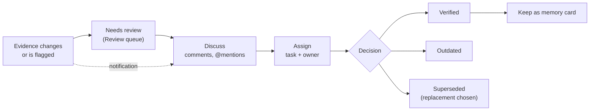

# Collaboration: review, comments, tasks and notifications

How a team keeps its evidence honest together. This page follows one item through the whole lifecycle so an owner can teach it, and audit it afterwards. The rules are in the [functional mindmap](../mindmap/FUNCTIONAL_MINDMAP.md#10-collaboration); the first workflows are in the [user guide](USER_GUIDE.md#3a-five-workflows-to-learn-first).

## 1. The lifecycle in one picture

## 2. Review states

Every piece of evidence has a status. A change by a person is written to the item's **lifecycle history** with who and when.

| State | Meaning | Who sets it |
|---|---|---|
| **active** | The default. Nobody has questioned it | the system, on upload |
| **needs review** | Something changed or a person or a health action flagged it | writers; health actions (admins and owners) |
| **verified** | A person checked it and it is true now | writers |
| **outdated** | No longer true. Left out of search by default | writers |
| **superseded** | Replaced; the replacement must be chosen. Left out of search by default | writers |

An item can also have an **owner** (a workspace member) and a **review note**. Several items can be changed at once: select them, preview their names, then mark them; the result lists each success and each refusal, and failed items stay selected.

Viewers can read every state and history, and cannot change anything.

## 3. Comments and mentions

- Comments are threaded, up to 5,000 characters, on any evidence. Authors edit and delete their own; admins and owners can moderate any comment.
- Type `@` to see the workspace's members, narrowed as you type; pick one with the arrow keys and Enter. Mentions work in comments, in a task's description and in a memory card's text.
- Only **direct members of the workspace** are suggested or told. The author is never notified of their own mention, and saving notifies only the people the save **adds**, so editing a comment does not repeat an old mention.

## 4. Tasks

The board has four columns: **Open**, **In progress**, **Blocked**, **Done**. A task has a title, a description, a priority (low, medium, high, urgent), an optional assignee who must be a workspace member, optional linked evidence and an optional due date. Overdue tasks are flagged. A task can hold **checklists**. Search by text and filter by assignee, or show unassigned tasks.

Assigning a task notifies the assignee, and the task shows on their profile. A task is deleted by its creator or by an admin or owner.

The Review queue and the health findings can **make a task** straight from an item, linking the evidence.

## 5. Notifications

Each person sees these in **Notifications**, and chooses per kind whether to get them in the app, by email, both or neither, plus an optional **daily digest** email (email needs mail set up by an administrator):

| Notification | When |
|---|---|
| Task assigned to you | someone assigns you a task |
| Mentioned in evidence discussion | `@you` in a comment |
| Mentioned in a task | `@you` in a task description |
| Mentioned in team memory | `@you` in a memory card |

Mark one or all as read. Clicking opens the related page. The **Review** tab shows a count of items waiting for you, and you can **snooze** an item (until tomorrow, a week or a month): it leaves your list and count, returns on the chosen day, and colleagues still see it. Snoozes are yours alone.

## 6. Saved searches as a team tool

A writer can save a search with its filters, for instance "needs review" in the *Runbooks* folder. A new saved search is **private**; a workspace owner can share it with the workspace or make it private again. Opening one runs it again under the reader's access, so it never shows results the reader could not otherwise see. The author or an administrator can delete it.

## 7. An end-to-end example

1. A teammate uploads a new version of `runbooks/failover.md`. The file goes to **needs review** and appears in the Review queue.
2. A member opens it, reads the new version beside the old (version history), and comments: "@Dana does step 4 still apply?"
3. Dana is notified, replies, and the member **assigns** a task "Update step 4" to Dana with a due date, linking the file.
4. Dana edits and uploads again; the file is marked **verified** by a member. It leaves the Review queue and ranks a little higher in search.
5. The member saves the conclusion as a **memory card**, linked to the file. If the file later changes, the card is flagged **Needs review**, and the cycle starts again.

## 8. Auditing the lifecycle

An owner or admin can check that the process is followed without reading code:

- **Activity** (People › Activity) lists the last 100 workspace actions with a 365-day calendar: evidence stored, indexing, lifecycle changes, comments, tasks, memory, member changes, AI use and provider changes.
- Each item's **lifecycle history** shows every status change with who made it.
- The **Review** tab counts what is waiting; an old, unsnoozed item is a sign the queue is not being worked.
- The **Overview** pulse shows tasks at risk.
