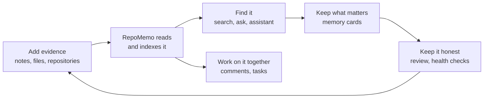
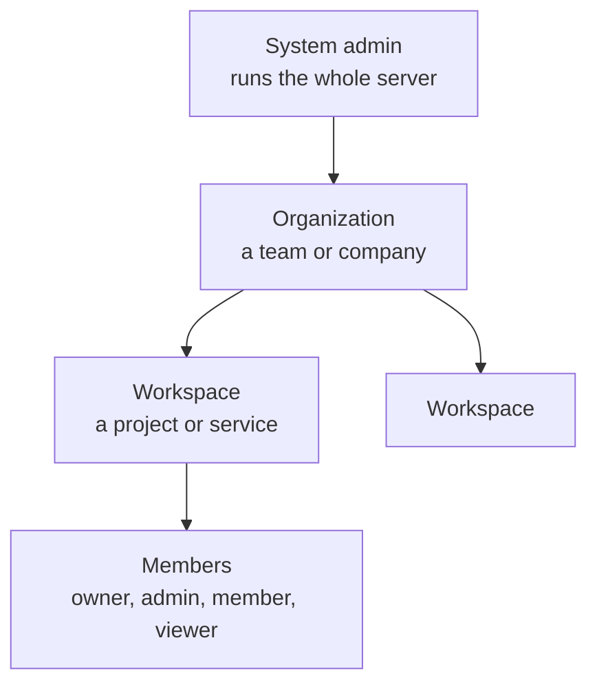
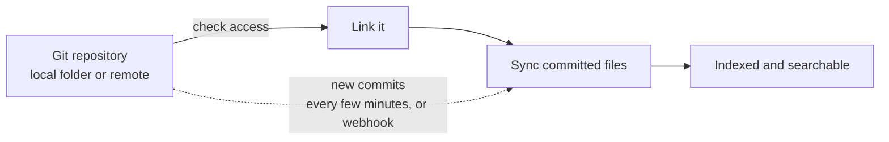
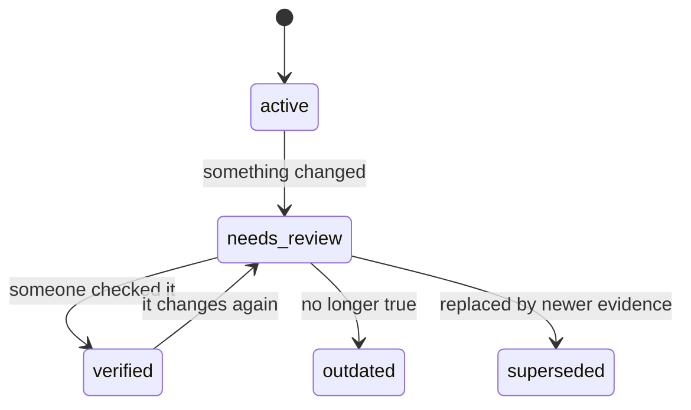
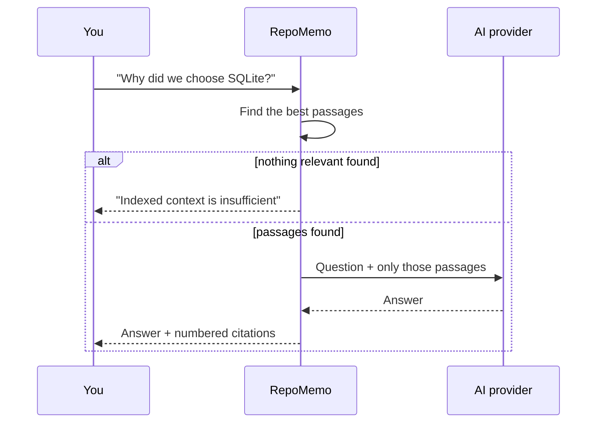
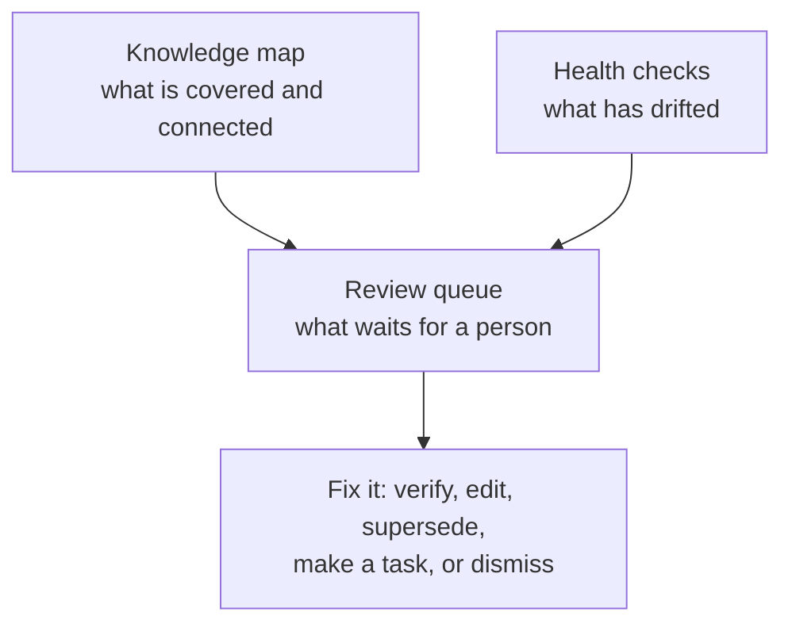
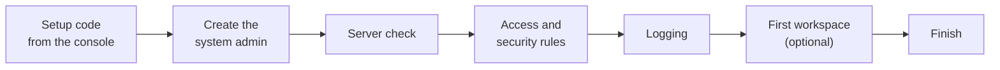

# RepoMemo: User Guide

> **What this is:** a plain-language tour of what RepoMemo can do, for the people who use it.
> **Who it's for:** team members, workspace and organization admins, and the system admins who run the server.
> **What it isn't:** a technical reference. For how things work inside, see the [technical mindmap](../mindmap/TECHNICAL_MINDMAP.md); for every detail of behavior, the [functional mindmap](../mindmap/FUNCTIONAL_MINDMAP.md).
> Reflects RepoMemo **V0.3.0**.

---

## 1. RepoMemo in one minute

RepoMemo is a **shared memory for your team's technical knowledge**.

You put your evidence in one place: notes, code, Markdown docs, Word, Excel, PowerPoint and PDF files, emails, screenshots, and whole **git repositories**. RepoMemo reads it all, makes it **searchable**, and lets you **ask questions** whose answers always point back to the exact file and lines they came from. What is worth keeping, you save as a **memory card**.

Three promises run through everything:

- **Evidence first.** Every answer shows where it came from. Nothing is made up without a source.
- **Useful without AI.** Storing, browsing, keyword search, the knowledge map and the health checks all work with no AI switched on.
- **AI is your choice.** Nothing leaves your server for an AI service until an admin sets one up and says so explicitly.

---

## 2. Who does what

RepoMemo has three kinds of people. Most users are only the first.

| You are… | You can… |
|---|---|
| **A member of a workspace** | Read, search, ask, comment, work on tasks, write memory cards and add evidence (viewers can read, search and ask, but not change things) |
| **A workspace or organization admin** | Everything above, plus invite people, choose AI settings, link repositories, pick a template and review health findings |
| **A system admin** | Set up and run the server: people, limits, mail, backups, logs, jobs |

### What each workspace role can do

| | Owner | Admin | Member | Viewer |
|---|:-:|:-:|:-:|:-:|
| Read, search, ask the AI¹ | ✅ | ✅ | ✅ | ✅ |
| Add, rename and delete evidence | ✅ | ✅ | ✅ | — |
| Write memory cards, tasks and comments | ✅ | ✅ | ✅ | — |
| Act on health findings | ✅ | ✅ | — | — |
| Invite and remove people | ✅ | ✅² | — | — |
| Set up AI and link repositories | ✅ | ✅ | — | — |
| Rename or delete the workspace | ✅ | — | — | — |

¹ By default, yes. Admins can limit AI to members and above, or to admins only.
² Admins can grant *member* or *viewer*, not admin or owner.

**Good to know:** joining an organization gives you access to all of its workspaces. A workspace can also invite someone as a **guest**: they see only that workspace and nothing else in the organization.

---

## 3. Getting started

### If you were invited

1. Open the **invitation link** you were sent. It shows what you're joining, your role and who invited you.
2. Create your account (even if registration is closed) or sign in.
3. You land on your **dashboard**: your organizations, their workspaces, and totals for evidence, active tasks and memory cards.

An invitation link works once, only for your email address, for 7 days.

### Your account

| Where | What you can do |
|---|---|
| **Profile** | Add a picture, change your name or password, see a 365-day activity calendar and the tasks assigned to you |
| **Notifications** | See "task assigned to you" and "you were mentioned". Choose per kind whether you want them in the app, by email, both or neither, and whether to get one **daily digest** email |
| **API tokens** | Create keys for scripts and CI, read-only or read-and-write, shown once, expiring in 7 to 365 days, revocable any time |
| **Theme** | Light or dark |
| **Sign out everywhere** | Ends your session on every device |

### Move around fast

- **Ctrl K** (or **⌘ K**) opens the **command palette**: jump to any workspace, section, file or memory card, or hand your text to the assistant.
- Everything works from the keyboard, in light and dark themes, down to phone width.

---

## 4. Your workspace at a glance

A workspace is one body of knowledge: a project, a service, a team's runbooks. It has these sections:

| Section | What it's for |
|---|---|
| **Overview** | A live "pulse": how much is indexed, what's fresh, tasks at risk, charts, plus an optional AI briefing for newcomers |
| **Evidence** | Everything you've stored, in folders |
| **Documents** | The same, filtered to Word, Excel, PowerPoint, PDF and email |
| **Repositories** | Linked git repositories and their files |
| **Retrieval** | Search and "Ask your evidence" |
| **Map** | How your knowledge connects |
| **Health** | What has drifted or broken |
| **Review** | One list of everything waiting for a person |
| **Memory** | Your team's memory cards |
| **Tasks** | The action board |
| **People** | Members, invitations and the activity feed *(admins)* |
| **Settings** | AI, repositories, template, export, rename, delete *(admins)* |

The **assistant** is docked on the right of every section. It's always one click away.

### Templates: a workspace shaped to its job

When a workspace is created, you can pick a **template**. A template doesn't add anything and never changes who can see what. It arranges the workspace for a purpose: the right tabs first, friendlier names, starter folders, the right overview cards, and search tuned to what matters.

| Template | Best for | Starts with folders |
|---|---|---|
| **General** | RepoMemo as it always was | none |
| **Software engineering** | Code, repositories, design notes | Architecture, Decisions, Runbooks |
| **Operations and incidents** | Runbooks, incidents, on-call | Runbooks, Incidents, Postmortems, On-call |
| **Product and decisions** | Specs, research, meeting notes | Decisions, Specs, Research, Meeting notes |
| **Knowledge base** | Policies, contracts, reports | Policies, Contracts, Reports, Archive |

For example, an *Operations* workspace opens on the Review queue, calls Tasks "Actions" and Memory "Lessons", favours recent runbooks in search, and flags runbooks nobody has touched in 90 days. Admins can switch templates in **Settings › Template** after seeing a preview, and nothing stored is moved or deleted.

---

## 5. Adding evidence

Anything you store is called **evidence**. Writers can add it three ways:

| How | What happens |
|---|---|
| **Write a note** | Rich text (headings, lists, code, links) saved as Markdown, filed in the open folder |
| **Upload files or a whole folder** | Up to 10 MiB per file. Folder structure is recreated; `.git`, `node_modules` and build folders are skipped. The same file uploaded twice is stored once |
| **Link a git repository** | See below: the whole codebase stays in step with its branch |

**Supported:** Markdown, text, code and config files, Word, Excel, PowerPoint, PDF, OneNote, Outlook emails, and images (images need an image-capable AI provider, because they're searchable through an AI description of them).

Organize with **nested folders** (up to 5 levels). You can open office files and PDFs right in the browser; where the admin has turned on previews, Word, Excel and PowerPoint show exactly as laid out, and **Open in Office** opens them in the desktop app.

### Indexing is automatic

You never press an "index" button. Right after you save, RepoMemo reads the text, splits it into passages that remember their line numbers, extracts functions and classes from code, and makes everything searchable. The ledger shows *Indexing…* then *Indexed*. Code in TypeScript, JavaScript, Python, Rust, Go, Java, C# and PHP is split along its structure, so a function is never cut in half.

### Repositories: code that stays current

Instead of uploading code file by file, an admin **links a repository** once (**Settings › Repositories**), and RepoMemo keeps the workspace in step with its branch.

- Only **committed** files are read. Not uncommitted edits, ignored files or build output.
- An **edited** file is updated in place, keeping its comments and tasks. A **renamed** file keeps its identity. A **deleted** file leaves search but stays readable for cards and comments that cite it, marked outdated.
- You can **include or exclude** paths such as `docs/**` or `src/`.
- Remote repositories work over `https` (with a token) or `ssh` (with a deploy key). A push **webhook** from GitHub, GitLab or any sender makes a sync happen within seconds.
- Each repository is also **one evidence item** with a no-AI overview (languages, key files, README, recent commits) and an **AI summary** written only when someone asks.
- A file's page shows its **last author and date** and its `CODEOWNERS` as hints.

### Issues and pull requests

Admins can connect **GitHub** and **GitLab** (including self-hosted) so that **issues and pull/merge requests**, with their comments, reviews and commits, become searchable evidence. Files, symbols and commits they mention link both ways, so a file shows the issues that name it.

### Versions and lifecycle

- Upload a new version of a file and the **version history** keeps the old ones: see who uploaded each, read it, and compare any two line by line.
- Every piece of evidence has a **status**, so you know what to trust:

Search ranks verified evidence a little higher and, by default, leaves outdated and superseded items out. Each change is kept in a history. You can also assign an **owner** and leave a **review note**.

---

## 6. Finding answers

### Search

- Type words; they match as prefixes (`auth tok` finds "authentication token").
- With an embedding AI provider, search also finds passages **by meaning**, so a differently phrased question still lands.
- Filter by file type, language, source, folder, evidence state or date. A **Code symbols** box finds where a function, class or method is defined.
- Results show highlighted snippets, the path and the line range; click to open.
- **Save a search** to share it with the team.
- On the dashboard, one search box covers **every workspace you can read**, each under its own rules.

### Ask your evidence

Ask a question in plain language. RepoMemo first retrieves matching passages. If nothing matches, it says so **without calling the AI**. If something does, the AI answers **only from those passages** and returns numbered **citations** you can click to open the exact file.

One click on **Save as memory** turns a good answer into a memory card.

### The assistant

The docked chat does one of five things per message: **find files**, **search content**, **summarize a file**, **ask a question**, or **give a workspace overview**. It remembers the conversation, so "and what about its timeout?" works as a follow-up. Finding and searching need no AI. Everything it writes with AI is labelled as such, and a template can teach it your team's vocabulary ("runbook for payments" finds files).

---

## 7. Memory cards: what the team decided to keep

A **memory card** is a short, durable statement: "We chose SQLite over Postgres because…", "Deploys must go through X".

- Write it in Markdown and **link it to the evidence** behind it, or save it straight from an Ask answer with its citations.
- Anyone can search cards. Writers create, edit and delete them.
- **Export** a card as Markdown with its evidence and line ranges, ready for a wiki, an ADR or a pull request.
- If the evidence a card relies on **changes, disappears or is retired**, the card is flagged **Needs review**, with the reasons. Check the evidence, edit it, and confirm the card as it is.

---

## 8. Keeping knowledge trustworthy

Knowledge rots. RepoMemo helps you catch it, without any AI.

**Knowledge map.** Shows the pipeline (stored → indexed → passages → searchable by meaning), coverage by file type, and a graph linking files that are **similar** and cards that **cite** them. Repositories appear as one ringed dot.

**Health checks.** Admins see findings and can act on them:

| Finding | What you can do |
|---|---|
| Several versions of the same file in use | Supersede the older ones |
| Files with identical content | Supersede, or dismiss |
| A removed code symbol still mentioned in docs | Mark for review, make a task |
| A file that points at retired evidence | Mark for review, make a task |
| A file that failed to index | Make a task, mark outdated |
| A file connected to nothing | Make a task |
| *Stale evidence* (Operations and Knowledge base templates) | Ask for a review, mark outdated |

**Review queue.** One list for the whole workspace: files marked *needs review*, memory cards gone stale, and open health findings. Each says why it's waiting and since when, and opens where it's resolved. When you fix it, it leaves the list.

---

## 9. Working together

| Feature | What it gives you |
|---|---|
| **Discussion** | Threaded comments on any evidence. Type `@` to mention a teammate: they get notified (in the app and, if they like, by email) |
| **Task board** | Open, In progress, Blocked and Done columns. Tasks have a priority, an assignee, a due date, linked evidence and **checklists**. Assigning notifies the person, and the task shows on their profile |
| **People** | Members, invitations and a summary of what *your* role allows |
| **Activity feed** | Who did what, with a 365-day calendar *(admins)* |
| **Live updates** | New files, indexing progress and changes from teammates appear without reloading |

Inviting is simple: an admin enters an email address and a role, and RepoMemo sends the invitation (or gives a link to copy if mail isn't set up). Pending invitations can be withdrawn.

---

## 10. AI: optional, explicit, safe

Nothing goes to an AI service until a workspace owner or admin configures one in **Settings › AI integration**.

| Provider | Where your text goes |
|---|---|
| **Ollama** (local) | A server you run yourself |
| **OpenRouter** (cloud) | The OpenRouter cloud, after you explicitly confirm that excerpts leave your server |

Each workspace can set up three kinds of provider:

- **Text**: answers, overviews, summaries, the assistant
- **Image (vision)**: describes screenshots and diagrams so they become searchable
- **Embedding**: search by meaning

Safety built in: keys are stored encrypted and never sent back to the browser. A **Test connection** button checks a provider. Admins choose **who may use AI** (everyone, members and above, or admins only). Each person has an hourly AI allowance, so nobody runs up a bill by accident. If AI fails or is off, keyword search keeps working.

---

## 11. Taking your data with you

- **Export a workspace** (owners and admins, **Settings › Export**): one archive file with evidence, folders, lifecycle history, memory cards with their citations, tasks and comments. Credentials never leave.
- **Import a workspace** (organization owners and admins, from the dashboard): the archive is **checked first** without writing anything, then imported as a **new workspace** with you as owner. Comments and tasks are credited to you, with the original author named in the text.

An archive is a copy, not a sync: importing the same file twice makes two workspaces.

---

## 12. For admins

### Workspace and organization admins

| Task | Where |
|---|---|
| Invite people, change roles, remove members | **People**, or **Organization administration** |
| Configure AI and who may use it | **Settings › AI integration** |
| Link repositories and trackers | **Settings › Repositories**, **Issues and pull requests** |
| Choose and adjust the template, pick the workspace icon | **Settings › Template**, **Settings** |
| Act on health findings, review and moderate | **Health**, **Review**, any comment or task |
| Export or delete the workspace | **Settings** |

### System admins

System admins run the server and have a **System** button in the header.

**First run.** On a new server, a setup wizard asks for the one-time code shown on the server console, then walks you through: the administrator account, a **server check** (database, folders, git, LibreOffice, AI addresses, backups… each marked OK, note, attention or problem, with advice), access and security rules, logging, and an optional first workspace. Until it's finished, nobody else can register.

**The System area:**

| Page | What it's for |
|---|---|
| **Overview** | Server health at a glance: version, storage, background work, traffic, locked sign-ins, templates loaded |
| **Usage** | Activity per day, most active people, and every workspace's size, members and AI use |
| **Users** | Every account and its memberships. Make system or **app admins** (same pages, but no automatic access to everything), sign someone out everywhere, unlock a sign-in lockout, **deactivate or reactivate** an account, and **anonymize** a deactivated one for good (what they wrote is credited to "Former member") |
| **Settings** | Registration, session length, sign-in protection, AI and upload limits, storage per workspace, backups schedule, logging, **mail** (with a test button and outbox), changed live |
| **Logs** | Live or past events, filtered by kind, level, workspace or text |
| **Jobs & maintenance** | Every background job (stop one if needed), run maintenance now, and **backups** |
| **Audit trail** | What admins did, exportable as JSON lines or CSV |
| **Console** | A command line for the server (`status`, `jobs list`, `users reset-link`…). Anything that changes something only previews its effect until you add `--yes` |

**Backups.** Back up now or on a schedule. Restore always creates a *new* environment, so a running one is never overwritten, and you can verify it first. Backups can be **encrypted** and **copied to a second location** (another disk or share) and checked.

**Mail.** Configure SMTP once (over TLS) and RepoMemo emails invitations, password resets, address verification, mentions and assignments, and the daily digest. Without mail, links are shown to copy and pass on by hand.

**Accounts and sign-in.** Registration is closed by default, so people join by invitation. Accounts lock after repeated failed sign-ins. Password reset links are created by an admin or requested by the user by mail.

**Operators.** Beyond the web pages: choose an environment folder at start-up, add custom **templates** as JSON files, run the server in a container with a ready-made compose file, and check a template file offline with `repomemo-console templates validate`.

---

## 13. The desktop app

The desktop app is **a window onto your server**. On first start it asks for the server address, checks it, then shows the same pages as the browser. Your session is kept in the system's secure credential store. There is nothing to set up on your computer besides the app: your work lives on the server.

---

## 14. What's not here yet

To set expectations:

- **Single sign-on (SSO)** isn't available.
- Issue and pull-request connectors cover **GitHub and GitLab** only.
- A workspace **template** arranges what exists; it doesn't add new sections, and an organization can't save its own template for all its workspaces yet.
- Archives are a copy, not a continuous sync. Saved searches, assistant chats and the activity feed aren't in them.
- Ownership hints from `CODEOWNERS` aren't matched to members or notified.

---

## Quick reference

| I want to… | Go to |
|---|---|
| Find a file or phrase | **Retrieval** (or **Ctrl K**) |
| Ask a question and see sources | **Retrieval › Ask**, or the assistant |
| Keep a decision | Save an answer as a **memory card**, or write one in **Memory** |
| See what needs attention | **Review** |
| Check what has gone stale | **Health** and **Map** |
| Hand work to someone | **Tasks**, or `@mention` in a comment |
| Bring in a codebase | **Settings › Repositories** *(admins)* |
| Turn on AI | **Settings › AI integration** *(admins)* |
| Run the server | **System** *(system admins)* |
