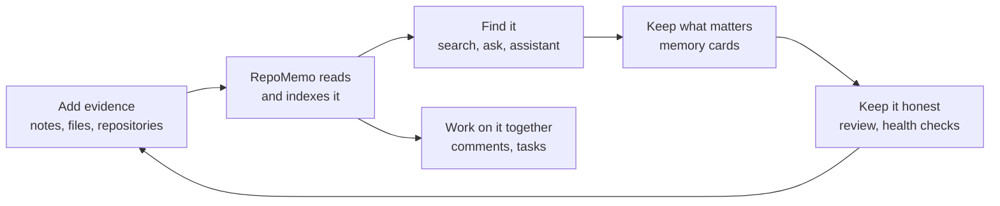
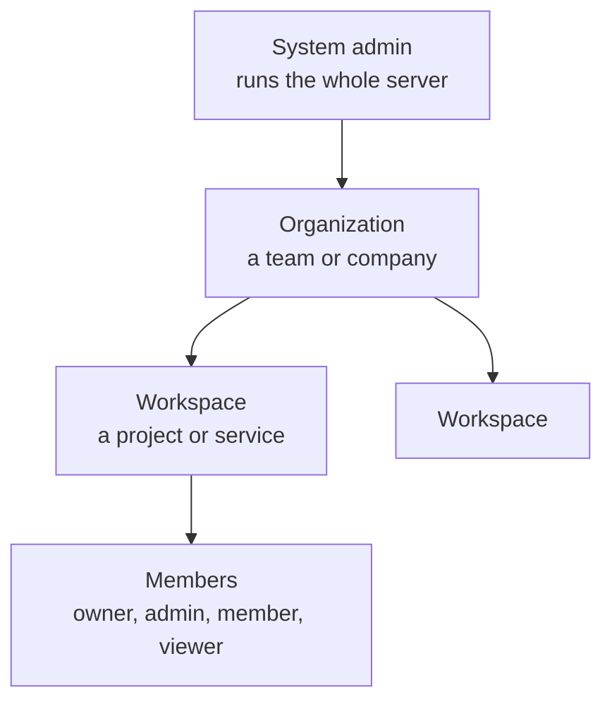
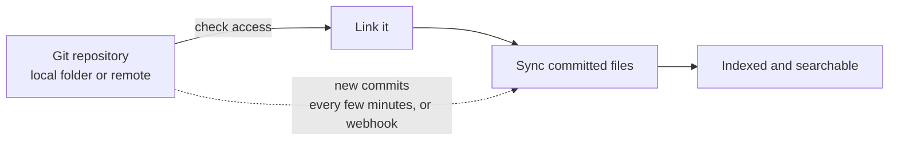
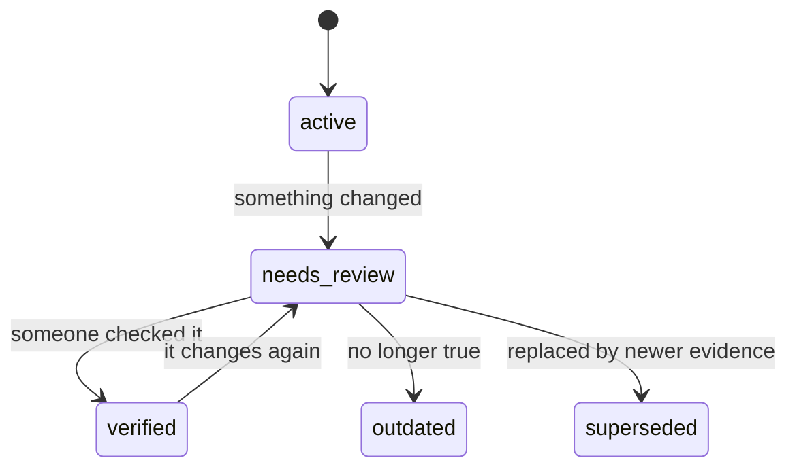
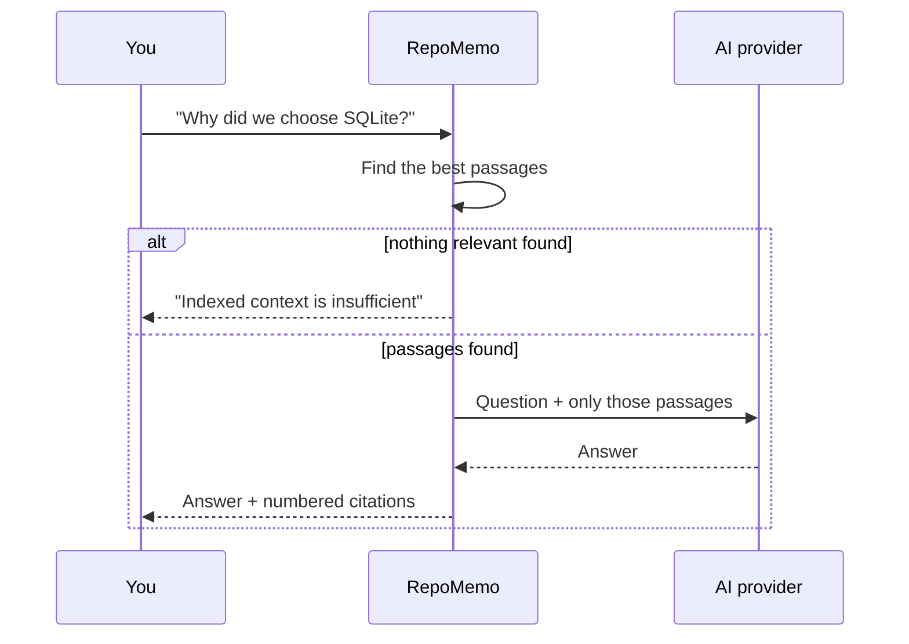
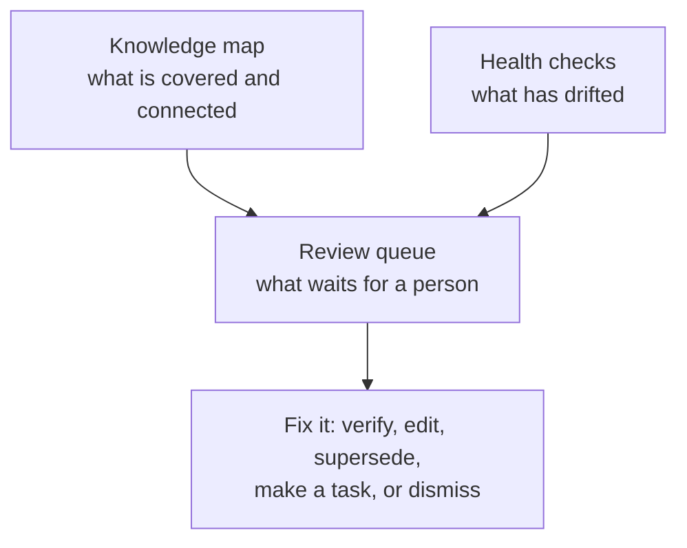
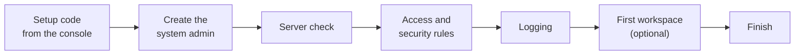

# RepoMemo: User Guide

> **What this is:** a plain-language tour of what RepoMemo can do, for the people who use it.
> **Who it's for:** team members, workspace and organization admins, and the system admins who run the server.
> **What it isn't:** a technical reference. For how things work inside, see the [technical mindmap](../mindmap/TECHNICAL_MINDMAP.md); for every detail of behavior, the [functional mindmap](../mindmap/FUNCTIONAL_MINDMAP.md).
> Reflects RepoMemo **0.4**, checked at V0.4.95. Start with [five workflows](#3a-five-workflows-to-learn-first).

---

## 1. RepoMemo in one minute

RepoMemo is a **shared memory for your team's technical knowledge**.

You put your evidence in one place: notes, code, Markdown docs, Word, Excel, PowerPoint and PDF files, emails, screenshots, and whole **git repositories**. RepoMemo reads it all, makes it **searchable**, and lets you **ask questions** whose answers always point back to the exact file and lines they came from. What is worth keeping, you save as a **memory card**.

Three promises run through everything:

- **Evidence first.** Every answer shows where it came from. Nothing is made up without a source.
- **Useful without AI.** Storing, browsing, keyword search, the knowledge map and the health checks all work with no AI switched on.
- **AI is your choice.** Nothing leaves your server for an AI service until an admin sets one up and says so explicitly.

---

## 2. Who does what

RepoMemo has three kinds of people. Most users are only the first.

| You are… | You can… |
|---|---|
| **A member of a workspace** | Read, search, ask, comment, work on tasks, write memory cards and add evidence (viewers can read, search and ask, but not change things) |
| **A workspace or organization admin** | Everything above, plus invite people, choose AI settings, link repositories, pick a template and review health findings |
| **A system admin** | Set up and run the server: people, limits, mail, backups, logs, jobs |

### What each workspace role can do

| | Owner | Admin | Member | Viewer |
|---|:-:|:-:|:-:|:-:|
| Read, search, ask the AI¹ | ✅ | ✅ | ✅ | ✅ |
| Add, rename and delete evidence | ✅ | ✅ | ✅ | — |
| Write memory cards, tasks and comments | ✅ | ✅ | ✅ | — |
| Act on health findings | ✅ | ✅ | — | — |
| Invite and remove people | ✅ | ✅² | — | — |
| Set up AI and link repositories | ✅ | ✅ | — | — |
| Rename or delete the workspace | ✅ | — | — | — |

¹ By default, yes. Admins can limit AI to members and above, or to admins only.
² Admins can grant *member* or *viewer*, not admin or owner.

**Good to know:** joining an organization gives you access to all of its workspaces. A workspace can also invite someone as a **guest**: they see only that workspace and nothing else in the organization.

---

## 3. Getting started

### If you were invited

1. Open the **invitation link** you were sent. It shows what you're joining, your role and who invited you.
2. Create your account (even if registration is closed) or sign in.
3. You land on your **dashboard**: your organizations, their workspaces, and totals for evidence, active tasks and memory cards.

An invitation link works once, only for your email address, for 7 days.

### Your account

| Where | What you can do |
|---|---|
| **Profile** | Add a picture, change your name or password, see a 365-day activity calendar and the tasks assigned to you |
| **Notifications** | See "task assigned to you" and "you were mentioned". Choose per kind whether you want them in the app, by email, both or neither, and whether to get one **daily digest** email |
| **API tokens** | Create keys for scripts and CI, read-only or read-and-write, shown once, expiring in 7 to 365 days, revocable any time |
| **Theme** | Light or dark |
| **Sign out everywhere** | Ends your session on every device |

### Move around fast

- **Ctrl K** (or **⌘ K**) opens the **command palette**: jump to any workspace, section, file or memory card, or hand your text to the assistant. It remembers the last places you opened from it and lists them when you open it, and **New note** starts a note in the workspace you are in.
- Workspace owners and administrators can give a workspace its own **icon** and **main color** in *Settings › Customization*; the color shows on the workspace's tabs and highlights for everyone.
- The left rail lists your **workspaces** (ten, then **Show more**; click the heading to fold the list). **Organizations**, above **System** at the bottom of the rail, opens the page that lists every organization you belong to (`/orgs`). The **+** button in the top bar creates a **new workspace** or a **new organization**.
- Everything works from the keyboard, in light and dark themes, down to phone width.

---

## 3a. Five workflows to learn first

Each workflow says **who can do it**, the steps, and **what you should see** when it worked. They build on each other: a workspace, evidence in it, its index, a review of what the index found, and the memory you keep.

### Workflow 1: create a workspace

**Who:** an organization owner or admin. Members and viewers cannot create workspaces; ask one of them.

1. Open the **dashboard** (the workspace directory) and pick the organization.
2. Choose **New workspace** from the **+** menu in the top bar, give it a name and, if the form offers them, a [template](#templates-a-workspace-shaped-to-its-job). *General* changes nothing.
3. Open it.

**Expected:** the workspace opens on its Overview (or the template's first tab), empty apart from the template's starter folders. You are its owner. Nothing is sent to any AI provider.

### Workflow 2: add evidence

**Who:** members, admins and owners. Viewers can read but not add.

1. Open **Evidence**, then a folder (or create one).
2. Write a note, or upload files or a whole folder (up to 10 MiB per file), or have an admin [link a repository](#repositories-code-that-stays-current).
3. Wait a moment. Nothing needs pressing: indexing starts on its own.

**Expected:** the new items appear in the folder list with their type and size. A file uploaded twice is stored once. A file over the limit or of an unsupported kind is refused with a message naming the reason.

### Two people editing one card

When you save a memory card that someone else saved after you opened it, RepoMemo refuses the save and keeps your text in the form. You can use their version or keep yours and save over it; both stay in the revision history. Replacing an uploaded file that changed after you opened it is refused the same way.

### Memory card history

Every save of a memory card is kept as a numbered revision with who saved it and the citations it had. **Nothing is trimmed:** revisions are kept for as long as the card exists (a deleted card's history stays in the trash for 30 days). A long history is shown 50 revisions at a time; *Show earlier revisions* loads the next page. Open a card and use **Revision history** to see *What changed*, *Compare with current* or *Restore*. A restore adds a new revision, so nothing is lost; a cited source that has since been deleted is named and left out. Each revision also remembers what its citations said: history shows whether a cited file is *as cited*, *changed since*, *no longer exists* or has *no recorded content*, and **Sources** then **View cited text** displays the text that revision cited when it is still kept, or says why it cannot be shown. Editing or restoring a card never makes a changed source look current; to confirm a source again after it changed, remove the citation and cite it again.

### My work

The Dashboard opens with **My work**: tasks assigned to you, files you own that need review and unread mentions, from every workspace you can open, with the overdue count. Choosing an item opens where it is handled. Work in a workspace you no longer belong to does not appear and is not counted.

### Getting started in a new workspace

The Overview opens with a **Getting started** checklist: add evidence, make it searchable, save a memory card that cites it and (optionally) bring in a teammate. A step is checked when the thing exists in the workspace, so it works without an AI provider or mail. **Hide for now** hides it for you only; **Show the getting-started checklist** brings it back.

### Recovering an unsaved edit

If a memory card edit is interrupted (a reload, a failed save), the card offers **Continue editing** or **Discard it** the next time you open it, and the note you were writing in Evidence is refilled. The draft stays in that browser tab only, is never saved for you, and is removed when you sign out, switch server or close the tab. Cited evidence is not part of a draft.

### Reviewers and review dates

Open a file or a memory card and use **Reviewer** to say who is accountable for checking it and when it is next due. **Mark reviewed** records the review and sets the next date. In **Review**, each item says why it is there (marked, evidence changed, or overdue) and who its reviewer is. If a reviewer leaves the workspace the item says so, and someone else should be chosen. Items assigned to you and past due also appear in **My work**.

### Review reminders

When a review you are accountable for is past its date, RepoMemo reminds you once a week for that item: in your inbox, by mail, or both, as you set under **Profile › Notifications › A review assigned to you is overdue** (the daily digest also lists unread inbox notices). A review is due from midnight UTC on its date. Snoozing the item in **Review** pauses its reminders; moving the date starts them again. Without a mail server you still get the inbox reminder.

### Approving a memory card

On a memory card, **Approval** shows whether the current revision is approved. A reviewer reads the card and chooses **Approve revision N**; if anyone edits the card afterwards, the new revision is not approved until it is approved again. Workspace owners and administrators can **Require independent review**, so the person who made a revision cannot approve it. Decisions, including withdrawals, stay listed with their author.

### Why a memory card needs review

A card that needs review now shows **What changed**: the earlier and current text of a cited file when an earlier version is kept, or the reason it cannot be shown. From there you can open the file or remove a citation that no longer holds; the card keeps a revision of the change.

### Workflow 3: understand the index state

**Who:** everyone who can read the workspace.

Open a file. Its header shows one of three states:

| State | Meaning | What to do |
|---|---|---|
| **Indexing…** | The text is being read and split into passages | Wait; progress also shows on the Overview and arrives live |
| **Indexed** | It is searchable by keyword, and by meaning if an embedding provider is set up | Search for a word from the file |
| **Not indexed** | Indexing failed or stalled; the reason is shown on hover | Re-upload a clean copy, or ask an admin to look at *Jobs*; health checks list the file |

The **Map** shows the same states for the whole workspace: how many files are stored, indexed, split into passages and searchable by meaning.

**Expected:** within seconds for a note and within a minute or two for a large file, the state becomes **Indexed**. Images are described by an AI provider, so without one they stay without a searchable description.

### Workflow 4: review sources

**Who:** members and above change an item's status; viewers can only read it. Acting on health findings needs an admin or owner.

1. Open **Review**. It lists files marked *needs review*, memory cards gone stale and open health findings, each with its reason.
2. Open an item. Read the evidence, then mark it **verified**, **outdated** or **superseded**, edit it, make a task, or **snooze** it.
3. Add an **owner** or a review note if someone else must decide.

**Expected:** a resolved item leaves your list and the count on the Review tab. Search ranks *verified* evidence higher and leaves *outdated* and *superseded* items out by default. Every status change is kept in the item's history.

### Workflow 5: save memory

**Who:** members and above write cards; everyone can read and search them.

1. Find the answer: open the evidence, or use **Retrieval** and **Ask** (see [Finding answers](#6-finding-answers)).
2. Choose **Save as memory** on an answer, or create a card in **Memory** and write it in Markdown.
3. Link the evidence the card relies on.

**Expected:** the card appears in **Memory** and in search, shows its linked evidence and line ranges, and can be exported as Markdown. If that evidence later changes or goes away, the card is flagged **Needs review** and appears in the Review queue.

**What is stored and what is generated:** your notes, files and cards are stored text. An Ask answer is generated by an AI provider from the passages it was given; it is labelled and carries numbered citations, so check the cited lines before keeping it as a card.

---

## 4. Your workspace at a glance

A workspace is one body of knowledge: a project, a service, a team's runbooks. It has these sections:

| Section | What it's for |
|---|---|
| **Overview** | A live "pulse": how much is indexed, what's fresh, tasks at risk, charts, plus an optional AI briefing for newcomers |
| **Evidence** | Everything you've stored, in folders |
| **Documents** | The same, filtered to Word, Excel, PowerPoint, PDF and email |
| **Repositories** | Linked git repositories and their files |
| **Retrieval** | Search and "Ask your evidence" |
| **Map** | How your knowledge connects |
| **Health** | What has drifted or broken |
| **Review** | One list of everything waiting for a person |
| **Memory** | Your team's memory cards |
| **Tasks** | The action board |
| **Task board** (columns) | The board shows the same filtered work as the list, with one column for each state (Open, In progress, Blocked, Done and any named state). Move a card with the keyboard or the mouse: the move is saved like any other change, and if it is refused (someone else changed the task, or you may not edit it) the card goes back and the reason is shown |
| **Recurring tasks** | A task that comes back daily, weekly or monthly, from a start date you choose (the monthly day is 1 to 28). The schedule shows its next dates before it runs, and each occurrence makes one task however often the server restarts. If days were missed, the newest is made once (or none, as you chose) and the rest are marked skipped; pausing makes nothing and makes nothing up; stopping ends it and keeps every task and the record of each occurrence. Dates are UTC |
| **Due reminders** | When a task assigned to you falls due, and again when it is overdue, you get one notice in your inbox (and by mail, or in the daily digest, as you chose in your profile under Notifications). Dates are in UTC: a task due on a date is due from the start of that day and overdue from the start of the next. Finished tasks send nothing, and moving the due date sends one new reminder |
| **Changing many tasks** | Select tasks and give them an assignee, add or remove labels, or put them in a milestone. You see a **preview** first: which tasks would change, which would not and why. Each task is checked on its own (a task someone changed meanwhile, or that is in another project, is refused and left as it was), the others still change, and the refused ones stay selected |
| **Task import and export** | Export the tasks you are looking at as a CSV that a spreadsheet opens safely (a cell that looks like a formula is kept as text). To bring tasks from another tool, upload its CSV and match its columns to the task's fields; you see a **preview** that explains every row (a missing title, a person who is not a member, a date that is not a date) before anything is written. One bad row stops the import unless you choose to skip it, and sending the same file again never creates a task twice |
| **Task list and views** | The task list is read a page at a time and filtered by project, milestone, assignee, priority, status, label, due date or words in the title. Save a filter as a **view**: it is private to you until you share it, it keeps only the filters (so **me** means whoever opens it), and it always shows what the person opening it may see. Its link keeps the view |
| **Workflow** | Besides Open, In progress, Blocked and Done, an administrator can add named task states (Review, Waiting...), each mapped to one of those four. Existing tasks keep their state. Removing a state that holds tasks asks where they go, and reports always count by the four |
| **Labels** | The workspace's own names for kinds of work (Bug, Docs, ...), each with a colour from a set that stays readable, always shown with its name. Anyone who can edit adds a label to a task; renaming one or merging two keeps every task's label (only an administrator merges or deletes). Filter the tasks by a label. A label never decides who can see a task |
| **Blockers** | A task can be blocked by other tasks of the workspace. It says in words what is blocking it, and the explanation changes when a blocker is done, but the blocked task is never completed for you. A task cannot block itself or form a loop |
| **Sub-tasks** | A task can have sub-tasks (up to five levels). Unlike a checklist step, a sub-task has its own owner, status and discussion. Finishing the parent does not finish or hide its sub-tasks: the parent keeps showing how many are still open. Everything stays in one workspace, and a task cannot be placed under its own sub-task |
| **Project updates** | A status update is written by a person: they choose **on track**, **at risk** or **blocked**, say what changed and why they chose it, and link the milestones, blockers and evidence behind it. The product offers counts to start from and never picks the health. Readers see who wrote it, the counts as they were, what differs from the update before, and whether a linked item still exists. An update is not edited; its author or an administrator can retract it, and it stays on record |
| **Milestones** | Inside a project, a named, dated group of its tasks. It shows how many tasks are done, how many remain and how many are overdue, and says in words what it is counting; it completes by itself when all its tasks are done, or when a person marks it complete. Moving its date never changes a task's own date. In 0.7.7 milestones are managed through the [API](API.md#4a-projects-07) |
| **People** | Members, invitations and the activity feed *(admins)* |
| **Settings** | AI, repositories, template, export, rename, delete *(admins)* |

**CAIRN**, the assistant, is one click away in the top bar: the button opens its page (`/cairn`), with your chats from every workspace in the sidebar, and the menu beside it offers a **quick question** from anywhere.

### Templates: a workspace shaped to its job

When a workspace is created, you can pick a **template**. A template doesn't add anything and never changes who can see what. It arranges the workspace for a purpose: the right tabs first, friendlier names, starter folders, the right overview cards, and search tuned to what matters.

| Template | Best for | Starts with folders |
|---|---|---|
| **General** | RepoMemo as it always was | none |
| **Software engineering** | Code, repositories, design notes | Architecture, Decisions, Runbooks |
| **Operations and incidents** | Runbooks, incidents, on-call | Runbooks, Incidents, Postmortems, On-call |
| **Product and decisions** | Specs, research, meeting notes | Decisions, Specs, Research, Meeting notes |
| **Knowledge base** | Policies, contracts, reports | Policies, Contracts, Reports, Archive |

For example, an *Operations* workspace opens on the Review queue, calls Tasks "Actions" and Memory "Lessons", favours recent runbooks in search, and flags runbooks nobody has touched in 90 days. Admins can switch templates in **Settings › Template** after seeing a preview, and nothing stored is moved or deleted.

**Your organization's own templates.** An organization owner or administrator can save templates for the whole organization (**Organization administration › Organization templates**): paste a template file (a workspace's setup can be exported as one in **Settings › Template**) and save it. Each save is the next **version**, with a note for the history, and the earlier versions stay readable. A saved template is offered at once, with no restart, but **only to workspaces of that organization**: other organizations neither see nor can adopt it. A workspace previews it and adopts it from **Settings › Template**, like any other. A template never changes who can see or do anything and never moves or removes content; saving a newer version updates how the workspaces that use it look, and each keeps its own adjustments (starter folders are made only when a workspace is created).

---

## 5. Adding evidence

Anything you store is called **evidence**. Writers can add it three ways:

| How | What happens |
|---|---|
| **Write a note** | Rich text (headings, lists, code, links) saved as Markdown, filed in the open folder |
| **Upload files or a whole folder** | Up to 10 MiB per file. Folder structure is recreated; `.git`, `node_modules` and build folders are skipped. The same file uploaded twice is stored once |
| **Link a git repository** | See below: the whole codebase stays in step with its branch |

**Supported:** Markdown, text, code and config files, Word, Excel, PowerPoint, PDF, OneNote, Outlook emails, and images. **There is no OCR:** a scanned PDF or a screenshot of text is kept and previewed, but the words in the picture are not read, so a search does not find them (a scanned PDF has no searchable pages). To make one findable, add a memory card that quotes what matters and cites the file, or paste the text as a note. **Images need no AI provider to be kept:** a screenshot is stored, previewed and found by its name and path, and the page says so ("Searchable by its name and path only"). What the picture shows becomes searchable only when an administrator adds an image-capable AI provider, which describes it; the page then says the description is generated and should be checked against the image.

Organize with **nested folders** (up to 5 levels). **Move** on a folder shows what the move will do before you confirm: where the folder ends up, how many files and folders are inside, how many memory cards cite those files and how many comments are on them (they all stay attached, because a move changes only the folder's place and files keep their identity), or the reason the move is refused (into itself or a folder inside it, nesting too deep, a name already used there). You can open office files and PDFs right in the browser; where the admin has turned on previews, Word, Excel and PowerPoint show exactly as laid out, and **Open in Office** opens them in the desktop app.

### Indexing is automatic

You never press an "index" button. Right after you save, RepoMemo reads the text, splits it into passages that remember their line numbers, extracts functions and classes from code, and makes everything searchable. The ledger shows *Indexing…* then *Indexed*. Code in TypeScript, JavaScript, Python, Rust, Go, Java, C# and PHP is split along its structure, so a function is never cut in half.

### Repositories: code that stays current

Instead of uploading code file by file, an admin **links a repository** once (**Settings › Repositories**), and RepoMemo keeps the workspace in step with its branch.

- Only **committed** files are read. Not uncommitted edits, ignored files or build output.
- An **edited** file is updated in place, keeping its comments and tasks. A **renamed** file keeps its identity. A **deleted** file leaves search but stays readable for cards and comments that cite it, marked outdated.
- You can **include or exclude** paths such as `docs/**` or `src/`.
- Remote repositories work over `https` (with a token) or `ssh` (with a deploy key). A push **webhook** from GitHub, GitLab or any sender makes a sync happen within seconds; the webhook's dialog lists the **recent calls** with what became of each (and why when no sync was queued), and **Send again** asks for the sync once more, for instance after a pause is over. Connectors have the same list.
- Each repository is also **one evidence item** with a no-AI overview (languages, key files, README, recent commits) and an **AI summary** written only when someone asks.
- A file's page shows its **last author and date** and its `CODEOWNERS`. An owner written as an email address that belongs to a member of the workspace shows as that member, with an **Ask to review** button that gives them a task for the file; `@handles` and teams stay plain hints.

### Issues and pull requests

Admins can connect **GitHub**, **GitLab** (including self-hosted) and **Jira Cloud** so that **issues and pull/merge requests**, with their comments, reviews and commits, become searchable evidence. Files, symbols and commits they mention link both ways, so a file shows the issues that name it. So do the other issues and pull requests an item refers to (`#12` for the same repository, `owner/repo#12` for another connected one, `!12` for a GitLab merge request, or the item's address): a pull request that says "Fixes #12" is listed on issue 12 and links to it. A pull request's page says who approved it and who asked for changes.

Before anything is imported, **Check access** shows what the connection copies (issues and requests with their discussion), what it never copies (the token, code, wikis, attachments; nothing is written back to the tracker) and **who can read the copy**: everyone who can read the workspace. You must tick that you approve sharing it with them before **Connect and sync** is available. If the tracker later stops answering for the repository (the token is refused, the access is removed or the repository is gone), the copied items are **held back**: they leave search, Ask, the file list and exports, and the connector shows *Held back* with the reason. Nothing is deleted. A single refused answer is not enough: the server asks once more first. Each connector says how current its copy is: **Complete**, **Partial** (the last sync stopped at its limit or could not index some items, and the next one carries on), **Stale** (no sync has finished for over a day), **Paused**, **Held back** or **Sync failed**, with the last successful sync, the point the next sync resumes from, a plain next step for a failure (replace the token, wait, check the address) and a list of what is not copied. A sync that fails halfway keeps what it stored and resumes after it; a retry never stores an item twice. Once the access is back, an administrator chooses **Release**, which checks the access again before the items are served. The server notices at its next check of the tracker, which is every five minutes unless the operator changed `REPOMEMO_REPO_POLL_SECONDS`. A source that hides some items from some people (a GitLab project with confidential issues) is refused, because the copy would show them to everyone.

For **Jira Cloud**, give the project's address (`https://acme.atlassian.net/browse/APP`) and the account's email and API token as `email:token`; the operator adds the site (`acme.atlassian.net`) to the allowed hosts. **Check access** is a dry run: it shows the project, whether the account may browse it, whether it uses security levels and what would be copied, using only read requests. A sync that is interrupted resumes after the last stored page, and an issue is kept by Jira's own id, so a renamed issue is not stored twice. **Jira stays the authority:** an edit in Jira (its text, status, assignee) replaces the copy at the next sync, an issue Jira deleted, moved away or gave a security level is **taken out of the evidence** (a sync that read the whole project is what tells), and nothing you do in RepoMemo is sent to Jira. A rate limit pauses the connector with its end shown, a repeated page stops the sync with a message, and a project the account can no longer reach holds the copy back.

### Moving a workspace with its connections and publications

A workspace archive (format 5) records where tracker items came from (the tracker, its address and each item's state) so attribution survives a move, and the history of what was published. **Nothing comes back live:** no credential, webhook secret or sync is carried, so a tracker connection comes back as a set of files that say where they were imported from and must be connected again by an administrator; outbound webhooks and chat destinations are not in an archive, so nothing is sent after an import; a snapshot comes back **withdrawn** under a new address and is public only after an administrator previews and publishes it again. Older archives import as before, and a server older than this one refuses a format 5 archive and says to update first.

### Public snapshots

When the operator has turned on `REPOMEMO_PUBLIC_PUBLISHING`, an administrator can publish a **snapshot** of a text or Markdown file (**API**: `POST /v1/artifacts/{id}/publication-preview`, then `POST /v1/artifacts/{id}/publication` with the preview's `review_token`; no screen yet). The preview shows exactly the text that would be public and what was taken out: images, raw HTML, email addresses and every link that is not a plain `https` address (its text is kept). Publishing records only that text, under a title and an address that says nothing about the workspace or the file; if the file changed since the preview the request is refused and you preview again. The snapshot is a copy: changing or deleting the original does not change it. Comments, citations, attachments, people and file paths are never part of it, and an item mirrored from a tracker cannot be published. **Controls:** `GET /v1/publications/{id}/public-preview` shows exactly what a reader is served now (nothing once it is withdrawn or stale) and how long a shared cache may keep it (60 seconds); `POST .../withdraw` stops serving it and keeps the record; `POST .../republish` with a fresh preview token replaces the text with the original as it is now and makes it live again. The publications list says whether the original is `current`, has changed (`original_changed`, publish again to update) or is gone (`source_removed`); the snapshot never changes by itself. If a source loses access, snapshots made from it become **stale** and stop being served until you publish again. **Reading:** anyone can open `/public` (an index of live snapshots with a search box), `/public/p/{address}` (one page) and `/public/search?q=`, with no account and no cookie. The pages are plain, responsive HTML made of the snapshot text with every character escaped; they work on a phone and in dark mode. A page that is withdrawn, stale, unknown or malformed is the same plain `404`, so nobody can tell whether it ever existed; search and the index list live snapshots only, so counts and results reveal nothing private. Each address is limited to 120 requests a minute, and a shared cache may keep a page for at most a minute, so a withdrawal is seen everywhere within about that time.

### Reporting a wrong answer

When an answer is wrong or out of date, **report it with a correction** (`POST /v1/workspaces/{id}/search-feedback` with the kind `wrong_answer`, the question, what was wrong and the file it relied on; no screen yet). The workspace's owners see it with the other requests for better evidence, and a **verified** file the answer relied on goes back to *needs review* so its reviewers look at it. Ask only reads your files: a file that contains an instruction is not obeyed, and Ask can take no action. See [Search and Ask](SEARCH_AND_ASK.md#answer-quality-08) for the evaluation set that checks this.

### Importing a Markdown directory

To bring a wiki or a folder of notes in, send its files to `POST /v1/workspaces/{id}/imports/directory` (**API**; no screen yet): each file's relative `path` and its `text` (Markdown and text) or `base64` (png, jpg, gif, webp and pdf), under a name of your choice for the import (`source_key`). **A dry run is the default** and writes nothing: it says, for every file, whether it would be created, replaced or left as it is, what is wrong with it, and how its links resolve. Folders become folders. A relative link to another file of the import is rewritten to that file's address in the app, so it keeps working; a link to something that is not in the import, one that climbs out of the directory and a `[[wiki link]]` are reported and left as written. An absolute path, one that climbs out, a hidden file, a backslash or an unsupported type is reported and never written. With `dry_run: false` one problem refuses everything unless you ask for `skip_invalid`, which imports the rest. **Send the same directory again** and nothing is made twice: unchanged files are skipped, a changed file is replaced in place (same file, same comments, the earlier text kept as a version), and an import that was interrupted carries on from the files already done. Up to 500 files and 25 MiB at a time; images and PDFs are stored but not read for text.

### Importing a Confluence space

A space exported from Confluence **as HTML** (Space settings, Export space, HTML) can be sent to `POST /v1/workspaces/{id}/imports/confluence` (**API**; no screen yet) as its files: the pages (`Title_12345.html`), `index.html`, the `attachments/` folder and any others. Each page becomes a Markdown file in folders that follow the page tree, with a line saying which space and page it came from; headings, paragraphs, lists, links, images, code, quotes and simple tables carry over, and links between pages and to attachments keep working. It goes through the same **dry run first**, link mapping and no-duplicates rules as a directory import. The report also says what did not translate: **macros** that did not become plain content (by name) and the style and script files that were left out. **An HTML export carries no page restrictions**, so every page becomes readable by everyone who can read the workspace: committing needs `acknowledge_restrictions: true` as your statement that this is right, and a space with restricted pages should be moved by hand or kept out. The XML export and the Confluence Cloud site export are not understood.

### Digests in Slack

An administrator can send a daily **digest** to a Slack channel (**API**: `/v1/workspaces/{id}/chat-destinations`; no screen yet). The channel's address is a Slack incoming-webhook address; the server's operator must have added `hooks.slack.com` to `REPOMEMO_OUTBOUND_HOSTS`, and the server needs `REPOMEMO_PUBLIC_URL` so a digest can carry a link. A digest is **a count and a link**, such as "3 items are due for review. Sign in to see them: …": no title, no excerpt, no name. Someone who is not a member of the workspace reaches the sign-in page, not content. Two digests exist, *review* (items past their review date) and *projects* (open tasks past their due date). Each goes to a channel at most once a day, nothing is sent when there is nothing to report, and a failed call is retried at the next pass without ever sending twice. The address is kept sealed and never shown again. **Turn it off or remove it** and nothing more is sent; *test* sends a message with no workspace content. Microsoft Teams is not offered: it was deferred because no pilot needed it. Slack channels through an incoming webhook are the only delivery mode (no direct messages, threads or replies).

### Following up a tracker issue

A mirrored issue or pull request belongs to the tracker; the work you do about it belongs to you. **Make a follow-up** (`POST /v1/artifacts/{id}/follow-up`; no screen yet) creates a normal task that cites the item, with its own assignee, status, priority and project, and refuses a second open one for the same item unless you ask for another. A task's citations show the tracker's state of the item **as the tracker's** (open, closed or merged, the link and when the tracker last changed it), and an item's page lists the tasks and projects that follow it up, so you can go both ways. Finishing the task never changes the issue, and a change in the tracker never changes the task. If the source loses access and its items are held back, the links show nothing of them.

### Outbound webhooks

An administrator can send signed events to a system of their own (**API**: `/v1/workspaces/{id}/outbound-endpoints`; no screen yet). It is **off** until the server's operator names the allowed hosts (`REPOMEMO_OUTBOUND_HOSTS`). An endpoint has an address on that list, the events it wants (`connector.sync_completed`, `connector.sync_failed`, `connector.quarantined`, `connector.released`) and a signing secret that is shown once. Events carry identifiers and counts, never titles or text. Each event has one id, repeated on every retry, so a receiver can drop a duplicate. A failed delivery is retried after 30 seconds, 2 minutes, 10 minutes and 1 hour and then given up; the delivery list shows each attempt. Turning an endpoint off, or the operator removing its host, stops everything still queued for it.

### Versions and lifecycle

- Upload a new version of a file and the **version history** keeps the old ones: see who uploaded each, read it, and compare any two line by line. If a newer version was a mistake, **Restore** an earlier one: it becomes a new version with that content, and nothing in the history is lost.
- Every piece of evidence has a **status**, so you know what to trust:

Search ranks verified evidence a little higher and, by default, leaves outdated and superseded items out. Each change is kept in a history. You can also assign an **owner** and leave a **review note**.

---

## 6. Finding answers

### Search

- Type words; they match as prefixes (`auth tok` finds "authentication token").
- With an embedding AI provider, search also finds passages **by meaning**, so a differently phrased question still lands.
- Filter by file type, language, source, folder, evidence state or date. A **Code symbols** box finds where a function, class or method is defined, and in Go, Java, C# and PHP also a constant, a field or a property.
- Results show highlighted snippets, the path and the line range; click to open.
- **Save a search** to share it with the team.
- **Dates and numbers** follow your browser's language, so a date reads the way you write it. The product's words are in English only for now; the groundwork for other languages is in place, but no translation is offered or claimed.
- **Not what you needed?** Under a search, **Tell the owners** sends what you searched for (and a note, if you add one) to the people who can improve the evidence; **This result did not help** does the same for one result. Your search stays on the screen. Anyone who can read the workspace can send one, and they see their own under **Settings › Search requests**, with what answered them. Owners and administrators see everyone's there and answer each with a memory card or a file, or decline it. **The query text is kept only for a while:** 180 days if nobody answers, 30 days after a request is answered or declined; then it is removed. Each person can have 25 open requests in a workspace.
- On the dashboard, one search box covers **every workspace you can read**, each under its own rules. It can be narrowed to a kind of file, a language and a range of days, and it also finds **memory cards** (not while you narrow to a kind of file or a language, since cards are not files).

### Ask your evidence

Ask a question in plain language. RepoMemo first retrieves matching passages (a passage from a repository file also says who last changed the file and when, beside its citation). If nothing matches, it says so **without calling the AI**. If something does, the AI answers **only from those passages** and returns numbered **citations** you can click to open the exact file.

One click on **Save as memory** turns a good answer into a memory card.

### Cairn, the assistant

The chat is a small set of jobs that CAIRN picks from what you write, in three kinds (the **+** menu groups them the same way). **Find**: files, symbols, content and memory cards. **Understand**: ask a question, summarize a file or the chat, analyze several files together, give a workspace overview. **Change**: manage files, create notes, save and manage memory cards, which CAIRN only proposes, and which happen only when you confirm. It remembers the conversation, so "and what about its timeout?" works as a follow-up, and a lookup that only points back works too: after "find the file about login", "search for it" searches for *login*. Finding and searching need no AI. Everything it writes with AI is labelled as such, and a template can teach it your team's vocabulary ("runbook for payments" finds files). CAIRN also answers for itself: say hello, ask "who are you" or "what can you do", or say thanks, and it replies at once, in your greeting's language, with the workspace's name, how many files are indexed in it, what CAIRN can do and something to type for each job, followed by up to three of the questions the workspace's template suggests. That needs no AI provider and no search. A message that is none of its jobs gets an answer in CAIRN's own voice, written by the AI when one is enabled (it states nothing about your files, because it read none for it), or else a short reply that shows what CAIRN can do. **Kinds of file.** Say "the Word documents", "pdfs in the Finance folder" or "images named logo" and CAIRN lists exactly those files. A kind (Word, Excel, PowerPoint, PDF, images, Markdown, code, JSON, YAML, email…) is matched by the file's extension, never by a piece of its name, so "word" no longer lists `wordle.png` or `passwordPolicy.ts`; a folder is found by name or path, and the reply says what it looked for ("Found 9 Word documents").

**Analyzing files together.** Say "analyze the Word documents", "review the pdfs in the Finance folder for payment terms" or, with files selected, "analyze the selected files and find the owners". CAIRN reads each file's indexed text, takes notes on it for your question, and writes one analysis over the notes: an overview, then a section per theme, naming the files, where they agree or differ, and which have nothing on the question. It reads up to eight files at once (it says when there were more), names any file that is not indexed yet or has no text, shows what it read, and offers to save the analysis as an indexed note. It needs an AI provider.

**Evidence state in bulk.** With files selected, **Mark as…** gives them a state (verified, needs review, outdated or active), or say "mark the Word documents as outdated" or "mark them as verified". CAIRN proposes one change for the whole set and you confirm it; each file's review note and owner stay as they are.

**Working on many files.** A list of files CAIRN found is a set: tick files, or **Select all**, and use **Move to…** (a folder name or path) or **Move to trash** on what is selected. You can also say it: "move all the Word documents to Contracts", "trash the pdfs in the Archive folder", or, after a list, "move them to Runbooks". CAIRN proposes one change for the whole set, listing the files and counting any beyond the first ten; nothing happens until you confirm, it acts on at most 200 files at once, and the trash can restore them. Renaming stays one file at a time.

**Recalling memory.** Say "what do we know about retries", "what did we decide about the pager policy", "search memory for deploy approval" or "list the memory cards", and CAIRN shows the matching memory cards in the chat: title, text, what each cites, when it was updated and a flag when its evidence needs review. The team's own decisions come first: when no card matches and an AI provider is enabled, CAIRN says so and answers from the files instead. It needs no AI to look in memory.

**Changing memory.** On a recalled card, **Update…** (write the new text) and **Delete** propose the change; or say it: "update the memory card “Retry policy”: Retries wait twice as long", "append to the memory card “Pager policy”: Escalate after 15 minutes", "rename the memory card “Retry policy” to Backoff policy" or "delete the memory card “Old note”". CAIRN finds the card by its title (several matches are listed, never guessed), shows the card before and after, and you confirm. A change is saved as a new revision you can restore, and it is refused if someone else saved the card in the meantime; a deleted card cannot be restored.

**Creating notes.** Say "create a note titled Pager rota: Alice is on call in March", "add a note in the Runbooks folder: Deploys need approval from two people" or, after an answer, "save that as a note". CAIRN proposes the note (title, text, folder), made from your sentence or from its last answer with a Sources list of the files that answer cited; you confirm, and it is stored as you and indexed like any note, so CAIRN and search find it later. Everyone who can read the workspace can read it, which the card says.

**Saving what it found.** Say "save that as a memory" (or "remember this: Deploys need approval") and CAIRN proposes a memory card: the title, the text and the evidence it would cite. Nothing is saved until you press **Confirm**; **Dismiss** leaves everything as it was. The card is saved as you, with your permissions, so a viewer is not offered it, and it appears in the workspace's memory like any card you wrote.

**Summarizing the chat.** Say "summarize this chat" (or pick **Summarize chat** in the **+** menu) and CAIRN writes a short summary of the whole conversation: what it was about, findings, decisions or actions, the files discussed and the open questions, using only what was said. It reads the entire chat, not just the last few messages; a very long chat is summarized from its most recent messages, and it says so. It needs an AI provider. Under the summary, CAIRN offers to **save it as a note**: confirm, and it is stored in the workspace with the files it drew on, and indexed like any note so CAIRN and search find it later. The chat itself stays private to you; the note can be read by everyone who can read the workspace, which the card says before you confirm.

**Uploading in the chat.** On Cairn's page, **+ › Attach files** uploads files into the workspace: each is stored and indexed like any upload (same limits, same role check, same quota), and CAIRN records it in the chat with a link to the file and says when it can be searched, answered from and summarized. It is offered to people who may change the workspace.

**Managing files.** Say `move retry-policy.md to Runbooks`, `rename the deploy runbook file to Release runbook` or `delete the file old-notes.md`, and CAIRN finds the file (and the folder), then proposes the change in a card. Confirm does it as you; the trash keeps what it takes and the workspace trash can restore it. CAIRN handles one file at a time and only when it is clear which file you mean; with several candidates it lists them and waits. A request that does not speak of a file ("remove duplicates from the list") is not read as one.

Under an answer, **What CAIRN read** lists only the passages the answer cites, numbered like the markers in its text, and nothing when the answer says the indexed context is not enough. In that case CAIRN also says what to try next: a search for the words of your question, and a lookup by file name, which need no AI.

---

## 7. Memory cards: what the team decided to keep

A **memory card** is a short, durable statement: "We chose SQLite over Postgres because…", "Deploys must go through X".

- Write it in Markdown and **link it to the evidence** behind it, or save it straight from an Ask answer with its citations.
- Anyone can search cards. Writers create, edit and delete them.
- **Export** a card as Markdown with its evidence and line ranges, ready for a wiki, an ADR or a pull request.
- If the evidence a card relies on **changes, disappears or is retired**, the card is flagged **Needs review**, with the reasons. Check the evidence, edit it, and confirm the card as it is.

---

## 8. Keeping knowledge trustworthy

Knowledge rots. RepoMemo helps you catch it, without any AI.

**Knowledge map.** Shows the pipeline (stored → indexed → passages → searchable by meaning), coverage by file type, and a graph linking files that are **similar** and cards that **cite** them. Repositories appear as one ringed dot.

**Health checks.** Admins see findings and can act on them:

| Finding | What you can do |
|---|---|
| Several versions of the same file in use | Supersede the older ones |
| Files with identical content | Supersede, or dismiss |
| A removed code symbol still mentioned in docs | Mark for review, make a task |
| A file that points at retired evidence | Mark for review, make a task |
| A file that failed to index | Make a task, mark outdated |
| A file connected to nothing | Make a task |
| *Stale evidence* (Operations and Knowledge base templates) | Ask for a review, mark outdated |

**Review queue.** One list for the whole workspace: files marked *needs review*, memory cards gone stale, and open health findings. Each says why it's waiting and since when, and opens where it's resolved. When you fix it, it leaves the list. The **Review** tab shows how many items are waiting for you. Not now? **Snooze** an item (until tomorrow, for a week, for a month): it leaves your list and the count, comes back on the day you chose, and can be brought back at once from the *Snoozed* list. Snoozing is yours alone; colleagues still see the item.

---

## 9. Working together

| Feature | What it gives you |
|---|---|
| **Discussion** | Threaded comments on any evidence. Type `@` to mention a teammate, in a comment, a task's description or a memory card: they get notified (in the app and, if they like, by email), only if they are members of the workspace, and only once for each text you add them to |
| **Task board** | Two people editing one task cannot silently overwrite each other: the second save is refused, shown the task as it is now and keeps what they typed. A task cites any number of files and memory cards (for example the decision that created it) instead of one file; a source that was deleted shows as unavailable. A task has its own discussion: comments with `@` mentions (a person is told once), and **Watch** or **Mute**. You follow a task you created or were given; watch any other to hear about new comments, and mute one to stop those notices (an assignment still reaches you). Every task has a number that names it for good (`T-12`): a link built from it opens the same task after the title changes, a guest can read it, and a deleted task says it was deleted. Open, In progress, Blocked and Done columns. Tasks have a priority, an assignee, a due date, linked evidence and **checklists**. Assigning notifies the person, and the task shows on their profile |
| **Projects** | A named piece of work with an owner, a goal and a target date, inside the workspace. A task can belong to one project; tasks with no project work as before. A project's **brief** cites the decision memories and the evidence behind it, by reference: its goal can be explained from them without copying any source text, and one that was deleted shows as unavailable rather than as stale text. A memory card or file lists the projects that cite it. Anyone who can read the workspace can read a project and anyone who can edit can change or archive it, so a project never gives or removes access. In 0.7.1 projects are managed through the [API](API.md#4a-projects-07); the screens follow |
| **People** | Members, invitations and a summary of what *your* role allows |
| **Activity feed** | Who did what, with a 365-day calendar *(admins)* |
| **Live updates** | New files, indexing progress and changes from teammates appear without reloading |

Inviting is simple: an admin enters an email address and a role, and RepoMemo sends the invitation (or gives a link to copy if mail isn't set up). Pending invitations can be withdrawn.

### Signing in and keeping your account safe

| Feature | What it gives you |
|---|---|
| **Sign in with your organization** | If your administrator turned it on, the sign-in page offers *Continue with* their provider. After you finish at the provider it shows an eight-digit code: type it back into RepoMemo. Only type a code from a page you opened yourself. Link your account first from **Profile › Sign-in provider** if you already have one |
| **Two-step sign-in** | **Profile › Two-step sign-in** adds a six-digit code from an authenticator app to your password. Keep the ten recovery codes somewhere safe: each works once, and they are shown only once |
| **API tokens** | **Profile › API tokens** can be limited to the workspaces a script needs. A token stops working in a workspace when you lose access to it |
| **Guest access** | If you were added to one workspace only, an administrator may have set an end date; after it you cannot open the workspace until it is renewed |

See the [team-access reference](TEAM_ACCESS.md) for how each works.

---

## 10. AI: optional, explicit, safe

Nothing goes to an AI service until a workspace owner or admin configures one in **Settings › AI integration**.

| Provider | Where your text goes |
|---|---|
| **Ollama** (local) | A server you run yourself |
| **OpenRouter** (cloud) | The OpenRouter cloud, after you explicitly confirm that excerpts leave your server |
| **OpenAI-compatible** (any endpoint) | The address you give: OpenAI, Mistral, Groq, Together, or a server of your own such as vLLM, LM Studio or the llama.cpp server. An address on this machine or your private network counts as local; any other needs the same explicit confirmation as OpenRouter. The server's operator must allow the host first |

Each workspace can set up three kinds of provider:

- **Text**: answers, overviews, summaries, the assistant
- **Image (vision)**: describes screenshots and diagrams so they become searchable
- **Embedding**: search by meaning

Safety built in: keys are stored encrypted and never sent back to the browser. A **Test connection** button checks a provider and, for a text provider, finds out whether its model can call tools (natively, through a JSON format, or not at all) and how large its context is; an admin can correct both under **Tool calling** and **Context size**. Nothing uses them yet; CAIRN's tool loop will. Admins choose **who may use AI** (everyone, members and above, or admins only). Each person has an hourly AI allowance, so nobody runs up a bill by accident. If AI fails or is off, keyword search keeps working.

---

## 11. Taking your data with you

- **Trash** (**Settings › Trash**): a deleted memory card or an uploaded or pasted file is kept for 30 days (up to 200 items per workspace, the oldest first). **Restore** puts it back under the same address. A card returns with its revisions, approvals, review date and the citations whose files still exist; a file returns indexed again, and the cards that cited it cite it again (a cited passage that cannot be found again comes back as the whole file). Anyone who can edit restores; only an administrator can **Remove for good**, and the activity feed records it. Comments, tasks, lifecycle history and earlier versions of a deleted file are not kept, and nothing from a repository or connector is put in the trash, so removed or revoked remote content never comes back from it.
- **Export a workspace** (owners and admins, **Settings › Export**): one archive file with evidence, folders, lifecycle history, memory cards with their citations, tasks and comments, and the work of projects: projects with their briefs and milestones, task numbers, sub-tasks, blockers, labels, named states, task comments and citations, schedules and status updates. Credentials never leave.
- **Import a workspace** (organization owners and admins, from the dashboard): the archive is **checked first** without writing anything, then imported as a **new workspace** with you as owner. Comments and tasks are credited to you, with the original author named in the text. Tasks keep their numbers (`T-12` is still `T-12`, and a number that was deleted is not given out again), projects keep their briefs, milestones, labels and relations, and every citation points inside the new workspace; an archive whose records point at something it does not hold is refused before anything is written. **Recurring tasks come back paused**: nothing is made until someone there resumes each one. Status updates come back as records, with who wrote each named in its text. A bar shows how far the import has got (sending the file, checking it, storing the files, writing the workspace); a large archive takes a while, and you can have one import running at a time.

An archive also carries each memory card's **revision history** with the content its citations recorded, its **approval decisions**, its **reviewer and next review date**, and the *require independent review* setting. After an import the history reads as it did, with authors shown by name (the accounts are not carried). Approvals come back as an **imported record** next to the card's own decisions: they say who decided what and when on the old server, but nothing is approved here until someone here approves it. A reviewer stays only if the same address belongs to a person who can edit in the new workspace; otherwise they show as a reviewer who has left, and an administrator assigns someone. A citation of a passage in an earlier revision comes back as the file it was in. **What an archive does not carry:** the **trash** (the archive records how many deleted items were in it, and the import tells you, so restore anything you want before exporting), and a workspace's **organization template** when it is imported into a different organization: the workspace starts on General there and the report says so (importing into the same organization keeps it). A second export of an imported workspace carries the same history, recorded content, review date and approval records, so a workspace can move more than once without losing meaning.

An archive is a copy, not a sync: importing the same file twice makes two workspaces.

---

## 12. For admins

### Workspace and organization admins

| Task | Where |
|---|---|
| Invite people, change roles, remove members | **People**, or **Organization administration** |
| See who can open the workspace and why; choose whether organization members join automatically (shared or restricted); give guests an end date | **People** (*Who can open this workspace*, *Guests*) |
| Configure AI and who may use it | **Settings › AI integration** |
| Link repositories and trackers | **Settings › Repositories**, **Issues and pull requests** |
| Choose and adjust the template, pick the workspace icon | **Settings › Template**, **Settings** |
| Act on health findings, review and moderate | **Health**, **Review**, any comment or task |
| Export or delete the workspace | **Settings** |

### System admins

System admins run the server and have a **System** button in the header.

**First run.** On a new server, a setup wizard asks for the one-time code shown on the server console, then walks you through: the administrator account, a **server check** (database, folders, git, LibreOffice, AI addresses, backups… each marked OK, note, attention or problem, with advice), access and security rules, logging, and an optional first workspace. Until it's finished, nobody else can register.

**The System area:**

| Page | What it's for |
|---|---|
| **Overview** | Server health at a glance: version, storage, background work, traffic, locked sign-ins, templates loaded |
| **Usage** | Activity per day, most active people, and every workspace's size, members and AI use |
| **Users** | Every account and its memberships. Make system or **app admins** (same pages, but no automatic access to everything), sign someone out everywhere, unlock a sign-in lockout, **deactivate or reactivate** an account, and **anonymize** a deactivated one for good (what they wrote is credited to "Former member") |
| **Settings** | Registration, session length, sign-in protection, AI and upload limits, storage per workspace, backups schedule, logging, **mail** (with a test button and outbox), changed live |
| **Logs** | Live or past events, filtered by kind, level, workspace or text |
| **Jobs & maintenance** | Every background job (stop one if needed), run maintenance now, and **backups** |
| **Audit trail** | What admins did, exportable as JSON lines or CSV |
| **Console** | A command line for the server (`status`, `jobs list`, `users reset-link`…). Anything that changes something only previews its effect until you add `--yes` |

**Backups.** Back up now or on a schedule. Restore always creates a *new* environment, so a running one is never overwritten, and you can verify it first. Backups can be **encrypted** and **copied to a second location** (another disk or share) and checked.

**Mail.** Configure SMTP once (over TLS) and RepoMemo emails invitations, password resets, address verification, mentions and assignments, and the daily digest. Without mail, links are shown to copy and pass on by hand.

**Accounts and sign-in.** Registration is closed by default, so people join by invitation. Accounts lock after repeated failed sign-ins. Password reset links are created by an admin or requested by the user by mail.

**Operators.** Beyond the web pages: choose an environment folder at start-up, add custom **templates** as JSON files, run the server in a container with a ready-made compose file, and check a template file offline with `repomemo-console templates validate`.

---

## 13. The desktop app

The desktop app is **a window onto your server**. On first start it asks for the server address, checks it, then shows the same pages as the browser. Your session is kept in the system's secure credential store. There is nothing to set up on your computer besides the app: your work lives on the server.

What the app adds to the pages of the browser:

- **Your administrator may have set it up for you.** An app packaged for your team, or given a `repomemo-desktop.json`, opens straight on your server's sign-in page with no address to type (and no *Change server*). If that file is wrong, the app says which file and why, and connects to nothing: ask your administrator.
- **Saving a file asks where.** An export or a download (a workspace archive, a memory card, a document, the audit trail) opens the system's save dialog; cancelling it saves nothing and says nothing.
- **It tells you while it is in the background.** A new notice (the ones your notification preferences in Profile let through) appears as a system notification, and the app's icon shows how much waits: your unread notices and the items waiting in Review.
- **Open a page in the app from the browser.** In a browser, the account area and each notice carry **Open in the app**: it hands the page to the desktop app, which shows the same page on the same server. The app opens only RepoMemo's own pages for the server it is connected to, and tells you when it turns a link away.
- **One window, where you left it.** Starting the app again brings the open window to the front; it comes back at the size and place you left it, and its title bar names the page and the workspace you are on.
- **Updates.** When your administrator has set up an update feed, the app tells you when a newer version is ready and installs it only when you say so. Otherwise, **Check for updates** in the account area (when your app can) looks at RepoMemo's releases, once a start, if you turn it on. An update that is not properly signed is refused.
- **Where it keeps things.** Your sign-in is in your computer's secure store, the app's settings in a small folder of your account; your administrator's guide ([DESKTOP_FILES.md](DESKTOP_FILES.md)) lists where, on each system, and how to clear them.
- **Removing it.** The uninstaller asks whether to also forget the server and the sign-in saved on this computer.

---

## 14. What's not here yet

To set expectations:

- **Single sign-on** works with one OpenID Connect provider and has not been tried against a real one yet; SAML, SCIM and several providers aren't available. Two-step sign-in is an authenticator-app code only: no hardware keys, no QR code, and no server-wide requirement.
- Issue and pull-request connectors cover **GitHub, GitLab and Jira Cloud** only. **Linear is not supported:** it was deferred because no pilot needed it, and no Linear address is accepted. Jira reads the issues of one project (no boards, sprints, attachments or work logs), changes nothing in Jira, and needs the account's email and an API token written as `email:token`; a project with issue security levels is refused and an issue that has one is never copied.
- A workspace **template** arranges what exists; it doesn't add new sections, and an organization can't save its own template for all its workspaces yet.
- Archives are a copy, not a continuous sync. Assistant chats and the activity feed aren't in them (saved searches are).
- **Projects and the work around them have no screens yet.** Projects, briefs, milestones, task numbers and pages, discussions, blockers, labels, states, the list, views and board, bulk changes, reminders, schedules, status updates and the CSV import all work through the [API](API.md#4a-projects-07) and the console; the web screens follow. There is **no** Gantt chart or critical path, no resource or capacity accounting, no time tracking or budget, no sprint or velocity view, no portfolio across workspaces and no custom field types. A project never reads from or writes to another tracker: use the CSV export and import to move tasks, and see the [closing record](../mindmap/technical/release-evidence-0.7.20.md) for how projects sit next to an external tracker.
- `CODEOWNERS` owners are matched to members only when written as an email address; `@handles` and teams stay hints, and nobody is asked to review unless you press **Ask to review**.

---

## Quick reference

| I want to… | Go to |
|---|---|
| Find a file or phrase | **Retrieval** (or **Ctrl K**) |
| Ask a question and see sources | **Retrieval › Ask**, or the assistant |
| Keep a decision | Save an answer as a **memory card**, or write one in **Memory** |
| See what needs attention | **Review** |
| Check what has gone stale | **Health** and **Map** |
| Hand work to someone | **Tasks**, or `@mention` in a comment or a task |
| Bring in a codebase | **Settings › Repositories** *(admins)* |
| Turn on AI | **Settings › AI integration** *(admins)* |
| Run the server | **System** *(system admins)* |
