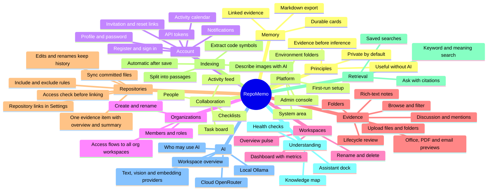

# RepoMemo: Functional Mindmap

> **Audience:** product owners, new teammates, and anyone who needs to know *what RepoMemo does* without reading code.
> **Companion:** [TECHNICAL_MINDMAP.md](TECHNICAL_MINDMAP.md) covers *how* it works, for engineers. [ROADMAP.md](ROADMAP.md) covers what has shipped and what comes next.
> **Scope:** reflects the code at `V0.2.108` (2026-10-21). Aligned on 2026-10-13. The shared **web app + API** is the primary product surface. The desktop app, a window onto a server, and the retired local workspace are described briefly in [§12](#12-desktop-app).

---

## The product in one paragraph

RepoMemo is a **team memory workspace for technical knowledge**. A team stores its evidence (notes, code files, Markdown docs, Office documents, PDFs, emails, screenshots and diagrams, and whole **git repositories** that stay in step with their branch) in a shared workspace, organised in folders. RepoMemo **indexes** that evidence so it can be **searched** by keyword and by meaning, and can optionally **ask an AI** questions that are answered **only from the stored evidence, with citations**. Knowledge worth keeping is saved as **memory cards**. Around that core, the team can **review** evidence (lifecycle status), **discuss** it (comments with @mentions), **track work** (a task board with checklists), see how its knowledge connects (**knowledge map**) and what has drifted (**health checks**), and use a docked **assistant**. The core stays useful without AI: storing, browsing, indexing, keyword search, the map's pipeline and the health checks all work with no AI provider configured.

---

## Who it's for and what it stands for

### Users

RepoMemo serves **developers and technical teams working inside an active codebase**. They reach for it when they need to:

- investigate implementation details
- recall **why** a decision was made
- onboard onto an unfamiliar system
- recover reliable context from code, documents, runbooks, incidents and architecture records

**Success** means a user moves from an uncertain technical question to **trustworthy source context** quickly, understands **where the answer came from**, and **preserves** useful knowledge for later.

### Positioning

RepoMemo is **structured memory first and an AI interface second**. Its source of truth is durable storage plus explicit metadata: indexes, symbols, links and citations. It is **not** a chat transcript or an opaque embedding store. Cloud AI is optional and is always an explicit choice.

### Product principles

1. **Evidence before inference.** Show sources, paths, line ranges, status and provenance.
2. **Value without AI.** Browsing, indexing and retrieval stay useful with AI switched off.
3. **Dense but legible.** Optimize for technical scanning without turning the workspace into visual noise.
4. **State is obvious.** Storage, indexing progress, provider state and errors are visible and actionable.
5. **Preserve trust.** Never blur durable stored facts with generated interpretation.

### Constraints the product must respect

- AI providers are optional. Sending content to a cloud provider requires explicit configuration and acknowledgement.
- Answers and summaries must stay tied to inspectable evidence and citations.
- Product copy must never invent customers, testimonials, usage metrics, benchmarks, pricing, or capabilities that are not built. The repository contains no approved marketing claims.

### Voice

The voice is **calm, precise, technical, private by default, and evidence-oriented**. The product states system facts directly, avoids hype, and always distinguishes trustworthy stored facts from optional AI interpretation.

### Experience and accessibility

- The product is used as a **focused technical workbench**. It must support dense scanning, keyboard-friendly operation, long paths and identifiers, code-oriented content, large result sets, and both light and dark themes.
- It must be **fully usable by keyboard** with visible focus states, respect **reduced-motion** preferences, keep **readable contrast** in both themes, and accommodate long technical identifiers without hiding critical context.
- Since V0.2.47 every signed-in page starts with a **Skip to the page** link, has one main area and a labelled side rail, and is named in the browser tab (*Atlas · Evidence*, *System · Audit trail*). After a move to another page, keyboard focus goes to the start of the page and a screen reader hears the page's name; changing a tab inside a workspace keeps focus on the tab. Every field has a label and every button a name, charts state their figures in words, notifications wait while a control inside them has focus (*Esc* dismisses one), motion stops when the system asks for less, and each colour pair used for text reaches 4.5:1 in both themes. A check for these rules runs in CI.
- Since V0.2.48 the web client works down to a phone's width (375 px): the page scrolls and never grows sideways, the side rail folds behind a *Workspaces and organizations* button, the header's buttons become icons, lists and forms fall to one column, tables and the knowledge map scroll inside their own box, and controls are at least 40 px high.

> The visual system (colors, type, components) is defined separately in [DESIGN.md](../DESIGN.md).

---

## The mindmap



Each branch below maps to one section of this document. Deeper branch documents will live next to this file (see [Branch documents](#branch-documents-planned)).

---

## 1. Who uses it: roles and permissions

RepoMemo has two levels of membership, plus a server-wide role.

**Organization**: the team or company boundary. Roles: `owner`, `admin`, `member`.
**Workspace**: one body of knowledge inside an organization, such as a project or service. Roles: `owner`, `admin`, `member`, `viewer`.
**System administrator**: a person who runs the whole server. They see **every organization and workspace**, act as an **administrator** in each (where they own something they stay owner), and use the **System** area (§1b). Owner-only actions, such as deleting a workspace, stay with owners. The first account created on a new server becomes a system administrator; others are named by an existing system administrator, or by the server operator for accounts that already exist when the server starts (registering an address the operator listed does not make it an administrator). The server always keeps at least one.

Joining an organization **automatically grants access to every workspace in it**: an org owner becomes a workspace owner, an org admin becomes an admin, and an org member becomes a member. A workspace can also add a registered user directly, or invite them by link. That gives access to **that workspace only**: the person does not join the organization, sees it on their dashboard as a **guest** with just the workspaces they were added to, and gets nothing from the organization's other or future workspaces. (Since V0.1.64. Until V0.1.63 such a person also became a member of the organization and of all its workspaces; see the [security review](security/2026-10-10-security-review.md), H1. People added that way keep that access until an administrator removes it.)

### What each workspace role can do

| Capability | Owner | Admin | Member | Viewer |
|---|:-:|:-:|:-:|:-:|
| Read evidence, search, memory, tasks | ✅ | ✅ | ✅ | ✅ |
| Ask AI / generate AI overview¹ | ✅ | ✅ | ✅ | ✅ |
| Add, rename, delete evidence (indexing is automatic) | ✅ | ✅ | ✅ | — |
| Inspect stored index chunks and re-index one artifact | ✅ | ✅ | — | — |
| Create and edit memory cards | ✅ | ✅ | ✅ | — |
| Create and edit tasks, comment, change lifecycle | ✅ | ✅ | ✅ | — |
| Edit or delete *other people's* comments, tasks and saved searches | ✅ | ✅ | — | — |
| Open People (with Activity) and Settings sections | ✅ | ✅ | — | — |
| Act on health findings | ✅ | ✅ | — | — |
| Add or remove members, invite by link | ✅ | ✅² | — | — |
| Configure the AI provider | ✅ | ✅ | — | — |
| Choose who may use AI in the workspace | ✅ | ✅ | — | — |
| Add, check, edit or remove repository links (Settings) | ✅ | ✅ | — | — |
| Sync a connected repository | ✅ | ✅ | ✅ | — |
| Rename or delete the workspace | ✅ | — | — | — |

¹ The AI features need an enabled provider. By default everyone in the workspace can use them, viewers included; owners and admins can keep them to members and above, or to admins and owners (**Settings › Who can use AI**). Each person can also make a limited number of AI requests per hour (120 by default, set by the server operator), so nobody can run up a cloud bill by accident. The server's own background work (describing images, preparing search vectors) has a daily allowance per workspace too (2,000 calls by default).
² Admins can grant only `member` or `viewer`, and cannot change or remove other admins or the owner. Nobody can assign `owner` through the UI, and the owner's own role cannot be changed there either, so a workspace or organization never ends up without an owner (since V0.1.65). Someone who becomes a viewer can no longer edit or delete their earlier comments and tasks.

### Organization permissions

| Action | Org owner | Org admin | Org member |
|---|:-:|:-:|:-:|
| Create a workspace in the org | ✅ | ✅ | — |
| Add members / change roles / invite by link | ✅ | ✅ (not admins) | — |
| Rename the organization | ✅ | — | — |

Any signed-in user can create a new organization and becomes its owner.

---

## 1-pre. Choosing the environment (platform)

All data of a server lives in one **environment folder** inside `workspace-data/` (git-ignored). A server started without `REPOMEMO_SERVER_DATA_DIR` shows a menu first: enter the code from the console, then **use** an existing environment (listed with its verification: a RepoMemo environment, empty, or cannot be attached and why) or **create** a new one. Folders outside `workspace-data/` and folders that are neither empty nor RepoMemo environments are refused. A system administrator can **detach** the environment in System › Settings: everyone is signed out and the menu shows again.

**Does the choice survive a restart?** If the operator does not name an environment, yes: the one chosen in the menu is attached again at every start, until it is detached. If the operator names one (`REPOMEMO_SERVER_DATA_DIR`), the server always starts with that one. It can still be detached and switched from the web app, but the switch lasts only until the next restart. The menu and the detach dialog say so and name the environment it will go back to.

## 1a. First-run setup (onboarding)

The very first time a server runs, with no account yet, the web app shows a **setup page** instead of sign-in:

| Step | What happens |
|---|---|
| **Welcome** | Explains what follows and asks for the **one-time setup code** printed on the server console when it started (or set by the operator). Only someone with access to the server has it |
| **System administrator** | Name, email and password of the account that will administer the whole server. Creating it signs that person in |
| **Server check** | Database, data folder, key for stored credentials, git, LibreOffice, allowed browser addresses, repository folders, AI addresses, public address (HTTPS), client addresses behind a proxy, automatic backups, log files: each marked OK, note, attention or problem, with advice |
| **Access and security** | Open or closed registration, session length, failed sign-ins before lockout and its length, AI requests per person |
| **Logging** | Default level, log files on or off, how long they are kept, console format |
| **First workspace** | Optional: an organization and a workspace, owned by the administrator |
| **Finish** | A summary, then **Finish setup** |

Until the setup is finished nobody else can register, and a closed browser picks up again after the administrator signs in. Once finished, the setup page **never shows again**: the server refuses every setup request and the `/setup` address sends people to sign-in. A server that already had accounts before this feature existed counts as set up.

## 1b. System area (system administrators)

A **System** button in the header opens `/system`, with these pages:

| Page | What it shows or does |
|---|---|
| **Overview** | The back end (version, host, process, address, data folder, uptime), storage (database, log, stored files, previews), background work (indexing and embedding queues, repository syncs, conversions, live event streams), traffic since start with requests per minute for the last hour, refused and rate-limited requests, locked sign-ins, and the **front-end clients** seen in the last 24 hours (browser and system, origin, address, requests). Refreshes every 30 seconds |
| **Usage** | Activity per day and by kind, the most active people, and every workspace with its members, files, size, passages, activity, AI requests and last activity, over 7 to 365 days |
| **Users** | Every account with its role, a tree of its organizations (one line each, with its role) and under each the workspaces it belongs to with its role in each (owner, admin, member, viewer); system administrators show as **Admin of all organizations and workspaces** by inheritance, plus what they own, signed-in sessions and last connection. Make or remove system administrators (system administrators only) and **app administrators** (same System pages, but no automatic access to every organization and workspace), sign someone out everywhere, lift a sign-in lockout, and **deactivate** an account (it cannot sign in or use a token, its sessions, tokens and sent invitations end, what it wrote stays; owners transfer what they own first) or **reactivate** it, and **anonymize** a deactivated account for good (its address, name, password, picture, memberships and notices go; what it wrote is credited to *Former member*) |
| **Settings** | Registration, token lifetimes, sign-in protection, AI requests per person, heavy requests per person (searches and reports per minute), background AI calls per workspace, **limits** (storage per workspace, uploads per person per hour, workspaces per person, a free-disk floor below which uploads stop), automatic backups, repository check interval, maintenance and **logging**, changed at run time and kept until reset to the server default. Logging sets a level (off to trace) for each kind of log (security, workspace activity, background jobs, HTTP requests, AI providers, database, performance (how long searches, questions, metrics, the knowledge map and health checks take, at debug), and everything else), the console format (readable text, compact text or JSON lines), whether logs are kept in daily files, and how many days those files are kept. Settings only the server's environment controls are listed read-only |
| **Mail** (inside Settings) | The mail server the server sends through: server, port, TLS or STARTTLS, sign-in (the password is never shown, only that one is saved), sender, *Send test mail* to yourself or an address, and the outbox with each message's result and retries. Mail is only sent over TLS and never holds a request. Without it, invitation and reset links are passed on by hand |
| **Logs** | What is being recorded, then the events: live (recent, following as they arrive) or any earlier day kept in the log files, filtered by kind of log, workspace, level and text. A day's file can be downloaded |
| **Jobs & maintenance** | Jobs across every workspace, updated live as they start, progress and finish (stop a running one), and maintenance: last run, next run, what it cleaned, and **Run maintenance now**. Below it, **Backups**: back up now, the list of backups with what each holds, and *Restore as a new environment…* (the running environment is never overwritten; the copy is opened to prove it works and attached from the environment menu), and delete. The server can also back up by itself on a schedule. Backups sit in the data folder, so they are copied off the machine by the operator ([production guide](technical/operations.md)). **A second copy** (V0.2.43): with `REPOMEMO_BACKUP_COPY_DIR` set to another disk or a share, every backup is copied there and the copy is checked (a checksum for every file, totals against the backup's manifest); the list shows when each was checked, a failure is shown with its reason and retried, and *Copy to the second location now* retries by hand. **Encrypted backups** (V0.2.42): with `REPOMEMO_BACKUP_KEY` set, every file of a new backup is sealed (AES-256-GCM) and the list tags it *encrypted*; restoring needs the same key, and a wrong one is refused before anything is written. The key is kept nowhere in the backup, so keep it apart and safe: without it a sealed backup cannot be restored |
| **Audit trail** | What system administrators did: role changes, settings, ended sessions, maintenance runs. **Export** (V0.2.46, full system administrators): choose JSON lines or CSV and a range of days (or none for the whole trail) and download every event of it, oldest first, for an auditor or a log store; a CSV cell that a spreadsheet could run as a formula is marked with an apostrophe. The download is itself recorded in the trail (*audit exported*, with the range and format) |
| **Console** | A command line to the server for administrators who prefer typing: `status`, `jobs list --status failed`, `logs --category security --level warn` (add `--follow` to keep watching), `users reset-link <email> --yes`, `tokens list`, `settings set log_http_level debug`, `users unlock alice@example.com`, `mail status`, `mail test <address> --yes`, `maintenance run`, `backup list`, `backup create --yes`, for system administrators `workspace reindex <workspace> --yes`, `repo sync <repository> --yes` and `embeddings rebuild <workspace> --yes` (each says what it would do first), and `help` for the rest. Answers show as tables or facts (`--json` for the raw answer). Anything that changes something only says what it **would** do until the line ends with `--yes`; changes are then recorded in the audit trail with the exact line. Up/Down recall earlier lines, Tab completes. The same console opens in a terminal with `repomemo-console` (`npm run console`): same logo, same commands, a hidden password prompt, and single commands for scripts (`repomemo-console jobs list --status failed`). Detaching the environment and granting the system administrator role stay on their pages |

---

## 2. Account and session

| Feature | What the user experiences |
|---|---|
| **Register** (`/register`) | Email, display name (1–120 characters), password (12–1024 characters, not a well-known password, at least five different characters, not containing the email name). The user is signed in immediately; when mail is set up the answer is the same for every address (since V0.2.18): the account is ready to sign in to and a link confirms the address, while the owner of an address that already has an account gets a message instead. Registration is **closed by default**: people join with invitation links, and only the first account of a new server can register without one. The server operator can open it. |
| **Sign in** (`/login`) | Email and password. A wrong email and a wrong password produce the same message. After 10 failed attempts in a row the account is locked for 15 minutes from that address (both configurable), and too many attempts from one address are slowed down. A browser that still holds a session of the account gets past a lockout other people caused. The session itself is kept in a cookie scripts cannot read. |
| **Session** | Renewed silently in the background for up to 30 days of inactivity, so nobody is signed out mid-work. |
| **Profile** (`/profile`) | Upload or remove a **profile picture** (PNG, JPEG or WebP; cropped square and shrunk to 256 px in the browser; server limit 512 KiB, 64–1024 px square). It also shows in workspace members, organization members and System › Users, and falls back to initials. Rename yourself, change your password (the current password is required; **every other device is signed out**, this one stays signed in), **sign out everywhere** (every device, this one included), see last connection time, workspace count, a **365-day contribution calendar**, and **tasks assigned to you**. |
| **Notifications** (`/notifications`) | "Task assigned to you" and "You were mentioned in evidence discussion". Mark one or all as read. Clicking a notification opens the related page. |
| **Theme** | Light and dark toggle, remembered per browser. |
| **Command palette** | **Ctrl K** (or **⌘ K**, or the search button in the header) opens a search box over what can be opened: workspaces, the open workspace's sections, its files and memory cards, pages such as the dashboard and profile, System pages for administrators. Arrow keys and Enter pick; Esc closes. On a workspace page the typed text can also be sent to the assistant as a question, a file lookup, a content search or a symbol lookup. |
| **Sign out** | Always visible in the header. |
| **Invitation link** (`/invite#<link>`) | Opens what the person is invited to (workspace or organization, role, who invited them, until when). With no account for the invited address: create one there, even when registration is closed. With an account: sign in there. Already signed in with the invited address: one click to join. Signed in as someone else: told to sign out first. A link works once, for that address only, for 7 days. Joining never lowers a role the person already has |
| **Password reset link** (`/reset-password#<link>`) | Created by a system administrator in System › Users and passed on to the person. Shows whose password it changes, asks for the new one twice, then signs this browser in and every other device out, lifts sign-in lockouts and (since V0.1.65) revokes the person's API tokens. Works once, for 24 hours; a newer link replaces it. The sign-in page says to ask an administrator for one |
| **API tokens** (Profile) | Personal access tokens for scripts, CI and `repomemo-console`: a name, read-only (look and search), read and write, or **system** (administrators only: also changes in the System area), and a lifetime of 7, 30, 90 or 365 days. The token is shown once; the list shows its start, scope, expiry and last use, and each can be revoked. A token acts as its owner, so it reaches only what they can, and it can never manage tokens, change the password, grant roles or accept invitations. Changing the password keeps tokens; an administrator's *Sign out everywhere* revokes them |

**Inviting people.** In a workspace's **People** section and in **Organization administration**, administrators can create an **invite link** for an email address and a role, copy it, and send it however they like (no mail server needed). Pending invitations are listed with their expiry and can be withdrawn. Adding a member whose email has no account suggests the invite link instead. The rules are the same as adding a member: only owners invite administrators, and the inviter must still be allowed to grant the role when the link is used.

**Not available yet:** sending invitations or reset links by email from the server, SSO.

---

## 3. Organizations and the dashboard

- **Dashboard** (`/dashboard`): every organization you belong to, its workspaces, and aggregate totals (artifacts, active tasks, memory cards), loaded in one request.
- **Workspace directory** (`/workspaces`): pick an organization, create workspaces (owner or admin), **import a workspace from an archive** (owner or admin, checked first; see §10), and create a new organization.
- **Organization administration**: list members, add a registered user by email with a role, and remove members, subject to the rules in §1.

---

## 4. Workspaces

A workspace is opened at `/workspaces/:id/<section>` and has **twelve sections**. The **assistant** (§7b) is docked on the right of every section page.

| Section | Purpose | Who sees it |
|---|---|---|
| **Overview** | "Workspace pulse" metrics and the AI overview | Everyone |
| **Evidence** | The evidence ledger: browse folders, add notes, upload files and folders, with live indexing status. New evidence is indexed automatically | Everyone (only writers can add) |
| **Documents** | The ledger filtered to business documents (Word, Excel, PowerPoint, PDF, OneNote, Outlook), with previews | Everyone |
| **Repositories** | Linked git repositories, their sync state and files (§5b) | Everyone (linking is in Settings) |
| **Retrieval** | Keyword and meaning search, saved searches, "Ask your evidence" | Everyone |
| **Map** | The knowledge map: indexing pipeline, coverage, and a graph of related files and memory cards (§7b) | Everyone |
| **Health** | Deterministic checks for drift, duplicates and failures, with actions (§7b) | Everyone (acting on a finding: owner and admin) |
| **Review** | One list of what waits for a person: files marked *needs review*, memory cards whose evidence changed and open health findings, each opening where it is resolved (§7b) | Everyone (resolving: writers; findings: owner and admin) |
| **Memory** | Team memory cards: search and create. A card shows **Needs review** when what it cites changed, disappeared or was retired; its page lists why, lets writers edit the evidence it cites, and confirm it as it is | Everyone |
| **Tasks** | Team action board | Everyone |
| **People** | Members, invitations, a summary of *your* capabilities, and the activity feed (user or AI activity) with a 365-day calendar | Owner and admin |
| **Settings** | Members, AI providers and who may use AI, repository links, **export as an archive**, rename or delete | Owner and admin (rename and delete are owner only) |

### Workspace pulse (Overview)

This is a live snapshot computed on each visit:

- **Index coverage**: the percentage of artifacts that are indexed. Pending artifacts are counted and their size is shown.
- **Fresh evidence**: artifacts added or updated in the last 7 days.
- **Knowledge density**: searchable passages per indexed file.
- **Code symbols**: functions and classes extracted from code.
- **Team**: member count, active tasks, blocked and overdue tasks ("at risk"), comment count.
- **Charts**: evidence by type, storage by type, languages, 14-day activity, activity by action, and members by role.

Deleting a workspace **permanently removes** all of its evidence, memory, tasks and memberships.

---

## 5. Evidence (artifacts)

Evidence is anything the team stores. Each item is called an **artifact**.

### Adding evidence

| Method | Details |
|---|---|
| **Write a shared note** | A title and a rich-text body (headings, lists, code, links), stored as Markdown. Notes are filed into the folder that is open. |
| **Upload files or a folder** | Choose several files at once, or (in the Evidence view) a whole folder: its subfolders become evidence folders, up to the folder depth limit, and hidden, dependency and build folders (`.git`, `node_modules`, `target`, `dist`, `build`…) are skipped. Each file can be up to **10 MiB**; unsupported and oversized files are left out with a notice. A progress bar counts the uploads, and files that could not be stored are listed. Uploads are grouped under the source "Shared uploads". |

**Supported file types:** Markdown (`md`, `mdx`), text (`txt`), code and config (`rs`, `ts`, `tsx`, `js`, `jsx`, `py`, `json`, `toml`, `yaml`, `yml`, `sql`, `html`, `css`, `sh`, `ps1`), business documents (Word `doc`, `docx`; Excel `xlsx`, `xlsm`, `xls`; PowerPoint `pptx`, `ppt`; `pdf`; OneNote `one`; Outlook `eml`, `msg`), and images (`png`, `jpg`, `jpeg`, `gif`, `webp`, `svg`, `bmp`). **Images can be uploaded only once the workspace has an image (vision) AI provider**, because an image is made searchable through its AI description. An SVG is shown in the page but never opened on its own, because its scripts would then run as RepoMemo (since V0.1.65).

If the same file with the same content is uploaded twice, it is stored only once.

### Folders

Evidence can be organised in **nested folders, up to 5 levels**. Writers create, rename and delete folders (deleting removes everything inside, after a confirmation that shows the counts) and move files between folders. Folders themselves cannot be moved yet. Uploading a folder recreates its subfolders.

### Business documents

Office files, PDFs and emails are previewed in the browser: text and tables for Word and Excel, slides for PowerPoint, the message for Outlook, and the PDF itself. When **LibreOffice** is installed on the server (System › Overview shows its version and whether it runs in a sandbox), Word, Excel and PowerPoint files are also shown as a layout-accurate PDF. **Open in Office** opens the file in the desktop Office app through a short-lived link; download is always offered. OneNote text is recovered approximately and labelled so.

### Working with evidence

- **Browse**: filter by name or path and by type, and switch between grid and list views.
- **Artifact page** (`/workspaces/:id/artifacts/:artifactId`) shows:
  - metadata: type, language, and whether it is indexed
  - **stored content** as a text preview; Word files are converted to text
  - **indexing status**: *Indexing…* right after saving, then *Indexed*
  - for owners and admins only, an **Indexed chunks** button that opens a dialog with the stored passages, their line ranges, and a **Re-index** action
  - **rename** and **delete**, for writers
  - **Version history** for an uploaded file that has taken a new version: each version with who uploaded it and when; its text can be read, and any version compared line by line with the one before it or with the current one. Earlier text stays readable for as long as the file exists
- **Lifecycle review**: every artifact has a status:
  `active` → `needs_review` → `verified` / `outdated` / `superseded`
  Each artifact can also have an **owner** (a workspace member) and a **review note**. `superseded` requires choosing the replacement artifact. Every change is kept in a **lifecycle history**.
- **Discussion**: threaded comments of up to 5,000 characters. Typing `@` **suggests the workspace's members** (narrowed as you type; choose with the arrow keys and Enter), and a typed `@someone@example.com` **notifies that workspace member**. Authors edit or delete their own comments, and admins and owners can moderate any comment.

---

## 5b. Repositories

A team's code usually already lives in a git repository, with many files and a history. Uploading it file by file would be slow and would go stale at the next commit. The **Repositories** section connects a repository instead and keeps the workspace in step with it.

| What you do | What happens |
|---|---|
| **Add a repository link** (owners and admins, in **Settings › Repositories**) | Enter the folder of a git checkout on the server and press **Check access**. RepoMemo tells you whether the server can read it, which branch and commit it would read, and about how many files it would index. **Link and sync** stores the link and starts the first sync. RepoMemo reads what the branch has **committed**: never uncommitted edits, ignored files or build output. |
| **Sync now** (writers) | RepoMemo compares the branch's latest commit with what it stored. Only new and changed files are read and indexed; unchanged files cost nothing. |
| **Automatic sync** | Every few minutes the server checks whether each linked branch has new commits and syncs the ones that moved, so nobody has to press Sync now. A sync that fails is not retried for the same commit for an hour. |
| **Edit a link** (owners and admins, in Settings) | Choose a branch (default: whatever is checked out), and **include** or **exclude** paths with patterns such as `docs/**`, `src/`, `**/*.test.ts`. Applies from the next sync. |
| **Browse files** | The repository's files, filterable by path. Each opens like any evidence: preview, lifecycle, comments. |
| **Remove a link** (owners and admins, in Settings) | Removes the repository's files, their index and memory links from the workspace. The repository on disk is untouched. |

**How files follow the repository:**

- An **edited** file is updated in place and re-indexed. Its comments, memory links and tasks stay attached. If it was *verified*, it goes back to *needs review*.
- A **renamed** file (same content) keeps its identity under the new path.
- A **deleted** file stays readable for the memory cards and comments that cite it, but it leaves search and Ask, and is marked *outdated* with the commit that removed it.

**Skipped automatically:** dependency and build folders (`node_modules/`, `vendor/`, `dist/`, `build/`, `target/`…), lock files, minified files, images, files over 1 MB and binary files. Each sync reports how many files were skipped and why.

**The repository as one evidence item.** Each linked repository appears in the **Evidence ledger as a single item**, next to notes and uploads, and can be reviewed, discussed, cited by memory cards and moved into a folder like any evidence. Opening it shows the **repository page**:

- **Sync state**: location, branch, commit, files, with *Sync now* and a file browser.
- **Summary**: what the repository is, its main parts, technologies, how to build or run it and where to start reading, written by the workspace's AI provider **only when someone asks**, with links to the files it is based on. The page says when the repository has changed since the summary was written.
- **Content overview**, with no AI: languages, folders, key files (README, manifests, entry points, docs), the opening of the README, and recent commits.

The **knowledge map** draws each repository as one ringed dot, sized by all of its files and linked to similar evidence and to memory cards that cite any of its files, and the **health checks** compare the repository as a whole rather than file by file.

The repository's individual files are searchable and citable like any evidence, but they are listed in the Repositories section (and from the repository page) rather than the Evidence ledger, and they cannot be renamed or deleted one by one: change them in the repository, or exclude their path.

**Availability:** repository links are a setting of each workspace. A link is either a folder the server can read (inside the folders the operator allows with `REPOMEMO_REPO_ROOTS`) or, since V0.2.20, a remote repository by `https` address with a token, or by `ssh` with a deploy key and the host's pinned key (the operator names the host with `REPOMEMO_GIT_ALLOWED_HOSTS`). A remote link is kept as a copy on the server, within a size and a time cap, and can have a push webhook so a push syncs within seconds. See the [technical design](technical/repository-sources.md).

---

## 6. Indexing: making evidence searchable

Evidence must be **indexed** before search, Ask, or the AI overview can use it. Indexing is **automatic**: as soon as a note is pasted or a file is uploaded, the server queues it and indexes it in the background. Nobody presses an index button, and the ledger shows *Indexing…* until the artifact is ready. Artifacts that were stored but never indexed (for example when the server restarted mid-queue) are picked up again at startup.

The stored passages are an administrative detail. Regular members see search results, snippets and citations, but not the raw chunk list. Owners and admins can open it from the artifact page, and can re-index a single artifact from there (useful after an AI provider is configured for images).

In plain terms, indexing does the following:

1. **Reads the text.** Office documents, PDFs and emails are converted to text on the server, with no outside service.
2. **Splits it into passages.** Markdown is split by heading. TypeScript, JavaScript, Python, Rust, Go, Java, C# and PHP are split along their structure, so a function, class or impl block is not cut in half: small neighbours are grouped, and large classes are split by method. Each passage records its scope (for example `impl Store > save`), which is also searchable. Other text and code files are split into windows of about 100 lines. Every passage keeps its line range so citations point to exact lines.
3. **Extracts code symbols** from TypeScript, JavaScript, Python, Rust, Go, Java, C# and PHP: functions, classes (structs, records), methods, interfaces (traits) and enums.
4. **Handles images differently.** The image is sent to the workspace's image (vision) provider and a **text description** is stored and made searchable, including any text visible in the image. Without such a provider, image uploads are refused with a message saying an administrator can set one up.
5. **Makes passages searchable by meaning** when the workspace has an embedding provider: a background queue turns each passage into a vector, and Settings shows the progress.

Re-indexing keeps every passage whose text did not change, so memory cards and any stored embeddings that point at it stay valid. Only passages that actually changed are replaced. When RepoMemo improves how it splits content, existing evidence is refreshed automatically in the background the next time the server starts, and images are never re-analysed by that refresh.

**Live status.** The ledger follows the server as it works: new files (including other people's) appear, *Indexing…* clears the moment a file is ready, and a failure shows its reason. A strip above the files counts what is still being indexed, and shows longer background work (making passages searchable by meaning, repository syncs) with a progress bar and a **Stop** button for writers. If the live connection drops, the page falls back to checking every few seconds and says so.

**Current behavior to be aware of:** the background queue processes up to two artifacts at a time. A file that fails to index is retried a few times, then shows its failure reason, and is retried again every few hours. Images stored before a vision provider was required (older servers) may have no description and need a manual re-index by an admin.

---

## 7. Retrieval: finding evidence

### Search

- Searches the **indexed passages** of the workspace.
- Every word must match, and words match as prefixes: `auth tok` finds "authentication token".
- When the workspace has an embedding provider, search also finds passages **by meaning** and merges both result lists, so a question phrased differently from the text still finds it. If the provider fails, search falls back to keywords.
- Filters: **file type**, **language**, **source**, and **10 / 20 / 50 results**. Filter options are built from what has actually been indexed. Further filters: the **evidence state** (current by default, so outdated and superseded files are left out; verified only, needing review, outdated and superseded, or every state), a **folder** (with the folders below it) and an **updated between** date range. Verified evidence ranks a little higher. A **Code symbols** box finds where a function, class or method is defined, and the assistant answers the same question.
- Each result shows the title, type, language, source, a snippet with the **matched words highlighted**, the path, and the line range. Clicking a result opens the artifact.
- Keyword search does **not** use AI and works offline.

### Search all workspaces

The dashboard has one search box over **every workspace the account can read**. Results from all of them are merged, best first, and each names its workspace and opens the file there. Each workspace is searched under its own rules: only if its AI policy lets the person use AI is the query also matched by meaning (and sent to that workspace's embedding provider); otherwise that workspace is searched by keywords only and the page says so. Workspaces the person cannot read are never searched or named. It takes only words: the filters, code symbols and Ask stay inside one workspace.

### Saved searches

Writers can save a named search that includes its filters. Anyone can re-run it with one click. Saved searches are shared with the whole workspace; only their author or an administrator deletes one.

### Ask your evidence (AI)

- The user asks a question in plain language.
- RepoMemo **first retrieves** matching passages. If nothing matches, it answers *"Indexed context is insufficient"* **without calling the AI**.
- Otherwise it sends the best passages to the workspace's AI provider. The provider is told to use only that context.
- The response contains the **answer**, formatted (headings, lists, code) and labelled as AI-generated, the **citations** (artifact, path, lines), and **warnings**, for example when only keyword retrieval could be used. Citations are numbered to match the `[1]`, `[2]`… markers in the answer, and each opens its file.
- Writers can **Save as memory**: the answer becomes a memory card titled with the question, and they choose which cited passages become its evidence links. The AI workspace overview can be saved the same way.

---

## 7b. Assistant, knowledge map and health

### Assistant

A chat panel **docked on the right of every workspace section**. It can be widened, narrowed to a slim rail, or, on a narrow screen (V0.2.48), opened as a sheet over the bottom of the page from a floating *Assistant* button (it starts closed there; *Esc* or a tap outside closes it). Each message does exactly one of five things: **find files**, **search content**, **summarize a file**, **ask a question** (the same cited Ask as Retrieval), or give a **workspace overview**. Common phrasings are recognised without AI; otherwise the AI provider picks the action, and without one the assistant lists what it can do. Finding and searching work without AI. Chats are kept per person and can be renamed and deleted. Text written by AI is labelled as such. Inside a chat the assistant **remembers the conversation**: the newest earlier messages that fit a token budget go with each question, so a follow-up such as *and what about its timeout?* finds what it is about and *summarize it* means the file just discussed. A reply says how many earlier messages it read. Lookups and searches run on what was typed.

### Knowledge map (Map)

Shows how much of the workspace is usable and how it connects, with no AI call:

- **Pipeline**: files stored → indexed (pending or failed) → passages → passages searchable by meaning.
- **Coverage** by kind of file.
- **Graph**: the files with the most passages, linked to **similar files** (when an embedding provider exists) and to the **memory cards that cite them**. A repository is drawn as one ringed node. A table view lists every link.

### Review queue (Review)

Everything in the workspace that waits for a person, in one list, without an AI call:

| Item | Where it comes from | Opens |
|---|---|---|
| **File marked for review** | A file whose state is *needs review* (set by a person or by a health action), with the note left | The file's page |
| **Memory card gone stale** | A card whose cited file changed after the card was written, was retired, or whose cited passage is gone | The card's page |
| **Health finding** | An open finding that was neither acted on nor dismissed (a stale-memory finding is shown as its card instead) | Health |

Each shows why it is waiting and since when, oldest first (findings have no date and follow). An item leaves the list when it is resolved where it is worked on: the file marked verified or active again, the card confirmed or edited, the finding acted on or dismissed. Members see the list; each item says who can resolve it.

### Health checks (Health)

Deterministic checks of what has drifted, with no AI call:

| Finding | Offered actions (owner and admin) |
|---|---|
| Several versions of the same uploaded file still in use | Supersede the older ones, dismiss |
| Files in use with identical content | Supersede, dismiss |
| A code symbol that was removed is still named in docs | Mark *needs review*, create a task, dismiss |
| A file in use refers to a retired (outdated or superseded) file | Mark *needs review*, create a task, dismiss |
| A file that failed to index | Create a task, mark outdated, dismiss |
| A file connected to nothing (no similar file, no memory card) | Create a task, dismiss |

A finding that was acted on stays hidden until the facts behind it change. Per check, the page counts how many findings were acted on or dismissed. There is no check yet for **memory cards whose cited passages changed** (roadmap F1).

---

## 8. AI integration

AI is **optional and explicit**. Nothing is sent to any AI service until an owner or admin configures and enables a provider in **Settings → AI integration**.

| Provider | Where content goes | Requirements |
|---|---|---|
| **Ollama (local)** | A local or self-hosted Ollama server | A base URL (default `http://127.0.0.1:11434`) and a chat model |
| **OpenRouter (cloud)** | The OpenRouter cloud API | An API key, a chat model, and an **explicit acknowledgement** that workspace excerpts leave the device |

- **Test connection** checks the provider before relying on it.
- The API key is kept on the server, **encrypted**, and **is never sent back to the browser**. It is only ever sent to the address it was entered for: changing the provider's type or address requires entering the key again.
- Provider addresses that point at cloud metadata services or link-local addresses are refused, and the server operator can limit providers to a list of hosts.
- **Three kinds of provider**, each set up separately: a **text** provider (answers, overviews, summaries, the assistant), an **image (vision)** provider (image descriptions; required before images can be uploaded), and an **embedding** provider (search by meaning; `bge-m3` is suggested because it is multilingual).
- **Who can use AI** (Settings): everyone, members and above, or administrators and owners. Image descriptions and search vectors are built in the background for everyone's uploads and are not affected.
- AI powers: **Ask your evidence** (with an AI re-ranking of the best passages), the **AI workspace overview** (a briefing for someone joining the project, built from indexed excerpts, with citations), **repository summaries**, the **assistant**, **image descriptions** during indexing, and **search by meaning**.

---

## 9. Memory cards: durable team knowledge

A memory card is a **short, durable statement the team wants to keep**. Examples are "We chose SQLite over Postgres because…" and "Deploys must go through X".

- **Create**: a title and a Markdown body, linked to **as many evidence items** as needed. A card can also be saved straight from an Ask answer or the AI overview, keeping the passages they cited.
- **Search**: a text match on the title and body.
- **Card page** (`/workspaces/:id/memory-cards/:cardId`): the statement (formatted Markdown), its source, and **linked evidence**, each opening its file. If the linked artifact has been deleted, the evidence is shown as missing. The links of an existing card cannot be changed yet.
- **Edit / delete**: writers only.
- **Export** a card as a Markdown file that includes its evidence links and line ranges, for use in a wiki, an ADR or a PR description.

---

## 10. Collaboration

### Task board

- Four columns: **Open**, **In progress**, **Blocked**, **Done**.
- Each task has a title, a description, a **priority** (low / medium / high / urgent), an optional **assignee** who must be a workspace member, optional **linked evidence**, and an optional **due date**. Overdue tasks are flagged.
- **Checklists** inside a task, where each item can be ticked.
- Search tasks, and filter by assignee or show unassigned tasks.
- Assigning a task to someone **notifies them**. The task also appears on their profile.
- A task can be deleted by its creator, or by an admin or owner.

### People and Activity

- **People** lists the members and explains what your role lets you do.
- **Activity** shows the last 100 workspace actions and a 365-day calendar. Recorded actions include evidence stored or uploaded, indexing, lifecycle changes, comments, tasks, memory, member changes, AI use and provider changes.

### Exporting and importing a workspace

Owners and administrators can download a workspace as **one archive file** from *Settings › Export this workspace* (V0.2.40). It is a compressed `.tar.gz` that any archive tool opens, holding a **manifest** (what is inside, with counts, sizes and checksums), one data document and the original files:

- **Evidence** with its folders, source names, type, language and each file's original bytes (a file stored once is in the archive once).
- **Lifecycle**: each file's state, owner, review note and its whole history.
- **Memory cards** with their citations. A citation names the file and, for a passage, its place and a fingerprint of its text, so it can be pointed at the same passage after the file is indexed again. Citations whose target is already gone are left out and counted in the manifest.
- **Tasks** with their checklists, and **comments**.

People appear as a name and an address, never as an account of this server; an anonymized account stays "Former member". Credentials never leave: AI provider keys, repository and tracker tokens and webhook secrets are not part of it, and links to a repository or a tracker are carried only as the files they brought. The export is recorded in the workspace's activity, and a workspace missing a stored file is refused with a plain message rather than exported incomplete.

**Importing** (V0.2.41) is the way back in: on the dashboard, owners and administrators of an organization choose an archive under *Import a workspace* and **check it first**. The check reads the whole file, verifies every checksum and every link between records, and says what it holds (files, folders, memory cards, tasks, comments), how big it is, which RepoMemo wrote it, and any warning, without writing anything. Only then does *Import workspace* create a **new workspace** (named as the archive or as you choose) with you as its owner.

- Everything arrives as it was: folders, lifecycle states and history, memory cards with their citations (a cited passage is found again once its file is indexed; if it cannot be, the citation points at the whole file and the report says how many), tasks with checklists, comments and the workspace's AI policy. Dates are kept; files are searchable as soon as they are indexed in the background.
- **Nobody is credited by account.** An archive can be written by anyone, so its authors are not believed: comments, tasks and history belong to you, and the original name is kept in the text ("Originally written by Ada on 2026-10-14"). Owners, reviewers and assignees become notes for the same reason.
- An archive that is damaged, from a newer RepoMemo, too large for the server (`REPOMEMO_MAX_IMPORT_MB`) or for a workspace's storage allowance, or whose records disagree, is refused with the reason, and a failed import leaves no workspace behind.

---

## 11. Typical team journey

```
Create organization ─► Create workspace ─► Invite teammates (by link, or add existing accounts)
      │
      ▼
Paste notes / upload files ─► Index evidence ─► Search / save searches
      │                                              │
      ▼                                              ▼
Review lifecycle, discuss with @mentions     (optional) configure AI ─► Ask with citations
      │                                              │
      ▼                                              ▼
Create tasks from findings  ◄──────────────  Save conclusions as memory cards ─► Export
```

---

## 12. Desktop app

Since V0.2.49 the **desktop app is a window onto a server.** On first start it asks for the address of a RepoMemo server (`https://...`; plain `http://` only for a server on your own network), checks that a RepoMemo server answers there, and then shows exactly the pages the browser shows, after you sign in. The app talks to that server only and cannot be sent to another site (links to the outside open in your system browser). Your session is kept in the computer's credential store (Windows Credential Manager, macOS Keychain), so a restart does not ask for the password again; *Change server* in the left rail forgets the server and the session. Pages that open in a new tab or hand a file to Word in a browser save the file instead.

The **local workspace** of the earlier desktop app is **retired** (V0.2.51): it is labelled so in the app, receives security fixes only and will be removed in a 0.3.x release. It is still there until then: *Use the local workspace* on the first screen. **Move a workspace to a server** (V0.2.50, bottom-left in the local workspace) writes the chosen workspace as a workspace archive, the same file a server exports, and takes you to your server: after you sign in, the dashboard's *Import a workspace* opens with it already checked, shows what is in it (files, folders, memory cards with their citations, tasks, comments) and imports it as a new workspace when you confirm. You can also save a copy of the archive or discard it. Your local copy is left as it was.

### The local workspace (retired)

The earlier desktop app, built with Tauri, is fully local: no accounts, no organizations and no collaboration features. It still has one thing the web app does not expose: a per-artifact **AI summary** button (on the web, the assistant summarizes a file). Symbol search exists on the web too since V0.1.72. Folder import and search by meaning, once desktop-only, now exist on the web too.

It does **not** have the web app's notes, folders, business document previews, repositories, assistant, knowledge map, health checks or System area. It is retired (roadmap F20c, V0.2.51) and will be removed in a 0.3.x release.

The local workspace and a server keep **separate data**.

---

## 13. Known functional gaps (at V0.2.108)

These are observed in the code and are useful for prioritizing. The roadmap item that addresses each one is in brackets.

| Gap | Impact |
|---|---|
| Only GitHub and GitLab are connected | Issues (V0.2.27) and pull or merge requests (V0.2.28, GitLab V0.2.29) with their comments, reviews and commits are evidence (Settings › Issues and pull requests), and the files, symbols and commits they name are linked both ways (V0.2.30). A connector can have a webhook (V0.2.31) and pauses itself when the tracker asks to wait or refuses the token [F17]. |
| A citation's old text is opened from the server's copy | *View at commit* (V0.2.26) shows a cited file as it was at the commit it names, while that commit is still in the repository's copy; memory-card links and repository summaries do not offer it yet [F16d]. |
| `CODEOWNERS` owners are hints only | They show on a repository file's page since V0.2.25 but are not matched to workspace members, assigned or notified [F16c]. |
| Assistant answers and citations do not name the last author | The last author and date of a repository file show on its page, in the file list and in search results since V0.2.24 [F16b]. |
| Remote repositories and trackers need a named host, and pushes are noticed by polling unless a webhook is set up | `https` links work since V0.2.20 (a read-only token for private ones) and `ssh` links since V0.2.21 (a deploy key and the pinned host key); each clone has a size and a time cap since V0.2.22 and counts in the workspace's storage allowance; a push webhook (GitHub, GitLab or a signed generic call, V0.2.23) queues a sync at once, otherwise the server polls. git resolves host names itself, so for a name that points at a private address the host list is advisory: an egress rule is what enforces it [F4 phase 2, F16a]. A file renamed and edited in one commit keeps its history since V0.1.73 when at least about half of it is unchanged. |
| Search across workspaces is plain | The dashboard search (V0.2.33) merges every readable workspace by score, but takes no filters and does not cover code symbols, memory cards or Ask, which stay inside one workspace [F5b]. The assistant remembers a chat since V0.2.32, for questions and summaries. |
| Mail is optional, and without it links are passed on by hand | Mail delivery exists since V0.2.9 (System › Settings › Mail, over TLS): invitations are mailed since V0.2.10, "Forgot your password?" works by mail since V0.2.11, task assignments and mentions are mailed since V0.2.12, and addresses are verified since V0.2.13 (an account that registered on an open server waits for its link before creating organizations or workspaces; an invitation counts), which is why registration is closed by default. One address is sent at most 12 messages an hour and one person causes at most 60 (V0.2.52). Without mail set up, invitation and reset links are shown to copy [F6 in V0.2.9–V0.2.12, F12 in V0.2.11, F13 in V0.2.13]. |
| Accounts are never deleted | They are deactivated (V0.2.16) and anonymized (V0.2.17); the account row stays as *Former member*. Log files and earlier backups keep the old address until they age out. |
| Archives are not a sync | A workspace exports (V0.2.40, Settings) and imports as a new workspace (V0.2.41, dashboard); it is a copy, not a link: nothing keeps the two in step, and importing the same archive twice makes two workspaces. Earlier versions of a file, saved searches, assistant chats and the activity feed are not in the archive. The retired local workspace of the desktop app moves the same way (V0.2.50) [O2, F20b]. |
| The retired local workspace is still in the app | It moves to a server as an archive (V0.2.50) and is labelled retired (V0.2.51), but is only removed in a 0.3.x release; until then it gets security fixes only. The move is a copy, not a link, and only an organization owner or administrator can import it [F20c]. |

Invitation links and administrator reset links, gaps until V0.1.62, shipped in V0.1.63.

---

## Branch documents (planned)

This gateway is the root of the functional mindmap. Each branch can grow into its own page under `mindmap/functional/`:

| Branch | Planned page |
|---|---|
| Roles and permissions | `functional/roles-and-permissions.md` |
| Account, profile, notifications | `functional/account-and-notifications.md` |
| Organizations and workspaces | `functional/organizations-and-workspaces.md` |
| Evidence and lifecycle | `functional/evidence-and-lifecycle.md` |
| Indexing, retrieval, Ask | `functional/indexing-and-retrieval.md` |
| AI providers and privacy | `functional/ai-and-privacy.md` |
| Memory cards | `functional/memory-cards.md` |
| Tasks and collaboration | `functional/tasks-and-collaboration.md` |

## Glossary

| Term | Meaning |
|---|---|
| **Artifact / evidence** | A stored item: a note, file or image. |
| **Source** | Where artifacts came from: "Pasted notes", "Shared uploads", a connected git repository, or an imported folder on desktop. |
| **Repository / sync** | A connected git repository, and the action that brings its files in step with the branch's latest commit. |
| **Chunk / passage** | A searchable slice of an artifact that keeps its line range. |
| **Symbol** | A named code construct such as a function or class, extracted during indexing. |
| **Citation** | A pointer from an AI answer or memory card to the exact artifact and lines that support it. |
| **Memory card** | A durable, human-curated statement linked to evidence. |
| **Lifecycle** | The review status of an artifact: active, needs review, verified, outdated or superseded. |
| **Provider** | The AI backend, Ollama or OpenRouter, configured for a workspace for one purpose: text, vision (images) or embedding (search by meaning). |
| **Folder** | A named group of evidence inside a workspace, nested up to 5 levels. |
| **Note** | Evidence written in the app with the rich-text editor, stored as Markdown. |
| **Knowledge map** | The page that shows indexing coverage and how files and memory cards connect. |
| **Health finding** | A deterministic observation of drift (duplicates, older versions, removed symbols still named…) with actions. |
| **Environment** | The folder under `workspace-data/` that holds all of one server's data. |
| **Invitation link** | A one-time link for one email address and role, used to join a workspace or organization. |
| **Personal access token** | A revocable `rmp_…` key that acts as its owner for scripts, CI and the terminal console. |
