# RepoMemo Roadmap

> **Current version:** `V0.2.92` (2026-10-18), after `V0.2.0` *Team-ready*, which waits for the clean-machine install (R6) before its tag · **Next minor after it:** `V0.3.0` *Connected* (proposed 2026-10-14)
> **Feature freeze (V0.1.76 to the `v0.2.0` tag):** only fixes from the clean install go into 0.2.0. The 0.2.x releases of [Road to V0.3.0](#-road-to-v030) follow the tag.
> **Related:** [Functional mindmap](FUNCTIONAL_MINDMAP.md) · [Technical mindmap](TECHNICAL_MINDMAP.md) · Release index [0.1 → 0.2](RELEASES_0.1.md) and [0.2 → 0.3](RELEASES_0.2.md) · [Security review 2026-10-10](security/2026-10-10-security-review.md) · [Security review 2026-10-14 (V0.2.6)](security/2026-10-14-security-review.md) · [Security review 2026-10-16 (V0.2.52)](security/2026-10-16-security-review.md) · [Enhancement analysis 2026-10-13](analysis/2026-10-13-enhancement-analysis.md)

RepoMemo started as a local-first desktop workbench. It is now a **self-hosted team product**: a shared API server with a web client, organizations and roles, collaboration, git repositories as living sources, business documents, and optional AI grounded in cited evidence. A server can be installed and administered entirely from the browser (environment menu, first-run setup, System area, admin console).

Between V0.1.32 and V0.1.62 the work went into **depth and operability**. V0.1.63 added **onboarding without an account** (invitation links, reset links, personal access tokens). V0.1.64 and V0.1.65 fixed the most urgent security findings: bundle S1, and a second pass that included a stored XSS.

**V0.2.0 is proposed as the first *team-ready* release**: a server a team can install, expose and trust with its knowledge. That means secure by default, deployable and recoverable, checked on every commit, and keeping its core promise that memory stays true. The plan to get there is [Road to V0.2.0](#-road-to-v020); every release of it is built and only the clean-machine install (R6) remains before the tag.

**V0.3.0, *Connected*,** is proposed next: remote repositories, mail, issues and pull requests, an assistant that remembers the conversation, portable workspaces and one client, reached through 56 single-purpose releases (V0.2.1–V0.2.56). The plan is [Road to V0.3.0](#-road-to-v030).

> **Versions** are set in one place since V0.1.66 (`npm run version:set -- <version>`), checked in CI, and recorded in [CHANGELOG.md](../CHANGELOG.md).

---

## At a glance

```mermaid
timeline
  title RepoMemo delivery
  section Local memory loop
    May 2026 : V0.1.0 Desktop skeleton
    Jun 2026 : V0.1.2 Import and store : V0.1.3 Chunking and symbols : V0.1.4 Full-text search
    Jul 2026 : V0.1.6 AI providers : V0.1.8 Embeddings and Ask : V0.1.9 Image understanding
    Aug 2026 : V0.1.10 Memory cards
  section Shared team mode
    Aug 2026 : V0.1.12 Server foundation : V0.1.13 Accounts and shared evidence : V0.1.15 to V0.1.23 Admin, AI, collaboration, review
    Sep 2026 : V0.1.27 Organization admin : V0.1.30 Word documents : V0.1.32 Jobs API and live events
  section Depth and operability
    Oct 2026 : V0.1.40 Auto-indexing, notes, folders : V0.1.42 Business documents : V0.1.45 Assistant : V0.1.46 Semantic search
    Oct 2026 : V0.1.48 Knowledge map : V0.1.50 Health checks : V0.1.52 Repository sync : V0.1.51 to V0.1.57 Security hardening
    Oct 2026 : V0.1.58 System area : V0.1.59 Setup wizard : V0.1.60 Environments : V0.1.61 Admin console : V0.1.62 Live progress
    Oct 2026 : V0.1.63 Invitations and tokens : V0.1.64 Security S1 : V0.1.65 Security second pass
  section Road to V0.2.0
    Hardening : V0.1.66 Checkable releases : V0.1.67 Safe defaults : V0.1.68 Browser hardening : V0.1.69 Host exposure
    Foundations : V0.1.70 Web client foundation : V0.1.71 Server foundation
    Product : V0.1.72 Memory and search you can trust : V0.1.73 Evidence, ownership, repositories 1b
    Run it for real : V0.1.74 Performance and robustness : V0.1.75 Operations : V0.1.76 Release candidate : V0.2.0 Team-ready
  section Road to V0.3.0 (proposed, one change per release)
    V0.2.1 to V0.2.8 : After 0.2.0 (web residuals, jobs, console, incremental map)
    V0.2.9 to V0.2.18 : Mail, verification, notifications, accounts
    V0.2.19 to V0.2.31 : Remote repositories, pushes, issues and pull requests
    V0.2.32 to V0.2.39 : Assistant memory, cross-workspace search, palette, languages, review queue
    V0.2.40 to V0.2.48 : Export and import, encrypted backups, container, accessibility
    V0.2.49 to V0.2.56 : One client, release candidate
    V0.2.57 to V0.2.129 : Frontend polish (track K) : V0.3.0 Connected
```

| Stage | Status |
|---|---|
| Phase 1: Local memory loop (1A–1H) | ✅ Complete |
| Phase S: Shared team mode | ✅ Complete |
| Phase D: Depth and operability (V0.1.33–V0.1.65) | ✅ Complete |
| Security review 2026-10-10, second and third passes | ✅ Every finding fixed, mitigated or accepted in writing (V0.1.76); R2-4 and R2-5 scheduled for V0.2.8 |
| Road to V0.2.0 (V0.1.66–V0.1.76) | 🔄 Built and versioned `0.2.0`; R6 (clean install) and the tag are the maintainer's |
| Road to V0.3.0 (V0.2.1–V0.2.56, one change each) | ✅ V0.2.1–V0.2.56 built; the clean-machine install (R6, R12) is the maintainer's |
| Track K: frontend polish (V0.2.57–V0.2.129) | 🔄 V0.2.57–V0.2.92 built (K1 and K2 done); decisions 15–19 taken as proposed; [plan](plans/2026-10-17-frontend-polish.md) |
| V0.4.0 and later: scale-out, single sign-on, hosted | 💭 Direction |

---

## ✅ Delivered

### Phase 1: Local memory loop (desktop)

The goal was to run the whole local loop with AI kept optional: *create workspace → import → inspect → search → ask with citations → save memory*.

| Phase | Version | Delivered |
|---|---|---|
| 1A Skeleton | V0.1.0 | Tauri + React shell, Rust workspace, SQLite schema, workspaces |
| 1B Import and store | V0.1.2 | File and folder import, content-addressed blob store, artifacts view, ADRs 0002–0004 |
| 1C Chunking | V0.1.3 | Markdown chunking by heading, 100-line windows for code and text, indexing jobs |
| 1E Code symbols | V0.1.3 | tree-sitter symbols for TS/TSX/JS, Python and Rust, file outlines |
| 1D Full-text search | V0.1.4 | SQLite FTS5, safe query building, filters, highlighted snippets |
| 1F AI provider layer | V0.1.6–0.1.7 | Ollama (local) and OpenRouter (cloud, with explicit acknowledgement), cited summaries |
| 1G Semantic search and Ask | V0.1.8 | Local embeddings, hybrid retrieval, cited answers, "insufficient context" guard |
| Image understanding | V0.1.9 | Vision-provider descriptions make images searchable |
| 1H Memory cards | V0.1.10 | Durable cards with evidence links, search and Markdown export |

The detailed specs are in [docs/phases/](../docs/phases).

### Phase S: Shared team mode (server + web)

| Milestone | Version | Delivered |
|---|---|---|
| Server foundation | V0.1.12 | `repomemo-server` (Axum), health and session routes, worker process boundary |
| Accounts and shared evidence | V0.1.13 | Registration and login (Argon2 + JWT), organizations, workspaces, text evidence, indexing, search, memory, and the **web client** |
| File uploads | V0.1.14 | Upload of evidence files up to 10 MiB |
| Workspace membership | V0.1.15 | Add, change and remove members, with role rules |
| Workspace admin and AI | V0.1.16 | Rename and delete, capabilities, per-workspace AI providers, AI overview, activity log |
| Ask in shared mode | V0.1.17 | Cited Q&A, provider test, memory search |
| Retrieval depth | V0.1.18–0.1.19 | Artifact query filters, retrieval facets (type, language, source) |
| Profiles and metrics | V0.1.20 | User profile, password change, "workspace pulse" metrics |
| Collaboration | V0.1.21 | Task board, evidence comments, assigned tasks, activity calendar |
| Review and notifications | V0.1.22 | Evidence lifecycle (verified, outdated, superseded) with history, notifications, @mentions |
| Workflow depth | V0.1.23 | Saved searches, task checklists |
| Web experience | V0.1.24–0.1.29 | Dashboard, organization switcher, notifications page, profile page, workspace sections, grid and list evidence views |
| Organization administration | V0.1.27 | Organization rename and member management, with access flowing to all org workspaces |
| Word documents | V0.1.30–0.1.31 | `.doc`/`.docx` text extraction, indexing, Documents section with preview |
| Jobs API and live events | V0.1.32 | Job kinds, cooperative cancel, job listing, **SSE event stream** for job and activity events |

### Phase D: Depth and operability (V0.1.33–V0.1.65)

| Milestone | Version | Delivered |
|---|---|---|
| Automatic and incremental indexing | V0.1.33–0.1.40 | Notes and uploads are indexed in the background with retries (30 s, 2 min, 10 min) and restart recovery. Failure reasons are stored and shown (migration 0012). Unchanged chunks keep their identity and embeddings. An `INDEXER_VERSION` bump refreshes older indexes. Code chunking follows declarations |
| Notes and folders | V0.1.40 | TipTap rich-text notes stored as Markdown, nested evidence folders up to 5 levels (migration 0013) |
| Business documents | V0.1.42–0.1.43 | Excel, PowerPoint, PDF, OneNote and Outlook text extraction and previews. Signed "Open in Office" links. Layout-accurate PDF previews through LibreOffice when installed |
| Workspace assistant | V0.1.45 | Closed capability router (find files, search, summarize, ask, overview) with stored per-user conversations (migration 0014) |
| Semantic search in shared mode | V0.1.46 | Embedding providers (Ollama, OpenRouter), a background embedding queue, hybrid FTS + vector search with rank fusion in Retrieval, Ask and the assistant, and an LLM rerank in Ask |
| Knowledge map | V0.1.48 | Indexing pipeline, coverage per kind, and a relation graph of similar files and memory-card citations |
| Workspace health | V0.1.50 | Deterministic checks (older versions, duplicates, removed symbols still mentioned, outdated references, failed indexing, unconnected files), each with actions and recorded outcomes (migration 0015) |
| Repository sync, phase 1 | V0.1.52–0.1.56 | Local git repositories as living sources (migration 0017). The branch is polled and synced when it moves. One evidence item per repository with a content overview, stack detection and an on-request cited AI summary |
| Security hardening | V0.1.51–0.1.57 | Rotating refresh tokens, session versions and "sign out everywhere", encrypted provider keys, sign-in throttling and lockout, workspace AI policy and per-user quotas, provider-URL and repository-root guards, security headers, typed 404s, blob garbage collection and hourly maintenance (migrations 0016, 0018) |
| System area | V0.1.58 | Overview, usage, users, run-time settings, logs (live and daily files, per-category levels), jobs and maintenance, audit trail (migration 0019) |
| Setup, avatars, app administrators | V0.1.59 | First-run setup wizard with a one-time code, profile pictures, app administrators without wildcard access (migrations 0020–0022) |
| Environment folders | V0.1.60 | Choose, create, verify and detach data environments under `workspace-data/` from the browser |
| Admin console | V0.1.61 | System › Console and the `repomemo-console` terminal client, with dry runs and audited changes |
| Daily-use polish and live progress | V0.1.62 | AI output rendered as Markdown with numbered citations; safe search highlights; several citations per memory card; **Save as memory** from Ask and the overview; several files or whole folders per upload (three at a time, with progress); **live progress** over a fetch-based event-stream reader (ledger, artifact page, repositories, tasks, memory, activity, a status strip with Stop) and `GET /v1/system/events` for System › Jobs, with polling as the fallback; the assistant docked beside every workspace section; the chosen environment remembered across restarts (`workspace-data/.last-environment`) unless one is pinned |
| Onboarding and API tokens | V0.1.63 | **Invitation links** for one email address and role, single-use, 7 days, withdrawable, usable even when registration is closed, re-checked against the inviter's rights on acceptance and never lowering a role; **password reset links** issued in System › Users (one-time, 24 hours, end every session, lift lockouts; app administrators cannot reset a system administrator); **personal access tokens** (`rmp_…`, read-only or read and write, 7–365 days, revocable, last use shown) for scripts, CI and `repomemo-console` (migration 0023) |
| Security ship-blockers (S1) | V0.1.64 | **H1:** adding someone to one workspace, directly or by invitation, gives that workspace only; their organization shows as a guest entry. **H4:** registering an address listed in `REPOMEMO_SYSTEM_ADMIN_EMAILS` grants nothing; only accounts that exist at startup are promoted. **L2:** token limits are marked on the handlers (`SessionSubject`, `ReadingSubject`) instead of a path denylist. **L3:** link secrets are in the URL fragment (`/invite#…`, `/reset-password#…`), with `no-referrer`; older path links are moved to the fragment. **M7:** only `VITE_` and `TAURI_ENV_` variables reach the bundle. People added before V0.1.64 keep the wider access they received; review organization members once |
| Security second pass | V0.1.65 | **N1 (high):** stored XSS through image previews closed; content types come from the file name, never the uploader (also I3), and previews open in a tab only for raster images. **N2:** run-time settings need a signed-in session. **N3:** owners keep their role, and organization changes never take a workspace from its owner. **N4:** viewers no longer change their old comments or tasks; saved searches are deleted by their author or an administrator. **N5:** a used reset link revokes personal access tokens. **N6:** the synchronous whole-workspace re-index is for administrators |

---

## 🎯 Road to V0.2.0

### What V0.2.0 means

A minor version marks a promise, not a pile of features. **V0.2.0, *Team-ready*,** promises that a team can install RepoMemo on a server others can reach, rely on it daily and recover it when something goes wrong. Concretely:

| Pillar | Promise | How it is checked |
|---|---|---|
| **Secure by default** | Every finding of the security review and its second pass is fixed, or accepted in writing with its mitigation. A fresh install is closed to strangers | Review status table shows no open item; a third pass before the release candidate finds nothing high or medium |
| **Checked on every commit** | Formatting, lints, Rust and web tests, type checks and dependency audits run in CI, and one version number is set in one place | CI green on `main`; System › Overview shows the real version |
| **Deployable and recoverable** | A documented production setup (TLS proxy, timeouts, service), backups that restore, quotas that protect the disk | The guide is followed on a clean machine; a backup is restored into a new environment and opens |
| **Memory stays true** | Memory cards say when their evidence changed; search can put trusted evidence first; code symbols are searchable | Feature tests, and the functional mindmap's gaps table is empty for these |
| **Changeable** | The web client and the server are split into modules with tests, so the next minor can move fast | No module over ~2,000 lines in `apps/server/src`, `crates/storage/src` or the shared web client (stylesheets and the frozen desktop `App.tsx` excepted) |
| **Fast enough to trust** | Search, Ask, the dashboard, map and health stay quick on a large workspace | Timings recorded for a 50,000-passage workspace in the release notes; targets in V0.1.74 |
| **Upgradable** | An environment from V0.1.40 or later upgrades in place, with a changelog and upgrade notes | Upgrade test on stored environments in CI |

**Out of scope for V0.2.0**, and proposed as V0.3.0 candidates: remote repositories (phase 2), mail delivery and email verification, assistant memory across turns, workspace export and import, connectors, and anything for scale-out. Each is valuable, but each widens the surface the V0.2.0 promise has to cover.

### Release plan

Each release is shippable on its own; the order puts what makes later work safer first.

| Release | Theme | Contents (IDs from the backlog below) | Why here |
|---|---|---|---|
| **V0.1.66** | Checkable releases | C8, C9, C10, P0, D1 | Every later release is then built, tested and versioned the same way, and P0 measures before any optimizing |
| **V0.1.67** | Safe defaults and identity | S2 (M1, M3, M4, M8, M9, L10, N2 residual), L4, L7 | Invitations made open registration unnecessary; this closes the biggest default risks |
| **V0.1.68** | Browser hardening | S4 (M2, M5, M6, L9), L3 follow-up | Turns any future injection from a takeover into a nuisance |
| **V0.1.69** | Host exposure | S3 (H2, H3, L8, M10) | The last two high findings; required before remote repositories |
| **V0.1.70** | Web client foundation | C1, C2, C3, C7, P6, P7 | Every product release after this touches the web client |
| **V0.1.71** | Server foundation | C4, C5, C6 (also L6), C12, N7, P8 | Same for the server; typed errors and timeouts land with the split |
| **V0.1.72** | Memory and search you can trust | F1, F2, F3, F8 | The product's core promise, on the new foundations |
| **V0.1.73** | Evidence, ownership, repositories 1b | F7, F11 (N8), F4 phase 1b, F9 | Daily ergonomics and the remaining integrity gap |
| **V0.1.74** | Performance and robustness | P1–P5, P9, S5 (M11, M12, L1, L5) | Measured by P0, on code that is now easy to change |
| **V0.1.75** | Operations | O1, O3, O4, O5, F9 backup commands | What an operator needs before trusting the server |
| **V0.1.76** | Release candidate | R1–R6 | Freeze features; prove the promise |
| **V0.2.0** | Team-ready | Fixes from the candidate only | — |

### Decisions (agreed 2026-10-13)

Each proposal below was accepted as written. They shape the releases named in the second column.

| # | Decision | Applies from | Agreed |
|---|---|---|---|
| 1 | **What app administrators are** (M8) | V0.1.67 | Read-only System pages plus jobs and maintenance; settings, users' sessions, lockouts and reset links stay with system administrators |
| 2 | **Where the refresh token lives** (M2) | V0.1.68 | An `HttpOnly; Secure; SameSite=Strict` cookie scoped to `/v1/auth/refresh`, which needs the SPA and API on the same site (one host behind the proxy) |
| 3 | **The desktop app's future** (F10) | V0.1.70 | Freeze it as the local-loop edition: security fixes only, labelled as such, and no ports of web features. Revisit as a server client in V0.3.0 |
| 4 | **The `apps/worker` stub** (C12) | V0.1.71 | Remove it; the durable queue belongs to the scale-out direction |
| 5 | **Mail in V0.2.0 or V0.3.0** (F6) | V0.1.67 | V0.3.0. Closed registration plus invitations covers M4 for V0.2.0 |
| 6 | **Version format** | V0.1.66 | Semantic versions: `0.2.0`, then `0.2.1` for fixes; tags `v0.2.0` |

### Release checklists

#### V0.1.66: Checkable releases

- [x] **C8 CI** (`.github/workflows/ci.yml`) on every push to `main` and every pull request. Blocking: versions agree, `cargo test` on Linux and Windows (desktop crate excluded), `npm run typecheck`, `cargo deny check advisories sources` for the server's dependencies (policy in `deny.toml`), `npm audit --omit=dev --audit-level=high`. Advisory for now: rustfmt, clippy `-D warnings`, licenses, duplicate crates and desktop-only advisories (they become blocking in V0.1.71)
- [x] **C9 one version source:** `npm run version:set -- <version>` (`scripts/set-version.mjs`) sets `Cargo.toml`, `Cargo.lock`, both `package.json` files, `package-lock.json` and `tauri.conf.json`; `npm run version:check` in CI; the code now says 0.1.66; `CHANGELOG.md` starts with V0.1.63–V0.1.66
- [x] **P0 timings:** search, Ask, metrics, the artifact query, the knowledge map and health record their duration and size under the `timing` target, in a new **Performance** log category (`log_performance_level`, debug to see them), filterable by workspace in System › Logs
- [x] **D1 documentation housekeeping:** `docs/IMPLEMENTATION_TRACKER.md` retired, `PRODUCT.md` describes the team product, Postman v5 collection with the onboarding routes (local, `docs/api/` is git-ignored)
- [x] **C10 dependencies** (V0.1.71): `quick-xml` 0.41 in `repomemo-ingestion` (closes RUSTSEC-2026-0194 and -0195) and a `cargo update`; the license, ban and advisory check is blocking. Vite 5 stays: the esbuild advisory reaches the development server only, and `npm audit --omit=dev` is clean. The remaining duplicates arrive through Tauri and only warn

#### V0.1.67: Safe defaults and identity

- [x] **M1** `REPOMEMO_ALLOW_REGISTRATION` defaults to `false`; the first account still registers, the setup wizard asks, and `/health` no longer carries `registration_open` (I2). Storage quotas stay with V0.1.75 (O4)
- [x] **M4** member adds refuse anyone not already in the organization or workspace with the same `409 invitation_required`, account or not, and the web app offers the invitation link. Registration itself stays distinguishable while it is open (no mail to verify with until V0.3.0), which is why it is closed by default
- [x] **M8** `require_full_system_admin` for settings, roles, sessions, lockouts, reset links, raw log files and detach; workspace activity records hidden from app administrators. Test `app_administrators_read_the_system_pages_and_changes_need_the_system_scope`
- [x] **N2 residual** the `system` token scope (migration 0024); System changes need a session or that scope
- [x] **M9** `check_transport` at startup, `REPOMEMO_ALLOW_INSECURE_HTTP` for a trusted network, HSTS for an HTTPS public URL, console warning
- [x] **M3** `ProxyTrust` (`REPOMEMO_TRUST_PROXY` plus loopback or `REPOMEMO_TRUSTED_PROXIES`), rightmost untrusted entry
- [x] **L10** a refresh token this browser holds bypasses a lockout (per-address counters were already separate from the account-wide bar of five times as many failures)
- [x] **L4** notifications `password_reset_issued` and `password_reset_used`
- [x] **L7** `validate_password`: common list, at least five different characters, no email name

#### V0.1.68: Browser hardening

- [x] **M5, L9** `SafeMarkdown` replaces every `react-markdown` use: images become a note with text and address, external links show their host and open with `noopener noreferrer`. The test of the image rule moves to the frontend test suite (C3, V0.1.70), which needs the test runner that release adds
- [x] **M2** the Vite build injects the policy as a meta tag and writes `content-security-policy.txt` (with `frame-ancestors`) for the host; the refresh token is an `HttpOnly; SameSite=Strict` cookie handled by `web_session.rs` for web clients. The cookie path is `/v1/auth` (not only `/v1/auth/refresh`) so sign-in and sign-out receive it
- [x] **M6** strict `csp` and a `devCsp` that adds the Vite dev server
- [x] **L3 follow-up** the web app keeps the secret in memory and replaces the history entry

#### V0.1.69: Host exposure

- [x] **H2** built-in list (`127.0.0.1`, `localhost`, `::1`, `openrouter.ai`) unless `REPOMEMO_AI_ALLOWED_HOSTS` says otherwise (`*` for everything); a checking DNS resolver filters every connection (public addresses only for the built-in list); provider bodies go to the log, not to the user
- [x] **H3** `RepoLinkPolicy::disabled()` on a server without roots (disabled, not defaulted: an operator opts in by naming folders); the refusal outside the roots does not depend on whether the path exists
- [x] **L8** `repomemo_git::harden`: `protocol.allow=never` (the https/ssh allowlist arrives with remote repositories), no system or global configuration, no submodule recursion, `safe.directory` only for the configured folders
- [x] **M10** scrubbed environment, `REPOMEMO_SOFFICE_WRAPPER` for the operator's sandbox command, version and sandbox state in System › Overview and the server check. The sandbox itself is the operator's (recipes follow in the production guide, V0.1.75)

#### V0.1.70: Web client foundation

- [x] **C1** `SharedWebApp.tsx` is the shell; `src/web/` holds the pages (`WorkspaceDetail.tsx` was the largest at about 1,000 lines; split in V0.2.2), `constants.ts`, `format.ts`, `router.ts`, `navigation.tsx`, `common.tsx`. Splitting the sections of the workspace page into components of their own comes with the next product work that touches them
- [x] **C2** `web/router.ts` (`Route`, `parseRoute`, `routePath`); `lib/queryClient.ts` and `lib/useServerState.ts` (cache-backed state with a `useState`-like setter) used by the workspace page. The dashboard, profile and detail pages still load their own data
- [x] **P7** `workspaceInvalidation` names what an event makes stale; `load()` is a full invalidation, used after bulk changes and on resync
- [x] **P6** `web/lazy.tsx`: System area (with the console), map, document viewer, editor, health and repository panels
- [x] **C7** `scripts/generate-types.mjs` reads `crates/domain` (a regular subset of Rust, failing loudly on anything else). Server-local response types (token response, setup, System) stay hand-written
- [x] **C3** 27 tests in `src/test/`: session renewal, live events, Markdown safety, upload filter, routes, image preview rules, query cache. The link pages are covered through the router and session tests; their rendering tests came in V0.2.4

#### V0.1.71: Server foundation

- [x] **C4** 13 modules plus `tests/` (scripted, then compiled and tested unchanged); the largest is `system.rs` at 1,460 lines
- [x] **C5 + C6** nine storage modules; `repomemo_domain::{not_found, invalid, conflict}` and `classify`; the server maps by kind; unique violations are detected through sqlx, not text; the five handlers that returned storage errors as 400 use the mapping
- [x] **N7** `TimeoutLayer` as a `route_layer` before the stream routes are added; `serve.rs` is the accept loop with a header read timeout (tested with a half-sent request); `Telemetry::claim_event_stream` per account
- [x] **P8** `StorageEngine::reader()` serves 138 read statements, the writer pool has one connection; concurrency settings are environment variables listed in System › Overview. Not yet measured: the 50,000-passage run belongs to V0.1.74
- [x] **C12** removed
- [x] **C8 follow-up** `rustfmt.toml` (`max_width = 120`), every file formatted, clippy clean with `-D warnings`; the lint job and the licenses and bans job are blocking

#### V0.1.72: Memory and search you can trust

- [x] **F1** `StorageEngine::memory_review_reasons` (missing / retired / changed), `needs_review` on summaries, `review` on the detail, the `stale_memory_citation` detector, citations on `PUT /v1/memory-cards/{id}`. Because passages are identified by content, a cited passage that is still there has not changed; whole-file citations also count a later update
- [x] **F2** filters in `push_search_filters` (keyword and vector search), `favour_verified` in hybrid search (Ask and the assistant use it, and hide retired evidence by default)
- [x] **F3** `GET /v1/workspaces/{ws}/symbols`, a *Code symbols* box on Retrieval (a symbol search is not a filter of passage search: it answers where a name is defined), the `find_symbol` assistant capability
- [x] **F8** `useLiveRefresh` in both panels

#### V0.1.73: Evidence, ownership, repositories 1b

- [x] **F11 (N8)** `transfer_workspace_ownership` and `transfer_organization_ownership` (session only, owner only, activity and System audit); `remove_organization_member` refuses with 409 while the person owns a workspace of it
- [x] **F7** `StorageEngine::move_folder`, `POST …/artifacts/bulk`, `replace_artifact_content` (the content hash changes under the same id; indexing runs again)
- [x] **F4 phase 1b** `GitRepo::renamed_files` (`git diff --name-status -z -M50%`) pairs a vanished path with its new one during a sync; `SearchResult.commit` and `Citation.commit` come from `repo_files.commit_sha`. The desktop app does not get either (decision 3)
- [x] **F9** `logs --follow` is the terminal client polling with `--after`; `users reset-link` and `tokens list` are server commands

#### V0.1.74: Performance and robustness

- [x] **Targets**, at 50,000 passages: search under 300 ms and the dashboard under 500 ms (p95), map and health under 2 s on first load, then cached. Measured by `performance_at_scale` (`cargo test -p repomemo-storage --release performance_at_scale -- --ignored --nocapture`). The run recorded so far is a **debug build** (unoptimized SQLite included, so an upper bound): keyword search p95 406 ms, meaning search p95 919 ms and the first search 21 s while the index is built, figures p95 19 ms, content version 22 ms, file query 6 ms. The release-build run is **R4 in V0.1.76**
- [x] **P1** `crates/storage/src/vectors.rs`: one index per workspace (unit vectors in one `f32` matrix), checked by vector count on every search, updated in place by `upsert_embeddings`, rebuilt when the count differs; `REPOMEMO_VECTOR_INDEX_MB` bounds the memory and a workspace that does not fit falls back to the scan. The nearest vectors are widened until enough pass the filters. sqlite-vec stays unneeded until memory is the limit
- [x] **P2, P3, P4** `StorageEngine::query_artifacts` (filters, count and page in SQL), `workspace_artifact_stats` (`GROUP BY type` and language), `dashboard_counts` and `GET /v1/dashboard`; the dashboard page makes one call
- [x] **P5** `DerivedCache` keyed by `workspace_content_version` (counts and latest changes of files, passages, vectors, cards, links, states, health decisions, providers), ten-minute expiry
- [x] **P9, M11** `repomemo_ingestion::budget`: each reading on its own thread with `REPOMEMO_DOCUMENT_TIMEOUT_SECONDS`, abandoned readings counted and new ones refused after four; `heavy` rate limiter on search, symbols, metrics, map, health and the file query. A memory cap per reading is not done: it needs a subprocess
- [x] **M12** `BackgroundAiBudget` in `RepoMemoCore`, spent per embedding batch and per image description; the limit follows the run-time setting
- [x] **L1** 60-second links with a `jti`, `FileLinkUses` (first client, 30 s grace), `redacted_span` for request logs; **L5** `restrict_to_owner` in `secrets.rs`

#### V0.1.75: Operations

- [x] **O1** `apps/server/src/backup.rs`: `StorageEngine::snapshot_database` (`VACUUM INTO` on a read connection, so writers carry on), blobs copied with hard links to the previous backup's files, manifest written last and the folder renamed into place, `BackupStatus` polled by the page; restore into a new `workspace-data/<name>` folder (staged, then renamed) and verified by opening it; scheduled from the maintenance loop (`REPOMEMO_BACKUP_INTERVAL_HOURS`, `REPOMEMO_BACKUP_KEEP`). Console `backup list|create|restore|delete`. Not done: compressing or encrypting a backup, an offsite target (the guide shows rsync and robocopy)
- [x] **O3** [technical/operations.md](technical/operations.md): settings that must be right, nginx and Caddy with timeouts and unbuffered event streams, systemd and NSSM, readiness checks, limits, backup and restore drill, Prometheus scrape and alerts, the LibreOffice wrapper, upgrade and rollback, troubleshooting. Followed on a clean machine in V0.1.76 (R6)
- [x] **O4** `quotas.rs`: `check_incoming` (disk floor, storage per workspace, uploads per hour) on uploads, new versions and notes; `check_new_workspace`; `free_disk_bytes` (`GetDiskFreeSpaceExW` on Windows, `df` elsewhere) shown in System › Overview. Settings in the *Limits* group
- [x] **O5** `GET /v1/system/metrics`, an `Exposition` writer for the OpenMetrics text format; system administrators or a `system` token

#### V0.1.76: Release candidate

- [x] **R1** feature freeze: fixes only until V0.2.0 (see the note at the top)
- [x] **R2** third security pass: [review §12](security/2026-10-10-security-review.md#12-third-pass-2026-10-14-release-candidate-v0176). No high or medium; R2-1 (repository syncs ignored quotas) and R2-2 (key file copy in a backup) fixed; the status table is closed
- [x] **R3** `environments_from_older_versions_upgrade_in_place` (storage tests): V0.1.40, V0.1.52 and V0.1.65 schemas rebuilt from the migration files up to 13, 17 and 23, filled, upgraded and checked. The fixtures are synthesized from the migrations, not captured from old binaries
- [x] **R4** release-build run at 50,000 passages: meaning search p95 112 ms, keyword search p95 63 ms (target 300 ms), figures p95 6 ms and the dashboard's three grouped queries (target 500 ms), map 0.5 s and health 0.4 s on first load (target 2 s). Debug-build numbers (V0.1.74) were 10 times slower, which is why they were not the verdict
- [x] **R5** [api-reference](technical/api-reference.md) (generated), [auth-and-authorization](technical/auth-and-authorization.md), [operations](technical/operations.md), both mindmaps, `CHANGELOG.md`, [UPGRADING.md](../UPGRADING.md)
- [ ] **R6** a clean-machine install following only the production guide. **Needs the maintainer:** it needs a second machine and a running server, which this repository's rules keep from the automated work. `node scripts/smoke-test.mjs` is the checklist's last step; record the result here and fix what the guide got wrong before tagging 0.2.0

#### V0.2.0: Team-ready

- [x] The version is `0.2.0` everywhere (`npm run version:set -- 0.2.0`); the candidate's checks left nothing to fix
- [x] The changelog's V0.2.0 entry names the part of the promise each release delivered; V0.1.66–V0.1.76 stay as its detailed notes
- [ ] **R6** the clean-machine install (above); what it finds becomes V0.2.1
- [ ] Tag `v0.2.0` once R6 passes

---

## 🎯 Road to V0.3.0

> **Status:** proposed on 2026-10-14, revised the same day into single-purpose releases; not started. Work begins after `v0.2.0` is tagged. Decisions 7–14 below need agreeing first.

### What V0.3.0 means

V0.2.0 made RepoMemo trustworthy on its own server. **V0.3.0, *Connected*,** promises that it reaches where the team's knowledge already lives, and that people can come and go with their knowledge intact:

| Pillar | Promise | How it is checked |
|---|---|---|
| **Reaches remote code** | A repository on GitHub, GitLab or any `https`/`ssh` host is linked by URL, kept current on a schedule or by push, and never needs a checkout on the server's disk | A private repository syncs with a stored credential; a push arrives through a signed webhook; a clone that is too big, too slow or on a host not allowed is refused |
| **Talks by mail** | Invitations, reset links, mentions and assignments arrive by email; people reset a forgotten password themselves; addresses are verified | A mail sent through a test SMTP server; the "forgot password" answer is the same for every address; an unverified address cannot join |
| **Links the work around the code** | Issues and pull requests from GitHub and GitLab are evidence: searchable, citable, linked to the files and symbols they mention | A connected project's issues appear, update on change and show on the files they name |
| **Remembers the conversation** | The assistant answers follow-up questions in context, and people in several workspaces can search them together | A follow-up resolves "it" from the earlier turn; a cross-workspace search returns only what each workspace allows |
| **Portable** | A workspace moves between servers as an archive, and backups can be encrypted | An exported workspace imports on another server with its memory, citations, tasks and history; an encrypted backup restores only with its key |
| **One client** | The desktop app opens a RepoMemo server instead of keeping a separate local copy | The desktop shell signs in to a server and shows the same pages as the browser |
| **Still team-ready** | Everything V0.2.0 promised holds for the new surfaces | A fourth security pass on mail, webhooks, remote clones and connectors finds nothing high or medium; upgrade from 0.2.0 tested in CI |

**Out of scope for V0.3.0**, and kept for later: scale-out (PostgreSQL, object storage, a job queue across processes), single sign-on and enterprise policy controls, hosted deployment, and connectors beyond GitHub and GitLab (Linear, Jira).

### How the 0.2.x releases are cut

- **One change per release:** one fix, one feature, or one enhancement or update of one section. A release that would need "and" in its title is two releases.
- **Shippable alone:** each release passes CI, carries its tests, updates the mindmaps, the changelog and its row in [RELEASES_0.2.md](RELEASES_0.2.md), and is committed as `Update V0.2.N` with a short list.
- **Security comes with the surface:** the rules for a new outside connection (mail, remote git, webhooks, connectors) are part of the release that opens it, never a later one.
- **Fixes ride along** with the next release when they are small; a fix that needs its own release gets one (decision 6 named the format, not a fixes-only rule).
- **Feature freeze from V0.2.52:** only the release candidate's checks and their fixes until V0.3.0, **lifted for track K** (decision 15): the frontend polish adds building blocks and fixes, no product feature, and V0.2.129 repeats the release checks and restores the freeze until the tag.

### Release plan

**Type:** 🐞 fix · ✨ feature · 🔧 enhancement · 📘 update (docs, process, dependencies)

#### Track A: After 0.2.0 (V0.2.1–V0.2.8)

Pays off what V0.2.0 left in the web client and the background work, while it is fresh and before new surfaces land on the same pages.

| Release | Type | Section | The one change | IDs | Done when |
|---|---|---|---|---|---|
| **V0.2.1** ✅ | 🐞 | Operations | Corrections the clean-machine install (R6) found in the production guide and the server checks | R6 follow-up | A second clean install follows the guide with no workaround |
| **V0.2.2** ✅ | 🔧 | Workspace page | The workspace page split into one component per section | C13a | No section component over 500 lines; behaviour unchanged, tests green |
| **V0.2.3** ✅ | 🔧 | Web data | The dashboard, profile, artifact and memory pages on the query cache | C13b | No page loads its own data outside the cache; live events refresh them |
| **V0.2.4** ✅ | 🔧 | Web tests | Rendering tests of the invitation and reset pages | C13c | Each state of both pages (valid, used, expired, signed in as someone else) has a test |
| **V0.2.5** ✅ | 📘 | Styles | `styles.css` split per component, dead rules removed | C11 | No stylesheet over 1,000 lines; no visual change |
| **V0.2.6** ✅ | 🔧 | Jobs | Manual re-index endpoints answer `202` with the job instead of indexing in the request | C14 | No request indexes in place; the admin dialog follows the job |
| **V0.2.7** ✅ | ✨ | Console | Workspace commands: `workspace reindex`, `repo sync`, `embeddings rebuild` (system administrators) | F9 | Each has a dry run and an audit line |
| **V0.2.8** ✅ | 🔧 | Map and health | Recompute only what a change touched, instead of the whole workspace | P11 | A one-file change recomputes in under 10% of a full run at 50,000 passages |

#### Track B: Mail (V0.2.9–V0.2.15)

| Release | Type | Section | The one change | IDs | Done when |
|---|---|---|---|---|---|
| **V0.2.9** ✅ | ✨ | System › Settings | SMTP delivery: settings with an encrypted password, an outbox with retries, *Send test mail*, console `mail test` | F6a, decision 7 | A test mail arrives through a TLS server; a slow server never holds a request; the SMTP host follows the outbound address rules |
| **V0.2.10** ✅ | ✨ | People | Invitations sent by email (the link is still shown to copy) | F6b | The invited address receives the link; a crafted name cannot add mail headers |
| **V0.2.11** ✅ | ✨ | Sign-in | "Forgot your password?" by email | F12, decision 8 | The same answer for every address; rate-limited; a one-time link valid 1 hour ends every session |
| **V0.2.12** ✅ | ✨ | Notifications | Mentions and task assignments sent by email | F6c | Sent once per event, never to the person who caused it |
| **V0.2.13** ✅ | ✨ | Accounts | Email verification on registration and on a changed address | F13, decision 9 | An unverified account cannot join, create or be added; invitations count as verification |
| **V0.2.14** ✅ | ✨ | Profile | Notification preferences: in the app, by mail, both or none, per kind | F14a | Each kind of notification honours the choice |
| **V0.2.15** ✅ | ✨ | Notifications | A daily digest by email | F14b | One mail a day at most, only when something happened |

#### Track C: Accounts (V0.2.16–V0.2.18)

| Release | Type | Section | The one change | IDs | Done when |
|---|---|---|---|---|---|
| **V0.2.16** ✅ | ✨ | System › Users | Deactivate and reactivate an account | F15a, decision 10 | A deactivated account cannot sign in or use tokens; owners must transfer first |
| **V0.2.17** ✅ | ✨ | System › Users | Anonymize a deactivated account | F15b, decision 10 | Personal data gone; what they wrote stays, credited to "Former member"; creator links no longer block (risk 12 closed) |
| **V0.2.18** ✅ | 🐞 | Registration | Open registration answers the same for a known address and mails its owner instead | M4 residual | Registration can be opened without revealing who has an account |

#### Track D: Remote repositories (V0.2.19–V0.2.26)

| Release | Type | Section | The one change | IDs | Done when |
|---|---|---|---|---|---|
| **V0.2.19** ✅ | 🔧 | Security | Groundwork for remote sources: an encrypted credential store per link and `REPOMEMO_GIT_ALLOWED_HOSTS` (remote links off when unset) | S6a, decision 11 | Credentials are never returned or logged; the host list is checked before any network call |
| **V0.2.20** ✅ | ✨ | Repositories | Link a remote repository over `https` with a token: partial bare clone, fetch on the poll schedule | F4 phase 2a | A private GitHub or GitLab repository syncs through the existing engine |
| **V0.2.21** ✅ | ✨ | Repositories | Remote repositories over `ssh` with a deploy key and pinned host keys | F4 phase 2b | An unknown host key is refused; the key never reaches the command line |
| **V0.2.22** ✅ | 🔧 | Repositories | Clone limits: size and time caps, the clone counted in the storage allowance, clone sizes in System › Overview | S6b | A clone over its limit stops and says why |
| **V0.2.23** ✅ | ✨ | Repositories | Push webhooks from GitHub, GitLab and a generic sender | F16a | An unsigned or wrongly signed call is refused (HMAC, constant time); a push queues one sync |
| **V0.2.24** ✅ | ✨ | Artifact page | Last author and date per repository file | F16b | Shown on the file and in search results, from one `git log` pass per sync |
| **V0.2.25** ✅ | ✨ | Artifact page | `CODEOWNERS` as ownership hints | F16c | The matching owners show on the file, as hints next to its lifecycle owner |
| **V0.2.26** ✅ | ✨ | Citations | View a cited passage at the commit it names | F16d | A citation opens the text as it was at that commit, labelled as such |

#### Track E: Issues and pull requests (V0.2.27–V0.2.31)

| Release | Type | Section | The one change | IDs | Done when |
|---|---|---|---|---|---|
| **V0.2.27** ✅ | ✨ | Connectors | GitHub issues as evidence (read-only token, incremental sync) | F17a, decision 12 | Issues and their comments are searchable and citable; closed issues are *outdated* |
| **V0.2.28** ✅ | ✨ | Connectors | GitHub pull requests as evidence | F17b | Pull requests with their review discussion, linked to their commits |
| **V0.2.29** ✅ | ✨ | Connectors | GitLab issues and merge requests | F17c | The same model as GitHub, including self-hosted GitLab |
| **V0.2.30** ✅ | 🔧 | Artifact page | Links from issues and pull requests to the files, symbols and commits they mention | F17d | A file shows the issues that name it |
| **V0.2.31** ✅ | 🔧 | Connectors | Connector webhooks and remote rate limits | F17e | Updates arrive on webhook; `Retry-After` is honoured; a revoked token pauses the connector and says so |

#### Track F: Search, assistant and review (V0.2.32–V0.2.39)

| Release | Type | Section | The one change | IDs | Done when |
|---|---|---|---|---|---|
| **V0.2.32** ✅ | ✨ | Assistant | Earlier turns go with each question, within a token budget | F5a | A follow-up resolves "it" and "that file" |
| **V0.2.33** ✅ | ✨ | Retrieval | Search across all of the caller's workspaces | F5b | Results merged by score, each checked against its workspace's role and AI policy |
| **V0.2.34** ✅ | ✨ | Web shell | A keyboard command palette | F19 | Jump to a workspace, file, memory card or setting, and start assistant actions, without the mouse |
| **V0.2.35** ✅ | ✨ | Indexing | Code symbols and structure-aware chunks for Go and Java | F21a | Both languages chunk by declaration and their symbols are searchable |
| **V0.2.36** ✅ | ✨ | Indexing | Code symbols and structure-aware chunks for C# and PHP | F21b | Same as V0.2.35 |
| **V0.2.37** ✅ | ✨ | Review | A review queue: evidence *needing review*, stale memory cards and open health findings in one list | F23 | Each item opens where it is resolved; the queue empties as they are |
| **V0.2.38** ✅ | ✨ | Artifact page | Version history of a file: earlier versions kept when a new one is uploaded, viewable and comparable | F24 | Uploading a new version keeps the old text readable |
| **V0.2.39** ✅ | 🔧 | Discussion | `@mention` suggestions while typing in comments | F25 | Only workspace members are suggested |

#### Track G: Portability and operations (V0.2.40–V0.2.46)

| Release | Type | Section | The one change | IDs | Done when |
|---|---|---|---|---|---|
| **V0.2.40** ✅ | ✨ | Workspace settings | Export a workspace as an archive | O2a | Evidence, folders, memory cards with citations, tasks, comments and lifecycle history in one file with a manifest |
| **V0.2.41** ✅ | ✨ | Workspaces | Import an archive into a new workspace, with a dry run | O2b | An export imports on another 0.2.x server with everything linked as before |
| **V0.2.42** ✅ | ✨ | Backups | Encrypted backups | O6a, decision 14 | A backup restores only with `REPOMEMO_BACKUP_KEY`; a wrong key is refused before anything is written (R2-5 closed) |
| **V0.2.43** ✅ | ✨ | Backups | A second copy of each backup to another folder or network share | O6b | The copy is verified against the manifest |
| **V0.2.44** ✅ | 🐞 | Indexing | Document readings in a subprocess with time and memory limits | P10 | An overrunning reading is killed, not abandoned (R2-4 closed) |
| **V0.2.45** ✅ | ✨ | Operations | A container image and a compose file with the proxy | O7 | `docker compose up` gives a working server behind TLS, with data in a volume |
| **V0.2.46** ✅ | ✨ | System › Audit | Export of the audit trail (JSON lines, CSV) | O8 | A date range downloads; the download itself is audited |

#### Track H: Experience (V0.2.47–V0.2.48)

| Release | Type | Section | The one change | IDs | Done when |
|---|---|---|---|---|---|
| **V0.2.47** ✅ | 🔧 | Web client | Accessibility pass: keyboard paths, focus, labels, contrast | X1 | Every page usable by keyboard alone; automated checks find no serious issue |
| **V0.2.48** ✅ | 🔧 | Web client | Narrow screens: the workspace pages and the assistant usable on a tablet or phone | X2 | No horizontal scrolling at 375 px; the dock becomes a sheet |

#### Track I: One client (V0.2.49–V0.2.51)

| Release | Type | Section | The one change | IDs | Done when |
|---|---|---|---|---|---|
| **V0.2.49** ✅ | ✨ | Desktop | The desktop app connects to a server: asks for its address, keeps the session in the operating system's credential store, shows the web client | F20a, decision 13 | The desktop window and the browser show the same pages for the same account |
| **V0.2.50** ✅ | ✨ | Desktop | *Export to a server*: a local workspace moves to a server through the archive format | F20b | A local workspace appears on the server with its memory and citations |
| **V0.2.51** ✅ | 📘 | Desktop | The local edition retired: labelled in the app and the docs, removal planned for V0.3.x | F20c | The docs no longer describe the local edition as current |

#### Track J: Release candidate (V0.2.52–V0.2.56)

| Release | Type | Section | The one change | IDs | Done when |
|---|---|---|---|---|---|
| **V0.2.52** ✅ | 📘 | Security | Feature freeze and the fourth security pass over mail, webhooks, remote clones, connectors, export and import, and the desktop client, with its fixes | R7, R8 | No high or medium finding open |
| **V0.2.53** ✅ | 📘 | Release | Upgrade test from 0.2.0 environments in CI | R9 | Stored 0.2.0 schemas upgrade in place and pass |
| **V0.2.54** ✅ | 📘 | Performance | Performance run at 50,000 passages plus a 100,000-file remote repository and 10,000 issues | R10 | The V0.2.0 targets still hold; results in the release notes |
| **V0.2.55** ✅ | 📘 | Documentation | Mindmaps, branch pages (`repository-sources`, a new `connectors` page, `operations`), changelog and upgrade notes from 0.2.x | R11 | Every page matches the code |
| **V0.2.56** ✅ | 📘 | Release | Clean-machine install with mail and a remote repository, following only the guide | R12 | Installed without a workaround; ready to tag |
| **V0.3.0** | — | — | *Connected*, after track K | — | Tag `v0.3.0` |

#### Track K: Frontend polish (V0.2.57–V0.2.129)

Planned on 2026-10-17. The web client works but does not look like one product: fields of four heights and four radii, dropdowns opening behind dialogs, checkboxes styled as text fields, and every page with its own headings, badges, tabs, loading text and confirmations. Track K **keeps the look** (palette, type, spacing and components stay) and makes every page use it the same way. It adds the few missing building blocks and leaves the React code easier to change. The audit, the evidence, decisions 15–19 and a full brief for each release are in **[the frontend polish plan](plans/2026-10-17-frontend-polish.md)**, written to be handed to an implementer one release at a time.

| Part | Theme | Releases | Count |
|---|---|---|---|
| K1 | Foundations: tokens, layers and the cascade | V0.2.57–V0.2.68 | 12 |
| K2 | Building blocks | V0.2.69–V0.2.90 | 22 |
| K3 | React foundations | V0.2.91–V0.2.101 | 11 |
| K4 | Pages on the shared pieces | V0.2.102–V0.2.118 | 17 |
| K5 | Behaviour you can rely on | V0.2.119–V0.2.125 | 7 |
| K6 | Keep it that way | V0.2.126–V0.2.129 | 4 |

### Release checklists (0.2.x)

#### V0.2.1: Production guide and server checks

- [x] The guide's variables, defaults, routes, metrics and commands compared with the code (`config.rs`, `setup.rs`, `main.rs`, `backup.rs`, metrics): no other difference
- [x] `public_url` and `backups` checks, `proxy` warns on HTTPS without `REPOMEMO_TRUST_PROXY`; advice only when something is missing (asserted in the first-run test in `tests/auth.rs`)
- [ ] A second clean install with no workaround: the maintainer's, with R6

#### V0.2.2: Workspace page split

- [x] **C13a** `web/WorkspaceDetail.tsx` (320 lines) is the shell; `web/workspace/` has seven section components (largest 371 lines), `data.ts` (the server-state hooks, one per cache key) and `page.ts` (`WorkspacePage`, `sectionState`)
- [x] Behaviour kept: sections remember their state in a per-workspace store while away; `key={workspaceId}` restarts them in another workspace
- [x] Tests: `src/test/sectionState.test.tsx`; 30 tests, typecheck clean

#### V0.2.3: Remaining pages on the query cache

- [x] **C13b** `Dashboard.tsx`, `Profile.tsx`, `Notifications.tsx`, `ArtifactDetail.tsx` (and its chunks dialog) and `MemoryCardDetail.tsx` use `useServerState`; keys in `queryClient.ts` (`accountKeys`, and `workspaceKeys.artifact*` / `memoryCard` under the workspace); `staleTime: 0` where an old answer must not linger
- [x] Live events: the evidence page invalidates its entries; the memory card page opens the workspace stream and refreshes the card on other people's edits and on evidence changes
- [x] Kept: the avatar check has its own small module cache (`fetchSharedAvatar`); the app shell's organization and workspace lists load once per session
- [x] Tests: two more in `queryState.test.tsx` (32)

#### V0.2.4: Link-page rendering tests

- [x] **C13c** `src/test/linkPages.test.tsx` renders `InvitePage` and `PasswordResetPage` against a mocked API: every state of both pages (valid, used, expired, withdrawn, signed in as someone else, failing to join, no reason given) has a test; 19 tests, 51 in the web suite
- [x] No page split was needed: the pages take their session and callbacks as props

#### V0.2.5: Stylesheets split

- [x] **C11** `src/styles/01…12-*.css` (largest 879 lines) imported in order by `styles/index.ts`; `styles.css` and `blueprint-refinement.css` removed; `components.json` points at the tokens file
- [x] Dead rules: a class counts as live when its name appears anywhere in the web client, the Rust sources or the HTML, or is built from a prefix or suffix found there, or belongs to TipTap; 47 rules or selectors removed. A diff of the old and new text shows deletions only
- [x] `npm run styles:check` (and CI) keeps every stylesheet under 1,000 lines and the import list complete and in order
- [x] No build was run for this release: this repository keeps builds to the maintainer, so the check is the diff of old and new text and the script; the result is seen when the app is opened

#### V0.2.6: Asynchronous manual re-index

- [x] **C14** `RepoMemoCore::begin_index_artifact` / `finish_index_artifact` and `begin_index_workspace` / `finish_index_workspace` (`PendingArtifactIndex`, `PendingWorkspaceIndex`); the handlers answer `202` and spawn the second half; `index_artifact` and `index_workspace` stay as the two halves in a row for the queue and the tests
- [x] `409` while a whole-workspace pass runs (`workspace_reindex_running`); cancel through the existing job endpoint
- [x] Web: `getSharedJob` and `waitForSharedJob` (`lib/sharedApi.ts`); the chunks dialog follows the job
- [x] Tests: `indexing_publishes_jobs_that_can_be_listed_and_cancelled` now expects `202` and follows both jobs; `reindex_tests` for the conflict rule; `jobs.test.ts` (55 web tests)

#### V0.2.7: Console workspace commands

- [x] **F9** `workspace reindex`, `repo sync`, `embeddings rebuild` in `system/console.rs`, with `workspace list` and `repo list` to look things up; system administrators only (`require_full_system_admin`); each is a dry run until `--yes` and audited as `console_command`
- [x] `StorageEngine::clear_workspace_embeddings`, `RepoMemoCore::{embedding_rebuild_plan, clear_embeddings, stale_artifact_count}`
- [x] Tests: `the_console_starts_workspace_work_as_dry_runs_then_audited_jobs`, `the_console_rebuilds_a_workspaces_embeddings_after_a_dry_run`

#### V0.2.8: Incremental map and health

- [x] **P11** `crates/api/src/meaning.rs`: per file `FileMeaning` (passages, embedded, centroid, stamp), per comparison `PairSimilarity` (map, health) reused for pairs of unchanged files; `RepoMemoCore::file_meanings` and `similarity_edges_cached`; the map and health use them (`knowledge_map.rs`, `health.rs`)
- [x] `StorageEngine::vector_stamps` (journal in `vectors.rs`, written by `upsert_embeddings`, `clear_workspace_embeddings`, `replace_artifact_index`, `remove_repo_file`); `chunk_counts_for_artifacts`, `artifact_embedding_centroids_for` read named files through the index on `chunks.artifact_id`
- [x] Measured at 50,000 passages (debug build): full run 5.0 s, one changed file 233 ms (4.6%), nothing changed 0.2 s; the run asserts under 10%
- [x] Tests: `the_map_and_health_after_a_change_match_a_cold_computation`, three in `meaning::tests`, journal assertions in `vector_search_uses_the_index_and_agrees_with_a_scan`
- [ ] A release-build run of `map_and_health_at_scale` for the release notes (the maintainer's: this repository keeps release builds to them)

#### V0.2.9: SMTP delivery

- [x] **F6a** `crates/mail` (`compose`, `send`, `OutboundPolicy`); migration 0025 (`mail_settings`, `mail_outbox`); `StorageEngine::{mail_settings, save_mail_settings, enqueue_mail, claim_due_mail, …}`; `apps/server/src/mail.rs` (`MailService`, the worker, `/v1/system/mail*`); `MailSettingsPanel.tsx`; console `mail status` and `mail test`
- [x] Decision 7: SMTP only, TLS required (implicit or STARTTLS), password sealed like provider keys, an outbox with retries; the host follows the outbound address rules (`repomemo_ai::is_forbidden_address`, `is_non_public_address`, `is_metadata_host`) with `REPOMEMO_SMTP_ALLOWED_HOSTS` for private relays and `REPOMEMO_SMTP_CA_FILE` for a private authority
- [x] Tests: 15 in `repomemo-mail` (TLS and STARTTLS against a scripted server, refusals, injection, policy), storage (sealed password, outbox), server (`mail_is_set_up_in_system_settings_and_sent_from_the_outbox`)
- [ ] A real mail server (the maintainer's): send a test message through the production guide's setup

#### V0.2.10: Invitations by email

- [x] **F6b** `mail::mail_invitation` / `invitation_message` called from `create_workspace_invitation` and `create_organization_invitation`; `CreatedInvitation.mail`; `InviteMembers.tsx` toasts the outcome; the link stays in the dialog
- [x] A crafted name cannot add headers: `plain()` cleans names for the subject, and `compose` refuses control characters in any header (V0.2.9)
- [x] Tests: `an_invitation_names_who_where_and_for_how_long_and_a_crafted_name_adds_nothing`, `an_invitation_is_mailed_through_the_outbox_when_mail_is_set_up`

#### V0.2.11: Forgot your password

- [x] **F12** (decision 8) `access::forgot_password` and `send_reset_link`; the answer is fixed and sent before any lookup; 3 requests an hour per address through `guards.auth` (`forgot:{email}`), plus `check_auth_quota`; link life 1 hour (`SELF_SERVICE_RESET_TTL_HOURS`); notification `password_reset_issued`; web: *Get a link by email* in `AuthCanvas.tsx`
- [x] Test: `forgot_password_answers_the_same_for_every_address_and_mails_only_a_real_one`
- [ ] Try it with a real mailbox (the maintainer's)

#### V0.2.12: Mentions and assignments by mail

- [x] **F6c** `mail::mail_notification` / `NotificationMail`, called from `notify_task_assignee` and `notify_artifact_mentions` (`profile.rs`) right after the in-app notice, so one event is one mail; `actor == recipient` returns early
- [x] Test: `assignments_and_mentions_are_mailed_once_and_never_to_the_person_who_caused_them`; unit: `a_notification_mail_says_who_what_and_where_and_a_crafted_title_adds_nothing`

#### V0.2.13: Email verification

- [x] **F13** (decision 9) migration 0026; `StorageEngine::{email_is_verified, mark_email_(un)verified, create_email_verification, consume_email_verification, change_user_email}`; `apps/server/src/verification.rs` (`enforced`, `require_verified`, `send_link`, handlers); registration flags unverified (not for invitations or the first account); `accept_invitation` verifies; `create_organization` and `create_workspace` require it; `VerifyEmailPage`, profile section
- [x] "Join" and "be added" already go through invitations since M4 (V0.1.67), and accepting one verifies; "create" is what is withheld
- [x] Enforcement is "registration open and mail ready" (`verification::enforced`): without mail nothing is withheld
- [x] Tests: `unverified_accounts_are_held_back_until_an_invitation_or_a_link_proves_the_address`, `an_address_is_verified_once_by_a_link_made_for_it`, three web tests (58)

#### V0.2.14: Notification preferences

- [x] **F14a** migration 0027; `StorageEngine::{notification_channel, notification_preferences, set_notification_preference}`; `profile::delivery` decides `(in the app, by mail)` for `task_assigned` and `evidence_mention`, everything else (security notices) is always both; `GET`/`PUT /v1/profile/notification-preferences`; Profile › Notifications
- [x] Test: `a_person_chooses_where_each_kind_of_notice_reaches_them` (none, app, mail, both against the notice list and the outbox)

#### V0.2.15: Daily digest

- [x] **F14b** migration 0028; `StorageEngine::{digest_candidates, unread_notices_since, record_digest_sent}`; `MailService::queue_digests` runs on every pass of the sender and in the same step wakes on a preference change; `digest_message`; the `daily_digest` kind (default `none`, `mail` or `none`) in `profile.rs`
- [x] Test: `the_daily_digest_is_asked_for_and_sent_once_when_something_is_unread`; unit: `a_digest_counts_and_lists_the_newest_and_a_crafted_title_adds_nothing`
- [ ] Track B (mail) is built: a real mail server, a real mailbox and the clean install with mail are the maintainer's checks

#### V0.2.16: Deactivate and reactivate an account

- [x] **F15a** (decision 10) migration 0029 (`users.deactivated_at`); `crates/storage/src/accounts.rs` (`is_deactivated`, `owned_places`, `deactivate_user` in one transaction, `reactivate_user`); `user_access` and `user_session_version` answer `None` for a deactivated account, so tokens of either kind, refresh and the stream watchers (E15) stop at once; file links carry the asker (`uid`) and are re-checked
- [x] Refused: oneself, the last active system administrator (`system_admin_count` counts active ones), an owner of an organization or workspace; sign-in says *deactivated* only after the right password; no reset link, notification mail or digest for a deactivated account; member forms refuse it
- [x] `POST /v1/system/users/{u}/deactivate` and `/reactivate`; console `users deactivate` and `users reactivate` (dry run until `--yes`); System › Users menu and *Deactivated* tag; `SystemUser.deactivated_at`
- [x] Test: `a_deactivated_account_is_shut_out_everywhere_and_comes_back_when_reactivated`
- [x] Anonymizing is V0.2.17, which also covers names in activity summaries

#### V0.2.17: Anonymize a deactivated account

- [x] **F15b** (decision 10) migration 0030 (`users.anonymized_at`); `StorageEngine::{anonymize_user, is_anonymized}` in one transaction, only for a deactivated account that owns nothing; the row stays as `Former member` with an unreachable address and an unusable password hash, roles removed
- [x] Removed: avatar, memberships, notices, preferences, digest record, assistant conversations, tokens, links, mail waiting for the address (sent ones lose address and subject), invitations made out to it; tasks assigned to it are unassigned
- [x] Rewritten: the address in activity summaries and system audit details; the name on the account's own activity and audit rows. **Remains:** log files and earlier backups, and other people's text that names the person
- [x] `POST /v1/system/users/{u}/anonymize` (`{confirm}` is the address); console `users anonymize`; System › Users dialog that asks for the address; `SystemUser.anonymized_at`
- [x] Test: `an_anonymized_account_loses_its_personal_data_and_what_it_wrote_stays`
- [x] Risk 12 (creator links block deletion) closed: nothing deletes the row

#### V0.2.18: Registration without revealing who has an account

- [x] **M4 residual** `auth::register_without_revealing` (used when registration is open, mail is ready, the public address is known, and the request has no invitation and is not the first account): `202` with one message for every address; the account of a new address is created unverified with its link mailed; a known address mails its owner (`registration_attempt`, 2 an hour through `guards.auth`, none for a deactivated account)
- [x] The password is hashed on every path; response times are close, not identical (documented)
- [x] Web: `signUpSharedUser`; the sign-up form shows the message and switches to sign in
- [x] Tests: `open_registration_answers_the_same_for_a_known_address_and_mails_its_owner` (same status and body, the known account untouched, two notices for three attempts); the email-verification test signs in after registering

#### V0.2.19: Groundwork for remote sources

- [x] **S6a** (decision 11) `crates/api/src/remote_policy.rs` (`RemoteGitPolicy`, `RemoteRepository`): only `https` and `ssh`, no userinfo with a secret, no transports, options, local paths or control characters, a valid host, host allow list (`host`, `host:port`, `*.suffix`, `*`), metadata and link-local literals never allowed; `RepoMemoCore::with_remote_git_policy`
- [x] `REPOMEMO_GIT_ALLOWED_HOSTS` in `config.rs` (unset: remote links off), the *Remote repository hosts* server check and overview fact
- [x] Migration 0031 `repo_credentials`; `crates/storage/src/credentials.rs`: `set_repo_credential`, `repo_credential_info`, `open_repo_credential` (only for the sync engine), `clear_repo_credential`; sealed with context `repo_credentials:{source}:secret`; `RepoSecret` hides its value in `Debug` and has no `Serialize`
- [x] Tests: three in `remote_policy` (off by default, forms accepted and refused, metadata and private addresses), `a_credential_is_sealed_never_shown_and_dies_with_its_link`
- [ ] The git version check (2.50.1 or later), the clone itself and the credential endpoints are V0.2.20

#### V0.2.20: Remote repositories over https

- [x] **F4 phase 2a** `crates/git/src/remote.rs`: `remote_head` (`ls-remote --symref`), `clone_bare` (`--bare --no-tags --single-branch --filter=blob:limit=1m`), `fetch_branch`, cleared environment, `protocol.https.allow=always`, no redirects, `transfer.fsckObjects`, `GIT_ASKPASS` through `run_as_askpass_if_requested` (called first in `main`), patched-git check, tokens removed from messages; `GitRepo::open_bare` and sizes from `cat-file --batch-check`
- [x] `crates/api/src/remote_repo.rs`: `check_remote_repo_link`, `connect_remote_repo` (token stored sealed, link removed if that fails), `set_repo_token`, `clear_repo_token`; the address goes through `RemoteGitPolicy` on every use; `RepoSource.remote` and `has_credential`; metadata `remote.url`
- [x] `PUT`/`DELETE /v1/repositories/{id}/token`; web: link form with token fields, remote and token tags, *Remove the token*
- [x] Tests: `a_bare_partial_clone_is_read_like_any_repository`, the remote git unit tests, `remote_links_are_off_until_hosts_are_named_and_a_token_is_never_echoed`
- [ ] `ssh` and deploy keys are V0.2.21; clone limits V0.2.22; a clone against a real host is for the maintainer to try

#### V0.2.21: Remote repositories over ssh

- [x] **F4 phase 2b** `SshAuth`, `known_hosts_lines` (pasted key to `known_hosts` lines for the link's own host and port; certificate authorities and revoked keys refused), `SshFiles` (private folder, `0700`/`0600`, removed on drop), `GIT_SSH_COMMAND` with `StrictHostKeyChecking=yes`, `IdentitiesOnly`, `BatchMode`, no agent, no passwords, `-F /dev/null`; `protocol.ssh.allow` in place of `https`
- [x] `RemoteLink.host_key`; `remote_target` picks token or deploy key by the address; both required for `ssh`; `set_repo_deploy_key` tries the key first
- [x] `PUT /v1/repositories/{id}/deploy-key`; web: deploy key and host key fields for `ssh` addresses, *deploy key* tag
- [x] Tests: `host_keys_are_pinned_to_the_host_and_port_of_the_link`, `a_deploy_key_lives_in_a_private_file_and_never_on_the_command_line`, the link-refusal list now includes an `ssh` address without a key
- [ ] A connection to a real host is for the maintainer to try; clone limits are V0.2.22

#### V0.2.22: Clone limits

- [x] **S6b** `TransferLimits { max_bytes, timeout }`; `run` watches the copy's folder every 500 ms and kills git over the cap or the time; `clone_bare` removes what a stopped clone wrote and `fetch_branch` removes `tmp_pack_*`
- [x] Settings `repo_clone_max_mb` (0: no cap) and `repo_clone_timeout_minutes` (config, run-time settings, shared with the core through `CloneLimitHandles`)
- [x] `workspace_clone_bytes` added to the used storage in `check_incoming` and `room_for_sync`; `remote_clone_sizes` for System › Overview
- [x] Tests: `a_transfer_over_its_time_or_size_limit_is_stopped_and_says_why` (a shell alias standing in for a slow host)
- [ ] A clone of a very large real repository is for the maintainer to try

#### V0.2.23: Push webhooks

- [x] **F16a** migration 0032 `repo_webhooks` (sealed secret, `last_received_at`); `create_repo_webhook`, `open_repo_webhook_secret`, `touch_repo_webhook`, `clear_repo_webhook`; `RepoSource.has_webhook` and `webhook_last_received_at`
- [x] `apps/server/src/webhooks.rs`: public `POST /v1/webhooks/repositories/{id}` (GitHub HMAC, GitLab token, generic HMAC; constant time through `hmac::verify`; the same `401` for every unverifiable call; failures per address, calls per repository; 1 MiB body cap), `POST`/`DELETE /v1/repositories/{id}/webhook` for administrators
- [x] Web: *Push webhooks* section in the repository's edit dialog, with the secret shown once
- [x] Tests: signature checks per sender, which pushes ask for a sync, `push_webhooks_queue_a_sync_only_when_they_are_signed_right`, and the webhook storage round trip
- [ ] A call from a real GitHub or GitLab is for the maintainer to try

#### V0.2.24: Last author per file

- [x] **F16b** migration 0033 (`repo_files.last_author`, `last_authored_at`, `last_change_commit`); `GitRepo::last_changes` (`git log --name-only --no-renames`, newest first, up to 20,000 commits)
- [x] The sync reads the log once, writes the author into the metadata of files it writes and then, for every tracked file, `set_repo_file_last_changes` (rows and artifact metadata, only where the commit differs)
- [x] `RepoFile` and `SearchResult` carry `last_author`, `last_changed_at` (and `last_change_commit` on files); web: file page, file list, search results
- [x] Tests: the log parser, `last_changes` on a real repository, the sync test (every file named, the edited file's last change moves, metadata carries it)
- [ ] Assistant answers and citations do not show it yet

#### V0.2.25: CODEOWNERS as ownership hints

- [x] **F16c** `crates/api/src/codeowners.rs`: parser and matcher (last match wins, anchoring, `**`, directory coverage, owner-less clearing, GitLab sections)
- [x] The sync reads `CODEOWNERS` once from the tree, writes `code_owners` into the metadata of files it writes, then updates every tracked file whose owners differ (`set_repo_file_code_owners`), or clears them when there is no `CODEOWNERS`
- [x] Web: *CODEOWNERS suggests …* on the file's page
- [x] Tests: the matcher (forms, sections, wildcards) and the sync test (README and `src/` files carry their owners)
- [ ] Owners are not matched to workspace members, and are not shown in the file list or search results

#### V0.2.26: A citation at its commit

- [x] **F16d** `GitRepo::file_at` (hex commit check, `cat-file -s` then `blob`, 1 MiB cap, plain messages for a missing commit, file or blob); `RepoMemoCore::repo_file_at_commit` (local folder or the bare clone); `GET /v1/artifacts/{id}/at/{commit}` with `require_workspace_read`
- [x] Web: `ViewAtCommit` beside citations in Ask answers, AI overviews and the assistant; the dialog labels the commit and whether it is current, and marks the cited lines
- [x] Tests: `file_at` on a real repository, `a_citation_opens_the_file_as_it_was_at_the_commit_it_names` (old text, current commit named, unknown and odd commits refused, outsiders refused)
- [ ] Memory-card evidence links and the repository summary's citations do not offer it yet

#### V0.2.27: GitHub issues as evidence

- [x] **F17a** (decision 12) migration 0034 `connector_items`; `StorageEngine::{create_connector_source, write_connector_item, connector_item_counts, list_connector_artifacts_needing_index}`; closed → *outdated*, reopened → *active*
- [x] `crates/api/src/connectors.rs`: link parsing (github.com and Enterprise), the GitHub client (no redirects, same-host paging, size and time limits, plain messages for 401, 403, 404 and rate limits), `render_issue`, incremental sync with a cursor and a page limit, indexing in the same job
- [x] `RemoteGitPolicy::check_api_host`; the token in `repo_credentials`; `apps/server/src/connectors.rs` (runner, polling on the repository interval, routes)
- [x] Web: Settings › Issues (check, connect, sync now, replace token, remove)
- [x] Tests: link forms, markdown rendering, `Link` header, and `github_issues_become_evidence_that_follows_the_tracker` against a stand-in GitHub (pull request skipped, closed → outdated, bearer token only, `since` asked, reopen → active, removal)
- [ ] Pull requests are V0.2.28; webhooks and rate-limit pauses V0.2.31

#### V0.2.28: GitHub pull requests as evidence

- [x] **F17b** the issues feed's pull requests are read in full: `/pulls/{n}`, `/commits`, `/reviews`, `/comments` and the issue comments; `render_pull` (details, branches, commits, reviews, review comments, discussion); `PullDetail::{merged, commit_ids}`
- [x] `ArtifactType::Pr`, path `pulls/{n}`, state `open`, `closed` or `merged`; merged stays active, closed → *outdated*; counts treat merged as closed
- [x] A budget of 500 requests per sync, resumed from the cursor (`more_to_fetch`)
- [x] Tests: `a_pull_request_becomes_markdown_with_its_commits_and_reviews`, the connector test with a pull request (opened, then merged, commits kept, still active)
- [ ] Links from pull requests to files and symbols are V0.2.30

#### V0.2.29: GitLab issues and merge requests

- [x] **F17c** `crates/api/src/connectors/gitlab.rs`: link parsing (groups and subgroups, `%2F` project id), GitLab records reshaped into the GitHub-shaped ones the renderers read, notes split into discussion and `DiffNote` review comments, merge request detail, commits and notes, `updated_after` cursors for issues and merge requests, the same budget and indexing
- [x] `parse_tracker_link` (provider by choice or by address), `check_tracker_link`, `connect_tracker`; the client sends `PRIVATE-TOKEN` and no GitHub headers for GitLab; `finish_connector_sync` shared
- [x] Routes take `provider`; web: *Tracker* field and wording
- [x] Tests: project addresses and record reshaping, `gitlab_issues_and_merge_requests_follow_the_same_model` against a stand-in GitLab (needs the provider chosen, PRIVATE-TOKEN only, closed issue outdated, merged request active with its commits, `updated_after` on the next sync)
- [ ] Approvals are not read; links from items to files are V0.2.30

#### V0.2.30: Links from issues and pull requests to code

- [x] **F17d** migration 0035 `artifact_mentions` (from item, to file artifact, kind, label); `StorageEngine::{workspace_file_index, list_connector_item_metadata, replace_mentions, artifact_mentions}`
- [x] `crates/api/src/mentions.rs`: `MentionIndex` (path suffixes, symbols, last-change commits), `find_mentions` (paths, unambiguous names, backticked symbols, commit prefixes, a pull request's own commits; 50 per item); `refresh_workspace_mentions` after connector syncs that changed something and after repository syncs
- [x] `GET /v1/artifacts/{id}/mentions` with `require_workspace_read`; web: *Mentioned in* and *Mentions* on file, issue and pull request pages
- [x] Tests: files by path or unique name, symbols, commits, empty cases, and `a_file_lists_the_issues_that_name_it` (a real repository and a stand-in tracker, both directions, outsiders refused)
- [ ] Mentions in comments written inside RepoMemo are not read; neither are issue links such as `#12` between items

#### V0.2.31: Connector webhooks and remote rate limits

- [x] **F17e** `Pause` (token refused, rate limited with seconds) carried as the error's context; `get` waits out up to 30 s twice, a longer wait or a refused token ends the sync with a typed pause; metadata `paused {reason, until}`, status `paused`; `ConnectorSource.{has_webhook, webhook_last_received_at, paused_reason, paused_until}`
- [x] `retry_after_seconds` (`Retry-After`, `X-RateLimit-Reset`, `RateLimit-Reset`), pause capped at 24 h; polling skips paused connectors (a rate-limit pause ends by itself); manual starts refuse while the pause is in the future; a new token clears a pause
- [x] `webhooks.rs`: one `authenticate` for repositories and connectors; `POST/DELETE /v1/connectors/{id}/webhook`, public `POST /v1/webhooks/connectors/{id}`; `repo_webhooks` serves both (checks `git_repo` or `connector`)
- [x] Web: *Webhook* dialog and the pause shown on each connector
- [x] Tests: connector webhook events per sender; `a_tracker_that_asks_to_wait_or_refuses_the_token_pauses_the_connector` (a short limit waited out, a long one paused and refused, a refused token, a new token, webhook calls signed and unsigned, removal)
- [ ] Webhook deliveries are not listed or redelivered from RepoMemo

#### V0.2.32: Earlier turns with each question

- [x] **F5a** `AgentRequest.history` (`AgentHistoryTurn {question, answer, files}`), filled by the server from the stored conversation only (its last 8 turns; a `history` sent by a client is not read); `AgentReply.context_turns`
- [x] `fit_history`: newest turns first, each answer cut to 700 characters, kept whole while within `HISTORY_TOKEN_BUDGET` (1,500 estimated tokens at four characters each)
- [x] "Summarize it" and "summarize that file" resolve to the one file the latest turn was about (listed or summarized, else cited); several files leave the choice to the user
- [x] `ask_workspace_in_conversation`: a short or pronoun question is searched with the turn before it and its files' titles (`follow_up_query`); the model reads the turns as context that is never evidence (`render_history`)
- [x] Web: a reply says how many earlier messages it read
- [x] Tests: budget and turn limit, reference detection, follow-up query, `a_follow_up_in_a_chat_is_understood_from_the_earlier_turns` (find, then "summarize it", then a question that names nothing; the prompt carries the earlier turns; a new chat and an injected `history` carry none)
- [ ] Lookups and searches do not read earlier turns ("search for it" is searched as typed), a message routed by the model is classified without them, and long histories are cut, not summarized

#### V0.2.33: Search across workspaces

- [x] **F5b** `POST /v1/search` (`SearchAllRequest {query, workspace_ids, lifecycle_statuses, limit}`, 20 results by default, at most 50): the caller's workspaces (every workspace for a system administrator), each read with `effective_workspace_role`; `CrossSearchResponse {results, workspaces, not_searched}`
- [x] The AI policy decides per workspace whether the query is matched by meaning (`RepoMemoCore::search_workspace_detailed(request, by_meaning)`): where `ai_min_role` keeps AI from the caller's role the search is by keywords only, the query is never sent to that workspace's embedding provider, and its entry says so
- [x] Merged by score, then rank in its workspace, then workspace name (scores are relative to each workspace's best match); at most 30 workspaces per search, a failing one skipped with a note; one heavy-request quota unit per search
- [x] Web: *Search all workspaces* on the dashboard (`CrossWorkspaceSearch`), each result naming its workspace and opening the file there
- [x] Tests: `a_search_across_workspaces_reads_only_what_each_workspace_allows` (the owner's two workspaces and not a stranger's, a viewer kept to keywords by one workspace's policy, an unreadable workspace named explicitly, limit, empty query, unknown state)
- [ ] No type, language, folder or date filters, no symbol or memory-card search and no Ask across workspaces; the list is not paged

#### V0.2.34: Command palette

- [x] **F19** `CommandPalette` (`web/CommandPalette.tsx`): Ctrl or ⌘ K and a header button open it from every signed-in page; a combobox with a listbox of results, arrows, Home, End, Enter and Esc
- [x] `paletteEntries` (`web/paletteEntries.ts`, pure): workspaces, the open workspace's sections (administration only for owners and admins), pages, System pages for administrators, files filtered by every typed word in title or path, memory cards from `searchSharedMemoryCards`, and assistant actions where the dock is
- [x] `lib/assistantBridge.ts`: a command waits until the assistant takes it; `AssistantDock` opens for it and `AssistantPanel` runs it once its chat is loaded and idle (an action with no text is only selected)
- [x] Tests: `paletteEntries` (pages, sections by role, files and cards, assistant only where docked, System only for administrators) and the component (Ctrl K, filtering, Enter navigates, arrows, Esc, hand-off to the assistant)
- [ ] Files are the open workspace's only (no search across workspaces from the palette); no recent items, and no actions that change data (creating or uploading)

#### V0.2.35: Go and Java

- [x] **F21a** `tree-sitter-go` and `tree-sitter-java` (MIT) as workspace dependencies; `tree_sitter_language` maps `Go` and `Java`; `INDEXER_VERSION` 3 refreshes stored indexes
- [x] Symbols: Go `function_declaration`, `method_declaration` (a method, labelled `Type.Name` from its receiver), `type_spec` of a struct (class) or interface; Java classes, records, interfaces, annotation types, enums, methods and constructors
- [x] Structure-aware chunks reuse the engine of the other languages: a Go `type_declaration` is labelled by its single `type_spec`; Java class members split under the class name
- [x] `.go` and `.java` accepted for upload and local import (`ACCEPTED_EXTENSIONS`, `detect_language`, the web client's upload list); repository classification no longer asks Go files for a text check (as for Rust)
- [x] Tests: Go and Java symbols, packing and labels, splitting between functions and by method (no declaration cut), `go_and_java_files_have_searchable_symbols_and_declaration_chunks` over the API; the unsupported-language fallback test now uses Ruby
- [ ] Go `const` and `var` blocks, type aliases and named non-struct types (`type ID int`) are chunked but not symbols; Java fields and nested types of a method body are not symbols

#### V0.2.36: C# and PHP

- [x] **F21b** `tree-sitter-c-sharp` and `tree-sitter-php` (MIT, `LANGUAGE_PHP`) as workspace dependencies; `tree_sitter_language` maps `C#` and `PHP`; `INDEXER_VERSION` 4
- [x] Symbols: C# classes, structs and records (class), interfaces, enums, methods and constructors; PHP classes (class), interfaces and traits (interface), enums, functions and methods
- [x] The splitting engine now also splits a container whose only member is large (a namespace holding one big class), for every language
- [x] `.cs` and `.php` accepted for upload and local import and in the web client's upload list; repository files of both are classified as code with no text check
- [x] Tests: C# and PHP symbols, packing, splitting by method inside a namespace and a class (no method cut, scope in the heading), and `go_java_csharp_and_php_files_have_searchable_symbols` over the API
- [ ] C# properties, fields, local functions and delegates, and PHP properties and constants, are chunked but not symbols; Razor (`.cshtml`) and Blade templates are plain text

#### V0.2.37: Review queue

- [x] **F23** `GET /v1/workspaces/{id}/review` (`require_workspace_read`, one heavy-request unit): `ReviewQueue {items, evidence_count, memory_card_count, finding_count}`, `ReviewItem {kind, id, title, reason, detail, artifact_id, since, resolver}`; computed from `StorageEngine::{artifacts_needing_review, memory_cards_needing_review}` and the cached workspace health (`health::cached_workspace_health`, shared with `GET …/health`); nothing stored
- [x] Oldest waiting first, findings (no date) last; a stale-memory finding is dropped because its card is listed; acted-on and dismissed findings are already absent from health
- [x] Web: a *Review* section (`ReviewQueuePanel`, lazy) with a count line, one card per item, *Open file*, *Open card* or *Open in Health*, a note on what the person cannot resolve, live refresh on evidence, memory and health activity; the palette lists it
- [x] Tests: `the_review_queue_lists_what_waits_and_empties_as_it_is_resolved` (a duplicate finding for the owner, a marked file and a card retired with its evidence, order, one item for a stale card, an outsider refused, resolved in place until the queue is empty) and the panel (kinds, opening, who can resolve, empty, the address)
- [ ] No assignment or snooze of an item, no count in the section tab, and the queue does not notify; tasks and comments needing a reply are not part of it

#### V0.2.38: Version history of a file

- [x] **F24** migration 0036 `artifact_versions` (`artifact_id`, `version`, `content_hash`, `size_bytes`, `became_current_at`, `replaced_at`, `replaced_by_user_id`); `replace_artifact_content` keeps the replaced content in the same transaction (a refused duplicate leaves no row); `list_artifact_versions` (newest first, the uploader of version n being whoever replaced n−1), `read_blob`
- [x] `collect_orphan_blobs` and its re-check treat a blob an earlier version holds as referenced; deleting the artifact cascades the rows and the blobs are collected after the grace period; `workspace_stored_bytes` counts the earlier versions against the workspace's allowance
- [x] `crates/api/src/versions.rs`: `artifact_version_text` (the file's text, or `extract_document_text` for business documents; none for images and binary files; 400,000 characters at most) and `compare_artifact_versions` (common head and tail trimmed, longest common subsequence of the middle up to 4 million cells, three lines of context, `Gap` lines for the rest; the first 4,000 lines of each)
- [x] `GET /v1/artifacts/{id}/versions`, `GET …/versions/{n}`, `GET …/compare?from=&to=` with `require_workspace_read`; the upload route records who uploaded
- [x] Web: *Version history* panel on the artifact page (`ArtifactVersionsPanel`): *View text*, *What changed*, *Compare with current*, with removed and added lines marked in colour and by sign
- [x] Tests: the storage test (three versions, authors, a refused duplicate, blobs kept through collection and released with the file), the API test (list, text of the first edition, comparison, 404 and 403), the diff unit tests and the panel
- [ ] No restore of an earlier version (download and upload it as a new version), no limit on how many versions are kept, no history for repository files (their history is git's), and edits of a note's text are not versions

#### V0.2.39: `@mention` suggestions

- [x] **F25** `GET /v1/workspaces/{id}/mention-suggestions?q=` (`require_workspace_write`): the workspace's members ranked by `rank_mention_candidates` (start of the name or address, then of a word of the name, then anywhere), the asker, accounts without an address and deactivated accounts left out, eight at most; the same member list `notify_artifact_mentions` resolves, so everyone suggested is someone who is notified
- [x] Web: `MentionTextarea` on the comment form: detects the `@word` at the caret (`mentionAt`), asks after 150 ms, listbox with arrows, Enter, Tab and Esc, writes `@address ` at the caret
- [x] Tests: ranking, exclusions, the route for a writer, viewer, outsider and a stranger's address, and the field (finding the `@word`, choosing, Esc, no request without an `@`, nobody suggested)
- [ ] Comments only: task descriptions and memory cards take no mentions; a mention is still matched by address, so a name typed after `@` by hand notifies nobody; organization members who are not direct members of the workspace are not suggested (nor notified)

#### V0.2.40: Workspace export

- [x] **O2a** `GET /v1/workspaces/{id}/export` (`require_workspace_admin`, one heavy-request unit): a gzip-compressed tar with `manifest.json` (`ArchiveManifest`: format and version, counts, `data_sha256`, every stored file's hash and size), `workspace.json` (`WorkspaceArchiveData`) and `blobs/<sha-256>` once per distinct file; produced while it is sent (`ArchiveEncoder` into a bounded channel), a stored file missing from disk is a `409` before anything is sent
- [x] `StorageEngine::export_workspace_data`: workspace settings, sources (name and type, no server path), folders, artifacts with metadata, lifecycle states and events, memory cards with citations (a passage by index, line range and text hash; links to something gone counted as omitted), tasks with checklists, comments; people as `{name, email}`, anonymized accounts as "Former member" with no address
- [x] Recorded as the workspace activity `workspace_exported` and an `audit` log line; web: *Export this workspace* in Settings (`WorkspaceExportSettings`) for owners and administrators
- [x] Tests: the tar container (header checksum, pieces round-trip, size mismatches, truncation, oversized entry), the file name, `a_workspace_exports_as_an_archive_that_holds_everything_it_has` (every record kind and count, one stored file for two identical files, hashes and the data checksum, no account id, refused for a member, viewer and outsider, the activity line) and the button
- [ ] Import came in V0.2.41; not carried: earlier file versions, saved searches, assistant chats, notifications, the activity feed, secrets and repository or tracker links (their files arrive as plain evidence); the web client holds the whole archive in the browser before saving it

#### V0.2.41: Workspace import

- [x] **O2b** `POST /v1/workspaces/import?organization_id=&dry_run=&name=` (raw archive body, `REPOMEMO_MAX_IMPORT_MB`, default 2,048, received into `<data>/imports/` and read entry by entry with `ArchiveReader`; outside the request timeout): manifest and format version checked, `workspace.json` against its checksum, `WorkspaceArchiveData::check` (ids, references, folder tree, states), every stored file against its hash and size, the total against the workspace allowance and the disk floor
- [x] `dry_run=true` returns the `ArchiveImportReport` (counts, size, source version, people named, problems, warnings) and writes nothing; a real import creates the workspace with the creator's role check, writes everything in one transaction with new ids (`import_workspace_data`) and removes the workspace again on failure
- [x] Dates kept; files stored as indexed as of their last change (images excepted) so their first index does not move `updated_at` and flag every citing card; indexes are built in the background; passages are found again by text hash, then line range, else widened to the file (`widened_citations`)
- [x] Nobody credited by account: comments, tasks, checklist items and folders belong to the importer, the archive's names kept in the text; folder, repository and tracker sources become `imported:<name>` uploads; only `ai_min_role` is taken from the settings
- [x] Web: *Import a workspace* on the dashboard (`WorkspaceImport`): choose, check, read the report, name, import
- [x] Tests: `an_archive_imports_into_a_new_workspace_after_a_dry_run_that_writes_nothing` (dry run writes nothing, not an archive, a tampered one, a member who may not create, then the import: files, folder, lifecycle and history, comment credit, task and checklist, card with a found passage, search, activity), the streaming reader, and the import panel
- [ ] A copy, not a sync (importing twice makes two workspaces); no progress while a large archive uploads; archives are read in one request (no background import job); members are not matched or invited; earlier file versions, saved searches and chats are not in the archive; the web client holds the exported archive in the browser before saving it

#### V0.2.42: Encrypted backups

- [x] **O6a** (decision 14, R2-5) `apps/server/src/backup_crypto.rs`: `BackupCipher` (PBKDF2-HMAC-SHA-256, 600,000 rounds, 16-byte salt → AES-256-GCM key), files sealed in 64 KiB chunks (`RMBK` header, random 8-byte nonce prefix plus a counter, header and a last-chunk flag as associated data, so a changed, moved, repeated or cut file fails), `sealed_len` predicts the size
- [x] `REPOMEMO_BACKUP_KEY` (16+ characters, checked at start; `ServerConfig.backup_key`, `AppState.backup_key`): with it set the database, `secret.key` and each stored file are written as `*.enc`; only `manifest.json` stays readable and carries `encryption {cipher, kdf, iterations, salt, key_check, chunk_bytes}`; the passphrase is stored nowhere. Off by default
- [x] `copy_files` has `CopyMode::{Plain, Seal, Open}`; unchanged files are still hard-linked because a new backup keeps the salt of the newest one while the passphrase opens it (`choose_cipher`); a backup sealed differently from the one before shares nothing with it
- [x] Restore reads the manifest and opens the cipher **before making any folder**: no key set, or a key that does not match, is refused with a plain message and nothing is written; a file that fails to open removes the staging folder
- [x] System › Backups: an *Encryption* line, an *encrypted* tag on each sealed backup; `GET /v1/system/backups` returns `encryption_enabled` and each manifest's `encryption`; a *Backup encryption* server check (info, with advice, until the key is set)
- [x] Tests: the cipher (sizes from 0 to several chunks, predicted length, nothing readable in a sealed file, a changed byte, a cut end, swapped chunks, another key, the manifest check value, short passphrases), sealed and linked copies (`sealed_copies_open_back_to_the_same_files_and_unchanged_ones_are_linked`) and `an_encrypted_backup_holds_nothing_readable_and_restores_only_with_its_key` (no plain database or key file, no text in any file, shared salt and linked files in the second backup, a mismatching key refused with no folder made, then a restore that opens)
- [ ] (V0.2.42) The passphrase is the only way back: there is no recovery and no rotation of old backups (a new passphrase seals new backups only); the plain database snapshot exists in the `.partial` folder for the moment before it is sealed; `secret.key` is sealed with the rest, so the `REPOMEMO_SECRET_KEY` guidance is unchanged; a sealed backup is copied sealed (V0.2.43)

#### V0.2.43: A second copy of each backup

- [x] **O6b** `REPOMEMO_BACKUP_COPY_DIR` (`ServerConfig.backup_copy_dir`, `AppState.backup_copy_dir`): after each backup `copy_pending` copies the newest `backup_keep` backups without a `copy.json` there, oldest first, and trims the destination to the number kept; a failure makes the job `succeeded: false` with the reason and the backup stays
- [x] `apps/server/src/backup_copy.rs`: `copy_backup` writes `<name>.partial`, hashes each file with SHA-256 as it is read (`copy_hashing`), reads it back from the destination and compares, links a file to the previous copy when its hash equals the one in that copy's `SHA256SUMS`, checks the totals against the manifest's new `files` and `bytes`, writes `SHA256SUMS` (the `sha256sum -c` format) and the manifest, then renames; `verify_copy` repeats the check and replaces a copy that fails it; a destination inside the backups folder is refused
- [x] `BackupManifest` gains `files`, `bytes` and `copy` (read from `copy.json`); `run_scheduled` retries pending copies on each maintenance pass; `POST /v1/system/backups/copy` retries now (full system administrators, audited as `backup_copy_started`); `BackupsResponse.copy_directory`
- [x] System › Backups: a *Second copy* line, a column with when each backup was checked or *waiting*, *Copy to the second location now*; the setup check *Second copy of backups*; the gauge `repomemo_backup_copy_last_timestamp_seconds`
- [x] Tests: the copy (whole, checksums, totals against the manifest, re-check finds a changed file, a copy that does not add up leaves nothing, hard links to the previous copy, a destination inside the backups refused, pruning) and `each_backup_is_copied_to_a_second_place_and_checked` (copy and record, same bytes as the original, linked files in the second, a destination that cannot be used fails the job but keeps the backup, no copy asked for when none is set up)
- [ ] The destination is trusted to be mounted and writable by the server's account; there is no copy of a backup older than the number kept; a restore still reads from the local backups folder (copy a second-location folder back by hand first); a backup made before V0.2.43 has no totals in its manifest and is checked file by file only

#### V0.2.44: Document readings in a subprocess

- [x] **P10** (R2-4) `crates/ingestion/src/reader.rs`: a reading can run in a child process, the server started with `--document-reader` (`run_as_document_reader_if_requested`, first thing in `main`, like the git askpass helper) with an empty environment; the file name (no folder) and bytes go in on standard input, one answer (JSON, or an error message) comes back on standard output, capped at 64 MiB; `extract_document_text` and `document_preview` try the process first and fall back to the thread of V0.1.74 only when none is configured
- [x] Time: the parent polls the child and kills it at `REPOMEMO_DOCUMENT_TIMEOUT_SECONDS` ("took longer than N seconds"); nothing is abandoned. Memory: `LimitedAllocator` (installed in `apps/server/src/main.rs`, off until the reader asks, so the server pays one flag check per allocation) counts the child's allocations and exits with code 87 past `REPOMEMO_DOCUMENT_MEMORY_MB` (default 1,024; 0 is none) ("needed more than N MB of memory"). A panic, abort or stack overflow ends the child alone ("stopped unexpectedly. The file may be damaged.")
- [x] `REPOMEMO_DOCUMENT_READER` (`process`, the default, or `thread`); `ServerConfig` for tests reads on a thread because the test program cannot be a reader; System › Overview lists how documents are read; the counter `repomemo_document_readings_killed_total`; the gauge for abandoned readings now matters only in `thread` mode
- [x] Tests: the wire format and answers (unit), and `readings_run_in_a_process_that_is_killed_when_it_overruns_and_that_crashes_alone` (`crates/ingestion/tests/reader_process.rs`, with the test-only `repomemo-reader` program: a real email read through the process, text and preview, a non-document is an error, memory within and over the limit, no limit, a reading that never ends is killed, a panic and an abort, the next reading unharmed, no server secret in the child's environment, thread mode again)
- [ ] A child is started per reading (a few milliseconds each; indexing is already limited to two at once); the memory count covers what Rust allocates, which is all the parsers do; a child still has the server's file permissions (no sandbox); the repository file text check and image analysis do not go through readers; Windows has no job object, so an uncooperative child relies on the kill

#### V0.2.45: Container image and compose file

- [x] **O7** `Dockerfile` (stages `web`, `build`, `server`, `proxy`): the server on Debian slim with `git` and CA certificates, unprivileged (uid 10001), the data folder as a volume, a health check on `/health/ready`, LibreOffice optional (`WITH_LIBREOFFICE`); Caddy with the web app built for the page's own host (`VITE_REPOMEMO_API_URL=""`) and the content security policy of the build handed to it
- [x] `docker-compose.yml`, `docker/Caddyfile`, `.env.example`, `.dockerignore`: `docker compose up` starts the server and the proxy on a private network with fixed addresses, the server trusting only the proxy (`REPOMEMO_TRUST_PROXY`, `REPOMEMO_TRUSTED_PROXIES`), an `https://` public address, the secrets required from `.env`, backups every 24 hours; TLS from Let's Encrypt for a real host name, or Caddy's own authority for `localhost`
- [x] `vite.config.ts`: an empty `VITE_REPOMEMO_API_URL` means the page's own host (`??`) and keeps `127.0.0.1` out of the policy; the sign-in page prints "this address" for it
- [x] `scripts/check-container.mjs` (`npm run container:check`, a CI step): the files agree with each other and with the variables the server reads, with no Docker needed; `.gitattributes` keeps them on LF
- [x] Production guide: "In containers" (what runs, first start, what the compose file settles, backup copy and repositories on mounts, upgrading, a proxy of your own)
- [ ] The images were not built or started in this release (the checks read the files only), so the first `docker compose up` is the maintainer's to try; no published image or registry, no `arm64` job, no `docker compose` test in CI, no Kubernetes manifests, and Caddy's certificate for a real name needs the ports reachable from the internet

#### V0.2.46: Audit trail export

- [x] **O8** `GET /v1/system/audit/export?format=&from=&to=` (`apps/server/src/audit_export.rs`, full system administrators like log files): JSON lines (default) or CSV, a range of days in UTC (both included) or RFC 3339 times, oldest first, streamed in pages of 1,000 (`StorageEngine::list_system_events_page` by `(created_at, id)`, `count_system_events`); the file stops at the moment the export began; `X-Total-Count` carries the number of events; a bad format or date, or an empty range, is a `400`
- [x] **The download itself is audited**: `audit_exported` (range and format) is recorded before the first byte, so a download cut short is on record; the file does not contain its own record, the next export does
- [x] CSV: quoted when needed (RFC 4180, CRLF) and every cell that starts with `=`, `+`, `-`, `@`, a tab or a return is prefixed with an apostrophe so a spreadsheet does not run it
- [x] Web: *Export the audit trail* in System › Audit trail (format, from, to, *Download*), the toast gives the count and the list refreshes to show the new event
- [x] Tests: cells, rows and lines, the range parser (units), the paging over 2,300 events with a range (storage), `the_audit_trail_downloads_for_a_date_range_and_the_download_is_audited` (JSON lines and CSV, order and count, the export on the record and in the next export, a range by day, an empty range, refusals, a non-administrator) and `downloadSystemAuditExport`
- [ ] Only the system audit trail: workspace activity, security events and logs have their own places (activity feed, Logs); no signed or hash-chained export, and no export on a schedule from the server itself (use a token and `curl`, see the production guide)

#### V0.2.47: Accessibility pass

- [x] **X1** Frame: `SharedLayout` is a `div` with a skip link (*Skip to the page*), a `header`, a labelled `aside` rail and one `main#main-content` (`tabIndex={-1}`); a click on the skip link focuses the page
- [x] Every move to another page sets the tab title (`pageTitle.ts`: `<workspace> · <section>`), says it in a polite status region and puts focus on the page (`RouteAnnouncer`); a change of section inside a workspace is announced but keeps focus on the pressed tab; the first page after sign-in or reload keeps the browser's starting point
- [x] Names and roles: every field has a label (the notes, memory, retrieval, checklist and saved-search fields had only a placeholder), graphs and bars that only had a `title` are `role="img"` with the figures in their name (the activity timeline lists its days), `aria-label` only on elements that expose it, the sign-in / create account switch is a pair of toggle buttons (it claimed to be tabs and was not), workbook sheet tabs follow the tabs pattern (arrows, Home, End, one tab stop, a labelled panel) and the sheet table has `scope`d headers
- [x] Toasts stay while a control inside has focus (not only the pointer) and *Esc* dismisses one; `prefers-reduced-motion` stops transitions and animations except the working spinner; a forced-colors rule keeps the focus ring
- [x] Contrast: the light and dark tokens that win the cascade were measured; `--color-text-muted`, `--color-text-subtle`, `--color-success` and `--color-warning` (light) and `--color-text-subtle` and the dark button hover (`--color-accent-hover`) now reach 4.5:1 on every surface they are used on
- [x] `scripts/check-accessibility.mjs` (`npm run a11y:check`, in CI): reads the syntax tree of every component of the web client for images without `alt`, fields and buttons without a name, click handlers on elements that are not controls, `aria-label` where it is not read, headers without `scope` and positive `tabIndex`, and measures 94 colour pairs in both themes. A deliberate exception is written next to the element (`a11y-allow: <rule> <why>`); the two in use are pointer conveniences with a keyboard path
- [x] Tests: `src/test/accessibility.test.tsx` (frame landmarks and skip link, titles and page keys, the announcer, toasts, sheet tabs)
- [ ] Not run in a browser or with a screen reader here: the check is static and the tests were compiled, not executed; an axe or Lighthouse run and a pass with NVDA or VoiceOver are the maintainer's to do. Not covered: a skip link inside dialogs, the rich note editor's toolbar roles, the target size of small icon buttons (24 px minimum), and the retired local edition (`App.tsx`)

#### V0.2.48: Narrow screens

- [x] **X2** Cause found first: `html`, `body`, `#root` and `.shared-home` were `overflow: clip` at every width (to stop focus shifting the shell on wide screens), so the stacked tablet layout of V0.1.x could not scroll at all. `styles/13-narrow-screens.css` (last in the cascade, only below 900 px and 640 px) lets the page scroll and clips only sideways
- [x] Tablet (≤ 900 px): the rail folds behind a *Workspaces and organizations* button (`aria-expanded`, `aria-controls`; closed on every page load), one column for the detail grids and the knowledge map, toolbars wrap, long names and paths wrap, code blocks scroll inside their box
- [x] Phone (≤ 640 px): header buttons are icons (their words stay as the accessible name), smaller logo, headings 30 px, the metric, task, retrieval and profile grids in one column, controls at least 40 px high, dialogs and the palette use the window, notifications sit above the floating assistant button
- [x] **The dock becomes a sheet:** on a narrow screen `AssistantDock` starts closed (the wide-screen open or shrunk state and width are kept untouched), shows a floating *Assistant* button, and opens over the bottom 88% of the window with a backdrop; *Esc*, the close button or a tap outside closes it, focus goes into the sheet and back to the button, and the conversation stays mounted. `useMediaQuery(NARROW_QUERY)` is the one place the 900 px is read in code
- [x] Tests: `src/test/narrowScreens.test.tsx` (the sheet's open, close and focus, the wide dock unchanged, the folded rail, header names, the stylesheet's width and place in the cascade)
- [ ] **Not seen on a screen:** nothing was rendered here, so the 375 px claim rests on reading the stylesheets and tracing each fixed width; the maintainer's pass at 375 px and 768 px (browser device mode) is the real test. Known to look at: the knowledge map graph (it pans inside its box), the contribution calendar (scrolls inside its box), the evidence file grid, the System tables (scroll inside their boxes) and the Settings forms. The retired local edition (`App.tsx`) is not touched

#### V0.2.49: The desktop app connects to a server

- [x] **F20a** The desktop window always shows the bundled web client (the same code as the browser) and the client calls the server through the shell: `@tauri-apps/plugin-http`'s `fetch` is installed as the client's transport (`configureDesktopApi` in `sharedApi.ts`), so the window's content security policy does not need the server's address and no CORS or cookie rule is involved. Everything else of the client (pages, live events, uploads, downloads) is unchanged
- [x] **First screen** (`DesktopConnect`): the address of the server; checked on the page (`serverAddress.ts`) and by the shell (`normalize_server_url`, the one that decides): `https` is assumed, plain `http` only for loopback, private and link-local addresses, `localhost`, `.local` and single-word names, and no login, path, query or fragment; the page then asks `/health` and keeps the server (`server.json` in the app's config folder) only when a RepoMemo server answered
- [x] **Navigation (review §8, track I):** the window is created in Rust with `on_navigation(is_app_url)`: only the bundled client (and the Vite port in a debug build) may be in it, so a link, a redirect or a script cannot take it, and the session, to another site. Links that open a new tab (`target="_blank"`) go to the system browser through `open_external` (http and https only). No capability lists a remote URL, so no other origin has any IPC
- [x] **The window may call one server:** `tauri.conf.json` no longer lets the HTTP plugin call anything; when a server is chosen (`prepare_server`, or at start from `server.json`) the shell adds a capability for `http:default` scoped to `<origin>/*` for the `main` window. *Change server* forgets the server and restarts the app, so no earlier scope outlives the choice
- [x] **The session is in the credential store:** the desktop client does not send `X-RepoMemo-Client: web` (it sends `desktop`, listed under System › Overview), so the server returns the refresh token in the response instead of a cookie; `save_session`, `load_session` and `clear_session` keep it with the `keyring` crate (Windows Credential Manager, macOS Keychain, the Secret Service on Linux) under the service *RepoMemo* and the server's origin, never in a file or the page's storage. A refresh reads it from there, a rotated one replaces it, a refusal (401) deletes it, a network failure keeps it, and signing out tells the server which session to end before deleting it
- [x] The window's content security policy now allows `blob:` frames (document previews); *Open in Word/PDF* downloads the file in the desktop window (no tabs, no `ms-word:` links)
- [x] The local workspace of the earlier desktop app stays reachable until V0.2.51: *Use the local workspace* on the first screen (remembered), *Connect to a server* to come back; its Tauri commands and data are untouched
- [x] Tests: `serverAddress.test.ts`, `desktopSession.test.ts` (transport, header, credential store, rotation, refusal, sign-out), `desktopApp.test.tsx` (saved server, connecting, refusals, not RepoMemo, the local way and back) and, in `connection.rs`, the address rules and `is_app_url` (run with `cargo test -p repomemo-desktop`; CI leaves the desktop crate out)
- [ ] **Not run:** `cargo check -p repomemo-desktop --tests` and `npm run typecheck` pass, but the app was not started. To try: `npm run dev`, enter the server's address, sign in, quit and start again (no sign-in, no password in `localStorage`; the entry *RepoMemo* is in the credential manager), upload a file, open a PDF, open a link in a markdown answer (system browser), *Change server*
- [ ] Known: *Change server* restarts the whole app; the live event stream relies on the plugin streaming a response body (the client falls back to polling if not); the HTTP plugin and `keyring` bring new crates (`cargo deny` was not run); drag-and-drop folder upload and the native file picker of the local edition are not part of the web client; Linux needs a running Secret Service for the credential store; no signing key or updater is added (review M7)

#### V0.2.50: Move a local workspace to a server

- [x] **F20b** *Move a workspace to a server* in the local edition (bottom-left of the desktop window): pick a workspace, **Prepare the archive**, then **Go to the server to import it**, **Save a copy…** or **Discard the archive**. No new server route: the archive is the one `GET /v1/workspaces/{id}/export` makes, so the existing import (V0.2.41: dry run, checks, fresh ids, quotas) is the way in
- [x] `repomemo_api::write_workspace_archive` / `RepoMemoCore::export_workspace_archive` write the same manifest, `workspace.json` and `blobs/<hash>` entries from the local storage (`StorageEngine::export_workspace_data` is shared with the server): the file is written as `.part` and renamed when whole, and a workspace with a file whose stored content is missing is refused up front. People are carried by name and address only, as in every archive, so nothing refers to a local account
- [x] **Shell (`src-tauri/src/handoff.rs`):** `export_workspace_archive` (into `exports/` in the app's data folder, files older than 7 days removed first), `read_export` (raw bytes through `tauri::ipc::Response`, no JSON copy), `copy_export` (to the place a save dialog chose), `discard_export`. Every command resolves its `path` to a file directly inside `exports/` (canonicalized, so `..` and links cannot leave it) and refuses anything else
- [x] **On the server side of the desktop window:** the prepared archive is remembered (`repomemo.desktop.handoff`), the first screen says one is waiting, and the dashboard's *Import a workspace* panel (organization owners and administrators) loads it, runs the check at once, shows what is in it and imports only on the person's confirmation under the name they give; after the import (or *Discard it*) the file is deleted
- [x] Tests: `write_workspace_archive` (a local workspace with a file, a card and a cited passage reads back with the right manifest, checksum and blob, no `.part` is left, a missing stored file refuses and leaves nothing: `crates/api`), the server importing that very archive with the card's passage found again and `needs_review` false (`apps/server/src/tests/workspaces.rs`), `resolve_in` and the file name (`handoff.rs`), `desktopHandoff.test.tsx`
- [ ] **Not run:** all of it compiles (`cargo check -p repomemo-api -p repomemo-server -p repomemo-desktop --tests`, `npm run typecheck`) but no test was executed and the app was not started. To try: in the local edition, *Move a workspace to a server*, prepare, go to the server, sign in as an organization administrator, check the dashboard's import panel
- [ ] Not moved: AI provider settings and keys, saved searches, assistant chats, the activity feed, earlier versions of a file and repository links (the same list as any archive, see V0.2.40); the server indexes the files again and embeds only if its workspace has a provider. The local workspace is not changed or deleted by the move. A workspace over the server's upload limit is refused by the server with its reason

#### V0.2.51: The local edition retired

- [x] **F20c** Labelled in the app: the local workspace sits under a standing notice (*The local workspace is retired. It stays available for now, receives security fixes only and will be removed in a 0.3.x release*) with *Move a workspace to a server* and *Connect to a server*; the first screen's *Use the local workspace* says the same. Nothing is removed in this release: removal is planned for a V0.3.x release, once nobody needs the move
- [x] Labelled in the docs: `PRODUCT.md`, the README, the functional mindmap (§12 now describes the desktop app as a client and the local workspace as retired), the technical mindmap and the decisions table no longer describe the local edition as current
- [x] **E10 (desktop part):** the local edition rendered AI answers, summaries and memory cards with a bare `react-markdown`; it now uses `SafeMarkdown` like the web client (no images, links labelled with their host and sent to the system browser), so the "desktop Markdown has no link rules" clause of review E10 is closed until the edition is removed
- [ ] **Left for the removal release (V0.3.x):** delete `LocalDesktopApp` (`App.tsx`, about 2,700 lines), `lib/repomemoApi.ts`, the 26 local Tauri commands and `RepoMemoCore::boot` in the shell, the local-only styles, the Tauri commands of the move (`handoff.rs`) and `DesktopApp`'s local branch; the shell then needs no `repomemo-api` dependency but the move's archive writer, if it is kept for the web client
- [ ] Not run: the app was not started; the banner's layout is unchecked on screen

#### V0.2.52: Feature freeze and the fourth security pass

- [x] **R7** From this release only the release candidate's checks and their fixes go in until V0.3.0 (the freeze of "How the 0.2.x releases are cut")
- [x] **R8** The fourth pass: [mindmap/security/2026-10-16-security-review.md](security/2026-10-16-security-review.md). Every requirement of §8 of the previous review was looked up in the code (mail, remote clones, webhooks, connectors, export and import, the desktop client); the report has the table, the findings and what was found sound. **0 high, 3 medium, 4 low, 5 informational; no high or medium finding is open**
- [x] **S4-1 (medium)** Mail: 12 messages an hour to one address, 60 an hour caused by one person, nothing queued while 1,000 wait; the invitation is still made and its link returned with `mail: "rate_limited"` (`mail.rs`, `InviteMembers.tsx`)
- [x] **S4-2 (medium)** The twelve public endpoints take 64 KiB, the webhook receivers 1 MiB, instead of the upload limit (`lib.rs`, `PUBLIC_BODY_BYTES`)
- [x] **S4-3 (medium)** Import: the declared total saturates (`blob_bytes`), an archive that claims more than 100 times its size (and over 64 MiB) is refused before it is unpacked, and each entry is read only up to what the manifest declares (`workspace_import.rs`)
- [x] **S4-4 to S4-7 (low)** Webhook delivery ids remembered for an hour (`already received`); connector answers read up to their cap; the desktop client follows no redirects; `ProxyCommand=none` for `ssh` clones
- [x] Tests: `an_address_cannot_be_flooded_with_invitations_through_the_server`, `anonymous_endpoints_take_small_bodies_whatever_the_upload_limit_is`, `an_archive_that_claims_far_more_than_it_is_made_of_is_refused_before_it_is_unpacked`, `the_total_of_declared_sizes_saturates_instead_of_wrapping`, and the delivery-id steps of the repository webhook test
- [ ] **Not run:** the review is a reading of the code and nothing was run or attacked; the new tests compile (`cargo check --tests`) but were not executed. `cargo deny` and `npm audit` (CI) are the check of record for the new crates of V0.2.49. The 2026-10-14 review's open items (E3: who may create an organization, among them) are tracked in their own report and were not re-read

#### V0.2.53: Upgrade test from 0.2.0

- [x] **R9** `an_environment_made_by_v0_2_0_upgrades_in_place_and_keeps_its_data` (`crates/storage/src/tests.rs`): builds the environment folder of a 0.2.0 server, opens it with the current code and reads it whole. The schema is the code's own migrations cut at 24, the last of 0.2.0 (the tag `RM-V0.2.0`; its first 24 files are byte-identical to the current ones, checked when the lock was made), the rows are `tests/fixtures/v0.2.0-seed.sql` (2 people, an organization, a workspace with a folder, 2 files with text and passages, a memory card citing a passage and a file, a verified lifecycle with its event, a task with a checklist, a comment, an activity line and a system setting, all as 0.2.0 wrote them) and the two stored files are written where storage lays them out (`blobs/ab/cd/<hash>`)
- [x] What it asserts after `StorageEngine::open` migrates in place (migrations 25 to 36): every migration is applied and none failed; the account and the workspace are there; the current export reads folders, files, lifecycle and its history, the card with both citations (none omitted), the task with its checklist and the comment; the stored file reads back; text search finds the passage; the system setting is kept; a new workspace can be written; and opening the folder again changes nothing. The seed and the whole upgrade were also run in SQLite (Python) while writing it
- [x] **`crates/storage/migrations.lock` and `scripts/check-migrations.mjs`** (`npm run migrations:check`, in CI): the SHA-256 of every released migration (line ends as LF); a migration that changed, vanished, is renumbered or is not in the lock fails the check. The server refuses an environment whose recorded checksum differs from its file, so a released migration is never edited; a new one is added and locked with `--lock` in the release that ships it
- [x] CI: an `upgrade` job (the migration check, then the test by name) so a failure says what broke; the same test also runs in the Rust jobs
- [ ] **Not run:** the test compiles (`cargo check -p repomemo-storage --tests`) and its seed was run through all 36 migrations in SQLite, but the Rust test was not executed. Not covered: a 0.2.0 environment's *stored provider keys, sessions and tokens* (they are not in the seed), an environment older than 0.2.0, and a downgrade (refused by design, see `UPGRADING.md`)
- [ ] Known: sqlx records a checksum of each migration's text as compiled, so a build whose checkout has other line ends (Windows `autocrlf`) than the one that made an environment refuses it with a version mismatch; build releases from an LF checkout, as CI does

#### V0.2.54: Performance run with remote sources

- [x] **R10** `repo_sync_at_scale` (`crates/api/src/repo_sync.rs`): a repository of 100,000 files (`REPOMEMO_PERF_FILES`) written with `git fast-import`, linked, and timed through the first sync, a sync with nothing changed and a sync after one changed file, then keyword search (p95 of 20), the knowledge map and health on what it indexed. It asserts the targets (each later sync under a tenth of the first, search under 300 ms, map and health under 2 s). A remote link is a bare clone the engine reads like a local repository, so the run measures everything after the clone; the transfer is git's and is bounded by the clone limits
- [x] `ten_thousand_issues_sync_and_stay_searchable` (`apps/server/src/tests/performance.rs`): a stand-in for GitHub serving 10,000 issues (`REPOMEMO_PERF_ISSUES`) with `per_page`, `since` and a `Link` header; the connector is synced pass after pass (30 pages of 100 each, resumed from its cursor) and each pass is printed, then the time to index, search p95, the dashboard, the map and health are asserted against the V0.1.74 targets
- [x] [technical/performance.md](technical/performance.md): the targets, the four commands (these two and the two of V0.1.74/V0.1.76), what each does and does not measure, and a table to record V0.2.54's figures next to R4's
- [ ] **Not run, so not claimed.** Release builds and a 100,000-file repository are what this repository's rules keep from the automated work; the harnesses compile (`cargo check --tests`) and were not executed. "The V0.2.0 targets still hold" is therefore **open**: run the four commands of the page, record the figures in its table and here, and fix what misses. Known risks to look at first: a sync with nothing changed on 100,000 files (it reads the whole tree), indexing 10,000 issues behind one queue, and a fourth-and-later connector pass each re-reading the page it resumes from

#### V0.2.55: Documentation

- [x] **R11** `scripts/check-docs.mjs` (`npm run docs:check`, in CI): every route of the server has a row in the API reference; every `REPOMEMO_*` variable the Rust code reads is described in `docs/DEVELOPMENT_COMMANDS.md` (four that the server sets for its helpers, and the performance runs' own, are named there as not being settings); the version the mindmaps and the release index describe is the product's; every release marked done has a changelog entry and the other way round; every relative link of the documents points at a file, and in Markdown at a heading, that exists. First run: 7 problems, all fixed here
- [x] What the check cannot see, found by reading the pages against the code and fixed: `api-reference.md` (nine routes missing since V0.2.6 and its counts: 203 routes in the main router, 210 operations in all), `repository-sources.md` (still said remote repositories were planned), `connectors.md`, `operations.md`, `admin-console.md` (statuses), `auth-and-authorization.md` (a new §4 for what 0.2.x added: verification, deactivation, reset, the two ways to carry a session, credentials that are not sessions, the anonymous surface, mail limits, the desktop window), the technical mindmap (36 migrations, the test counts of §10, the archive heading) and `scripts/list-routes.mjs` itself (it lost every route with its own layer and read CRLF files wrongly)
- [x] `UPGRADING.md` has a section *From 0.2.0 to 0.3.0*: what stays off until turned on (mail, remote repositories and trackers, sealed backups and their copy, containers), what changed in behaviour, and the build note about line endings
- [x] The functional mindmap was read against the releases: §5b's availability still said repository links were local only, and §13 listed shipped things as gaps (pushes by polling, issues and pull requests, mail by hand). They are rewritten as the gaps that remain
- [ ] Not covered by a check: prose claims that need a person (what a page *does*). The pages were read against the code of their release, not exercised; the clean-machine install (R12) is where a page is followed to the letter

#### V0.2.56: Clean-machine install

- [x] **R12** [technical/clean-install.md](technical/clean-install.md): the run before the tag as fourteen steps, each with the guide section it follows and what to see: get the server, the settings, proxy and service, first-run setup, the smoke test, mail (test mail, an invitation, a reset, verification), a remote repository, a push webhook, a tracker, a backup and its restore, an upgrade, the desktop app, and spot checks of the fourth security pass. A workaround is anything the guide does not say; each becomes a fix and the run is made again
- [x] `scripts/smoke-test.mjs` checks, besides what it did, that sign-in refuses a 200 KiB body and a webhook that cannot be verified answers `401`; and, with an administrator, the mail settings, a test mail sent to `REPOMEMO_SMOKE_MAIL` until it leaves the outbox, and that a remote repository can be linked (`REPOMEMO_SMOKE_REMOTE_REPO`, `REPOMEMO_SMOKE_WORKSPACE`, `REPOMEMO_SMOKE_REMOTE_TOKEN`; the check stores nothing)
- [x] The page ends with **what must be done before the tag**: CI green, the desktop crate's tests, the performance runs, a browser pass for accessibility and narrow screens, the desktop app tried, the security fixes tried, the container images built once, and the open lines of every release read again; and a result table, empty
- [ ] **The install itself, which is R6 and R12.** It needs a second machine, a mail account and a running server, which this repository's rules keep from the automated work. **`V0.3.0` is not ready to tag**: the release is prepared, not passed. Many tests of V0.2.46 to V0.2.55 were compiled and never executed, the performance runs and the browser passes have not been made, and the app has not been started (each is in its release's checklist and in the page's pre-tag list)

#### Track K: Frontend polish (planned)

One box per release; the brief, the files and the commit line of each are in [the plan](plans/2026-10-17-frontend-polish.md).

**K1. Foundations: tokens, layers and the cascade**

- [x] **V0.2.57** Dropdowns and menus open above dialogs: one layer scale (`--layer-raised`, `-sticky`, `-float`, `-sheet`, `-sheet-panel`, `-overlay`, `-dialog`, `-popover`, `-toast`) in `01-tokens-and-shared-web.css`; every `z-index` of the stylesheets (except one `0`) is a token; dropdown lists, action menus, mention lists and the map tooltip sit at `--layer-popover`, above dialogs. Typecheck and style check pass; not seen on screen
- [x] **V0.2.58** Long dropdown lists scroll inside the window: `.rm-dropdown-content` is at most `min(320px, var(--radix-select-content-available-height))` tall, its viewport scrolls, and `Dropdown` has Radix scroll-up and scroll-down arrows. Typecheck passes; not seen on screen
- [x] **V0.2.59** Dropdowns size to their content unless a form stretches them: `.rm-dropdown-trigger` is `width: auto; min-width: 160px`; the toolbars and filter rows (Tasks, Retrieval, System logs, Jobs, audit export) keep that, and sixteen form containers stretch it with `width: 100%; min-width: 0` until `Field` (V0.2.69) does. Typecheck passes; not seen on screen
- [x] **V0.2.60** One size for every control: tokens `--control-height` (36 px), `--control-height-touch` (40 px), `--control-radius` (8 px), `--control-border` (2 px) and `--control-padding-x` (12 px) in `01…`; `.rm-input`, `.rm-textarea`, `.rm-dropdown-trigger`, `.rm-dropdown-item` and `.rm-button` use them, and `13-narrow-screens.css` switches to the touch height. Page-specific heights are left for V0.2.66. Typecheck passes; not seen on screen
- [x] **V0.2.61** True neutral greys: the winning light neutrals in `11…` (hue 220) are now `hsl(0 0% L%)` with the same lightness; the overridden copies in `01…`, `09…` and `10…` follow; dark neutrals were already grey; `a11y:check` still passes. The audit's "green neutrals and accent" read overridden tokens: the plan and decision 16 are corrected (the accent that wins is blue, as DESIGN.md says). Not seen on screen
- [x] **V0.2.62** One accent: the `--workspace-*` colours retired: the `--workspace-*` tokens (accent, line, inset, selected, grid, font) and their dark copy are removed from `03…`; their 60 uses read `--color-accent*`, `--color-border*`, `--color-surface-2`/`-3` and `--font-ui`; `grep -- --workspace- styles` finds nothing. They were scoped to the retired local edition (`App.tsx`), so the web client is unchanged and the local edition's teal becomes the shared accent (the maintainer checks it by hand). Not seen on screen
- [x] **V0.2.63** Hard-coded colours become tokens: every hex, `rgb()` and `rgba()` colour outside a `:root` token block now reads a token (or `black`/`white` in a `color-mix` for scrims and shadows); new tokens `--color-on-danger`, `--color-toast-*`, `--file-*` and `--viz-*` (moved to `:root`); the dialog footer's danger red is `--color-danger`; 164 token declarations that a later block overrides are removed, with the effective tokens of both themes checked identical before and after. Dark-theme fields are no longer white. Not seen on screen
- [x] **V0.2.64** Retired desktop styles kept to the desktop edition: 36 selectors of the retired local edition (bare `input`, `textarea`, `select`, `.paste-language`, `.workspace-create-controls`, `.search-input-wrap`, `.filter-options`, `.artifact-search`) in `04…`, `06…`, `07…` and `08…` are prefixed with `:where(.rm-local-edition)`, which adds no specificity, and `LocalDesktopApp` puts that class on its root. The web client gets no style from them; the local edition keeps its cascade (the maintainer checks it by hand). Typecheck passes; not seen on screen
- [x] **V0.2.65** Duplicate global field rules removed: the competing global rules for bare `input`, `textarea` and `select` in `09…`, `10…`, `11…` (55 selectors in all, dark copies and the local edition's remaining pieces included) move behind `:where(.rm-local-edition)`, so outside the local edition only `.rm-input`, `.rm-textarea`, `.rm-dropdown-trigger` and one base reset in `01…` (font, colour, focus ring) style a field. The memory card's raw evidence `select` takes `.rm-input` until V0.2.86 replaces it. Typecheck passes; not seen on screen
- [x] **V0.2.66** Page rules no longer resize the shared field: the height, padding, background, border and radius overrides of the sign-in, setup, create-workspace, member, memory, note and search forms are removed from `01…`; those fields keep only `width: 100%` (and the layout widths and text-area minimums), so they are the shared field: 36 px, 2 px border, 8 px corner. `.shared-memory-form select` (a raw select no form uses any more) is deleted. The comment form never overrode the field. Typecheck passes; not seen on screen
- [x] **V0.2.67** Checkboxes, radios and file inputs reset: a base rule in `01…` gives `input[type=checkbox]`, `input[type=radio]` and `input[type=file]` their natural size (16 px, no stretch) and the accent; the size and colour patches of `.shared-artifact-type-menu-panel`, `.shared-task-checklist-list`, `.shared-ai-provider-toggle`, `.provider-toggle`, `.filter-options` and `.rm-health-files` are removed (only their alignment margins stay). The evidence type menu keeps its drawn check mark until V0.2.70's `Checkbox`. Typecheck passes; not seen on screen
- [x] **V0.2.68** Three icon sizes: `ICON_SIZE = { sm: 14, md: 16, lg: 18 }` in `components/ui/icon.ts`; the 503 icons of 12–18 px (53 files, the local edition included) read it, 12, 13 and 15 becoming 14 and 17 becoming 16; `grep 'size={1[2357]}'` finds nothing. Documented exceptions keep their size: avatars (32, 40, 72), empty states (25, 26), setup steps and status icons (20, 22), file and folder tiles (20), the page loader and the assistant's introduction (22), the local edition's own larger icons. Typecheck passes; not seen on screen

**K2. Building blocks**

- [x] **V0.2.69** `Field`: `<Field label hint required invalid message htmlFor>` and `FieldRow` in `components/ui/field.tsx` (id generated when none is given; `aria-invalid` and `aria-describedby` set on the control; styles in the new `14-building-blocks.css`); used in Profile › Personal details, look unchanged. Typecheck passes; not seen on screen
- [x] **V0.2.70** `Checkbox`: `<Checkbox checked onCheckedChange label description>` in `components/ui/checkbox.tsx` on `@radix-ui/react-checkbox` (a new dependency); used for the rows of the evidence type filter, whose drawn check mark and seven input rules in `12…` are gone. Typecheck passes; not seen on screen
- [x] **V0.2.71** `Switch` for on and off settings: `<Switch checked onCheckedChange label>` in `components/ui/switch.tsx` on `@radix-ui/react-switch` (a new dependency); used for the boolean rows of System › Settings, which still save with the page's button. The other `shared-ai-provider-toggle` uses move with their pages (V0.2.103–V0.2.116). Typecheck passes; not seen on screen
- [x] **V0.2.72** Buttons no longer submit forms by accident: `Button` renders `type="button"` unless given a type (`asChild` excepted). A syntax-tree pass over the web client found every button already typed and every form with one `type="submit"` button (inside it or tied by `form=`, as in the repository edit dialog); the only form without one, the workspace's *Who can use AI* dropdown, is a `div`. Typecheck passes; not seen on screen
- [x] **V0.2.73** `Button` shows that it is working: `<Button busy>` shows a `Spinner` in place of the icon, keeps the label, disables the button and sets `aria-busy` (`components/ui/button.tsx`, `spinner.tsx`); used on the sign-in button and Profile's save, change-password and sign-out-everywhere buttons. Typecheck passes; not seen on screen
- [x] **V0.2.74** `IconButton`: `<IconButton label size appearance pressed busy>` in `components/ui/icon-button.tsx` (32 or 36 px); it replaces `rm-action-trigger` (the `ActionMenu` trigger), the System `RefreshButton` and the 34 px squares of the organization member remove button and of the evidence and map view switches, whose size rules are gone. Typecheck passes; not seen on screen
- [x] **V0.2.75** `Tooltip`: `<Tooltip content>` in `components/ui/tooltip.tsx` on `@radix-ui/react-tooltip` (a new dependency); `IconButton` shows its label in one, and the theme toggle (now an `IconButton`), *New folder* and the map's *Similar content* use it instead of `title`. Typecheck passes; not seen on screen
- [x] **V0.2.76** `danger` button: `variant="danger"` on `Button` (solid `--color-danger` fill, white text, darker hover) replaces the dialog-footer-only `.rm-button-danger` rule of `11…`; the destructive confirmations (folder, files, repository, connector, assistant chat) use it, and the five row buttons that carried the class without effect lost it. Typecheck passes; not seen on screen
- [x] **V0.2.77** `ConfirmDialog` and `useConfirm`: `useConfirm()` returns `confirm({ title, description, action, danger })`, a promise of true or false, shown by `ConfirmDialog` through the `ConfirmProvider` mounted in `SharedWebApp` (`components/ui/confirm-dialog.tsx`); it replaces the three native confirmations of the artifact page (evidence, comment) and the memory card page. Typecheck passes; not seen on screen
- [x] **V0.2.78** No more native confirmations: `useConfirm` replaces the last four native confirmations: ownership transfer of an organization (`Organization`) and of a workspace (`PeopleSection`), deleting a workspace (`SettingsSection`) and deleting a task (`TasksSection`); `grep window.confirm` finds nothing in `apps/desktop/src`. Typecheck passes; not seen on screen
- [x] **V0.2.79** `LoadingState`: `<LoadingState label="Loading jobs" />` in `components/ui/loading-state.tsx` (spinner, one muted line, `role="status"`, the ellipsis added by the component); the System overview, usage, users, settings, logs, backups, jobs and audit pages use it. Typecheck passes; not seen on screen
- [x] **V0.2.80** `EmptyState`: `<EmptyState icon title description action>` in `components/ui/empty-state.tsx` (muted, centred, one sentence, at most one action); used for the task board with no match, the memory cards (no match, none yet) and the notifications page. Typecheck passes; not seen on screen
- [x] **V0.2.81** `Badge`: `<Badge tone icon>` in `components/ui/badge.tsx` (neutral surface and text, a 6 px status dot for a tone, ref forwarded for `Tooltip`); it replaces `rm-system-tag`, `rm-system-role`, `shared-review-badge`, `rm-console-tag`, `workspace-context-chip` and `rm-stack-chip`; `grep` finds none of the six classes. Typecheck passes; not seen on screen
- [x] **V0.2.82** `SegmentedControl`: `<SegmentedControl aria-label options value onValueChange fill followFocus>` in `components/ui/segmented-control.tsx` on `@radix-ui/react-toggle-group` (a new dependency); it replaces `shared-auth-switch`, `shared-activity-filter`, `shared-artifact-view-switch` and `shared-sheet-tabs` (and drops the class of the single `rm-desktop-switch` button); the workbook sheets test is rewritten for radio roles and has not been run. Typecheck passes; not seen on screen
- [x] **V0.2.83** `PanelHeading`: `<PanelHeading icon title description actions level id>` in `components/ui/panel-heading.tsx` replaces all 59 `shared-panel-heading` blocks (24 files); the rules became `rm-panel-heading` in `14-building-blocks.css` and `grep shared-panel-heading` finds nothing. Typecheck passes; not seen on screen
- [x] **V0.2.84** `PageHeader`: `<PageHeader title description actions back>` in `components/ui/page-header.tsx` replaces `shared-page-heading` and `shared-detail-heading` on the dashboard, workspace, artifact and memory card (record layout), profile, notifications and System pages; page titles are 28 to 32 px (they were 34 to 72 px) and panel titles 16 px, as DESIGN.md says. Typecheck passes; not seen on screen
- [x] **V0.2.85** Table styles: `<Table>` (`components/ui/table.tsx`) with the `rm-table` styles (sideways-scrolling box, sticky header, row hover, `rm-table-number`) replaces `rm-map-coverage` in twelve tables: System overview, usage, users, backups, jobs, audit and console, the map's coverage and link tables, health checks and repository structure. Typecheck passes; not seen on screen
- [x] **V0.2.86** `Combobox` for long lists: `<Combobox aria-label options value onValueChange placeholder emptyLabel>` in `components/ui/combobox.tsx` on `@radix-ui/react-popover` (a new dependency): a dropdown-looking trigger, a search field, filtering on label and description, keyboard choice; it replaces the raw `<select>` of *Add a file…* in the memory card editor, the last one in the web client. Typecheck passes; not seen on screen
- [x] **V0.2.87** The searchable picker where lists are long: `Combobox` replaces the dropdowns for *Replacement evidence* (`ArtifactDetail`), a task's *Related evidence* and *Open a task checklist* (`TasksSection`); it gained `noneLabel` for an option that clears the choice. Typecheck passes; not seen on screen
- [x] **V0.2.88** `SearchField`: `<SearchField aria-label value onValueChange clearOnEscape>` in `components/ui/search-field.tsx` (search icon, clear button, Escape to clear) replaces the evidence filter, the System users and logs filters, the task search, the repository file filter and the command palette's field, whose own field box rule is gone. Typecheck passes; not seen on screen
- [x] **V0.2.89** `CopyButton`: `<CopyButton label value text onUnavailable>` in `components/ui/copy-button.tsx` (check mark and "Copied" for two seconds, a warning toast when the clipboard is refused) replaces the copy code of `SecretDialog` (invitation links, tokens) and is added to commit hashes, the file path of an evidence page and the webhook payload URL and secret. Typecheck passes; not seen on screen
- [x] **V0.2.90** One option-list style: `rm-option-list` and `rm-option` (with `rm-option-row`, `rm-option-text`, `rm-option-group`) in `14-building-blocks.css` replace the separate rule sets of the command palette, the mention suggestions, the folder picker and the assistant's chat list; the evidence page's *Mentioned in* lists stop borrowing the suggestions' popover class. Typecheck passes; not seen on screen

**K3. React foundations**

- [x] **V0.2.91** Formatting helpers in one place: `formatDate`, `formatTime`, `formatRelativeTime`, `formatRecentTime`, `formatBytes`, `formatDuration` and `formatShare` live in `web/format.ts` and the fifteen local copies are deleted (only the retired local edition keeps its own); `<Time value>` in `components/ui/time.tsx` shows a relative time with the exact one in a tooltip; `test/format.test.tsx` is written, not run. Typecheck passes; not seen on screen
- [x] **V0.2.92** One error message helper: `apiMessage(error, fallback)` in `web/format.ts` (the fallback is optional) replaces the ten local `errorMessage` functions, the mail settings `message`, the document viewer `errorText` and eighteen inline `instanceof Error` checks; `test/format.test.tsx` covers it, written, not run. Typecheck passes; not seen on screen
- [ ] **V0.2.93** `useAsyncAction`
- [ ] **V0.2.94** `useFormState`
- [ ] **V0.2.95** System area split
- [ ] **V0.2.96** Repositories split
- [ ] **V0.2.97** Setup wizard split
- [ ] **V0.2.98** Knowledge map split
- [ ] **V0.2.99** System pages load through the cache
- [ ] **V0.2.100** Repositories and connectors load through the cache
- [ ] **V0.2.101** Map, document viewer and assistant load through the cache

**K4. Pages on the shared pieces**

- [ ] **V0.2.102** Sign-in, registration, invitation, reset and verification pages use the shared fields, buttons and states
- [ ] **V0.2.103** The setup wizard and the environment menu use the shared fields, switches and states
- [ ] **V0.2.104** The profile page and API tokens use the shared fields, switches and states
- [ ] **V0.2.105** The organization page uses the shared fields, badges and states
- [ ] **V0.2.106** Workspace settings use the shared fields and switches
- [ ] **V0.2.107** The people section uses the shared fields, badges and segmented control
- [ ] **V0.2.108** The evidence section's forms, filters and bulk actions use the shared pieces
- [ ] **V0.2.109** Retrieval filters, saved searches, Ask and symbol search use the shared pieces
- [ ] **V0.2.110** Tasks use the shared fields, checkboxes and states
- [ ] **V0.2.111** The memory section and card page use the shared fields, picker and states
- [ ] **V0.2.112** The artifact page's forms use the shared pieces
- [ ] **V0.2.113** Repository forms and pages use the shared pieces
- [ ] **V0.2.114** Connector forms use the shared pieces
- [ ] **V0.2.115** Mail settings use the shared fields and states
- [ ] **V0.2.116** System settings rows use the shared fields and switches
- [ ] **V0.2.117** System toolbars and filters use the shared search field, dropdowns and date fields
- [ ] **V0.2.118** The assistant and the command palette use the shared field and option list

**K5. Behaviour you can rely on**

- [ ] **V0.2.119** Dialogs behave the same
- [ ] **V0.2.120** Unsaved changes are not lost
- [ ] **V0.2.121** Ctrl or Cmd plus Enter sends
- [ ] **V0.2.122** Required fields before the request
- [ ] **V0.2.123** Long lists page
- [ ] **V0.2.124** Every change says it happened
- [ ] **V0.2.125** Focus lands somewhere sensible

**K6. Keep it that way**

- [ ] **V0.2.126** Tests for the building blocks
- [ ] **V0.2.127** A style check that stops the drift
- [ ] **V0.2.128** DESIGN.md matches the code
- [ ] **V0.2.129** Release check after the polish track

### Decisions to agree before work starts

| # | Decision | Needed by | Proposal |
|---|---|---|---|
| 7 | **Mail transport** | V0.2.9 | SMTP only (any provider offers it), TLS required (implicit or STARTTLS), the password encrypted like provider keys; an outbox table with retries so a slow mail server never holds a request |
| 8 | **Self-service password reset** | V0.2.11 | Yes, by email, alongside the administrator's reset links: the same answer for every address, rate-limited per address and per account, a 1-hour one-time link, and the reset notifications from V0.1.67 |
| 9 | **Registration with verification** | V0.2.13 | Registration stays closed by default; when an operator opens it, verification is mandatory and an unverified account can sign in but not join or create anything |
| 10 | **Account deletion** (risk 12) | V0.2.16 | Deactivate, then anonymize: the account's sessions, tokens, avatar and email go; what they wrote stays, credited to "Former member". Only system administrators, audited; an owner must transfer ownership first |
| 11 | **Who links remote repositories, and where from** | V0.2.19 | Workspace administrators, only to hosts in `REPOMEMO_GIT_ALLOWED_HOSTS` (unset: remote links off, like `REPOMEMO_REPO_ROOTS` for local ones); `https` and `ssh` only; credentials per link (a read-only token or deploy key), encrypted, never shown again |
| 12 | **First connectors** | V0.2.27 | GitHub (including GitHub Enterprise Server) and GitLab, read-only, issues and pull/merge requests with their discussion; Linear and Jira later |
| 13 | **The desktop app** (revisits decision 3) | V0.2.49 | ✅ Done in V0.2.49–V0.2.51. The desktop shell becomes a client: it asks for a server address, signs in and shows the web client. The local edition is retired after one release that offers "export to a server" (V0.2.50); it is labelled retired in V0.2.51 and removed in a 0.3.x release |
| 14 | **Backup encryption** | V0.2.42 | AES-256-GCM in streaming chunks, key from `REPOMEMO_BACKUP_KEY` (never stored in the backup); off by default, recommended in the guide; restore refuses a wrong key before writing anything |
| 15 | **Lift the freeze for track K** (frontend polish) | V0.2.57 | Yes: the track adds building blocks and fixes, no product feature; V0.2.129 repeats the release checks and restores the freeze until the tag |
| 16 | **The accent colour** (DESIGN.md says blue; the audit read green tokens that are overridden) | V0.2.57 | Keep the blue the cascade applies, as DESIGN.md says; V0.2.63 removes the dead green token blocks |
| 17 | **Neutrals at saturation 0** | V0.2.61 | Yes, as DESIGN.md requires: same lightness, no hue |
| 18 | **More than two button treatments** | V0.2.74 | Add `danger` and the `IconButton` shape; both exist today as one-off styles |
| 19 | **Where form mistakes show** | V0.2.69 | API errors stay toasts; a required or malformed field is marked `aria-invalid` with a one-line hint under it, a field state rather than a banner |

---

## 📚 Backlog reference

Every item of both roads, with the release it is planned for. The evidence behind each is in the [enhancement analysis](analysis/2026-10-13-enhancement-analysis.md) and the [security review](security/2026-10-10-security-review.md).

### Product features

| ID | Item | Size | Target |
|---|---|---|---|
| F1 | **Memory that stays true.** Stale-citation detector, *needs review* on cards, citation editing | S–M | ✅ V0.1.72 |
| F2 | **Search by trust.** Lifecycle, folder and date filters; boost verified evidence | S | ✅ V0.1.72 |
| F3 | **Symbol search on the web** | S | ✅ V0.1.72 |
| F4 | **Repositories.** Phase 1b (renames with edits, commit on citations) | M | ✅ V0.1.73 |
| F4 | **Repositories.** Phase 2: remote by URL over `https` (2a) and `ssh` (2b) | L | V0.2.20, V0.2.21 |
| F5 | **Assistant memory** (5a ✅ V0.2.32) and **cross-workspace search** (5b ✅ V0.2.33) | M | ✅ V0.2.32, V0.2.33 |
| F6 | **Mail delivery:** SMTP and outbox (6a ✅ V0.2.9), invitations (6b ✅ V0.2.10), mentions and assignments (6c ✅ V0.2.12) | M | V0.2.9, V0.2.10, V0.2.12 (decisions 5, 7) |
| F7 | **Evidence ergonomics.** Move folders, multi-select, new version of a file | M | ✅ V0.1.73 |
| F8 | **Live map and health** | S | ✅ V0.1.72 |
| F9 | **Console follow-ups.** `logs --follow`, `users reset-link`, `tokens list`, backup commands; workspace commands for system administrators | S–M | ✅ V0.1.73, V0.1.75, V0.2.7 |
| F10 | **Desktop decision:** frozen as the local edition, security fixes only | Decision | ✅ Decided (decision 3), superseded by decision 13: retired in V0.2.51 |
| F11 | **Ownership transfer** and no removal of a workspace owner (N8) | S | ✅ V0.1.73 |
| F12 | **Self-service password reset** by email, the same answer for every address | S | ✅ V0.2.11 (decision 8) |
| F13 | **Email verification** for self-registration and changed addresses | S–M | ✅ V0.2.13 (decision 9) |
| F14 | **Notification preferences** (14a ✅ V0.2.14) and a **daily digest** (14b ✅ V0.2.15) | S | V0.2.14, V0.2.15 |
| F15 | **Account lifecycle:** deactivate and reactivate (15a ✅ V0.2.16), anonymize (15b ✅ V0.2.17) (risk 12) | M | V0.2.16, V0.2.17 (decision 10) |
| F16 | **Push webhooks and git awareness:** signed webhooks (16a), last author and date (16b), `CODEOWNERS` hints (16c), a citation at its commit (16d) | M | V0.2.23–V0.2.26 |
| F17 | **Issues and pull requests:** GitHub issues (17a), GitHub pull requests (17b), GitLab (17c), links to files and symbols (17d), webhooks and rate limits (17e) | L | V0.2.27–V0.2.31 (decision 12) |
| F19 | **Command palette** | S | ✅ V0.2.34 |
| F21 | **More languages:** symbols and structure-aware chunks for Go and Java (21a ✅ V0.2.35), C# and PHP (21b ✅ V0.2.36) | S–M | ✅ V0.2.35, V0.2.36 |
| F23 | **Review queue:** evidence needing review, stale memory cards and open health findings in one list | S–M | ✅ V0.2.37 |
| F24 | **Version history** of a file, viewable and comparable | M | ✅ V0.2.38 |
| F25 | **`@mention` suggestions** in comments | S | ✅ V0.2.39 |
| F20 | **Desktop as a server client** (20a ✅ V0.2.49), export to a server (20b ✅ V0.2.50), local edition retired (20c ✅ V0.2.51) | M | ✅ V0.2.49–V0.2.51 (decision 13) |

### Security

| ID | Bundle | Findings | Target |
|---|---|---|---|
| S1 | Ship-blockers for onboarding | H1, H4, L2, L3, M7 | ✅ V0.1.64 |
| — | Second pass | N1–N6, I3 | ✅ V0.1.65 |
| S2 | Safe defaults and identity | M1, M3, M4, M8, M9, L4, L7, L10, N2 residual | ✅ V0.1.67 |
| S4 | Browser hardening | M2, M5, M6, L9 | ✅ V0.1.68 |
| S3 | Host exposure | H2, H3, L8, M10 | ✅ V0.1.69 |
| — | Server timeouts | N7 | ✅ V0.1.71 |
| S5 | Robustness | M11, M12, L1, L5, L6 | ✅ V0.1.71, V0.1.74 |
| — | Integrity | N8 | ✅ V0.1.73 |
| — | Supply chain | dependency scanning (review §7) | ✅ V0.1.66 (CI) |
| — | Third pass | R2-1, R2-2 fixed; R2-3, R2-6 accepted | ✅ V0.1.76 |
| — | Accepted for later | R2-4 (readings cannot be killed) ✅ closed by V0.2.44 (P10); R2-5 (backups not encrypted) ✅ closed by V0.2.42 (O6a) | — |
| — | Accepted | N9 (not a boundary, documented), I1, I4 | — |
| S6 | Remote sources | Credential store and host allowlist (6a ✅ V0.2.19), clone limits (6b); each later surface (SMTP, webhooks, connectors) brings its own rules | V0.2.19, V0.2.22 |
| — | Registration without enumeration | M4 residual | ✅ V0.2.18 |
| — | Fourth pass | Mail, webhooks, remote clones, connectors, export and import, desktop client | ✅ V0.2.52 (R8): [review of 2026-10-16](security/2026-10-16-security-review.md), 3 medium and 4 low fixed, 5 informational |

### Platform performance

| ID | Item | Size | Target |
|---|---|---|---|
| P0 | Timings (Performance log category) | S | ✅ V0.1.66 |
| P1 | Vector search without a full scan | M | ✅ V0.1.74 |
| P2 | `artifacts/query` in SQL | S | ✅ V0.1.74 |
| P3 | Workspace metrics as SQL aggregates | S–M | ✅ V0.1.74 |
| P4 | One dashboard call | S | ✅ V0.1.74 |
| P5 | Cached map and health | M | ✅ V0.1.74 |
| P6 | Code splitting of the web bundle | S | ✅ V0.1.70 |
| P7 | Query cache with targeted invalidation | M | ✅ V0.1.70, remaining pages V0.2.3 |
| P8 | Writer connection plus read pool; configurable concurrency | M | ✅ V0.1.71 |
| P9 | Parser time budget (memory caps need a subprocess) | M | ✅ V0.1.74 |
| P10 | Readings in a subprocess with time and memory limits (R2-4) | M | ✅ V0.2.44 |
| P11 | Map and health recomputed only where a change touched | M | ✅ V0.2.8 |

### Code health and release engineering

| ID | Item | Size | Target |
|---|---|---|---|
| C1 | Split `SharedWebApp.tsx` | M | ✅ V0.1.70 (sections: C13) |
| C2 | Router module and query cache | M | ✅ V0.1.70 |
| C3 | Frontend tests | S–M | ✅ V0.1.70 |
| C4 | Split `apps/server/src/lib.rs` | M | ✅ V0.1.71 |
| C5 | Split `crates/storage/src/lib.rs` | M | ✅ V0.1.71 |
| C6 | Typed errors | M | ✅ V0.1.71 |
| C7 | Generated TypeScript types | S–M | ✅ V0.1.70 |
| C8 | CI | S | ✅ V0.1.66 (rustfmt and clippy blocking since V0.1.71) |
| C9 | One version source, changelog | S | ✅ V0.1.66 |
| C10 | Dependency hygiene (`quick-xml` in ingestion; Vite 5 kept) | S | ✅ V0.1.71 |
| C11 | Split `styles.css` per component | M | ✅ V0.2.5 |
| C12 | Remove the worker stub | S | ✅ V0.1.71 (decision 4) |
| C13 | Workspace page split per section (13a ✅ V0.2.2), remaining pages on the query cache (13b ✅ V0.2.3), link-page rendering tests (13c ✅ V0.2.4) | M | V0.2.2–V0.2.4 |
| C14 | Asynchronous manual re-index endpoints | S | ✅ V0.2.6 |

### Operations and documentation

| ID | Item | Size | Target |
|---|---|---|---|
| O1 | Backup and restore | M | ✅ V0.1.75 |
| O2 | Workspace export (2a) and import (2b) | M | ✅ V0.2.40, V0.2.41 |
| O3 | Production guide | S–M | ✅ V0.1.75 |
| O4 | Quotas and disk floor | M | ✅ V0.1.75 |
| O5 | OpenMetrics export | S | ✅ V0.1.75 |
| O6 | Encrypted backups (6a, R2-5) and a second copy after each backup (6b) | S–M | ✅ V0.2.42, V0.2.43 (decision 14) |
| O7 | Container image and compose file with the proxy | S–M | ✅ V0.2.45 |
| O8 | Audit trail export | S | ✅ V0.2.46 |
| D1 | Tracker retired, `PRODUCT.md`, Postman v5 | S | ✅ V0.1.66 |
| R5 | Mindmaps, branch pages, changelog, upgrade notes | M | ✅ V0.1.76 |
| R6 follow-up | Corrections from the clean-machine install | S | V0.2.1 |
| R7–R12 | Release candidate for V0.3.0: freeze and fourth security pass (R7 ✅, R8 ✅ V0.2.52), upgrade from 0.2.0 (R9 ✅ V0.2.53), performance with remote sources (R10: harnesses V0.2.54, run pending), documentation (R11 ✅ V0.2.55), clean install (R12: runbook V0.2.56, install pending) | M | V0.2.52–V0.2.56 |

### Experience

| ID | Item | Size | Target |
|---|---|---|---|
| X1 | Accessibility pass: keyboard paths, focus, labels, contrast | M | ✅ V0.2.47 |
| X2 | Narrow screens: workspace pages and the assistant usable at 375 px | M | ✅ V0.2.48 |

### Repository indexing track

Design and limits: [technical/repository-sources.md](technical/repository-sources.md).

- [x] **Phase 1:** local repositories, the sync engine, automatic sync when the branch moves, `REPOMEMO_REPO_ROOTS` and the UNC guard.
- [x] **Phase 1b (V0.1.73):** renames with edits, the commit on results and citations.
- [ ] **Phase 2 (V0.2.19–V0.2.22):** credential store and allowed hosts (✅ V0.2.19), then remote repositories over `https` and `ssh`, then clone limits.
- [ ] **Phase 3a (V0.2.23–V0.2.26):** push webhooks, last author and date per file, `CODEOWNERS` hints, a citation at its commit.
- [ ] **Phase 3b (V0.2.27–V0.2.31):** issues and pull requests, through the GitHub and GitLab connector.

### Background jobs track

- [x] Background indexing, embedding and repository-sync queues with restart recovery, retries and failure reasons; incremental re-index; live progress.
- [x] Async manual index endpoints (C14, V0.2.6).
- [ ] A durable job queue claimed by a worker: scale-out direction.

---

## 💭 Later: V0.4.0 and beyond

What V0.3.0 leaves out. The order is not decided.

| Direction | Scope |
|---|---|
| **More connectors** | Linear and Jira, after the GitHub and GitLab connector (F17) proves its model |
| **Assistant depth** | Beyond F5 and the palette: actions that propose memory cards and tasks for a person to confirm |
| **Scale-out team server** | PostgreSQL, object storage, a durable job queue claimed by a worker process, shared rate-limit counters, and Qdrant when vector search needs a service (see [ADR-0004](../docs/decisions/0004-embedded-vector-storage-before-qdrant.md)) |
| **Enterprise / hosted** | Single sign-on (OIDC, SAML), permission-aware retrieval across organizations, audit export, policy controls and redaction, hosted and self-hosted packaging |

---

## Guiding rules (unchanged)

- **Storage first, AI second.** Every AI feature operates on indexed, inspectable evidence and returns citations.
- **Useful without AI.** Storing, browsing, indexing and search must keep working with no provider configured.
- **Cloud is explicit.** No content leaves the server until an admin enables a cloud provider and acknowledges it.
- **Show state.** Storage, indexing progress, provider status and errors are always visible.
