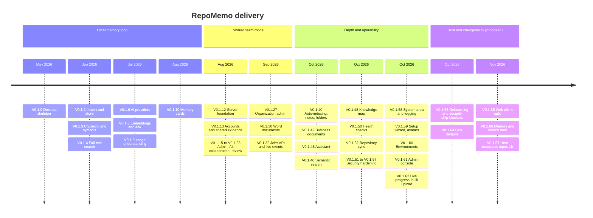

# RepoMemo Roadmap

> **Current version:** `V0.1.62` (2026-10-10) · **Unreleased on main:** onboarding and API tokens (migration 0023)
> **Related:** [Functional mindmap](FUNCTIONAL_MINDMAP.md) · [Technical mindmap](TECHNICAL_MINDMAP.md) · [Security review 2026-10-10](security/2026-10-10-security-review.md) · [Enhancement analysis 2026-10-13](analysis/2026-10-13-enhancement-analysis.md) · [Implementation tracker](../docs/IMPLEMENTATION_TRACKER.md)

RepoMemo started as a local-first desktop workbench. It is now a **self-hosted team product**: a shared API server with a web client, organizations and roles, collaboration, git repositories as living sources, business documents, and optional AI grounded in cited evidence. A server can be installed and administered entirely from the browser (environment menu, first-run setup, System area, admin console).

Between V0.1.32 and V0.1.62 the work went into **depth and operability**. Background indexing, semantic search, the assistant, the knowledge map, health checks, repository sync, security hardening, the System area and live progress all shipped. **Onboarding without an account** (invitation links, reset links, personal access tokens) is built and waiting for release.

The next stretch is about **trust and changeability** more than new surface. That means fixing the open security findings (some must ship with onboarding), adding CI, splitting the web client, then making memory and search more trustworthy before remote repositories and scale work. The reasoning and evidence are in the [enhancement analysis](analysis/2026-10-13-enhancement-analysis.md). Item IDs below (F, S, P, C, O) refer to it.

> ⚠️ **Version strings.** `Cargo.toml`, both `package.json` files and `tauri.conf.json` still say `0.1.60`, so System › Overview and the console report 0.1.60 on a V0.1.62 server. Item C9 fixes this.

---

## At a glance

| Stage | Status |
|---|---|
| Phase 1: Local memory loop (1A–1H) | ✅ Complete |
| Phase S: Shared team mode | ✅ Complete |
| Phase D: Depth and operability (V0.1.33–V0.1.62) | ✅ Complete |
| Onboarding and API tokens | 🔄 Built, not yet released (target V0.1.63, with S1) |
| Security review 2026-10-10 (4 high, 12 medium, 10 low) | 🔜 Nothing patched yet; scheduled in S1–S5 |
| Repository indexing (git) | ✅ Phase 1 (local, auto-sync) · 🔜 1b polish · 🔜 phase 2 remote · 💭 phase 3 git awareness |
| Admin console | ✅ First slice, terminal client, token sign-in · 🔜 follow-ups (F9) |
| Next: trust and changeability | 🔜 Proposed (see *Next*) |
| Later: connectors, scale-out, enterprise | 💭 Direction |

---

## ✅ Delivered

### Phase 1: Local memory loop (desktop)

The goal was to run the whole local loop with AI kept optional: *create workspace → import → inspect → search → ask with citations → save memory*.

| Phase | Version | Delivered |
|---|---|---|
| 1A Skeleton | V0.1.0 | Tauri + React shell, Rust workspace, SQLite schema, workspaces |
| 1B Import and store | V0.1.2 | File and folder import, content-addressed blob store, artifacts view, ADRs 0002–0004 |
| 1C Chunking | V0.1.3 | Markdown chunking by heading, 100-line windows for code and text, indexing jobs |
| 1E Code symbols | V0.1.3 | tree-sitter symbols for TS/TSX/JS, Python and Rust, file outlines |
| 1D Full-text search | V0.1.4 | SQLite FTS5, safe query building, filters, highlighted snippets |
| 1F AI provider layer | V0.1.6–0.1.7 | Ollama (local) and OpenRouter (cloud, with explicit acknowledgement), cited summaries |
| 1G Semantic search and Ask | V0.1.8 | Local embeddings, hybrid retrieval, cited answers, "insufficient context" guard |
| Image understanding | V0.1.9 | Vision-provider descriptions make images searchable |
| 1H Memory cards | V0.1.10 | Durable cards with evidence links, search and Markdown export |

The detailed specs are in [docs/phases/](../docs/phases).

### Phase S: Shared team mode (server + web)

| Milestone | Version | Delivered |
|---|---|---|
| Server foundation | V0.1.12 | `repomemo-server` (Axum), health and session routes, worker process boundary |
| Accounts and shared evidence | V0.1.13 | Registration and login (Argon2 + JWT), organizations, workspaces, text evidence, indexing, search, memory, and the **web client** |
| File uploads | V0.1.14 | Upload of evidence files up to 10 MiB |
| Workspace membership | V0.1.15 | Add, change and remove members, with role rules |
| Workspace admin and AI | V0.1.16 | Rename and delete, capabilities, per-workspace AI providers, AI overview, activity log |
| Ask in shared mode | V0.1.17 | Cited Q&A, provider test, memory search |
| Retrieval depth | V0.1.18–0.1.19 | Artifact query filters, retrieval facets (type, language, source) |
| Profiles and metrics | V0.1.20 | User profile, password change, "workspace pulse" metrics |
| Collaboration | V0.1.21 | Task board, evidence comments, assigned tasks, activity calendar |
| Review and notifications | V0.1.22 | Evidence lifecycle (verified, outdated, superseded) with history, notifications, @mentions |
| Workflow depth | V0.1.23 | Saved searches, task checklists |
| Web experience | V0.1.24–0.1.29 | Dashboard, organization switcher, notifications page, profile page, workspace sections, grid and list evidence views |
| Organization administration | V0.1.27 | Organization rename and member management, with access flowing to all org workspaces |
| Word documents | V0.1.30–0.1.31 | `.doc`/`.docx` text extraction, indexing, Documents section with preview |
| Jobs API and live events | V0.1.32 | Job kinds, cooperative cancel, job listing, **SSE event stream** for job and activity events |

### Phase D: Depth and operability (V0.1.33–V0.1.62)

| Milestone | Version | Delivered |
|---|---|---|
| Automatic and incremental indexing | V0.1.33–0.1.40 | Notes and uploads are indexed in the background with retries (30 s, 2 min, 10 min) and restart recovery. Failure reasons are stored and shown (migration 0012). Unchanged chunks keep their identity and embeddings. An `INDEXER_VERSION` bump refreshes older indexes. Code chunking follows declarations |
| Notes and folders | V0.1.40 | TipTap rich-text notes stored as Markdown, nested evidence folders up to 5 levels (migration 0013) |
| Business documents | V0.1.42–0.1.43 | Excel, PowerPoint, PDF, OneNote and Outlook text extraction and previews. Signed "Open in Office" links. Layout-accurate PDF previews through LibreOffice when installed |
| Workspace assistant | V0.1.45 | Closed capability router (find files, search, summarize, ask, overview) with stored per-user conversations (migration 0014) |
| Semantic search in shared mode | V0.1.46 | Embedding providers (Ollama, OpenRouter), a background embedding queue, hybrid FTS + vector search with rank fusion in Retrieval, Ask and the assistant, and an LLM rerank in Ask |
| Knowledge map | V0.1.48 | Indexing pipeline, coverage per kind, and a relation graph of similar files and memory-card citations |
| Workspace health | V0.1.50 | Deterministic checks (older versions, duplicates, removed symbols still mentioned, outdated references, failed indexing, unconnected files), each with actions and recorded outcomes (migration 0015) |
| Repository sync, phase 1 | V0.1.52–0.1.56 | Local git repositories as living sources (migration 0017). The branch is polled and synced when it moves. One evidence item per repository with a content overview, stack detection and an on-request cited AI summary |
| Security hardening | V0.1.51–0.1.57 | Rotating refresh tokens, session versions and "sign out everywhere", encrypted provider keys, sign-in throttling and lockout, workspace AI policy and per-user quotas, provider-URL and repository-root guards, security headers, typed 404s, blob garbage collection and hourly maintenance (migrations 0016, 0018) |
| System area | V0.1.58 | Overview, usage, users, run-time settings, logs (live and daily files, per-category levels), jobs and maintenance, audit trail (migration 0019) |
| Setup, avatars, app administrators | V0.1.59 | First-run setup wizard with a one-time code, profile pictures, app administrators without wildcard access (migrations 0020–0022) |
| Environment folders | V0.1.60 | Choose, create, verify and detach data environments under `workspace-data/` from the browser |
| Admin console | V0.1.61 | System › Console and the `repomemo-console` terminal client, with dry runs and audited changes |
| Daily-use polish and live progress | V0.1.62 | AI output rendered as Markdown with numbered citations; safe search highlights; several citations per memory card; **Save as memory** from Ask and the overview; several files or whole folders per upload (three at a time, with progress); **live progress** over a fetch-based event-stream reader (ledger, artifact page, repositories, tasks, memory, activity, a status strip with Stop) and `GET /v1/system/events` for System › Jobs, with polling as the fallback; the assistant docked beside every workspace section; the chosen environment remembered across restarts (`workspace-data/.last-environment`) unless one is pinned |

---

## 🔄 In progress

### Onboarding and API tokens (unreleased, target V0.1.63)

Built after V0.1.62, with migration 0023. **Ship together with security bundle S1** (see *Next*). Accepting an invitation goes through the same membership code as H1 in the security review, so releasing it alone would make that issue reachable by link.

- [x] **Invitation links.** Workspace and organization administrators create a link for one email address and a role, and pass it on themselves (no mail server needed). It works once, expires after 7 days, can be withdrawn, and lets the person create an account even when registration is closed. Accepting checks again that the inviter may still grant the role, and never lowers a role the person already has. Adding a member whose email has no account offers the invitation instead.
- [x] **Password reset links.** System › Users › *Create password reset link* gives a one-time link valid 24 hours. Using it sets the new password, signs out every device and lifts sign-in lockouts. App administrators cannot reset a system administrator's password. The sign-in page tells people to ask for one.
- [x] **Personal access tokens.** Profile › API tokens: read-only or read and write, 7, 30, 90 or 365 days, shown once, revocable, with the last use shown. They work as `Authorization: Bearer rmp_…` and as `REPOMEMO_TOKEN` for `repomemo-console`. They never manage tokens, change passwords, grant roles, accept invitations or detach the environment. A read-only token can also search and ask, and run console dry runs. An administrator's *Sign out everywhere* also revokes the user's tokens.
- [ ] Before release (S1): token limits as a route marker instead of a path denylist (L2), link secrets in the URL fragment (L3), membership propagation fixed (H1).
- [ ] Later: sending invitations and reset links by email (F6), a console command for reset links and a System view of every user's tokens (F9), revoking tokens when a reset link is used.

### Repository indexing

Design and limits: [technical/repository-sources.md](technical/repository-sources.md).

- [x] **Phase 1: local repositories and the sync engine.** Includes automatic sync when the branch moves, `REPOMEMO_REPO_ROOTS` and the UNC guard.
- [ ] **Phase 1b: polish (F4).** Renames with edits (`git diff -M`; a file renamed *and* edited currently loses its history), the commit shown on search results and citations, and Tauri commands so the desktop app gets the same section (depends on the desktop decision, F10).
- [ ] **Phase 2: remote repositories (F4).** Connect by URL with an encrypted token, partial bare clone under the data directory, scheduled fetch, `https`/`ssh` only. **After S3** (H3, L8).
- [ ] **Phase 3: git awareness.** Last author and date per file, `CODEOWNERS` ownership hints, commit-pinned citations, push webhooks, issue and pull-request links.

### Admin console

Design and open questions: [technical/admin-console.md](technical/admin-console.md).

- [x] **First slice** and the **terminal client** (`repomemo-console`).
- [x] **Script sign-in** with personal access tokens (`REPOMEMO_TOKEN`), unreleased.
- [ ] **Live logs (F9).** `logs --follow`, by adding log events to the system stream that V0.1.62 introduced for jobs.
- [ ] **More commands (F9).** `users reset-link`, `tokens list`, and `workspace reindex`, `repo sync`, `embeddings rebuild` once the role rule for app administrators is decided.

### Background jobs (re-scoped)

- [x] Automatic background indexing, embedding and repository-sync queues with restart recovery, retries and failure reasons.
- [x] Incremental re-index.
- [x] Live progress in the web client (V0.1.62).
- [ ] **Async manual index endpoints.** `POST …/index` still runs inside the request. The web client uses it only for the admin re-index of one artifact, so this is minor.
- [ ] **Worker claims jobs.** Moved to *Later (scale-out)*; whether to keep the stub at all is item C12.

---

## 🔜 Next: trust and changeability (proposed)

These come from checking the code at V0.1.62 and the unreleased work. The [enhancement analysis](analysis/2026-10-13-enhancement-analysis.md) has the evidence for each item and the [security review](security/2026-10-10-security-review.md) has the details of every S item. The order is a proposal.

### Proposed releases

| Release | Theme | Items | Why in this order |
|---|---|---|---|
| **V0.1.63** | Onboarding, safely | Onboarding and API tokens, **S1** (H1, H4, L2, L3, M7), **C8** CI, **C9** one version source | Invitations widen H1, and tokens are cheapest to fix before anyone scripts against them. CI and a correct version make every later release checkable |
| **V0.1.64** | Safe defaults | **S2** (registration closed after setup, split System permissions, HTTPS checks, proxy address, lockout), **S4** (no remote images in AI Markdown, CSP for the SPA and Tauri, refresh-token cookie) | Now that invitations cover onboarding, open registration is no longer needed by default |
| **V0.1.65** | Web client foundation | **C1** split `SharedWebApp.tsx`, **C2** router and query cache, **C3** frontend tests, **P6** route-level code splitting, **C7** generated types | Every product item below touches this file. Splitting it first makes them cheaper and safer |
| **V0.1.66** | Memory and search you can trust | **F1** memory-card staleness and citation editing, **F2** search by lifecycle, folder and date, **F3** symbol search on the web, **F8** live map and health | The product's core promise: knowledge that stays true and trusted evidence first |
| **V0.1.67** | Host exposure, repositories 1b | **S3** (provider URL allowlist and DNS pinning, repository roots required, git hardening, LibreOffice sandbox), **F4** phase 1b | S3 must land before remote clones |
| **V0.1.68+** | Scale and operations | Timing spans first, then **P1–P5** (vector index, SQL-side query and metrics, batched dashboard, cached map and health), **O1** backup and restore, **F4** phase 2 remote repositories, **S5** robustness | Measure before optimizing; operators need backups before trusting real data |

### Product features

| ID | Item | Size |
|---|---|---|
| F1 | **Memory that stays true.** A health detector for cards whose cited passages changed or disappeared, *needs review* on the card, and citation editing (`PUT /v1/memory-cards/{id}` takes citations) | S–M |
| F2 | **Search by trust.** Filter by lifecycle status (hide outdated and superseded by default), folder and date; a small boost for verified evidence | S |
| F3 | **Symbol search on the web.** Symbols are already extracted in shared mode; add a route, a Retrieval filter and assistant lookups | S |
| F4 | **Repositories 1b → 2** (see *In progress*) | M → L |
| F5 | **Assistant memory.** The last few turns go with each message; search across all of the caller's workspaces | M |
| F6 | **Mail delivery** (SMTP in System › Settings) for invitations, reset links, mentions and assignments, then email verification for self-registration | M |
| F7 | **Evidence ergonomics.** Move folders, multi-select actions, upload a new version of a file into the same artifact | M |
| F8 | **Live map and health** from the event stream | S |
| F9 | **Console follow-ups** (see *Admin console*) | S–M |
| F10 | **Desktop decision.** Make the desktop app a client of a server, or freeze it as the local-loop edition. It lags far behind the web client (no notes, folders, repositories, documents or assistant) | Decision |

### Security (from the 2026-10-10 review)

| ID | Bundle | Review IDs | Size |
|---|---|---|---|
| S1 | Ship-blockers for onboarding | H1, H4, L2, L3, M7 | S–M |
| S2 | Safe defaults | M1, M8, M9, M3, L10 | M |
| S3 | Host exposure | H2, H3, L8, M10 | M |
| S4 | Browser hardening | M5, L9, M2, M6 | M |
| S5 | Robustness and supply chain | M11, M12, L1, L5, L6, L7, dependency scanning | M |

Each fix comes with a test that locks it in: a viewer of one workspace has no role in its siblings (H1), every account-security route in the router refuses tokens, found by walking the router rather than from a list (L2), and a Markdown image in an AI answer is not rendered (M5).

### Platform performance

| ID | Item | Size |
|---|---|---|
| P0 | **Measure.** Debug-level timing spans for search, Ask, metrics, map and health, visible in System › Logs | S |
| P1 | Vector search without a full scan: a per-workspace in-memory index, then sqlite-vec if needed | M |
| P2 | `artifacts/query` filtering, counting and paging in SQL | S |
| P3 | Workspace metrics as SQL aggregates | S–M |
| P4 | One `GET /v1/dashboard` call instead of one metrics call per workspace | S |
| P5 | Knowledge map and health cached per workspace content version | M |
| P6 | Route-level code splitting of the web bundle (no lazy loading today) | S |
| P7 | A query cache with targeted invalidation instead of `load()` refetching six endpoints after every change | M |
| P8 | Configurable indexing and embedding concurrency; one writer connection plus a read pool | M |
| P9 | Time and memory budgets for document parsers (also M11) | M |

### Code health

| ID | Item | Size |
|---|---|---|
| C1 | Split `SharedWebApp.tsx` (2,787 lines, 202 KB, 150 `useState`) by route and section | M |
| C2 | A router module and TanStack Query | M |
| C3 | Frontend tests (Vitest + Testing Library): API client refresh, live events, Markdown safety, folder upload walker | S–M |
| C4 | Split `apps/server/src/lib.rs` (8,531 lines) into route modules per domain | M |
| C5 | Split `crates/storage/src/lib.rs` (6,206 lines) the same way | M |
| C6 | Typed errors instead of substring matching in `map_storage_error` / `map_core_error` | M |
| C7 | TypeScript types generated from the Rust DTOs (`ts-rs` or `specta`) | S–M |
| C8 | CI: fmt, clippy, tests, typecheck, frontend tests, `cargo deny`, `npm audit` | S |
| C9 | One version source set by a release script (code says 0.1.60 at V0.1.62) | S |
| C10 | Dependency hygiene: one `reqwest` (0.12 and 0.13 today), one `quick-xml`, Vite 5 → current | S |
| C11 | Split `styles.css` (6.2k lines) per component after C1 | M |
| C12 | Decide on the `apps/worker` stub: remove it or give it the durable queue | Decision |

### Operations

| ID | Item | Size |
|---|---|---|
| O1 | Backup and restore of an environment (database snapshot, blobs, `secret.key`) from System and the console | M |
| O2 | Workspace export and import as an archive | M |
| O3 | Production guide: static SPA with CSP, TLS proxy, Windows service and systemd units | S |
| O4 | Quotas per workspace and user, and a free-disk floor shown in System › Overview | M |
| O5 | OpenMetrics export of the counters System › Overview already keeps | S |

### Documentation

- Keep the mindmaps current with each release (aligned to V0.1.62 on 2026-10-13).
- Refresh `PRODUCT.md` (still describes a desktop-only product), retire or redirect `docs/IMPLEMENTATION_TRACKER.md` (covers only phases 1A–1H), and publish a Postman v5 collection with the onboarding routes.
- Grow the planned branch pages, starting with `technical/auth-and-authorization.md` (needed by S1 and S2) and `technical/operations.md` (needed by O1 and O3).

---

## 💭 Later: strategic direction

| Direction | Scope |
|---|---|
| **Git awareness** | Repository phase 3: ownership hints, commit-pinned citations, push webhooks, commit and PR relationships |
| **Issue and PR connectors** | GitHub/GitLab first, then Linear/Jira. Link issues and PRs to artifacts and symbols. Personal access tokens already let CI push ADRs, runbooks and release notes as evidence |
| **Assistant depth** | Beyond F5: a keyboard command palette, and actions that propose memory cards and tasks for a person to confirm |
| **Scale-out team server** | PostgreSQL, object storage, a durable job queue claimed by `repomemo-worker`, shared rate-limit counters, and Qdrant when vector search needs a service (see [ADR-0004](../docs/decisions/0004-embedded-vector-storage-before-qdrant.md)) |
| **Enterprise / hosted** | SSO, permission-aware retrieval, audit export, policy controls and redaction, account deletion policy (creator foreign keys currently block it), hosted and self-hosted deployment |

---

## Guiding rules (unchanged)

- **Storage first, AI second.** Every AI feature operates on indexed, inspectable evidence and returns citations.
- **Useful without AI.** Storing, browsing, indexing and search must keep working with no provider configured.
- **Cloud is explicit.** No content leaves the server until an admin enables a cloud provider and acknowledges it.
- **Show state.** Storage, indexing progress, provider status and errors are always visible.
