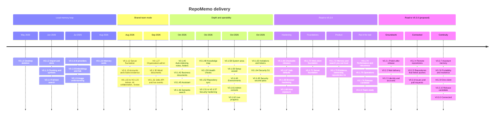

# RepoMemo Roadmap

> **Current version:** `V0.1.76` (2026-10-14), the release candidate for `V0.2.0` *Team-ready* · **Next minor after it:** `V0.3.0` *Connected* (proposed 2026-10-14)
> **Feature freeze (since V0.1.76):** only fixes from the release candidate go into V0.2.0; new work waits for V0.3.0.
> **Related:** [Functional mindmap](FUNCTIONAL_MINDMAP.md) · [Technical mindmap](TECHNICAL_MINDMAP.md) · [Security review 2026-10-10](security/2026-10-10-security-review.md) · [Enhancement analysis 2026-10-13](analysis/2026-10-13-enhancement-analysis.md)

RepoMemo started as a local-first desktop workbench. It is now a **self-hosted team product**: a shared API server with a web client, organizations and roles, collaboration, git repositories as living sources, business documents, and optional AI grounded in cited evidence. A server can be installed and administered entirely from the browser (environment menu, first-run setup, System area, admin console).

Between V0.1.32 and V0.1.62 the work went into **depth and operability**. V0.1.63 added **onboarding without an account** (invitation links, reset links, personal access tokens). V0.1.64 and V0.1.65 fixed the most urgent security findings: bundle S1, and a second pass that included a stored XSS.

**V0.2.0 is proposed as the first *team-ready* release**: a server a team can install, expose and trust with its knowledge. That means secure by default, deployable and recoverable, checked on every commit, and keeping its core promise that memory stays true. The plan to get there is [Road to V0.2.0](#-road-to-v020); every release of it is built and only the clean-machine install (R6) remains before the tag.

**V0.3.0, *Connected*,** is proposed next: remote repositories, mail, issues and pull requests, an assistant that remembers the conversation, portable workspaces and one client. The plan is [Road to V0.3.0](#-road-to-v030).

> **Versions** are set in one place since V0.1.66 (`npm run version:set -- <version>`), checked in CI, and recorded in [CHANGELOG.md](../CHANGELOG.md).

---

## At a glance

| Stage | Status |
|---|---|
| Phase 1: Local memory loop (1A–1H) | ✅ Complete |
| Phase S: Shared team mode | ✅ Complete |
| Phase D: Depth and operability (V0.1.33–V0.1.65) | ✅ Complete |
| Security review 2026-10-10, second and third passes | ✅ Every finding fixed, mitigated or accepted in writing (V0.1.76); R2-4 and R2-5 scheduled for V0.2.8 |
| Road to V0.2.0 (V0.1.66–V0.1.76) | 🔄 V0.1.66–V0.1.75 built; V0.1.76 is the release candidate, R6 (clean install) open |
| Road to V0.3.0 (V0.2.1–V0.2.10) | 🔜 Proposed 2026-10-14; decisions 7–14 to agree |
| V0.4.0 and later: scale-out, single sign-on, hosted | 💭 Direction |

---

## ✅ Delivered

### Phase 1: Local memory loop (desktop)

The goal was to run the whole local loop with AI kept optional: *create workspace → import → inspect → search → ask with citations → save memory*.

| Phase | Version | Delivered |
|---|---|---|
| 1A Skeleton | V0.1.0 | Tauri + React shell, Rust workspace, SQLite schema, workspaces |
| 1B Import and store | V0.1.2 | File and folder import, content-addressed blob store, artifacts view, ADRs 0002–0004 |
| 1C Chunking | V0.1.3 | Markdown chunking by heading, 100-line windows for code and text, indexing jobs |
| 1E Code symbols | V0.1.3 | tree-sitter symbols for TS/TSX/JS, Python and Rust, file outlines |
| 1D Full-text search | V0.1.4 | SQLite FTS5, safe query building, filters, highlighted snippets |
| 1F AI provider layer | V0.1.6–0.1.7 | Ollama (local) and OpenRouter (cloud, with explicit acknowledgement), cited summaries |
| 1G Semantic search and Ask | V0.1.8 | Local embeddings, hybrid retrieval, cited answers, "insufficient context" guard |
| Image understanding | V0.1.9 | Vision-provider descriptions make images searchable |
| 1H Memory cards | V0.1.10 | Durable cards with evidence links, search and Markdown export |

The detailed specs are in [docs/phases/](../docs/phases).

### Phase S: Shared team mode (server + web)

| Milestone | Version | Delivered |
|---|---|---|
| Server foundation | V0.1.12 | `repomemo-server` (Axum), health and session routes, worker process boundary |
| Accounts and shared evidence | V0.1.13 | Registration and login (Argon2 + JWT), organizations, workspaces, text evidence, indexing, search, memory, and the **web client** |
| File uploads | V0.1.14 | Upload of evidence files up to 10 MiB |
| Workspace membership | V0.1.15 | Add, change and remove members, with role rules |
| Workspace admin and AI | V0.1.16 | Rename and delete, capabilities, per-workspace AI providers, AI overview, activity log |
| Ask in shared mode | V0.1.17 | Cited Q&A, provider test, memory search |
| Retrieval depth | V0.1.18–0.1.19 | Artifact query filters, retrieval facets (type, language, source) |
| Profiles and metrics | V0.1.20 | User profile, password change, "workspace pulse" metrics |
| Collaboration | V0.1.21 | Task board, evidence comments, assigned tasks, activity calendar |
| Review and notifications | V0.1.22 | Evidence lifecycle (verified, outdated, superseded) with history, notifications, @mentions |
| Workflow depth | V0.1.23 | Saved searches, task checklists |
| Web experience | V0.1.24–0.1.29 | Dashboard, organization switcher, notifications page, profile page, workspace sections, grid and list evidence views |
| Organization administration | V0.1.27 | Organization rename and member management, with access flowing to all org workspaces |
| Word documents | V0.1.30–0.1.31 | `.doc`/`.docx` text extraction, indexing, Documents section with preview |
| Jobs API and live events | V0.1.32 | Job kinds, cooperative cancel, job listing, **SSE event stream** for job and activity events |

### Phase D: Depth and operability (V0.1.33–V0.1.65)

| Milestone | Version | Delivered |
|---|---|---|
| Automatic and incremental indexing | V0.1.33–0.1.40 | Notes and uploads are indexed in the background with retries (30 s, 2 min, 10 min) and restart recovery. Failure reasons are stored and shown (migration 0012). Unchanged chunks keep their identity and embeddings. An `INDEXER_VERSION` bump refreshes older indexes. Code chunking follows declarations |
| Notes and folders | V0.1.40 | TipTap rich-text notes stored as Markdown, nested evidence folders up to 5 levels (migration 0013) |
| Business documents | V0.1.42–0.1.43 | Excel, PowerPoint, PDF, OneNote and Outlook text extraction and previews. Signed "Open in Office" links. Layout-accurate PDF previews through LibreOffice when installed |
| Workspace assistant | V0.1.45 | Closed capability router (find files, search, summarize, ask, overview) with stored per-user conversations (migration 0014) |
| Semantic search in shared mode | V0.1.46 | Embedding providers (Ollama, OpenRouter), a background embedding queue, hybrid FTS + vector search with rank fusion in Retrieval, Ask and the assistant, and an LLM rerank in Ask |
| Knowledge map | V0.1.48 | Indexing pipeline, coverage per kind, and a relation graph of similar files and memory-card citations |
| Workspace health | V0.1.50 | Deterministic checks (older versions, duplicates, removed symbols still mentioned, outdated references, failed indexing, unconnected files), each with actions and recorded outcomes (migration 0015) |
| Repository sync, phase 1 | V0.1.52–0.1.56 | Local git repositories as living sources (migration 0017). The branch is polled and synced when it moves. One evidence item per repository with a content overview, stack detection and an on-request cited AI summary |
| Security hardening | V0.1.51–0.1.57 | Rotating refresh tokens, session versions and "sign out everywhere", encrypted provider keys, sign-in throttling and lockout, workspace AI policy and per-user quotas, provider-URL and repository-root guards, security headers, typed 404s, blob garbage collection and hourly maintenance (migrations 0016, 0018) |
| System area | V0.1.58 | Overview, usage, users, run-time settings, logs (live and daily files, per-category levels), jobs and maintenance, audit trail (migration 0019) |
| Setup, avatars, app administrators | V0.1.59 | First-run setup wizard with a one-time code, profile pictures, app administrators without wildcard access (migrations 0020–0022) |
| Environment folders | V0.1.60 | Choose, create, verify and detach data environments under `workspace-data/` from the browser |
| Admin console | V0.1.61 | System › Console and the `repomemo-console` terminal client, with dry runs and audited changes |
| Daily-use polish and live progress | V0.1.62 | AI output rendered as Markdown with numbered citations; safe search highlights; several citations per memory card; **Save as memory** from Ask and the overview; several files or whole folders per upload (three at a time, with progress); **live progress** over a fetch-based event-stream reader (ledger, artifact page, repositories, tasks, memory, activity, a status strip with Stop) and `GET /v1/system/events` for System › Jobs, with polling as the fallback; the assistant docked beside every workspace section; the chosen environment remembered across restarts (`workspace-data/.last-environment`) unless one is pinned |
| Onboarding and API tokens | V0.1.63 | **Invitation links** for one email address and role, single-use, 7 days, withdrawable, usable even when registration is closed, re-checked against the inviter's rights on acceptance and never lowering a role; **password reset links** issued in System › Users (one-time, 24 hours, end every session, lift lockouts; app administrators cannot reset a system administrator); **personal access tokens** (`rmp_…`, read-only or read and write, 7–365 days, revocable, last use shown) for scripts, CI and `repomemo-console` (migration 0023) |
| Security ship-blockers (S1) | V0.1.64 | **H1:** adding someone to one workspace, directly or by invitation, gives that workspace only; their organization shows as a guest entry. **H4:** registering an address listed in `REPOMEMO_SYSTEM_ADMIN_EMAILS` grants nothing; only accounts that exist at startup are promoted. **L2:** token limits are marked on the handlers (`SessionSubject`, `ReadingSubject`) instead of a path denylist. **L3:** link secrets are in the URL fragment (`/invite#…`, `/reset-password#…`), with `no-referrer`; older path links are moved to the fragment. **M7:** only `VITE_` and `TAURI_ENV_` variables reach the bundle. People added before V0.1.64 keep the wider access they received; review organization members once |
| Security second pass | V0.1.65 | **N1 (high):** stored XSS through image previews closed; content types come from the file name, never the uploader (also I3), and previews open in a tab only for raster images. **N2:** run-time settings need a signed-in session. **N3:** owners keep their role, and organization changes never take a workspace from its owner. **N4:** viewers no longer change their old comments or tasks; saved searches are deleted by their author or an administrator. **N5:** a used reset link revokes personal access tokens. **N6:** the synchronous whole-workspace re-index is for administrators |

---

## 🎯 Road to V0.2.0

### What V0.2.0 means

A minor version marks a promise, not a pile of features. **V0.2.0, *Team-ready*,** promises that a team can install RepoMemo on a server others can reach, rely on it daily and recover it when something goes wrong. Concretely:

| Pillar | Promise | How it is checked |
|---|---|---|
| **Secure by default** | Every finding of the security review and its second pass is fixed, or accepted in writing with its mitigation. A fresh install is closed to strangers | Review status table shows no open item; a third pass before the release candidate finds nothing high or medium |
| **Checked on every commit** | Formatting, lints, Rust and web tests, type checks and dependency audits run in CI, and one version number is set in one place | CI green on `main`; System › Overview shows the real version |
| **Deployable and recoverable** | A documented production setup (TLS proxy, timeouts, service), backups that restore, quotas that protect the disk | The guide is followed on a clean machine; a backup is restored into a new environment and opens |
| **Memory stays true** | Memory cards say when their evidence changed; search can put trusted evidence first; code symbols are searchable | Feature tests, and the functional mindmap's gaps table is empty for these |
| **Changeable** | The web client and the server are split into modules with tests, so the next minor can move fast | No module over ~2,000 lines in `apps/server/src`, `crates/storage/src` or the shared web client (stylesheets and the frozen desktop `App.tsx` excepted) |
| **Fast enough to trust** | Search, Ask, the dashboard, map and health stay quick on a large workspace | Timings recorded for a 50,000-passage workspace in the release notes; targets in V0.1.74 |
| **Upgradable** | An environment from V0.1.40 or later upgrades in place, with a changelog and upgrade notes | Upgrade test on stored environments in CI |

**Out of scope for V0.2.0**, and proposed as V0.3.0 candidates: remote repositories (phase 2), mail delivery and email verification, assistant memory across turns, workspace export and import, connectors, and anything for scale-out. Each is valuable, but each widens the surface the V0.2.0 promise has to cover.

### Release plan

Each release is shippable on its own; the order puts what makes later work safer first.

| Release | Theme | Contents (IDs from the backlog below) | Why here |
|---|---|---|---|
| **V0.1.66** | Checkable releases | C8, C9, C10, P0, D1 | Every later release is then built, tested and versioned the same way, and P0 measures before any optimizing |
| **V0.1.67** | Safe defaults and identity | S2 (M1, M3, M4, M8, M9, L10, N2 residual), L4, L7 | Invitations made open registration unnecessary; this closes the biggest default risks |
| **V0.1.68** | Browser hardening | S4 (M2, M5, M6, L9), L3 follow-up | Turns any future injection from a takeover into a nuisance |
| **V0.1.69** | Host exposure | S3 (H2, H3, L8, M10) | The last two high findings; required before remote repositories |
| **V0.1.70** | Web client foundation | C1, C2, C3, C7, P6, P7 | Every product release after this touches the web client |
| **V0.1.71** | Server foundation | C4, C5, C6 (also L6), C12, N7, P8 | Same for the server; typed errors and timeouts land with the split |
| **V0.1.72** | Memory and search you can trust | F1, F2, F3, F8 | The product's core promise, on the new foundations |
| **V0.1.73** | Evidence, ownership, repositories 1b | F7, F11 (N8), F4 phase 1b, F9 | Daily ergonomics and the remaining integrity gap |
| **V0.1.74** | Performance and robustness | P1–P5, P9, S5 (M11, M12, L1, L5) | Measured by P0, on code that is now easy to change |
| **V0.1.75** | Operations | O1, O3, O4, O5, F9 backup commands | What an operator needs before trusting the server |
| **V0.1.76** | Release candidate | R1–R6 | Freeze features; prove the promise |
| **V0.2.0** | Team-ready | Fixes from the candidate only | — |

### Decisions (agreed 2026-10-13)

Each proposal below was accepted as written. They shape the releases named in the second column.

| # | Decision | Applies from | Agreed |
|---|---|---|---|
| 1 | **What app administrators are** (M8) | V0.1.67 | Read-only System pages plus jobs and maintenance; settings, users' sessions, lockouts and reset links stay with system administrators |
| 2 | **Where the refresh token lives** (M2) | V0.1.68 | An `HttpOnly; Secure; SameSite=Strict` cookie scoped to `/v1/auth/refresh`, which needs the SPA and API on the same site (one host behind the proxy) |
| 3 | **The desktop app's future** (F10) | V0.1.70 | Freeze it as the local-loop edition: security fixes only, labelled as such, and no ports of web features. Revisit as a server client in V0.3.0 |
| 4 | **The `apps/worker` stub** (C12) | V0.1.71 | Remove it; the durable queue belongs to the scale-out direction |
| 5 | **Mail in V0.2.0 or V0.3.0** (F6) | V0.1.67 | V0.3.0. Closed registration plus invitations covers M4 for V0.2.0 |
| 6 | **Version format** | V0.1.66 | Semantic versions: `0.2.0`, then `0.2.1` for fixes; tags `v0.2.0` |

### Release checklists

#### V0.1.66: Checkable releases

- [x] **C8 CI** (`.github/workflows/ci.yml`) on every push to `main` and every pull request. Blocking: versions agree, `cargo test` on Linux and Windows (desktop crate excluded), `npm run typecheck`, `cargo deny check advisories sources` for the server's dependencies (policy in `deny.toml`), `npm audit --omit=dev --audit-level=high`. Advisory for now: rustfmt, clippy `-D warnings`, licenses, duplicate crates and desktop-only advisories (they become blocking in V0.1.71)
- [x] **C9 one version source:** `npm run version:set -- <version>` (`scripts/set-version.mjs`) sets `Cargo.toml`, `Cargo.lock`, both `package.json` files, `package-lock.json` and `tauri.conf.json`; `npm run version:check` in CI; the code now says 0.1.66; `CHANGELOG.md` starts with V0.1.63–V0.1.66
- [x] **P0 timings:** search, Ask, metrics, the artifact query, the knowledge map and health record their duration and size under the `timing` target, in a new **Performance** log category (`log_performance_level`, debug to see them), filterable by workspace in System › Logs
- [x] **D1 documentation housekeeping:** `docs/IMPLEMENTATION_TRACKER.md` retired, `PRODUCT.md` describes the team product, Postman v5 collection with the onboarding routes (local, `docs/api/` is git-ignored)
- [x] **C10 dependencies** (V0.1.71): `quick-xml` 0.41 in `repomemo-ingestion` (closes RUSTSEC-2026-0194 and -0195) and a `cargo update`; the license, ban and advisory check is blocking. Vite 5 stays: the esbuild advisory reaches the development server only, and `npm audit --omit=dev` is clean. The remaining duplicates arrive through Tauri and only warn

#### V0.1.67: Safe defaults and identity

- [x] **M1** `REPOMEMO_ALLOW_REGISTRATION` defaults to `false`; the first account still registers, the setup wizard asks, and `/health` no longer carries `registration_open` (I2). Storage quotas stay with V0.1.75 (O4)
- [x] **M4** member adds refuse anyone not already in the organization or workspace with the same `409 invitation_required`, account or not, and the web app offers the invitation link. Registration itself stays distinguishable while it is open (no mail to verify with until V0.3.0), which is why it is closed by default
- [x] **M8** `require_full_system_admin` for settings, roles, sessions, lockouts, reset links, raw log files and detach; workspace activity records hidden from app administrators. Test `app_administrators_read_the_system_pages_and_changes_need_the_system_scope`
- [x] **N2 residual** the `system` token scope (migration 0024); System changes need a session or that scope
- [x] **M9** `check_transport` at startup, `REPOMEMO_ALLOW_INSECURE_HTTP` for a trusted network, HSTS for an HTTPS public URL, console warning
- [x] **M3** `ProxyTrust` (`REPOMEMO_TRUST_PROXY` plus loopback or `REPOMEMO_TRUSTED_PROXIES`), rightmost untrusted entry
- [x] **L10** a refresh token this browser holds bypasses a lockout (per-address counters were already separate from the account-wide bar of five times as many failures)
- [x] **L4** notifications `password_reset_issued` and `password_reset_used`
- [x] **L7** `validate_password`: common list, at least five different characters, no email name

#### V0.1.68: Browser hardening

- [x] **M5, L9** `SafeMarkdown` replaces every `react-markdown` use: images become a note with text and address, external links show their host and open with `noopener noreferrer`. The test of the image rule moves to the frontend test suite (C3, V0.1.70), which needs the test runner that release adds
- [x] **M2** the Vite build injects the policy as a meta tag and writes `content-security-policy.txt` (with `frame-ancestors`) for the host; the refresh token is an `HttpOnly; SameSite=Strict` cookie handled by `web_session.rs` for web clients. The cookie path is `/v1/auth` (not only `/v1/auth/refresh`) so sign-in and sign-out receive it
- [x] **M6** strict `csp` and a `devCsp` that adds the Vite dev server
- [x] **L3 follow-up** the web app keeps the secret in memory and replaces the history entry

#### V0.1.69: Host exposure

- [x] **H2** built-in list (`127.0.0.1`, `localhost`, `::1`, `openrouter.ai`) unless `REPOMEMO_AI_ALLOWED_HOSTS` says otherwise (`*` for everything); a checking DNS resolver filters every connection (public addresses only for the built-in list); provider bodies go to the log, not to the user
- [x] **H3** `RepoLinkPolicy::disabled()` on a server without roots (disabled, not defaulted: an operator opts in by naming folders); the refusal outside the roots does not depend on whether the path exists
- [x] **L8** `repomemo_git::harden`: `protocol.allow=never` (the https/ssh allowlist arrives with remote repositories), no system or global configuration, no submodule recursion, `safe.directory` only for the configured folders
- [x] **M10** scrubbed environment, `REPOMEMO_SOFFICE_WRAPPER` for the operator's sandbox command, version and sandbox state in System › Overview and the server check. The sandbox itself is the operator's (recipes follow in the production guide, V0.1.75)

#### V0.1.70: Web client foundation

- [x] **C1** `SharedWebApp.tsx` is the shell; `src/web/` holds the pages (`WorkspaceDetail.tsx` is the largest at about 1,000 lines), `constants.ts`, `format.ts`, `router.ts`, `navigation.tsx`, `common.tsx`. Splitting the sections of the workspace page into components of their own comes with the next product work that touches them
- [x] **C2** `web/router.ts` (`Route`, `parseRoute`, `routePath`); `lib/queryClient.ts` and `lib/useServerState.ts` (cache-backed state with a `useState`-like setter) used by the workspace page. The dashboard, profile and detail pages still load their own data
- [x] **P7** `workspaceInvalidation` names what an event makes stale; `load()` is a full invalidation, used after bulk changes and on resync
- [x] **P6** `web/lazy.tsx`: System area (with the console), map, document viewer, editor, health and repository panels
- [x] **C7** `scripts/generate-types.mjs` reads `crates/domain` (a regular subset of Rust, failing loudly on anything else). Server-local response types (token response, setup, System) stay hand-written
- [x] **C3** 27 tests in `src/test/`: session renewal, live events, Markdown safety, upload filter, routes, image preview rules, query cache. The link pages are covered through the router and session tests; a rendering test of the invitation page needs the page split further

#### V0.1.71: Server foundation

- [x] **C4** 13 modules plus `tests/` (scripted, then compiled and tested unchanged); the largest is `system.rs` at 1,460 lines
- [x] **C5 + C6** nine storage modules; `repomemo_domain::{not_found, invalid, conflict}` and `classify`; the server maps by kind; unique violations are detected through sqlx, not text; the five handlers that returned storage errors as 400 use the mapping
- [x] **N7** `TimeoutLayer` as a `route_layer` before the stream routes are added; `serve.rs` is the accept loop with a header read timeout (tested with a half-sent request); `Telemetry::claim_event_stream` per account
- [x] **P8** `StorageEngine::reader()` serves 138 read statements, the writer pool has one connection; concurrency settings are environment variables listed in System › Overview. Not yet measured: the 50,000-passage run belongs to V0.1.74
- [x] **C12** removed
- [x] **C8 follow-up** `rustfmt.toml` (`max_width = 120`), every file formatted, clippy clean with `-D warnings`; the lint job and the licenses and bans job are blocking

#### V0.1.72: Memory and search you can trust

- [x] **F1** `StorageEngine::memory_review_reasons` (missing / retired / changed), `needs_review` on summaries, `review` on the detail, the `stale_memory_citation` detector, citations on `PUT /v1/memory-cards/{id}`. Because passages are identified by content, a cited passage that is still there has not changed; whole-file citations also count a later update
- [x] **F2** filters in `push_search_filters` (keyword and vector search), `favour_verified` in hybrid search (Ask and the assistant use it, and hide retired evidence by default)
- [x] **F3** `GET /v1/workspaces/{ws}/symbols`, a *Code symbols* box on Retrieval (a symbol search is not a filter of passage search: it answers where a name is defined), the `find_symbol` assistant capability
- [x] **F8** `useLiveRefresh` in both panels

#### V0.1.73: Evidence, ownership, repositories 1b

- [x] **F11 (N8)** `transfer_workspace_ownership` and `transfer_organization_ownership` (session only, owner only, activity and System audit); `remove_organization_member` refuses with 409 while the person owns a workspace of it
- [x] **F7** `StorageEngine::move_folder`, `POST …/artifacts/bulk`, `replace_artifact_content` (the content hash changes under the same id; indexing runs again)
- [x] **F4 phase 1b** `GitRepo::renamed_files` (`git diff --name-status -z -M50%`) pairs a vanished path with its new one during a sync; `SearchResult.commit` and `Citation.commit` come from `repo_files.commit_sha`. The desktop app does not get either (decision 3)
- [x] **F9** `logs --follow` is the terminal client polling with `--after`; `users reset-link` and `tokens list` are server commands

#### V0.1.74: Performance and robustness

- [x] **Targets**, at 50,000 passages: search under 300 ms and the dashboard under 500 ms (p95), map and health under 2 s on first load, then cached. Measured by `performance_at_scale` (`cargo test -p repomemo-storage --release performance_at_scale -- --ignored --nocapture`). The run recorded so far is a **debug build** (unoptimized SQLite included, so an upper bound): keyword search p95 406 ms, meaning search p95 919 ms and the first search 21 s while the index is built, figures p95 19 ms, content version 22 ms, file query 6 ms. The release-build run is **R4 in V0.1.76**
- [x] **P1** `crates/storage/src/vectors.rs`: one index per workspace (unit vectors in one `f32` matrix), checked by vector count on every search, updated in place by `upsert_embeddings`, rebuilt when the count differs; `REPOMEMO_VECTOR_INDEX_MB` bounds the memory and a workspace that does not fit falls back to the scan. The nearest vectors are widened until enough pass the filters. sqlite-vec stays unneeded until memory is the limit
- [x] **P2, P3, P4** `StorageEngine::query_artifacts` (filters, count and page in SQL), `workspace_artifact_stats` (`GROUP BY type` and language), `dashboard_counts` and `GET /v1/dashboard`; the dashboard page makes one call
- [x] **P5** `DerivedCache` keyed by `workspace_content_version` (counts and latest changes of files, passages, vectors, cards, links, states, health decisions, providers), ten-minute expiry
- [x] **P9, M11** `repomemo_ingestion::budget`: each reading on its own thread with `REPOMEMO_DOCUMENT_TIMEOUT_SECONDS`, abandoned readings counted and new ones refused after four; `heavy` rate limiter on search, symbols, metrics, map, health and the file query. A memory cap per reading is not done: it needs a subprocess
- [x] **M12** `BackgroundAiBudget` in `RepoMemoCore`, spent per embedding batch and per image description; the limit follows the run-time setting
- [x] **L1** 60-second links with a `jti`, `FileLinkUses` (first client, 30 s grace), `redacted_span` for request logs; **L5** `restrict_to_owner` in `secrets.rs`

#### V0.1.75: Operations

- [x] **O1** `apps/server/src/backup.rs`: `StorageEngine::snapshot_database` (`VACUUM INTO` on a read connection, so writers carry on), blobs copied with hard links to the previous backup's files, manifest written last and the folder renamed into place, `BackupStatus` polled by the page; restore into a new `workspace-data/<name>` folder (staged, then renamed) and verified by opening it; scheduled from the maintenance loop (`REPOMEMO_BACKUP_INTERVAL_HOURS`, `REPOMEMO_BACKUP_KEEP`). Console `backup list|create|restore|delete`. Not done: compressing or encrypting a backup, an offsite target (the guide shows rsync and robocopy)
- [x] **O3** [technical/operations.md](technical/operations.md): settings that must be right, nginx and Caddy with timeouts and unbuffered event streams, systemd and NSSM, readiness checks, limits, backup and restore drill, Prometheus scrape and alerts, the LibreOffice wrapper, upgrade and rollback, troubleshooting. Followed on a clean machine in V0.1.76 (R6)
- [x] **O4** `quotas.rs`: `check_incoming` (disk floor, storage per workspace, uploads per hour) on uploads, new versions and notes; `check_new_workspace`; `free_disk_bytes` (`GetDiskFreeSpaceExW` on Windows, `df` elsewhere) shown in System › Overview. Settings in the *Limits* group
- [x] **O5** `GET /v1/system/metrics`, an `Exposition` writer for the OpenMetrics text format; system administrators or a `system` token

#### V0.1.76: Release candidate (built, not yet released)

- [x] **R1** feature freeze: fixes only until V0.2.0 (see the note at the top)
- [x] **R2** third security pass: [review §12](security/2026-10-10-security-review.md#12-third-pass-2026-10-14-release-candidate-v0176). No high or medium; R2-1 (repository syncs ignored quotas) and R2-2 (key file copy in a backup) fixed; the status table is closed
- [x] **R3** `environments_from_older_versions_upgrade_in_place` (storage tests): V0.1.40, V0.1.52 and V0.1.65 schemas rebuilt from the migration files up to 13, 17 and 23, filled, upgraded and checked. The fixtures are synthesized from the migrations, not captured from old binaries
- [x] **R4** release-build run at 50,000 passages: meaning search p95 112 ms, keyword search p95 63 ms (target 300 ms), figures p95 6 ms and the dashboard's three grouped queries (target 500 ms), map 0.5 s and health 0.4 s on first load (target 2 s). Debug-build numbers (V0.1.74) were 10 times slower, which is why they were not the verdict
- [x] **R5** [api-reference](technical/api-reference.md) (generated), [auth-and-authorization](technical/auth-and-authorization.md), [operations](technical/operations.md), both mindmaps, `CHANGELOG.md`, [UPGRADING.md](../UPGRADING.md)
- [ ] **R6** a clean-machine install following only the production guide. **Needs the maintainer:** it needs a second machine and a running server, which this repository's rules keep from the automated work. `node scripts/smoke-test.mjs` is the checklist's last step; record the result here and fix what the guide got wrong before tagging 0.2.0

#### V0.2.0: Team-ready

- [ ] **R6** the clean-machine install (above), then the fixes it calls for
- [ ] Tag `v0.2.0`; the changelog's V0.1.66–V0.1.76 entries become the 0.2.0 release notes

---

## 🎯 Road to V0.3.0

> **Status:** proposed on 2026-10-14, not started. Work begins after `v0.2.0` is tagged. The decisions below need agreeing first.

### What V0.3.0 means

V0.2.0 made RepoMemo trustworthy on its own server. **V0.3.0, *Connected*,** promises that it reaches where the team's knowledge already lives, and that people can come and go with their knowledge intact:

| Pillar | Promise | How it is checked |
|---|---|---|
| **Reaches remote code** | A repository on GitHub, GitLab or any `https`/`ssh` host is linked by URL, kept current on a schedule or by push, and never needs a checkout on the server's disk | A link to a private repository syncs with a stored credential; a push arrives through a signed webhook; a clone that is too big, too slow or on a host not allowed is refused |
| **Talks by mail** | Invitations, reset links, mentions and assignments arrive by email; people reset a forgotten password themselves; addresses are verified | A mail sent through a test SMTP server; the "forgot password" answer is the same for every address; an unverified address cannot join |
| **Links the work around the code** | Issues and pull requests from GitHub and GitLab are evidence: searchable, citable, linked to the files and symbols they mention | A connected project's issues appear, update on change and show on the files they name |
| **Remembers the conversation** | The assistant answers follow-up questions in context, and people in several workspaces can search them together | A follow-up resolves "it" from the earlier turn; a cross-workspace search returns only what each workspace allows |
| **Portable** | A workspace moves between servers as an archive, and backups can be encrypted | An exported workspace imports on another server with its memory, citations, tasks and history; an encrypted backup restores only with its key |
| **One client** | The desktop app opens a RepoMemo server instead of keeping a separate local copy | The desktop shell signs in to a server and shows the same pages as the browser |
| **Still team-ready** | Everything V0.2.0 promised holds for the new surfaces | A fourth security pass on mail, webhooks, remote clones and connectors finds nothing high or medium; upgrade from 0.2.0 tested in CI |

**Out of scope for V0.3.0**, and kept for later: scale-out (PostgreSQL, object storage, a job queue across processes), single sign-on and enterprise policy controls, hosted deployment, and connectors beyond GitHub and GitLab (Linear, Jira).

### Release plan

As in the 0.1 line, each 0.2.x release is a themed, shippable step, and fixes ride along with the next one (decision 6 named the format, not a fixes-only rule).

| Release | Theme | Contents (IDs from the backlog below) | Why here |
|---|---|---|---|
| **V0.2.1** | Polish after release | Fixes reported against 0.2.0, C13, C11, C14, F9 workspace commands | Pays off the frontend residuals while 0.2.0 is fresh, before new surfaces land on the same pages |
| **V0.2.2** | Mail delivery | F6, F12 | Every later release sends mail (verification, digests, sync alerts) |
| **V0.2.3** | Identity and accounts | F13, F14, F15 | Verified addresses make registration safe to open; account deletion closes risk 12 |
| **V0.2.4** | Remote repositories | F4 phase 2, S6 | The largest product step; its security rules (hosts, credentials, sizes) come with it, not after |
| **V0.2.5** | Repositories that follow pushes | F16 | Webhooks and git awareness need remote repositories first |
| **V0.2.6** | Issues and pull requests | F17 | Uses the same credential store, host rules and webhook endpoint as V0.2.4–V0.2.5 |
| **V0.2.7** | Assistant memory | F5, F19 | More evidence (issues, remote code) makes conversations worth continuing |
| **V0.2.8** | Portability and resilience | O2, O6, P10 | Export must exist before the desktop's local data can move to a server (V0.2.9) |
| **V0.2.9** | One client | F20 | Retires the local edition once its users can export to a server |
| **V0.2.10** | Release candidate | R7–R12 | Freeze features; prove the promise |
| **V0.3.0** | Connected | Fixes from the candidate only | — |

### Decisions to agree before work starts

| # | Decision | Needed by | Proposal |
|---|---|---|---|
| 7 | **Mail transport** | V0.2.2 | SMTP only (any provider offers it), TLS required (implicit or STARTTLS), the password encrypted like provider keys; an outbox table with retries so a slow mail server never holds a request |
| 8 | **Self-service password reset** | V0.2.2 | Yes, by email, alongside the administrator's reset links: the same answer for every address, rate-limited per address and per account, a 1-hour one-time link, and the reset notifications from V0.1.67 |
| 9 | **Registration with verification** | V0.2.3 | Registration stays closed by default; when an operator opens it, verification is mandatory and an unverified account can sign in but not join or create anything |
| 10 | **Account deletion** (risk 12) | V0.2.3 | Deactivate, then anonymize: the account's sessions, tokens, avatar and email go; what they wrote stays, credited to "Former member". Only system administrators, audited; an owner must transfer ownership first |
| 11 | **Who links remote repositories, and where from** | V0.2.4 | Workspace administrators, only to hosts in `REPOMEMO_GIT_ALLOWED_HOSTS` (unset: remote links off, like `REPOMEMO_REPO_ROOTS` for local ones); `https` and `ssh` only; credentials per link (a read-only token or deploy key), encrypted, never shown again |
| 12 | **First connectors** | V0.2.6 | GitHub (including GitHub Enterprise Server) and GitLab, read-only, issues and pull/merge requests with their discussion; Linear and Jira later |
| 13 | **The desktop app** (revisits decision 3) | V0.2.9 | The desktop shell becomes a client: it asks for a server address, signs in and shows the web client. The local edition is retired after one release that offers "export to a server" through O2 |
| 14 | **Backup encryption** | V0.2.8 | AES-256-GCM in streaming chunks, key from `REPOMEMO_BACKUP_KEY` (never stored in the backup); off by default, recommended in the guide; restore refuses a wrong key before writing anything |

### Release checklists

#### V0.2.1: Polish after release

- [ ] Fixes reported against 0.2.0, each with a test
- [ ] **C13** the workspace page split into one component per section; the dashboard, profile, artifact and memory pages on the query cache; a rendering test of the invitation and reset pages (C1–C3 residuals from V0.1.70)
- [ ] **C11** `styles.css` split per component and dead rules removed
- [ ] **C14** asynchronous manual re-index endpoints (`202` with the job), so no request indexes in place
- [ ] **F9 workspace commands** in the console (`workspace reindex`, `repo sync`, `embeddings rebuild`), for system administrators only (decision 1 settled the rule)

#### V0.2.2: Mail delivery

- [ ] **F6** SMTP settings in System › Settings (host, port, TLS mode, user, encrypted password, sender), a *Send test mail* action and a console `mail test`; an outbox (migration) with retries and a System view of what failed; plain-text and HTML templates for invitations, reset links, mentions, assignments and the reset notifications. Mail headers built by the library, never by string concatenation
- [ ] **F12** "Forgot your password?" on the sign-in page: the same answer for every address, rate limits per address and account, a one-time link valid 1 hour, every session ended when it is used
- [ ] Security: the SMTP host goes through the outbound address rules of H2; a test that a crafted display name cannot add mail headers

#### V0.2.3: Identity and accounts

- [ ] **F13** email verification for self-registration and for a changed address (a link, 24 hours); an unverified account cannot accept invitations, join, create or be added; invitations count as verification
- [ ] **F14** notification preferences per person (in the app, by mail, both, none) and a daily digest
- [ ] **F15** account lifecycle per decision 10: deactivate and reactivate in System › Users, then anonymize; creator foreign keys move from `RESTRICT` to the anonymized account
- [ ] Registration can be opened safely: when open, the answer for an address that already has an account is the same as for a new one, and the owner gets a mail instead (closes the M4 residual)

#### V0.2.4: Remote repositories

- [ ] **F4 phase 2** link by URL with a credential (token or deploy key, encrypted), a partial bare clone (`--filter=blob:none`) under the data folder, fetch on the existing poll schedule, the same sync engine and file rules as local repositories
- [ ] **S6** host allowlist (decision 11), `https`/`ssh` only with `protocol.allow` limited to them, DNS-checked addresses as for providers, clone size and time limits, the clone counted in the workspace's storage allowance, `GIT_TERMINAL_PROMPT=0`, known hosts pinned for `ssh`, credentials passed by environment or askpass, never on the command line
- [ ] Removing a link deletes its clone; System › Overview shows clone sizes

#### V0.2.5: Repositories that follow pushes

- [ ] **F16** push webhooks for GitHub, GitLab and a generic sender, signed with a per-link secret (HMAC, constant-time check), rate-limited, a sync queued only for the linked branch
- [ ] Git awareness: last author and date per file from one `git log` pass, `CODEOWNERS` as ownership hints on the artifact page, and "view at this commit" for a citation that names one

#### V0.2.6: Issues and pull requests

- [ ] **F17** a connector per project (GitHub or GitLab, read-only token per decision 12): issues and pull/merge requests with their discussion become evidence of a new kind, synced incrementally and on webhook, searchable and citable, filterable in Retrieval
- [ ] Links: file paths, symbols and commits mentioned in an issue or pull request link to that evidence and show on the artifact page; closed issues are marked *outdated*
- [ ] Rate limits of the remote API respected (retry-after), and a connector paused by a revoked token says so

#### V0.2.7: Assistant memory

- [ ] **F5** the last turns of a conversation, bounded by a token budget, go with each question; a follow-up resolves "it" and "that file"; cross-workspace search over the caller's workspaces, merged by score, each result checked against its workspace's role and AI policy
- [ ] **F19** a keyboard command palette: jump to a workspace, file, memory card or setting, and start the assistant's actions

#### V0.2.8: Portability and resilience

- [ ] **O2** workspace export (an archive with evidence, folders, memory cards and their citations, tasks, comments and lifecycle history) and import into a new workspace on any 0.2.x or later server, with a dry run that reports what would be created
- [ ] **O6** encrypted backups per decision 14, and an optional second copy to another folder or network share after each backup (closes R2-5)
- [ ] **P10** document readings in a subprocess with time and memory limits, killed on overrun (closes R2-4 and the P9 residual)

#### V0.2.9: One client

- [ ] **F20** per decision 13: the desktop shell asks for a server address, keeps its session in the operating system's credential store and shows the web client; *Export to a server* moves a local workspace through O2; the local edition is marked retired in the docs and removed in V0.3.x

#### V0.2.10: Release candidate

- [ ] **R7** feature freeze
- [ ] **R8** fourth security pass over mail, webhooks, remote clones, connectors, export and import, and the desktop client
- [ ] **R9** upgrade test from 0.2.0 environments in CI
- [ ] **R10** performance run at 50,000 passages plus a 100,000-file remote repository and 10,000 issues
- [ ] **R11** documentation: mindmaps, branch pages (`repository-sources`, a new `connectors` page, `operations`), changelog, upgrade notes from 0.2.x
- [ ] **R12** a clean-machine install with mail and a remote repository, following only the guide

---

## 📚 Backlog reference

Every item of both roads, with the release it is planned for. The evidence behind each is in the [enhancement analysis](analysis/2026-10-13-enhancement-analysis.md) and the [security review](security/2026-10-10-security-review.md).

### Product features

| ID | Item | Size | Target |
|---|---|---|---|
| F1 | **Memory that stays true.** Stale-citation detector, *needs review* on cards, citation editing | S–M | ✅ V0.1.72 |
| F2 | **Search by trust.** Lifecycle, folder and date filters; boost verified evidence | S | ✅ V0.1.72 |
| F3 | **Symbol search on the web** | S | ✅ V0.1.72 |
| F4 | **Repositories.** Phase 1b (renames with edits, commit on citations) | M | ✅ V0.1.73 |
| F4 | **Repositories.** Phase 2 (remote by URL, encrypted credential, partial clone, scheduled fetch) | L | V0.2.4 |
| F5 | **Assistant memory.** Earlier turns in context; search across workspaces | M | V0.2.7 |
| F6 | **Mail delivery** (SMTP, outbox, templates) for invitations, resets, mentions, assignments | M | V0.2.2 (decisions 5, 7) |
| F7 | **Evidence ergonomics.** Move folders, multi-select, new version of a file | M | ✅ V0.1.73 |
| F8 | **Live map and health** | S | ✅ V0.1.72 |
| F9 | **Console follow-ups.** `logs --follow`, `users reset-link`, `tokens list`, backup commands; workspace commands for system administrators | S–M | ✅ V0.1.73, V0.1.75; workspace commands V0.2.1 |
| F10 | **Desktop decision:** frozen as the local edition, security fixes only | Decision | ✅ Decided (decision 3) |
| F11 | **Ownership transfer** and no removal of a workspace owner (N8) | S | ✅ V0.1.73 |
| F12 | **Self-service password reset** by email, the same answer for every address | S | V0.2.2 (decision 8) |
| F13 | **Email verification** for self-registration and changed addresses | S–M | V0.2.3 (decision 9) |
| F14 | **Notification preferences** and a daily digest | S | V0.2.3 |
| F15 | **Account lifecycle:** deactivate, reactivate, anonymize (risk 12) | M | V0.2.3 (decision 10) |
| F16 | **Push webhooks and git awareness:** signed webhooks, last author and date, `CODEOWNERS` hints, view a citation at its commit | M | V0.2.5 |
| F17 | **Issue and pull request connector** for GitHub and GitLab, read-only | L | V0.2.6 (decision 12) |
| F19 | **Command palette** | S | V0.2.7 |
| F20 | **Desktop as a server client;** local edition retired | M | V0.2.9 (decision 13) |

### Security

| ID | Bundle | Findings | Target |
|---|---|---|---|
| S1 | Ship-blockers for onboarding | H1, H4, L2, L3, M7 | ✅ V0.1.64 |
| — | Second pass | N1–N6, I3 | ✅ V0.1.65 |
| S2 | Safe defaults and identity | M1, M3, M4, M8, M9, L4, L7, L10, N2 residual | ✅ V0.1.67 |
| S4 | Browser hardening | M2, M5, M6, L9 | ✅ V0.1.68 |
| S3 | Host exposure | H2, H3, L8, M10 | ✅ V0.1.69 |
| — | Server timeouts | N7 | ✅ V0.1.71 |
| S5 | Robustness | M11, M12, L1, L5, L6 | ✅ V0.1.71, V0.1.74 |
| — | Integrity | N8 | ✅ V0.1.73 |
| — | Supply chain | dependency scanning (review §7) | ✅ V0.1.66 (CI) |
| — | Third pass | R2-1, R2-2 fixed; R2-3, R2-6 accepted | ✅ V0.1.76 |
| — | Accepted for later | R2-4 (readings cannot be killed), R2-5 (backups not encrypted) | V0.2.8 (P10, O6) |
| — | Accepted | N9 (not a boundary, documented), I1, I4 | — |
| S6 | Remote sources | Host allowlist, protocols, credentials, clone limits for remote repositories; the same rules for webhooks, SMTP and connectors | V0.2.4–V0.2.6 |
| — | Fourth pass | Mail, webhooks, remote clones, connectors, export and import, desktop client | V0.2.10 (R8) |

### Platform performance

| ID | Item | Size | Target |
|---|---|---|---|
| P0 | Timings (Performance log category) | S | ✅ V0.1.66 |
| P1 | Vector search without a full scan | M | ✅ V0.1.74 |
| P2 | `artifacts/query` in SQL | S | ✅ V0.1.74 |
| P3 | Workspace metrics as SQL aggregates | S–M | ✅ V0.1.74 |
| P4 | One dashboard call | S | ✅ V0.1.74 |
| P5 | Cached map and health | M | ✅ V0.1.74 |
| P6 | Code splitting of the web bundle | S | ✅ V0.1.70 |
| P7 | Query cache with targeted invalidation | M | ✅ V0.1.70 (remaining pages: C13) |
| P8 | Writer connection plus read pool; configurable concurrency | M | ✅ V0.1.71 |
| P9 | Parser time budget (memory caps need a subprocess) | M | ✅ V0.1.74 |
| P10 | Readings in a subprocess with time and memory limits (R2-4) | M | V0.2.8 |

### Code health and release engineering

| ID | Item | Size | Target |
|---|---|---|---|
| C1 | Split `SharedWebApp.tsx` | M | ✅ V0.1.70 (sections: C13) |
| C2 | Router module and query cache | M | ✅ V0.1.70 |
| C3 | Frontend tests | S–M | ✅ V0.1.70 |
| C4 | Split `apps/server/src/lib.rs` | M | ✅ V0.1.71 |
| C5 | Split `crates/storage/src/lib.rs` | M | ✅ V0.1.71 |
| C6 | Typed errors | M | ✅ V0.1.71 |
| C7 | Generated TypeScript types | S–M | ✅ V0.1.70 |
| C8 | CI | S | ✅ V0.1.66 (rustfmt and clippy blocking since V0.1.71) |
| C9 | One version source, changelog | S | ✅ V0.1.66 |
| C10 | Dependency hygiene (`quick-xml` in ingestion; Vite 5 kept) | S | ✅ V0.1.71 |
| C11 | Split `styles.css` per component | M | V0.2.1 |
| C12 | Remove the worker stub | S | ✅ V0.1.71 (decision 4) |
| C13 | Workspace page split per section; remaining pages on the query cache; link-page rendering tests | M | V0.2.1 |
| C14 | Asynchronous manual re-index endpoints | S | V0.2.1 |

### Operations and documentation

| ID | Item | Size | Target |
|---|---|---|---|
| O1 | Backup and restore | M | ✅ V0.1.75 |
| O2 | Workspace export and import | M | V0.2.8 |
| O3 | Production guide | S–M | ✅ V0.1.75 |
| O4 | Quotas and disk floor | M | ✅ V0.1.75 |
| O5 | OpenMetrics export | S | ✅ V0.1.75 |
| O6 | Encrypted backups and a second copy after each backup (R2-5) | S–M | V0.2.8 (decision 14) |
| D1 | Tracker retired, `PRODUCT.md`, Postman v5 | S | ✅ V0.1.66 |
| R5 | Mindmaps, branch pages, changelog, upgrade notes | M | ✅ V0.1.76 |
| R7–R12 | Release candidate for V0.3.0: freeze, fourth security pass, upgrade from 0.2.0, performance with remote sources, documentation, clean install | M | V0.2.10 |

### Repository indexing track

Design and limits: [technical/repository-sources.md](technical/repository-sources.md).

- [x] **Phase 1:** local repositories, the sync engine, automatic sync when the branch moves, `REPOMEMO_REPO_ROOTS` and the UNC guard.
- [x] **Phase 1b (V0.1.73):** renames with edits, the commit on results and citations.
- [ ] **Phase 2 (V0.2.4):** remote repositories by URL with an encrypted credential, partial clone and scheduled fetch (S3 done in V0.1.69; S6 lands with it).
- [ ] **Phase 3a (V0.2.5):** push webhooks, last author and date per file, `CODEOWNERS` hints, view a citation at its commit.
- [ ] **Phase 3b (V0.2.6):** issue and pull-request links, through the GitHub and GitLab connector.

### Background jobs track

- [x] Background indexing, embedding and repository-sync queues with restart recovery, retries and failure reasons; incremental re-index; live progress.
- [ ] Async manual index endpoints (C14, V0.2.1).
- [ ] A durable job queue claimed by a worker: scale-out direction.

---

## 💭 Later: V0.4.0 and beyond

What V0.3.0 leaves out. The order is not decided.

| Direction | Scope |
|---|---|
| **More connectors** | Linear and Jira, after the GitHub and GitLab connector (F17) proves its model |
| **Assistant depth** | Beyond F5 and the palette: actions that propose memory cards and tasks for a person to confirm |
| **Scale-out team server** | PostgreSQL, object storage, a durable job queue claimed by a worker process, shared rate-limit counters, and Qdrant when vector search needs a service (see [ADR-0004](../docs/decisions/0004-embedded-vector-storage-before-qdrant.md)) |
| **Enterprise / hosted** | Single sign-on (OIDC, SAML), permission-aware retrieval across organizations, audit export, policy controls and redaction, hosted and self-hosted packaging |

---

## Guiding rules (unchanged)

- **Storage first, AI second.** Every AI feature operates on indexed, inspectable evidence and returns citations.
- **Useful without AI.** Storing, browsing, indexing and search must keep working with no provider configured.
- **Cloud is explicit.** No content leaves the server until an admin enables a cloud provider and acknowledges it.
- **Show state.** Storage, indexing progress, provider status and errors are always visible.
