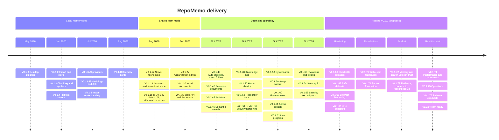

# RepoMemo Roadmap

> **Current version:** `V0.1.65` (2026-10-13) · **Next minor:** `V0.2.0`, *Team-ready* (plan agreed 2026-10-13) · **Unreleased on main:** V0.1.66 (CI, one version source, timings, docs)
> **Related:** [Functional mindmap](FUNCTIONAL_MINDMAP.md) · [Technical mindmap](TECHNICAL_MINDMAP.md) · [Security review 2026-10-10](security/2026-10-10-security-review.md) · [Enhancement analysis 2026-10-13](analysis/2026-10-13-enhancement-analysis.md)

RepoMemo started as a local-first desktop workbench. It is now a **self-hosted team product**: a shared API server with a web client, organizations and roles, collaboration, git repositories as living sources, business documents, and optional AI grounded in cited evidence. A server can be installed and administered entirely from the browser (environment menu, first-run setup, System area, admin console).

Between V0.1.32 and V0.1.62 the work went into **depth and operability**. V0.1.63 added **onboarding without an account** (invitation links, reset links, personal access tokens). V0.1.64 and V0.1.65 fixed the most urgent security findings: bundle S1, and a second pass that included a stored XSS.

**V0.2.0 is proposed as the first *team-ready* release**: a server a team can install, expose and trust with its knowledge. That means secure by default, deployable and recoverable, checked on every commit, and keeping its core promise that memory stays true. The plan to get there is [Road to V0.2.0](#-road-to-v020). Big new surfaces (remote repositories, mail, connectors) wait for V0.3.0.

> **Versions** are set in one place since V0.1.66 (`npm run version:set -- <version>`), checked in CI, and recorded in [CHANGELOG.md](../CHANGELOG.md).

---

## At a glance

| Stage | Status |
|---|---|
| Phase 1: Local memory loop (1A–1H) | ✅ Complete |
| Phase S: Shared team mode | ✅ Complete |
| Phase D: Depth and operability (V0.1.33–V0.1.65) | ✅ Complete |
| Security review 2026-10-10 + second pass | ✅ S1 (V0.1.64) and N1–N6 (V0.1.65) · 🔜 every remaining finding is scheduled before V0.2.0 |
| Road to V0.2.0 (V0.1.66–V0.1.76) | 🔄 V0.1.66 built, not yet released · plan and decisions agreed 2026-10-13 |
| V0.3.0 and later: remote repositories, mail, connectors, scale-out | 💭 Direction |

---

## ✅ Delivered

### Phase 1: Local memory loop (desktop)

The goal was to run the whole local loop with AI kept optional: *create workspace → import → inspect → search → ask with citations → save memory*.

| Phase | Version | Delivered |
|---|---|---|
| 1A Skeleton | V0.1.0 | Tauri + React shell, Rust workspace, SQLite schema, workspaces |
| 1B Import and store | V0.1.2 | File and folder import, content-addressed blob store, artifacts view, ADRs 0002–0004 |
| 1C Chunking | V0.1.3 | Markdown chunking by heading, 100-line windows for code and text, indexing jobs |
| 1E Code symbols | V0.1.3 | tree-sitter symbols for TS/TSX/JS, Python and Rust, file outlines |
| 1D Full-text search | V0.1.4 | SQLite FTS5, safe query building, filters, highlighted snippets |
| 1F AI provider layer | V0.1.6–0.1.7 | Ollama (local) and OpenRouter (cloud, with explicit acknowledgement), cited summaries |
| 1G Semantic search and Ask | V0.1.8 | Local embeddings, hybrid retrieval, cited answers, "insufficient context" guard |
| Image understanding | V0.1.9 | Vision-provider descriptions make images searchable |
| 1H Memory cards | V0.1.10 | Durable cards with evidence links, search and Markdown export |

The detailed specs are in [docs/phases/](../docs/phases).

### Phase S: Shared team mode (server + web)

| Milestone | Version | Delivered |
|---|---|---|
| Server foundation | V0.1.12 | `repomemo-server` (Axum), health and session routes, worker process boundary |
| Accounts and shared evidence | V0.1.13 | Registration and login (Argon2 + JWT), organizations, workspaces, text evidence, indexing, search, memory, and the **web client** |
| File uploads | V0.1.14 | Upload of evidence files up to 10 MiB |
| Workspace membership | V0.1.15 | Add, change and remove members, with role rules |
| Workspace admin and AI | V0.1.16 | Rename and delete, capabilities, per-workspace AI providers, AI overview, activity log |
| Ask in shared mode | V0.1.17 | Cited Q&A, provider test, memory search |
| Retrieval depth | V0.1.18–0.1.19 | Artifact query filters, retrieval facets (type, language, source) |
| Profiles and metrics | V0.1.20 | User profile, password change, "workspace pulse" metrics |
| Collaboration | V0.1.21 | Task board, evidence comments, assigned tasks, activity calendar |
| Review and notifications | V0.1.22 | Evidence lifecycle (verified, outdated, superseded) with history, notifications, @mentions |
| Workflow depth | V0.1.23 | Saved searches, task checklists |
| Web experience | V0.1.24–0.1.29 | Dashboard, organization switcher, notifications page, profile page, workspace sections, grid and list evidence views |
| Organization administration | V0.1.27 | Organization rename and member management, with access flowing to all org workspaces |
| Word documents | V0.1.30–0.1.31 | `.doc`/`.docx` text extraction, indexing, Documents section with preview |
| Jobs API and live events | V0.1.32 | Job kinds, cooperative cancel, job listing, **SSE event stream** for job and activity events |

### Phase D: Depth and operability (V0.1.33–V0.1.65)

| Milestone | Version | Delivered |
|---|---|---|
| Automatic and incremental indexing | V0.1.33–0.1.40 | Notes and uploads are indexed in the background with retries (30 s, 2 min, 10 min) and restart recovery. Failure reasons are stored and shown (migration 0012). Unchanged chunks keep their identity and embeddings. An `INDEXER_VERSION` bump refreshes older indexes. Code chunking follows declarations |
| Notes and folders | V0.1.40 | TipTap rich-text notes stored as Markdown, nested evidence folders up to 5 levels (migration 0013) |
| Business documents | V0.1.42–0.1.43 | Excel, PowerPoint, PDF, OneNote and Outlook text extraction and previews. Signed "Open in Office" links. Layout-accurate PDF previews through LibreOffice when installed |
| Workspace assistant | V0.1.45 | Closed capability router (find files, search, summarize, ask, overview) with stored per-user conversations (migration 0014) |
| Semantic search in shared mode | V0.1.46 | Embedding providers (Ollama, OpenRouter), a background embedding queue, hybrid FTS + vector search with rank fusion in Retrieval, Ask and the assistant, and an LLM rerank in Ask |
| Knowledge map | V0.1.48 | Indexing pipeline, coverage per kind, and a relation graph of similar files and memory-card citations |
| Workspace health | V0.1.50 | Deterministic checks (older versions, duplicates, removed symbols still mentioned, outdated references, failed indexing, unconnected files), each with actions and recorded outcomes (migration 0015) |
| Repository sync, phase 1 | V0.1.52–0.1.56 | Local git repositories as living sources (migration 0017). The branch is polled and synced when it moves. One evidence item per repository with a content overview, stack detection and an on-request cited AI summary |
| Security hardening | V0.1.51–0.1.57 | Rotating refresh tokens, session versions and "sign out everywhere", encrypted provider keys, sign-in throttling and lockout, workspace AI policy and per-user quotas, provider-URL and repository-root guards, security headers, typed 404s, blob garbage collection and hourly maintenance (migrations 0016, 0018) |
| System area | V0.1.58 | Overview, usage, users, run-time settings, logs (live and daily files, per-category levels), jobs and maintenance, audit trail (migration 0019) |
| Setup, avatars, app administrators | V0.1.59 | First-run setup wizard with a one-time code, profile pictures, app administrators without wildcard access (migrations 0020–0022) |
| Environment folders | V0.1.60 | Choose, create, verify and detach data environments under `workspace-data/` from the browser |
| Admin console | V0.1.61 | System › Console and the `repomemo-console` terminal client, with dry runs and audited changes |
| Daily-use polish and live progress | V0.1.62 | AI output rendered as Markdown with numbered citations; safe search highlights; several citations per memory card; **Save as memory** from Ask and the overview; several files or whole folders per upload (three at a time, with progress); **live progress** over a fetch-based event-stream reader (ledger, artifact page, repositories, tasks, memory, activity, a status strip with Stop) and `GET /v1/system/events` for System › Jobs, with polling as the fallback; the assistant docked beside every workspace section; the chosen environment remembered across restarts (`workspace-data/.last-environment`) unless one is pinned |
| Onboarding and API tokens | V0.1.63 | **Invitation links** for one email address and role, single-use, 7 days, withdrawable, usable even when registration is closed, re-checked against the inviter's rights on acceptance and never lowering a role; **password reset links** issued in System › Users (one-time, 24 hours, end every session, lift lockouts; app administrators cannot reset a system administrator); **personal access tokens** (`rmp_…`, read-only or read and write, 7–365 days, revocable, last use shown) for scripts, CI and `repomemo-console` (migration 0023) |
| Security ship-blockers (S1) | V0.1.64 | **H1:** adding someone to one workspace, directly or by invitation, gives that workspace only; their organization shows as a guest entry. **H4:** registering an address listed in `REPOMEMO_SYSTEM_ADMIN_EMAILS` grants nothing; only accounts that exist at startup are promoted. **L2:** token limits are marked on the handlers (`SessionSubject`, `ReadingSubject`) instead of a path denylist. **L3:** link secrets are in the URL fragment (`/invite#…`, `/reset-password#…`), with `no-referrer`; older path links are moved to the fragment. **M7:** only `VITE_` and `TAURI_ENV_` variables reach the bundle. People added before V0.1.64 keep the wider access they received; review organization members once |
| Security second pass | V0.1.65 | **N1 (high):** stored XSS through image previews closed; content types come from the file name, never the uploader (also I3), and previews open in a tab only for raster images. **N2:** run-time settings need a signed-in session. **N3:** owners keep their role, and organization changes never take a workspace from its owner. **N4:** viewers no longer change their old comments or tasks; saved searches are deleted by their author or an administrator. **N5:** a used reset link revokes personal access tokens. **N6:** the synchronous whole-workspace re-index is for administrators |

---

## 🎯 Road to V0.2.0

### What V0.2.0 means

A minor version marks a promise, not a pile of features. **V0.2.0, *Team-ready*,** promises that a team can install RepoMemo on a server others can reach, rely on it daily and recover it when something goes wrong. Concretely:

| Pillar | Promise | How it is checked |
|---|---|---|
| **Secure by default** | Every finding of the security review and its second pass is fixed, or accepted in writing with its mitigation. A fresh install is closed to strangers | Review status table shows no open item; a third pass before the release candidate finds nothing high or medium |
| **Checked on every commit** | Formatting, lints, Rust and web tests, type checks and dependency audits run in CI, and one version number is set in one place | CI green on `main`; System › Overview shows the real version |
| **Deployable and recoverable** | A documented production setup (TLS proxy, timeouts, service), backups that restore, quotas that protect the disk | The guide is followed on a clean machine; a backup is restored into a new environment and opens |
| **Memory stays true** | Memory cards say when their evidence changed; search can put trusted evidence first; code symbols are searchable | Feature tests, and the functional mindmap's gaps table is empty for these |
| **Changeable** | The web client and the server are split into modules with tests, so the next minor can move fast | No module over ~2,000 lines in `apps/server/src`, `crates/storage/src` or the shared web client (stylesheets and the frozen desktop `App.tsx` excepted) |
| **Fast enough to trust** | Search, Ask, the dashboard, map and health stay quick on a large workspace | Timings recorded for a 50,000-passage workspace in the release notes; targets in V0.1.74 |
| **Upgradable** | An environment from V0.1.40 or later upgrades in place, with a changelog and upgrade notes | Upgrade test on stored environments in CI |

**Out of scope for V0.2.0**, and proposed as V0.3.0 candidates: remote repositories (phase 2), mail delivery and email verification, assistant memory across turns, workspace export and import, connectors, and anything for scale-out. Each is valuable, but each widens the surface the V0.2.0 promise has to cover.

### Release plan

Each release is shippable on its own; the order puts what makes later work safer first.

| Release | Theme | Contents (IDs from the backlog below) | Why here |
|---|---|---|---|
| **V0.1.66** | Checkable releases | C8, C9, C10, P0, D1 | Every later release is then built, tested and versioned the same way, and P0 measures before any optimizing |
| **V0.1.67** | Safe defaults and identity | S2 (M1, M3, M4, M8, M9, L10, N2 residual), L4, L7 | Invitations made open registration unnecessary; this closes the biggest default risks |
| **V0.1.68** | Browser hardening | S4 (M2, M5, M6, L9), L3 follow-up | Turns any future injection from a takeover into a nuisance |
| **V0.1.69** | Host exposure | S3 (H2, H3, L8, M10) | The last two high findings; required before remote repositories |
| **V0.1.70** | Web client foundation | C1, C2, C3, C7, P6, P7 | Every product release after this touches the web client |
| **V0.1.71** | Server foundation | C4, C5, C6 (also L6), C12, N7, P8 | Same for the server; typed errors and timeouts land with the split |
| **V0.1.72** | Memory and search you can trust | F1, F2, F3, F8 | The product's core promise, on the new foundations |
| **V0.1.73** | Evidence, ownership, repositories 1b | F7, F11 (N8), F4 phase 1b, F9 | Daily ergonomics and the remaining integrity gap |
| **V0.1.74** | Performance and robustness | P1–P5, P9, S5 (M11, M12, L1, L5) | Measured by P0, on code that is now easy to change |
| **V0.1.75** | Operations | O1, O3, O4, O5, F9 backup commands | What an operator needs before trusting the server |
| **V0.1.76** | Release candidate | R1–R6 | Freeze features; prove the promise |
| **V0.2.0** | Team-ready | Fixes from the candidate only | — |

### Decisions (agreed 2026-10-13)

Each proposal below was accepted as written. They shape the releases named in the second column.

| # | Decision | Applies from | Agreed |
|---|---|---|---|
| 1 | **What app administrators are** (M8) | V0.1.67 | Read-only System pages plus jobs and maintenance; settings, users' sessions, lockouts and reset links stay with system administrators |
| 2 | **Where the refresh token lives** (M2) | V0.1.68 | An `HttpOnly; Secure; SameSite=Strict` cookie scoped to `/v1/auth/refresh`, which needs the SPA and API on the same site (one host behind the proxy) |
| 3 | **The desktop app's future** (F10) | V0.1.70 | Freeze it as the local-loop edition: security fixes only, labelled as such, and no ports of web features. Revisit as a server client in V0.3.0 |
| 4 | **The `apps/worker` stub** (C12) | V0.1.71 | Remove it; the durable queue belongs to the scale-out direction |
| 5 | **Mail in V0.2.0 or V0.3.0** (F6) | V0.1.67 | V0.3.0. Closed registration plus invitations covers M4 for V0.2.0 |
| 6 | **Version format** | V0.1.66 | Semantic versions: `0.2.0`, then `0.2.1` for fixes; tags `v0.2.0` |

### Release checklists

#### V0.1.66: Checkable releases

- [x] **C8 CI** (`.github/workflows/ci.yml`) on every push to `main` and every pull request. Blocking: versions agree, `cargo test` on Linux and Windows (desktop crate excluded), `npm run typecheck`, `cargo deny check advisories sources` for the server's dependencies (policy in `deny.toml`), `npm audit --omit=dev --audit-level=high`. Advisory for now: rustfmt, clippy `-D warnings`, licenses, duplicate crates and desktop-only advisories (they become blocking in V0.1.71)
- [x] **C9 one version source:** `npm run version:set -- <version>` (`scripts/set-version.mjs`) sets `Cargo.toml`, `Cargo.lock`, both `package.json` files, `package-lock.json` and `tauri.conf.json`; `npm run version:check` in CI; the code now says 0.1.66; `CHANGELOG.md` starts with V0.1.63–V0.1.66
- [x] **P0 timings:** search, Ask, metrics, the artifact query, the knowledge map and health record their duration and size under the `timing` target, in a new **Performance** log category (`log_performance_level`, debug to see them), filterable by workspace in System › Logs
- [x] **D1 documentation housekeeping:** `docs/IMPLEMENTATION_TRACKER.md` retired, `PRODUCT.md` describes the team product, Postman v5 collection with the onboarding routes (local, `docs/api/` is git-ignored)
- [ ] **C10 dependencies** (needs the lockfiles regenerated with `cargo` and `npm`, so it is done by hand): Vite 5 → current, which closes the esbuild advisory; `quick-xml` 0.39 → 0.41 in `repomemo-ingestion` so the server builds one version. The remaining duplicates are not ours: `reqwest` 0.13 and `quick-xml` 0.39 arrive through Tauri (`tauri`, `plist`) next to the versions the server uses, and are reported as warnings by `cargo deny`

#### V0.1.67: Safe defaults and identity

- [x] **M1** `REPOMEMO_ALLOW_REGISTRATION` defaults to `false`; the first account still registers, the setup wizard asks, and `/health` no longer carries `registration_open` (I2). Storage quotas stay with V0.1.75 (O4)
- [x] **M4** member adds refuse anyone not already in the organization or workspace with the same `409 invitation_required`, account or not, and the web app offers the invitation link. Registration itself stays distinguishable while it is open (no mail to verify with until V0.3.0), which is why it is closed by default
- [x] **M8** `require_full_system_admin` for settings, roles, sessions, lockouts, reset links, raw log files and detach; workspace activity records hidden from app administrators. Test `app_administrators_read_the_system_pages_and_changes_need_the_system_scope`
- [x] **N2 residual** the `system` token scope (migration 0024); System changes need a session or that scope
- [x] **M9** `check_transport` at startup, `REPOMEMO_ALLOW_INSECURE_HTTP` for a trusted network, HSTS for an HTTPS public URL, console warning
- [x] **M3** `ProxyTrust` (`REPOMEMO_TRUST_PROXY` plus loopback or `REPOMEMO_TRUSTED_PROXIES`), rightmost untrusted entry
- [x] **L10** a refresh token this browser holds bypasses a lockout (per-address counters were already separate from the account-wide bar of five times as many failures)
- [x] **L4** notifications `password_reset_issued` and `password_reset_used`
- [x] **L7** `validate_password`: common list, at least five different characters, no email name

#### V0.1.68: Browser hardening

- [x] **M5, L9** `SafeMarkdown` replaces every `react-markdown` use: images become a note with text and address, external links show their host and open with `noopener noreferrer`. The test of the image rule moves to the frontend test suite (C3, V0.1.70), which needs the test runner that release adds
- [x] **M2** the Vite build injects the policy as a meta tag and writes `content-security-policy.txt` (with `frame-ancestors`) for the host; the refresh token is an `HttpOnly; SameSite=Strict` cookie handled by `web_session.rs` for web clients. The cookie path is `/v1/auth` (not only `/v1/auth/refresh`) so sign-in and sign-out receive it
- [x] **M6** strict `csp` and a `devCsp` that adds the Vite dev server
- [x] **L3 follow-up** the web app keeps the secret in memory and replaces the history entry

#### V0.1.69: Host exposure

- [x] **H2** built-in list (`127.0.0.1`, `localhost`, `::1`, `openrouter.ai`) unless `REPOMEMO_AI_ALLOWED_HOSTS` says otherwise (`*` for everything); a checking DNS resolver filters every connection (public addresses only for the built-in list); provider bodies go to the log, not to the user
- [x] **H3** `RepoLinkPolicy::disabled()` on a server without roots (disabled, not defaulted: an operator opts in by naming folders); the refusal outside the roots does not depend on whether the path exists
- [x] **L8** `repomemo_git::harden`: `protocol.allow=never` (the https/ssh allowlist arrives with remote repositories), no system or global configuration, no submodule recursion, `safe.directory` only for the configured folders
- [x] **M10** scrubbed environment, `REPOMEMO_SOFFICE_WRAPPER` for the operator's sandbox command, version and sandbox state in System › Overview and the server check. The sandbox itself is the operator's (recipes follow in the production guide, V0.1.75)

#### V0.1.70: Web client foundation (built, not yet released)

- [x] **C1** `SharedWebApp.tsx` is the shell; `src/web/` holds the pages (`WorkspaceDetail.tsx` is the largest at about 1,000 lines), `constants.ts`, `format.ts`, `router.ts`, `navigation.tsx`, `common.tsx`. Splitting the sections of the workspace page into components of their own comes with the next product work that touches them
- [x] **C2** `web/router.ts` (`Route`, `parseRoute`, `routePath`); `lib/queryClient.ts` and `lib/useServerState.ts` (cache-backed state with a `useState`-like setter) used by the workspace page. The dashboard, profile and detail pages still load their own data
- [x] **P7** `workspaceInvalidation` names what an event makes stale; `load()` is a full invalidation, used after bulk changes and on resync
- [x] **P6** `web/lazy.tsx`: System area (with the console), map, document viewer, editor, health and repository panels
- [x] **C7** `scripts/generate-types.mjs` reads `crates/domain` (a regular subset of Rust, failing loudly on anything else). Server-local response types (token response, setup, System) stay hand-written
- [x] **C3** 27 tests in `src/test/`: session renewal, live events, Markdown safety, upload filter, routes, image preview rules, query cache. The link pages are covered through the router and session tests; a rendering test of the invitation page needs the page split further

#### V0.1.71: Server foundation

- [ ] **C4** `apps/server/src/lib.rs` split into route modules per domain
- [ ] **C5 + C6** storage split by aggregate with typed errors; `map_storage_error` stops matching substrings, and internal errors stop reaching clients as 400s (L6)
- [ ] **N7** a request timeout layer on every route except event streams; header-read timeout; limit of open event streams per user (M11 part)
- [ ] **P8** one writer connection plus a read pool; indexing and embedding concurrency as settings
- [ ] **C12** remove `apps/worker` per decision 4
- [ ] **C8 follow-up** run rustfmt over the code base and fix clippy findings, then make both blocking in CI, with licenses and duplicate crates

#### V0.1.72: Memory and search you can trust

- [ ] **F1** a health detector for memory cards whose cited passages changed or disappeared, *needs review* on the card, and citation editing (`PUT /v1/memory-cards/{id}` takes citations)
- [ ] **F2** search filters for lifecycle status (outdated and superseded hidden by default), folder and date; a small boost for verified evidence; the same in Ask and the assistant
- [ ] **F3** symbol search: a route over the `symbols` table, a Retrieval filter, assistant lookups
- [ ] **F8** live Map and Health pages from the event stream

#### V0.1.73: Evidence, ownership, repositories 1b

- [ ] **F11 (N8)** ownership transfer for workspaces and organizations (owner only, audited); refuse removing someone who still owns a workspace
- [ ] **F7** move folders; multi-select move, delete and lifecycle; upload a new version of a file into the same artifact
- [ ] **F4 phase 1b** renames with edits (`git diff -M`), the commit on search results and citations
- [ ] **F9** console: `logs --follow`, `users reset-link`, `tokens list`

#### V0.1.74: Performance and robustness

- [ ] **Targets**, at 50,000 passages: search under 300 ms and the dashboard under 500 ms (p95), map and health under 2 s on first load, then cached
- [ ] **P1** per-workspace in-memory vector index (sqlite-vec only if memory becomes the limit)
- [ ] **P2, P3, P4** artifact query and metrics in SQL; one `GET /v1/dashboard`
- [ ] **P5** map and health cached per workspace content version
- [ ] **P9, M11** time and memory budgets for document parsers; rate limits on heavy endpoints
- [ ] **M12** background image descriptions and embeddings counted against a per-workspace budget
- [ ] **L1** single-use, 60-second file links, never logged; **L5** owner-only ACL on `secret.key` on Windows

#### V0.1.75: Operations

- [ ] **O1** backup and restore of an environment (database snapshot with `VACUUM INTO`, blobs, `secret.key`) from System › Maintenance and the console (`backup create`, `backup list`, `backup restore`)
- [ ] **O3** production guide (`technical/operations.md`): TLS proxy with timeouts, static SPA with the CSP, Windows service and systemd units, readiness checks, upgrade steps
- [ ] **O4** storage quotas per workspace, uploads per hour per user, workspaces per user, and a free-disk floor shown in System › Overview
- [ ] **O5** OpenMetrics export of the System counters (system administrators or a `system` token)

#### V0.1.76: Release candidate

- [ ] **R1** feature freeze: fixes only until V0.2.0
- [ ] **R2** third security pass over everything changed since V0.1.65; the review's status table closed out
- [ ] **R3** upgrade test: stored environments from V0.1.40, V0.1.52 and V0.1.65 upgraded in CI
- [ ] **R4** performance run against the V0.1.74 targets, results in the release notes
- [ ] **R5** documentation: both mindmaps and their branch pages (`auth-and-authorization`, `operations`, `api-reference`), `CHANGELOG.md`, `UPGRADING.md` from V0.1.x
- [ ] **R6** a clean-machine install following only the production guide

---

## 📚 Backlog reference

Every item, with the release it is planned for. The evidence behind each is in the [enhancement analysis](analysis/2026-10-13-enhancement-analysis.md) and the [security review](security/2026-10-10-security-review.md).

### Product features

| ID | Item | Size | Target |
|---|---|---|---|
| F1 | **Memory that stays true.** Stale-citation detector, *needs review* on cards, citation editing | S–M | V0.1.72 |
| F2 | **Search by trust.** Lifecycle, folder and date filters; boost verified evidence | S | V0.1.72 |
| F3 | **Symbol search on the web** | S | V0.1.72 |
| F4 | **Repositories.** Phase 1b (renames with edits, commit on citations) | M | V0.1.73 |
| F4 | **Repositories.** Phase 2 (remote by URL, encrypted token, partial clone, scheduled fetch) | L | V0.3.0 |
| F5 | **Assistant memory.** Earlier turns in context; search across workspaces | M | V0.3.0 |
| F6 | **Mail delivery** (SMTP) for invitations, resets, mentions; then email verification | M | V0.3.0 (decided, decision 5) |
| F7 | **Evidence ergonomics.** Move folders, multi-select, new version of a file | M | V0.1.73 |
| F8 | **Live map and health** | S | V0.1.72 |
| F9 | **Console follow-ups.** `logs --follow`, `users reset-link`, `tokens list`, backup commands; workspace commands once the app-admin rule is settled | S–M | V0.1.73, V0.1.75 |
| F10 | **Desktop decision:** frozen as the local edition, security fixes only | Decision | ✅ Decided (decision 3) |
| F11 | **Ownership transfer** and no removal of a workspace owner (N8) | S | V0.1.73 |

### Security

| ID | Bundle | Findings | Target |
|---|---|---|---|
| S1 | Ship-blockers for onboarding | H1, H4, L2, L3, M7 | ✅ V0.1.64 |
| — | Second pass | N1–N6, I3 | ✅ V0.1.65 |
| S2 | Safe defaults and identity | M1, M3, M4, M8, M9, L4, L7, L10, N2 residual | ✅ V0.1.67 |
| S4 | Browser hardening | M2, M5, M6, L9 | ✅ V0.1.68 |
| S3 | Host exposure | H2, H3, L8, M10 | ✅ V0.1.69 |
| — | Server timeouts | N7 | V0.1.71 |
| S5 | Robustness | M11, M12, L1, L5, L6 | V0.1.71, V0.1.74 |
| — | Integrity | N8 | V0.1.73 |
| — | Supply chain | dependency scanning (review §7) | ✅ V0.1.66 (CI) |
| — | Accepted | N9 (not a boundary, documented), I1, I4 | — |

### Platform performance

| ID | Item | Size | Target |
|---|---|---|---|
| P0 | Timings (Performance log category) | S | ✅ V0.1.66 |
| P1 | Vector search without a full scan | M | V0.1.74 |
| P2 | `artifacts/query` in SQL | S | V0.1.74 |
| P3 | Workspace metrics as SQL aggregates | S–M | V0.1.74 |
| P4 | One dashboard call | S | V0.1.74 |
| P5 | Cached map and health | M | V0.1.74 |
| P6 | Code splitting of the web bundle | S | V0.1.70 |
| P7 | Query cache with targeted invalidation | M | V0.1.70 |
| P8 | Writer connection plus read pool; configurable concurrency | M | V0.1.71 |
| P9 | Parser time and memory budgets | M | V0.1.74 |

### Code health and release engineering

| ID | Item | Size | Target |
|---|---|---|---|
| C1 | Split `SharedWebApp.tsx` | M | V0.1.70 |
| C2 | Router module and TanStack Query | M | V0.1.70 |
| C3 | Frontend tests | S–M | V0.1.70 |
| C4 | Split `apps/server/src/lib.rs` | M | V0.1.71 |
| C5 | Split `crates/storage/src/lib.rs` | M | V0.1.71 |
| C6 | Typed errors | M | V0.1.71 |
| C7 | Generated TypeScript types | S–M | V0.1.70 |
| C8 | CI | S | ✅ V0.1.66 (rustfmt and clippy blocking from V0.1.71) |
| C9 | One version source, changelog | S | ✅ V0.1.66 |
| C10 | Dependency hygiene (Vite, `quick-xml` in ingestion) | S | V0.1.66 (by hand) |
| C11 | Split `styles.css` per component | M | V0.3.0 |
| C12 | Remove the worker stub | S | V0.1.71 (decided, decision 4) |

### Operations and documentation

| ID | Item | Size | Target |
|---|---|---|---|
| O1 | Backup and restore | M | V0.1.75 |
| O2 | Workspace export and import | M | V0.3.0 |
| O3 | Production guide | S–M | V0.1.75 |
| O4 | Quotas and disk floor | M | V0.1.75 |
| O5 | OpenMetrics export | S | V0.1.75 |
| D1 | Tracker retired, `PRODUCT.md`, Postman v5 | S | ✅ V0.1.66 |
| R5 | Mindmaps, branch pages, changelog, upgrade notes | M | V0.1.76 |

### Repository indexing track

Design and limits: [technical/repository-sources.md](technical/repository-sources.md).

- [x] **Phase 1:** local repositories, the sync engine, automatic sync when the branch moves, `REPOMEMO_REPO_ROOTS` and the UNC guard.
- [ ] **Phase 1b (V0.1.73):** renames with edits, the commit on results and citations. Tauri commands only if decision 3 makes the desktop app a client.
- [ ] **Phase 2 (V0.3.0):** remote repositories by URL, after S3.
- [ ] **Phase 3 (later):** last author and date per file, `CODEOWNERS` hints, commit-pinned citations, push webhooks, issue and pull-request links.

### Background jobs track

- [x] Background indexing, embedding and repository-sync queues with restart recovery, retries and failure reasons; incremental re-index; live progress.
- [ ] Async manual index endpoints: minor, since only administrators use them (the workspace-wide one since V0.1.65).
- [ ] A durable job queue claimed by a worker: scale-out direction.

---

## 💭 Later: strategic direction

| Direction | Scope |
|---|---|
| **Git awareness** | Repository phase 3: ownership hints, commit-pinned citations, push webhooks, commit and PR relationships |
| **Issue and PR connectors** | GitHub/GitLab first, then Linear/Jira. Link issues and PRs to artifacts and symbols. Personal access tokens already let CI push ADRs, runbooks and release notes as evidence |
| **Assistant depth** | Beyond F5: a keyboard command palette, and actions that propose memory cards and tasks for a person to confirm |
| **Scale-out team server** | PostgreSQL, object storage, a durable job queue claimed by `repomemo-worker`, shared rate-limit counters, and Qdrant when vector search needs a service (see [ADR-0004](../docs/decisions/0004-embedded-vector-storage-before-qdrant.md)) |
| **Enterprise / hosted** | SSO, permission-aware retrieval, audit export, policy controls and redaction, account deletion policy (creator foreign keys currently block it), hosted and self-hosted deployment |

---

## Guiding rules (unchanged)

- **Storage first, AI second.** Every AI feature operates on indexed, inspectable evidence and returns citations.
- **Useful without AI.** Storing, browsing, indexing and search must keep working with no provider configured.
- **Cloud is explicit.** No content leaves the server until an admin enables a cloud provider and acknowledges it.
- **Show state.** Storage, indexing progress, provider status and errors are always visible.
