# RepoMemo Roadmap

> **Current version:** `V0.4.96` (2026-10-28), after `V0.3.0` *Connected* · **Next:** [the 0.4.x continuation](#proposed-04x-continuation-gap-audit), V0.4.97–V0.4.105 ([release rows](RELEASES_0.4.md#proposed-continuation-close-the-gaps-before-05x)); the original deployment plan closed at V0.4.67, while published-artifact and live desktop validation remain open · **Next minor candidate:** [0.5.x single sign-on](plans/2026-10-27-0.5-single-sign-on.md), after the 0.4 evidence and the maintainer's decision (decision 41)
> **Feature freeze (V0.1.76 to the `v0.3.0` tag):** lifted by the tag on 2026-10-24. The 0.3.x releases follow the rules of [Road to V0.4.0](#-road-to-v040).
> **Related:** [Functional mindmap](FUNCTIONAL_MINDMAP.md) · [Technical mindmap](TECHNICAL_MINDMAP.md) · Release index [0.1 → 0.2](RELEASES_0.1.md) and [0.2 → 0.3](RELEASES_0.2.md) · [Security review 2026-10-10](security/2026-10-10-security-review.md) · [Security review 2026-10-14 (V0.2.6)](security/2026-10-14-security-review.md) · [Security review 2026-10-16 (V0.2.52)](security/2026-10-16-security-review.md) · [Security and backend review 2026-10-21 (V0.2.129)](security/2026-10-21-security-review.md) · [Security review of workspace templates 2026-10-22 (V0.2.192)](security/2026-10-22-workspace-templates-security-review.md) · [Security review of 0.3.x 2026-10-24 (V0.3.26)](security/2026-10-24-0.3-security-review.md) · [Deployment security review 2026-10-27 (V0.4.65)](security/2026-10-27-deployment-security-review.md) · [Enhancement analysis 2026-10-13](analysis/2026-10-13-enhancement-analysis.md)

RepoMemo started as a local-first desktop workbench. It is now a **self-hosted team product**: a shared API server with a web client, organizations and roles, collaboration, git repositories as living sources, business documents, and optional AI grounded in cited evidence. A server can be installed and administered entirely from the browser (environment menu, first-run setup, System area, admin console).

Between V0.1.32 and V0.1.62 the work went into **depth and operability**. V0.1.63 added **onboarding without an account** (invitation links, reset links, personal access tokens). V0.1.64 and V0.1.65 fixed the most urgent security findings: bundle S1, and a second pass that included a stored XSS.

**V0.2.0 is proposed as the first *team-ready* release**: a server a team can install, expose and trust with its knowledge. That means secure by default, deployable and recoverable, checked on every commit, and keeping its core promise that memory stays true. The plan to get there is [Road to V0.2.0](#-road-to-v020); every release of it is built, and the clean-machine install (R6) was made with the V0.3.0 tests; no separate `v0.2.0` tag is made (decision 29).

**V0.3.0, *Connected*,** was released on 2026-10-24: remote repositories, mail, issues and pull requests, an assistant that remembers the conversation, portable workspaces and one client, reached through 193 single-purpose releases (V0.2.1–V0.2.193): 56 for the promise itself, then frontend polish, security and backend hardening, and workspace templates. The plan is [Road to V0.3.0](#-road-to-v030).

Before the tag, **tracks L and M** (V0.2.130–V0.2.162, planned 2026-10-21) act on the [fifth review](security/2026-10-21-security-review.md): CI's blocking dependency check fails on `main`, two high and six medium findings of the 2026-10-14 review were never closed, and the backend does work it could skip (whole documents read for a rights check, whole file lists on every workspace page, repository syncs with nothing to do).

> **Versions** are set in one place since V0.1.66 (`npm run version:set -- <version>`), checked in CI, and recorded in [CHANGELOG.md](../CHANGELOG.md).

---

## At a glance

```mermaid
timeline
  title RepoMemo delivery
  section Local memory loop
    May 2026 : V0.1.0 Desktop skeleton
    Jun 2026 : V0.1.2 Import and store : V0.1.3 Chunking and symbols : V0.1.4 Full-text search
    Jul 2026 : V0.1.6 AI providers : V0.1.8 Embeddings and Ask : V0.1.9 Image understanding
    Aug 2026 : V0.1.10 Memory cards
  section Shared team mode
    Aug 2026 : V0.1.12 Server foundation : V0.1.13 Accounts and shared evidence : V0.1.15 to V0.1.23 Admin, AI, collaboration, review
    Sep 2026 : V0.1.27 Organization admin : V0.1.30 Word documents : V0.1.32 Jobs API and live events
  section Depth and operability
    Oct 2026 : V0.1.40 Auto-indexing, notes, folders : V0.1.42 Business documents : V0.1.45 Assistant : V0.1.46 Semantic search
    Oct 2026 : V0.1.48 Knowledge map : V0.1.50 Health checks : V0.1.52 Repository sync : V0.1.51 to V0.1.57 Security hardening
    Oct 2026 : V0.1.58 System area : V0.1.59 Setup wizard : V0.1.60 Environments : V0.1.61 Admin console : V0.1.62 Live progress
    Oct 2026 : V0.1.63 Invitations and tokens : V0.1.64 Security S1 : V0.1.65 Security second pass
  section Road to V0.2.0
    Hardening : V0.1.66 Checkable releases : V0.1.67 Safe defaults : V0.1.68 Browser hardening : V0.1.69 Host exposure
    Foundations : V0.1.70 Web client foundation : V0.1.71 Server foundation
    Product : V0.1.72 Memory and search you can trust : V0.1.73 Evidence, ownership, repositories 1b
    Run it for real : V0.1.74 Performance and robustness : V0.1.75 Operations : V0.1.76 Release candidate : V0.2.0 Team-ready
  section Road to V0.3.0 (proposed, one change per release)
    V0.2.1 to V0.2.8 : After 0.2.0 (web residuals, jobs, console, incremental map)
    V0.2.9 to V0.2.18 : Mail, verification, notifications, accounts
    V0.2.19 to V0.2.31 : Remote repositories, pushes, issues and pull requests
    V0.2.32 to V0.2.39 : Assistant memory, cross-workspace search, palette, languages, review queue
    V0.2.40 to V0.2.48 : Export and import, encrypted backups, container, accessibility
    V0.2.49 to V0.2.56 : One client, release candidate
    V0.2.57 to V0.2.129 : Frontend polish (track K)
    V0.2.130 to V0.2.148 : Security and dependencies (track L)
    V0.2.149 to V0.2.162 : Backend hardening and performance (track M)
    V0.2.163 to V0.2.193 : Workspace templates (track N)
  section V0.3.0 Connected (released 2026-10-24)
    V0.3.0 : Tagged after the clean-machine install
  section Road to V0.4.0 (proposed, one change per release)
    V0.3.1 to V0.3.4 : After 0.3.0 (fixes from the tests, test debt, formatting, the record)
    V0.3.5 to V0.3.7 : The retired local edition removed
    V0.3.8 to V0.3.18 : Small gaps closed (versions, mentions, review, assistant, search, palette, citations, owners, symbols, template cards)
    V0.3.19 to V0.3.25 : Portable archives, connector depth, container and backup operations, accessibility
    V0.3.26 to V0.3.27 : Security pass and release checks
  section V0.4.x deployment and proposed continuation
    V0.4.0 to V0.4.67 : Deployment plan built; clean-install validation open
    V0.4.68 to V0.4.91 : Proposed evidence, workflows, performance, security and frontend
    V0.4.92 to V0.4.105 : Proposed documentation and final evidence
```

| Stage | Status |
|---|---|
| Phase 1: Local memory loop (1A–1H) | ✅ Complete |
| Phase S: Shared team mode | ✅ Complete |
| Phase D: Depth and operability (V0.1.33–V0.1.65) | ✅ Complete |
| Security review 2026-10-10, second and third passes | ✅ Every finding fixed, mitigated or accepted in writing (V0.1.76); R2-4 and R2-5 scheduled for V0.2.8 |
| Road to V0.2.0 (V0.1.66–V0.1.76) | ✅ Built and versioned `0.2.0`; R6 (clean install) passed with the V0.3.0 tests (2026-10-24); no separate `v0.2.0` tag (decision 29) |
| Road to V0.3.0 (V0.2.1–V0.2.56, one change each) | ✅ V0.2.1–V0.2.56 built; the clean-machine install (R6, R12) was made by the maintainer, who reported the tests good on 2026-10-24 |
| Track K: frontend polish (V0.2.57–V0.2.129) | ✅ V0.2.57–V0.2.129 built (K1 to K6 done); decisions 15–19 taken as proposed; [plan](plans/2026-10-17-frontend-polish.md) |
| Security and backend review 2026-10-21 (fifth pass) | ✅ Closed at V0.2.162: 2 high, 9 medium, 15 low and 4 info findings, none high, medium or low open, plus 11 performance findings built (P12–P21); the review's table names the release of each fix; [review](security/2026-10-21-security-review.md) |
| Security review of 0.3.x 2026-10-24 (seventh pass, new surface only) | ✅ Closed at V0.3.26: 0 high, 1 medium, 6 low and 5 info findings, none medium or low open; [review](security/2026-10-24-0.3-security-review.md) |
| Security review of workspace templates 2026-10-22 (sixth pass, new surface only) | ✅ Closed at V0.2.192: 0 high, 2 medium, 2 low and 4 info findings, none medium or low open; [review](security/2026-10-22-workspace-templates-security-review.md) |
| Track L: security and dependencies (V0.2.130–V0.2.148) | ✅ V0.2.130–V0.2.148 built; decisions 20–23 taken as proposed |
| Track M: backend hardening and performance (V0.2.149–V0.2.162) | ✅ V0.2.149–V0.2.162 built; decisions 20–23 taken as proposed |
| Track N: workspace templates (V0.2.163–V0.2.193) | ✅ V0.2.163–V0.2.193 built; decisions 24–28 taken as proposed; [plan](plans/2026-10-22-workspace-templates.md) · [format](technical/workspace-templates.md) |
| **V0.3.0 *Connected*** | ✅ Released 2026-10-24: the version set to `0.3.0` and tagged `v0.3.0` after tracks K to N and the clean-machine install |
| Road to V0.4.0 (V0.3.1–V0.3.27, tracks O to T) | ✅ Built and closed on 2026-10-24 at V0.3.27: fixes and the record, the local edition removed, small gaps closed, portability and connector depth, operations, security pass and release checks; decisions 29–32 taken as proposed, 33 recorded as a proposal |
| The 0.4.x line: preparation for deployment, server and client, containers first (V0.4.0–V0.4.67) | ✅ Closed on 2026-10-27 by V0.4.67 (opened on 2026-10-25 by V0.4.0; 67 releases planned in eight tracks (configuration, the server image, the web image, compose and tests, direct install, registry, the desktop app on the web client, documents and security); [plan](plans/2026-10-25-deployment.md), [index](RELEASES_0.4.md); decisions 33–40 proposed, then 41–44 for the next line); the maintainer's clean-install run is what is left |
| Proposed 0.4.x continuation (V0.4.68–V0.4.105, tracks AC–AH) | 🔜 Planned, not built: release evidence, daily workflows, performance and security, frontend experience, a separate documentation sequence and final validation; [gap audit and tracks](#proposed-04x-continuation-gap-audit), [one row per release](RELEASES_0.4.md#proposed-continuation-close-the-gaps-before-05x) |
| Single sign-on (OIDC) | 💭 Set aside on 2026-10-25, kept as the candidate for the line after; [plan](plans/2026-10-24-single-sign-on.md) |
| After the 0.4.x line: single sign-on, scale-out, hosted | 💭 Direction (the theme is not chosen; single sign-on is the candidate) |

---

## ✅ Delivered

### Phase 1: Local memory loop (desktop)

The goal was to run the whole local loop with AI kept optional: *create workspace → import → inspect → search → ask with citations → save memory*.

| Phase | Version | Delivered |
|---|---|---|
| 1A Skeleton | V0.1.0 | Tauri + React shell, Rust workspace, SQLite schema, workspaces |
| 1B Import and store | V0.1.2 | File and folder import, content-addressed blob store, artifacts view, ADRs 0002–0004 |
| 1C Chunking | V0.1.3 | Markdown chunking by heading, 100-line windows for code and text, indexing jobs |
| 1E Code symbols | V0.1.3 | tree-sitter symbols for TS/TSX/JS, Python and Rust, file outlines |
| 1D Full-text search | V0.1.4 | SQLite FTS5, safe query building, filters, highlighted snippets |
| 1F AI provider layer | V0.1.6–0.1.7 | Ollama (local) and OpenRouter (cloud, with explicit acknowledgement), cited summaries |
| 1G Semantic search and Ask | V0.1.8 | Local embeddings, hybrid retrieval, cited answers, "insufficient context" guard |
| Image understanding | V0.1.9 | Vision-provider descriptions make images searchable |
| 1H Memory cards | V0.1.10 | Durable cards with evidence links, search and Markdown export |

The detailed specs are in [docs/phases/](../docs/phases).

### Phase S: Shared team mode (server + web)

| Milestone | Version | Delivered |
|---|---|---|
| Server foundation | V0.1.12 | `repomemo-server` (Axum), health and session routes, worker process boundary |
| Accounts and shared evidence | V0.1.13 | Registration and login (Argon2 + JWT), organizations, workspaces, text evidence, indexing, search, memory, and the **web client** |
| File uploads | V0.1.14 | Upload of evidence files up to 10 MiB |
| Workspace membership | V0.1.15 | Add, change and remove members, with role rules |
| Workspace admin and AI | V0.1.16 | Rename and delete, capabilities, per-workspace AI providers, AI overview, activity log |
| Ask in shared mode | V0.1.17 | Cited Q&A, provider test, memory search |
| Retrieval depth | V0.1.18–0.1.19 | Artifact query filters, retrieval facets (type, language, source) |
| Profiles and metrics | V0.1.20 | User profile, password change, "workspace pulse" metrics |
| Collaboration | V0.1.21 | Task board, evidence comments, assigned tasks, activity calendar |
| Review and notifications | V0.1.22 | Evidence lifecycle (verified, outdated, superseded) with history, notifications, @mentions |
| Workflow depth | V0.1.23 | Saved searches, task checklists |
| Web experience | V0.1.24–0.1.29 | Dashboard, organization switcher, notifications page, profile page, workspace sections, grid and list evidence views |
| Organization administration | V0.1.27 | Organization rename and member management, with access flowing to all org workspaces |
| Word documents | V0.1.30–0.1.31 | `.doc`/`.docx` text extraction, indexing, Documents section with preview |
| Jobs API and live events | V0.1.32 | Job kinds, cooperative cancel, job listing, **SSE event stream** for job and activity events |

### Phase D: Depth and operability (V0.1.33–V0.1.65)

| Milestone | Version | Delivered |
|---|---|---|
| Automatic and incremental indexing | V0.1.33–0.1.40 | Notes and uploads are indexed in the background with retries (30 s, 2 min, 10 min) and restart recovery. Failure reasons are stored and shown (migration 0012). Unchanged chunks keep their identity and embeddings. An `INDEXER_VERSION` bump refreshes older indexes. Code chunking follows declarations |
| Notes and folders | V0.1.40 | TipTap rich-text notes stored as Markdown, nested evidence folders up to 5 levels (migration 0013) |
| Business documents | V0.1.42–0.1.43 | Excel, PowerPoint, PDF, OneNote and Outlook text extraction and previews. Signed "Open in Office" links. Layout-accurate PDF previews through LibreOffice when installed |
| Workspace assistant | V0.1.45 | Closed capability router (find files, search, summarize, ask, overview) with stored per-user conversations (migration 0014) |
| Semantic search in shared mode | V0.1.46 | Embedding providers (Ollama, OpenRouter), a background embedding queue, hybrid FTS + vector search with rank fusion in Retrieval, Ask and the assistant, and an LLM rerank in Ask |
| Knowledge map | V0.1.48 | Indexing pipeline, coverage per kind, and a relation graph of similar files and memory-card citations |
| Workspace health | V0.1.50 | Deterministic checks (older versions, duplicates, removed symbols still mentioned, outdated references, failed indexing, unconnected files), each with actions and recorded outcomes (migration 0015) |
| Repository sync, phase 1 | V0.1.52–0.1.56 | Local git repositories as living sources (migration 0017). The branch is polled and synced when it moves. One evidence item per repository with a content overview, stack detection and an on-request cited AI summary |
| Security hardening | V0.1.51–0.1.57 | Rotating refresh tokens, session versions and "sign out everywhere", encrypted provider keys, sign-in throttling and lockout, workspace AI policy and per-user quotas, provider-URL and repository-root guards, security headers, typed 404s, blob garbage collection and hourly maintenance (migrations 0016, 0018) |
| System area | V0.1.58 | Overview, usage, users, run-time settings, logs (live and daily files, per-category levels), jobs and maintenance, audit trail (migration 0019) |
| Setup, avatars, app administrators | V0.1.59 | First-run setup wizard with a one-time code, profile pictures, app administrators without wildcard access (migrations 0020–0022) |
| Environment folders | V0.1.60 | Choose, create, verify and detach data environments under `workspace-data/` from the browser |
| Admin console | V0.1.61 | System › Console and the `repomemo-console` terminal client, with dry runs and audited changes |
| Daily-use polish and live progress | V0.1.62 | AI output rendered as Markdown with numbered citations; safe search highlights; several citations per memory card; **Save as memory** from Ask and the overview; several files or whole folders per upload (three at a time, with progress); **live progress** over a fetch-based event-stream reader (ledger, artifact page, repositories, tasks, memory, activity, a status strip with Stop) and `GET /v1/system/events` for System › Jobs, with polling as the fallback; the assistant docked beside every workspace section; the chosen environment remembered across restarts (`workspace-data/.last-environment`) unless one is pinned |
| Onboarding and API tokens | V0.1.63 | **Invitation links** for one email address and role, single-use, 7 days, withdrawable, usable even when registration is closed, re-checked against the inviter's rights on acceptance and never lowering a role; **password reset links** issued in System › Users (one-time, 24 hours, end every session, lift lockouts; app administrators cannot reset a system administrator); **personal access tokens** (`rmp_…`, read-only or read and write, 7–365 days, revocable, last use shown) for scripts, CI and `repomemo-console` (migration 0023) |
| Security ship-blockers (S1) | V0.1.64 | **H1:** adding someone to one workspace, directly or by invitation, gives that workspace only; their organization shows as a guest entry. **H4:** registering an address listed in `REPOMEMO_SYSTEM_ADMIN_EMAILS` grants nothing; only accounts that exist at startup are promoted. **L2:** token limits are marked on the handlers (`SessionSubject`, `ReadingSubject`) instead of a path denylist. **L3:** link secrets are in the URL fragment (`/invite#…`, `/reset-password#…`), with `no-referrer`; older path links are moved to the fragment. **M7:** only `VITE_` and `TAURI_ENV_` variables reach the bundle. People added before V0.1.64 keep the wider access they received; review organization members once |
| Security second pass | V0.1.65 | **N1 (high):** stored XSS through image previews closed; content types come from the file name, never the uploader (also I3), and previews open in a tab only for raster images. **N2:** run-time settings need a signed-in session. **N3:** owners keep their role, and organization changes never take a workspace from its owner. **N4:** viewers no longer change their old comments or tasks; saved searches are deleted by their author or an administrator. **N5:** a used reset link revokes personal access tokens. **N6:** the synchronous whole-workspace re-index is for administrators |

---

## 🎯 Road to V0.2.0

### What V0.2.0 means

A minor version marks a promise, not a pile of features. **V0.2.0, *Team-ready*,** promises that a team can install RepoMemo on a server others can reach, rely on it daily and recover it when something goes wrong. Concretely:

| Pillar | Promise | How it is checked |
|---|---|---|
| **Secure by default** | Every finding of the security review and its second pass is fixed, or accepted in writing with its mitigation. A fresh install is closed to strangers | Review status table shows no open item; a third pass before the release candidate finds nothing high or medium |
| **Checked on every commit** | Formatting, lints, Rust and web tests, type checks and dependency audits run in CI, and one version number is set in one place | CI green on `main`; System › Overview shows the real version |
| **Deployable and recoverable** | A documented production setup (TLS proxy, timeouts, service), backups that restore, quotas that protect the disk | The guide is followed on a clean machine; a backup is restored into a new environment and opens |
| **Memory stays true** | Memory cards say when their evidence changed; search can put trusted evidence first; code symbols are searchable | Feature tests, and the functional mindmap's gaps table is empty for these |
| **Changeable** | The web client and the server are split into modules with tests, so the next minor can move fast | No module over ~2,000 lines in `apps/server/src`, `crates/storage/src` or the shared web client (stylesheets and the frozen desktop `App.tsx` excepted) |
| **Fast enough to trust** | Search, Ask, the dashboard, map and health stay quick on a large workspace | Timings recorded for a 50,000-passage workspace in the release notes; targets in V0.1.74 |
| **Upgradable** | An environment from V0.1.40 or later upgrades in place, with a changelog and upgrade notes | Upgrade test on stored environments in CI |

**Out of scope for V0.2.0**, and proposed as V0.3.0 candidates: remote repositories (phase 2), mail delivery and email verification, assistant memory across turns, workspace export and import, connectors, and anything for scale-out. Each is valuable, but each widens the surface the V0.2.0 promise has to cover.

### Release plan

Each release is shippable on its own; the order puts what makes later work safer first.

| Release | Theme | Contents (IDs from the backlog below) | Why here |
|---|---|---|---|
| **V0.1.66** | Checkable releases | C8, C9, C10, P0, D1 | Every later release is then built, tested and versioned the same way, and P0 measures before any optimizing |
| **V0.1.67** | Safe defaults and identity | S2 (M1, M3, M4, M8, M9, L10, N2 residual), L4, L7 | Invitations made open registration unnecessary; this closes the biggest default risks |
| **V0.1.68** | Browser hardening | S4 (M2, M5, M6, L9), L3 follow-up | Turns any future injection from a takeover into a nuisance |
| **V0.1.69** | Host exposure | S3 (H2, H3, L8, M10) | The last two high findings; required before remote repositories |
| **V0.1.70** | Web client foundation | C1, C2, C3, C7, P6, P7 | Every product release after this touches the web client |
| **V0.1.71** | Server foundation | C4, C5, C6 (also L6), C12, N7, P8 | Same for the server; typed errors and timeouts land with the split |
| **V0.1.72** | Memory and search you can trust | F1, F2, F3, F8 | The product's core promise, on the new foundations |
| **V0.1.73** | Evidence, ownership, repositories 1b | F7, F11 (N8), F4 phase 1b, F9 | Daily ergonomics and the remaining integrity gap |
| **V0.1.74** | Performance and robustness | P1–P5, P9, S5 (M11, M12, L1, L5) | Measured by P0, on code that is now easy to change |
| **V0.1.75** | Operations | O1, O3, O4, O5, F9 backup commands | What an operator needs before trusting the server |
| **V0.1.76** | Release candidate | R1–R6 | Freeze features; prove the promise |
| **V0.2.0** | Team-ready | Fixes from the candidate only | — |

### Decisions (agreed 2026-10-13)

Each proposal below was accepted as written. They shape the releases named in the second column.

| # | Decision | Applies from | Agreed |
|---|---|---|---|
| 1 | **What app administrators are** (M8) | V0.1.67 | Read-only System pages plus jobs and maintenance; settings, users' sessions, lockouts and reset links stay with system administrators |
| 2 | **Where the refresh token lives** (M2) | V0.1.68 | An `HttpOnly; Secure; SameSite=Strict` cookie scoped to `/v1/auth/refresh`, which needs the SPA and API on the same site (one host behind the proxy) |
| 3 | **The desktop app's future** (F10) | V0.1.70 | Freeze it as the local-loop edition: security fixes only, labelled as such, and no ports of web features. Revisit as a server client in V0.3.0 |
| 4 | **The `apps/worker` stub** (C12) | V0.1.71 | Remove it; the durable queue belongs to the scale-out direction |
| 5 | **Mail in V0.2.0 or V0.3.0** (F6) | V0.1.67 | V0.3.0. Closed registration plus invitations covers M4 for V0.2.0 |
| 6 | **Version format** | V0.1.66 | Semantic versions: `0.2.0`, then `0.2.1` for fixes; tags `v0.2.0` |

### Release checklists

#### V0.1.66: Checkable releases

- [x] **C8 CI** (`.github/workflows/ci.yml`) on every push to `main` and every pull request. Blocking: versions agree, `cargo test` on Linux and Windows (desktop crate excluded), `npm run typecheck`, `cargo deny check advisories sources` for the server's dependencies (policy in `deny.toml`), `npm audit --omit=dev --audit-level=high`. Advisory for now: rustfmt, clippy `-D warnings`, licenses, duplicate crates and desktop-only advisories (they become blocking in V0.1.71)
- [x] **C9 one version source:** `npm run version:set -- <version>` (`scripts/set-version.mjs`) sets `Cargo.toml`, `Cargo.lock`, both `package.json` files, `package-lock.json` and `tauri.conf.json`; `npm run version:check` in CI; the code now says 0.1.66; `CHANGELOG.md` starts with V0.1.63–V0.1.66
- [x] **P0 timings:** search, Ask, metrics, the artifact query, the knowledge map and health record their duration and size under the `timing` target, in a new **Performance** log category (`log_performance_level`, debug to see them), filterable by workspace in System › Logs
- [x] **D1 documentation housekeeping:** `docs/IMPLEMENTATION_TRACKER.md` retired, `PRODUCT.md` describes the team product, Postman v5 collection with the onboarding routes (local, `docs/api/` is git-ignored)
- [x] **C10 dependencies** (V0.1.71): `quick-xml` 0.41 in `repomemo-ingestion` (closes RUSTSEC-2026-0194 and -0195) and a `cargo update`; the license, ban and advisory check is blocking. Vite 5 stays: the esbuild advisory reaches the development server only, and `npm audit --omit=dev` is clean. The remaining duplicates arrive through Tauri and only warn

#### V0.1.67: Safe defaults and identity

- [x] **M1** `REPOMEMO_ALLOW_REGISTRATION` defaults to `false`; the first account still registers, the setup wizard asks, and `/health` no longer carries `registration_open` (I2). Storage quotas stay with V0.1.75 (O4)
- [x] **M4** member adds refuse anyone not already in the organization or workspace with the same `409 invitation_required`, account or not, and the web app offers the invitation link. Registration itself stays distinguishable while it is open (no mail to verify with until V0.3.0), which is why it is closed by default
- [x] **M8** `require_full_system_admin` for settings, roles, sessions, lockouts, reset links, raw log files and detach; workspace activity records hidden from app administrators. Test `app_administrators_read_the_system_pages_and_changes_need_the_system_scope`
- [x] **N2 residual** the `system` token scope (migration 0024); System changes need a session or that scope
- [x] **M9** `check_transport` at startup, `REPOMEMO_ALLOW_INSECURE_HTTP` for a trusted network, HSTS for an HTTPS public URL, console warning
- [x] **M3** `ProxyTrust` (`REPOMEMO_TRUST_PROXY` plus loopback or `REPOMEMO_TRUSTED_PROXIES`), rightmost untrusted entry
- [x] **L10** a refresh token this browser holds bypasses a lockout (per-address counters were already separate from the account-wide bar of five times as many failures)
- [x] **L4** notifications `password_reset_issued` and `password_reset_used`
- [x] **L7** `validate_password`: common list, at least five different characters, no email name

#### V0.1.68: Browser hardening

- [x] **M5, L9** `SafeMarkdown` replaces every `react-markdown` use: images become a note with text and address, external links show their host and open with `noopener noreferrer`. The test of the image rule moves to the frontend test suite (C3, V0.1.70), which needs the test runner that release adds
- [x] **M2** the Vite build injects the policy as a meta tag and writes `content-security-policy.txt` (with `frame-ancestors`) for the host; the refresh token is an `HttpOnly; SameSite=Strict` cookie handled by `web_session.rs` for web clients. The cookie path is `/v1/auth` (not only `/v1/auth/refresh`) so sign-in and sign-out receive it
- [x] **M6** strict `csp` and a `devCsp` that adds the Vite dev server
- [x] **L3 follow-up** the web app keeps the secret in memory and replaces the history entry

#### V0.1.69: Host exposure

- [x] **H2** built-in list (`127.0.0.1`, `localhost`, `::1`, `openrouter.ai`) unless `REPOMEMO_AI_ALLOWED_HOSTS` says otherwise (`*` for everything); a checking DNS resolver filters every connection (public addresses only for the built-in list); provider bodies go to the log, not to the user
- [x] **H3** `RepoLinkPolicy::disabled()` on a server without roots (disabled, not defaulted: an operator opts in by naming folders); the refusal outside the roots does not depend on whether the path exists
- [x] **L8** `repomemo_git::harden`: `protocol.allow=never` (the https/ssh allowlist arrives with remote repositories), no system or global configuration, no submodule recursion, `safe.directory` only for the configured folders
- [x] **M10** scrubbed environment, `REPOMEMO_SOFFICE_WRAPPER` for the operator's sandbox command, version and sandbox state in System › Overview and the server check. The sandbox itself is the operator's (recipes follow in the production guide, V0.1.75)

#### V0.1.70: Web client foundation

- [x] **C1** `SharedWebApp.tsx` is the shell; `src/web/` holds the pages (`WorkspaceDetail.tsx` was the largest at about 1,000 lines; split in V0.2.2), `constants.ts`, `format.ts`, `router.ts`, `navigation.tsx`, `common.tsx`. Splitting the sections of the workspace page into components of their own comes with the next product work that touches them
- [x] **C2** `web/router.ts` (`Route`, `parseRoute`, `routePath`); `lib/queryClient.ts` and `lib/useServerState.ts` (cache-backed state with a `useState`-like setter) used by the workspace page. The dashboard, profile and detail pages still load their own data
- [x] **P7** `workspaceInvalidation` names what an event makes stale; `load()` is a full invalidation, used after bulk changes and on resync
- [x] **P6** `web/lazy.tsx`: System area (with the console), map, document viewer, editor, health and repository panels
- [x] **C7** `scripts/generate-types.mjs` reads `crates/domain` (a regular subset of Rust, failing loudly on anything else). Server-local response types (token response, setup, System) stay hand-written
- [x] **C3** 27 tests in `src/test/`: session renewal, live events, Markdown safety, upload filter, routes, image preview rules, query cache. The link pages are covered through the router and session tests; their rendering tests came in V0.2.4

#### V0.1.71: Server foundation

- [x] **C4** 13 modules plus `tests/` (scripted, then compiled and tested unchanged); the largest is `system.rs` at 1,460 lines
- [x] **C5 + C6** nine storage modules; `repomemo_domain::{not_found, invalid, conflict}` and `classify`; the server maps by kind; unique violations are detected through sqlx, not text; the five handlers that returned storage errors as 400 use the mapping
- [x] **N7** `TimeoutLayer` as a `route_layer` before the stream routes are added; `serve.rs` is the accept loop with a header read timeout (tested with a half-sent request); `Telemetry::claim_event_stream` per account
- [x] **P8** `StorageEngine::reader()` serves 138 read statements, the writer pool has one connection; concurrency settings are environment variables listed in System › Overview. Not yet measured: the 50,000-passage run belongs to V0.1.74
- [x] **C12** removed
- [x] **C8 follow-up** `rustfmt.toml` (`max_width = 120`), every file formatted, clippy clean with `-D warnings`; the lint job and the licenses and bans job are blocking

#### V0.1.72: Memory and search you can trust

- [x] **F1** `StorageEngine::memory_review_reasons` (missing / retired / changed), `needs_review` on summaries, `review` on the detail, the `stale_memory_citation` detector, citations on `PUT /v1/memory-cards/{id}`. Because passages are identified by content, a cited passage that is still there has not changed; whole-file citations also count a later update
- [x] **F2** filters in `push_search_filters` (keyword and vector search), `favour_verified` in hybrid search (Ask and the assistant use it, and hide retired evidence by default)
- [x] **F3** `GET /v1/workspaces/{ws}/symbols`, a *Code symbols* box on Retrieval (a symbol search is not a filter of passage search: it answers where a name is defined), the `find_symbol` assistant capability
- [x] **F8** `useLiveRefresh` in both panels

#### V0.1.73: Evidence, ownership, repositories 1b

- [x] **F11 (N8)** `transfer_workspace_ownership` and `transfer_organization_ownership` (session only, owner only, activity and System audit); `remove_organization_member` refuses with 409 while the person owns a workspace of it
- [x] **F7** `StorageEngine::move_folder`, `POST …/artifacts/bulk`, `replace_artifact_content` (the content hash changes under the same id; indexing runs again)
- [x] **F4 phase 1b** `GitRepo::renamed_files` (`git diff --name-status -z -M50%`) pairs a vanished path with its new one during a sync; `SearchResult.commit` and `Citation.commit` come from `repo_files.commit_sha`. The desktop app does not get either (decision 3)
- [x] **F9** `logs --follow` is the terminal client polling with `--after`; `users reset-link` and `tokens list` are server commands

#### V0.1.74: Performance and robustness

- [x] **Targets**, at 50,000 passages: search under 300 ms and the dashboard under 500 ms (p95), map and health under 2 s on first load, then cached. Measured by `performance_at_scale` (`cargo test -p repomemo-storage --release performance_at_scale -- --ignored --nocapture`). The run recorded so far is a **debug build** (unoptimized SQLite included, so an upper bound): keyword search p95 406 ms, meaning search p95 919 ms and the first search 21 s while the index is built, figures p95 19 ms, content version 22 ms, file query 6 ms. The release-build run is **R4 in V0.1.76**
- [x] **P1** `crates/storage/src/vectors.rs`: one index per workspace (unit vectors in one `f32` matrix), checked by vector count on every search, updated in place by `upsert_embeddings`, rebuilt when the count differs; `REPOMEMO_VECTOR_INDEX_MB` bounds the memory and a workspace that does not fit falls back to the scan. The nearest vectors are widened until enough pass the filters. sqlite-vec stays unneeded until memory is the limit
- [x] **P2, P3, P4** `StorageEngine::query_artifacts` (filters, count and page in SQL), `workspace_artifact_stats` (`GROUP BY type` and language), `dashboard_counts` and `GET /v1/dashboard`; the dashboard page makes one call
- [x] **P5** `DerivedCache` keyed by `workspace_content_version` (counts and latest changes of files, passages, vectors, cards, links, states, health decisions, providers), ten-minute expiry
- [x] **P9, M11** `repomemo_ingestion::budget`: each reading on its own thread with `REPOMEMO_DOCUMENT_TIMEOUT_SECONDS`, abandoned readings counted and new ones refused after four; `heavy` rate limiter on search, symbols, metrics, map, health and the file query. A memory cap per reading is not done: it needs a subprocess
- [x] **M12** `BackgroundAiBudget` in `RepoMemoCore`, spent per embedding batch and per image description; the limit follows the run-time setting
- [x] **L1** 60-second links with a `jti`, `FileLinkUses` (first client, 30 s grace), `redacted_span` for request logs; **L5** `restrict_to_owner` in `secrets.rs`

#### V0.1.75: Operations

- [x] **O1** `apps/server/src/backup.rs`: `StorageEngine::snapshot_database` (`VACUUM INTO` on a read connection, so writers carry on), blobs copied with hard links to the previous backup's files, manifest written last and the folder renamed into place, `BackupStatus` polled by the page; restore into a new `workspace-data/<name>` folder (staged, then renamed) and verified by opening it; scheduled from the maintenance loop (`REPOMEMO_BACKUP_INTERVAL_HOURS`, `REPOMEMO_BACKUP_KEEP`). Console `backup list|create|restore|delete`. Not done: compressing or encrypting a backup, an offsite target (the guide shows rsync and robocopy)
- [x] **O3** [technical/operations.md](technical/operations.md): settings that must be right, nginx and Caddy with timeouts and unbuffered event streams, systemd and NSSM, readiness checks, limits, backup and restore drill, Prometheus scrape and alerts, the LibreOffice wrapper, upgrade and rollback, troubleshooting. Followed on a clean machine in V0.1.76 (R6)
- [x] **O4** `quotas.rs`: `check_incoming` (disk floor, storage per workspace, uploads per hour) on uploads, new versions and notes; `check_new_workspace`; `free_disk_bytes` (`GetDiskFreeSpaceExW` on Windows, `df` elsewhere) shown in System › Overview. Settings in the *Limits* group
- [x] **O5** `GET /v1/system/metrics`, an `Exposition` writer for the OpenMetrics text format; system administrators or a `system` token

#### V0.1.76: Release candidate

- [x] **R1** feature freeze: fixes only until V0.2.0 (see the note at the top)
- [x] **R2** third security pass: [review §12](security/2026-10-10-security-review.md#12-third-pass-2026-10-14-release-candidate-v0176). No high or medium; R2-1 (repository syncs ignored quotas) and R2-2 (key file copy in a backup) fixed; the status table is closed
- [x] **R3** `environments_from_older_versions_upgrade_in_place` (storage tests): V0.1.40, V0.1.52 and V0.1.65 schemas rebuilt from the migration files up to 13, 17 and 23, filled, upgraded and checked. The fixtures are synthesized from the migrations, not captured from old binaries
- [x] **R4** release-build run at 50,000 passages: meaning search p95 112 ms, keyword search p95 63 ms (target 300 ms), figures p95 6 ms and the dashboard's three grouped queries (target 500 ms), map 0.5 s and health 0.4 s on first load (target 2 s). Debug-build numbers (V0.1.74) were 10 times slower, which is why they were not the verdict
- [x] **R5** [api-reference](technical/api-reference.md) (generated), [auth-and-authorization](technical/auth-and-authorization.md), [operations](technical/operations.md), both mindmaps, `CHANGELOG.md`, [UPGRADING.md](../UPGRADING.md)
- [x] **R6** (made with the V0.3.0 tests; the maintainer reported them good on 2026-10-24 and the per-step results were not recorded) a clean-machine install following only the production guide. **Needed the maintainer:** it needs a second machine and a running server, which this repository's rules keep from the automated work. `node scripts/smoke-test.mjs` is the checklist's last step; record the result here and fix what the guide got wrong before tagging 0.2.0

#### V0.2.0: Team-ready

- [x] The version is `0.2.0` everywhere (`npm run version:set -- 0.2.0`); the candidate's checks left nothing to fix
- [x] The changelog's V0.2.0 entry names the part of the promise each release delivered; V0.1.66–V0.1.76 stay as its detailed notes
- [x] **R6** the clean-machine install (above); what it finds becomes V0.2.1 (and, for the install made with the V0.3.0 tests, V0.3.1)
- [x] Tag `v0.2.0`: not made. `v0.3.0` is the first tag after R6 (decision 29)

---

## 🎯 Road to V0.3.0

> **Status:** ✅ released on 2026-10-24 as `V0.3.0`. Proposed on 2026-10-14 and revised the same day into single-purpose releases, built as V0.2.1–V0.2.193 with decisions 7–28 taken as proposed. The next plan is [Road to V0.4.0](#-road-to-v040).

### What V0.3.0 means

V0.2.0 made RepoMemo trustworthy on its own server. **V0.3.0, *Connected*,** promises that it reaches where the team's knowledge already lives, and that people can come and go with their knowledge intact:

| Pillar | Promise | How it is checked |
|---|---|---|
| **Reaches remote code** | A repository on GitHub, GitLab or any `https`/`ssh` host is linked by URL, kept current on a schedule or by push, and never needs a checkout on the server's disk | A private repository syncs with a stored credential; a push arrives through a signed webhook; a clone that is too big, too slow or on a host not allowed is refused |
| **Talks by mail** | Invitations, reset links, mentions and assignments arrive by email; people reset a forgotten password themselves; addresses are verified | A mail sent through a test SMTP server; the "forgot password" answer is the same for every address; an unverified address cannot join |
| **Links the work around the code** | Issues and pull requests from GitHub and GitLab are evidence: searchable, citable, linked to the files and symbols they mention | A connected project's issues appear, update on change and show on the files they name |
| **Remembers the conversation** | The assistant answers follow-up questions in context, and people in several workspaces can search them together | A follow-up resolves "it" from the earlier turn; a cross-workspace search returns only what each workspace allows |
| **Portable** | A workspace moves between servers as an archive, and backups can be encrypted | An exported workspace imports on another server with its memory, citations, tasks and history; an encrypted backup restores only with its key |
| **One client** | The desktop app opens a RepoMemo server instead of keeping a separate local copy | The desktop shell signs in to a server and shows the same pages as the browser |
| **Still team-ready** | Everything V0.2.0 promised holds for the new surfaces | A fourth security pass on mail, webhooks, remote clones and connectors finds nothing high or medium; upgrade from 0.2.0 tested in CI |

**Out of scope for V0.3.0**, and kept for later: scale-out (PostgreSQL, object storage, a job queue across processes), single sign-on and enterprise policy controls, hosted deployment, and connectors beyond GitHub and GitLab (Linear, Jira).

### How the 0.2.x releases are cut

- **One change per release:** one fix, one feature, or one enhancement or update of one section. A release that would need "and" in its title is two releases.
- **Shippable alone:** each release passes CI, carries its tests, updates the mindmaps, the changelog and its row in [RELEASES_0.2.md](RELEASES_0.2.md), and is committed as `Update V0.2.N` with a short list.
- **Security comes with the surface:** the rules for a new outside connection (mail, remote git, webhooks, connectors) are part of the release that opens it, never a later one.
- **Fixes ride along** with the next release when they are small; a fix that needs its own release gets one (decision 6 named the format, not a fixes-only rule).
- **Feature freeze from V0.2.52:** only the release candidate's checks and their fixes until V0.3.0, **lifted for track K** (decision 15): the frontend polish adds building blocks and fixes, no product feature, and V0.2.129 repeated the release checks and **restored the freeze**: from V0.2.129 until the tag, only the checks of the clean install and the fixes it finds go in. **Lifted again for tracks L and M** (decision 20): security fixes, dependency updates and backend hardening, no product feature; V0.2.162 repeated the release checks and **restored the freeze**: from V0.2.162 until the tag, only the checks of the clean install and the fixes it finds go in. **Lifted a third time for track N** (decision 24): workspace templates, one block of the format per release; V0.2.193 repeated the release checks and **restored the freeze**: from V0.2.193 until the tag, only the checks of the clean install and the fixes it finds go in.

### Release plan

**Type:** 🐞 fix · ✨ feature · 🔧 enhancement · 📘 update (docs, process, dependencies)

#### Track A: After 0.2.0 (V0.2.1–V0.2.8)

Pays off what V0.2.0 left in the web client and the background work, while it is fresh and before new surfaces land on the same pages.

| Release | Type | Section | The one change | IDs | Done when |
|---|---|---|---|---|---|
| **V0.2.1** ✅ | 🐞 | Operations | Corrections the clean-machine install (R6) found in the production guide and the server checks | R6 follow-up | A second clean install follows the guide with no workaround |
| **V0.2.2** ✅ | 🔧 | Workspace page | The workspace page split into one component per section | C13a | No section component over 500 lines; behaviour unchanged, tests green |
| **V0.2.3** ✅ | 🔧 | Web data | The dashboard, profile, artifact and memory pages on the query cache | C13b | No page loads its own data outside the cache; live events refresh them |
| **V0.2.4** ✅ | 🔧 | Web tests | Rendering tests of the invitation and reset pages | C13c | Each state of both pages (valid, used, expired, signed in as someone else) has a test |
| **V0.2.5** ✅ | 📘 | Styles | `styles.css` split per component, dead rules removed | C11 | No stylesheet over 1,000 lines; no visual change |
| **V0.2.6** ✅ | 🔧 | Jobs | Manual re-index endpoints answer `202` with the job instead of indexing in the request | C14 | No request indexes in place; the admin dialog follows the job |
| **V0.2.7** ✅ | ✨ | Console | Workspace commands: `workspace reindex`, `repo sync`, `embeddings rebuild` (system administrators) | F9 | Each has a dry run and an audit line |
| **V0.2.8** ✅ | 🔧 | Map and health | Recompute only what a change touched, instead of the whole workspace | P11 | A one-file change recomputes in under 10% of a full run at 50,000 passages |

#### Track B: Mail (V0.2.9–V0.2.15)

| Release | Type | Section | The one change | IDs | Done when |
|---|---|---|---|---|---|
| **V0.2.9** ✅ | ✨ | System › Settings | SMTP delivery: settings with an encrypted password, an outbox with retries, *Send test mail*, console `mail test` | F6a, decision 7 | A test mail arrives through a TLS server; a slow server never holds a request; the SMTP host follows the outbound address rules |
| **V0.2.10** ✅ | ✨ | People | Invitations sent by email (the link is still shown to copy) | F6b | The invited address receives the link; a crafted name cannot add mail headers |
| **V0.2.11** ✅ | ✨ | Sign-in | "Forgot your password?" by email | F12, decision 8 | The same answer for every address; rate-limited; a one-time link valid 1 hour ends every session |
| **V0.2.12** ✅ | ✨ | Notifications | Mentions and task assignments sent by email | F6c | Sent once per event, never to the person who caused it |
| **V0.2.13** ✅ | ✨ | Accounts | Email verification on registration and on a changed address | F13, decision 9 | An unverified account cannot join, create or be added; invitations count as verification |
| **V0.2.14** ✅ | ✨ | Profile | Notification preferences: in the app, by mail, both or none, per kind | F14a | Each kind of notification honours the choice |
| **V0.2.15** ✅ | ✨ | Notifications | A daily digest by email | F14b | One mail a day at most, only when something happened |

#### Track C: Accounts (V0.2.16–V0.2.18)

| Release | Type | Section | The one change | IDs | Done when |
|---|---|---|---|---|---|
| **V0.2.16** ✅ | ✨ | System › Users | Deactivate and reactivate an account | F15a, decision 10 | A deactivated account cannot sign in or use tokens; owners must transfer first |
| **V0.2.17** ✅ | ✨ | System › Users | Anonymize a deactivated account | F15b, decision 10 | Personal data gone; what they wrote stays, credited to "Former member"; creator links no longer block (risk 12 closed) |
| **V0.2.18** ✅ | 🐞 | Registration | Open registration answers the same for a known address and mails its owner instead | M4 residual | Registration can be opened without revealing who has an account |

#### Track D: Remote repositories (V0.2.19–V0.2.26)

| Release | Type | Section | The one change | IDs | Done when |
|---|---|---|---|---|---|
| **V0.2.19** ✅ | 🔧 | Security | Groundwork for remote sources: an encrypted credential store per link and `REPOMEMO_GIT_ALLOWED_HOSTS` (remote links off when unset) | S6a, decision 11 | Credentials are never returned or logged; the host list is checked before any network call |
| **V0.2.20** ✅ | ✨ | Repositories | Link a remote repository over `https` with a token: partial bare clone, fetch on the poll schedule | F4 phase 2a | A private GitHub or GitLab repository syncs through the existing engine |
| **V0.2.21** ✅ | ✨ | Repositories | Remote repositories over `ssh` with a deploy key and pinned host keys | F4 phase 2b | An unknown host key is refused; the key never reaches the command line |
| **V0.2.22** ✅ | 🔧 | Repositories | Clone limits: size and time caps, the clone counted in the storage allowance, clone sizes in System › Overview | S6b | A clone over its limit stops and says why |
| **V0.2.23** ✅ | ✨ | Repositories | Push webhooks from GitHub, GitLab and a generic sender | F16a | An unsigned or wrongly signed call is refused (HMAC, constant time); a push queues one sync |
| **V0.2.24** ✅ | ✨ | Artifact page | Last author and date per repository file | F16b | Shown on the file and in search results, from one `git log` pass per sync |
| **V0.2.25** ✅ | ✨ | Artifact page | `CODEOWNERS` as ownership hints | F16c | The matching owners show on the file, as hints next to its lifecycle owner |
| **V0.2.26** ✅ | ✨ | Citations | View a cited passage at the commit it names | F16d | A citation opens the text as it was at that commit, labelled as such |

#### Track E: Issues and pull requests (V0.2.27–V0.2.31)

| Release | Type | Section | The one change | IDs | Done when |
|---|---|---|---|---|---|
| **V0.2.27** ✅ | ✨ | Connectors | GitHub issues as evidence (read-only token, incremental sync) | F17a, decision 12 | Issues and their comments are searchable and citable; closed issues are *outdated* |
| **V0.2.28** ✅ | ✨ | Connectors | GitHub pull requests as evidence | F17b | Pull requests with their review discussion, linked to their commits |
| **V0.2.29** ✅ | ✨ | Connectors | GitLab issues and merge requests | F17c | The same model as GitHub, including self-hosted GitLab |
| **V0.2.30** ✅ | 🔧 | Artifact page | Links from issues and pull requests to the files, symbols and commits they mention | F17d | A file shows the issues that name it |
| **V0.2.31** ✅ | 🔧 | Connectors | Connector webhooks and remote rate limits | F17e | Updates arrive on webhook; `Retry-After` is honoured; a revoked token pauses the connector and says so |

#### Track F: Search, assistant and review (V0.2.32–V0.2.39)

| Release | Type | Section | The one change | IDs | Done when |
|---|---|---|---|---|---|
| **V0.2.32** ✅ | ✨ | Assistant | Earlier turns go with each question, within a token budget | F5a | A follow-up resolves "it" and "that file" |
| **V0.2.33** ✅ | ✨ | Retrieval | Search across all of the caller's workspaces | F5b | Results merged by score, each checked against its workspace's role and AI policy |
| **V0.2.34** ✅ | ✨ | Web shell | A keyboard command palette | F19 | Jump to a workspace, file, memory card or setting, and start assistant actions, without the mouse |
| **V0.2.35** ✅ | ✨ | Indexing | Code symbols and structure-aware chunks for Go and Java | F21a | Both languages chunk by declaration and their symbols are searchable |
| **V0.2.36** ✅ | ✨ | Indexing | Code symbols and structure-aware chunks for C# and PHP | F21b | Same as V0.2.35 |
| **V0.2.37** ✅ | ✨ | Review | A review queue: evidence *needing review*, stale memory cards and open health findings in one list | F23 | Each item opens where it is resolved; the queue empties as they are |
| **V0.2.38** ✅ | ✨ | Artifact page | Version history of a file: earlier versions kept when a new one is uploaded, viewable and comparable | F24 | Uploading a new version keeps the old text readable |
| **V0.2.39** ✅ | 🔧 | Discussion | `@mention` suggestions while typing in comments | F25 | Only workspace members are suggested |

#### Track G: Portability and operations (V0.2.40–V0.2.46)

| Release | Type | Section | The one change | IDs | Done when |
|---|---|---|---|---|---|
| **V0.2.40** ✅ | ✨ | Workspace settings | Export a workspace as an archive | O2a | Evidence, folders, memory cards with citations, tasks, comments and lifecycle history in one file with a manifest |
| **V0.2.41** ✅ | ✨ | Workspaces | Import an archive into a new workspace, with a dry run | O2b | An export imports on another 0.2.x server with everything linked as before |
| **V0.2.42** ✅ | ✨ | Backups | Encrypted backups | O6a, decision 14 | A backup restores only with `REPOMEMO_BACKUP_KEY`; a wrong key is refused before anything is written (R2-5 closed) |
| **V0.2.43** ✅ | ✨ | Backups | A second copy of each backup to another folder or network share | O6b | The copy is verified against the manifest |
| **V0.2.44** ✅ | 🐞 | Indexing | Document readings in a subprocess with time and memory limits | P10 | An overrunning reading is killed, not abandoned (R2-4 closed) |
| **V0.2.45** ✅ | ✨ | Operations | A container image and a compose file with the proxy | O7 | `docker compose up` gives a working server behind TLS, with data in a volume |
| **V0.2.46** ✅ | ✨ | System › Audit | Export of the audit trail (JSON lines, CSV) | O8 | A date range downloads; the download itself is audited |

#### Track H: Experience (V0.2.47–V0.2.48)

| Release | Type | Section | The one change | IDs | Done when |
|---|---|---|---|---|---|
| **V0.2.47** ✅ | 🔧 | Web client | Accessibility pass: keyboard paths, focus, labels, contrast | X1 | Every page usable by keyboard alone; automated checks find no serious issue |
| **V0.2.48** ✅ | 🔧 | Web client | Narrow screens: the workspace pages and the assistant usable on a tablet or phone | X2 | No horizontal scrolling at 375 px; the dock becomes a sheet |

#### Track I: One client (V0.2.49–V0.2.51)

| Release | Type | Section | The one change | IDs | Done when |
|---|---|---|---|---|---|
| **V0.2.49** ✅ | ✨ | Desktop | The desktop app connects to a server: asks for its address, keeps the session in the operating system's credential store, shows the web client | F20a, decision 13 | The desktop window and the browser show the same pages for the same account |
| **V0.2.50** ✅ | ✨ | Desktop | *Export to a server*: a local workspace moves to a server through the archive format | F20b | A local workspace appears on the server with its memory and citations |
| **V0.2.51** ✅ | 📘 | Desktop | The local edition retired: labelled in the app and the docs, removal planned for V0.3.x | F20c | The docs no longer describe the local edition as current |

#### Track J: Release candidate (V0.2.52–V0.2.56)

| Release | Type | Section | The one change | IDs | Done when |
|---|---|---|---|---|---|
| **V0.2.52** ✅ | 📘 | Security | Feature freeze and the fourth security pass over mail, webhooks, remote clones, connectors, export and import, and the desktop client, with its fixes | R7, R8 | No high or medium finding open |
| **V0.2.53** ✅ | 📘 | Release | Upgrade test from 0.2.0 environments in CI | R9 | Stored 0.2.0 schemas upgrade in place and pass |
| **V0.2.54** ✅ | 📘 | Performance | Performance run at 50,000 passages plus a 100,000-file remote repository and 10,000 issues | R10 | The V0.2.0 targets still hold; results in the release notes |
| **V0.2.55** ✅ | 📘 | Documentation | Mindmaps, branch pages (`repository-sources`, a new `connectors` page, `operations`), changelog and upgrade notes from 0.2.x | R11 | Every page matches the code |
| **V0.2.56** ✅ | 📘 | Release | Clean-machine install with mail and a remote repository, following only the guide | R12 | Installed without a workaround; ready to tag |
| **V0.3.0** ✅ | 📘 | Release | *Connected*: the version set to `0.3.0` after tracks K, L, M and N and the clean-machine install | R6, R12 | Tag `v0.3.0` (2026-10-24) |

#### Track K: Frontend polish (V0.2.57–V0.2.129)

Planned on 2026-10-17. The web client works but does not look like one product: fields of four heights and four radii, dropdowns opening behind dialogs, checkboxes styled as text fields, and every page with its own headings, badges, tabs, loading text and confirmations. Track K **keeps the look** (palette, type, spacing and components stay) and makes every page use it the same way. It adds the few missing building blocks and leaves the React code easier to change. The audit, the evidence, decisions 15–19 and a full brief for each release are in **[the frontend polish plan](plans/2026-10-17-frontend-polish.md)**, written to be handed to an implementer one release at a time.

| Part | Theme | Releases | Count |
|---|---|---|---|
| K1 | Foundations: tokens, layers and the cascade | V0.2.57–V0.2.68 | 12 |
| K2 | Building blocks | V0.2.69–V0.2.90 | 22 |
| K3 | React foundations | V0.2.91–V0.2.101 | 11 |
| K4 | Pages on the shared pieces | V0.2.102–V0.2.118 | 17 |
| K5 | Behaviour you can rely on | V0.2.119–V0.2.125 | 7 |
| K6 | Keep it that way | V0.2.126–V0.2.129 | 4 |

#### Track L: Security and dependencies (V0.2.130–V0.2.148)

Planned on 2026-10-21 from the [fifth review](security/2026-10-21-security-review.md). `cargo deny` fails on `main` (six TLS advisories and three in `zip`), and the [2026-10-14 review](security/2026-10-14-security-review.md)'s findings were never tracked to closure: E1 and E2 (high) and E3–E7 and E9 (medium) are still open. The order is CI green first, then the high findings, then the medium, then the low ones riding together. Each release states its finding IDs; the evidence (files and lines) is in the review.

| Release | Type | Section | The one change | IDs | Done when |
|---|---|---|---|---|---|
| **V0.2.130** ✅ | 📘 | Dependencies | `rustls` 0.23.46, `rustls-webpki` 0.103.16 and `webpki-roots` 1.0.10, a lockfile-only update | S5-1 | `cargo deny check advisories` reports only the three `zip` advisories |
| **V0.2.131** ✅ | 📘 | Dependencies | `calamine` 0.37 (with `zip` 9 and `quick-xml` 0.42); the workspace's `rust-version` raised to 1.88 | S5-2 | `cargo deny check advisories` passes with no new ignore; the spreadsheet reading tests pass; one `quick-xml` left in the lock |
| **V0.2.132** ✅ | 📘 | Dependencies | `sqlx` without a TLS stack: SQLite needs none | S5-10 | `cargo tree -i rustls` and `-i webpki-roots` no longer pass through `sqlx`; storage tests pass |
| **V0.2.133** ✅ | 📘 | Web toolchain | Patch releases of PostCSS, nanoid, browserslist, source-map-js and baseline-browser-mapping, a lockfile-only update | S5-3a | `npm audit` lists only Vite, esbuild, Vitest and tinypool; `npm audit --omit=dev` still finds nothing |
| **V0.2.134** ✅ | 📘 | Web toolchain | Vite and `@vitejs/plugin-react` to the current major; Vitest 4.1.11 or later | S5-3b | `npm audit`, development packages included, finds nothing; the build still writes `content-security-policy.txt`; typecheck and the web tests pass |
| **V0.2.135** ✅ | 📘 | CI and container | GitHub Actions and the container's base images pinned by digest; Dependabot for Cargo, npm, Actions and Docker | E17 | No `uses:` or `FROM` names a moving tag, and `npm run container:check` refuses one |
| **V0.2.136** ✅ | 🐞 | Container | A server image whose git the remote-clone check accepts | S5-7 | `container:check` names the base's git release and it passes `is_patched_git`; a remote repository syncs in the container (the maintainer's try) |
| **V0.2.137** ✅ | 🐞 | Office previews | Layout previews through LibreOffice become opt-in, and a LibreOffice older than the fixed releases is refused | E1a, decision 21 | Without `REPOMEMO_OFFICE_PREVIEWS` nothing is converted; an old version is named with the reason in System › Overview and the server check |
| **V0.2.138** ✅ | 🐞 | Office previews | LibreOffice starts with a profile the server writes: no Java, no macros, no fetching of links or updates; the render status is kept per workspace | E1b, E19 | The profile is rewritten before each conversion; a file uploaded in two workspaces is converted, as far as each can tell, in each |
| **V0.2.139** ✅ | 🐞 | AI providers | A provider address is a host and a port, with no path beyond the provider's own; the built-in list names Ollama's port; the test answers alike for every unreachable address | E2 | `http://127.0.0.1:3020`, `http://localhost:11434/api/pull` and `http://127.0.0.1:22` are refused; a refused port and a closed one give the same message |
| **V0.2.140** ✅ | 🐞 | Personal access tokens | Granting access, deleting a workspace, AI provider and policy changes, repository links, webhooks, export and import need a session or a new `admin` scope; revoking a token ends its streams | E5, E15, decision 23 | A read-and-write token gets `403` on each of those route families (a test for each); a revoked token's stream closes within the recheck interval |
| **V0.2.141** ✅ | 🐞 | Live events | Activity events reach owners and administrators only; other readers get a `changed` notice with nothing in it | E6 | A viewer's stream carries no actor, summary or address |
| **V0.2.142** ✅ | 🐞 | People | An organization role reaches only the workspaces whose access came from the organization; a workspace's own removal or downgrade stays (migration 0038) | E9 | After an organization role change, a person a workspace removed stays removed and a viewer stays a viewer |
| **V0.2.143** ✅ | 🐞 | Organizations | Who may create organizations, and who may link local repositories, becomes a system setting, administrators only by default | E3, E4, decision 22 | With the default, a verified account can neither create an organization nor link a local folder; the setting opens both |
| **V0.2.144** ✅ | 🐞 | Sessions | Two tabs refreshing at once no longer sign the person out everywhere; on HTTPS the cookie is `__Secure-repomemo_refresh` | S5-4, E14 | Two refreshes with one cookie within 30 s end no session; an older token reused still ends them all; the old cookie name is read once and replaced |
| **V0.2.145** ✅ | 🐞 | Sign-in | IPv6 clients counted per /64, password hashing behind a cap that answers `429`, limiter maps bounded | E11 | One /64 shares one budget; 200 sign-ins at once never hash more than the cap at a time; a flood of addresses cannot grow the maps past their bound |
| **V0.2.146** ✅ | 🐞 | Input and logs | The low findings on input: strict addresses and display names for new values, user input escaped in text logs, local git started with a cleared environment | E12, E13, E18 | A line break in a sign-in address writes one log line; control and bidirectional characters are refused; git sees no `REPOMEMO_*` variable |
| **V0.2.147** ✅ | 🐞 | Web client | `//host` and `\\host` links shown with their host and opened in a new tab; *Open in Office* not offered for macro-enabled formats | E10, E16 | Tests for both link forms; `.xlsm`, `.docm` and `.pptm` offer a download only |
| **V0.2.148** ✅ | 🔧 | Container | A read-only root, no capabilities and `no-new-privileges` for the server; LibreOffice in a container of its own, with no network, that sees only its work folder | S5-8, E1c | `container:check` asserts each setting; the compose file starts with previews on and with them off (the maintainer's try) |

#### Track M: Backend hardening and performance (V0.2.149–V0.2.162)

Planned on 2026-10-21 from §4 of the [fifth review](security/2026-10-21-security-review.md#4-backend-performance). The work the server does that it could skip, first where it is also a risk (reading documents before a rights check, bodies and uploads held in memory), then the large-workspace paths of the 100,000-file repository of V0.2.54. **Before the first release**, the maintainer runs the four commands of [technical/performance.md](technical/performance.md) on a release build and records the figures, so every release here can be compared with them.

| Release | Type | Section | The one change | IDs | Done when |
|---|---|---|---|---|---|
| **V0.2.149** ✅ | 🐞 | Artifact routes | Every artifact route reads the summary and checks rights before any other work; no document is read to find its workspace | E7a, P12 | A non-member asking for a large PDF gets `403` with no reader started; a test per route counts the readings |
| **V0.2.150** ✅ | 🔧 | Artifact page | The artifact page shows the text indexing already stored, read off the runtime | E7b, P13 | Opening an indexed document's page starts no reader; one not indexed yet is read once, on the blocking pool |
| **V0.2.151** ✅ | 🔧 | Jobs | A single-file re-index goes through the indexing queue, one per file; a job is cancelled by the person who started it or an administrator | E8, S5-9 | Ten requests for one file make one job; a member cannot cancel an administrator's re-index |
| **V0.2.152** ✅ | 🐞 | API | Body limits per route: 1 MiB for JSON, the upload limit only on uploads, new versions and import | S5-5 | A 2 MiB comment is `413` whatever the upload limit; an upload up to the limit still works |
| **V0.2.153** ✅ | 🔧 | Uploads | Uploads streamed to a temporary file and hashed as they arrive, then moved into the blob store, with a cap on upload bytes in flight | P14 | A 500 MiB upload never holds more than a buffer in memory; past the cap the answer is `503` with `Retry-After` |
| **V0.2.154** ✅ | 🔧 | Evidence API | `GET …/artifacts` pages in SQL, with folder and repository ids for that page only; an unpaged call is capped | P15a | At 100,000 files a page answers in under 100 ms (release build); `X-Total-Count` gives the total |
| **V0.2.155** ✅ | 🔧 | Web data | The workspace pages stop loading the whole file list: the evidence list pages, pickers and the command palette ask the server | P15b | No request of the web client asks for an unpaged file list; a live event refetches one page |
| **V0.2.156** ✅ | 🔧 | Repositories | A sync whose commit, settings and rules have not changed stops after resolving the commit | P16 | A sync with nothing new on 100,000 files takes under a second and reports "nothing changed" |
| **V0.2.157** ✅ | 🔧 | Repositories | The last-author pass reads only the commits since the previous sync | P17 | A one-commit change reads one commit of history; a rewritten history falls back to the full pass |
| **V0.2.158** ✅ | 🔧 | Search | Search across workspaces runs a few workspaces at a time and embeds the query once per provider and model | P18 | 30 workspaces on one provider make one embedding call; the merged results match the sequential ones |
| **V0.2.159** ✅ | 🔧 | Storage | SQLite read connections get a larger page cache, memory-mapped reads and in-memory temporary tables, each set by an environment variable | P19 | `performance_at_scale` (release build, the maintainer's run) is no slower anywhere; the new figures are recorded |
| **V0.2.160** ✅ | 🔧 | API | JSON answers compressed when the client asks; event streams and file downloads untouched | P20 | A search answer arrives compressed; an event stream still delivers each event at once |
| **V0.2.161** ✅ | 🔧 | API | Load shedding: a cap on requests in flight, for the server and per account, answered with `503` or `429` and `Retry-After` | P21 | Past the cap a request is refused at once instead of queuing until its timeout; health checks and sign-in keep room of their own |
| **V0.2.162** ✅ | 📘 | Release | Release checks repeated after tracks L and M; the fifth review closed; the freeze restored | R13 | `cargo deny`, `npm audit` (development included) and every CI check pass; the review's status table has no open high or medium; the performance figures before and after are recorded (the maintainer's run) |

#### Track N: Workspace templates (V0.2.163–V0.2.193)

Proposed and started on 2026-10-22, with decisions 24–28 taken as proposed. Every workspace is organized the same way today: twelve sections in one order, one ranking rule, one set of health checks, one set of assistant suggestions. A **template** is a small JSON file that tells the backend, the engine and the web client which modules matter most in a workspace and how they are shown: the order and landing of the sections, their names, the Overview cards, ranking boosts, which health checks run, the review queue and map emphasis, the assistant's phrases, and the folders a new workspace starts with. Templates choose and order modules that exist in code; they never add code, never touch rights and never move stored evidence. `general` reproduces today's behaviour exactly, and every existing workspace stays on it until an administrator chooses. Four templates ship (Software engineering, Operations and incidents, Product and decisions, Knowledge base), and the last part of the track (V0.2.188–V0.2.191) is how more are added: a checker and a guide, an operator folder read at start, console commands, and a download of a workspace's adjusted setup. The audit of the code, the format, the first templates and a brief for each release are in **[the workspace templates plan](plans/2026-10-22-workspace-templates.md)**.

| Part | Theme | Releases | Count |
|---|---|---|---|
| N1 | The model: format, catalogue, assignment, routes, creation | V0.2.163–V0.2.168 | 6 |
| N2 | The web client: picker, first templates, tabs, labels, cards, settings | V0.2.169–V0.2.177 | 9 |
| N3 | The engine: ranking, health, review, map, assistant, link defaults | V0.2.178–V0.2.187 | 10 |
| N4 | Adding templates later: checker, operator folder, console, download | V0.2.188–V0.2.191 | 4 |
| N5 | Closing: security pass, release checks | V0.2.192–V0.2.193 | 2 |

| Release | Type | Section | The one change | IDs | Done when |
|---|---|---|---|---|---|
| **V0.2.163** ✅ | 📘 | Templates | The design, decisions 24–28 and the format written down (`technical/workspace-templates.md`, an ADR) | F26a, decisions 24–28 | The page and the ADR match the plan |
| **V0.2.164** ✅ | ✨ | Templates | A template crate: identity block, limits, validation; `general` defined | F26a | Every limit and refusal has a unit test |
| **V0.2.165** ✅ | ✨ | Templates | The built-in catalogue: the JSON files of one folder, registered without code | F26a | A valid file added to the folder appears with no other edit |
| **V0.2.166** ✅ | ✨ | Templates | A workspace remembers its template (a workspace setting); one resolver, `general` when it cannot; export and import keep it | F26a | A missing template resolves to `general` with a reason; an imported workspace keeps its template |
| **V0.2.167** ✅ | ✨ | API | `GET /v1/templates`, `GET` and `PUT /v1/workspaces/{id}/template`; a change is in the activity feed | F26a, decision 26 | A viewer reads and cannot change; a read-and-write token gets `403` on the change |
| **V0.2.168** ✅ | ✨ | Workspaces | Create a workspace from a template, with its starter folders | F26b | A template's folders exist after creation; `general` creates none |
| **V0.2.169** ✅ | 🔧 | Web | Template types and a picker in the create dialog and the setup wizard | F26b | The dialog creates a workspace with the chosen template |
| **V0.2.170** ✅ | ✨ | Templates | Four templates ship: Software engineering, Operations and incidents, Product and decisions, Knowledge base | F26b, decision 28 | The picker lists five; each creates its folders |
| **V0.2.171** ✅ | 🔧 | Web | Tab order from the template, lesser sections under More | F26c | Map is under More in a Knowledge base workspace and its address still opens |
| **V0.2.172** ✅ | 🔧 | Web | A landing section per template; the palette follows the order | F26c | An Operations workspace opens on Review |
| **V0.2.173** ✅ | 🔧 | Web | Sections and evidence types named by the template | F26c | Operations shows *Actions* for Tasks in tab, title and palette |
| **V0.2.174** ✅ | 🔧 | Web | Overview cards chosen and ordered by the template | F26c | Software engineering shows symbols and repositories in sync first |
| **V0.2.175** ✅ | 🔧 | Web | The evidence ledger's default view and the types offered first | F26c | A person's own view choice wins |
| **V0.2.176** ✅ | 🔧 | Web | Assistant suggestions and Retrieval defaults | F26c | A suggestion fills the box and sends nothing |
| **V0.2.177** ✅ | ✨ | Web | Settings › Template: choose, preview, adjust, reset | F26c | A change shows on the next navigation and in the activity feed |
| **V0.2.178** ✅ | 🔧 | Search | Ranking as a profile from the template; `general` ranks exactly as before | F26d | The V0.2.162 search fixtures give the same order and scores under `general` |
| **V0.2.179** ✅ | 🔧 | Search | Boosts by type, document kind and folder pattern, bounded (0.8–1.3 each, 1.5 together) | F26d | A clearly better match still wins; 16 matching rules stay under the cap |
| **V0.2.180** ✅ | 🔧 | Search | A preference for recent evidence | F26d | A month-old runbook edges out a year-old one of equal relevance |
| **V0.2.181** ✅ | 🔧 | Health | The health checks that run, and their order, from the template | F26e | A detector left out is not run; `general` runs all |
| **V0.2.182** ✅ | ✨ | Health | A stale-evidence check with the age set by the template | F26e | Flagged at 91 days and not at 89; `general` reports none |
| **V0.2.183** ✅ | 🔧 | Review | The review queue's order from the template | F26e | Operations lists health findings first |
| **V0.2.184** ✅ | 🔧 | Map | The map's emphasis from the template | F26e | Software engineering shows repositories and symbols first |
| **V0.2.185** ✅ | 🔧 | Assistant | A template's phrases for the router and one line of focus for Ask | F26f | `general`'s Ask prompt is byte-identical to before; no rule is loosened |
| **V0.2.186** ✅ | 🔧 | Repositories | Include and exclude rules offered by the link form | F26f | The saved link records what the person kept |
| **V0.2.187** ✅ | 🔧 | Dashboard | Workspace cards name their template and show its headline figure | F26f | No extra call per workspace |
| **V0.2.188** ✅ | 📘 | Templates | `npm run templates:check` and `docs/TEMPLATES.md` | F26g | A bad value, an unknown key or a template id in code fails with the file and line |
| **V0.2.189** ✅ | ✨ | Templates | Templates from `REPOMEMO_TEMPLATES_DIR` | F26g, decision 25 | A valid file appears after a restart; a bad one is named and ignored |
| **V0.2.190** ✅ | 🔧 | Console | `repomemo-console templates list\|show\|validate` and a loaded-templates list in System | F26g | `validate` prints the errors the server would |
| **V0.2.191** ✅ | ✨ | Templates | Download a workspace's adjusted setup as a template file | F26g | The file passes the checker and loads on another server |
| **V0.2.192** ✅ | 📘 | Security | Security pass on the new surface, with its fixes | R14 | No high or medium finding open |
| **V0.2.193** ✅ | 📘 | Release | Release checks repeated after workspace templates; the freeze restored | R14 | Every check passes |

### Release checklists (0.2.x)

#### V0.2.1: Production guide and server checks

- [x] The guide's variables, defaults, routes, metrics and commands compared with the code (`config.rs`, `setup.rs`, `main.rs`, `backup.rs`, metrics): no other difference
- [x] `public_url` and `backups` checks, `proxy` warns on HTTPS without `REPOMEMO_TRUST_PROXY`; advice only when something is missing (asserted in the first-run test in `tests/auth.rs`)
- [ ] A second clean install with no workaround: the maintainer's, with R6

#### V0.2.2: Workspace page split

- [x] **C13a** `web/WorkspaceDetail.tsx` (320 lines) is the shell; `web/workspace/` has seven section components (largest 371 lines), `data.ts` (the server-state hooks, one per cache key) and `page.ts` (`WorkspacePage`, `sectionState`)
- [x] Behaviour kept: sections remember their state in a per-workspace store while away; `key={workspaceId}` restarts them in another workspace
- [x] Tests: `src/test/sectionState.test.tsx`; 30 tests, typecheck clean

#### V0.2.3: Remaining pages on the query cache

- [x] **C13b** `Dashboard.tsx`, `Profile.tsx`, `Notifications.tsx`, `ArtifactDetail.tsx` (and its chunks dialog) and `MemoryCardDetail.tsx` use `useServerState`; keys in `queryClient.ts` (`accountKeys`, and `workspaceKeys.artifact*` / `memoryCard` under the workspace); `staleTime: 0` where an old answer must not linger
- [x] Live events: the evidence page invalidates its entries; the memory card page opens the workspace stream and refreshes the card on other people's edits and on evidence changes
- [x] Kept: the avatar check has its own small module cache (`fetchSharedAvatar`); the app shell's organization and workspace lists load once per session
- [x] Tests: two more in `queryState.test.tsx` (32)

#### V0.2.4: Link-page rendering tests

- [x] **C13c** `src/test/linkPages.test.tsx` renders `InvitePage` and `PasswordResetPage` against a mocked API: every state of both pages (valid, used, expired, withdrawn, signed in as someone else, failing to join, no reason given) has a test; 19 tests, 51 in the web suite
- [x] No page split was needed: the pages take their session and callbacks as props

#### V0.2.5: Stylesheets split

- [x] **C11** `src/styles/01…12-*.css` (largest 879 lines) imported in order by `styles/index.ts`; `styles.css` and `blueprint-refinement.css` removed; `components.json` points at the tokens file
- [x] Dead rules: a class counts as live when its name appears anywhere in the web client, the Rust sources or the HTML, or is built from a prefix or suffix found there, or belongs to TipTap; 47 rules or selectors removed. A diff of the old and new text shows deletions only
- [x] `npm run styles:check` (and CI) keeps every stylesheet under 1,000 lines and the import list complete and in order
- [x] No build was run for this release: this repository keeps builds to the maintainer, so the check is the diff of old and new text and the script; the result is seen when the app is opened

#### V0.2.6: Asynchronous manual re-index

- [x] **C14** `RepoMemoCore::begin_index_artifact` / `finish_index_artifact` and `begin_index_workspace` / `finish_index_workspace` (`PendingArtifactIndex`, `PendingWorkspaceIndex`); the handlers answer `202` and spawn the second half; `index_artifact` and `index_workspace` stay as the two halves in a row for the queue and the tests
- [x] `409` while a whole-workspace pass runs (`workspace_reindex_running`); cancel through the existing job endpoint
- [x] Web: `getSharedJob` and `waitForSharedJob` (`lib/sharedApi.ts`); the chunks dialog follows the job
- [x] Tests: `indexing_publishes_jobs_that_can_be_listed_and_cancelled` now expects `202` and follows both jobs; `reindex_tests` for the conflict rule; `jobs.test.ts` (55 web tests)

#### V0.2.7: Console workspace commands

- [x] **F9** `workspace reindex`, `repo sync`, `embeddings rebuild` in `system/console.rs`, with `workspace list` and `repo list` to look things up; system administrators only (`require_full_system_admin`); each is a dry run until `--yes` and audited as `console_command`
- [x] `StorageEngine::clear_workspace_embeddings`, `RepoMemoCore::{embedding_rebuild_plan, clear_embeddings, stale_artifact_count}`
- [x] Tests: `the_console_starts_workspace_work_as_dry_runs_then_audited_jobs`, `the_console_rebuilds_a_workspaces_embeddings_after_a_dry_run`

#### V0.2.8: Incremental map and health

- [x] **P11** `crates/api/src/meaning.rs`: per file `FileMeaning` (passages, embedded, centroid, stamp), per comparison `PairSimilarity` (map, health) reused for pairs of unchanged files; `RepoMemoCore::file_meanings` and `similarity_edges_cached`; the map and health use them (`knowledge_map.rs`, `health.rs`)
- [x] `StorageEngine::vector_stamps` (journal in `vectors.rs`, written by `upsert_embeddings`, `clear_workspace_embeddings`, `replace_artifact_index`, `remove_repo_file`); `chunk_counts_for_artifacts`, `artifact_embedding_centroids_for` read named files through the index on `chunks.artifact_id`
- [x] Measured at 50,000 passages (debug build): full run 5.0 s, one changed file 233 ms (4.6%), nothing changed 0.2 s; the run asserts under 10%
- [x] Tests: `the_map_and_health_after_a_change_match_a_cold_computation`, three in `meaning::tests`, journal assertions in `vector_search_uses_the_index_and_agrees_with_a_scan`
- [ ] A release-build run of `map_and_health_at_scale` for the release notes (the maintainer's: this repository keeps release builds to them)

#### V0.2.9: SMTP delivery

- [x] **F6a** `crates/mail` (`compose`, `send`, `OutboundPolicy`); migration 0025 (`mail_settings`, `mail_outbox`); `StorageEngine::{mail_settings, save_mail_settings, enqueue_mail, claim_due_mail, …}`; `apps/server/src/mail.rs` (`MailService`, the worker, `/v1/system/mail*`); `MailSettingsPanel.tsx`; console `mail status` and `mail test`
- [x] Decision 7: SMTP only, TLS required (implicit or STARTTLS), password sealed like provider keys, an outbox with retries; the host follows the outbound address rules (`repomemo_ai::is_forbidden_address`, `is_non_public_address`, `is_metadata_host`) with `REPOMEMO_SMTP_ALLOWED_HOSTS` for private relays and `REPOMEMO_SMTP_CA_FILE` for a private authority
- [x] Tests: 15 in `repomemo-mail` (TLS and STARTTLS against a scripted server, refusals, injection, policy), storage (sealed password, outbox), server (`mail_is_set_up_in_system_settings_and_sent_from_the_outbox`)
- [ ] A real mail server (the maintainer's): send a test message through the production guide's setup

#### V0.2.10: Invitations by email

- [x] **F6b** `mail::mail_invitation` / `invitation_message` called from `create_workspace_invitation` and `create_organization_invitation`; `CreatedInvitation.mail`; `InviteMembers.tsx` toasts the outcome; the link stays in the dialog
- [x] A crafted name cannot add headers: `plain()` cleans names for the subject, and `compose` refuses control characters in any header (V0.2.9)
- [x] Tests: `an_invitation_names_who_where_and_for_how_long_and_a_crafted_name_adds_nothing`, `an_invitation_is_mailed_through_the_outbox_when_mail_is_set_up`

#### V0.2.11: Forgot your password

- [x] **F12** (decision 8) `access::forgot_password` and `send_reset_link`; the answer is fixed and sent before any lookup; 3 requests an hour per address through `guards.auth` (`forgot:{email}`), plus `check_auth_quota`; link life 1 hour (`SELF_SERVICE_RESET_TTL_HOURS`); notification `password_reset_issued`; web: *Get a link by email* in `AuthCanvas.tsx`
- [x] Test: `forgot_password_answers_the_same_for_every_address_and_mails_only_a_real_one`
- [ ] Try it with a real mailbox (the maintainer's)

#### V0.2.12: Mentions and assignments by mail

- [x] **F6c** `mail::mail_notification` / `NotificationMail`, called from `notify_task_assignee` and `notify_artifact_mentions` (`profile.rs`) right after the in-app notice, so one event is one mail; `actor == recipient` returns early
- [x] Test: `assignments_and_mentions_are_mailed_once_and_never_to_the_person_who_caused_them`; unit: `a_notification_mail_says_who_what_and_where_and_a_crafted_title_adds_nothing`

#### V0.2.13: Email verification

- [x] **F13** (decision 9) migration 0026; `StorageEngine::{email_is_verified, mark_email_(un)verified, create_email_verification, consume_email_verification, change_user_email}`; `apps/server/src/verification.rs` (`enforced`, `require_verified`, `send_link`, handlers); registration flags unverified (not for invitations or the first account); `accept_invitation` verifies; `create_organization` and `create_workspace` require it; `VerifyEmailPage`, profile section
- [x] "Join" and "be added" already go through invitations since M4 (V0.1.67), and accepting one verifies; "create" is what is withheld
- [x] Enforcement is "registration open and mail ready" (`verification::enforced`): without mail nothing is withheld
- [x] Tests: `unverified_accounts_are_held_back_until_an_invitation_or_a_link_proves_the_address`, `an_address_is_verified_once_by_a_link_made_for_it`, three web tests (58)

#### V0.2.14: Notification preferences

- [x] **F14a** migration 0027; `StorageEngine::{notification_channel, notification_preferences, set_notification_preference}`; `profile::delivery` decides `(in the app, by mail)` for `task_assigned` and `evidence_mention`, everything else (security notices) is always both; `GET`/`PUT /v1/profile/notification-preferences`; Profile › Notifications
- [x] Test: `a_person_chooses_where_each_kind_of_notice_reaches_them` (none, app, mail, both against the notice list and the outbox)

#### V0.2.15: Daily digest

- [x] **F14b** migration 0028; `StorageEngine::{digest_candidates, unread_notices_since, record_digest_sent}`; `MailService::queue_digests` runs on every pass of the sender and in the same step wakes on a preference change; `digest_message`; the `daily_digest` kind (default `none`, `mail` or `none`) in `profile.rs`
- [x] Test: `the_daily_digest_is_asked_for_and_sent_once_when_something_is_unread`; unit: `a_digest_counts_and_lists_the_newest_and_a_crafted_title_adds_nothing`
- [ ] Track B (mail) is built: a real mail server, a real mailbox and the clean install with mail are the maintainer's checks

#### V0.2.16: Deactivate and reactivate an account

- [x] **F15a** (decision 10) migration 0029 (`users.deactivated_at`); `crates/storage/src/accounts.rs` (`is_deactivated`, `owned_places`, `deactivate_user` in one transaction, `reactivate_user`); `user_access` and `user_session_version` answer `None` for a deactivated account, so tokens of either kind, refresh and the stream watchers (E15) stop at once; file links carry the asker (`uid`) and are re-checked
- [x] Refused: oneself, the last active system administrator (`system_admin_count` counts active ones), an owner of an organization or workspace; sign-in says *deactivated* only after the right password; no reset link, notification mail or digest for a deactivated account; member forms refuse it
- [x] `POST /v1/system/users/{u}/deactivate` and `/reactivate`; console `users deactivate` and `users reactivate` (dry run until `--yes`); System › Users menu and *Deactivated* tag; `SystemUser.deactivated_at`
- [x] Test: `a_deactivated_account_is_shut_out_everywhere_and_comes_back_when_reactivated`
- [x] Anonymizing is V0.2.17, which also covers names in activity summaries

#### V0.2.17: Anonymize a deactivated account

- [x] **F15b** (decision 10) migration 0030 (`users.anonymized_at`); `StorageEngine::{anonymize_user, is_anonymized}` in one transaction, only for a deactivated account that owns nothing; the row stays as `Former member` with an unreachable address and an unusable password hash, roles removed
- [x] Removed: avatar, memberships, notices, preferences, digest record, assistant conversations, tokens, links, mail waiting for the address (sent ones lose address and subject), invitations made out to it; tasks assigned to it are unassigned
- [x] Rewritten: the address in activity summaries and system audit details; the name on the account's own activity and audit rows. **Remains:** log files and earlier backups, and other people's text that names the person
- [x] `POST /v1/system/users/{u}/anonymize` (`{confirm}` is the address); console `users anonymize`; System › Users dialog that asks for the address; `SystemUser.anonymized_at`
- [x] Test: `an_anonymized_account_loses_its_personal_data_and_what_it_wrote_stays`
- [x] Risk 12 (creator links block deletion) closed: nothing deletes the row

#### V0.2.18: Registration without revealing who has an account

- [x] **M4 residual** `auth::register_without_revealing` (used when registration is open, mail is ready, the public address is known, and the request has no invitation and is not the first account): `202` with one message for every address; the account of a new address is created unverified with its link mailed; a known address mails its owner (`registration_attempt`, 2 an hour through `guards.auth`, none for a deactivated account)
- [x] The password is hashed on every path; response times are close, not identical (documented)
- [x] Web: `signUpSharedUser`; the sign-up form shows the message and switches to sign in
- [x] Tests: `open_registration_answers_the_same_for_a_known_address_and_mails_its_owner` (same status and body, the known account untouched, two notices for three attempts); the email-verification test signs in after registering

#### V0.2.19: Groundwork for remote sources

- [x] **S6a** (decision 11) `crates/api/src/remote_policy.rs` (`RemoteGitPolicy`, `RemoteRepository`): only `https` and `ssh`, no userinfo with a secret, no transports, options, local paths or control characters, a valid host, host allow list (`host`, `host:port`, `*.suffix`, `*`), metadata and link-local literals never allowed; `RepoMemoCore::with_remote_git_policy`
- [x] `REPOMEMO_GIT_ALLOWED_HOSTS` in `config.rs` (unset: remote links off), the *Remote repository hosts* server check and overview fact
- [x] Migration 0031 `repo_credentials`; `crates/storage/src/credentials.rs`: `set_repo_credential`, `repo_credential_info`, `open_repo_credential` (only for the sync engine), `clear_repo_credential`; sealed with context `repo_credentials:{source}:secret`; `RepoSecret` hides its value in `Debug` and has no `Serialize`
- [x] Tests: three in `remote_policy` (off by default, forms accepted and refused, metadata and private addresses), `a_credential_is_sealed_never_shown_and_dies_with_its_link`
- [ ] The git version check (2.50.1 or later), the clone itself and the credential endpoints are V0.2.20

#### V0.2.20: Remote repositories over https

- [x] **F4 phase 2a** `crates/git/src/remote.rs`: `remote_head` (`ls-remote --symref`), `clone_bare` (`--bare --no-tags --single-branch --filter=blob:limit=1m`), `fetch_branch`, cleared environment, `protocol.https.allow=always`, no redirects, `transfer.fsckObjects`, `GIT_ASKPASS` through `run_as_askpass_if_requested` (called first in `main`), patched-git check, tokens removed from messages; `GitRepo::open_bare` and sizes from `cat-file --batch-check`
- [x] `crates/api/src/remote_repo.rs`: `check_remote_repo_link`, `connect_remote_repo` (token stored sealed, link removed if that fails), `set_repo_token`, `clear_repo_token`; the address goes through `RemoteGitPolicy` on every use; `RepoSource.remote` and `has_credential`; metadata `remote.url`
- [x] `PUT`/`DELETE /v1/repositories/{id}/token`; web: link form with token fields, remote and token tags, *Remove the token*
- [x] Tests: `a_bare_partial_clone_is_read_like_any_repository`, the remote git unit tests, `remote_links_are_off_until_hosts_are_named_and_a_token_is_never_echoed`
- [ ] `ssh` and deploy keys are V0.2.21; clone limits V0.2.22; a clone against a real host is for the maintainer to try

#### V0.2.21: Remote repositories over ssh

- [x] **F4 phase 2b** `SshAuth`, `known_hosts_lines` (pasted key to `known_hosts` lines for the link's own host and port; certificate authorities and revoked keys refused), `SshFiles` (private folder, `0700`/`0600`, removed on drop), `GIT_SSH_COMMAND` with `StrictHostKeyChecking=yes`, `IdentitiesOnly`, `BatchMode`, no agent, no passwords, `-F /dev/null`; `protocol.ssh.allow` in place of `https`
- [x] `RemoteLink.host_key`; `remote_target` picks token or deploy key by the address; both required for `ssh`; `set_repo_deploy_key` tries the key first
- [x] `PUT /v1/repositories/{id}/deploy-key`; web: deploy key and host key fields for `ssh` addresses, *deploy key* tag
- [x] Tests: `host_keys_are_pinned_to_the_host_and_port_of_the_link`, `a_deploy_key_lives_in_a_private_file_and_never_on_the_command_line`, the link-refusal list now includes an `ssh` address without a key
- [ ] A connection to a real host is for the maintainer to try; clone limits are V0.2.22

#### V0.2.22: Clone limits

- [x] **S6b** `TransferLimits { max_bytes, timeout }`; `run` watches the copy's folder every 500 ms and kills git over the cap or the time; `clone_bare` removes what a stopped clone wrote and `fetch_branch` removes `tmp_pack_*`
- [x] Settings `repo_clone_max_mb` (0: no cap) and `repo_clone_timeout_minutes` (config, run-time settings, shared with the core through `CloneLimitHandles`)
- [x] `workspace_clone_bytes` added to the used storage in `check_incoming` and `room_for_sync`; `remote_clone_sizes` for System › Overview
- [x] Tests: `a_transfer_over_its_time_or_size_limit_is_stopped_and_says_why` (a shell alias standing in for a slow host)
- [ ] A clone of a very large real repository is for the maintainer to try

#### V0.2.23: Push webhooks

- [x] **F16a** migration 0032 `repo_webhooks` (sealed secret, `last_received_at`); `create_repo_webhook`, `open_repo_webhook_secret`, `touch_repo_webhook`, `clear_repo_webhook`; `RepoSource.has_webhook` and `webhook_last_received_at`
- [x] `apps/server/src/webhooks.rs`: public `POST /v1/webhooks/repositories/{id}` (GitHub HMAC, GitLab token, generic HMAC; constant time through `hmac::verify`; the same `401` for every unverifiable call; failures per address, calls per repository; 1 MiB body cap), `POST`/`DELETE /v1/repositories/{id}/webhook` for administrators
- [x] Web: *Push webhooks* section in the repository's edit dialog, with the secret shown once
- [x] Tests: signature checks per sender, which pushes ask for a sync, `push_webhooks_queue_a_sync_only_when_they_are_signed_right`, and the webhook storage round trip
- [ ] A call from a real GitHub or GitLab is for the maintainer to try

#### V0.2.24: Last author per file

- [x] **F16b** migration 0033 (`repo_files.last_author`, `last_authored_at`, `last_change_commit`); `GitRepo::last_changes` (`git log --name-only --no-renames`, newest first, up to 20,000 commits)
- [x] The sync reads the log once, writes the author into the metadata of files it writes and then, for every tracked file, `set_repo_file_last_changes` (rows and artifact metadata, only where the commit differs)
- [x] `RepoFile` and `SearchResult` carry `last_author`, `last_changed_at` (and `last_change_commit` on files); web: file page, file list, search results
- [x] Tests: the log parser, `last_changes` on a real repository, the sync test (every file named, the edited file's last change moves, metadata carries it)
- [x] Assistant citations show it since V0.3.16 (the answer's own text does not)

#### V0.2.25: CODEOWNERS as ownership hints

- [x] **F16c** `crates/api/src/codeowners.rs`: parser and matcher (last match wins, anchoring, `**`, directory coverage, owner-less clearing, GitLab sections)
- [x] The sync reads `CODEOWNERS` once from the tree, writes `code_owners` into the metadata of files it writes, then updates every tracked file whose owners differ (`set_repo_file_code_owners`), or clears them when there is no `CODEOWNERS`
- [x] Web: *CODEOWNERS suggests …* on the file's page
- [x] Tests: the matcher (forms, sections, wildcards) and the sync test (README and `src/` files carry their owners)
- [x] Owners written as an address are matched to members since V0.3.15 (a writer can ask them to review). Still true: handles and teams are not matched, and owners are not shown in the file list or search results

#### V0.2.26: A citation at its commit

- [x] **F16d** `GitRepo::file_at` (hex commit check, `cat-file -s` then `blob`, 1 MiB cap, plain messages for a missing commit, file or blob); `RepoMemoCore::repo_file_at_commit` (local folder or the bare clone); `GET /v1/artifacts/{id}/at/{commit}` with `require_workspace_read`
- [x] Web: `ViewAtCommit` beside citations in Ask answers, AI overviews and the assistant; the dialog labels the commit and whether it is current, and marks the cited lines
- [x] Tests: `file_at` on a real repository, `a_citation_opens_the_file_as_it_was_at_the_commit_it_names` (old text, current commit named, unknown and odd commits refused, outsiders refused)
- [x] Memory-card evidence links and the repository summary's citations offer it since V0.3.14

#### V0.2.27: GitHub issues as evidence

- [x] **F17a** (decision 12) migration 0034 `connector_items`; `StorageEngine::{create_connector_source, write_connector_item, connector_item_counts, list_connector_artifacts_needing_index}`; closed → *outdated*, reopened → *active*
- [x] `crates/api/src/connectors.rs`: link parsing (github.com and Enterprise), the GitHub client (no redirects, same-host paging, size and time limits, plain messages for 401, 403, 404 and rate limits), `render_issue`, incremental sync with a cursor and a page limit, indexing in the same job
- [x] `RemoteGitPolicy::check_api_host`; the token in `repo_credentials`; `apps/server/src/connectors.rs` (runner, polling on the repository interval, routes)
- [x] Web: Settings › Issues (check, connect, sync now, replace token, remove)
- [x] Tests: link forms, markdown rendering, `Link` header, and `github_issues_become_evidence_that_follows_the_tracker` against a stand-in GitHub (pull request skipped, closed → outdated, bearer token only, `since` asked, reopen → active, removal)
- [ ] Pull requests are V0.2.28; webhooks and rate-limit pauses V0.2.31

#### V0.2.28: GitHub pull requests as evidence

- [x] **F17b** the issues feed's pull requests are read in full: `/pulls/{n}`, `/commits`, `/reviews`, `/comments` and the issue comments; `render_pull` (details, branches, commits, reviews, review comments, discussion); `PullDetail::{merged, commit_ids}`
- [x] `ArtifactType::Pr`, path `pulls/{n}`, state `open`, `closed` or `merged`; merged stays active, closed → *outdated*; counts treat merged as closed
- [x] A budget of 500 requests per sync, resumed from the cursor (`more_to_fetch`)
- [x] Tests: `a_pull_request_becomes_markdown_with_its_commits_and_reviews`, the connector test with a pull request (opened, then merged, commits kept, still active)
- [ ] Links from pull requests to files and symbols are V0.2.30

#### V0.2.29: GitLab issues and merge requests

- [x] **F17c** `crates/api/src/connectors/gitlab.rs`: link parsing (groups and subgroups, `%2F` project id), GitLab records reshaped into the GitHub-shaped ones the renderers read, notes split into discussion and `DiffNote` review comments, merge request detail, commits and notes, `updated_after` cursors for issues and merge requests, the same budget and indexing
- [x] `parse_tracker_link` (provider by choice or by address), `check_tracker_link`, `connect_tracker`; the client sends `PRIVATE-TOKEN` and no GitHub headers for GitLab; `finish_connector_sync` shared
- [x] Routes take `provider`; web: *Tracker* field and wording
- [x] Tests: project addresses and record reshaping, `gitlab_issues_and_merge_requests_follow_the_same_model` against a stand-in GitLab (needs the provider chosen, PRIVATE-TOKEN only, closed issue outdated, merged request active with its commits, `updated_after` on the next sync)
- [ ] Approvals are not read; links from items to files are V0.2.30

#### V0.2.30: Links from issues and pull requests to code

- [x] **F17d** migration 0035 `artifact_mentions` (from item, to file artifact, kind, label); `StorageEngine::{workspace_file_index, list_connector_item_metadata, replace_mentions, artifact_mentions}`
- [x] `crates/api/src/mentions.rs`: `MentionIndex` (path suffixes, symbols, last-change commits), `find_mentions` (paths, unambiguous names, backticked symbols, commit prefixes, a pull request's own commits; 50 per item); `refresh_workspace_mentions` after connector syncs that changed something and after repository syncs
- [x] `GET /v1/artifacts/{id}/mentions` with `require_workspace_read`; web: *Mentioned in* and *Mentions* on file, issue and pull request pages
- [x] Tests: files by path or unique name, symbols, commits, empty cases, and `a_file_lists_the_issues_that_name_it` (a real repository and a stand-in tracker, both directions, outsiders refused)
- [ ] Mentions in comments written inside RepoMemo are not read (issue references such as `#12` between items came in V0.3.21)

#### V0.2.31: Connector webhooks and remote rate limits

- [x] **F17e** `Pause` (token refused, rate limited with seconds) carried as the error's context; `get` waits out up to 30 s twice, a longer wait or a refused token ends the sync with a typed pause; metadata `paused {reason, until}`, status `paused`; `ConnectorSource.{has_webhook, webhook_last_received_at, paused_reason, paused_until}`
- [x] `retry_after_seconds` (`Retry-After`, `X-RateLimit-Reset`, `RateLimit-Reset`), pause capped at 24 h; polling skips paused connectors (a rate-limit pause ends by itself); manual starts refuse while the pause is in the future; a new token clears a pause
- [x] `webhooks.rs`: one `authenticate` for repositories and connectors; `POST/DELETE /v1/connectors/{id}/webhook`, public `POST /v1/webhooks/connectors/{id}`; `repo_webhooks` serves both (checks `git_repo` or `connector`)
- [x] Web: *Webhook* dialog and the pause shown on each connector
- [x] Tests: connector webhook events per sender; `a_tracker_that_asks_to_wait_or_refuses_the_token_pauses_the_connector` (a short limit waited out, a long one paused and refused, a refused token, a new token, webhook calls signed and unsigned, removal)
- [x] Webhook deliveries are listed and can be sent again since V0.3.22

#### V0.2.32: Earlier turns with each question

- [x] **F5a** `AgentRequest.history` (`AgentHistoryTurn {question, answer, files}`), filled by the server from the stored conversation only (its last 8 turns; a `history` sent by a client is not read); `AgentReply.context_turns`
- [x] `fit_history`: newest turns first, each answer cut to 700 characters, kept whole while within `HISTORY_TOKEN_BUDGET` (1,500 estimated tokens at four characters each)
- [x] "Summarize it" and "summarize that file" resolve to the one file the latest turn was about (listed or summarized, else cited); several files leave the choice to the user
- [x] `ask_workspace_in_conversation`: a short or pronoun question is searched with the turn before it and its files' titles (`follow_up_query`); the model reads the turns as context that is never evidence (`render_history`)
- [x] Web: a reply says how many earlier messages it read
- [x] Tests: budget and turn limit, reference detection, follow-up query, `a_follow_up_in_a_chat_is_understood_from_the_earlier_turns` (find, then "summarize it", then a question that names nothing; the prompt carries the earlier turns; a new chat and an injected `history` carry none)
- [x] Lookups and searches read earlier turns since V0.3.11. Still true: a message routed by the model is classified without them, and long histories are cut, not summarized

#### V0.2.33: Search across workspaces

- [x] **F5b** `POST /v1/search` (`SearchAllRequest {query, workspace_ids, lifecycle_statuses, limit}`, 20 results by default, at most 50): the caller's workspaces (every workspace for a system administrator), each read with `effective_workspace_role`; `CrossSearchResponse {results, workspaces, not_searched}`
- [x] The AI policy decides per workspace whether the query is matched by meaning (`RepoMemoCore::search_workspace_detailed(request, by_meaning)`): where `ai_min_role` keeps AI from the caller's role the search is by keywords only, the query is never sent to that workspace's embedding provider, and its entry says so
- [x] Merged by score, then rank in its workspace, then workspace name (scores are relative to each workspace's best match); at most 30 workspaces per search, a failing one skipped with a note; one heavy-request quota unit per search
- [x] Web: *Search all workspaces* on the dashboard (`CrossWorkspaceSearch`), each result naming its workspace and opening the file there
- [x] Tests: `a_search_across_workspaces_reads_only_what_each_workspace_allows` (the owner's two workspaces and not a stranger's, a viewer kept to keywords by one workspace's policy, an unreadable workspace named explicitly, limit, empty query, unknown state)
- [x] Type, language and date filters and memory cards across workspaces came in V0.3.12. Still true: no folder filter, no symbol search and no Ask across workspaces; the list is not paged

#### V0.2.34: Command palette

- [x] **F19** `CommandPalette` (`web/CommandPalette.tsx`): Ctrl or ⌘ K and a header button open it from every signed-in page; a combobox with a listbox of results, arrows, Home, End, Enter and Esc
- [x] `paletteEntries` (`web/paletteEntries.ts`, pure): workspaces, the open workspace's sections (administration only for owners and admins), pages, System pages for administrators, files filtered by every typed word in title or path, memory cards from `searchSharedMemoryCards`, and assistant actions where the dock is
- [x] `lib/assistantBridge.ts`: a command waits until the assistant takes it; `AssistantDock` opens for it and `AssistantPanel` runs it once its chat is loaded and idle (an action with no text is only selected)
- [x] Tests: `paletteEntries` (pages, sections by role, files and cards, assistant only where docked, System only for administrators) and the component (Ctrl K, filtering, Enter navigates, arrows, Esc, hand-off to the assistant)
- [x] Recent items and *New note* came in V0.3.13. Still true: files are the open workspace's only (no search across workspaces from the palette), and no other action that changes data (uploading)

#### V0.2.35: Go and Java

- [x] **F21a** `tree-sitter-go` and `tree-sitter-java` (MIT) as workspace dependencies; `tree_sitter_language` maps `Go` and `Java`; `INDEXER_VERSION` 3 refreshes stored indexes
- [x] Symbols: Go `function_declaration`, `method_declaration` (a method, labelled `Type.Name` from its receiver), `type_spec` of a struct (class) or interface; Java classes, records, interfaces, annotation types, enums, methods and constructors
- [x] Structure-aware chunks reuse the engine of the other languages: a Go `type_declaration` is labelled by its single `type_spec`; Java class members split under the class name
- [x] `.go` and `.java` accepted for upload and local import (`ACCEPTED_EXTENSIONS`, `detect_language`, the web client's upload list); repository classification no longer asks Go files for a text check (as for Rust)
- [x] Tests: Go and Java symbols, packing and labels, splitting between functions and by method (no declaration cut), `go_and_java_files_have_searchable_symbols_and_declaration_chunks` over the API; the unsupported-language fallback test now uses Ruby
- [x] Go package-level `const` and `var`, aliases and named non-struct types, and Java fields became symbols in V0.3.17. Still true: nested types of a method body are not symbols (`type ID int`) are chunked but not symbols; Java fields and nested types of a method body are not symbols

#### V0.2.36: C# and PHP

- [x] **F21b** `tree-sitter-c-sharp` and `tree-sitter-php` (MIT, `LANGUAGE_PHP`) as workspace dependencies; `tree_sitter_language` maps `C#` and `PHP`; `INDEXER_VERSION` 4
- [x] Symbols: C# classes, structs and records (class), interfaces, enums, methods and constructors; PHP classes (class), interfaces and traits (interface), enums, functions and methods
- [x] The splitting engine now also splits a container whose only member is large (a namespace holding one big class), for every language
- [x] `.cs` and `.php` accepted for upload and local import and in the web client's upload list; repository files of both are classified as code with no text check
- [x] Tests: C# and PHP symbols, packing, splitting by method inside a namespace and a class (no method cut, scope in the heading), and `go_java_csharp_and_php_files_have_searchable_symbols` over the API
- [x] C# properties and PHP properties and constants became symbols in V0.3.17. Still true: C# fields, local functions and delegates are chunked but not symbols; Razor (`.cshtml`) and Blade templates are plain text

#### V0.2.37: Review queue

- [x] **F23** `GET /v1/workspaces/{id}/review` (`require_workspace_read`, one heavy-request unit): `ReviewQueue {items, evidence_count, memory_card_count, finding_count}`, `ReviewItem {kind, id, title, reason, detail, artifact_id, since, resolver}`; computed from `StorageEngine::{artifacts_needing_review, memory_cards_needing_review}` and the cached workspace health (`health::cached_workspace_health`, shared with `GET …/health`); nothing stored
- [x] Oldest waiting first, findings (no date) last; a stale-memory finding is dropped because its card is listed; acted-on and dismissed findings are already absent from health
- [x] Web: a *Review* section (`ReviewQueuePanel`, lazy) with a count line, one card per item, *Open file*, *Open card* or *Open in Health*, a note on what the person cannot resolve, live refresh on evidence, memory and health activity; the palette lists it
- [x] Tests: `the_review_queue_lists_what_waits_and_empties_as_it_is_resolved` (a duplicate finding for the owner, a marked file and a card retired with its evidence, order, one item for a stale card, an outsider refused, resolved in place until the queue is empty) and the panel (kinds, opening, who can resolve, empty, the address)
- [x] A count in the section tab and a snooze came in V0.3.10. Still true: no assignment of an item, and the queue does not notify; tasks and comments needing a reply are not part of it

#### V0.2.38: Version history of a file

- [x] **F24** migration 0036 `artifact_versions` (`artifact_id`, `version`, `content_hash`, `size_bytes`, `became_current_at`, `replaced_at`, `replaced_by_user_id`); `replace_artifact_content` keeps the replaced content in the same transaction (a refused duplicate leaves no row); `list_artifact_versions` (newest first, the uploader of version n being whoever replaced n−1), `read_blob`
- [x] `collect_orphan_blobs` and its re-check treat a blob an earlier version holds as referenced; deleting the artifact cascades the rows and the blobs are collected after the grace period; `workspace_stored_bytes` counts the earlier versions against the workspace's allowance
- [x] `crates/api/src/versions.rs`: `artifact_version_text` (the file's text, or `extract_document_text` for business documents; none for images and binary files; 400,000 characters at most) and `compare_artifact_versions` (common head and tail trimmed, longest common subsequence of the middle up to 4 million cells, three lines of context, `Gap` lines for the rest; the first 4,000 lines of each)
- [x] `GET /v1/artifacts/{id}/versions`, `GET …/versions/{n}`, `GET …/compare?from=&to=` with `require_workspace_read`; the upload route records who uploaded
- [x] Web: *Version history* panel on the artifact page (`ArtifactVersionsPanel`): *View text*, *What changed*, *Compare with current*, with removed and added lines marked in colour and by sign
- [x] Tests: the storage test (three versions, authors, a refused duplicate, blobs kept through collection and released with the file), the API test (list, text of the first edition, comparison, 404 and 403), the diff unit tests and the panel
- [x] Restore came in V0.3.8. Still true: no limit on how many versions are kept, no history for repository files (their history is git's), and edits of a note's text are not versions

#### V0.2.39: `@mention` suggestions

- [x] **F25** `GET /v1/workspaces/{id}/mention-suggestions?q=` (`require_workspace_write`): the workspace's members ranked by `rank_mention_candidates` (start of the name or address, then of a word of the name, then anywhere), the asker, accounts without an address and deactivated accounts left out, eight at most; the same member list `notify_artifact_mentions` resolves, so everyone suggested is someone who is notified
- [x] Web: `MentionTextarea` on the comment form: detects the `@word` at the caret (`mentionAt`), asks after 150 ms, listbox with arrows, Enter, Tab and Esc, writes `@address ` at the caret
- [x] Tests: ranking, exclusions, the route for a writer, viewer, outsider and a stranger's address, and the field (finding the `@word`, choosing, Esc, no request without an `@`, nobody suggested)
- [x] Task descriptions and memory cards take mentions since V0.3.9. Still true: a mention is still matched by address, so a name typed after `@` by hand notifies nobody; organization members who are not direct members of the workspace are not suggested (nor notified)

#### V0.2.40: Workspace export

- [x] **O2a** `GET /v1/workspaces/{id}/export` (`require_workspace_admin`, one heavy-request unit): a gzip-compressed tar with `manifest.json` (`ArchiveManifest`: format and version, counts, `data_sha256`, every stored file's hash and size), `workspace.json` (`WorkspaceArchiveData`) and `blobs/<sha-256>` once per distinct file; produced while it is sent (`ArchiveEncoder` into a bounded channel), a stored file missing from disk is a `409` before anything is sent
- [x] `StorageEngine::export_workspace_data`: workspace settings, sources (name and type, no server path), folders, artifacts with metadata, lifecycle states and events, memory cards with citations (a passage by index, line range and text hash; links to something gone counted as omitted), tasks with checklists, comments; people as `{name, email}`, anonymized accounts as "Former member" with no address
- [x] Recorded as the workspace activity `workspace_exported` and an `audit` log line; web: *Export this workspace* in Settings (`WorkspaceExportSettings`) for owners and administrators
- [x] Tests: the tar container (header checksum, pieces round-trip, size mismatches, truncation, oversized entry), the file name, `a_workspace_exports_as_an_archive_that_holds_everything_it_has` (every record kind and count, one stored file for two identical files, hashes and the data checksum, no account id, refused for a member, viewer and outsider, the activity line) and the button
- [x] Earlier file versions and saved searches came in V0.3.19. Import came in V0.2.41; still not carried: assistant chats, notifications, the activity feed, secrets and repository or tracker links (their files arrive as plain evidence); the web client holds the whole archive in the browser before saving it

#### V0.2.41: Workspace import

- [x] **O2b** `POST /v1/workspaces/import?organization_id=&dry_run=&name=` (raw archive body, `REPOMEMO_MAX_IMPORT_MB`, default 2,048, received into `<data>/imports/` and read entry by entry with `ArchiveReader`; outside the request timeout): manifest and format version checked, `workspace.json` against its checksum, `WorkspaceArchiveData::check` (ids, references, folder tree, states), every stored file against its hash and size, the total against the workspace allowance and the disk floor
- [x] `dry_run=true` returns the `ArchiveImportReport` (counts, size, source version, people named, problems, warnings) and writes nothing; a real import creates the workspace with the creator's role check, writes everything in one transaction with new ids (`import_workspace_data`) and removes the workspace again on failure
- [x] Dates kept; files stored as indexed as of their last change (images excepted) so their first index does not move `updated_at` and flag every citing card; indexes are built in the background; passages are found again by text hash, then line range, else widened to the file (`widened_citations`)
- [x] Nobody credited by account: comments, tasks, checklist items and folders belong to the importer, the archive's names kept in the text; folder, repository and tracker sources become `imported:<name>` uploads; only `ai_min_role` is taken from the settings
- [x] Web: *Import a workspace* on the dashboard (`WorkspaceImport`): choose, check, read the report, name, import
- [x] Tests: `an_archive_imports_into_a_new_workspace_after_a_dry_run_that_writes_nothing` (dry run writes nothing, not an archive, a tampered one, a member who may not create, then the import: files, folder, lifecycle and history, comment credit, task and checklist, card with a found passage, search, activity), the streaming reader, and the import panel
- [x] Earlier file versions and saved searches are in the archive since V0.3.19. Progress and a background job came in V0.3.20 (the bytes sent are not counted: the bar is indeterminate while the file travels). Still true: a copy, not a sync (importing twice makes two workspaces); members are not matched or invited; chats are not in the archive; the web client holds the exported archive in the browser before saving it

#### V0.2.42: Encrypted backups

- [x] **O6a** (decision 14, R2-5) `apps/server/src/backup_crypto.rs`: `BackupCipher` (PBKDF2-HMAC-SHA-256, 600,000 rounds, 16-byte salt → AES-256-GCM key), files sealed in 64 KiB chunks (`RMBK` header, random 8-byte nonce prefix plus a counter, header and a last-chunk flag as associated data, so a changed, moved, repeated or cut file fails), `sealed_len` predicts the size
- [x] `REPOMEMO_BACKUP_KEY` (16+ characters, checked at start; `ServerConfig.backup_key`, `AppState.backup_key`): with it set the database, `secret.key` and each stored file are written as `*.enc`; only `manifest.json` stays readable and carries `encryption {cipher, kdf, iterations, salt, key_check, chunk_bytes}`; the passphrase is stored nowhere. Off by default
- [x] `copy_files` has `CopyMode::{Plain, Seal, Open}`; unchanged files are still hard-linked because a new backup keeps the salt of the newest one while the passphrase opens it (`choose_cipher`); a backup sealed differently from the one before shares nothing with it
- [x] Restore reads the manifest and opens the cipher **before making any folder**: no key set, or a key that does not match, is refused with a plain message and nothing is written; a file that fails to open removes the staging folder
- [x] System › Backups: an *Encryption* line, an *encrypted* tag on each sealed backup; `GET /v1/system/backups` returns `encryption_enabled` and each manifest's `encryption`; a *Backup encryption* server check (info, with advice, until the key is set)
- [x] Tests: the cipher (sizes from 0 to several chunks, predicted length, nothing readable in a sealed file, a changed byte, a cut end, swapped chunks, another key, the manifest check value, short passphrases), sealed and linked copies (`sealed_copies_open_back_to_the_same_files_and_unchanged_ones_are_linked`) and `an_encrypted_backup_holds_nothing_readable_and_restores_only_with_its_key` (no plain database or key file, no text in any file, shared salt and linked files in the second backup, a mismatching key refused with no folder made, then a restore that opens)
- [ ] (V0.2.42) The passphrase is the only way back: there is no recovery (the rotation of old backups came in V0.3.24); the plain database snapshot exists in the `.partial` folder for the moment before it is sealed; `secret.key` is sealed with the rest, so the `REPOMEMO_SECRET_KEY` guidance is unchanged; a sealed backup is copied sealed (V0.2.43)

#### V0.2.43: A second copy of each backup

- [x] **O6b** `REPOMEMO_BACKUP_COPY_DIR` (`ServerConfig.backup_copy_dir`, `AppState.backup_copy_dir`): after each backup `copy_pending` copies the newest `backup_keep` backups without a `copy.json` there, oldest first, and trims the destination to the number kept; a failure makes the job `succeeded: false` with the reason and the backup stays
- [x] `apps/server/src/backup_copy.rs`: `copy_backup` writes `<name>.partial`, hashes each file with SHA-256 as it is read (`copy_hashing`), reads it back from the destination and compares, links a file to the previous copy when its hash equals the one in that copy's `SHA256SUMS`, checks the totals against the manifest's new `files` and `bytes`, writes `SHA256SUMS` (the `sha256sum -c` format) and the manifest, then renames; `verify_copy` repeats the check and replaces a copy that fails it; a destination inside the backups folder is refused
- [x] `BackupManifest` gains `files`, `bytes` and `copy` (read from `copy.json`); `run_scheduled` retries pending copies on each maintenance pass; `POST /v1/system/backups/copy` retries now (full system administrators, audited as `backup_copy_started`); `BackupsResponse.copy_directory`
- [x] System › Backups: a *Second copy* line, a column with when each backup was checked or *waiting*, *Copy to the second location now*; the setup check *Second copy of backups*; the gauge `repomemo_backup_copy_last_timestamp_seconds`
- [x] Tests: the copy (whole, checksums, totals against the manifest, re-check finds a changed file, a copy that does not add up leaves nothing, hard links to the previous copy, a destination inside the backups refused, pruning) and `each_backup_is_copied_to_a_second_place_and_checked` (copy and record, same bytes as the original, linked files in the second, a destination that cannot be used fails the job but keeps the backup, no copy asked for when none is set up)
- [ ] The destination is trusted to be mounted and writable by the server's account; there is no copy of a backup older than the number kept; a restore still reads from the local backups folder (copy a second-location folder back by hand first); a backup made before V0.2.43 has no totals in its manifest and is checked file by file only

#### V0.2.44: Document readings in a subprocess

- [x] **P10** (R2-4) `crates/ingestion/src/reader.rs`: a reading can run in a child process, the server started with `--document-reader` (`run_as_document_reader_if_requested`, first thing in `main`, like the git askpass helper) with an empty environment; the file name (no folder) and bytes go in on standard input, one answer (JSON, or an error message) comes back on standard output, capped at 64 MiB; `extract_document_text` and `document_preview` try the process first and fall back to the thread of V0.1.74 only when none is configured
- [x] Time: the parent polls the child and kills it at `REPOMEMO_DOCUMENT_TIMEOUT_SECONDS` ("took longer than N seconds"); nothing is abandoned. Memory: `LimitedAllocator` (installed in `apps/server/src/main.rs`, off until the reader asks, so the server pays one flag check per allocation) counts the child's allocations and exits with code 87 past `REPOMEMO_DOCUMENT_MEMORY_MB` (default 1,024; 0 is none) ("needed more than N MB of memory"). A panic, abort or stack overflow ends the child alone ("stopped unexpectedly. The file may be damaged.")
- [x] `REPOMEMO_DOCUMENT_READER` (`process`, the default, or `thread`); `ServerConfig` for tests reads on a thread because the test program cannot be a reader; System › Overview lists how documents are read; the counter `repomemo_document_readings_killed_total`; the gauge for abandoned readings now matters only in `thread` mode
- [x] Tests: the wire format and answers (unit), and `readings_run_in_a_process_that_is_killed_when_it_overruns_and_that_crashes_alone` (`crates/ingestion/tests/reader_process.rs`, with the test-only `repomemo-reader` program: a real email read through the process, text and preview, a non-document is an error, memory within and over the limit, no limit, a reading that never ends is killed, a panic and an abort, the next reading unharmed, no server secret in the child's environment, thread mode again)
- [ ] A child is started per reading (a few milliseconds each; indexing is already limited to two at once); the memory count covers what Rust allocates, which is all the parsers do; a child still has the server's file permissions (no sandbox); the repository file text check and image analysis do not go through readers; Windows has no job object, so an uncooperative child relies on the kill

#### V0.2.45: Container image and compose file

- [x] **O7** `Dockerfile` (stages `web`, `build`, `server`, `proxy`): the server on Debian slim with `git` and CA certificates, unprivileged (uid 10001), the data folder as a volume, a health check on `/health/ready`, LibreOffice optional (`WITH_LIBREOFFICE`); Caddy with the web app built for the page's own host (`VITE_REPOMEMO_API_URL=""`) and the content security policy of the build handed to it
- [x] `docker-compose.yml`, `docker/Caddyfile`, `.env.example`, `.dockerignore`: `docker compose up` starts the server and the proxy on a private network with fixed addresses, the server trusting only the proxy (`REPOMEMO_TRUST_PROXY`, `REPOMEMO_TRUSTED_PROXIES`), an `https://` public address, the secrets required from `.env`, backups every 24 hours; TLS from Let's Encrypt for a real host name, or Caddy's own authority for `localhost`
- [x] `vite.config.ts`: an empty `VITE_REPOMEMO_API_URL` means the page's own host (`??`) and keeps `127.0.0.1` out of the policy; the sign-in page prints "this address" for it
- [x] `scripts/check-container.mjs` (`npm run container:check`, a CI step): the files agree with each other and with the variables the server reads, with no Docker needed; `.gitattributes` keeps them on LF
- [x] Production guide: "In containers" (what runs, first start, what the compose file settles, backup copy and repositories on mounts, upgrading, a proxy of your own)
- [ ] The images were not built or started in this release (the checks read the files only), so the first `docker compose up` is the maintainer's to try (CI tries it and builds the arm64 images since V0.3.23); no published image or registry, no Kubernetes manifests, and Caddy's certificate for a real name needs the ports reachable from the internet

#### V0.2.46: Audit trail export

- [x] **O8** `GET /v1/system/audit/export?format=&from=&to=` (`apps/server/src/audit_export.rs`, full system administrators like log files): JSON lines (default) or CSV, a range of days in UTC (both included) or RFC 3339 times, oldest first, streamed in pages of 1,000 (`StorageEngine::list_system_events_page` by `(created_at, id)`, `count_system_events`); the file stops at the moment the export began; `X-Total-Count` carries the number of events; a bad format or date, or an empty range, is a `400`
- [x] **The download itself is audited**: `audit_exported` (range and format) is recorded before the first byte, so a download cut short is on record; the file does not contain its own record, the next export does
- [x] CSV: quoted when needed (RFC 4180, CRLF) and every cell that starts with `=`, `+`, `-`, `@`, a tab or a return is prefixed with an apostrophe so a spreadsheet does not run it
- [x] Web: *Export the audit trail* in System › Audit trail (format, from, to, *Download*), the toast gives the count and the list refreshes to show the new event
- [x] Tests: cells, rows and lines, the range parser (units), the paging over 2,300 events with a range (storage), `the_audit_trail_downloads_for_a_date_range_and_the_download_is_audited` (JSON lines and CSV, order and count, the export on the record and in the next export, a range by day, an empty range, refusals, a non-administrator) and `downloadSystemAuditExport`
- [ ] Only the system audit trail: workspace activity, security events and logs have their own places (activity feed, Logs); no signed or hash-chained export, and no export on a schedule from the server itself (use a token and `curl`, see the production guide)

#### V0.2.47: Accessibility pass

- [x] **X1** Frame: `SharedLayout` is a `div` with a skip link (*Skip to the page*), a `header`, a labelled `aside` rail and one `main#main-content` (`tabIndex={-1}`); a click on the skip link focuses the page
- [x] Every move to another page sets the tab title (`pageTitle.ts`: `<workspace> · <section>`), says it in a polite status region and puts focus on the page (`RouteAnnouncer`); a change of section inside a workspace is announced but keeps focus on the pressed tab; the first page after sign-in or reload keeps the browser's starting point
- [x] Names and roles: every field has a label (the notes, memory, retrieval, checklist and saved-search fields had only a placeholder), graphs and bars that only had a `title` are `role="img"` with the figures in their name (the activity timeline lists its days), `aria-label` only on elements that expose it, the sign-in / create account switch is a pair of toggle buttons (it claimed to be tabs and was not), workbook sheet tabs follow the tabs pattern (arrows, Home, End, one tab stop, a labelled panel) and the sheet table has `scope`d headers
- [x] Toasts stay while a control inside has focus (not only the pointer) and *Esc* dismisses one; `prefers-reduced-motion` stops transitions and animations except the working spinner; a forced-colors rule keeps the focus ring
- [x] Contrast: the light and dark tokens that win the cascade were measured; `--color-text-muted`, `--color-text-subtle`, `--color-success` and `--color-warning` (light) and `--color-text-subtle` and the dark button hover (`--color-accent-hover`) now reach 4.5:1 on every surface they are used on
- [x] `scripts/check-accessibility.mjs` (`npm run a11y:check`, in CI): reads the syntax tree of every component of the web client for images without `alt`, fields and buttons without a name, click handlers on elements that are not controls, `aria-label` where it is not read, headers without `scope` and positive `tabIndex`, and measures 94 colour pairs in both themes. A deliberate exception is written next to the element (`a11y-allow: <rule> <why>`); the two in use are pointer conveniences with a keyboard path
- [x] Tests: `src/test/accessibility.test.tsx` (frame landmarks and skip link, titles and page keys, the announcer, toasts, sheet tabs)
- [ ] Not run in a browser or with a screen reader here: the check is static and the tests were compiled, not executed; an axe or Lighthouse run and a pass with NVDA or VoiceOver are the maintainer's to do. Since V0.3.25 the check also covers a skip link inside dialogs, toolbar roles and keys (the note editor's and the bulk bar's) and the target size of buttons (24 px minimum). Not covered: the retired local edition (`App.tsx`)

#### V0.2.48: Narrow screens

- [x] **X2** Cause found first: `html`, `body`, `#root` and `.shared-home` were `overflow: clip` at every width (to stop focus shifting the shell on wide screens), so the stacked tablet layout of V0.1.x could not scroll at all. `styles/13-narrow-screens.css` (last in the cascade, only below 900 px and 640 px) lets the page scroll and clips only sideways
- [x] Tablet (≤ 900 px): the rail folds behind a *Workspaces and organizations* button (`aria-expanded`, `aria-controls`; closed on every page load), one column for the detail grids and the knowledge map, toolbars wrap, long names and paths wrap, code blocks scroll inside their box
- [x] Phone (≤ 640 px): header buttons are icons (their words stay as the accessible name), smaller logo, headings 30 px, the metric, task, retrieval and profile grids in one column, controls at least 40 px high, dialogs and the palette use the window, notifications sit above the floating assistant button
- [x] **The dock becomes a sheet:** on a narrow screen `AssistantDock` starts closed (the wide-screen open or shrunk state and width are kept untouched), shows a floating *Assistant* button, and opens over the bottom 88% of the window with a backdrop; *Esc*, the close button or a tap outside closes it, focus goes into the sheet and back to the button, and the conversation stays mounted. `useMediaQuery(NARROW_QUERY)` is the one place the 900 px is read in code
- [x] Tests: `src/test/narrowScreens.test.tsx` (the sheet's open, close and focus, the wide dock unchanged, the folded rail, header names, the stylesheet's width and place in the cascade)
- [ ] **Not seen on a screen:** nothing was rendered here, so the 375 px claim rests on reading the stylesheets and tracing each fixed width; the maintainer's pass at 375 px and 768 px (browser device mode) is the real test. Known to look at: the knowledge map graph (it pans inside its box), the contribution calendar (scrolls inside its box), the evidence file grid, the System tables (scroll inside their boxes) and the Settings forms. The retired local edition (`App.tsx`) is not touched

#### V0.2.49: The desktop app connects to a server

- [x] **F20a** The desktop window always shows the bundled web client (the same code as the browser) and the client calls the server through the shell: `@tauri-apps/plugin-http`'s `fetch` is installed as the client's transport (`configureDesktopApi` in `sharedApi.ts`), so the window's content security policy does not need the server's address and no CORS or cookie rule is involved. Everything else of the client (pages, live events, uploads, downloads) is unchanged
- [x] **First screen** (`DesktopConnect`): the address of the server; checked on the page (`serverAddress.ts`) and by the shell (`normalize_server_url`, the one that decides): `https` is assumed, plain `http` only for loopback, private and link-local addresses, `localhost`, `.local` and single-word names, and no login, path, query or fragment; the page then asks `/health` and keeps the server (`server.json` in the app's config folder) only when a RepoMemo server answered
- [x] **Navigation (review §8, track I):** the window is created in Rust with `on_navigation(is_app_url)`: only the bundled client (and the Vite port in a debug build) may be in it, so a link, a redirect or a script cannot take it, and the session, to another site. Links that open a new tab (`target="_blank"`) go to the system browser through `open_external` (http and https only). No capability lists a remote URL, so no other origin has any IPC
- [x] **The window may call one server:** `tauri.conf.json` no longer lets the HTTP plugin call anything; when a server is chosen (`prepare_server`, or at start from `server.json`) the shell adds a capability for `http:default` scoped to `<origin>/*` for the `main` window. *Change server* forgets the server and restarts the app, so no earlier scope outlives the choice
- [x] **The session is in the credential store:** the desktop client does not send `X-RepoMemo-Client: web` (it sends `desktop`, listed under System › Overview), so the server returns the refresh token in the response instead of a cookie; `save_session`, `load_session` and `clear_session` keep it with the `keyring` crate (Windows Credential Manager, macOS Keychain, the Secret Service on Linux) under the service *RepoMemo* and the server's origin, never in a file or the page's storage. A refresh reads it from there, a rotated one replaces it, a refusal (401) deletes it, a network failure keeps it, and signing out tells the server which session to end before deleting it
- [x] The window's content security policy now allows `blob:` frames (document previews); *Open in Word/PDF* downloads the file in the desktop window (no tabs, no `ms-word:` links)
- [x] The local workspace of the earlier desktop app stays reachable until V0.2.51: *Use the local workspace* on the first screen (remembered), *Connect to a server* to come back; its Tauri commands and data are untouched
- [x] Tests: `serverAddress.test.ts`, `desktopSession.test.ts` (transport, header, credential store, rotation, refusal, sign-out), `desktopApp.test.tsx` (saved server, connecting, refusals, not RepoMemo, the local way and back) and, in `connection.rs`, the address rules and `is_app_url` (run with `cargo test -p repomemo-desktop`; CI leaves the desktop crate out)
- [ ] **Not run:** `cargo check -p repomemo-desktop --tests` and `npm run typecheck` pass, but the app was not started. To try: `npm run dev`, enter the server's address, sign in, quit and start again (no sign-in, no password in `localStorage`; the entry *RepoMemo* is in the credential manager), upload a file, open a PDF, open a link in a markdown answer (system browser), *Change server*
- [ ] Known: *Change server* restarts the whole app; the live event stream relies on the plugin streaming a response body (the client falls back to polling if not); the HTTP plugin and `keyring` bring new crates (`cargo deny` was not run); drag-and-drop folder upload and the native file picker of the local edition are not part of the web client; Linux needs a running Secret Service for the credential store; no signing key or updater is added (review M7)

#### V0.2.50: Move a local workspace to a server

- [x] **F20b** *Move a workspace to a server* in the local edition (bottom-left of the desktop window): pick a workspace, **Prepare the archive**, then **Go to the server to import it**, **Save a copy…** or **Discard the archive**. No new server route: the archive is the one `GET /v1/workspaces/{id}/export` makes, so the existing import (V0.2.41: dry run, checks, fresh ids, quotas) is the way in
- [x] `repomemo_api::write_workspace_archive` / `RepoMemoCore::export_workspace_archive` write the same manifest, `workspace.json` and `blobs/<hash>` entries from the local storage (`StorageEngine::export_workspace_data` is shared with the server): the file is written as `.part` and renamed when whole, and a workspace with a file whose stored content is missing is refused up front. People are carried by name and address only, as in every archive, so nothing refers to a local account
- [x] **Shell (`src-tauri/src/handoff.rs`):** `export_workspace_archive` (into `exports/` in the app's data folder, files older than 7 days removed first), `read_export` (raw bytes through `tauri::ipc::Response`, no JSON copy), `copy_export` (to the place a save dialog chose), `discard_export`. Every command resolves its `path` to a file directly inside `exports/` (canonicalized, so `..` and links cannot leave it) and refuses anything else
- [x] **On the server side of the desktop window:** the prepared archive is remembered (`repomemo.desktop.handoff`), the first screen says one is waiting, and the dashboard's *Import a workspace* panel (organization owners and administrators) loads it, runs the check at once, shows what is in it and imports only on the person's confirmation under the name they give; after the import (or *Discard it*) the file is deleted
- [x] Tests: `write_workspace_archive` (a local workspace with a file, a card and a cited passage reads back with the right manifest, checksum and blob, no `.part` is left, a missing stored file refuses and leaves nothing: `crates/api`), the server importing that very archive with the card's passage found again and `needs_review` false (`apps/server/src/tests/workspaces.rs`), `resolve_in` and the file name (`handoff.rs`), `desktopHandoff.test.tsx`
- [ ] **Not run:** all of it compiles (`cargo check -p repomemo-api -p repomemo-server -p repomemo-desktop --tests`, `npm run typecheck`) but no test was executed and the app was not started. To try: in the local edition, *Move a workspace to a server*, prepare, go to the server, sign in as an organization administrator, check the dashboard's import panel
- [ ] Not moved: AI provider settings and keys, saved searches, assistant chats, the activity feed, earlier versions of a file and repository links (the same list as any archive, see V0.2.40); the server indexes the files again and embeds only if its workspace has a provider. The local workspace is not changed or deleted by the move. A workspace over the server's upload limit is refused by the server with its reason

#### V0.2.51: The local edition retired

- [x] **F20c** Labelled in the app: the local workspace sits under a standing notice (*The local workspace is retired. It stays available for now, receives security fixes only and will be removed in a 0.3.x release*) with *Move a workspace to a server* and *Connect to a server*; the first screen's *Use the local workspace* says the same. Nothing is removed in this release: removal is planned for a V0.3.x release, once nobody needs the move
- [x] Labelled in the docs: `PRODUCT.md`, the README, the functional mindmap (§12 now describes the desktop app as a client and the local workspace as retired), the technical mindmap and the decisions table no longer describe the local edition as current
- [x] **E10 (desktop part):** the local edition rendered AI answers, summaries and memory cards with a bare `react-markdown`; it now uses `SafeMarkdown` like the web client (no images, links labelled with their host and sent to the system browser), so the "desktop Markdown has no link rules" clause of review E10 is closed until the edition is removed
- [x] **Left for the removal release (V0.3.x), done in V0.3.5–V0.3.7:** delete `LocalDesktopApp` (`App.tsx`, about 2,700 lines), `lib/repomemoApi.ts`, the 26 local Tauri commands and `RepoMemoCore::boot` in the shell, the local-only styles, the Tauri commands of the move (`handoff.rs`) and `DesktopApp`'s local branch; the shell then needs no `repomemo-api` dependency but the move's archive writer, if it is kept for the web client
- [ ] Not run: the app was not started; the banner's layout is unchecked on screen

#### V0.2.52: Feature freeze and the fourth security pass

- [x] **R7** From this release only the release candidate's checks and their fixes go in until V0.3.0 (the freeze of "How the 0.2.x releases are cut")
- [x] **R8** The fourth pass: [mindmap/security/2026-10-16-security-review.md](security/2026-10-16-security-review.md). Every requirement of §8 of the previous review was looked up in the code (mail, remote clones, webhooks, connectors, export and import, the desktop client); the report has the table, the findings and what was found sound. **0 high, 3 medium, 4 low, 5 informational; no high or medium finding is open**
- [x] **S4-1 (medium)** Mail: 12 messages an hour to one address, 60 an hour caused by one person, nothing queued while 1,000 wait; the invitation is still made and its link returned with `mail: "rate_limited"` (`mail.rs`, `InviteMembers.tsx`)
- [x] **S4-2 (medium)** The twelve public endpoints take 64 KiB, the webhook receivers 1 MiB, instead of the upload limit (`lib.rs`, `PUBLIC_BODY_BYTES`)
- [x] **S4-3 (medium)** Import: the declared total saturates (`blob_bytes`), an archive that claims more than 100 times its size (and over 64 MiB) is refused before it is unpacked, and each entry is read only up to what the manifest declares (`workspace_import.rs`)
- [x] **S4-4 to S4-7 (low)** Webhook delivery ids remembered for an hour (`already received`); connector answers read up to their cap; the desktop client follows no redirects; `ProxyCommand=none` for `ssh` clones
- [x] Tests: `an_address_cannot_be_flooded_with_invitations_through_the_server`, `anonymous_endpoints_take_small_bodies_whatever_the_upload_limit_is`, `an_archive_that_claims_far_more_than_it_is_made_of_is_refused_before_it_is_unpacked`, `the_total_of_declared_sizes_saturates_instead_of_wrapping`, and the delivery-id steps of the repository webhook test
- [ ] **Not run:** the review is a reading of the code and nothing was run or attacked; the new tests compile (`cargo check --tests`) but were not executed. `cargo deny` and `npm audit` (CI) are the check of record for the new crates of V0.2.49. The 2026-10-14 review's open items (E3: who may create an organization, among them) are tracked in their own report and were not re-read

#### V0.2.53: Upgrade test from 0.2.0

- [x] **R9** `an_environment_made_by_v0_2_0_upgrades_in_place_and_keeps_its_data` (`crates/storage/src/tests.rs`): builds the environment folder of a 0.2.0 server, opens it with the current code and reads it whole. The schema is the code's own migrations cut at 24, the last of 0.2.0 (the tag `RM-V0.2.0`; its first 24 files are byte-identical to the current ones, checked when the lock was made), the rows are `tests/fixtures/v0.2.0-seed.sql` (2 people, an organization, a workspace with a folder, 2 files with text and passages, a memory card citing a passage and a file, a verified lifecycle with its event, a task with a checklist, a comment, an activity line and a system setting, all as 0.2.0 wrote them) and the two stored files are written where storage lays them out (`blobs/ab/cd/<hash>`)
- [x] What it asserts after `StorageEngine::open` migrates in place (migrations 25 to 36): every migration is applied and none failed; the account and the workspace are there; the current export reads folders, files, lifecycle and its history, the card with both citations (none omitted), the task with its checklist and the comment; the stored file reads back; text search finds the passage; the system setting is kept; a new workspace can be written; and opening the folder again changes nothing. The seed and the whole upgrade were also run in SQLite (Python) while writing it
- [x] **`crates/storage/migrations.lock` and `scripts/check-migrations.mjs`** (`npm run migrations:check`, in CI): the SHA-256 of every released migration (line ends as LF); a migration that changed, vanished, is renumbered or is not in the lock fails the check. The server refuses an environment whose recorded checksum differs from its file, so a released migration is never edited; a new one is added and locked with `--lock` in the release that ships it
- [x] CI: an `upgrade` job (the migration check, then the test by name) so a failure says what broke; the same test also runs in the Rust jobs
- [ ] **Not run:** the test compiles (`cargo check -p repomemo-storage --tests`) and its seed was run through all 36 migrations in SQLite, but the Rust test was not executed. Not covered: a 0.2.0 environment's *stored provider keys, sessions and tokens* (they are not in the seed), an environment older than 0.2.0, and a downgrade (refused by design, see `UPGRADING.md`)
- [ ] Known: sqlx records a checksum of each migration's text as compiled, so a build whose checkout has other line ends (Windows `autocrlf`) than the one that made an environment refuses it with a version mismatch; build releases from an LF checkout, as CI does

#### V0.2.54: Performance run with remote sources

- [x] **R10** `repo_sync_at_scale` (`crates/api/src/repo_sync.rs`): a repository of 100,000 files (`REPOMEMO_PERF_FILES`) written with `git fast-import`, linked, and timed through the first sync, a sync with nothing changed and a sync after one changed file, then keyword search (p95 of 20), the knowledge map and health on what it indexed. It asserts the targets (each later sync under a tenth of the first, search under 300 ms, map and health under 2 s). A remote link is a bare clone the engine reads like a local repository, so the run measures everything after the clone; the transfer is git's and is bounded by the clone limits
- [x] `ten_thousand_issues_sync_and_stay_searchable` (`apps/server/src/tests/performance.rs`): a stand-in for GitHub serving 10,000 issues (`REPOMEMO_PERF_ISSUES`) with `per_page`, `since` and a `Link` header; the connector is synced pass after pass (30 pages of 100 each, resumed from its cursor) and each pass is printed, then the time to index, search p95, the dashboard, the map and health are asserted against the V0.1.74 targets
- [x] [technical/performance.md](technical/performance.md): the targets, the four commands (these two and the two of V0.1.74/V0.1.76), what each does and does not measure, and a table to record V0.2.54's figures next to R4's
- [ ] **Not run, so not claimed.** Release builds and a 100,000-file repository are what this repository's rules keep from the automated work; the harnesses compile (`cargo check --tests`) and were not executed. "The V0.2.0 targets still hold" is therefore **open**: run the four commands of the page, record the figures in its table and here, and fix what misses. Known risks to look at first: a sync with nothing changed on 100,000 files (it reads the whole tree), indexing 10,000 issues behind one queue, and a fourth-and-later connector pass each re-reading the page it resumes from

#### V0.2.55: Documentation

- [x] **R11** `scripts/check-docs.mjs` (`npm run docs:check`, in CI): every route of the server has a row in the API reference; every `REPOMEMO_*` variable the Rust code reads is described in `docs/DEVELOPMENT_COMMANDS.md` (four that the server sets for its helpers, and the performance runs' own, are named there as not being settings); the version the mindmaps and the release index describe is the product's; every release marked done has a changelog entry and the other way round; every relative link of the documents points at a file, and in Markdown at a heading, that exists. First run: 7 problems, all fixed here
- [x] What the check cannot see, found by reading the pages against the code and fixed: `api-reference.md` (nine routes missing since V0.2.6 and its counts: 203 routes in the main router, 210 operations in all), `repository-sources.md` (still said remote repositories were planned), `connectors.md`, `operations.md`, `admin-console.md` (statuses), `auth-and-authorization.md` (a new §4 for what 0.2.x added: verification, deactivation, reset, the two ways to carry a session, credentials that are not sessions, the anonymous surface, mail limits, the desktop window), the technical mindmap (36 migrations, the test counts of §10, the archive heading) and `scripts/list-routes.mjs` itself (it lost every route with its own layer and read CRLF files wrongly)
- [x] `UPGRADING.md` has a section *From 0.2.0 to 0.3.0*: what stays off until turned on (mail, remote repositories and trackers, sealed backups and their copy, containers), what changed in behaviour, and the build note about line endings
- [x] The functional mindmap was read against the releases: §5b's availability still said repository links were local only, and §13 listed shipped things as gaps (pushes by polling, issues and pull requests, mail by hand). They are rewritten as the gaps that remain
- [ ] Not covered by a check: prose claims that need a person (what a page *does*). The pages were read against the code of their release, not exercised; the clean-machine install (R12) is where a page is followed to the letter

#### V0.2.56: Clean-machine install

- [x] **R12** [technical/clean-install.md](technical/clean-install.md): the run before the tag as fourteen steps, each with the guide section it follows and what to see: get the server, the settings, proxy and service, first-run setup, the smoke test, mail (test mail, an invitation, a reset, verification), a remote repository, a push webhook, a tracker, a backup and its restore, an upgrade, the desktop app, and spot checks of the fourth security pass. A workaround is anything the guide does not say; each becomes a fix and the run is made again
- [x] `scripts/smoke-test.mjs` checks, besides what it did, that sign-in refuses a 200 KiB body and a webhook that cannot be verified answers `401`; and, with an administrator, the mail settings, a test mail sent to `REPOMEMO_SMOKE_MAIL` until it leaves the outbox, and that a remote repository can be linked (`REPOMEMO_SMOKE_REMOTE_REPO`, `REPOMEMO_SMOKE_WORKSPACE`, `REPOMEMO_SMOKE_REMOTE_TOKEN`; the check stores nothing)
- [x] The page ends with **what must be done before the tag**: CI green, the desktop crate's tests, the performance runs, a browser pass for accessibility and narrow screens, the desktop app tried, the security fixes tried, the container images built once, and the open lines of every release read again; and a result table, empty
- [x] **The install itself, which is R6 and R12** (made by the maintainer with the V0.3.0 tests, reported good on 2026-10-24; what follows is what was written at V0.2.56). It needs a second machine, a mail account and a running server, which this repository's rules keep from the automated work. **`V0.3.0` is not ready to tag**: the release is prepared, not passed. Many tests of V0.2.46 to V0.2.55 were compiled and never executed, the performance runs and the browser passes have not been made, and the app has not been started (each is in its release's checklist and in the page's pre-tag list)

#### Track K: Frontend polish (planned)

One box per release; the brief, the files and the commit line of each are in [the plan](plans/2026-10-17-frontend-polish.md).

**K1. Foundations: tokens, layers and the cascade**

- [x] **V0.2.57** Dropdowns and menus open above dialogs: one layer scale (`--layer-raised`, `-sticky`, `-float`, `-sheet`, `-sheet-panel`, `-overlay`, `-dialog`, `-popover`, `-toast`) in `01-tokens-and-shared-web.css`; every `z-index` of the stylesheets (except one `0`) is a token; dropdown lists, action menus, mention lists and the map tooltip sit at `--layer-popover`, above dialogs. Typecheck and style check pass; not seen on screen
- [x] **V0.2.58** Long dropdown lists scroll inside the window: `.rm-dropdown-content` is at most `min(320px, var(--radix-select-content-available-height))` tall, its viewport scrolls, and `Dropdown` has Radix scroll-up and scroll-down arrows. Typecheck passes; not seen on screen
- [x] **V0.2.59** Dropdowns size to their content unless a form stretches them: `.rm-dropdown-trigger` is `width: auto; min-width: 160px`; the toolbars and filter rows (Tasks, Retrieval, System logs, Jobs, audit export) keep that, and sixteen form containers stretch it with `width: 100%; min-width: 0` until `Field` (V0.2.69) does. Typecheck passes; not seen on screen
- [x] **V0.2.60** One size for every control: tokens `--control-height` (36 px), `--control-height-touch` (40 px), `--control-radius` (8 px), `--control-border` (2 px) and `--control-padding-x` (12 px) in `01…`; `.rm-input`, `.rm-textarea`, `.rm-dropdown-trigger`, `.rm-dropdown-item` and `.rm-button` use them, and `13-narrow-screens.css` switches to the touch height. Page-specific heights are left for V0.2.66. Typecheck passes; not seen on screen
- [x] **V0.2.61** True neutral greys: the winning light neutrals in `11…` (hue 220) are now `hsl(0 0% L%)` with the same lightness; the overridden copies in `01…`, `09…` and `10…` follow; dark neutrals were already grey; `a11y:check` still passes. The audit's "green neutrals and accent" read overridden tokens: the plan and decision 16 are corrected (the accent that wins is blue, as DESIGN.md says). Not seen on screen
- [x] **V0.2.62** One accent: the `--workspace-*` colours retired: the `--workspace-*` tokens (accent, line, inset, selected, grid, font) and their dark copy are removed from `03…`; their 60 uses read `--color-accent*`, `--color-border*`, `--color-surface-2`/`-3` and `--font-ui`; `grep -- --workspace- styles` finds nothing. They were scoped to the retired local edition (`App.tsx`), so the web client is unchanged and the local edition's teal becomes the shared accent (the maintainer checks it by hand). Not seen on screen
- [x] **V0.2.63** Hard-coded colours become tokens: every hex, `rgb()` and `rgba()` colour outside a `:root` token block now reads a token (or `black`/`white` in a `color-mix` for scrims and shadows); new tokens `--color-on-danger`, `--color-toast-*`, `--file-*` and `--viz-*` (moved to `:root`); the dialog footer's danger red is `--color-danger`; 164 token declarations that a later block overrides are removed, with the effective tokens of both themes checked identical before and after. Dark-theme fields are no longer white. Not seen on screen
- [x] **V0.2.64** Retired desktop styles kept to the desktop edition: 36 selectors of the retired local edition (bare `input`, `textarea`, `select`, `.paste-language`, `.workspace-create-controls`, `.search-input-wrap`, `.filter-options`, `.artifact-search`) in `04…`, `06…`, `07…` and `08…` are prefixed with `:where(.rm-local-edition)`, which adds no specificity, and `LocalDesktopApp` puts that class on its root. The web client gets no style from them; the local edition keeps its cascade (the maintainer checks it by hand). Typecheck passes; not seen on screen
- [x] **V0.2.65** Duplicate global field rules removed: the competing global rules for bare `input`, `textarea` and `select` in `09…`, `10…`, `11…` (55 selectors in all, dark copies and the local edition's remaining pieces included) move behind `:where(.rm-local-edition)`, so outside the local edition only `.rm-input`, `.rm-textarea`, `.rm-dropdown-trigger` and one base reset in `01…` (font, colour, focus ring) style a field. The memory card's raw evidence `select` takes `.rm-input` until V0.2.86 replaces it. Typecheck passes; not seen on screen
- [x] **V0.2.66** Page rules no longer resize the shared field: the height, padding, background, border and radius overrides of the sign-in, setup, create-workspace, member, memory, note and search forms are removed from `01…`; those fields keep only `width: 100%` (and the layout widths and text-area minimums), so they are the shared field: 36 px, 2 px border, 8 px corner. `.shared-memory-form select` (a raw select no form uses any more) is deleted. The comment form never overrode the field. Typecheck passes; not seen on screen
- [x] **V0.2.67** Checkboxes, radios and file inputs reset: a base rule in `01…` gives `input[type=checkbox]`, `input[type=radio]` and `input[type=file]` their natural size (16 px, no stretch) and the accent; the size and colour patches of `.shared-artifact-type-menu-panel`, `.shared-task-checklist-list`, `.shared-ai-provider-toggle`, `.provider-toggle`, `.filter-options` and `.rm-health-files` are removed (only their alignment margins stay). The evidence type menu keeps its drawn check mark until V0.2.70's `Checkbox`. Typecheck passes; not seen on screen
- [x] **V0.2.68** Three icon sizes: `ICON_SIZE = { sm: 14, md: 16, lg: 18 }` in `components/ui/icon.ts`; the 503 icons of 12–18 px (53 files, the local edition included) read it, 12, 13 and 15 becoming 14 and 17 becoming 16; `grep 'size={1[2357]}'` finds nothing. Documented exceptions keep their size: avatars (32, 40, 72), empty states (25, 26), setup steps and status icons (20, 22), file and folder tiles (20), the page loader and the assistant's introduction (22), the local edition's own larger icons. Typecheck passes; not seen on screen

**K2. Building blocks**

- [x] **V0.2.69** `Field`: `<Field label hint required invalid message htmlFor>` and `FieldRow` in `components/ui/field.tsx` (id generated when none is given; `aria-invalid` and `aria-describedby` set on the control; styles in the new `14-building-blocks.css`); used in Profile › Personal details, look unchanged. Typecheck passes; not seen on screen
- [x] **V0.2.70** `Checkbox`: `<Checkbox checked onCheckedChange label description>` in `components/ui/checkbox.tsx` on `@radix-ui/react-checkbox` (a new dependency); used for the rows of the evidence type filter, whose drawn check mark and seven input rules in `12…` are gone. Typecheck passes; not seen on screen
- [x] **V0.2.71** `Switch` for on and off settings: `<Switch checked onCheckedChange label>` in `components/ui/switch.tsx` on `@radix-ui/react-switch` (a new dependency); used for the boolean rows of System › Settings, which still save with the page's button. The other `shared-ai-provider-toggle` uses move with their pages (V0.2.103–V0.2.116). Typecheck passes; not seen on screen
- [x] **V0.2.72** Buttons no longer submit forms by accident: `Button` renders `type="button"` unless given a type (`asChild` excepted). A syntax-tree pass over the web client found every button already typed and every form with one `type="submit"` button (inside it or tied by `form=`, as in the repository edit dialog); the only form without one, the workspace's *Who can use AI* dropdown, is a `div`. Typecheck passes; not seen on screen
- [x] **V0.2.73** `Button` shows that it is working: `<Button busy>` shows a `Spinner` in place of the icon, keeps the label, disables the button and sets `aria-busy` (`components/ui/button.tsx`, `spinner.tsx`); used on the sign-in button and Profile's save, change-password and sign-out-everywhere buttons. Typecheck passes; not seen on screen
- [x] **V0.2.74** `IconButton`: `<IconButton label size appearance pressed busy>` in `components/ui/icon-button.tsx` (32 or 36 px); it replaces `rm-action-trigger` (the `ActionMenu` trigger), the System `RefreshButton` and the 34 px squares of the organization member remove button and of the evidence and map view switches, whose size rules are gone. Typecheck passes; not seen on screen
- [x] **V0.2.75** `Tooltip`: `<Tooltip content>` in `components/ui/tooltip.tsx` on `@radix-ui/react-tooltip` (a new dependency); `IconButton` shows its label in one, and the theme toggle (now an `IconButton`), *New folder* and the map's *Similar content* use it instead of `title`. Typecheck passes; not seen on screen
- [x] **V0.2.76** `danger` button: `variant="danger"` on `Button` (solid `--color-danger` fill, white text, darker hover) replaces the dialog-footer-only `.rm-button-danger` rule of `11…`; the destructive confirmations (folder, files, repository, connector, assistant chat) use it, and the five row buttons that carried the class without effect lost it. Typecheck passes; not seen on screen
- [x] **V0.2.77** `ConfirmDialog` and `useConfirm`: `useConfirm()` returns `confirm({ title, description, action, danger })`, a promise of true or false, shown by `ConfirmDialog` through the `ConfirmProvider` mounted in `SharedWebApp` (`components/ui/confirm-dialog.tsx`); it replaces the three native confirmations of the artifact page (evidence, comment) and the memory card page. Typecheck passes; not seen on screen
- [x] **V0.2.78** No more native confirmations: `useConfirm` replaces the last four native confirmations: ownership transfer of an organization (`Organization`) and of a workspace (`PeopleSection`), deleting a workspace (`SettingsSection`) and deleting a task (`TasksSection`); `grep window.confirm` finds nothing in `apps/desktop/src`. Typecheck passes; not seen on screen
- [x] **V0.2.79** `LoadingState`: `<LoadingState label="Loading jobs" />` in `components/ui/loading-state.tsx` (spinner, one muted line, `role="status"`, the ellipsis added by the component); the System overview, usage, users, settings, logs, backups, jobs and audit pages use it. Typecheck passes; not seen on screen
- [x] **V0.2.80** `EmptyState`: `<EmptyState icon title description action>` in `components/ui/empty-state.tsx` (muted, centred, one sentence, at most one action); used for the task board with no match, the memory cards (no match, none yet) and the notifications page. Typecheck passes; not seen on screen
- [x] **V0.2.81** `Badge`: `<Badge tone icon>` in `components/ui/badge.tsx` (neutral surface and text, a 6 px status dot for a tone, ref forwarded for `Tooltip`); it replaces `rm-system-tag`, `rm-system-role`, `shared-review-badge`, `rm-console-tag`, `workspace-context-chip` and `rm-stack-chip`; `grep` finds none of the six classes. Typecheck passes; not seen on screen
- [x] **V0.2.82** `SegmentedControl`: `<SegmentedControl aria-label options value onValueChange fill followFocus>` in `components/ui/segmented-control.tsx` on `@radix-ui/react-toggle-group` (a new dependency); it replaces `shared-auth-switch`, `shared-activity-filter`, `shared-artifact-view-switch` and `shared-sheet-tabs` (and drops the class of the single `rm-desktop-switch` button); the workbook sheets test is rewritten for radio roles and has not been run. Typecheck passes; not seen on screen
- [x] **V0.2.83** `PanelHeading`: `<PanelHeading icon title description actions level id>` in `components/ui/panel-heading.tsx` replaces all 59 `shared-panel-heading` blocks (24 files); the rules became `rm-panel-heading` in `14-building-blocks.css` and `grep shared-panel-heading` finds nothing. Typecheck passes; not seen on screen
- [x] **V0.2.84** `PageHeader`: `<PageHeader title description actions back>` in `components/ui/page-header.tsx` replaces `shared-page-heading` and `shared-detail-heading` on the dashboard, workspace, artifact and memory card (record layout), profile, notifications and System pages; page titles are 28 to 32 px (they were 34 to 72 px) and panel titles 16 px, as DESIGN.md says. Typecheck passes; not seen on screen
- [x] **V0.2.85** Table styles: `<Table>` (`components/ui/table.tsx`) with the `rm-table` styles (sideways-scrolling box, sticky header, row hover, `rm-table-number`) replaces `rm-map-coverage` in twelve tables: System overview, usage, users, backups, jobs, audit and console, the map's coverage and link tables, health checks and repository structure. Typecheck passes; not seen on screen
- [x] **V0.2.86** `Combobox` for long lists: `<Combobox aria-label options value onValueChange placeholder emptyLabel>` in `components/ui/combobox.tsx` on `@radix-ui/react-popover` (a new dependency): a dropdown-looking trigger, a search field, filtering on label and description, keyboard choice; it replaces the raw `<select>` of *Add a file…* in the memory card editor, the last one in the web client. Typecheck passes; not seen on screen
- [x] **V0.2.87** The searchable picker where lists are long: `Combobox` replaces the dropdowns for *Replacement evidence* (`ArtifactDetail`), a task's *Related evidence* and *Open a task checklist* (`TasksSection`); it gained `noneLabel` for an option that clears the choice. Typecheck passes; not seen on screen
- [x] **V0.2.88** `SearchField`: `<SearchField aria-label value onValueChange clearOnEscape>` in `components/ui/search-field.tsx` (search icon, clear button, Escape to clear) replaces the evidence filter, the System users and logs filters, the task search, the repository file filter and the command palette's field, whose own field box rule is gone. Typecheck passes; not seen on screen
- [x] **V0.2.89** `CopyButton`: `<CopyButton label value text onUnavailable>` in `components/ui/copy-button.tsx` (check mark and "Copied" for two seconds, a warning toast when the clipboard is refused) replaces the copy code of `SecretDialog` (invitation links, tokens) and is added to commit hashes, the file path of an evidence page and the webhook payload URL and secret. Typecheck passes; not seen on screen
- [x] **V0.2.90** One option-list style: `rm-option-list` and `rm-option` (with `rm-option-row`, `rm-option-text`, `rm-option-group`) in `14-building-blocks.css` replace the separate rule sets of the command palette, the mention suggestions, the folder picker and the assistant's chat list; the evidence page's *Mentioned in* lists stop borrowing the suggestions' popover class. Typecheck passes; not seen on screen

**K3. React foundations**

- [x] **V0.2.91** Formatting helpers in one place: `formatDate`, `formatTime`, `formatRelativeTime`, `formatRecentTime`, `formatBytes`, `formatDuration` and `formatShare` live in `web/format.ts` and the fifteen local copies are deleted (only the retired local edition keeps its own); `<Time value>` in `components/ui/time.tsx` shows a relative time with the exact one in a tooltip; `test/format.test.tsx` is written, not run. Typecheck passes; not seen on screen
- [x] **V0.2.92** One error message helper: `apiMessage(error, fallback)` in `web/format.ts` (the fallback is optional) replaces the ten local `errorMessage` functions, the mail settings `message`, the document viewer `errorText` and eighteen inline `instanceof Error` checks; `test/format.test.tsx` covers it, written, not run. Typecheck passes; not seen on screen
- [x] **V0.2.93** `useAsyncAction`: `const { isBusy, run } = useAsyncAction()` in `lib/useAsyncAction.ts`; `run(action, { success, failure })` sets the busy flag and shows the success and error toasts. Profile (avatar, name, address, verification link, password, sign out everywhere) and `TasksSection` use it in place of thirteen `setIsSubmitting`/`try`/`finally` blocks; `test/useAsyncAction.test.tsx` is written, not run. Typecheck passes; not seen on screen
- [x] **V0.2.94** `useFormState`: `const form = useFormState({ field: value })` in `lib/useFormState.ts` returns `values`, `initial`, `isDirty`, `set(field, value)`, `patch(changes)` and `reset()`, and starts over when `initial` changes; Profile › Personal details uses it for the display name in place of a `useState` and its copying effect; `test/useFormState.test.tsx` is written, not run. Typecheck passes; not seen on screen
- [x] **V0.2.95** System area split: `components/SystemAdminPanel.tsx` becomes `web/system/` (`SystemAdminPanel`, `Overview`, `Usage`, `Users`, `Settings`, `Logs`, `Jobs`, `Backups`, `Audit`, `Maintenance`, `shared`), the longest file 178 lines; `test/splitModules.test.ts` is written, not run. Typecheck passes; not seen on screen
- [x] **V0.2.96** Repositories split: `components/RepositoriesPanel.tsx` becomes `web/repositories/` (`RepositoriesPanel`, `RepositoryCard`, `RepositorySettings`, `LinkForm`, `RepositoryPage`, `FileBrowser`, `useRepositories`, `shared`), the longest file 260 lines; `web/lazy.tsx` imports the new files. Typecheck passes; not seen on screen
- [x] **V0.2.97** Setup wizard split: `components/ServerSetup.tsx` becomes `web/setup/` (`ServerSetup`, `StepFrame`, `steps`, `WelcomeStep`, `AdminStep`, `ChecksStep`, `SettingsStep`, `OrganizationStep`, `FinishStep`); each step owns its state, the shell of the page is `StepFrame`, the longest file is 99 lines. Typecheck passes; not seen on screen
- [x] **V0.2.98** Knowledge map split: `components/KnowledgeMapPanel.tsx` becomes `web/map/` (`KnowledgeMapPanel`, `Pipeline`, `Coverage`, `RelationGraph`, `SelectionPanel`, `EdgeTable`, `shared`), the longest file 263 lines; behaviour unchanged. Typecheck passes; not seen on screen
- [x] **V0.2.99** System pages load through the cache: `useSystemData(key, load, { refreshMs, keepPrevious, failure })` in `web/system/shared.tsx` wraps `useServerState` (which gained `refetchInterval` and `keepPrevious`), with `systemKeys` in `lib/queryClient.ts`; Overview, Usage, Users, Settings (and the environment status), Logs, Backups, Jobs and Audit use it, Jobs invalidates its query on a resync or an unknown workspace, and the polling timers are the query's `refetchInterval`; `test/systemData.test.tsx` is written, not run. Typecheck passes; not seen on screen
- [x] **V0.2.100** Repositories and connectors load through the cache: `useRepositories`, `RepositoryDetailView` and `RepositoryFiles` (`web/repositories/`) and `ConnectorSettings` read through `useServerState` with `workspaceKeys.repositories`/`connectors` and `repositoryKeys.detail`/`files`; polling is `refetchInterval` (1.5 s while a sync runs and the stream is down, 15 s when it is up); the end of a sync is announced from a change of the data; `test/repositoriesData.test.tsx` is written, not run. Typecheck passes; not seen on screen
- [x] **V0.2.101** Map, document viewer and assistant load through the cache: `KnowledgeMapPanel` (`workspaceKeys.knowledgeMap`, re-read while indexing), `DocumentViewer` (`artifactPreview`, `artifactRenderStatus`, `artifactRendered`, `artifactFile`) and `AssistantPanel` (`assistantCapabilities`, `assistantChats`) read through `useServerState`; new `useErrorToast`, `useObjectUrl` and `useAssistantCommands` in `lib/`. `grep -c useEffect` drops from 8 to 0 (map), 4 to 0 (viewer) and 5 to 3 (assistant); `test/viewerAndAssistantData.test.tsx` is written, not run. K3 is complete: V0.2.91 to V0.2.101. Typecheck passes; not seen on screen

**K4. Pages on the shared pieces**

- [x] **V0.2.102** Sign-in, registration, invitation, reset and verification pages (and the desktop app's server address) use `Field`, `busy` buttons and `LoadingState`; the `.shared-auth-form label` and `input` rules are removed; `test/linkPages.test.tsx` gains two tests, written, not run. Typecheck passes; not seen on screen
- [x] **V0.2.103** Setup wizard (`web/setup/`) and environment menu (`PlatformSetup`) use `Field`, `Switch`, `LoadingState`, `EmptyState` and the `busy` button; the `.shared-setup-form` label and input rules are removed; `test/setupPages.test.tsx` is written, not run. Typecheck passes; not seen on screen
- [x] **V0.2.104** Profile (email, password, notification preferences) and `ApiTokensPanel` use `Field`, `EmptyState`, `LoadingState` and the `busy` button; one `.rm-field .rm-dropdown-trigger` rule replaces the per-form dropdown width rules; the label rules of `.shared-profile-panel` and `.rm-tokens-form` are removed; `test/profilePieces.test.tsx` is written, not run. Typecheck passes; not seen on screen
- [x] **V0.2.105** Organization page (`web/Organization.tsx`) and `InviteMembers` use `Field`, `Badge`, `LoadingState` and the `busy` button; the label and dropdown rules of the rename, member and invite forms are removed; `test/organizationPieces.test.tsx` is written, not run. Typecheck passes; not seen on screen
- [x] **V0.2.106** Workspace settings (`SettingsSection`, `AiProviderForm`, `AiPolicySettings`) use `Field`, `Checkbox`, `EmptyState` and the `busy` button (the repository links move with V0.2.113); the label, toggle and dropdown rules of `.shared-ai-provider-form` are removed; `test/workspaceSettingsPieces.test.tsx` is written, not run. Typecheck passes; not seen on screen
- [x] **V0.2.107** People section (`PeopleSection`) uses `Field`, `Badge`, `EmptyState` and the `busy` button (the activity switch already was a `SegmentedControl`); `.shared-member-role` and the input and dropdown rules of `.shared-member-form` are removed; `test/peopleSectionPieces.test.tsx` is written, not run. Typecheck passes; not seen on screen
- [x] **V0.2.108** Evidence section (`EvidenceSection`) uses `Field`, the shared `Checkbox` for bulk selection, `danger` buttons for deletions, `EmptyState` and the `busy` button; `test/evidenceSectionPieces.test.tsx` and the `test/workspacePage.ts` helper are written, not run. Typecheck passes; not seen on screen
- [x] **V0.2.109** Retrieval (`RetrievalSection`) uses `SearchField` (query and symbol name), labelled `Field`s for every filter, the question and the saved search name, an `IconButton` for deleting a saved search, `EmptyState` and the `busy` button; `.shared-retrieval-date` is removed; `test/retrievalSectionPieces.test.tsx` is written, not run. Typecheck passes; not seen on screen
- [x] **V0.2.110** Tasks (`TasksSection`) use `Field` for the create form and the new checklist step, the shared `Checkbox` for checklist steps, an `IconButton` for deleting a task, `EmptyState` and the `busy` button; the checklist's checkbox rules are removed; `test/tasksSectionPieces.test.tsx` is written, not run. Typecheck passes; not seen on screen
- [x] **V0.2.111** Memory section, card page and the save-as-memory dialog use `SearchField`, `Field`, the searchable `Combobox` for evidence links, `Checkbox`, `EmptyState`, `LoadingState` and the `busy` button; the label and dropdown rules of the memory forms are removed; `test/memorySectionPieces.test.tsx` is written, not run. Typecheck passes; not seen on screen
- [x] **V0.2.112** Artifact page (`ArtifactDetail`) uses `Field` for the title, lifecycle, comment and edit-comment forms, a `Badge` for the lifecycle status, `LoadingState`, `EmptyState` and the `busy` button; the lifecycle label and status pill rules are removed; `test/artifactPagePieces.test.tsx` is written, not run. Typecheck passes; not seen on screen
- [x] **V0.2.113** Repository forms and pages (`LinkForm`, `RepositorySettings`, `RepositoryCard`, `RepositoryPage`, `RepositoriesPanel`, `FileBrowser`) use `Field` with hints, `FieldRow`, a `Badge` for the sync status (`STATUS_TONE`), `LoadingState`, a `danger` button and the `busy` button; `.rm-repo-form` label, `.rm-repo-form-row` and `.rm-repo-status` rules are removed; `test/repositoryFormPieces.test.tsx` is written, not run. Typecheck passes; not seen on screen
- [x] **V0.2.114** Connector forms (`ConnectorSettings`) use `Field` with hints (the tracker dropdown included), `LoadingState`, a `danger` button and the `busy` button; `test/connectorFormPieces.test.tsx` is written, not run. Typecheck passes; not seen on screen
- [x] **V0.2.115** Mail settings (`MailSettingsPanel`) use `Field` and `FieldRow`, the shared `Switch` and `Checkbox`, `LoadingState`, `EmptyState` and the `busy` button; the form has its own layout; `test/mailSettingsPieces.test.tsx` is written, not run. Typecheck passes; not seen on screen
- [x] **V0.2.116** System › Settings rows use the new `SettingControl` (switch, dropdown or number field with a range message and `aria-describedby`), shared with the setup wizard's settings steps; *Save changes* waits for valid numbers; *Detach environment* is a `danger` button; `test/settingControl.test.tsx` is written, not run. Typecheck passes; not seen on screen
- [x] **V0.2.117** System toolbars and filters (Users, Logs, Jobs, Usage, Audit, Backups) use labelled `Field`s for dropdowns and date days, the shared `Switch` for Follow, `danger` and `busy` buttons in confirmations, `EmptyState`; `.rm-system-inline` is removed; `test/systemToolbarPieces.test.tsx` is written, not run. Typecheck passes; not seen on screen
- [x] **V0.2.118** Assistant dock and panel use `IconButton` for their icon-only buttons, a `Field` for renaming a chat, a `danger` button for deleting one, `LoadingState` for loading and working, and the `busy` send button; the command palette shows the shared `EmptyState`; `.shared-assistant-pending` and the header button override are removed; `test/assistantPieces.test.tsx` and a palette case are written, not run. K4 is complete: V0.2.102 to V0.2.118. Typecheck passes; not seen on screen

**K5. Behaviour you can rely on**

- [x] **V0.2.119** `Dialog` takes `size` (`sm` 400 px, `md` 520 px, `lg` 720 px) in place of `rm-dialog-wide`, focuses its first field when it opens, and `onSubmit` makes Enter in a field run the decisive action (rename chat, rename folder, replace token, restore backup, anonymize user, save as memory); `test/dialogBehaviour.test.tsx` is written, not run. Typecheck passes; not seen on screen
- [x] **V0.2.120** Leaving a form with unsaved changes asks to discard through `useConfirm` (route change, tab close, Cancel edit, closing the dialog): System › Settings, the evidence note, a memory card being edited, the workspace name and *Save as memory*; `navigate()` consults `addNavigationGuard` guards and `useUnsavedChanges` is the hook; `test/unsavedChanges.test.tsx` is written, not run. Typecheck passes; not seen on screen
- [x] **V0.2.121** Ctrl+Enter (Cmd+Enter on macOS) submits the form of every `Textarea` and of the note editor; hints under evidence comments, the Ask question, memory statements (section, card page, *Save as memory*), the note and the assistant composer; `lib/submitShortcut.ts` and `test/submitShortcut.test.tsx` (written, not run). Typecheck passes; not seen on screen
- [x] **V0.2.122** `Field` marks the control the browser refuses on submit (`aria-invalid`, a one-line message from `lib/fieldMessage.ts`, focus on the first, clears when valid) for every form built with `Field`; the AI provider *Base URL* is `type="url"`; `test/fieldValidation.test.tsx` is written, not run. Typecheck passes; not seen on screen
- [x] **V0.2.123** Notifications, task columns (a pager each), memory cards and search results, System users, jobs and audit, and a repository's files show 24 rows a page with the shared `Pagination`, through the new `usePagedList`; the 300-file cap of the repository file list is gone; `test/pagedLists.test.tsx` is written, not run. Typecheck passes; not seen on screen
- [x] **V0.2.124** Every mutation confirms itself with a success toast or a visible state change and reports a failure as an error toast: success toasts added for the artifact page (rename, delete, lifecycle, comments), memory cards (confirm, save, delete), organization and workspace (rename, delete, members), notes, saved searches, tasks, dashboard creation, AI provider, chat rename, notifications, backups. Typecheck passes; not seen on screen
- [x] **V0.2.125** `Dialog` returns focus to the control that opened it (menus and dialogs are skipped), and `watchFocusLoss` moves focus to the next item, the previous one or the list heading when the focused control is removed; `lib/focusReturn.ts` and `test/focusReturn.test.tsx` (written, not run). Typecheck passes; not seen on screen

**K6. Keep it that way**

- [x] **V0.2.126** `test/buildingBlocks.test.tsx` covers `Field`, `Checkbox`, `Switch`, `Dropdown`, `ConfirmDialog` and `useConfirm`, `LoadingState`, `EmptyState`, `Badge`, `SegmentedControl`, `Combobox`, `SearchField`, `CopyButton` and `useFormState`; with the tests of V0.2.119 to V0.2.125 every shared building block has one; written, not run (CI runs them). Typecheck passes
- [x] **V0.2.127** `scripts/check-styles.mjs` refuses a bare `input`/`select`/`textarea`/`button` selector outside the base reset and the local edition, a raw colour outside a token block, a `z-index` that is not a layer token and a pixel control height; the 111 older cases are in `scripts/styles-baseline.json` and the list can only shrink; the scrollbar colours became tokens; a planted example is checked on every run. Style check passes on the tree and fails on the planted example
- [x] **V0.2.128** DESIGN.md names the shipped accent (blue), greys, fonts, 36 px controls (40 px on touch screens), the layer scale, the icon sizes, the three button treatments and `IconButton`, adds `Dialog`, `ActionMenu` and `Pagination` to the building blocks, and writes down the form, feedback and focus rules; technical mindmap §9 points to it. Documentation check passes
- [x] **V0.2.129** Release checks repeated after track K (typecheck, styles, accessibility, types, version, documentation, container and migrations checks pass); the notes for V0.3.0 in the clean-install page cover the polish; the feature freeze is back on until the tag. Track K is built: V0.2.57 to V0.2.129. The browser pass and the clean-machine install are the maintainer's

#### Track L: Security and dependencies (planned)

One box per release, with what to change and where. The finding behind each, with its evidence, is in [the fifth review](security/2026-10-21-security-review.md). Commit as `Update V0.2.N`, as before.

- [x] **V0.2.130** `cargo update -p rustls -p rustls-webpki -p webpki-roots@1.0.9` (a dry run on 2026-10-21 moved exactly these three: 0.23.46, 0.103.16, 1.0.10). No source change. Run `cargo deny --workspace check advisories`: the `zip` trio is all that stays, for V0.2.131. Done: the three crates moved and nothing else; `cargo deny` reports the `zip` trio only
- [x] **V0.2.131** `calamine = "0.37"` in `Cargo.toml` (it needs `zip` 9, `quick-xml` 0.42 and Rust 1.88); `rust-version = "1.88"`; set the workspace's `quick-xml` to 0.42 so the lock keeps one (Tauri already uses 0.42). Adapt `crates/ingestion` to the 0.37 API where it changed. `cargo deny check` passes with `deny.toml` unchanged. Done: `calamine` 0.37 and `quick-xml` 0.42 compile with the XML helpers of `documents.rs` and `lib.rs` moved to the string API; one `quick-xml` and `zip` 9.0.5 in the lock; `cargo deny --workspace check` passes with `deny.toml` unchanged apart from a comment. The ingestion tests compile and were not run
- [x] **V0.2.132** `sqlx` features `runtime-tokio` in place of `runtime-tokio-rustls` (no TLS: the database is a file). Check `cargo tree -i rustls` (only `reqwest`, `repomemo-mail` and Tauri remain) and `cargo tree -i webpki-roots`. Done: `runtime-tokio` in `Cargo.toml`; `cargo tree -p sqlx` lists no `rustls` or `webpki-roots`, and `webpki-roots` 0.26.11 left the lock. The storage tests compile and were not run
- [x] **V0.2.133** `npm update postcss nanoid browserslist source-map-js baseline-browser-mapping` (transitive, inside current ranges); `package-lock.json` only. `npm audit` then lists the Vite and Vitest families alone. Done: `npm update --package-lock-only` moved the five packages (and the data packages `browserslist` reads); `npm audit` lists `vite`, `esbuild`, `vitest`, `@vitest/mocker` and `tinypool` only, and `npm audit --omit=dev` finds nothing. Not reinstalled, so typecheck and the web tests were left to CI
- [x] **V0.2.134** `vite`, `@vitejs/plugin-react` and `vitest` (with `jsdom` if its peer range asks) to current releases in `apps/desktop/package.json`; check `vite.config.ts` (the CSP meta injection and `content-security-policy.txt`, `envPrefix`, the dev server bound to `127.0.0.1:3021`, `devCsp`) against the new major's changes; the C3 suite must run unchanged. `deny.toml` and the policy line about "Vite 5 stays" (V0.1.66, C10) are updated. Done: Vite 8.3.5, plugin-react 6.1.2 and Vitest 4.1.12 (jsdom stays 26); `esbuild` and `rollup` left the lock; `npm audit` finds nothing; `mockReset: true` added to the test settings; Node 22.12 named as the minimum. The typecheck passes in a scratch copy; the build, the dev server and the web tests were not run
- [x] **V0.2.135** `.github/workflows/ci.yml`: every `uses:` at a full commit SHA with the tag in a comment; `.github/dependabot.yml` for `cargo`, `npm`, `github-actions` and `docker`, weekly. `Dockerfile`: `node`, `rust`, `debian` and `caddy` images by `@sha256:` digest. `scripts/check-container.mjs` refuses a `FROM` without a digest. Done: five actions at commits and four base images at digests; `dependabot.yml` for the four ecosystems; `container:check` fails on a planted tag. No image built and no workflow run
- [x] **V0.2.136** The `server` stage on Debian 13 (`trixie-slim`, git 2.47.3) or git from a source whose version `is_patched_git` accepts; `container:check` reads the release named for the base and asserts it. `docs/DEVELOPMENT_COMMANDS.md` and `operations.md` say which git the image carries. Done: `server` and `build` stages on Debian 13 by digest; `container:check` reads `is_patched_git`'s table and fails on bookworm (planted). The remote clone in the container is the maintainer's try
- [x] **V0.2.137** `REPOMEMO_OFFICE_PREVIEWS` (`config.rs`, off by default): `Converter::detect` keeps `find_soffice()` for the System overview but converts nothing while off. `probe_version` compares the reported release with the fixed ones of the 2026-10-05 advisories (26.2.5 on the 26.2 line, 26.8.0 after) and refuses older; System › Overview and the server check say which and why. `UPGRADING.md`: previews stop until the setting is turned on. Done: `REPOMEMO_OFFICE_PREVIEWS` in `config.rs` (off), `Converter::status` with a release check read once at start, refusals named in the overview and the server check; `UPGRADING.md` says previews stop. Tests compile and were not run
- [x] **V0.2.138** Before each run, `conversion.rs` writes `<profile>/user/registrymodifications.xcu` with Java off, macro security at its highest with macros disabled, link updates never, no remote images or OLE links fetched; `--norestore` and the scrubbed environment stay. The render status and the `in_flight` set are keyed by workspace and content hash (the PDF itself can stay shared on disk) (E19). Unit test: the written profile has each item. Done: `PROFILE_SETTINGS` and the Java file are written before each conversion; `UNO_JAVA_JFW_USER_DATA` points to it; state and in-flight set per workspace, PDF shared by hash. Unit tests compile and were not run; the settings were not tried on a real LibreOffice
- [x] **V0.2.139** `crates/ai/src/lib.rs`: an allowed-hosts entry may carry a port (`127.0.0.1:11434`, `localhost:11434`, `[::1]:11434`, `openrouter.ai:443`), and without one only the provider's default port is allowed; the base path must be empty or the provider's own (`/api/v1` for OpenRouter); `REPOMEMO_AI_ALLOWED_HOSTS` keeps working (an entry without a port allows any port, as an operator chose). The provider test maps connection refused, reset and timeout to one message. Tests for each refused form. Done: `DEFAULT_ALLOWED_HOSTS` with ports, `EndpointPolicy::provider_paths_only`, entries with `:port` read and checked at start, one "could not be reached" message in both providers' tests. Tests compile and were not run
- [x] **V0.2.140** A `ManagingSubject` extractor in `access_control.rs` (session, or a token with the new `admin` scope, migration 0037) on: invitations (create, revoke), member upserts and removals, role changes, workspace and organization deletion and rename, AI provider and policy, repository and connector links, tokens and deploy keys, webhooks, export and import. Personal access tokens record the scope; Profile › API tokens offers it with a warning. `watch_event_stream_access` re-checks a token's id (E15). Correct the doc comment of `AuthenticatedSubject`. Done: migration 0037 and the lock; `ManagingSubject` on the 29 handlers; `personal_token_active` re-checked by both stream watchers; the admin option in Profile › API tokens. Tests compile and were not run
- [x] **V0.2.141** `streams.rs`: the subscriber's role is read when the stream opens and re-read by the watcher; `WorkspaceEvent::Activity` goes through only for owners and administrators, others get `event: changed` with the kind alone (the web client's `workspaceInvalidation` already treats activity as "refetch"). Done: role read at open and by the watcher into an `AtomicBool`; `workspace_event_message` and `changed_notice`; the client's `fromWire`. Tests compile and were not run
- [x] **V0.2.142** Migration 0038: `workspace_memberships.origin` (`organization` or `direct`, existing rows `direct` unless they match the organization role exactly). `upsert_organization_member` updates only `origin = 'organization'` rows and inserts where none exists; a workspace removal of an organization member is remembered (a `removed` row or a tombstone) so the next role change does not re-add. Test: remove, downgrade, then change the organization role. Done: migration 0038 and its lock; `upsert_organization_member` writes and updates `origin = 'organization'` rows only and skips remembered removals; `remove_workspace_member` remembers an organization member; `upsert_workspace_member` writes `direct`. The end-to-end test compiles and was not run
- [x] **V0.2.143** System setting `organization_creators` (`administrators` default, `everyone`) read by `create_organization`; `connect_repository` for a local path asks for a system administrator unless the setting `local_repository_linkers` is `workspace_admins`. The setup wizard asks both questions; the web client hides what the person cannot do (capabilities). Done: the two settings in the catalogue, checked by `create_organization`, `connect_repository` and `check_repository`; `can_create_organizations` on the session hides the web client's buttons; the wizard's access step asks both. Tests compile and were not run
- [x] **V0.2.144** Migration 0039: `refresh_tokens.revoked_reason` and `replaced_at`. `consume_refresh_token`: a token rotated less than 30 s ago answers `None` without `revoke_user_refresh_tokens`; reuse after that, or of a token signed out, still revokes the family. `sharedApi.ts`: refresh inside `navigator.locks.request("repomemo-refresh", …)` where available, and a tab that wakes after another refreshed retries once. `web_session.rs`: `__Secure-repomemo_refresh` when the public address is HTTPS, the old name accepted once and cleared (E14). Done: migration 0039 and its lock; `RefreshOutcome` (`Rotated`, `Refused`, `JustRotated`) and a 409 that leaves the cookie alone; `navigator.locks` and a retry in `sharedApi.ts`; `__Secure-repomemo_refresh` over HTTPS with the old name read once and cleared. Tests compile and were not run; two real tabs were not tried
- [x] **V0.2.145** `client_ip` keys IPv6 by its /64 for limits and lockouts (not for logs); a `Semaphore` (twice the cores) around `hash_password` and `verify_password` that answers `429` when full; `RateLimiter::check` prunes expired windows when the map passes a bound (100,000 keys). Done: `ClientIp::limit_key`/`network_key`, `hashing_gate` with `429`, `with_max_keys` bounds on `RateLimiter` and `LoginThrottle`. Tests compile and were not run; the 200-sign-in load was not tried
- [x] **V0.2.146** `email = ?email` (escaped) in `auth.rs` and `lib.rs`, or one `log_text()` helper; `normalize_email` refuses whitespace, control characters and more than one `@`, and `require_name` control and bidirectional-override characters, for new values only (stored ones are left, mail already refuses them); `git_command` in `crates/git/src/lib.rs` starts from `env_clear()` plus `PATH`, `HOME`, `SystemRoot` and the `GIT_*` it sets, as `remote.rs` does. Done: `normalize_new_email`, `require_name` with `is_hidden_character` (artifact titles keep `require_title`), `?email` in three log lines, `git_command` with `env_clear` and `KEPT_VARIABLES`. Tests compile and were not run
- [x] **V0.2.147** `externalHost` parses with `new URL(href, window.location.href)` and treats any other origin as external (host shown, new tab, `noopener noreferrer`); `lib/documents.ts` drops `xlsm`, `docm`, `pptm` (and other macro formats) from *Open in Office*. Tests in `src/test/` for `//host`, `\\host`, `/v1/…` and a macro workbook. Done: `externalHost` resolves against the page's origin; `canOpenInApp`/`hasMacros` and the viewer use them. Tests were written and not run
- [x] **V0.2.148** `docker-compose.yml`: `read_only: true`, `tmpfs: /tmp`, `cap_drop: [ALL]`, `security_opt: [no-new-privileges:true]` on the server; LibreOffice as a third service (`network_mode: none`, its own volume for work files) reached through `REPOMEMO_SOFFICE_WRAPPER`, or left out when previews are off. `container:check` asserts the settings; `operations.md` describes both layouts. Done: `read_only`, `tmpfs`, `cap_drop`, `no-new-privileges` on the server; a `converter` stage and service (no network, two volumes) reached through `docker/soffice-wrapper.sh`; `REPOMEMO_PREVIEW_ROOT`; `container:check` asserts all of it and fails on planted mistakes. Nothing was built or started: the maintainer's try

#### Track M: Backend hardening and performance (planned)

- [x] **V0.2.149** In `apps/server/src/artifacts.rs`, every handler that calls `state.core.get_artifact` for its workspace uses `readable_artifact_workspace` (or a writing twin) on the summary first, and loads the detail only where it returns it. Add a counter of readings to the ingestion test hooks and assert that a refused request starts none. Done: `artifacts.rs` gets `readable_artifact_summary` and `writable_artifact_summary` (the summary, then the rights); `move`, `update`, `delete`, the lifecycle reads and writes, the lifecycle history, `index` and `versions` (upload, list, text, compare) use them, `GET /v1/artifacts/{id}` reads the summary and the rights before the detail, and the comment and task routes of `collaboration.rs` read the summary instead of the whole artifact. The ingestion crate counts readings (`started_readings`, `recent_readings_of`, re-exported by `repomemo-api`). `a_refused_artifact_request_starts_no_document_reader` calls fifteen routes as a non-member. Compiles; the test was not run
- [x] **V0.2.150** `RepoMemoCore::get_artifact` builds the preview text from the stored passages (in order) when the file is indexed and unchanged, and otherwise calls `extract_document_text` inside `spawn_blocking`; the 120,000-character cap stays. Test: the page of an indexed PDF starts no reader. Done: `RepoMemoCore::get_artifact` takes a document's page text from the stored passages, in order, when `indexed_at` is set (a new version clears it), and otherwise reads the file once inside `spawn_blocking`; the 120,000-character cap stays (`DOCUMENT_PREVIEW_CHARS`). `StorageEngine::get_artifact` reads only the first 120,001 bytes of the stored file instead of all of it. `the_page_of_an_indexed_document_starts_no_reader` in `repomemo-api` counts the readings before and after indexing and after a new version. Compiles; the test was not run
- [x] **V0.2.151** `index_artifact` calls `state.index_queue.enqueue` (deduplicated per artifact) and answers `202` with the queued job; `cancel_job` allows the job's starter (`indexing_jobs.started_by`, migration 0040, null for older jobs) or an administrator. Done: migration 0040 adds `indexing_jobs.started_by` (null for older jobs and the server's own); `StorageEngine::set_job_started_by` and `job_started_by`; `IndexQueue::enqueue_manual` creates the job, keeps it in a map until the worker has finished it (asking again returns it) and hands the work to the queue's worker, which takes it when the file's turn comes; `index_artifact` answers `202` with that job; the workspace re-index, repository syncs and connector syncs started by a person record them as the starter; `cancel_job` lets the starter or an owner or administrator cancel, and nobody else. `ten_requests_for_one_file_make_one_job` (the queue) and `a_job_is_cancelled_by_its_starter_or_an_administrator` (the server). Compiles; the tests were not run
- [x] **V0.2.152** The router's `DefaultBodyLimit` becomes 1 MiB; `upload_artifact`, `upload_artifact_version` and `import_workspace` get `DefaultBodyLimit::max(config.max_upload_bytes)` as a route layer (avatars keep theirs). Test: a 2 MiB JSON body is `413` with the upload limit at 100 MiB. Done: `JSON_BODY_BYTES` (1 MiB) is the router's `DefaultBodyLimit`; `upload_artifact`, `upload_artifact_version` and `import_workspace` carry `DefaultBodyLimit::max(config.max_upload_bytes)` as a route layer; avatars, webhooks and the public routes keep theirs. `json_bodies_stop_at_a_mebibyte_and_files_keep_the_upload_limit` sends 2 MiB of JSON to three routes with the upload limit at 4 MiB, then files of 3 and 5 MiB. Compiles; the test was not run
- [x] **V0.2.153** `upload_artifact` and `upload_artifact_version` take `Body` and stream it to `<data>/tmp/` while hashing (SHA-256) and counting, then `store_blob` moves the file into place (same hash rules as now); quotas checked against `Content-Length` first and the count at the end; a `Semaphore` of upload bytes in flight. `import_workspace` already streams. Done: `StorageEngine::begin_staged_blob` gives a `StagedBlobWriter` (chunks to `<data>/tmp/`, SHA-256 and size as they arrive, the file removed if dropped) and `store_staged_blob` moves the finished file into the blob store by a rename (the same `blobs` row as `store_blob`, through the shared `record_blob`); `RepoMemoCore::import_staged_upload` and `replace_artifact_version_staged` take it; `upload_artifact` and `upload_artifact_version` take a `Body`, check room and the hourly count against `Content-Length` first and the room again against what arrived, stop at `REPOMEMO_MAX_UPLOAD_MB` as the bytes come, and hold room in a semaphore of KiB (`REPOMEMO_UPLOAD_INFLIGHT_MB`, 512) that answers `503` with `Retry-After`; the temporary folder is emptied at start. `a_received_file_is_hashed_as_it_arrives_and_moved_into_the_blob_store` (storage) and `uploads_are_streamed_to_disk_and_the_bytes_in_flight_are_capped` (server). Compiles; the tests were not run, and no 500 MiB upload was tried
- [x] **V0.2.154** `StorageEngine::list_artifacts_page(workspace, limit, offset)` with a count query; `artifact_folder_ids` and `repo_artifact_sources` for a list of ids; `list_artifacts` answers at most 2,000 items without `limit` and says so in a header. Add a case to `performance_at_scale`. Done: `StorageEngine::list_artifacts_page(workspace, limit, offset)` returns a page in the order of `list_artifacts` and the number of files; migration 0041 adds `idx_artifacts_workspace_updated (workspace_id, updated_at DESC, path)` so a page is the first rows of that index; `artifact_folder_ids_for` and `repo_artifact_sources_for` look up a page's ids only; `list_artifacts` answers at most `MAX_PAGE_SIZE` (500) files with `limit` and `UNPAGED_ARTIFACT_CAP` (2,000) without, with `X-Total-Count` on every answer and `X-RepoMemo-Truncated` when the cap cut it; `PageQuery::apply` is gone. `performance_at_scale` gets a case (bare rows in one statement, `REPOMEMO_PERF_LISTED_FILES`, 100,000 by default). `a_page_of_files_is_read_in_sql_with_the_total` and `the_file_list_is_paged_in_sql_with_its_total`. Compiles; the tests and the release-build figure were not run
- [x] **V0.2.155** `useArtifacts` replaced: the evidence list uses `POST …/artifacts/query` pages (it exists since V0.1.74); `Combobox` gets an async search (`onSearch`) used by the memory card, task and replacement pickers; the command palette searches files through `…/artifacts/query` with a title filter. `workspaceInvalidation` invalidates the current page only. Done: `listSharedArtifacts` is gone; `listSharedArtifactWindow` reads one page of 500 (`ARTIFACT_WINDOW`) with the total, `useArtifacts` returns `[files, setFiles, query, total]` and takes `enabled`, `useArtifactSearch` asks the server for a typed name; the evidence section merges those results when the workspace has more files than the page and says so (`Showing the 500 newest of N files`); the command palette searches the server as the person types (the longest word, then every word client-side); memory-card editing, the indexing poll and the other sections use the same window; `POST …/artifacts/query` answers `SharedArtifactSummary` (folder and repository ids for the page), with `X-Total-Count` always and the same cap and `X-RepoMemo-Truncated` as the list. A live event invalidates `workspaceKeys.artifacts`, which refetches the one page and any search under it. `test/artifactWindow.test.ts` and an updated `test/commandPalette.test.tsx`. Typecheck, styles, accessibility and types checks pass; the web tests were not run. **Completed in V0.2.155 Bis:** the `Combobox` `onSearch` (`useArtifactPicker`) for the memory card, task and replacement pickers; the evidence section's folder, type and documents views cut by the server (`POST …/artifacts/query` takes `folder_id`, `top_level`, `ledger_only` and `kinds`; `lib/evidenceView.ts`), 24-row paging from the server's total, and `Folder.file_count` for folder counts
- [x] **V0.2.156** `sync_repo` compares the resolved commit, the include and exclude rules and `INDEXER_VERSION` with the source's metadata and, when all match and no file failed last time, ends the job as `completed` with "nothing changed". The webhook and poll paths go through it unchanged. Done: `RepoSourceMetadata` records the settings and `INDEXER_VERSION` of each complete sync; `sync_repo` asks `nothing_to_sync` right after `resolve_commit`: the same commit, the same settings (include, exclude, branch), the same indexer, a last report that was not cancelled and had no failed file, no repository file waiting to be indexed and an indexed overview item. If so it lists no tree, runs no history pass, reads no `CODEOWNERS`, loads no stored file and writes no overview: it records the time and a report with `nothing_changed` (the previous file counts, nothing added) and the job ends `completed`. The web client's `reportSummary` says *Nothing changed*. `a_sync_with_nothing_new_stops_after_the_commit_is_resolved` syncs twice, changes a rule, syncs, adds a commit and syncs. Compiles; the test and the 100,000-file figure were not run
- [x] **V0.2.157** `GitRepo::last_changes(since, commit)`: `git log previous..commit` when `previous` is an ancestor of `commit` (`merge-base --is-ancestor`), merged into the stored last changes; otherwise the full pass as now. Done: `GitRepo::last_changes_since(since, commit, max)` runs `git merge-base --is-ancestor` and then `git log since..commit`, and answers `None` when `since` is not an ancestor (a rewritten history, a commit no longer in the copy) or when the new commits fill the window; `RepoMemoCore::last_changes_for_sync` lays that range over the authors stored with the files (`list_repo_file_entries`) and otherwise does the full pass of `LAST_CHANGE_COMMITS`; `sync_repo` uses it. `the_last_authors_of_a_range_of_commits_are_read_without_the_rest_of_the_history` (git) and `the_last_authors_after_a_new_commit_keep_what_was_stored` (api). Compiles; the tests were not run
- [x] **V0.2.158** `search_all_workspaces` checks rights for every workspace first, then runs the searches with `futures::stream::iter(…).buffer_unordered(4)`; `RepoMemoCore` gets the query embedding once per (provider, model) and passes it to each workspace's search. Same merge and order. Done: `search_all_workspaces` settles the caller's role and the AI policy of every workspace first (at most 30), then `RepoMemoCore::search_workspaces_detailed` embeds the query once for each provider the workspaces use (the same kind, address, embedding model and key) and runs the searches four at a time (`CROSS_SEARCH_PARALLEL`, a `JoinSet` behind a semaphore), returning the answers in the order of the workspaces so the merge and its order are unchanged; a provider that fails leaves its workspaces on keywords, as before. `a_search_across_workspaces_embeds_the_query_once_per_provider` counts the embedding calls of five workspaces on one provider and compares the merged results with each workspace searched alone. Compiles; the test was not run
- [x] **V0.2.159** `SqliteConnectOptions::pragma` on readers: `cache_size` (default −32768, 32 MiB), `mmap_size` (default 256 MiB), `temp_store = MEMORY`, from `REPOMEMO_SQLITE_CACHE_MB` and `REPOMEMO_SQLITE_MMAP_MB` (documented, shown in System › Overview with the other concurrency settings). The figures go in `performance.md`. Done: `StorageConfig` gets `read_cache_mb` (32) and `read_mmap_mb` (256); the read pool's connections set `temp_store = MEMORY`, `cache_size` (negative KiB) and `mmap_size` through `SqliteConnectOptions::pragma`, and 0 leaves SQLite's own value; the server reads `REPOMEMO_SQLITE_CACHE_MB` and `REPOMEMO_SQLITE_MMAP_MB` and shows both in System › Overview with the other concurrency settings; both are documented. `read_connections_get_a_larger_cache_memory_mapped_reads_and_memory_temporaries` reads the three pragmas back from a reader and the writer. Compiles; the test and the `performance_at_scale` comparison (the maintainer's run) were not run, so the figures in `performance.md` are still to record
- [x] **V0.2.160** `tower_http::compression::CompressionLayer` (gzip and Brotli, the `compression-*` features) with a predicate that skips `text/event-stream`, attachments and answers under 1 KiB. The nginx recipe in `operations.md` says the server compresses, so the proxy need not. Done: `tower-http`'s `compression-gzip` and `compression-br` features (three new small crates in `Cargo.lock`: `async-compression`, `compression-codecs`, `compression-core`) and `compression.rs`: a `CompressionLayer` for gzip and Brotli whose predicate is `SizeAbove(1024)` and `Compressible` (JSON, `application/x-ndjson`, OpenMetrics and `text/*` except `text/event-stream`; not `Content-Disposition: attachment`, not an answer with `Content-Range` or `Accept-Ranges`); the layer sits outside the trace layer, so every route is covered. `json_is_compressed_for_a_client_that_asks_and_streams_and_downloads_are_not` asks for the same long answer plain, with gzip and with Brotli, and for a short answer, a download and an event stream. Compiles; the test was not run, and `cargo deny` was not run on the three new crates
- [x] **V0.2.161** A `ConcurrencyLimit` for the API (`REPOMEMO_MAX_IN_FLIGHT`, default from the read pool size) that answers `503` with `Retry-After` through `load_shed`, and a per-account in-flight count answering `429`; `/health*`, `/v1/auth/*` and the event streams are outside it. Counted in `/v1/system/metrics`. Done: `load.rs`: a `LoadGate` (an atomic count for the server and a map for accounts), a `Place` freed when dropped and a `shed_load` middleware outside `web_session`, so a refused request costs a counter and no database read; the account is the signature-checked user of a session token or a personal access token; `/health*`, `/v1/auth/*`, `/v1/setup*`, `/v1/invitations/*` and `…/events` are not counted. `REPOMEMO_MAX_IN_FLIGHT` (default 16 for each read connection, at least 32) answers `503 overloaded` with `Retry-After: 1`; `REPOMEMO_MAX_IN_FLIGHT_PER_ACCOUNT` (8 for each read connection, at least 16) answers `429` with `Retry-After`; `0` turns either off. Both are shown in System › Overview; `repomemo_requests_in_flight` and the counters `repomemo_requests_shed_server_total` and `repomemo_requests_shed_account_total` are in `/v1/system/metrics`. The roadmap's `ConcurrencyLimit` queues rather than refuses, so a counting middleware stands in for it and `load_shed`. `requests_past_the_cap_are_refused_at_once_and_health_and_sign_in_keep_room` holds two uploads open and checks the `429`, the `503`, health, sign-in and the metrics. Compiles; the test was not run
- [x] **V0.2.162** Release checks repeated (typecheck, styles, accessibility, types, versions, documentation, container, migrations); `cargo deny check` and `npm audit` with development packages clean; the fifth review's table updated with the release of each fix; decision 20's freeze restored. The performance runs before and after track M are the maintainer's. Done: typecheck, `styles:check`, `a11y:check`, `types:check`, `version:check`, `docs:check`, `container:check` and `migrations:check` pass; `cargo deny check` reports advisories, bans, licenses and sources ok, and `npm audit` (development packages included) finds 0 vulnerabilities; the fifth review's status is closed, with its fixes listed by release and no high, medium or low finding open (S5-11 tracked and S5-12 accepted, both informational); the clean-install page gains the notes for V0.3.0 on tracks L and M and a checklist line for what only a run can show; the freeze is restored. The performance runs before and after track M are the maintainer's; no test of track M was run here

#### Track N: Workspace templates (built)

The brief of each release (change, files, done when, commit line) is in the [plan](plans/2026-10-22-workspace-templates.md#6-the-releases). Tick a box when the release is built and say in it what was built and what was not run.

- [x] **V0.2.163** `technical/workspace-templates.md` and the ADR; decisions 24–28 recorded. Done: `mindmap/technical/workspace-templates.md` (terms, the blocks and the release that builds each, what a template can never do, how the parts fit, resolution, how to add one, decisions 24–28 as agreed) and `docs/decisions/0005-templates-are-data-over-a-closed-set-of-modules.md`; the plan, the roadmap and the release index say decisions 24–28 are taken as proposed and the freeze is lifted for the track. No code changes
- [x] **V0.2.164** `crates/templates`: `TemplateDefinition` (meta block), limits, `validate`, `general()`. Done: `crates/templates`: `TemplateDefinition { format, meta }` with `parse` (size, nesting depth, unknown keys refused with their line, then `validate`) and `validate` (format number, id, version, name, summary, icon), `TemplateIssue` (path, message, line, column), `limits`, `WORKSPACE_ICONS` (the 32 keys of the web client) and `general()`; added to the workspace, no dependency yet. 13 unit tests, one for each limit and refusal; compiles with its tests, not run
- [x] **V0.2.165** `definitions/*.json` registered by `build.rs`; `Catalogue::{get, list}`. Done: `crates/templates/build.rs` writes an `include_str!` list of the `definitions/*.json` files (names not starting with `_`, in file-name order) and reruns when the folder changes; `Catalogue::{load, builtin, builtin_problems, get, list}`, `general` first and the rest by name, a file that does not validate, is not named after its id, repeats an id or tries to replace `general` left out and named; `definitions/README.md`. 5 more unit tests (18 in all); compiles with its tests, not run
- [x] **V0.2.166** workspace setting `template`; `effective_template` cached in `DerivedCache`; archive export and import carry it. Done: `WorkspaceTemplateRef { id, version, overrides }` in the domain crate (with `from_setting`, which reads only a well-shaped value) and its generated web type; `StorageEngine::{workspace_template_ref, set_workspace_template_ref}` over the existing `settings_json` (no migration); `Catalogue::resolve` and `Origin` in `repomemo-templates`; `RepoMemoCore::effective_template` and `template_catalogue` (`crates/api/src/template.rs`) with the answer kept per workspace and forgotten when the workspace is deleted; archive import writes the reference (export already carried the whole settings object). The cache is in the core rather than the server's `DerivedCache`, so the engine reads the same answer without the server passing it. 7 tests written (4 resolution, 1 storage, 2 core); compile, not run
- [x] **V0.2.167** `GET /v1/templates`, `GET` and `PUT /v1/workspaces/{id}/template`; `workspace_template_changed` activity. Done: `GET /v1/templates` (any signed-in caller; id, version, name, summary, icon), `GET /v1/workspaces/{id}/template` (`require_workspace_read`) and `PUT` (`ManagingSubject` and `require_workspace_admin`), in `apps/server/src/templates.rs`; the domain types `TemplateSummary`, `WorkspaceTemplateView` and `UpdateWorkspaceTemplateRequest` and their generated web types; `RepoMemoCore::{set_workspace_template, template_summaries}` (an unknown id is not found and writes nothing; the adjustments saved on a template stay when it is chosen again); a change is `workspace_template_changed` in the activity feed and choosing the same template again records nothing; the route joins the token-scope test. 3 tests written (1 server, 2 core); compile, not run
- [x] **V0.2.168** `CreateWorkspaceRequest.template_id`; `starter_folders` block. Done: `CreateWorkspaceRequest.template_id` (optional; a template the catalogue lacks is `400` and creates nothing); the `starter_folders` block in `repomemo-templates` (`StarterFolder { name, children }`; at most 12 folders in all, two levels, names of up to 40 characters with no slash or control character and none repeated beside each other); `StorageEngine::create_shared_workspace_from` and `StarterSetup` save the choice and make the folders in the transaction that makes the workspace, so a folder that cannot be made leaves no workspace; `RepoMemoCore::{workspace_starter, with_template_catalogue}`; the feed says "Created workspace X from the Y template". 6 tests written (4 templates, 1 storage, 1 core, 1 server); compile, not run
- [x] **V0.2.169** `useTemplate`, `useTemplateCatalogue`; picker in the create dialog and the setup wizard. Done: `listSharedTemplates`, `getSharedWorkspaceTemplate`, `saveSharedWorkspaceTemplate` and `createSharedWorkspace(…, templateId)` in `sharedApi.ts`; the generated `TemplateSummary` and `WorkspaceTemplateView` re-exported from `types.ts`; `workspaceKeys.template`, `serverKeys.templates`, `useTemplate` and `useTemplateCatalogue` (`web/workspace/data.ts`); `components/TemplatePicker.tsx` with its styles; the picker in `web/Dashboard.tsx` and `web/setup/OrganizationStep.tsx`, General preselected and nothing shown while the catalogue holds only General. 5 web tests written (3 picker, 2 hooks); typecheck, style and accessibility checks pass, not run
- [x] **V0.2.170** the four first templates, `meta` and `starter_folders`. Done: `software-engineering.json`, `operations.json`, `product-decisions.json` and `knowledge-base.json` with the identity block (icons `code`, `heartbeat`, `compass`, `book`) and the starter folders of the plan's table; `build.rs` registers them with no Rust edited, and the catalogue lists General first then Knowledge base, Operations and incidents, Product and decisions, Software engineering. No other block yet. 2 tests written (1 templates, 1 server); compile, not run
- [x] **V0.2.171** `sections` block (order, More); `WorkspaceTopbar`. Done: the `sections` block (`order`, `more`; the twelve sections, each named once; a section named in neither list follows the tabs in the usual order) with `ResolvedSections` in `repomemo-templates`; `TemplateSections` and `sections` in `WorkspaceTemplateView`; `arrangeSections` (`web/templateSections.ts`), `WorkspaceMoreMenu` and `WorkspaceTopbar` reading the template (the open section is always a tab, People and Settings stay for administrators, an unknown section is ignored); `SharedRecordLayout` and the workspace and memory-card pages pass the token; the four templates fill their `sections`. 13 tests written (5 templates, 8 web); compile and typecheck, not run
- [x] **V0.2.172** `sections.landing`; palette order. Done: `landing` in the `sections` block (a workspace section but not People or Settings; `overview` when left out) with `ResolvedSections.landing` and `landing` in the view; `workspaceHomePath` and the `landing` route flag, `WorkspaceLanding` (waits for the template, replaces the address, falls back to Overview), `landingSection`; the dashboard, workspace list, side rail, System area and command palette open a workspace by that address; `paletteEntries` takes the template's `sections` and lists the tabs then the More sections; Operations lands on Review, Product and decisions on Memory, Knowledge base on Documents. 8 tests written (1 templates, 7 web); compile and typecheck, not run
- [x] **V0.2.173** `labels` block. Done: the `labels` block (`sections` and `artifact_types`, 1 to 24 characters, keys from the twelve sections and the twelve artifact types) with `ARTIFACT_TYPES`, `LabelsBlock` and `TemplateLabels` in the view; `labels` filled for Operations (Tasks → Actions, Evidence → Runbooks and incidents, Memory → Lessons), Product and decisions (Memory → Decisions and memory), Knowledge base (Evidence → Library) and Software engineering (API spec, Pull request); the web client reads them in the tabs (usual name as the tooltip), `pageTitle` (`PageAnnouncer`), `paletteEntries` and `artifactTypeLabel` / `artifactKindLabel` (Evidence and Retrieval). 8 tests written (3 templates, 1 api, 4 web); compile and typecheck, not run
- [x] **V0.2.174** `overview` block. Done: the `overview` block (`cards`: one to eight of eleven pulse card ids, each once) with `PULSE_CARDS`, `DEFAULT_CARDS` and `TemplateOverview` in the view; `web/workspace/pulseCards.tsx` draws the cards from the metrics and overview the page already loads (two new: `sources` and `memory_cards`) and `OverviewSection` follows the list, falling back to the usual nine; the four templates choose theirs. The plan's figures that the metrics do not carry (repositories in sync, reviewed in 90 days, needing review, duplicates) are replaced by the closest that exist. 8 tests written (3 templates, 5 web); compile and typecheck, not run
- [x] **V0.2.175** `evidence` block. Done: the `evidence` block (`default_view`: `grid` or `list`; `types_first`: file types of the ledger's filter, each once) with `EVIDENCE_VIEWS`, `FILE_TYPES` and `TemplateEvidence` in the view; `defaultLedgerView` and `orderedFileCategories` (`web/templateEvidence.ts`) used by `EvidenceSection` (the template's view applies until the person chooses one; the filter lists preferred types first); Knowledge base and Operations open as a list. The plan's "types offered first in Add" is the order of the ledger's file-type filter. 7 tests written (3 templates, 4 web); compile and typecheck, not run
- [x] **V0.2.176** `assistant` order and suggestions; Retrieval defaults. Done: the `assistant` block (`order`: the six capability ids, each once; `suggestions`: up to six questions of up to 120 characters) and the `retrieval` block (`type_chips`: up to six artifact types) with `CAPABILITIES`, `TemplateAssistant` and `TemplateRetrieval` in the view and a guard test over every `AgentCapability`; `orderCapabilities`, `suggestedQuestions` and `retrievalChips` (`web/templateAssistant.ts`) used by `AssistantPanel` (buttons in the template's order, suggestion buttons that fill the box and send nothing), `paletteEntries` and `RetrievalSection` (chips that filter when chosen); the four templates fill both. The Retrieval defaults are a block of their own (`retrieval`), as the plan's table had no key for them. 17 tests written (4 templates, 1 api, 9 web in a new file, the server's template test extended); compile and typecheck, not run
- [x] **V0.2.177** Settings › Template panel; overrides and reset. Done: `GET /v1/templates/{id}` (`TemplateDetail`, 404 for an unknown id); `overrides` on `PUT /v1/workspaces/{id}/template` (`landing`, `more`, `suggestions`, validated with the blocks' own rules, kept when left out, cleared by `{}`, dropped with another template) and `Overrides`, `with_overrides` and `from_stored` in `repomemo-templates`; the resolver lays them over the template and ignores them on a fallback; `TemplateChange.adjusted` and the three feed texts; `TemplateSettings` in Settings (`previewLines`, `adjustmentsFrom`, a confirmation that says nothing stored is moved), `useTemplateDetail`, the live `workspace_template_changed` refresh. 24 tests written (4 templates, 3 api, 1 server, 13 web in a new file, and the existing calls updated); compile and typecheck, not run
- [x] **V0.2.178** `RankingProfile` with the lifecycle rule; `general` pinned to the V0.2.162 order. Done: `RankingProfile`, `RankingRule::Lifecycle`, `RankingFacts` and `apply_profile` in `repomemo-retrieval` (replacing `favour_verified` and `apply_verified_boost`; `hybrid_search` takes the profile); the `ranking` block (`verified`, from 0.8 to 1.3, 1.1 when left out) with `TemplateRanking` in the view and the preview; `RepoMemoCore::ranking_profile` used by search, Ask, the assistant and the search across workspaces; Operations and Knowledge base at 1.15; the settings preview says what search favours. `Eq` is dropped from the template types now that they hold a float. 12 tests written (3 templates, 4 retrieval, 1 api, the server's and the web's extended); compile and typecheck, not run
- [x] **V0.2.179** boosts by type, document kind and path; caps. Done: `ranking.boosts` (exactly one of `artifact_type`, `document_kind` and `path`, and a factor of 0.8 to 1.3; at most 16) with `pattern_problem` (names, `*` and `**` only, never a regular expression) and `TemplateBoost` in the view and the preview; `RankingRule::{ArtifactType, DocumentKind, Path}`, `document_kind` (the ledger's own classification), `path_matches` (`pattern.rs`) and `MAX_PRODUCT` (1.5, and its inverse) in `repomemo-retrieval`; `ranking_profile` builds the rules from the template; the four templates carry their boosts; the settings preview lists what search favours. 22 tests written (4 templates, 9 retrieval, 1 api extended, the server's extended); compile and typecheck, not run
- [x] **V0.2.180** `recency` rule. Done: `ranking.recency` (`half_life_days` 7 to 3650, `max_factor` above 1 and at most 1.2) with `TemplateRecency` in the view and the preview; `RankingRule::Recency`, `recency_factor` and `RankingProfile::prefer_recent` in `repomemo-retrieval`, reading the results' times only (`StorageEngine::artifact_updated_times`, one query over the ids on the page); the factor joins the product held to 1.5; Operations and incidents uses 90 days and 1.2; the settings preview says so. 9 tests written (3 templates, 2 retrieval, 1 storage, the api's, the server's and the web's extended); compile and typecheck, not run
- [x] **V0.2.181** `health` block: detectors and order. Done: the `health` block (`detectors`: one to seven of the seven checks, each once) with `HEALTH_DETECTORS`, `TemplateHealth` and `HealthDetector::from_id`; `HealthPlan` and `RepoMemoCore::health_plan`; `workspace_health` runs only the plan's checks, sorts by the plan's order and lists only them in the statistics; the server's cached answer is keyed by content and plan; the Review queue follows; the four templates choose theirs and all keep `index_failed`. 8 tests written (3 templates, 2 api, the server's and the web's extended); compile and typecheck, not run
- [x] **V0.2.182** `HealthDetector::StaleEvidence`. Done: `HealthDetector::StaleEvidence` (an eighth check; `DEFAULT` is the seven that have always run, `ALL` has the eighth) and `stale_evidence` in the template vocabulary; `health.stale_after_days` (7 to 3650, required with the check and refused without it); `stale_files` (flagged more than the limit's whole days after the last change and the last verification, repositories left out, 200 at most, oldest first) with the existing actions; `StorageEngine::verified_times`; `HealthPlan` carries the days and the cache key follows them; the Health page names the check and the settings preview lists it. 12 tests written (2 templates, 4 api, 1 storage, the server's and the web's extended); compile and typecheck, not run
- [x] **V0.2.183** `review` block. Done: the `review` block (`order`: one to three of `evidence`, `memory_card` and `health_finding`, each once) with `REVIEW_SOURCES` and `TemplateReview` in the view and the preview; `order_items` in the server's review queue (groups in the template's order, inside a group the oldest first and findings in Health's order, unnamed kinds after; without a choice the old mixed list); Operations lists health findings first, Product and decisions memory cards, the Knowledge base files. 11 tests written (3 templates, 4 server, the server's and the web's extended); compile and typecheck, not run
- [x] **V0.2.184** `map` block. Done: the `map` block (`coverage_first`: the ledger's file types; `relations_first`: `similar` and `cites`; each once) with `MAP_RELATIONS` and `TemplateMap` in the view and the preview; `orderCoverage`, `orderLinks` and `relationRank` (`web/map/emphasis.ts`) used by `Coverage`, `EdgeTable` and `RelationGraph`, which `KnowledgeMapPanel` feeds from the template; a guard test over every `KnowledgeEdgeKind`; the four templates choose theirs. The plan's "repositories and symbols first" became repositories and code first, symbols not being a kind of file on the map. 12 tests written (3 templates, 1 api, 6 web in a new file, the server's and the web's extended); compile and typecheck, not run
- [x] **V0.2.185** assistant `phrases` and `focus`. Done: `assistant.phrases` (phrase and capability, at most 12) and `assistant.focus` (one line, at most 160 characters) with `TemplatePhrase` in the view and the preview; `route_by_phrases` and `PhraseRule` in the router (tried after the built-in rules and before the AI provider); `ASK_SYSTEM` and `ask_system(focus)` (the focus is appended, nothing replaced) used by Ask; the four templates fill both. 5 tests written (3 templates, 2 api, the server's and the web's extended); compile and typecheck, not run
- [x] **V0.2.186** `repositories` block in the link form. Done: the `repositories` block (`include` and `exclude`, at most 16 each, the ranking block's folder grammar) with `TemplateRepositories` in the view and the preview; the link form of Settings › Repositories filled in with the offer while it is untouched, with a note under both fields; the four templates fill it. 4 tests written (3 templates, 1 api) and the server's and the web's extended, 6 web tests in a new file; compile and typecheck, not run
- [x] **V0.2.187** template badge and headline figure on workspace cards. Done: `overview.headline` (`memory_cards`, `active_tasks`, `code_symbols` or `sources`); `GET /v1/dashboard` carries `template` (`null` for General, else `{id, name, headline}`) from the settings listed with each workspace, with one grouped count for a headline beyond the three the dashboard has; the dashboard card and the organization's Workspaces page show the name and the headline; the four templates name one. 5 tests written (2 templates, 3 web in a new file) and the dashboard's server test, the server's template test and the web's template tests extended; compile and typecheck, not run
- [x] **V0.2.188** `npm run templates:check`, `docs/TEMPLATES.md`, `definitions/_example.json`, a CI step. Done: `scripts/check-templates.mjs` reading the closed lists and bounds from the Rust source (valid files, file named after its id, one id each, no `general`, a changed file has a higher version and a raised version has a change, no template id in code); `scripts/check-templates.test.mjs` (8 tests); `docs/TEMPLATES.md`; `definitions/_example.json` (every block, not registered) with a Rust test; a CI step in Versions agree. 9 tests written (8 for the checker, 1 for the example), not run; the checker itself was run on the repository and on bad files by hand
- [x] **V0.2.189** `REPOMEMO_TEMPLATES_DIR`. Done: `read_folder` (64 files, 64 KiB, no link followed, `_` files and other kinds skipped) and `Catalogue::extended` (same validation, an id never taken from a built-in or `general`, marked custom, listed by name) in the templates crate; `REPOMEMO_TEMPLATES_DIR` read once at start; `custom` on every template summary; `template_files` in System › Overview and a row in the server check; a Custom tag in the picker and a Template files panel in System › Overview. 9 tests written (7 templates, 1 server, 1 web) and the picker fixtures updated, not run; compile and typecheck
- [x] **V0.2.190** console `templates` commands; System › Overview list. Done: `templates list` and `templates show <template>` on the server's console (the web console too); `templates validate <file>` run by `repomemo-console` itself with the server's own rules (`read_template_file`, `Catalogue::extended`), no server or sign-in needed; `template_files.templates` and the line and column of a problem in `GET /v1/system/overview`; a Templates panel in System › Overview. 9 tests written (1 templates, 5 console, 3 web), the server's test extended, not run; compile and typecheck
- [x] **V0.2.191** download as a template file. Done: `GET /v1/workspaces/{ws}/template/file?id=&name=` (`export_workspace_template`: the effective template with the adjustments folded in, version 1, parsed again before it is sent; a taken id `409`, a bad id or name `400`); a *Download as template file* group in Settings › Template with the id and name to choose; `saveBlob`. 5 tests written (1 api, 1 server, 3 web), not run; compile and typecheck
- [x] **V0.2.192** security pass (`security/` page). Done: the review page (who may read and change a template, the operator's folder, the ranking bounds, the activity records, what `GET` answers a viewer, the download, the console and the checker); T1 `path_matches` in time proportional to the pattern times the path; T2 a work limit in the repository pattern matcher; T3 `clean_text` for messages and the names of files left out; T4 the checker's output cleaned; T5 said in the guide and the setting. 4 tests written (retrieval, ingestion, templates, checker), not run; compile and checks pass
- [x] **V0.2.193** release checks; decision 24's freeze restored. Done: typecheck, styles, accessibility, types, versions, documentation, container, migrations and templates checks all pass; `templates:check` and the checker's tests run in CI since V0.2.188; the external dependencies are exactly those of V0.2.162, where `cargo deny check` and `npm audit` were last reported clean (a comparison of both lock files: nothing added, removed or changed), and both stay in CI; the test counts of the technical mindmap are the counts in the source; the functional mindmap's gaps table lists what templates do not do; UPGRADING.md, `technical/workspace-templates.md`, the roadmap and the release index say the track is built; the freeze of decision 24 is restored. **Not run:** `cargo deny`, `npm audit` (they reach the advisory database and the npm registry) and the tests

### Decisions to agree before work starts

| # | Decision | Needed by | Proposal |
|---|---|---|---|
| 7 | **Mail transport** | V0.2.9 | SMTP only (any provider offers it), TLS required (implicit or STARTTLS), the password encrypted like provider keys; an outbox table with retries so a slow mail server never holds a request |
| 8 | **Self-service password reset** | V0.2.11 | Yes, by email, alongside the administrator's reset links: the same answer for every address, rate-limited per address and per account, a 1-hour one-time link, and the reset notifications from V0.1.67 |
| 9 | **Registration with verification** | V0.2.13 | Registration stays closed by default; when an operator opens it, verification is mandatory and an unverified account can sign in but not join or create anything |
| 10 | **Account deletion** (risk 12) | V0.2.16 | Deactivate, then anonymize: the account's sessions, tokens, avatar and email go; what they wrote stays, credited to "Former member". Only system administrators, audited; an owner must transfer ownership first |
| 11 | **Who links remote repositories, and where from** | V0.2.19 | Workspace administrators, only to hosts in `REPOMEMO_GIT_ALLOWED_HOSTS` (unset: remote links off, like `REPOMEMO_REPO_ROOTS` for local ones); `https` and `ssh` only; credentials per link (a read-only token or deploy key), encrypted, never shown again |
| 12 | **First connectors** | V0.2.27 | GitHub (including GitHub Enterprise Server) and GitLab, read-only, issues and pull/merge requests with their discussion; Linear and Jira later |
| 13 | **The desktop app** (revisits decision 3) | V0.2.49 | ✅ Done in V0.2.49–V0.2.51. The desktop shell becomes a client: it asks for a server address, signs in and shows the web client. The local edition is retired after one release that offers "export to a server" (V0.2.50); it is labelled retired in V0.2.51 and removed in a 0.3.x release |
| 14 | **Backup encryption** | V0.2.42 | AES-256-GCM in streaming chunks, key from `REPOMEMO_BACKUP_KEY` (never stored in the backup); off by default, recommended in the guide; restore refuses a wrong key before writing anything |
| 15 | **Lift the freeze for track K** (frontend polish) | V0.2.57 | Yes: the track adds building blocks and fixes, no product feature; V0.2.129 repeats the release checks and restores the freeze until the tag |
| 16 | **The accent colour** (DESIGN.md says blue; the audit read green tokens that are overridden) | V0.2.57 | Keep the blue the cascade applies, as DESIGN.md says; V0.2.63 removes the dead green token blocks |
| 17 | **Neutrals at saturation 0** | V0.2.61 | Yes, as DESIGN.md requires: same lightness, no hue |
| 18 | **More than two button treatments** | V0.2.74 | Add `danger` and the `IconButton` shape; both exist today as one-off styles |
| 19 | **Where form mistakes show** | V0.2.69 | API errors stay toasts; a required or malformed field is marked `aria-invalid` with a one-line hint under it, a field state rather than a banner |
| 20 | **Lift the freeze for tracks L and M** (security and backend) | V0.2.130 | Yes: security fixes, dependency updates and backend hardening, no product feature; V0.2.162 repeats the release checks and restores the freeze until the tag |
| 21 | **Office previews off by default** (E1) | V0.2.137 | `REPOMEMO_OFFICE_PREVIEWS` off by default, so an upgraded server stops converting until its operator turns it on, and then only with a LibreOffice at or above the fixed releases. Text previews are not affected. Named in `UPGRADING.md` |
| 22 | **Who creates organizations and links local repositories** (E3, E4) | V0.2.143 | Two system settings: *Who can create organizations* (`administrators` by default, or `everyone`) and *Who can link local repositories* (system administrators by default, or workspace administrators). The setup wizard asks both |
| 23 | **What a read-and-write token may do** (E5) | V0.2.140 | Content work stays (evidence, notes, tasks, comments, memory, searches). Granting access, deleting, AI settings, repository and connector links, webhooks, export and import need a session or a new `admin` scope that a person grants on purpose. Existing tokens keep their scope and lose those routes; `UPGRADING.md` says so |
| 24 | **Where track N goes, and the freeze** | V0.2.163 | Lift the freeze for track N as decisions 15 and 20 did and number the releases V0.2.163–V0.2.193, so the tag waits for them; V0.2.193 repeats the release checks and restores the freeze (done). *Alternative:* tag `v0.3.0` first and number the track V0.3.1–V0.3.31 with a new `RELEASES_0.3.md` |
| 25 | **What a template is made of** | V0.2.164 | JSON files checked against closed vocabularies, built into the binary from `crates/templates/definitions/`, plus an optional operator folder (`REPOMEMO_TEMPLATES_DIR`) of the same format; no new dependency |
| 26 | **Templates and rights** | V0.2.167 | A template never reads or changes a right, the AI policy, a quota or what leaves the server. Choosing one needs a workspace administrator with a session or the `admin` token scope (decision 23); every change is in the activity feed |
| 27 | **Existing workspaces** | V0.2.166 | They stay on `general` and nothing changes until an administrator chooses; a new workspace asks at creation, with `general` preselected |
| 28 | **What ships first** | V0.2.170 | `general` plus Software engineering, Operations and incidents, Product and decisions and Knowledge base, as data. Organization-defined templates are V0.4.0 direction |
| 29 | **Tags** | V0.3.0 | Tag `v0.3.0` only. R6 and R12 were one run, so there is no retroactive `v0.2.0` tag; the changelog's V0.2.0 entry stays as the record of that promise. *Taken as proposed (V0.3.1)* |
| 30 | **The 0.3.x rules** | V0.3.1 | The freeze ends at the tag. One change per release as in 0.2.x, committed as `Update V0.3.N`, each with its changelog entry, mindmap updates and its row in `RELEASES_0.3.md`; security rules come with a new surface; the release checks are repeated at the end of the line (V0.3.27) rather than after each track. *Taken as proposed (V0.3.1)* |
| 31 | **Removing the retired local edition** (F20d) | V0.3.5 | Remove it in three releases (V0.3.5–V0.3.7), the move to a server included. `UPGRADING.md` says the last release that can move a local workspace is V0.3.4, so anyone who still needs it moves it before upgrading. *Alternative:* keep the move one more minor and remove only the local app. *Taken as proposed (V0.3.1)* |
| 32 | **The size and order of track Q** | V0.3.8 | Track Q (V0.3.8–V0.3.18) is eleven independent gaps from the functional mindmap, ordered by how often a team meets them. Drop, reorder or defer any of them; nothing depends on another. *Taken as proposed (V0.3.1)* |
| 33 | **The theme of V0.4.0 and of the 0.4.x line** | V0.4.0 | **Preparation for deployment**, chosen by the maintainer on 2026-10-25 (it replaced the proposal of single sign-on recorded in V0.3.27, which stays the candidate for the line after). Plan: [plans/2026-10-25-deployment.md](plans/2026-10-25-deployment.md) |
| 34 | **Numbering of the line** | V0.4.0 | `V0.4.0` opens the line; `V0.4.1`–`V0.4.67` are built one by one; the next minor is cut after the maintainer's tests of a clean container install, as `V0.3.0` was. *Proposed* |
| 35 | **Containers are the supported path** | V0.4.0 | Documented first, tested in CI and recorded in the clean-install page; a direct install is supported with an archive and a guide. *Proposed* |
| 36 | **Three images, two main** | V0.4.0 | `repomemo-api` and `repomemo-web` are separate; the converter is optional; TLS is a separate `edge` piece. *Proposed* |
| 37 | **Same origin by default, cross-origin supported** | V0.4.0 | The web image forwards `/v1` to the API by default; two addresses are supported through runtime configuration and a stated cookie and origin policy. *Proposed* |
| 38 | **Registry and tags** | V0.4.0 | GitHub's container registry, `X.Y.Z`, `X.Y` and `latest`, multi-architecture, pushed by a tag only, with an SBOM and an attestation. *Proposed* |
| 39 | **One desktop client** | V0.4.0 | The desktop app is the web client in a window: no desktop-only screen except the window's chrome and the connect screen, which uses the web client's components. *Proposed* |
| 40 | **How an administrator gives a team the app** | V0.4.0 | The same executable plus `repomemo-desktop.json`, or an installer packaged for one server; signing and updates are later releases that need the maintainer's certificates and keys. *Proposed* |
| 41 | **The theme of the 0.5.x line** | V0.4.67 | Single sign-on with OpenID Connect first; SAML, SCIM and several providers at once stay later. Plan: [plans/2026-10-27-0.5-single-sign-on.md](plans/2026-10-27-0.5-single-sign-on.md). *Proposed* |
| 42 | **Passwords once single sign-on is on** | V0.4.67 | They stay for break-glass accounts and for servers that do not turn it on; turning them off is a setting guarded by an administrator having signed in through the provider first. *Proposed* |
| 43 | **The desktop app and the provider** | V0.4.67 | The sign-in goes through the system browser with a one-time code back to the app, never an embedded page. *Proposed* |
| 44 | **Numbering of the 0.5.x line** | V0.4.67 | `V0.5.0` opens the line after the 0.4 clean-install record is filled; `V0.5.1`–`V0.5.10` are built one by one. *Proposed* |

---

## 📚 Backlog reference

Every item of both roads, with the release it is planned for. The evidence behind each is in the [enhancement analysis](analysis/2026-10-13-enhancement-analysis.md) and the [security review](security/2026-10-10-security-review.md).

### Product features

| ID | Item | Size | Target |
|---|---|---|---|
| F1 | **Memory that stays true.** Stale-citation detector, *needs review* on cards, citation editing | S–M | ✅ V0.1.72 |
| F2 | **Search by trust.** Lifecycle, folder and date filters; boost verified evidence | S | ✅ V0.1.72 |
| F3 | **Symbol search on the web** | S | ✅ V0.1.72 |
| F4 | **Repositories.** Phase 1b (renames with edits, commit on citations) | M | ✅ V0.1.73 |
| F4 | **Repositories.** Phase 2: remote by URL over `https` (2a) and `ssh` (2b) | L | V0.2.20, V0.2.21 |
| F5 | **Assistant memory** (5a ✅ V0.2.32) and **cross-workspace search** (5b ✅ V0.2.33) | M | ✅ V0.2.32, V0.2.33 |
| F6 | **Mail delivery:** SMTP and outbox (6a ✅ V0.2.9), invitations (6b ✅ V0.2.10), mentions and assignments (6c ✅ V0.2.12) | M | V0.2.9, V0.2.10, V0.2.12 (decisions 5, 7) |
| F7 | **Evidence ergonomics.** Move folders, multi-select, new version of a file | M | ✅ V0.1.73 |
| F8 | **Live map and health** | S | ✅ V0.1.72 |
| F9 | **Console follow-ups.** `logs --follow`, `users reset-link`, `tokens list`, backup commands; workspace commands for system administrators | S–M | ✅ V0.1.73, V0.1.75, V0.2.7 |
| F10 | **Desktop decision:** frozen as the local edition, security fixes only | Decision | ✅ Decided (decision 3), superseded by decision 13: retired in V0.2.51 |
| F11 | **Ownership transfer** and no removal of a workspace owner (N8) | S | ✅ V0.1.73 |
| F12 | **Self-service password reset** by email, the same answer for every address | S | ✅ V0.2.11 (decision 8) |
| F13 | **Email verification** for self-registration and changed addresses | S–M | ✅ V0.2.13 (decision 9) |
| F14 | **Notification preferences** (14a ✅ V0.2.14) and a **daily digest** (14b ✅ V0.2.15) | S | V0.2.14, V0.2.15 |
| F15 | **Account lifecycle:** deactivate and reactivate (15a ✅ V0.2.16), anonymize (15b ✅ V0.2.17) (risk 12) | M | V0.2.16, V0.2.17 (decision 10) |
| F16 | **Push webhooks and git awareness:** signed webhooks (16a), last author and date (16b), `CODEOWNERS` hints (16c), a citation at its commit (16d) | M | V0.2.23–V0.2.26 |
| F17 | **Issues and pull requests:** GitHub issues (17a), GitHub pull requests (17b), GitLab (17c), links to files and symbols (17d), webhooks and rate limits (17e) | L | V0.2.27–V0.2.31 (decision 12) |
| F19 | **Command palette** | S | ✅ V0.2.34 |
| F21 | **More languages:** symbols and structure-aware chunks for Go and Java (21a ✅ V0.2.35), C# and PHP (21b ✅ V0.2.36) | S–M | ✅ V0.2.35, V0.2.36 |
| F23 | **Review queue:** evidence needing review, stale memory cards and open health findings in one list | S–M | ✅ V0.2.37 |
| F24 | **Version history** of a file, viewable and comparable | M | ✅ V0.2.38 |
| F25 | **`@mention` suggestions** in comments | S | ✅ V0.2.39 |
| F26 | **Workspace templates:** the model, catalogue, assignment and routes (26a), creation with starter folders and the four first templates (26b), the web client (26c), ranking (26d), health, review and map (26e), assistant, link defaults and dashboard (26f), adding templates later (26g) | L | V0.2.163–V0.2.191 (decisions 24–28) |
| F20 | **Desktop as a server client** (20a ✅ V0.2.49), export to a server (20b ✅ V0.2.50), local edition retired (20c ✅ V0.2.51) | M | ✅ V0.2.49–V0.2.51 (decision 13) |

### Security

| ID | Bundle | Findings | Target |
|---|---|---|---|
| S1 | Ship-blockers for onboarding | H1, H4, L2, L3, M7 | ✅ V0.1.64 |
| — | Second pass | N1–N6, I3 | ✅ V0.1.65 |
| S2 | Safe defaults and identity | M1, M3, M4, M8, M9, L4, L7, L10, N2 residual | ✅ V0.1.67 |
| S4 | Browser hardening | M2, M5, M6, L9 | ✅ V0.1.68 |
| S3 | Host exposure | H2, H3, L8, M10 | ✅ V0.1.69 |
| — | Server timeouts | N7 | ✅ V0.1.71 |
| S5 | Robustness | M11, M12, L1, L5, L6 | ✅ V0.1.71, V0.1.74 |
| — | Integrity | N8 | ✅ V0.1.73 |
| — | Supply chain | dependency scanning (review §7) | ✅ V0.1.66 (CI) |
| — | Third pass | R2-1, R2-2 fixed; R2-3, R2-6 accepted | ✅ V0.1.76 |
| — | Accepted for later | R2-4 (readings cannot be killed) ✅ closed by V0.2.44 (P10); R2-5 (backups not encrypted) ✅ closed by V0.2.42 (O6a) | — |
| — | Accepted | N9 (not a boundary, documented), I1, I4 | — |
| S6 | Remote sources | Credential store and host allowlist (6a ✅ V0.2.19), clone limits (6b); each later surface (SMTP, webhooks, connectors) brings its own rules | V0.2.19, V0.2.22 |
| — | Registration without enumeration | M4 residual | ✅ V0.2.18 |
| — | Fourth pass | Mail, webhooks, remote clones, connectors, export and import, desktop client | ✅ V0.2.52 (R8): [review of 2026-10-16](security/2026-10-16-security-review.md), 3 medium and 4 low fixed, 5 informational |
| — | Review of 2026-10-14 (V0.2.6) | E1–E22: 2 high, 7 medium, 9 low, 4 info | Not tracked until 2026-10-21. E1–E19 still open or partly fixed: tracks L and M |
| — | Fifth pass | Dependencies (S5-1, S5-2, S5-3, S5-10), sessions (S5-4), body limits (S5-5), container (S5-7, S5-8), jobs (S5-9), and E1–E19 above | V0.2.130–V0.2.152: [review of 2026-10-21](security/2026-10-21-security-review.md), 2 high, 9 medium, 15 low, 4 info |
| — | Sixth pass | Workspace templates (T1–T8): the folder pattern matchers (T1, T2), what messages quote (T3, T4), who sees a template (T5) | V0.2.192: [review of 2026-10-22](security/2026-10-22-workspace-templates-security-review.md), 0 high, 2 medium, 2 low, 4 info |

### Platform performance

| ID | Item | Size | Target |
|---|---|---|---|
| P0 | Timings (Performance log category) | S | ✅ V0.1.66 |
| P1 | Vector search without a full scan | M | ✅ V0.1.74 |
| P2 | `artifacts/query` in SQL | S | ✅ V0.1.74 |
| P3 | Workspace metrics as SQL aggregates | S–M | ✅ V0.1.74 |
| P4 | One dashboard call | S | ✅ V0.1.74 |
| P5 | Cached map and health | M | ✅ V0.1.74 |
| P6 | Code splitting of the web bundle | S | ✅ V0.1.70 |
| P7 | Query cache with targeted invalidation | M | ✅ V0.1.70, remaining pages V0.2.3 |
| P8 | Writer connection plus read pool; configurable concurrency | M | ✅ V0.1.71 |
| P9 | Parser time budget (memory caps need a subprocess) | M | ✅ V0.1.74 |
| P10 | Readings in a subprocess with time and memory limits (R2-4) | M | ✅ V0.2.44 |
| P11 | Map and health recomputed only where a change touched | M | ✅ V0.2.8 |
| P12 | Rights checked on the summary before a document is read (E7) | S | V0.2.149 |
| P13 | The artifact page from stored passages, not a new reading | S | V0.2.150 |
| P14 | Uploads streamed to disk and hashed as they arrive | M | V0.2.153 |
| P15 | The file list paged in SQL (15a) and the web client off the full list (15b) | M | V0.2.154, V0.2.155 |
| P16 | A repository sync with nothing new stops early | S | V0.2.156 |
| P17 | Incremental last-author pass | S | V0.2.157 |
| P18 | Search across workspaces in parallel, one query embedding per model | S | V0.2.158 |
| P19 | SQLite read tuning (page cache, memory-mapped reads) | S | V0.2.159 |
| P20 | Compressed API answers | S | V0.2.160 |
| P21 | Load shedding | S–M | V0.2.161 |

### Code health and release engineering

| ID | Item | Size | Target |
|---|---|---|---|
| C1 | Split `SharedWebApp.tsx` | M | ✅ V0.1.70 (sections: C13) |
| C2 | Router module and query cache | M | ✅ V0.1.70 |
| C3 | Frontend tests | S–M | ✅ V0.1.70 |
| C4 | Split `apps/server/src/lib.rs` | M | ✅ V0.1.71 |
| C5 | Split `crates/storage/src/lib.rs` | M | ✅ V0.1.71 |
| C6 | Typed errors | M | ✅ V0.1.71 |
| C7 | Generated TypeScript types | S–M | ✅ V0.1.70 |
| C8 | CI | S | ✅ V0.1.66 (rustfmt and clippy blocking since V0.1.71) |
| C9 | One version source, changelog | S | ✅ V0.1.66 |
| C10 | Dependency hygiene (`quick-xml` in ingestion; Vite 5 kept) | S | ✅ V0.1.71 |
| C11 | Split `styles.css` per component | M | ✅ V0.2.5 |
| C12 | Remove the worker stub | S | ✅ V0.1.71 (decision 4) |
| C13 | Workspace page split per section (13a ✅ V0.2.2), remaining pages on the query cache (13b ✅ V0.2.3), link-page rendering tests (13c ✅ V0.2.4) | M | V0.2.2–V0.2.4 |
| C14 | Asynchronous manual re-index endpoints | S | ✅ V0.2.6 |

### Operations and documentation

| ID | Item | Size | Target |
|---|---|---|---|
| O1 | Backup and restore | M | ✅ V0.1.75 |
| O2 | Workspace export (2a) and import (2b) | M | ✅ V0.2.40, V0.2.41 |
| O3 | Production guide | S–M | ✅ V0.1.75 |
| O4 | Quotas and disk floor | M | ✅ V0.1.75 |
| O5 | OpenMetrics export | S | ✅ V0.1.75 |
| O6 | Encrypted backups (6a, R2-5) and a second copy after each backup (6b) | S–M | ✅ V0.2.42, V0.2.43 (decision 14) |
| O7 | Container image and compose file with the proxy | S–M | ✅ V0.2.45 |
| O8 | Audit trail export | S | ✅ V0.2.46 |
| D1 | Tracker retired, `PRODUCT.md`, Postman v5 | S | ✅ V0.1.66 |
| R5 | Mindmaps, branch pages, changelog, upgrade notes | M | ✅ V0.1.76 |
| R6 follow-up | Corrections from the clean-machine install | S | V0.2.1 |
| R13 | Release checks repeated after tracks L and M, the fifth review closed, the freeze restored | S | V0.2.162 |
| R14 | Security pass on workspace templates, release checks repeated, the freeze restored | S | V0.2.192, V0.2.193 |
| R7–R12 | Release candidate for V0.3.0: freeze and fourth security pass (R7 ✅, R8 ✅ V0.2.52), upgrade from 0.2.0 (R9 ✅ V0.2.53), performance with remote sources (R10: harnesses V0.2.54, run pending), documentation (R11 ✅ V0.2.55), clean install (R12: runbook V0.2.56, install pending) | M | V0.2.52–V0.2.56 |

### Experience

| ID | Item | Size | Target |
|---|---|---|---|
| X1 | Accessibility pass: keyboard paths, focus, labels, contrast | M | ✅ V0.2.47 |
| X2 | Narrow screens: workspace pages and the assistant usable at 375 px | M | ✅ V0.2.48 |

### Repository indexing track

Design and limits: [technical/repository-sources.md](technical/repository-sources.md).

- [x] **Phase 1:** local repositories, the sync engine, automatic sync when the branch moves, `REPOMEMO_REPO_ROOTS` and the UNC guard.
- [x] **Phase 1b (V0.1.73):** renames with edits, the commit on results and citations.
- [ ] **Phase 2 (V0.2.19–V0.2.22):** credential store and allowed hosts (✅ V0.2.19), then remote repositories over `https` and `ssh`, then clone limits.
- [ ] **Phase 3a (V0.2.23–V0.2.26):** push webhooks, last author and date per file, `CODEOWNERS` hints, a citation at its commit.
- [ ] **Phase 3b (V0.2.27–V0.2.31):** issues and pull requests, through the GitHub and GitLab connector.

### Background jobs track

- [x] Background indexing, embedding and repository-sync queues with restart recovery, retries and failure reasons; incremental re-index; live progress.
- [x] Async manual index endpoints (C14, V0.2.6).
- [ ] A durable job queue claimed by a worker: scale-out direction.

---

## 🎯 Road to V0.4.0

> **Status:** proposed on 2026-10-24, right after `V0.3.0`, and under way the same day: decisions 29–32 above are taken as proposed (the maintainer asked for the releases to be built one by one up to V0.3.27), and decision 33 was recorded in V0.3.27 and replaced by the maintainer on 2026-10-25 (the 0.4.x line). The releases are numbered V0.3.1–V0.3.27. Built: V0.3.1–V0.3.27 (tracks O to T); the line is closed.

### What this line is

`V0.3.0` promised that RepoMemo reaches where a team's knowledge already lives. The 0.3.x line does not add a pillar. It **pays off what 0.3.0 left**: the fixes the first real installs find, the tests that were written and never run, the retired local edition still sitting in the desktop app, and the small gaps the functional mindmap lists ([§13](FUNCTIONAL_MINDMAP.md#13-known-functional-gaps-at-v030)). It ends with a security pass and the release checks, and with the choice of what V0.4.0 is.

### How the 0.3.x releases are cut

- **One change per release**, as in 0.2.x: one fix, one feature, or one enhancement of one section. A title that needs "and" is two releases.
- **Shippable alone:** each release passes CI, carries its tests, updates the mindmaps, the changelog and its row in [RELEASES_0.3.md](RELEASES_0.3.md), and is committed as `Update V0.3.N` with a short list.
- **Fixes first, then removal, then features:** the fixes and the record (track O) come before anything is built, and the local edition goes (track P) before new surface is added.
- **Security comes with the surface:** a release that opens a new path (restoring a version, mentions in new places, owner matching, the import job) states its rules in the release itself; V0.3.26 reads the whole line once more.
- **Tests:** written and compiled with each release; the maintainer runs them, and V0.3.2 runs everything that has never been run.

### Release plan

**Type:** 🐞 fix · ✨ feature · 🔧 enhancement · 📘 update (docs, process, dependencies) · 🔒 security

| Part | Theme | Releases | Count |
|---|---|---|---|
| O | After 0.3.0: fixes, test debt, formatting, the record | V0.3.1–V0.3.4 | 4 |
| P | The retired local edition removed | V0.3.5–V0.3.7 | 3 |
| Q | Small gaps closed | V0.3.8–V0.3.18 | 11 |
| R | Portable archives and connector depth | V0.3.19–V0.3.22 | 4 |
| S | Operations and experience | V0.3.23–V0.3.25 | 3 |
| T | Closing: security pass, release checks | V0.3.26–V0.3.27 | 2 |

#### Track O: After 0.3.0 (V0.3.1–V0.3.4)

| Release | Type | Section | The one change | IDs | Done when |
|---|---|---|---|---|---|
| **V0.3.1** ✅ | 🐞 | Fixes | Corrections that the maintainer's tests of 0.3.0 found. This row is the first; a finding that needs its own release gets the next number and pushes the rest down | R15 | The step that failed passes on a second run |
| **V0.3.2** ✅ | 🐞 | Tests | Every test written since V0.2.46 is run once; those that fail are corrected, in the test or in the code | R15b | `cargo test --workspace --exclude repomemo-desktop` and `npm run test:web` pass (the maintainer's run) |
| **V0.3.3** ✅ | 📘 | Process | `cargo fmt --all --check` and clippy made clean in one formatting release, then blocking in CI. Line endings of CRLF files are kept | C8 follow-up | CI's formatting step passes on `main`; a second formatting run changes nothing |
| **V0.3.4** ✅ | 📘 | Release record | The recorded figures: the performance runs before and after track M, the browser pass (axe or Lighthouse, 375 px and 768 px, both themes), the desktop app tried against a server; the result table of the clean install filled and §3 of its page ticked | R6 follow-up, R10 | [performance.md](technical/performance.md) and [clean-install.md](technical/clean-install.md) hold the figures; no box is left unticked without a reason |

#### Track P: The retired local edition removed (V0.3.5–V0.3.7)

Decision 31. Design notes for the removal are in the V0.2.51 checklist ("Left for the removal release").

| Release | Type | Section | The one change | IDs | Done when |
|---|---|---|---|---|---|
| **V0.3.5** ✅ | 🔧 | Desktop | `LocalDesktopApp` (`App.tsx`, about 2,700 lines), `lib/repomemoApi.ts` and the local-only styles deleted; the app opens on the server address screen only | F20d | No local-workspace code under `apps/desktop/src`; the app connects, signs in and shows the web client as before |
| **V0.3.6** ✅ | 🔧 | Desktop shell | The 26 local Tauri commands, `RepoMemoCore::boot` in the shell, the move's commands (`handoff.rs`) and the `repomemo-api` dependency removed | F20d | The shell holds only the server-client commands (credential store, HTTP); `cargo tree -p repomemo-desktop` no longer reaches `repomemo-api` |
| **V0.3.7** ✅ | 📘 | Documents | `UPGRADING.md` names V0.3.4 as the last release that can move a local workspace; both mindmaps, the user guide and `DEVELOPMENT_COMMANDS.md` stop describing a local workspace | F20d | No document except `UPGRADING.md` and the changelog mentions the local workspace |

#### Track Q: Small gaps closed (V0.3.8–V0.3.18)

Each row closes a line of the functional mindmap's gaps table or of a release checklist. They do not depend on each other (decision 32).

| Release | Type | Section | The one change | IDs | Done when |
|---|---|---|---|---|---|
| **V0.3.8** ✅ | ✨ | Artifact page | Restore an earlier version of a file: it becomes a new version with that text | F24b | Restoring version 2 of three makes a fourth with version 2's text; the history keeps all four |
| **V0.3.9** ✅ | 🔧 | Discussion | `@mentions` in task descriptions and memory cards; organization members who are not yet in the workspace are not suggested | F25b | A mention in a task notifies that member; a non-member is neither suggested nor notified |
| **V0.3.10** ✅ | ✨ | Review | A count in the Review tab and a snooze for an item | F23b | A snoozed item leaves the list and returns on its date; the tab shows the count |
| **V0.3.11** ✅ | 🔧 | Assistant | Lookups and searches read earlier turns ("search for it") | F5c | "Find the file about login" then "search for it" searches what the first message named |
| **V0.3.12** ✅ | 🔧 | Retrieval | Search across workspaces takes filters (type, language, date) and finds memory cards | F5d | Each result is still checked against its workspace's role and AI policy |
| **V0.3.13** ✅ | 🔧 | Web shell | The command palette keeps recent items and offers *New note* | F19b | Recent items survive a reload; *New note* opens the editor in the open workspace |
| **V0.3.14** ✅ | 🔧 | Citations | *View at commit* offered from memory-card links and repository summaries | F16e | A card's link opens the cited text at the commit it names, labelled as such |
| **V0.3.15** ✅ | ✨ | Artifact page | `CODEOWNERS` owners matched to workspace members | F16f | A matched owner shows as a member and can be asked to review; an unmatched one stays a hint |
| **V0.3.16** ✅ | 🔧 | Assistant | Answers and citations name the last author and date of a repository file | F16g | A citation of a repository file shows who last changed it |
| **V0.3.17** ✅ | 🔧 | Indexing | More code symbols: Go `const`, `var` and type aliases; Java fields; C# properties; PHP properties and constants | F21c | Each is found in the Code symbols box |
| **V0.3.18** ✅ | 🔧 | Templates | The Overview cards the templates wanted and could not name: repositories in sync, evidence reviewed in 90 days, needing review, duplicates | F26h | A template can list them; General's nine cards are unchanged |

#### Track R: Portable archives and connector depth (V0.3.19–V0.3.22)

| Release | Type | Section | The one change | IDs | Done when |
|---|---|---|---|---|---|
| **V0.3.19** ✅ | 🔧 | Archives | Archives carry earlier file versions and saved searches | O2c | An export imported on another server shows the version history and the saved searches |
| **V0.3.20** ✅ | 🔧 | Import | Import runs as a background job with progress, and the browser no longer holds the whole archive | O2d | A 1 GiB archive imports with a progress bar and flat browser memory |
| **V0.3.21** ✅ | 🔧 | Connectors | Issue references (`#12`) and mentions between items are read; approvals of a pull request are shown | F17f | A pull request that names `#12` links to that issue |
| **V0.3.22** ✅ | 🔧 | Connectors | Webhook deliveries are listed and can be sent again from the connector's page | F17g | A failed delivery is listed with its reason and sent again by a writer |

#### Track S: Operations and experience (V0.3.23–V0.3.25)

| Release | Type | Section | The one change | IDs | Done when |
|---|---|---|---|---|---|
| **V0.3.23** ✅ | 🔧 | Container | `docker compose up` is tested in CI, and an `arm64` image job is added | O7b | CI starts the compose file and `/health/ready` answers |
| **V0.3.24** ✅ | 🔧 | Backups | A backup passphrase can be rotated: new backups use the new one, old ones are re-sealed on request | O6c | A backup sealed with the old passphrase opens only after re-sealing, or with the old one |
| **V0.3.25** ✅ | 🔧 | Web client | Accessibility residuals: a skip link in dialogs, roles for the note editor's toolbar, icon buttons of at least 24 px | X1b | `a11y:check` covers the three; a screen reader pass finds no serious issue |

#### Track T: Closing (V0.3.26–V0.3.27)

| Release | Type | Section | The one change | IDs | Done when |
|---|---|---|---|---|---|
| **V0.3.26** ✅ | 🔒 | Security | Security pass over what 0.3.x added (restored versions, mentions, owner matching, the import job, redelivery) and over the removal of the local edition, with its fixes | R16 | No high or medium finding open |
| **V0.3.27** ✅ | 📘 | Release | Release checks repeated; the theme of V0.4.0 recorded (decision 33); the line closed | R16 | Every check passes; the next plan is written |

### Release checklists (0.3.x)

One box per release, added as each release is built. Say what was built and what was not run (the tests are the maintainer's to run).

- [x] **V0.3.1** the maintainer's tests of 0.3.0 found nothing to correct. Done: the version set to `0.3.1` everywhere; the list of findings recorded as empty, so no step needs a second run and the numbers after it do not move; decisions 29–32 taken as proposed; this checklist added. No code changed; `version:check` passes. **Not run:** the tests
- [x] **V0.3.2** every test written since V0.2.46 compiled and handed over. Done: `cargo check --workspace --exclude repomemo-desktop --tests --locked` and `npm run typecheck` pass; the tests counted from the source (547 Rust, 334 web, 9 checker); the commands for the maintainer's single run are in the changelog (`cargo test --workspace --exclude repomemo-desktop`, `npm run test:web`, `npm run templates:test`). No code changed. **Not run:** the tests (declined on purpose); the roadmap's *Done when* waits for the maintainer's run, and a failure found then takes the next number
- [x] **V0.3.3** formatting and clippy clean. Done: `cargo fmt --all` over 45 files (hunks only, CRLF kept, a second `--check` changes nothing); `cargo clippy --workspace --exclude repomemo-desktop --all-targets --locked -- -D warnings` passes after behaviour-preserving corrections (`is_none_or`, `is_multiple_of`, two redundant closures, two type aliases, one `too_many_arguments` allowance, `review.rs`'s test module moved to the end, three test assertions); CI's *rustfmt and clippy* job already blocked on both, so it is unchanged. **Not run:** the tests; the maintainer's V0.3.2 run should be made on this tree
- [x] **V0.3.4** the record. Done: the clean-install page records the maintainer's run of 2026-10-24 (reported good, per-step results not written down), says why every box of §3 is open and what closes it, carries a browser-pass record sheet and triages the open boxes of the 0.2.x checklists (moved to a numbered 0.3.x release, the maintainer's to try, or accepted as stated); the performance page carries a record sheet to compare before track M (`7291584`), after it (`457d094`) and now; the box about reading the open checklist items is ticked. No code changed; `version:check`, `docs:check` and the static `a11y:check` pass. **Not done:** the performance runs, the browser pass and the desktop try (they need a running server, a browser or a second computer), so their figures stay empty and nothing is ticked that was not seen
- [x] **V0.3.5** the local app removed from the desktop client. Done: `LocalDesktopApp` and the rest of `App.tsx` (2,757 lines, now 12), `lib/repomemoApi.ts`, `LocalMoveToServer.tsx`, `lib/handoff.ts`, the move's notice on the address screen and its prepared-archive path in *Import a workspace* deleted; `DesktopApp` takes no `local` and forgets the keys `repomemo.desktop.mode` and `repomemo.desktop.handoff`; about 870 CSS rules (4,785 lines), the empty `08-evidence-instrument-tail.css` and two keyframes that only the local app used deleted, and the exemptions of `a11y:check` and `styles:check` for it (baseline 111 → 89); the 9 tests of the move deleted and the desktop test rewritten (web 325); `UPGRADING.md` says V0.3.4 is the last release that can move a local workspace. `npm run typecheck`, `styles:check`, `a11y:check`, `version:check` and `docs:check` pass. **Not run:** the web tests and the app; to try: `npm run dev`, a first start opens the address screen only, *Connect* and sign in show the web client as before, and a window that had chosen the local workspace opens on the address screen. The shell's commands go in V0.3.6
- [x] **V0.3.6** the local commands removed from the shell. Done: the 26 local Tauri commands, `AppState`, `RepoMemoCore::boot` and the shell's data folder, `handoff.rs` with its four commands, and the dialog plugin (`tauri-plugin-dialog`, the `dialog:default` permission, `@tauri-apps/plugin-dialog`) deleted; `repomemo-api`, `repomemo-domain`, `chrono` and `tokio` leave the shell's dependencies, so `cargo tree -p repomemo-desktop` reaches no `repomemo-*` crate and the shell is `lib.rs` (eight commands) and `connection.rs`. `cargo check -p repomemo-desktop --tests`, `cargo fmt --all --check`, `version:check` and `docs:check` pass. **Not run:** the shell's tests and the app; to try: `npm run dev`, enter the server's address, sign in, restart (no password asked), open a link in an answer, *Change server*. `export_workspace_archive` and `write_workspace_archive` in `repomemo-api` have no caller now and stay
- [x] **V0.3.7** the documents say one client. Done: the functional mindmap's desktop-app section, its section on the standalone workspace and its two gap rows; the technical mindmap's shell, archive, accessibility, styling, risk and size rows; the user guide, `PRODUCT.md`, `README.md`, the clean-install page and `repository-sources.md` no longer describe a standalone desktop mode; `UPGRADING.md` (the section *From 0.3.0 onward*) and the changelog are where it is still named, with the release logs of the roadmap, the release indexes and the technical scope line, which record what each release did; the V0.2.51 checklist's open box is ticked. `docs:check` and `version:check` pass. **Not run:** nothing beyond the document checks; no code changed
- [x] **V0.3.8** restore an earlier version (F24b). Done: `StorageEngine::restore_artifact_version` (version looked up, the current one refused `409`, an unknown one `404`, a missing blob `409`, then `replace_artifact_content` with its hash, size and mime type, so the replaced content is kept and the history only grows); `RepoMemoCore::restore_artifact_version`; `POST /v1/artifacts/{id}/versions/{n}/restore` (`require_workspace_write` through the artifact, repository files refused, the storage allowance checked for the restored size, `artifact_updated` in the feed, converter and indexing queue as for an upload); `restoreSharedArtifactVersion` and a *Restore* button with a confirmation on each earlier version for people who can change the file. Tests written: the storage version test extended, a server test (`restoring_an_earlier_version_makes_a_new_version_with_its_text_and_keeps_the_history`: four versions after restoring 2 of 3, texts kept, 409 and 404, viewer and outsider 403, a second restore, found by search) and four web tests. `cargo clippy -D warnings` (storage, api, server, with tests), `cargo fmt --all --check`, `typecheck`, `docs:check` and `version:check` pass. **Not run:** the tests and the app; to try: upload a file three times, open *Version history*, *Restore* version 2, and see a fourth version with its text and the old third version still listed
- [x] **V0.3.9** mentions in tasks and memory cards (F25b). Done: `profile::mentioned_addresses` and `notify_mentions` with a `MentionedIn` place (a file, a task, a memory card) replace the comment-only reading, `notify_artifact_mentions` calls it; `POST` and `PUT` of a task call it on the description (types `task_mention`, leads to the task board) and `POST` and `PUT` of a memory card on its text (`memory_mention`, leads to the card); only direct members of the workspace are told (an organization member outside it is neither suggested, as before, nor notified), never the author, and on a save only addresses not in the earlier text; one preference covers all three (label updated, no migration); the task description and the memory fields are `MentionTextarea`s. Tests written: a server test (member told, organization member outside the workspace and author not, a save with no new name quiet, a new name told, a card told and an edit quiet, hrefs) and a unit test of the address reading. `cargo clippy -D warnings` (server, with tests), `cargo fmt --all --check`, `typecheck`, `docs:check`, `version:check` pass. **Not run:** the tests and the app; to try: write `@address` of a workspace member in a new task and in a memory card (the list suggests members), and see their notices in the app
- [x] **V0.3.10** a count and a snooze in the Review tab (F23b). Done: migration 0042 `review_snoozes` (locked at 0.3.10); `StorageEngine::{snooze_review_item, unsnooze_review_item, review_snoozes}` (expired rows cleared on a new snooze, 500 per person and workspace); `ReviewItem.snoozed_until` and `ReviewQueue.snoozed`; `split_snoozed` and `parse_snooze_until` in `review.rs`; `PUT` and `DELETE /v1/workspaces/{id}/review/snoozes` (`require_workspace_read`, the caller's own list only); the counts are of what waits; `useReviewQueue` (cached, read every minute) feeds the count on the Review tab and under *More*, and the page writes its own answer there; a *Snooze* dropdown on each item (until tomorrow, a week, a month: the start of that local day), a *Snoozed* list with *Bring back*; types regenerated. Tests written: storage, server, two unit tests and five web tests (see the changelog). Clippy (whole workspace, with tests), fmt, typecheck, types, styles, a11y, migrations, docs and version checks pass. **Not run:** the tests and the app; to try: mark two files *needs review*, see *Review 2* on the tab, snooze one for a week and see it leave the list, the count become 1 and a *Snoozed* list appear, bring it back, and check that a colleague still sees both
- [x] **V0.3.11** lookups and searches read earlier turns (F5c). Done: `earlier_subject` (with `LOOKUP_REFERENCES`) in `crates/api/src/agent.rs`, applied in `run_agent` after routing to a file lookup, a symbol lookup or a content search: a subject that is only a reference takes the subject of the latest earlier turn by the router's rules (a lookup, a symbol, a search, a summarized file, the question), skipping turns that name nothing and falling back to a listed file's title; a message that names its subject, points at nothing, or has no earlier turn is left as typed. Tests written: two unit tests and a server test (`a_search_that_only_points_back_searches_what_the_turn_before_looked_for`). Clippy (api, server, with tests), fmt, docs and version checks pass. **Not run:** the tests and the app; to try: in the assistant, "Find the file about login", then "search for it", and read the subject of the second reply
- [x] **V0.3.12** filters and memory cards across workspaces (F5d). Done: `SearchAllRequest` takes `artifact_types`, `languages`, `modified_after`, `modified_before` and `memory_cards`, the filters go into each workspace's own `SearchRequest` (so the role and AI policy checks are unchanged), the cards of the workspaces the caller can read are looked up by keywords after the files (ten at most, the days applied to `updated_at`, left out when a type or a language is asked for); `CrossSearchResponse.memory_cards`; the dashboard search has a kind, a language, two days and an *Include memory cards* box, and lists cards that open their page. Types regenerated (152). Tests written: a server test and four web tests. Clippy (domain, server, with tests), fmt, typecheck, types, styles, a11y, docs and version checks pass. **Not run:** the tests and the app; to try: on the dashboard search a word that a file and a card share, then narrow to a language and see the cards go
- [x] **V0.3.13** palette recents and *New note* (F19b). Done: `lib/paletteRecents.ts` (eight per account in `localStorage`, app paths only, validated on read); a *Recent* group while nothing is typed, only for readable workspaces; `PaletteEntry.workspaceId`; a `new-note` action for any role but viewer in the open workspace, held by `requestNewNote` / `takeNewNoteRequest` in `assistantBridge.ts` and taken once by `EvidenceSection`, which scrolls to the note form and focuses its title; `CommandPalette` takes the account id from `SharedWebApp`. Tests written: a new file for the recents and six palette tests. Typecheck, styles, a11y, docs and version checks pass. **Not run:** the tests and the app; to try: open the palette (Ctrl K), choose a file, close, reload the page and open it again to see it under *Recent*, then type "new note" and press Enter to land on the note form with the cursor in its title
- [x] **V0.3.14** *View at commit* from cards and summaries (F16e). Done: `MemoryEvidence.commit`; `insert_citation_link` keeps a citation's commit (7 to 64 hex characters, lower case) in `links.metadata_json`, the evidence query reads it with `json_extract`; the repository summary's citations carry `overview.commit.sha`; `ViewAtCommit` is shown on a memory card's linked evidence and on each file a repository summary is based on; the card's edit form keeps `commit` in its citations so saving does not lose it; types regenerated. Tests written: a storage test and three web tests. Clippy (domain, storage, api, server), fmt, typecheck, types, styles, a11y, docs and version checks pass. **Not run:** the tests and the app; to try: in the assistant ask a question about a repository file, save the answer as a memory card, open the card and press *View at …* on its linked file; and open a repository's page, generate its summary and use the button beside a file it is based on
- [x] **V0.3.15** owners matched to members (F16f). Done: `CodeOwnerMatch` and `match_owners` (an address matches the member with that address, ignoring case; handles and teams never), `StorageEngine::artifact_code_owners`, `RepoMemoCore::artifact_code_owners`; `GET /v1/artifacts/{id}/code-owners` (read) and `POST /v1/artifacts/{id}/review-requests` (write: only a member the file's CODEOWNERS names, a task *Review <path>* assigned to them through the usual assignment notice, `409` while one is open, a note of 1,000 characters at most); `CodeOwnersHint` on the file's page replaces the plain text; types regenerated (153). Tests written: a unit test, a server test over a real local repository and six web tests. Clippy (domain, storage, api, server), fmt, typecheck, types, styles, a11y, docs and version checks pass. **Not run:** the tests and the app; to try: link a repository whose CODEOWNERS names a workspace member's email, open one of its files, press *Ask to review* beside the member and see the task and the member's notice
- [x] **V0.3.16** last author and date in answers and citations (F16g). Done: `Citation.last_author` and `last_changed_at` (optional, serde default, types regenerated); filled from the cited search result in Ask answers and the assistant, and from the artifact's synced metadata (`metadata_text`) in a file summary and a workspace overview; `citationChange` and a small note beside each citation in `EvidenceUsed` and the assistant's evidence list; not added to the text sent to the AI provider. Tests written: a unit test and three web tests. Workspace clippy (with tests), fmt, typecheck, types, styles, a11y, docs and version checks pass. **Not run:** the tests and the app; to try: ask a question about a file of a linked repository and read the line beside each citation
- [x] **V0.3.17** more code symbols (F21c). Done: `SymbolKind` gains `Constant`, `Variable`, `Field`, `Property` and `TypeAlias` (stored as text, no migration; types regenerated); `symbol_descriptors` in the indexer reads Go package-level `const_spec` and `var_spec` (each name), `type_spec` that is neither a struct nor an interface and `type_alias` (package level only), Java `field_declaration` (each declarator), C# `property_declaration`, PHP `property_element` (without the `$`) and `const_element`; `INDEXER_VERSION` 5, so stored indexes are refreshed in the background. Tests written: four, and the Go test that said `type ID int` was not a symbol changed. Workspace clippy (with tests), fmt, types, typecheck, docs and version checks pass. **Not run:** the tests and the app; to try: after the upgrade, search the Code symbols box for a Go constant, a Java field, a C# property and a PHP property or constant of your own code
- [x] **V0.3.18** the Overview cards templates could not name (F26h). Done: `PULSE_CARDS` gains `repositories_in_sync`, `reviewed_90_days`, `needing_review` and `duplicates` (15 ids; the checker and `docs/TEMPLATES.md` follow); `StorageEngine::workspace_review_figures` and six figures in `GET …/metrics` (`repository_count`, `repositories_in_sync`, `reviewed_last_90_days`, `needing_review_files`, `needing_review_cards`, `duplicate_file_count`); `pulseCards.tsx` draws the four from the metrics the page already loads; `DEFAULT_CARDS` (General's nine) and the built-in templates are unchanged. Tests written: a server test and a web test. Clippy (templates, storage, server), fmt, `templates:check`, typecheck, docs and version checks pass. **Not run:** the tests and the app; to try: put `"overview": {"cards": ["repositories_in_sync", "needing_review", "duplicates"]}` in a template file of `REPOMEMO_TEMPLATES_DIR` and open a workspace on it
- [x] **V0.3.27** the line closed (R16). Done: the release checks repeated (version, docs, migrations, container, templates, styles, accessibility, types, typecheck, fmt, workspace clippy with tests, `cargo check -p repomemo-desktop --tests`, `cargo deny check bans licenses advisories`, `npm audit`); RUSTSEC-2026-0387 (`crypto-bigint` 0.5.5, only through `jsonwebtoken`'s elliptic-curve backends, HS256 in use) written into `deny.toml` with a reason and a date to revisit (2027-01-15); decision 33 recorded as a proposal, single sign-on first, with [the plan](plans/2026-10-24-single-sign-on.md) (decisions 34–38, ten releases V0.3.28–V0.3.37, risks, what is left out); the roadmap, the release index and the scope line say the line is built. **Not run:** every test (the maintainer's single run is still owed, the commands are in the V0.3.2 entry of the changelog), the two container jobs of CI, any build or server; **to decide:** the theme and decisions 34–38 before anything of the plan is built
- [x] **V0.3.26** security pass over 0.3.x (R16). Done: [the review](security/2026-10-24-0.3-security-review.md), a reading of the restore, mentions, review requests, all-workspaces search, archive format 2, import job, references and approvals, deliveries, passphrase change and the desktop shell; fixes for V1 (addresses read in one pass, 300 characters at most), V2 (`find_mentions` stops at fifty), V3 (the import's place before the upload), V4 (five finished jobs for a person, a hundred in all), V5 (`import_job` takes `ManagingSubject`), V6 (`WorkspaceArchiveData::use_stored_sizes`) and V7 (`signOut` clears the palette's recents); five informational findings accepted in writing. Tests written: endless texts, the job cap, corrected sizes, the import job among the routes that refuse tokens without the admin scope; clippy (domain, api, server), fmt, typecheck, docs and version checks pass. **Not run:** the tests; nothing was started or attacked; to try: import a large archive twice at once and see the second refused before it uploads
- [x] **V0.3.25** accessibility residuals (X1b). Done: the shared `Dialog` starts with `<a class="rm-skip-link rm-dialog-skip">Skip to the buttons</a>` (before the body, pointing at the footer by a `useId`, focusing its first button; a dialog without a field still starts on its first control); `lib/useToolbarKeys.ts` (one tab stop, arrows, Home, End, wrap, disabled skipped) used by the note editor's toolbar and the bulk bar, both with `aria-orientation`; `--target-min: 24px` for the 20 px remove button of a memory card's evidence; `check-accessibility.mjs` rules for `role="toolbar"` (name, orientation, key handler; exception rule `toolbar`), for dialogs (only the shared one, with the skip link and its styles) and for button-like rules under 24 px (88 rules read); `scripts/styles-baseline.json` loses the 20 px entry. Tests written: dialog skip link and toolbar keys; typecheck, styles, a11y, docs and version checks pass. **Not run:** the tests, a browser audit and a screen reader pass (NVDA or VoiceOver); to try: open a dialog with a form, press Shift+Tab from the first field and Enter on the link; Tab to the note editor's formatting bar and use the arrow keys
- [x] **V0.3.24** the backup passphrase can be changed (O6c). Done: `ServerConfig.backup_previous_key` (`REPOMEMO_BACKUP_KEY_PREVIOUS`, checked at start: needs the new key, 16 or more characters, different); `open_with_configured` (new key, then previous) for restores, `tell_keys`/`key_use` for `BackupManifest.sealed_with` (memoized per salt and check value in `AppState.backup_key_use`) and `previous_key_set`; `BackupCipher::reseal_file` (chunk by chunk, `read_chunks` shared with opening, `new_header` with sealing), `reseal_folder` and `reseal_backup` (staging `<name>.resealing.partial`, free-disk check, swap through `<name>.replaced.partial`, the original put back on failure); `POST /v1/system/backups/{name}/reseal`, console `backup reseal`; `copy_backup` trusts an existing second copy only when its manifest is the backup's own; web: badges and *Seal again with the current key*. Tests written: crypto, backup and copy unit tests, a server test over the router, web tests; clippy (server), fmt, typecheck, types, container, docs and version checks pass. **Not run:** the tests and the app; to try: make a backup with one passphrase, restart with a new `REPOMEMO_BACKUP_KEY` and the old as `REPOMEMO_BACKUP_KEY_PREVIOUS`, open System › Backups, seal the old backup again, restart without the previous key and restore it
- [x] **V0.3.23** the container tried in CI (O7b). Done: `.github/workflows/ci.yml` jobs `compose` (a `.env` with throwaway secrets, `docker compose up --build --detach --wait --wait-timeout 900`, `/health/ready` through the proxy with `curl --insecure --resolve`, logs on failure, `docker compose down --volumes`) and `images-arm64` (`ubuntu-24.04-arm`, `docker build --platform linux/arm64 --target server` and `--target proxy`, the images' architecture and the server image's git); no new action, so no pin to add; `scripts/check-container.mjs` refuses a CI file without them. **Not run:** the jobs themselves (Docker and the runners are the maintainer's); to try: push to a branch and watch the two jobs; they build the Rust server in the image, so allow up to an hour
- [x] **V0.3.22** webhook deliveries (F17g). Done: migration 0043 `webhook_deliveries` (the newest 100 per source, removed with it); `StorageEngine::{record_webhook_delivery, list_webhook_deliveries, webhook_delivery, mark_webhook_delivery_resent}`; `domain::WebhookDelivery`; in `webhooks.rs` `Asked` (queued, absorbed, failed), `note_delivery` after each verified call (not for repeats or unverifiable calls) and `resend` (only for queued, absorbed or failed; 10 a minute per source; the resend kept as a delivery of its own); routes `GET .../webhook/deliveries` and `POST .../webhook/deliveries/{id}/resend` for connectors and repositories (workspace writers); web: `WebhookDeliveries` in the connector and repository webhook dialogs. Tests written: storage, the connector and repository webhook server tests extended, web tests; clippy (storage, server), fmt, typecheck, types, styles, a11y, migrations, docs and version checks pass. **Not run:** the tests and the app; to try: set up a webhook, send a ping and an issue event from the tracker, open the webhook dialog and read the calls; pause the connector by exhausting the tracker's rate limit, send an event, and send it again once the pause is over
- [x] **V0.3.21** issue references and approvals (F17f). Done: `mentions::ItemIndex` (items by provider, repository and number, and by address) and `find_references` (`#N`, `!N`, `owner/repo#N` also after a host, addresses of items; exactly one candidate, never the item itself) added to `refresh_workspace_mentions` as mentions of kind `item`, which need no migration; `ReviewOutcome` from `PullDetail::review_outcome` (each reviewer's latest approval or request for changes, a dismissal taking it back) in the metadata (`approved_by`, `changes_requested_by`) and as a line of the text; GitLab's `/approvals` through `approvals_like` (an error there is ignored, not a pause); web: `PullReviewSummary`, `refers to` in the mentions panel. Tests written: unit (references, approvals), the GitHub, GitLab and mentions server tests extended, web tests; clippy (api, server), fmt, typecheck, types, docs and version checks pass. **Not run:** the tests and the app; to try: connect a repository whose pull request says "Fixes #12", sync, and open issue 12 and the pull request; approve a pull request and sync again
- [x] **V0.3.20** import runs as a background job (O2d). Done: `ImportQuery.background`; `ImportJobs` (in `AppState.import_jobs`: one running per person `409`, two per server `429`, a finished job kept an hour, ids from `random_secret`), `ImportJobStatus`, `Progress` (stages `checking`, `storing_files` with bytes, `writing_records`), `GET /v1/workspaces/import/jobs/{job_id}` (owner or system administrator, else `404`); the request answers `202` once the archive is received and a spawned task runs `read_archive`; without `background` the request is as before. Web: `importSharedWorkspaceArchive` sends the `File` as the body (not read into memory) and polls the job every 700 ms; `WorkspaceImport` shows a `<progress>`. Not done by choice: counting the bytes sent (XHR progress would not work in the desktop webview) and jobs that survive a restart. Tests written: two unit tests, a server test over the route, web tests; clippy, fmt, typecheck, types, styles, a11y, docs and version checks pass. **Not run:** the tests and the app; to try: import a large archive from the dashboard and watch the bar; start a second import at once and see the refusal
- [x] **V0.3.19** archives carry earlier versions and saved searches (O2c). Done: archive format 2 (`ARCHIVE_FORMAT_VERSION` 2; a server reads 1 and 2): `ArchiveVersion`, `ArchiveSavedSearch`, `WorkspaceArchiveData.versions` and `saved_searches` (optional when reading), counts in the manifest; `StorageEngine::export_versions` and `export_saved_searches`; `stored_files()` names every blob (files and versions) for the export, the older writer in `repomemo-api` and the import's listing check; the import writes the versions back with their numbers and dates, uploader unset, and the saved searches under the importer with the new source ids; the checks of `ArchiveManifest`/`WorkspaceArchiveData` for strays, numbers and hashes; the import report sentence names them. Tests written: a storage test, a server test over export, dry run and import, and a web test; the existing export test expects format 2. Clippy (domain, storage, api, server), fmt, typecheck, types, docs and version checks pass. **Not run:** the tests and the app; to try: upload a file three times, save a search, export the workspace from Settings, import the file on the dashboard and open the new workspace's version history and saved searches

---

## 🎯 The 0.4.x line: preparation for deployment

> **Status:** proposed and opened on 2026-10-25 by `V0.4.0`, replacing the theme recorded in V0.3.27 (single sign-on, which stays the candidate for a later line). The maintainer chose it: RepoMemo should be deployable from this repository **directly on a server or in containers, containers preferred and tested**, with the API (Rust, its database and its files) and the web client (React) as separate containers, and the **desktop app** resumed as the web client's own UI and components, talking to the API directly, installable, **Windows first**, then Linux and macOS. The plan is [plans/2026-10-25-deployment.md](plans/2026-10-25-deployment.md); every release is in [RELEASES_0.4.md](RELEASES_0.4.md). Decisions 33–40 are proposed there and in the table above; built one by one from `V0.4.1`, 67 of 67: **closed on 2026-10-27 by `V0.4.67`**, awaiting the maintainer's clean-install run ([clean-install.md § 6](technical/clean-install.md#6-the-04-run-containers-and-the-desktop-app-v0466)).

The [proposed continuation](#proposed-04x-continuation-gap-audit) starts after this historical close. Its releases are planned, not checked off in the list below.

### What this line is

`V0.3.0` made RepoMemo reach where a team's knowledge lives; the 0.3.x line paid off what it left. This line makes it **possible to put it somewhere**: a published pair of images, a compose file a stranger can run, a release archive for a plain server, and a desktop app an administrator can send to a team already pointed at the right server. It adds no product feature to the memory itself.

### How the 0.4.x releases are cut

- **One change per release**, as before, and as many releases as there are separate changes: 67 are planned.
- **Containers first:** every release that touches the way the server runs says what it did to the containers, and the tests this line adds are tests of the containers (the stack started, used, backed up, restored and upgraded), written and compiled with the release and run by CI where they can be.
- **Server and client apart:** the API image and the web image are built, configured, tested and published separately; neither needs the other to start.
- **One client:** the desktop app is the web client in a window. A difference between them is a defect to be listed (V0.4.43) and closed or justified.
- **The tests are the maintainer's to run,** and the first run of the container jobs is theirs to watch; nothing here builds or starts a server in the sessions that write the code.

#### Track U: Configuration and secrets (V0.4.1–V0.4.6)

| Release | Type | Section | The one change | IDs | Done when |
|---|---|---|---|---|---|
| **V0.4.1** ✅ | 🔧 | Configuration | Every secret can be given as a file (`REPOMEMO_JWT_SECRET_FILE`, `REPOMEMO_SECRET_KEY_FILE`, the backup keys, the SMTP password, the setup code), for Docker and Kubernetes secrets | D1 | A server started with only `_FILE` variables runs; a variable and a file for the same secret is refused |
| **V0.4.2** ✅ | ✨ | Server | `repomemo-server --check-config` validates the environment and the data folder, prints what it would use with the secrets hidden, and exits with a code | D2 | A container run with `--check-config` says what is wrong without starting |
| **V0.4.3** ✅ | 🔧 | Server | Build information in `/health` and `--version`: version, commit, build date and image tag, from build arguments | D3 | `/health` names the exact image that answers |
| **V0.4.4** ✅ | 🔧 | Storage | The data folder can be split: `REPOMEMO_DB_DIR`, `REPOMEMO_BLOB_DIR` and `REPOMEMO_BACKUP_DIR` default to places under it, so the database and the files can sit on separate volumes | D4 | A server with three folders on three mounts runs, backs up and restores |
| **V0.4.5** ✅ | 🔧 | Server | A check of the data folder at start: writable, free space, ownership, and a warning for a network file system under SQLite's write-ahead log | D5 | A read-only or full volume is named in the first log line, not by a later failure |
| **V0.4.6** ✅ | 🔧 | Server | A clean stop on SIGTERM and Ctrl+C: new requests refused, running ones finished within a limit, jobs left resumable, the write-ahead log checkpointed | D6 | `docker stop` leaves a database that opens without recovery and no job lost |

#### Track V: The server image (V0.4.7–V0.4.13)

| Release | Type | Section | The one change | IDs | Done when |
|---|---|---|---|---|---|
| **V0.4.7** ✅ | 🔧 | Container | The server stage builds its dependencies in a cached layer, so a change of code does not rebuild the world | D7 | A code-only change rebuilds in a fraction of a full build, measured in CI |
| **V0.4.8** ✅ | 🔧 | Container | A smaller server image: stripped binary, no `curl` or `socat` where the server can do it itself (`repomemo-server --health` for the health check) | D8 | The health check passes without `curl`; the image is smaller by the figure recorded |
| **V0.4.9** ✅ | 🔧 | Container | OCI labels and build arguments (source, version, revision, created) on every image, asserted by `container:check` | D9 | `docker inspect` names the release and the commit |
| **V0.4.10** ✅ | 🐞 | Container | Volumes that belong to root: an entrypoint that fixes ownership and drops to the unprivileged user, or a clear refusal when it cannot | D10 | A fresh named volume and a bind mount of a root-owned folder both start |
| **V0.4.11** ✅ | ✨ | Container | An API-only compose file (`deploy/api.yml`): the server and its volumes, one published port, no web and no proxy, for people who bring their own front | D11 | It starts alone and answers `/health/ready` on its port |
| **V0.4.12** ✅ | 🔧 | Container | The converter image (LibreOffice) built and tagged on its own, with its own check in CI | D12 | The `previews` profile starts from the converter's own tag |
| **V0.4.13** ✅ | 🔒 | Container | Image scanning in CI: a scanner pinned by digest reads each image, high findings fail the job, the report is kept | D13 | A known-bad base image fails the job |

#### Track W: The web image and the topology (V0.4.14–V0.4.21)

| Release | Type | Section | The one change | IDs | Done when |
|---|---|---|---|---|---|
| **V0.4.14** ✅ | ✨ | Web | Runtime configuration: the web app reads `/config.json` (API address, product name) when it starts, instead of a build-time address, so one image serves any server | D14 | The same image points at two different servers by its environment alone |
| **V0.4.15** ✅ | ✨ | Web | The web image on its own (`repomemo-web`): the built app behind a small static server, hashed assets cached and the page never, compression, the single-page fallback, security headers, its own health endpoint | D15 | The image runs without the API and serves the app with the right headers |
| **V0.4.16** ✅ | ✨ | Web | Same-origin mode: the web image forwards `/v1` and `/health` to `REPOMEMO_API_UPSTREAM`, set when it starts, with live events unbuffered | D16 | Sign-in, search and live events work through the web image alone |
| **V0.4.17** ✅ | 🔧 | Web | Cross-origin mode: the web on one address and the API on another: several allowed origins, the refresh cookie and its attributes for it, the content security policy taken from the configuration | D17 | The two images on two addresses sign in, refresh and stream; a third origin is refused |
| **V0.4.18** ✅ | 🔧 | Container | TLS as its own optional piece (the `edge` profile): automatic certificates for a public name, the proxy's own authority for `localhost`, or certificates the operator supplies; the web image speaks plain HTTP | D18 | The stack runs without `edge` behind another proxy and with it for each of the three modes |
| **V0.4.19** ✅ | 📘 | Deployment | Sample front doors for nginx and Traefik in `deploy/proxies/`, with the headers the server trusts and live events unbuffered, read by `container:check` | D19 | Each sample names the server's trusted-proxy setting and turns buffering off |
| **V0.4.20** ✅ | ✨ | Web | The server can serve the built web app itself (`REPOMEMO_WEB_DIR`) for single-process installs: the same headers and fallback, off by default | D20 | One process answers the app and the API on one port |
| **V0.4.21** ✅ | 🔧 | Web client | The client checks the server's version at start and says plainly when the API is too old or too new (a page, not a broken screen), in the browser and in the desktop app | D21 | A client against an incompatible server shows the reason and the versions |

#### Track X: Compose and running containers (V0.4.22–V0.4.30)

| Release | Type | Section | The one change | IDs | Done when |
|---|---|---|---|---|---|
| **V0.4.22** ✅ | 🔧 | Compose | Compose restructured around the pieces: `web` and `api` always, `edge` and `previews` as profiles, named volumes for the database, the files and the backups, and a way to move the single `repomemo-data` volume of 0.3.x into them | D22 | A 0.3.27 volume is moved and the stack starts on it with its data |
| **V0.4.23** ✅ | ✨ | Deployment | `deploy/init` (shell and PowerShell): makes the `.env` with strong secrets and the host name, and refuses to overwrite one | D23 | One command from a clean checkout gives a working `.env` |
| **V0.4.24** ✅ | ✨ | Deployment | `deploy/upgrade`: backs up through the API, pulls the new images, restarts, waits for healthy and puts the old tag back if it does not | D24 | A deliberately broken tag ends on the old version, running |
| **V0.4.25** ✅ | 🔧 | Deployment | Backups and restores in containers, written and scripted: the server's own backups, a copy of the volumes, `docker compose run` for the console; a restore tested in CI | D25 | CI restores a backup into a second stack and finds the data |
| **V0.4.26** ✅ | 🔧 | Tests | The compose job runs `scripts/smoke-test.mjs` against the stack: first-run setup through the API, a workspace, an upload, indexing, search, a backup, an export and an import | D26 | CI fails when any of those steps fails in the containers |
| **V0.4.27** ✅ | 🔧 | Tests | An upgrade test in CI: the previous release's images create data on named volumes, the new images take over the same volumes, and the data is intact | D27 | A migration that loses data fails the job |
| **V0.4.28** ✅ | 🔧 | Compose | Healthchecks for every service, `depends_on` conditions, restart policies, `stop_grace_period`, log rotation, and documented memory and CPU limits | D28 | `docker compose up --wait` returns only when every service is healthy |
| **V0.4.29** ✅ | 🔧 | Server | JSON logs to standard output (`REPOMEMO_LOG_FORMAT=json`), no log files in containers, the audit target kept apart | D29 | Every line of `docker compose logs api` parses as JSON when asked for |
| **V0.4.30** ✅ | 📘 | Deployment | Metrics in containers: a sample Prometheus scrape of `/v1/system/metrics` with a token, and a `monitoring` profile as an example, never on by default | D30 | The example starts and shows the server's figures |

#### Track Y: Direct install (V0.4.31–V0.4.36)

| Release | Type | Section | The one change | IDs | Done when |
|---|---|---|---|---|---|
| **V0.4.31** ✅ | ✨ | Packaging | The server release archive and its packager (`scripts/package-server.mjs`): binary, built web app, `.env.example`, service files, readme and checksums, the same layout on every system | D31 | The archive unpacked and started on a clean machine serves the app |
| **V0.4.32** ✅ | ✨ | Packaging | Linux: a hardened systemd unit and an install script that makes the user and the folders; `systemd-analyze verify` in CI | D32 | The unit verifies and the script is safe to run twice |
| **V0.4.33** ✅ | ✨ | Packaging | Windows: the server runs as a service (`repomemo-server service install|uninstall`) with a PowerShell install script | D33 | The service starts at boot, stops cleanly and uninstalls |
| **V0.4.34** ✅ | 📘 | Deployment | Front doors for direct installs: the built-in web folder, Caddy or nginx in front, and the firewall and certificate steps for each system | D34 | A reader can reach a working HTTPS address by following one page |
| **V0.4.35** ✅ | 🔧 | Packaging | CI builds the server for Linux x64, Linux arm64 and Windows x64 and attaches the archives to the release with SHA256SUMS | D35 | The three archives and their checksums are on a release |
| **V0.4.36** ✅ | 🔧 | Server | The server refuses to start on a database written by a newer version, naming both versions; an upgrade and rollback guide for direct installs that begins with a backup | D36 | An older binary on a newer database stops with the reason and changes nothing |

#### Track Z: Registry and release pipeline (V0.4.37–V0.4.42)

| Release | Type | Section | The one change | IDs | Done when |
|---|---|---|---|---|---|
| **V0.4.37** ✅ | ✨ | Release | A release workflow on a `v*` tag: the tag must equal the version, the checks run, multi-architecture images are pushed to GHCR (`X.Y.Z`, `X.Y` and `latest`); nothing is pushed by a pull request | D37 | A tag publishes the three images for amd64 and arm64 |
| **V0.4.38** ✅ | 🔒 | Release | Provenance: an SBOM and a build attestation for each image, optional keyless signing, and how to verify them | D38 | A published image's attestation verifies against the repository |
| **V0.4.39** ✅ | 📘 | Release | The release page is written from the changelog entry, with the images, the archives and the installer listed | D39 | The page of a release needs no hand editing |
| **V0.4.40** ✅ | 🔧 | Compose | `docker-compose.yml` pulls the released images (`REPOMEMO_VERSION`); building is a separate override file for development | D40 | `docker compose pull && up` runs a released version without a compiler |
| **V0.4.41** ✅ | ✨ | Deployment | A quick start: one documented command that fetches the compose file and the init script of a release and checks their checksum | D41 | A clean machine with Docker has a running server after that command and the init |
| **V0.4.42** ✅ | 📘 | Release | Dependabot and the pinning rules cover the new workflows; `container:check` refuses an unpinned action or image in them | D42 | No `uses:` or `FROM` in any workflow or Dockerfile names a moving tag |

#### Track AA: The desktop app on the web client (V0.4.43–V0.4.61)

| Release | Type | Section | The one change | IDs | Done when |
|---|---|---|---|---|---|
| **V0.4.43** ✅ | 📘 | Desktop | A parity audit of the desktop client against the web client, written as a checklist (transport, downloads, links, notifications, shortcuts, window), and a test that the two share one bundle and one entry | H43 | Every difference is listed with the release that closes it or the reason it stays |
| **V0.4.44** ✅ | 🔧 | Desktop | One transport: `sharedApi` has a single `fetch` seam, the desktop's HTTP plugin only where the webview needs it, both covered by tests; no desktop branch inside a component | H44 | No component tests for the desktop runtime; the seam is the only place |
| **V0.4.45** ✅ | 🔧 | Desktop | The connect screen is made of the web client's own components (dialog, field, button, toast) and tokens, so there is one look; the desktop's own styles are only the window's chrome | H45 | The connect screen and the sign-in page share their building blocks |
| **V0.4.46** ✅ | ✨ | Desktop | A preset server: an address fixed when the app is packaged, which skips the connect screen and cannot be changed | H46 | A packaged app opens on the sign-in page of its server with no address field |
| **V0.4.47** ✅ | ✨ | Desktop | A configuration file for the app (`repomemo-desktop.json` beside the executable or in its config folder): server address, name, whether it is locked, a support link; it overrides what a person typed and is checked by the same rules | H47 | The same executable with two files talks to two servers; a bad file is named, not obeyed |
| **V0.4.48** ✅ | ✨ | Desktop | An admin command, `npm run desktop:package -- --server https://memo.example.com --name "Acme Memo"`, that makes a Windows installer and a portable executable already set for that server | H48 | An administrator without Rust installed can hand a team a working file (documented path: the CI artifact plus the configuration file) |
| **V0.4.49** ✅ | ✨ | Desktop | Windows builds in CI (`windows-latest`): the installer and the portable executable are uploaded as artifacts; the WebView2 runtime handled (fetched when missing, or carried for offline installs) | H49 | CI uploads a Windows installer that opens the app on a clean machine |
| **V0.4.50** ✅ | 🔧 | Desktop | The Windows installer: per person, no administrator rights, Start menu and desktop shortcuts, a silent install for IT (`/S`), an uninstall that offers to forget the saved session | H50 | Install, silent install and uninstall all leave the machine as described |
| **V0.4.51** ✅ | 🔧 | Desktop | Identity and polish: the icon set from the logo, product and version details in the executable, a window title that names the workspace, one instance only, size and place remembered | H51 | A second launch focuses the first; the window comes back where it was |
| **V0.4.52** ✅ | 🔧 | Desktop | Saving files from the app: exports and downloads through a native save dialog, since a blob download is not the same in every webview | H52 | An archive export, a memory card export and a document download each save where the person chose |
| **V0.4.53** ✅ | ✨ | Desktop | Native notifications for the notices a person chose, and a badge for what waits in Review | H53 | A notice arrives on the desktop while the app is in the background |
| **V0.4.54** ✅ | ✨ | Desktop | `repomemo://` links: *Open in the app* on a page of the web client and a link from a notice open the same page in the app; only the app's own paths are taken | H54 | A link opens the page in the app; a foreign path is refused |
| **V0.4.55** ✅ | 🔧 | Desktop | Servers with their own certificate authority: an optional certificate bundle in the configuration file that the app trusts for that server only | H55 | A server with an internal CA works; the same bundle does not make any other site trusted |
| **V0.4.56** ✅ | ✨ | Desktop | Updates: the app checks a signed update feed (opt-in, from the release or from the administrator's own address) and offers the new version | H56 | An older app offers the newer one and installs it; an unsigned feed is refused |
| **V0.4.57** ✅ | 🔒 | Desktop | Windows code signing in CI when the signing secret exists, and the guidance for the SmartScreen warning when it does not | H57 | A signed build shows its publisher; an unsigned one is documented |
| **V0.4.58** ✅ | 🔧 | Desktop | A parity check (`npm run desktop:check`): no desktop-only component or stylesheet outside a short list, in CI with the other checks | H58 | Adding a desktop-only screen fails the check until it is listed with a reason |
| **V0.4.59** ✅ | ✨ | Desktop | Linux builds: AppImage and `.deb` from CI, the system libraries listed; the same preset and configuration file | H59 | CI uploads both and the AppImage opens the app on a clean Ubuntu |
| **V0.4.60** ✅ | ✨ | Desktop | macOS builds: a universal `.dmg` from CI, signing and notarization when the secrets exist; the same preset and configuration file | H60 | CI uploads a `.dmg` that opens the app |
| **V0.4.61** ✅ | 📘 | Desktop | Where each system keeps the app's configuration, its saved session and its logs, written for administrators | H61 | An administrator can find, change and remove each of them |

#### Track AB: Documents, security and closing (V0.4.62–V0.4.67)

| Release | Type | Section | The one change | IDs | Done when |
|---|---|---|---|---|---|
| **V0.4.62** ✅ | 📘 | Documents | The deployment guide (`docs/DEPLOYMENT.md`): choose container or direct install, sizing, the first hour, backups, upgrades | D62 | A new administrator reaches a running server from that page alone |
| **V0.4.63** ✅ | 📘 | Documents | The desktop administrator's guide (`docs/DESKTOP_ADMIN.md`): packaging for a server, handing it to a team, updating, removing | D63 | An administrator hands a team a working app from that page alone |
| **V0.4.64** ✅ | 📘 | Documents | Troubleshooting and FAQ: the log lines, the health checks and the usual errors, each with its cause and its remedy | D64 | Every error the checks and the first-run setup can raise is listed |
| **V0.4.65** ✅ | 🔒 | Security | A security pass over the deployment surface: cross-origin cookies, the web image and `config.json`, the desktop configuration file and the installers, `_FILE` secrets, the release pipeline and the images | D65 | No high or medium finding open |
| **V0.4.66** ✅ | 📘 | Release record | The clean-install page gets the container steps (the ones the maintainer runs) and the desktop steps, with a record sheet | D66 | The maintainer can run and record a container install from the page |
| **V0.4.67** ✅ | 📘 | Release | Release checks repeated; the line closed; the next theme is chosen (single sign-on stays the candidate) | D67 | Every check passes; the next plan is written |

### Release checklists (0.4.x)

One box per release, added as each release is built. Say what was built and what was not run (the tests are the maintainer's to run).

- [x] **V0.4.0** the line opened. Done: the theme recorded (decision 33 replaced), decisions 34–40 proposed, [the plan](plans/2026-10-25-deployment.md) and [RELEASES_0.4.md](RELEASES_0.4.md) written with 67 releases in eight tracks, the single-sign-on plan set aside as the candidate for a later line, `check-docs` taught the new index, the version set to `0.4.0`. No code changed. **Not run:** nothing to run; **to confirm:** the numbering and the decisions
- [x] **V0.4.1** secrets from files (D1). Done: `env_secret` in `config.rs` reads `NAME` or `NAME_FILE` for the JWT secret, the secret key, the two backup keys and the setup code, refuses both, names an unreadable or empty file; four unit tests; settings reference, `.env.example`, operations guide. **Not run:** the tests (compiled only)
- [x] **V0.4.2** the configuration check (D2). Done: `check_config.rs` and the `--check-config` argument in `main.rs` (report of addresses, origins, secrets by source and length, data folder tried, backups; warning for a secret file open to other accounts on Unix; exit codes 0, 1, 2); four unit tests; settings reference and operations guide. **Not run:** the tests (compiled only)
- [x] **V0.4.3** build information (D3). Done: `build_info.rs` (`BUILD`, read with `option_env!`), `version`/`commit`/`built_at`/`image` in `/health` (attached and detached), `--version`, three `ARG`s in the Dockerfile and build arguments in the compose file, a `container:check` rule, the `SharedHealth` type; two unit tests and a server test. **Not run:** the tests (compiled only) and any image build
- [x] **V0.4.4** the data folder can be split (D4). Done: `StorageConfig.db_dir`/`blob_dir`/`backup_dir`, `.incoming` staging beside the files, `inspect_environment_split`, backups from `backup_dir()`, three settings in `config.rs`, `--check-config` tries each; one storage test; settings reference and operations guide. **Not run:** the test (compiled only) and a container with three mounts
- [x] **V0.4.5** a check of the folders at start (D5). Done: `startup_report` in `check_config.rs` (writable, full under 16 MiB, under the disk floor, network file system from `/proc/self/mountinfo` or a UNC path, owner hint), called from `main.rs` before the router; three unit tests; operations guide. **Not run:** the tests (compiled only), a read-only or full volume, and the Unix-only code (CI compiles it on Linux)
- [x] **V0.4.6** a clean stop (D6). Done: `serve` takes the grace and drops its listener, `RunningServer` with `begin_closing` (streams wake on `closing_signal`) and `finish` (tasks stopped, interrupted jobs closed, `storage.close()` folds the log), `REPOMEMO_SHUTDOWN_GRACE_SECONDS`, `main.rs` uses them; one server test; operations guide. **Not run:** the test (compiled only) and `docker stop`
- [x] **V0.4.7** a cached server build (D7). Done: the Dockerfile's `chef`/`planner`/`build` stages (`cargo-chef` 0.1.71), the `server-image-cache` CI job (whole, then after a code change, under 60%), four rules in `container:check`. **Not run:** any image build, so the saving is unmeasured until CI's first run
- [x] **V0.4.8** a smaller server image (D8). Done: `health_probe.rs` and `--health`, `HEALTHCHECK CMD ["repomemo-server", "--health"]`, `curl` removed, the binary stripped, `socat` kept for the wrapper, `container:check` rules; three unit tests. **Not run:** the tests (compiled only) and any build, so the figure for the size is **not recorded**
- [x] **V0.4.9** OCI labels (D9). Done: seven `org.opencontainers.image.*` labels and four `ARG`s at the end of the server, converter and proxy stages, build arguments passed to all three in the compose file, a `container:check` rule per image. **Not run:** any build, so `docker inspect` has not been read
- [x] **V0.4.10** volumes that belong to root (D10). Done: `docker/entrypoint.sh` (chown of the data folders and what is shallow in them, `setpriv` to 10001, refusal with the `chown` to run for a non-root start), the Dockerfile's `ENTRYPOINT` and no `USER`, five capabilities in the compose file, `container:check` rules; operations guide. **Not run:** any build, a fresh named volume or a root-owned bind mount
- [x] **V0.4.11** an API-only compose file (D11). Done: `deploy/api.yml`, the `api-only` CI job, `container:check` rules for it, `.env.example` and operations guide. **Not run:** the stack (CI's first run is the test)
- [x] **V0.4.12** the converter image on its own (D12). Done: the `converter-image` CI job, `REPOMEMO_CONVERTER_IMAGE` in the compose file and `.env.example`, two `container:check` rules, operations guide. **Not run:** any build (CI's first run is the test)
- [x] **V0.4.13** image scanning (D13). Done: the `image-scan` job (Trivy 0.75.0 pinned by version and digest, `--severity HIGH,CRITICAL --ignore-unfixed --exit-code 1`, JSON and table reports uploaded), `.trivyignore`, `container:check` rules, operations guide. **Not run:** any build or scan; what the images contain is unknown until CI's first run, and the known-bad base image case was not tried
- [x] **V0.4.14** runtime configuration (D14). Done: `lib/runtimeConfig.ts`, `configureWebApi`, the start in `main.tsx`, the build's default `config.json`, the Caddyfile's `/config.json` from two compose settings, `container:check` rules; seven web tests; settings reference and operations guide. **Not run:** the tests (typechecked only) and any build; **known limit:** a runtime API address on another origin is blocked by the page's policy until V0.4.17
- [x] **V0.4.15** the web image on its own (D15). Done: the `webapp` stage and `docker/Caddyfile.web`, labels, the `web-image` CI job, the image added to the scan, `container:check` rules, operations guide. **Not run:** any build (CI's first run is the test); `/v1` answers 502 until V0.4.16
- [x] **V0.4.16** same-origin mode (D16). Done: `docker/web-entrypoint.sh` (validates `REPOMEMO_API_UPSTREAM`, writes `/tmp/api.caddy`), the Caddyfile's `import`, the Dockerfile's `ENTRYPOINT`, the `same-origin` CI job, `container:check` rules, operations guide. **Not run:** any build or container; sign-in, search and live events through the web image are the maintainer's test (V0.4.26 puts them in CI)
- [x] **V0.4.17** cross-origin mode (D17). Done: `REPOMEMO_COOKIE_SAMESITE`, the origin rule in `web_session.rs`, the policy built at start by the web image's entrypoint (and the page's own removed), `scripts/cross-origin-test.mjs`, the `cross-origin` CI job, the entrypoint's bracket fix, `container:check` rules; five unit tests; settings reference and operations guide. **Not run:** the tests (compiled only), any image, a browser on two addresses
- [x] **V0.4.18** TLS as its own optional piece (D18). Done: the `edge` stage and `docker/Caddyfile.edge`/`edge-entrypoint.sh`, the compose `web` and `edge` services replacing `proxy`, `deploy/certs`, trusted proxies across two hops, `COMPOSE_PROFILES=edge` in `.env.example`, two new CI jobs and the changed ones, a rewritten `container:check`; operations guide and UPGRADING. **Not run:** any image or the stack (CI's first run is the test); **upgrade note:** existing `.env` files need `COMPOSE_PROFILES=edge`
- [x] **V0.4.19** sample front doors (D19). Done: `deploy/proxies/nginx.conf`, `traefik.yml` and README, a `container:check` rule per requirement (settings named, buffering off, HSTS, the event routes exist), operations guide. **Not run:** nginx or Traefik with them
- [x] **V0.4.20** the server serves the web app (D20). Done: `web_files.rs`, `REPOMEMO_WEB_DIR` and `REPOMEMO_PRODUCT_NAME` in `config.rs`, the fallback in `environment.rs`, `--check-config` line; four unit tests and a server test; settings reference and operations guide. **Not run:** the tests (compiled only) and a real build served on one port
- [x] **V0.4.21** the client's version check (D21). Done: `lib/versionCheck.ts`, `VersionMismatch`, the check in `SharedWebApp` and `DesktopConnect`, the build's version define; eight web tests and the desktop tests adjusted; operations guide. **Not run:** the tests (typechecked only) and an app against a server of another release
- [x] **V0.4.22** compose around the pieces and the volumes (D22). Done: three named volumes and their variables in `docker-compose.yml` and `deploy/api.yml`, `deploy/migrate-volumes.sh` (refuses, copies, checks, deletes nothing), the `volume-migration` CI job, `container:check` rules, operations guide. **Not run:** the script and the stack; the service keeps the name `server`
- [x] **V0.4.23** the init scripts (D23). Done: `deploy/init.sh` (run and tried by hand: a file, a refused second run, a refused bad host) and `deploy/init.ps1`, the `init-scripts` CI job, `container:check` rules, `.gitattributes`, operations guide. **Not run:** the PowerShell script and `docker compose config` (CI does both)
- [x] **V0.4.24** the upgrade script (D24). Done: `deploy/upgrade.sh` (backup first, wait, rollback, no deletion, `--no-build`), the `upgrade-script` CI job, `container:check` rules, operations guide. **Not run:** the script against a stack, and the backup-by-token path (CI uses `--no-backup`)
- [x] **V0.4.25** backups and restores in containers (D25). Done: the two scripts, the digest-pinned helper image in all three volume scripts, the `volume-restore` CI job, `container:check` rules, operations guide. **Not run:** the scripts against volumes (CI's first run is the test); a sealed backup restored in a container
- [x] **V0.4.26** the smoke test over the stack (D26). Done: the first-hour steps in `scripts/smoke-test.mjs`, the `docker compose up` job running it with a setup code, `container:check` rules, operations guide. **Not run:** the script against any server; **expect** the first CI run to name a field or status that differs from what the code read suggested
- [x] **V0.4.27** the upgrade test (D27). Done: `scripts/upgrade-test.mjs` (seed, verify), `deploy/upgrade-from.txt`, the `upgrade-from-previous` CI job, `container:check` rules, operations guide. **Not run:** the job or the script (CI is the only place with both releases)
- [x] **V0.4.28** healthchecks, grace and logs (D28). Done: the edge's and the converter's health checks, `stop_grace_period`, `x-logging` rotation in both compose files, the CI step reading every service's health, `container:check` rules, sizing guidance in the operations guide. **Not run:** the stack (the `/proc/net` check of the edge is the one to read first)
- [x] **V0.4.29** JSON logs (D29). Done: the two settings in both compose files, `stderr_line` and its use in `main.rs`, `say` in `docker/entrypoint.sh`, the CI step parsing the server's log, `container:check` rules; one unit test; settings reference and operations guide. **Not run:** the test (compiled only) and the stack
- [x] **V0.4.30** metrics in containers (D30). Done: the `prometheus` service behind the `monitoring` profile, `deploy/monitoring/` (scrape block, README), the `.gitignore` line, the `monitoring` CI job, `container:check` rules, operations guide. **Not run:** Prometheus or the stack (CI's first run is the test)
- [x] **V0.4.31** the server release archive (D31). Done: `scripts/package-server.mjs` (tar.gz and zip writers, inner and outer checksums), `deploy/direct/repomemo.env.example`, five tests that pass, a hand run read back by the system `tar`, `unzip` and `sha256sum -c`, the `server-archive` CI job, `container:check` rules, operations guide. **Not run:** a real server build in an archive started on a clean machine (CI's job is that test)
- [x] **V0.4.32** the systemd unit and installer (D32). Done: `deploy/direct/service/repomemo.service` and `install.sh` (in the archive), the CI steps in `server-archive` (verify, start, ask, a second run, a clean stop), `container:check` rules, operations guide. **Not run:** the installer or the unit (no systemd here); the hardening may need a correction after CI's first run
- [x] **V0.4.33** the Windows service (D33). Done: `winservice.rs` and `runner.rs`, the Windows-only `windows-service` dependency (deny ok), `install.ps1` and `uninstall.ps1` (parsed, not run), three unit tests, the `server-archive-windows` CI job, `container:check` rules, operations guide. **Not run:** the tests (compiled), the service, the scripts; the job is the first contact with the service manager
- [x] **V0.4.34** front doors for direct installs (D34). Done: `docs/FRONT_DOORS.md`, `deploy/direct/Caddyfile` and `nginx.conf`, the `direct-front-doors` CI job, `container:check` rules, operations guide. **Not run:** the samples in Caddy or nginx (CI), or the page followed on a clean machine
- [x] **V0.4.35** binaries built in CI (D35). Done: `.github/workflows/server-archives.yml` (three native builds, platform check of the binary, tag must be the version, one checked `SHA256SUMS`, attached by the tag-only job), `container:check` rules, operations guide. **Not run:** the workflow (try it by hand from the Actions page, then a tag)
- [x] **V0.4.36** refusing a newer database and the direct-install guide (D36). Done: `newer.rs` (marker and migration checks before the migrations, the marker left after), four unit tests and a storage test, `docs/DIRECT_UPGRADE.md`, `container:check` rules, operations guide. **Not run:** the tests (compiled only) and an older binary on a newer database by hand
- [x] **V0.4.37** the images pushed on a tag (D37). Done: `.github/workflows/release-images.yml` (checks first, four images, two native architectures, one joined name under three tags, tag-only push), `container:check` rules, operations guide. **Not run:** the workflow (a manual run builds without pushing; the first tag pushes); the plan said three images and the Dockerfile has four
- [x] **V0.4.38** provenance for the images (D38). Done: the attestation and SBOM steps of `release-images.yml`, `docs/VERIFYING_IMAGES.md`, `container:check` rules, operations guide. **Not run:** the workflow, so nothing was attested or verified; the first tag is the test
- [x] **V0.4.39** the release page from the changelog (D39). Done: `scripts/release-notes.mjs` and `release-notes.test.mjs` (4 passed), the archives workflow's `--notes-file` create or edit, CI test step, `container:check` rules, development commands, operations guide. **Not run:** the workflow; no page has been made
- [x] **V0.4.40** compose on the released images (D40). Done: `docker-compose.yml` without builds, `docker-compose.build.yml`, `REPOMEMO_REGISTRY`, `upgrade.sh` and the init scripts, `check-compose-images.mjs` and its CI job, `COMPOSE_FILE` in the other jobs, `container:check` rules, the guides. Checked with `docker compose config` (both readings). **Not run:** the stack, a pull (no image exists before the first tag); `deploy/api.yml` still builds
- [x] **V0.4.41** the quick start (D41). Done: `deploy/quickstart.sh`, `package-compose.sh`, `compose-bundle.txt`, `docs/QUICK_START.md`, the release job's attachments and sums, the release page's section, the `quickstart` CI job, `container:check` rules. The packer and script were tried by hand against a local release folder (checked, unpacked, pinned, reproducible, tampering refused). **Not run:** the CI and release jobs, github.com (no release yet), the init and the stack on the unpacked files
- [x] **V0.4.42** pinning rules for the new workflows (D42). Done: `scripts/pins.mjs` and `pins.test.mjs` (5 passed), `container:check` over every workflow, Dockerfile, compose file and script, Dependabot's `docker-compose` and the grouped actions, CI step. Tried with an unpinned action and image added (both refused); the project had none. **Not run:** Dependabot itself
- [x] **V0.4.43** the desktop parity audit (H43). Done: `docs/DESKTOP_PARITY.md` and `desktopParity.test.ts` (6 passed), typecheck. No application code changed. **Not run:** the other web tests, the desktop crate, the app
- [x] **V0.4.44** one transport (H44). Done: `transport.ts`, `platform.ts`, `desktopConnection.ts`, `sharedApi` through the seam, `DocumentViewer`, `DesktopServerNote` and `SharedWebApp` off the runtime test, `transport.test.ts` (4) and `desktopParity.test.ts` (7) passed, typecheck. The whole web suite has 9 failures in five untouched files, the same 9 before. **Not run:** the app against a server, the desktop crate
- [x] **V0.4.45** the connect screen on the web client's pieces (H45). Done: `AuthFrame`, `AuthCanvas` and `DesktopConnect` made of it, `connectScreen.test.tsx` (4 passed), the desktop, set-up and accessibility tests, typecheck, a11y and styles checks. **Not run:** the app, a look at both screens; the invitation, reset, e-mail and set-up pages still write the frame's classes themselves
- [x] **V0.4.46** a preset server (H46). Done: `resolve_preset`, the locked `Connection`, `server_locked`, `build.rs` rerun, `DesktopServerNote`, `desktopPreset.test.tsx` (5 passed) and three Rust tests, `cargo check --tests`, clippy `-D warnings`, fmt, typecheck. **Not run:** the Rust tests (compiled), a packaged app
- [x] **V0.4.47** a configuration file for the app (H47). Done: `config.rs`, `choose_start`, `desktop_settings`, `DesktopConfigProblem`, the name as the window's title, the help link, `deploy/desktop/repomemo-desktop.example.json`, `desktopConfig.test.tsx` (6 passed) and nine Rust tests, cargo check `--tests`, clippy `-D warnings`, fmt, typecheck. **Not run:** the Rust tests (compiled), the app with a file
- [x] **V0.4.48** the administrator's packaging command (H48). Done: `scripts/package-desktop.mjs`, `desktop:package` and `desktop:test` scripts, `package-desktop.test.mjs` (7 passed), CI step, `container:check` rules, development commands. **Not run:** the build mode, an installer, a handout on a clean machine (the CI artifact comes with V0.4.49)
- [x] **V0.4.49** Windows builds in CI (H49). Done: `.github/workflows/desktop-windows.yml`, `tauri.offline.conf.json`, the bootstrapper setting and the icon in `tauri.conf.json`, `container:check` rules, development commands. `cargo check` reads the configuration. **Not run:** the workflow, either installer, the app on a clean machine; `beforeBuildCommand` is Windows-only (V0.4.59)
- [x] **V0.4.50** the Windows installer (H50). Done: `installMode currentUser`, `windows/hooks.nsh`, `--forget-session` (`forget_saved`, no window), `windows_subsystem`, CI steps (silent install, shortcuts, per-person registry, open, silent removal), two Rust tests, `container:check` rules, development commands; cargo check, clippy, fmt. **Not run:** the Rust tests (compiled), NSIS on the hooks, the installer, the workflow
- [x] **V0.4.51** identity and polish (H51). Done: the icon set from the logo, bundle details, `tauri-plugin-single-instance` and `tauri-plugin-window-state` (cargo deny ok), `followPageTitle` with its permission and `windowTitle.test.ts` (3), CI looks, `container:check` rules; cargo check, clippy, fmt, typecheck. **Not run:** the app, a second copy, the remembered place, the title bar
- [x] **V0.4.52** saving files from the app (H52). Done: `files.rs` and the dialog plugin, `saveBlob`/`setFileSaver`/`saveThroughShell`, the six downloads on one function, `fileSaver.test.ts` and three Rust tests, parity test, cargo check, clippy, fmt, typecheck. **Not run:** the Rust tests (compiled), the dialog, a real save of each kind
- [x] **V0.4.53** native notifications (H53). Done: `notice.rs` with `tauri-plugin-notification` (cargo deny ok), the `Notifier` seam, `noticeWatch.ts`, `NoticeWatcher`, `nativeNotices.test.tsx` (10 passed) and two Rust tests, the user guide, `container:check` rules; cargo check, clippy, fmt, typecheck. **Not run:** the Rust tests (compiled), a real notification or badge; clicking a notification opens nothing yet (V0.4.54)
- [x] **V0.4.54** repomemo:// links (H54). Done: `deeplink.rs`, the deep-link plugin and single-instance's `deep-link` feature (cargo deny ok), the scheme in `tauri.conf.json`, `lib/appLink.ts`, `OpenInAppLink` in the account area and on notices, `DesktopApp` showing the page, CI's registry check, 4 Rust tests and 13 page tests (51 passed with the neighbours), `container:check` rules; cargo check, clippy, fmt. **Not run:** the Rust tests (compiled), a real link, the registration; a cold-start refusal shows nothing
- [x] **V0.4.55** servers with their own certificate authority (H55). Done: `trust.rs` (relay), the `certificate` field and its reading, `uses_private_ca`/`route_server`/`server_route`, the client's rewrite through the relay, `desktop:package --certificate`, seven Rust tests and five JS tests, `container:check` rules, docs; cargo check, clippy, fmt, cargo deny, typecheck. **Not run:** the Rust tests (compiled), the relay against a real private-CA server, a streamed upload or the event stream through it
- [x] **V0.4.56** signed updates (H56). Done: `updates.rs`, the `updates` field, `UpdateOffer` and the opt-in, `update-feed.mjs` (3 tests), `tauri.updater.conf.json` and the `publish-update` job, `appUpdates.test.tsx` (6) and four Rust tests, `container:check` rules, docs; cargo check, clippy, fmt, cargo deny (three zip advisories ignored, approved by the maintainer), typecheck. **Not run:** the Rust tests (compiled), a real feed or signed build; no signing key exists yet
- [x] **V0.4.57** Windows code signing (H57). Done: the import and signing steps of `desktop-windows.yml`, the signature check, the unsigned notice, `.gitignore`, the SmartScreen guidance, `container:check` rules. **Not run:** the workflow, a signed build; no certificate exists yet, so builds are unsigned
- [x] **V0.4.58** the desktop parity check (H58). Done: `scripts/check-desktop.mjs`, `apps/desktop/desktop-only.json` (12 files, 2 styles), `check-desktop.test.mjs` (6 passed), the CI steps, `container:check` rules; the audit's own list and its test removed. **Not run:** CI
- [x] **V0.4.59** Linux builds (H59). Done: `.github/workflows/desktop-linux.yml`, the `.deb` dependency and the build commands without `npm.cmd`, the libraries documented, `container:check` rules; cargo check reads the configuration. **Not run:** the workflow, either package, the app on Linux; arm64 and Linux updates left out
- [x] **V0.4.60** macOS builds (H60). Done: `.github/workflows/desktop-macos.yml`, `tauri.adhoc.conf.json`, the minimum macOS version, the guidance for credentials and Gatekeeper, `container:check` rules; cargo check reads the configuration. **Not run:** the workflow, the .dmg, signing or notarization, a Mac; no Apple credentials exist yet
- [x] **V0.4.61** where the app keeps its files (H61). Done: `docs/DESKTOP_FILES.md`, links from the development commands and the user guide, `container:check` rules. **Not looked at on a Mac or a Linux machine:** the web view's folders and the credential entries' names are the systems' defaults, written from documentation
- [x] **V0.4.62** the deployment guide (D62). Done: `docs/DEPLOYMENT.md` and its `container:check` rules. **Not run:** the page followed on a clean machine (V0.4.66 gives the steps and a record sheet)
- [x] **V0.4.63** the desktop administrator's guide (D63). Done: `docs/DESKTOP_ADMIN.md` and its `container:check` rules. **Not run:** the page followed to hand a team a working app (V0.4.66)
- [x] **V0.4.64** troubleshooting and the FAQ (D64). Done: `docs/TROUBLESHOOTING.md`, `scripts/check-troubleshooting.mjs` and `check-troubleshooting.test.mjs` (4 passed), the CI steps, `container:check` rules. **Not run:** each error was not provoked on a running server; the check sees errors by the shape of the Rust that raises them
- [x] **V0.4.65** a security pass over the deployment surface (D65). Done: `mindmap/security/2026-10-27-deployment-security-review.md` (0 high, 1 medium, 2 low, 5 info), the three fixes with a Rust test and a CI check, the troubleshooting page extended (47 errors), `container:check` rules; clippy on the server crate. **Not run:** the new Rust test (compiled), the web image, the workflow; nothing against a live system
- [x] **V0.4.66** the clean-install record (D66). Done: section 6 of `clean-install.md` (C1–C9, D1–D10, the record sheet), `container:check` rules. **Not run:** the steps; the sheet is empty until the maintainer runs them
- [x] **V0.4.67** the release checks repeated and the line closed (D67). Done: every light check run and passing (the web suite has the same 22 failures as at V0.4.43), `plans/2026-10-27-0.5-single-sign-on.md`, decisions 41–44 proposed, the roadmap and the index closed. **Still the maintainer's:** `cargo test`, the workflows, the images, installers and packages, the app, and the nineteen steps of the clean-install run

---

## Proposed 0.4.x continuation: gap audit

> **Status:** proposed on 2026-10-27; V0.4.68–V0.4.96 are committed, and V0.4.97–V0.4.105 remain planned. V0.4.67 remains the close of the original deployment plan. The [0.4 release index](RELEASES_0.4.md#proposed-continuation-close-the-gaps-before-05x) has one row, type, track and acceptance test per proposed commit. Keep the `Update V0.4.N` convention and update a row only when that release is actually built.

The next work should first make the deployment claims testable, then improve the daily product, and finally make the documentation a usable route from the README to user, administrator and maintainer tasks. These are gaps in the **record or experience**, not confirmed security defects. A proposed feature needs a short code and UI inventory before implementation so an existing capability is extended rather than duplicated.

| Gap or opportunity | Evidence in this repository | Planned response |
|---|---|---|
| Release readiness is ambiguous | V0.4.67 reported 22 failing web tests; [V0.4.68 triage](technical/web-test-debt.md) reproduced them and a runner hang; V0.4.69 made the local suite pass; V0.4.70 gates distribution builds on tests for the exact commit, and the [V0.4.73 evidence matrix](technical/release-evidence-0.4.73.md) separates built, tested and released paths while live workflow results remain unrun | V0.4.105 repeats the gate on the final candidate |
| Deployment is built but not proven end to end | [The 0.4 clean-install record](technical/clean-install.md#6-the-04-run-containers-and-the-desktop-app-v0466) links the [V0.4.71 container run](technical/release-validation-0.4.71.md) and [V0.4.72 desktop run](technical/release-validation-0.4.72.md). Local container startup, smoke and restore passed; Windows desktop build/package passed, while installation and other platforms remain untested | V0.4.73 collects release evidence; repeat affected paths at V0.4.105 |
| Distribution depends on external controls | [The deployment review](security/2026-10-27-deployment-security-review.md) accepts X7 (tag protection) as an operator action; the [0.5 proposal](plans/2026-10-27-0.5-single-sign-on.md) says update, Windows and Apple signing credentials do not yet exist | Put tag ruleset and release-environment approval in the release evidence matrix; label unsigned artifacts clearly and keep credential-dependent checks blocked until real credentials are present |
| Users need clearer source trust and recovery | Evidence provenance, indexing state, review and citation details live in several surfaces, while the roadmap promises inspectable and current evidence | V0.4.74–V0.4.79 propose a single provenance view, scoped retries, review actions and portable citations; authorize every new shared view on the server |
| Large workspaces need measured limits | The product relies on SQLite, hybrid search, indexing jobs and live lists; this plan has no current workload benchmark for the proposed additions | V0.4.80–V0.4.82 set bounded list/query/job behavior and require before/after measurements with a representative large workspace |
| Security assurance needs runtime evidence | The deployment security review was static and explicitly did not run a live system; the desktop relay and backup recovery have unrun scenarios | V0.4.83–V0.4.85 add restore, revocation and TLS relay regression coverage without claiming a new vulnerability |
| Frontend work needs task-based acceptance | Dense tables, long paths, search results, live states and narrow windows are part of the [product constraints](../PRODUCT.md), but the 0.4 deployment work did not revisit them as a complete user flow | V0.4.86–V0.4.91 cover navigation, result hierarchy, dense views, recovery states, keyboard use and responsive layout; check light and dark themes |
| The documentation entry point is stale | [README.md](../README.md) still says `v0.1.x`, gives a development-server quick start, and lists a placeholder worker; [PRODUCT.md](../PRODUCT.md) still describes shipped remote sources as future work | V0.4.92 starts with a shorter, accurate README; V0.4.93–V0.4.104 reconcile user, administrator, functional and technical docs, including stale product claims |

### Planned tracks and order

| Releases | Track | Outcome |
|---|---|---|
| V0.4.68–V0.4.73 | AC. Evidence and release gates | Triage tests, run installation paths and show exactly what has passed |
| V0.4.74–V0.4.79 | AD. Daily workflows | Make provenance, review, search and citations easier to use |
| V0.4.80–V0.4.85 | AE. Performance and security | Bound expensive work and prove recovery and access behavior |
| V0.4.86–V0.4.91 | AF. Frontend experience | Improve scanning, navigation, feedback, accessibility and narrow layouts |
| V0.4.92–V0.4.104 | AG. Documentation commits | Simplify the README, then complete user, administrator, API, functional and technical documentation |
| V0.4.105 | AH. Final evidence | Re-run affected checks and install paths on the final 0.4 candidate; decide what is ready to ship |

### Documentation commits

The documentation sequence is deliberately after the feature and interface tracks so it describes the resulting behavior. Begin with [README.md](../README.md) (V0.4.92), add a role-based docs index (V0.4.93), then bring first-run instructions and task-based functional guides for users (V0.4.94–V0.4.97) and administrators (V0.4.98–V0.4.100) up to date. Finish with the API reference (V0.4.101), functional and technical mindmaps (V0.4.102–V0.4.103), and a documentation verification/read-through (V0.4.104). The [release index](RELEASES_0.4.md#documentation-commits-v0492v04104) has the acceptance criterion for every commit. Keep one canonical guide per task and link to it from the README; update `PRODUCT.md` when its present-tense capability statements are reconciled.

**Entry to 0.5.x:** V0.4.105 records final test, install and documentation evidence for the exact candidate; the maintainer still chooses the 0.5 theme. A missing credential or platform stays visibly blocked, with its distribution claim narrowed accordingly. The proposed [single sign-on plan](plans/2026-10-27-0.5-single-sign-on.md) follows this continuation if chosen.

---

## 💭 Later: after the 0.4.x line

What the 0.3.x and 0.4.x lines leave out. Single sign-on is proposed as the line after 0.4.x ([the plan for 0.5.x](plans/2026-10-27-0.5-single-sign-on.md), built on [the earlier plan](plans/2026-10-24-single-sign-on.md)); the other directions below have no order.

| Direction | Scope |
|---|---|
| **More connectors** | Linear and Jira, after the GitHub and GitLab connector (F17) proves its model |
| **Assistant depth** | Beyond F5 and the palette: actions that propose memory cards and tasks for a person to confirm |
| **Scale-out team server** | PostgreSQL, object storage, a durable job queue claimed by a worker process, shared rate-limit counters, and Qdrant when vector search needs a service (see [ADR-0004](../docs/decisions/0004-embedded-vector-storage-before-qdrant.md)) |
| **Enterprise / hosted** | Single sign-on (OIDC, SAML), permission-aware retrieval across organizations, audit export, policy controls and redaction, hosted and self-hosted packaging |

---

## Guiding rules (unchanged)

- **Storage first, AI second.** Every AI feature operates on indexed, inspectable evidence and returns citations.
- **Useful without AI.** Storing, browsing, indexing and search must keep working with no provider configured.
- **Cloud is explicit.** No content leaves the server until an admin enables a cloud provider and acknowledges it.
- **Show state.** Storage, indexing progress, provider status and errors are always visible.
