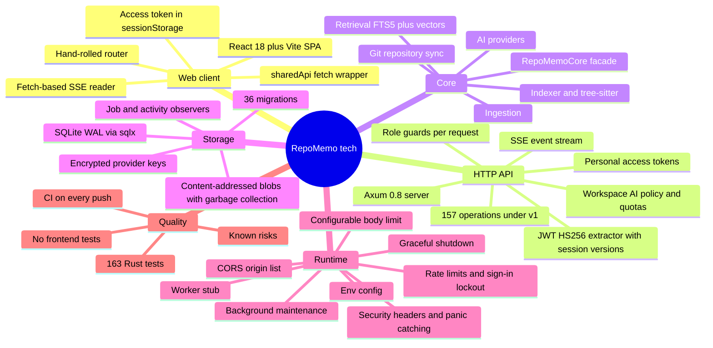
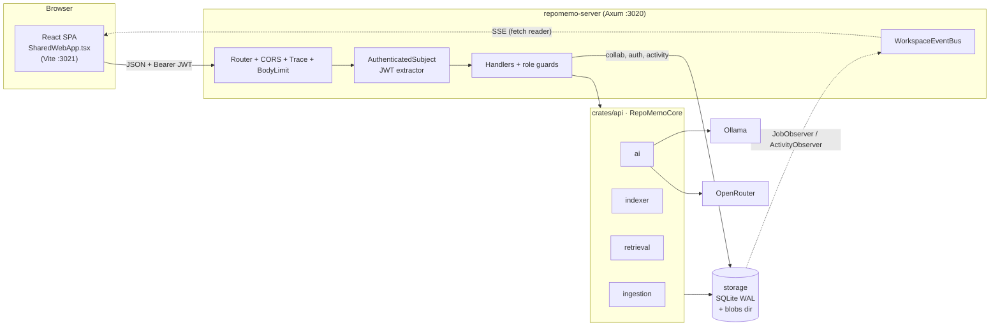
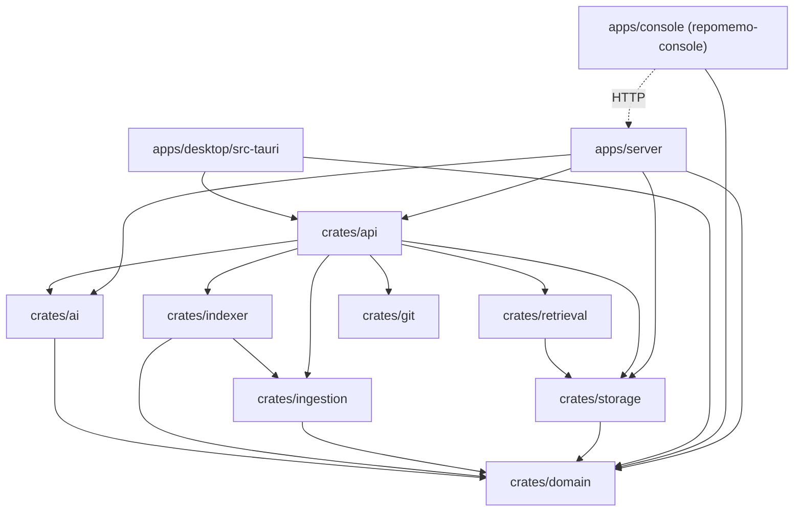
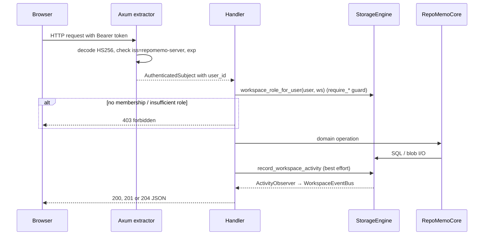
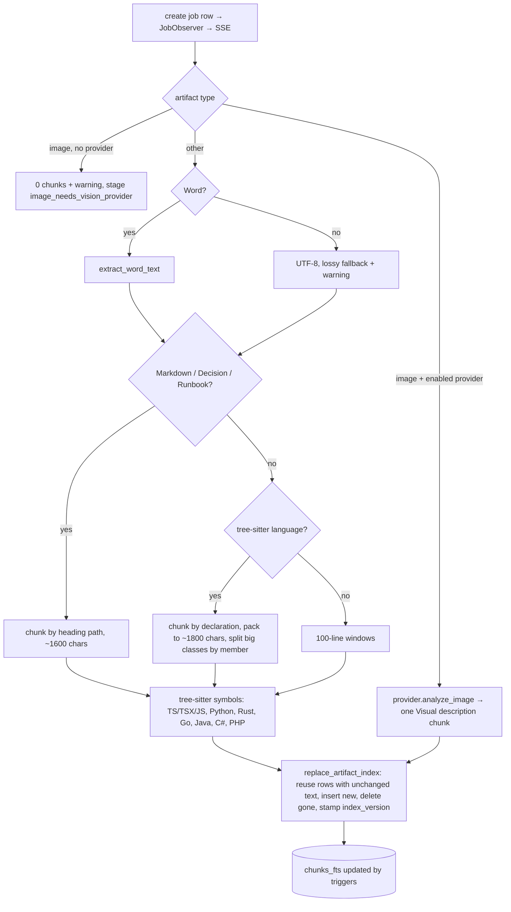
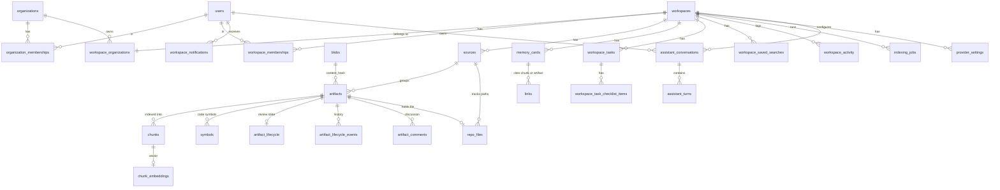

# RepoMemo: Technical Mindmap

> **Audience:** engineers working on RepoMemo, reviewers, and anyone operating the shared server.
> **Companion:** [FUNCTIONAL_MINDMAP.md](FUNCTIONAL_MINDMAP.md) covers *what* the product does. [ROADMAP.md](ROADMAP.md) covers what has shipped and what comes next.
> **Scope:** code at `V0.2.113` (2026-10-21; V0.2.113 moves the repository forms and pages onto `Field` (with hints), `FieldRow`, `Badge` (`STATUS_TONE`), `LoadingState`, the `danger` button and the `busy` button; V0.2.112 moves the artifact page onto `Field`, `Badge`, `LoadingState`, `EmptyState` and the `busy` button; V0.2.111 moves the memory section, the memory card page and the save-as-memory dialog onto `SearchField`, `Field`, `Combobox`, `Checkbox`, `EmptyState`, `LoadingState` and the `busy` button; V0.2.110 moves tasks onto `Field`, `Checkbox`, `IconButton`, `EmptyState` and the `busy` button; V0.2.109 moves retrieval onto `SearchField`, labelled `Field`s, `IconButton`, `EmptyState` and the `busy` button; V0.2.108 moves the evidence section onto `Field`, `Checkbox`, the `danger` button, `EmptyState` and the `busy` button (`test/workspacePage.ts` builds a workspace page for section tests); V0.2.107 moves the people section onto `Field`, `Badge`, `EmptyState` and the `busy` button; V0.2.106 moves the workspace settings (rename, AI providers, AI policy) onto `Field`, `Checkbox`, `EmptyState` and the `busy` button; V0.2.105 moves the organization page and the invitation form onto `Field`, `Badge`, `LoadingState` and the `busy` button; V0.2.104 moves the profile page and API tokens onto `Field`, `EmptyState`, `LoadingState` and the `busy` button; a dropdown in a `Field` fills it (`.rm-field .rm-dropdown-trigger`); V0.2.103 moves the setup wizard and the environment menu onto `Field`, `Switch`, `LoadingState`, `EmptyState` and the `busy` button; V0.2.102 moves the sign-in, registration, invitation, reset, verification and desktop connect pages onto `Field`, the `busy` button and `LoadingState`; V0.2.101 moves the knowledge map, the document viewer and the assistant's chat list onto the query cache (new `useErrorToast`, `useObjectUrl`, `useAssistantCommands`); V0.2.100 moves the repositories, repository page, file list and connectors list onto the query cache (`repositoryKeys`, `workspaceKeys.repositories` and `.connectors`); V0.2.99 moves the System pages onto the query cache (`systemKeys`, `useSystemData` on `useServerState`, with `refetchInterval` and `keepPrevious`); V0.2.98 splits `components/KnowledgeMapPanel.tsx` into the pipeline, coverage table, graph and link table in `web/map/`; V0.2.97 splits `components/ServerSetup.tsx` into a shared `StepFrame` and one component per step in `web/setup/`; V0.2.96 splits `components/RepositoriesPanel.tsx` into list, card, settings, link form, repository page and file browser in `web/repositories/`; V0.2.95 splits `components/SystemAdminPanel.tsx` into one file per page in `web/system/`; V0.2.94 adds `useFormState` (`lib/useFormState.ts`), used by Profile › Personal details; V0.2.93 adds `useAsyncAction` (`lib/useAsyncAction.ts`), used by the profile page and the task board; V0.2.92 replaces twelve local error helpers and eighteen inline checks with `apiMessage(error, fallback)` in `web/format.ts`; V0.2.91 moves the date, size and duration formatters of fifteen components into `web/format.ts` and adds `Time` (`components/ui/time.tsx`); V0.2.90 adds the `rm-option-list` style shared by the command palette, mention suggestions, folder picker and assistant chat list; V0.2.89 adds `CopyButton` (`components/ui/copy-button.tsx`) used by the secret dialog, commit hashes, file paths and webhook values; V0.2.88 adds `SearchField` (`components/ui/search-field.tsx`) for the list filters and the command palette; V0.2.87 uses `Combobox` for replacement evidence, a task's related evidence and the task checklist picker; V0.2.86 adds `Combobox` (`components/ui/combobox.tsx`, Radix Popover) and uses it to add evidence to a memory card; V0.2.85 adds `Table` and the `rm-table` styles (`components/ui/table.tsx`), replacing `rm-map-coverage` in the System, map, health and repository tables; V0.2.84 adds `PageHeader` (`components/ui/page-header.tsx`) used by every page; page titles are now 28 to 32 px (DESIGN.md); V0.2.83 adds `PanelHeading` (`components/ui/panel-heading.tsx`) used by all 59 panel headings; the `shared-panel-heading` class is gone; V0.2.82 adds `SegmentedControl` (`components/ui/segmented-control.tsx`, Radix Toggle Group) replacing the account switch, the activity filter, the evidence and map view switches and the workbook sheet tabs; V0.2.81 adds `Badge` (`components/ui/badge.tsx`) and removes the six tag and chip classes it replaces; V0.2.80 adds `EmptyState` (`components/ui/empty-state.tsx`) and uses it for tasks, memory cards and notifications; V0.2.79 adds `LoadingState` (`components/ui/loading-state.tsx`) and uses it on the System pages; V0.2.78 moves the last four native confirmations (ownership transfers, workspace and task deletion) to `useConfirm`, so the web client has no `window.confirm`; V0.2.77 adds `ConfirmDialog` and `useConfirm` (`ConfirmProvider` is mounted in `SharedWebApp`), first for deleting evidence, comments and memory cards; V0.2.76 adds `variant="danger"` to `Button`, used by destructive confirmation dialogs; V0.2.75 adds `Tooltip` (`components/ui/tooltip.tsx`, Radix Tooltip) that `IconButton` and the controls that had a `title` hint use; V0.2.74 adds `IconButton` (`components/ui/icon-button.tsx`) for icon-only buttons: the action menu trigger, the System refresh button, the organization member remove button and the evidence and map view switches; V0.2.73 adds `busy` to `Button` and a shared `Spinner`, used on the sign-in and Profile buttons; V0.2.72 makes `Button` a plain `type="button"` unless it says `submit`; every form names its one submit button; V0.2.71 adds `Switch` (`components/ui/switch.tsx`, Radix Switch) and uses it for the boolean rows of System › Settings; V0.2.70 adds `Checkbox` (`components/ui/checkbox.tsx`, Radix Checkbox) and uses it in the evidence type filter; V0.2.69 adds `Field` and `FieldRow` (`components/ui/field.tsx`, styles in `14-building-blocks.css`) and uses them in Profile › Personal details; V0.2.68 puts every icon of 12 to 18 px on `ICON_SIZE` (14, 16, 18) in `components/ui/icon.ts`; illustrations keep their size; V0.2.67 gives checkboxes, radio buttons and file pickers one base rule (16 px, accent colour, never stretched) and removes six local patches; V0.2.66 removes the page-specific sizes, borders, paddings and backgrounds of the sign-in, setup, member, memory, note and search fields, which are now the shared field; V0.2.65 leaves `.rm-input`, `.rm-textarea` and `.rm-dropdown-trigger` as the only styles of a field outside the local edition (the competing bare `input`, `textarea` and `select` rules sit behind `:where(.rm-local-edition)`); V0.2.64 fences the retired local edition's global field and search styles under `:where(.rm-local-edition)`, so the web client no longer inherits them; V0.2.63 makes every colour outside a `:root` block a token and removes the 164 token declarations that a later block overrides (the effective tokens are unchanged); V0.2.62 retires the `--workspace-*` palette (the retired local edition's second teal accent) for the shared `--color-*` tokens; V0.2.61 makes the neutral tokens of the light theme true greys (the cascade's winning block was blue-grey) and corrects the plan: the accent that shows is blue; V0.2.60 gives text fields, dropdowns and buttons one height, corner and border from the `--control-*` tokens (36 px, 40 px on touch screens); V0.2.59 sizes a dropdown to its content (160 px at least) unless a form stretches it; V0.2.58 keeps long dropdown lists inside the window (at most 320 px or the room left, scrolling, with arrows); V0.2.57 puts every `z-index` of the web client's stylesheets on one layer scale (`--layer-*` in `01-tokens-and-shared-web.css`), so dropdown lists and menus open above dialogs; V0.2.56 prepares the clean-machine install: the runbook [technical/clean-install.md](technical/clean-install.md) and a smoke test that checks mail, a remote repository and the limits of V0.2.52; the install itself is the maintainer's; V0.2.55 is the documentation pass: `scripts/check-docs.mjs` (routes, settings, versions, releases and links agree with the code), the API reference and counts brought up to date, the branch pages and `UPGRADING.md` (from 0.2.x) rewritten where they were stale; V0.2.54 adds the performance runs for remote sources (`repo_sync_at_scale` in `crates/api/src/repo_sync.rs`, `ten_thousand_issues_sync_and_stay_searchable` in `apps/server/src/tests/performance.rs`, [technical/performance.md](technical/performance.md)); the runs themselves are the maintainer's; V0.2.53 tests the upgrade from a 0.2.0 environment in CI (`an_environment_made_by_v0_2_0_upgrades_in_place_and_keeps_its_data` in `crates/storage/src/tests.rs`, `tests/fixtures/v0.2.0-seed.sql`, `migrations.lock`, `scripts/check-migrations.mjs`, the `upgrade` job); V0.2.52 is the feature freeze and the fourth security pass ([security review 2026-10-16](security/2026-10-16-security-review.md)): mail limits (`MailService::send_to`), small bodies on public routes, an expansion limit on imports, webhook delivery ids, capped connector answers; V0.2.51 retires the local desktop edition (a standing notice in `DesktopApp.tsx`, `SafeMarkdown` in `App.tsx`, removal planned for a 0.3.x release); V0.2.50 moves a local workspace to a server through the archive format (`write_workspace_archive` in `crates/api/src/archive.rs`, `src-tauri/src/handoff.rs`, `LocalMoveToServer.tsx`, the prepared archive in `WorkspaceImport.tsx`); V0.2.49 turns the desktop app into a client of a server (`src-tauri/src/connection.rs`, `DesktopApp.tsx`, `DesktopConnect.tsx`, `configureDesktopApi` in `sharedApi.ts`, the HTTP plugin and the credential store); V0.2.48 adds narrow-screen layouts (`styles/13-narrow-screens.css`, `useMediaQuery`, the rail folded behind a button in `SharedLayout`, the assistant as a sheet in `AssistantDock`); V0.2.47 makes the web client usable by keyboard and screen reader (`SharedLayout` landmarks and skip link, `RouteAnnouncer`, `pageTitle.ts`, contrast tokens, `scripts/check-accessibility.mjs`); V0.2.46 exports the audit trail (`GET /v1/system/audit/export`, `audit_export.rs`, `StorageEngine::list_system_events_page`); V0.2.45 ships container images (`Dockerfile` targets `server` and `proxy`, `docker-compose.yml`, `docker/Caddyfile`, `.env.example`, `scripts/check-container.mjs`); V0.2.44 reads documents in a child process (`crates/ingestion/src/reader.rs`, `--document-reader`, `LimitedAllocator`, `REPOMEMO_DOCUMENT_MEMORY_MB`, `REPOMEMO_DOCUMENT_READER`); V0.2.43 copies each backup to a second place and checks it (`REPOMEMO_BACKUP_COPY_DIR`, `backup_copy.rs`, `POST /v1/system/backups/copy`); V0.2.42 seals backups with AES-256-GCM (`REPOMEMO_BACKUP_KEY`, `backup_crypto.rs`, `BackupCipher`); V0.2.41 imports an archive into a new workspace (`POST /v1/workspaces/import`, `workspace_import.rs`, `StorageEngine::import_workspace_data`, `ArchiveReader`, `WorkspaceImport`, `REPOMEMO_MAX_IMPORT_MB`); V0.2.40 exports a workspace as one archive (`GET /v1/workspaces/{id}/export`, `workspace_export.rs`, the tar-in-gzip container `ArchiveEncoder` in `crates/api/src/archive.rs`, `StorageEngine::export_workspace_data`, `WorkspaceExportSettings`); V0.2.39 suggests mentions while a comment is typed (`GET /v1/workspaces/{id}/mention-suggestions`, `MentionTextarea`); V0.2.38 keeps earlier versions of an uploaded file and compares them (migration 0036, `artifact_versions`, `versions.rs`); V0.2.37 adds the review queue (`GET /v1/workspaces/{id}/review`, `review.rs`, `ReviewQueuePanel`); V0.2.36 reads C# and PHP with tree-sitter (`tree-sitter-c-sharp`, `tree-sitter-php`, `INDEXER_VERSION` 4); V0.2.35 reads Go and Java with tree-sitter (`tree-sitter-go`, `tree-sitter-java`, `INDEXER_VERSION` 3); V0.2.34 adds the keyboard command palette (`CommandPalette`, `paletteEntries`, `assistantBridge`); V0.2.33 adds one search across the caller's workspaces (`POST /v1/search`, `search_workspace_detailed`, the AI policy applied per workspace); V0.2.32 gives the assistant the earlier turns of a chat within a token budget (`AgentRequest.history`, `fit_history`, `ask_workspace_in_conversation`); V0.2.31 adds connector webhooks and pauses for a tracker's rate limit or a refused token (`Pause`, `webhooks.rs`); V0.2.30 links tracker items to the files, symbols and commits they name (migration 0035, `mentions.rs`); V0.2.29 connects GitLab, self-hosted included (`connectors/gitlab.rs`); V0.2.28 keeps GitHub pull requests as evidence with their reviews and commits (`render_pull`, `PullDetail`); V0.2.27 adds connectors, starting with GitHub issues (migration 0034, `connectors.rs`, [technical/connectors.md](technical/connectors.md)); V0.2.26 opens a cited repository passage at the commit it names (`GET /v1/artifacts/{id}/at/{commit}`); V0.2.25 shows `CODEOWNERS` owners as hints on repository files (`codeowners.rs`); V0.2.24 records who last changed each repository file (migration 0033, `GitRepo::last_changes`); V0.2.23 adds push webhooks for repositories (migration 0032, `webhooks.rs`); V0.2.22 caps remote clones by size and time (`TransferLimits`, settings `repo_clone_max_mb` and `repo_clone_timeout_minutes`); V0.2.21 links remote repositories over `ssh` with a deploy key and a pinned host key (`SshAuth`, `known_hosts_lines`); V0.2.20 links remote repositories over `https` (`crates/git/src/remote.rs`, `crates/api/src/remote_repo.rs`, a bare partial clone per link); V0.2.19 adds the groundwork for remote repositories (migration 0031, `RemoteGitPolicy`, the credential store); V0.2.18 makes open registration answer the same for every address (`register_without_revealing`); V0.2.17 adds anonymization (migration 0030, `StorageEngine::anonymize_user`); V0.2.16 adds account deactivation (migration 0029, [accounts.rs](../crates/storage/src/accounts.rs)); V0.2.15 adds the daily digest (migration 0028, `MailService::queue_digests`); V0.2.14 adds notification preferences (migration 0027); V0.2.13 adds email verification (migration 0026, [verification.rs](../apps/server/src/verification.rs)); V0.2.12 mails task assignments and mentions (`mail::mail_notification`); V0.2.11 adds "Forgot your password?" by mail; V0.2.10 mails invitations (`mail::mail_invitation`, answer field `mail`); V0.2.9 adds outgoing mail (migration 0025, `crates/mail`, the outbox worker in [mail.rs](../apps/server/src/mail.rs)); V0.2.8 makes the map and health incremental; V0.2.7 adds the console's workspace commands; V0.2.6 makes the manual re-index endpoints asynchronous; V0.2.5 splits the stylesheets; V0.2.4 adds the link-page tests; V0.2.2 splits the workspace page and V0.2.3 puts every page on the query cache; V0.2.0 is the code of V0.1.76 under a new number and V0.2.1 corrects the server checks; invitations, reset links and personal access tokens in V0.1.63, migration 0023; security bundle S1 in V0.1.64; the security second pass in V0.1.65; CI, one version source and performance timings in V0.1.66; safe defaults and identity, migration 0024, in V0.1.67; browser hardening in V0.1.68; host exposure in V0.1.69; web client foundation in V0.1.70; server foundation in V0.1.71; memory and search you can trust in V0.1.72; evidence, ownership and repositories 1b in V0.1.73; performance and robustness in V0.1.74; operations in V0.1.75, with the [production guide](technical/operations.md); the release candidate in V0.1.76: third security pass, upgrade test, generated [API reference](technical/api-reference.md)). The plan to V0.2.0 is in the [roadmap](ROADMAP.md#-road-to-v020). Aligned on 2026-10-13; sections marked *hardening* came with V0.1.51–V0.1.57. The focus is the **shared web client** (`apps/desktop/src/SharedWebApp.tsx`) and the **HTTP API** (`apps/server`). Desktop and Tauri paths are noted where they share code. Open security findings are in the [security review](security/2026-10-10-security-review.md), and the improvement backlog is in the [enhancement analysis](analysis/2026-10-13-enhancement-analysis.md).

---

## The mindmap



---

## 1. System context



**The same React bundle has two runtimes.** `apps/desktop/src/App.tsx` checks `"__TAURI_INTERNALS__" in window`:

- In **Tauri**, it renders `DesktopApp` (since V0.2.49, [DesktopApp.tsx](../apps/desktop/src/components/DesktopApp.tsx)): with a saved server it renders `SharedWebApp` against that server, without one `DesktopConnect`, and on request the retired `LocalDesktopApp` (V0.2.51, removal planned for a 0.3.x release; it renders Markdown with `SafeMarkdown` like the web client), which reaches Rust through `invoke()` (see `lib/repomemoApi.ts`; 26 Tauri commands call `RepoMemoCore` in-process, plus 4 that write and hand over an archive of a workspace) until it is retired.
- In a **browser**, it renders `SharedWebApp`, which calls the HTTP API through `lib/sharedApi.ts`.

---

## 2. Workspace layout and crate graph



| Unit | Responsibility | Key file(s) | Size |
|---|---|---|---|
| `crates/domain` | Serde DTOs shared by every layer: `ArtifactSummary`, `Chunk`, `Citation`, `WorkspaceRole`…, and the console banner | [lib.rs](../crates/domain/src/lib.rs) | ~1,370 LOC |
| `crates/storage` | `StorageEngine`: the sqlx pool, migrations, blob I/O, **all SQL**, observers, secrets, environments. Since V0.1.71 `lib.rs` (engine, row types, helpers, about 1,500 lines) is joined by `users`, `organizations`, `activity`, `collaboration`, `artifacts`, `search`, `memory`, `jobs` and `providers`, next to `access`, `repo`, `system` and `setup`. One writer connection (`pool`) and a read pool (`reader()`) | [lib.rs](../crates/storage/src/lib.rs), [migrations/](../crates/storage/migrations) | ~8,500 LOC |
| `crates/ingestion` | File discovery, type and language detection, binary sniffing, business document extraction and previews ([documents.rs](../crates/ingestion/src/documents.rs)), repository file rules ([repo.rs](../crates/ingestion/src/repo.rs)) | [lib.rs](../crates/ingestion/src/lib.rs) | ~2,400 |
| `crates/indexer` | Chunking (Markdown by heading, structure-aware code chunks for TS/TSX/JS, Python, Rust, Go, Java, C# and PHP, 100-line windows as fallback) and tree-sitter symbols. Exports `INDEXER_VERSION` | [lib.rs](../crates/indexer/src/lib.rs) | ~950 |
| `crates/retrieval` | FTS query sanitising, hybrid FTS + vector merge | [lib.rs](../crates/retrieval/src/lib.rs) | ~220 |
| `crates/ai` | `AiProvider` trait, with Ollama and OpenRouter implementations over `reqwest` (rustls), outbound URL checks, LLM rerank | [lib.rs](../crates/ai/src/lib.rs) | ~950 |
| `crates/git` | Read-only `git` CLI access: resolve a branch, list a commit's tree, stream blobs through `git cat-file --batch` | [lib.rs](../crates/git/src/lib.rs) | ~400 |
| `crates/mail` | *Since V0.2.9.* Outgoing mail: `compose` (addresses checked, no control characters in any header, RFC 2047 and base64 for non-ASCII) and `send`, an SMTP submission client that only speaks TLS (implicit or `STARTTLS`, never plain text), checks the certificate against the public roots plus `REPOMEMO_SMTP_CA_FILE`, resolves the name itself and refuses link-local, cloud-metadata and (unless listed in `REPOMEMO_SMTP_ALLOWED_HOSTS`) private addresses, with timeouts at every step. Tested against a scripted TLS server | [lib.rs](../crates/mail/src/lib.rs) |
| `crates/api` | `RepoMemoCore` facade: import, index, search, summarize, ask, memory cards, plus the assistant, knowledge map, health checks, embeddings and repository sync, overview and stack modules | [lib.rs](../crates/api/src/lib.rs) | ~5,500 |
| `apps/server` | Axum router, auth, authorization, collaboration handlers, SSE, background queues, System area, logging, setup, environments, access links and tokens. Since V0.1.71 `lib.rs` holds the router and state (about 770 lines), with the handlers in `auth`, `access_control`, `profile`, `organizations`, `workspaces`, `artifacts`, `collaboration`, `retrieval`, `ai`, `streams`, plus `requests`, `errors`, `config`, `serve`, `web_session` and `tests/` | [lib.rs](../apps/server/src/lib.rs), [events.rs](../apps/server/src/events.rs), [system.rs](../apps/server/src/system.rs), [access.rs](../apps/server/src/access.rs) | ~16,500 |
| `apps/console` | `repomemo-console` terminal client for the admin console (§8c) | [main.rs](../apps/console/src/main.rs) | ~870 |
| Web client | SPA, API client, types, layout, about 20 components. `SharedWebApp.tsx` is the shell (about 340 lines) with the pages in `src/web/` (`WorkspaceDetail.tsx` about 320, its seven sections in `src/web/workspace/`); *since V0.2.95* the System area is one file per page in `src/web/system/`, the repositories pages in `src/web/repositories/`, the setup wizard in `src/web/setup/` (a `StepFrame` and one component per step) and the knowledge map in `src/web/map/`, none over 300 lines (`test/splitModules.test.ts` keeps it so); the desktop `App.tsx` 2,750 | [SharedWebApp.tsx](../apps/desktop/src/SharedWebApp.tsx), [sharedApi.ts](../apps/desktop/src/lib/sharedApi.ts), [types.ts](../apps/desktop/src/types.ts), [SharedLayout.tsx](../apps/desktop/src/components/SharedLayout.tsx) | ~10,900 (plus ~7,400 CSS) |

**Layering note.** The server calls `RepoMemoCore` for evidence, indexing, search, AI and memory. It calls **`StorageEngine` directly** for auth, organizations, memberships, tasks, comments, lifecycle, notifications, saved searches, activity and jobs. Both use **one shared `StorageEngine`**, created with `RepoMemoCore::from_storage(storage.clone())`, so writes made inside the core still fire the server's observers.

---

## 3. Runtime and configuration

### Server (`ServerConfig::from_env`, [lib.rs](../apps/server/src/lib.rs))

| Env var | Default | Notes |
|---|---|---|
| `REPOMEMO_JWT_SECRET` | — (**required**) | Must be at least 32 characters, or startup panics. |
| `REPOMEMO_SERVER_ADDR` | `127.0.0.1:3020` | Bind address. |
| `REPOMEMO_SERVER_DATA_DIR` | unset | Environment folder to attach at startup: a name (`main`) or `workspace-data/main`. Must be directly inside `workspace-data/` (relative to the CWD, git-ignored) and be empty or a valid RepoMemo environment; checked at startup, and the server refuses to start otherwise. Set, the server is **pinned**: every start attaches it, and a switch made in the web app lasts until the next restart. Unset: the server re-attaches the environment last chosen in the web app (`workspace-data/.last-environment`), or starts detached with the environment menu (§8b-ter). Holds `repomemo.sqlite`, `blobs/`, `logs/`, `secret.key`. |
| `REPOMEMO_ALLOWED_ORIGIN` | `http://127.0.0.1:3021` | The CORS origins, comma-separated (`*` is refused). Allowed methods are GET, POST, PUT, PATCH and DELETE. Allowed headers are `Authorization`, `Content-Type`, `X-RepoMemo-Filename` and `X-RepoMemo-Folder-Id`; `X-Total-Count` and `Retry-After` are exposed. |
| `REPOMEMO_SERVICE_NAME` | `repomemo-server` | Returned by `/health`. |
| `REPOMEMO_SECRET_KEY` | unset | *Hardening.* Key material for encrypting provider API keys at rest (§6.6). Unset: a random key in `<data dir>/secret.key`. |
| `RUST_LOG` | unset | A raw tracing filter. When set it replaces the per-category levels until a system administrator sets levels in System › Settings › Logging (§8c). Security events use the `audit` target. |
| `REPOMEMO_LOG_FORMAT`, `REPOMEMO_LOG_TO_FILE`, `REPOMEMO_LOG_RETENTION_DAYS` | `text`, `true`, `14` | Console format, daily log files and their retention (§8c); all changeable at run time |

*Hardening* added settings for registration, token lifetimes, rate limits and lockout, AI quotas and allowed AI hosts, repository roots, automatic repository syncing and background maintenance. Each has a safe default; the full table is in [DEVELOPMENT_COMMANDS.md](../docs/DEVELOPMENT_COMMANDS.md#optional-server-settings). An invalid value stops the server at startup, naming the variable. A JWT secret that is too repetitive (fewer than 8 distinct characters) is refused.

Tower layers, outermost first: `CorsLayer` (credentials allowed for the listed origins), `DefaultBodyLimit` (`REPOMEMO_MAX_UPLOAD_MB`, 10 MiB by default; since V0.2.52 the twelve public endpoints and the webhook receivers set their own, 64 KiB and 1 MiB, with a route-level `DefaultBodyLimit`), `TraceLayer`, a security-headers middleware (`X-Content-Type-Options: nosniff`, `X-Frame-Options: DENY`, `Referrer-Policy: no-referrer`, `Cache-Control: no-store` and a `default-src 'none'` CSP, each only when the handler did not set its own) and `CatchPanicLayer`, which turns a handler panic into the usual JSON 500 instead of a dropped connection.

**Process.** `main.rs` serves with the peer address attached (`into_make_service_with_connect_info`, used by the rate limits) and shuts down gracefully on Ctrl-C or SIGTERM, letting in-flight requests finish. `GET /health/ready` answers 200 when the database responds and 503 otherwise.

### Web client

| Setting | Where | Value |
|---|---|---|
| `VITE_REPOMEMO_API_URL` | `apps/desktop/.env` | Defaults to `http://127.0.0.1:3020`. |
| Dev server | [vite.config.ts](../apps/desktop/vite.config.ts) | Port `3021`, `strictPort`, started with `npm run web:dev`. |
| Token storage key | `sessionStorage["repomemo.shared.access-token"]` | Scoped to the tab. |
| Theme key | `localStorage["repomemo.theme"]` | |

Run commands are in [docs/DEVELOPMENT_COMMANDS.md](../docs/DEVELOPMENT_COMMANDS.md).

---

## 4. Request lifecycle, authentication and authorization



### Authentication

- Passwords are hashed with **Argon2** (default params and a random salt) on the blocking thread pool. The length limit is 12–1024.
- Access tokens are **HS256 JWTs** with claims `sub`, `email`, `iss`, `iat`, `exp` and `ver`. The TTL is 60 minutes by default (`REPOMEMO_ACCESS_TOKEN_TTL_MINUTES`). **Refresh tokens** (migration 0016) are opaque, stored as SHA-256 hashes, rotated on every use and valid 30 days; presenting a rotated token again revokes the whole family. The web client refreshes silently on a 401.
- **Session versions** (*hardening*, migration 0018). `users.session_version` is stamped into each access token as `ver`, and the extractor refuses a token whose version no longer matches (one primary-key lookup per request), so a deleted user's tokens also stop working. Changing the password and `POST /v1/auth/logout-all` bump the version and revoke every refresh token: every session ends at once, not when its token expires. The password change returns a fresh session (`TokenResponse`) for the device that made it.
- `AuthenticatedSubject` implements `FromRequestParts`. If a handler takes it as an argument, the handler is protected.
- **Personal access tokens** (migration 0023, [access.rs](../apps/server/src/access.rs)). A bearer value starting with `rmp_` is looked up by SHA-256 instead of decoded as a JWT. It must not be revoked or expired, and its user must exist. The subject carries `token: Some(TokenGrant { read_only, system })` (the `system` scope, since V0.1.67, migration 0024: read and write plus System changes; only administrators can create one, and `require_system_change` lets only a session or such a token through) and the user's current session version, so open event streams still end when sessions are ended. *Since V0.1.64 (review L2):* what a token may reach is marked by the extractor each handler takes, not by a path list. `AuthenticatedSubject` accepts tokens but refuses read-only ones on anything other than GET/HEAD. `SessionSubject` refuses every token (403): token management, `/v1/profile/password`, `/v1/auth/logout-all`, `/v1/invitations/accept`, `/v1/system/environment/detach`, the system and app administrator grants and reset links, and (second pass N2) changes to run-time settings. `ReadingSubject` lets a read-only token make a POST that only reads: workspace and memory-card search, `…/artifacts/query`, `…/ask` and `/v1/system/console`, whose handler refuses `--yes` from it. A new account-security handler must take `SessionSubject`. Last use is written at most every 5 minutes. Tokens survive password changes and the user's own sign-out-everywhere; System › *Sign out everywhere* and (since V0.1.65, second pass N5) a used reset link revoke them.
- **Invitation and reset links** ([access.rs](../apps/server/src/access.rs), storage `access.rs`). Secrets are two UUIDv4s in hex, stored as SHA-256 and found by hash lookup. *Since V0.1.64 (review L3):* the web paths are `/invite#<secret>` and `/reset-password#<secret>`, so the secret never reaches a server, and the SPA sets `no-referrer`. Registration with `invitation_token` skips the closed-registration check only for the invited email; joining happens on `accept`, which marks the invitation used with a conditional update first and gives it back if the membership change fails. Maintenance deletes links a week after they expire.
- Login returns the same `invalid_credentials` error whether the email is unknown or the password is wrong, and an unknown email is checked against a fixed Argon2 hash so the response time does not reveal which emails have accounts.
- **Throttling** (*hardening*, [security.rs](../apps/server/src/security.rs)). Sign-in and registration are limited per client address (30 per minute by default), and session refreshes, which every open tab makes and which cannot be guessed, get a separate bucket four times as large. Failed sign-ins lock the account for that address after 10 consecutive failures, and for every address after 50, for 15 minutes; the answer is 429 `rate_limited` with `Retry-After`. Counters are in memory (one server process). *Since V0.1.67:* a sign-in that carries a refresh token of the account (`refresh_token` in the login body) skips the lockout (`known_device`, review L10), and the client address is the TCP peer, or, only when `REPOMEMO_TRUST_PROXY` is on and the peer is loopback or in `REPOMEMO_TRUSTED_PROXIES`, the rightmost `X-Forwarded-For` entry no trusted proxy added (`security::client_ip`, review M3).
- **Registration** is closed by default (`REPOMEMO_ALLOW_REGISTRATION`, since V0.1.67, review M1); the first account can still register, and an invitation always allows its address. `/health` no longer reports it. Passwords go through `validate_password` (12–1024 characters, not in a list of common ones, five different characters, not the email name; review L7). Member forms do not add people who are not in the organization or workspace yet: `invitation_required` (409), the same for known and unknown addresses (review M4).
- **Transport** (review M9). `check_transport` refuses a bind beyond loopback unless `REPOMEMO_PUBLIC_URL` is `https://…`, `REPOMEMO_TRUST_PROXY` is on or `REPOMEMO_ALLOW_INSECURE_HTTP` is set; an HTTPS public URL adds `Strict-Transport-Security` (`security::HeaderPolicy`). `repomemo-console` prints a warning for plain `http://` to a non-loopback host.

### Authorization

The server resolves the caller's role **per request** from `workspace_memberships` or `organization_memberships`. Guards return the role, so handlers can apply finer rules.

**System administrators** (`users.is_system_admin`, migration 0019) are loaded with the session version by the extractor, so a granted or removed role applies on the next request. `require_workspace_read` and `require_organization_read` (through `effective_workspace_role`) give them **admin** in every workspace and organization, owner where they own it, without a membership row; every finer guard and escalation rule builds on that, so owner-only actions stay with owners. `GET /v1/workspaces` and `/v1/organizations` list everything for them, `GET /v1/session` reports `is_system_admin`, and storage lets them create workspaces in any organization. The first account of a server becomes one (when none exists), as do accounts listed in `REPOMEMO_SYSTEM_ADMIN_EMAILS` that exist at startup. *Since V0.1.64 (review H4):* registering a listed address no longer grants the role, since email addresses are not verified; it logs a warning, as does a listed address with no account at startup. The last one cannot be removed. Without any, the server logs a warning at startup.

**App administrators** (`users.is_app_admin`, migration 0021) may use the whole System API and pages (`require_system_admin` accepts either flag) but get **no wildcard access**: every place that grants an administrator role in all organizations and workspaces (`effective_workspace_role`, `require_organization_read`, the all-organizations and all-workspaces lists, the event stream recheck, avatar viewing) still checks `is_system_admin` only. *Since V0.1.67 (decision 1, review M8):* app administrators **read** the System pages and run jobs and maintenance. `require_full_system_admin` guards everything else: the system administrator role and the app role, run-time settings, ending sessions, unlocking, reset links, raw log files and detaching the environment. Workspace activity log records are hidden from app administrators.

| Guard | Passes for |
|---|---|
| `require_workspace_read` | any workspace role |
| `require_workspace_write` | owner, admin, member |
| `require_workspace_admin` | owner, admin. Also gates `GET /v1/artifacts/{a}/chunks` |
| `require_workspace_owner` | owner |
| `require_organization_read/admin/owner` | the equivalent roles at org level |

Other rules:

- For **resource-scoped routes** (`/v1/artifacts/{id}`, `/v1/tasks/{id}`, `/v1/comments/{id}`…), the handler first loads the resource to find its `workspace_id` and then applies the guard.
- **Author-or-moderator** checks apply to deleting tasks, to editing or deleting comments and (since V0.1.65) to deleting saved searches. *Since V0.1.65 (second pass N4):* the author path needs a writer role, so someone downgraded to viewer no longer changes their old content.
- **Escalation rules** live in the member-upsert handlers. Nobody can grant `owner`, and (since V0.1.65, second pass N3) nobody can change the role of a current owner either, not even the owner themselves (400), so a workspace or organization never loses its owner through the member list. An admin cannot grant `admin` and cannot modify or remove an owner or admin.
- **Membership propagation** happens in SQL inside storage transactions:
  - `create_shared_workspace` copies all org members into the workspace.
  - `upsert_organization_member` adds the user to every workspace of the org, with the matching role, except that (since V0.1.65) it never lowers a workspace the person owns. Removing an organization member removes them from every workspace, owned ones included (second pass N8: no ownership transfer yet).
  - `upsert_workspace_member` writes the workspace row only (since V0.1.64, review H1; it used to add the user to the organization and so to every workspace in it). `list_organizations_for_user` also returns, with `guest: true`, the organizations where the user only belongs to some workspaces, so the web client can list them; a guest has no organization role and no access to its other workspaces.
- `can_inspect_index` (owner, admin) controls who receives chunks from `GET /v1/artifacts/{a}`. The server strips them for everyone else; the SPA only hides the button and the overview chunk count.
- `GET …/capabilities` returns `capabilities_for_role(role, may_use_ai)`. The SPA uses it **only to hide UI**. The server remains the authority.
- **AI policy** (*hardening*, [ai_access.rs](../apps/server/src/ai_access.rs)). Each workspace sets the lowest role that may trigger AI (`ai_min_role` in `workspaces.settings_json`: `viewer` by default, `member` or `admin`), via `GET/PUT /v1/workspaces/{ws}/ai-policy` (read: any member; write: owner or admin). Ask, the AI overview, repository summaries and the assistant's AI actions check it (403 otherwise; the assistant answers that AI is kept to other roles and still runs lookups and searches), and each user has an hourly AI quota (`REPOMEMO_AI_REQUESTS_PER_HOUR`, 120 by default; 429 when used up). `can_use_ai` and `can_generate_ai_overview` follow the policy. *Since V0.1.74 (review M12):* background image descriptions and embedding batches are counted per workspace per day (`REPOMEMO_BACKGROUND_AI_PER_DAY`, 2000; `BackgroundAiBudget` in `RepoMemoCore`, in memory, UTC days). A workspace that spent it pauses embedding (the job fails with the reason; maintenance resumes it) and its images wait for the next indexing retry.

### Error envelope

```json
{ "error": { "code": "bad_request|unauthorized|invalid_credentials|forbidden|conflict|internal_error", "message": "…" } }
```

`map_storage_error` (also used for core and repository errors) answers from the **kind** of the error, not from its words (*since V0.1.71*, review L6): an error created with `repomemo_domain::not_found!`, `invalid!` or `conflict!` carries a `DomainError` that `classify` finds through `context` layers and becomes 404, 400 or 409 with its message; a database uniqueness violation (`repomemo_storage::is_unique_violation`) becomes 409; anything else becomes 500 with a generic message and the cause in the log. New validation or lookup failures in the storage and api crates must use the macros, or they are 500s. Rate limits answer 429 `rate_limited` with a `Retry-After` header. Provider settings are validated before they are saved, so every validation failure is a 400 with its message.

---

## 5. HTTP API reference (210 operations under `/v1`)

Counted as method and path pairs (`node scripts/list-routes.mjs`): 203 in the main router (`routes()` in [lib.rs](../apps/server/src/lib.rs), the two health routes included), 4 platform routes ([environment.rs](../apps/server/src/environment.rs)) and 3 avatar routes ([avatars.rs](../apps/server/src/avatars.rs)), plus nothing else. Every route with its guard and request and response types is in [api-reference.md](technical/api-reference.md), and `npm run docs:check` fails when a route has no row.

Guard legend: **pub** = no auth, **auth** = any valid JWT or personal access token, **R/W/A/O** = workspace read / write / admin / owner, **oR/oA/oO** = organization read / admin / owner. "→ activity" means the call records a `workspace_activity` row and so emits an SSE `activity` event. **F** = system administrators only (`require_full_system_admin`), and *change* = a session or a `system` token (`require_system_change`).

### Identity and session

| Method | Path | Guard | Notes |
|---|---|---|---|
| GET | `/health` | pub | `{service,status,authentication}` |
| GET | `/health/ready` | pub | 200 when the database answers, 503 otherwise |
| GET | `/v1/setup` | pub | `{state, onboarding}` with `state` new, finishing or complete (§8b-bis) |
| POST | `/v1/setup/verify-code` | pub | `{code}` → 204; new server only; wrong codes count towards a lockout |
| POST | `/v1/setup/admin` | pub | `{code, email, display_name, password}` → 201 `TokenResponse`; creates the first system administrator; 409 once one exists |
| GET | `/v1/setup/checks` | system admin, finishing | server checks with status and advice (database, data folder, key, git, LibreOffice, origins, repository folders, AI hosts, public address, client addresses, backups, logs) |
| POST | `/v1/setup/complete` | system admin, finishing | completes the setup for good; 409 afterwards |
| GET | `/v1/platform` | pub | `{attached, environment, folder, pinned_environment}`; `pinned_environment` is the folder `REPOMEMO_SERVER_DATA_DIR` names, null when the web app's choice is remembered |
| POST | `/v1/platform/environments/list` | code | `{code}` → folders of `workspace-data/` with `valid`/`empty`/`invalid` and the reason; 403 on a wrong code (lockout after 10); 409 when attached |
| POST | `/v1/platform/environments/create` | code | `{code, name}` → creates `workspace-data/<name>` and attaches it; 409 if the folder exists |
| POST | `/v1/platform/environments/attach` | code | `{code, name}` → verifies the structure, then attaches; 400 with the reason when invalid |
| POST | `/v1/system/environment/detach` | system admin | ends every session, stops background work, closes the database, back to detached; 204 |
| POST | `/v1/auth/register` | pub | 201 `TokenResponse`, 409 if the email exists, 403 when registration is closed, 429 when rate-limited. V0.2.18: with open registration, mail ready and a public address, and no invitation, `202 {message}` for every address (a new one gets its account and a link; a known one, a mail to its owner) |
| POST | `/v1/auth/login` | pub | `TokenResponse`, 401 `invalid_credentials`, 429 when rate-limited or locked out |
| POST | `/v1/auth/refresh` | pub | `{refresh_token}` → a new `TokenResponse` with a rotated refresh token; 401 for an unknown, expired or reused token. For web clients the token comes from the `repomemo_refresh` cookie and the new one is set as a cookie (`refresh_token` is empty in the body) |
| POST | `/v1/auth/logout` | pub | `{refresh_token}` (or the cookie) → 204, revokes that refresh token and clears the cookie |
| POST | `/v1/auth/logout-all` | auth | 204. Ends every session of the caller, on every device. Personal access tokens are kept |
| GET, PUT | `/v1/profile/notification-preferences` | A | the choosable kinds (`task_assigned`, `evidence_mention`) with their channel; `PUT {kind, channel}`, `400` for another kind or channel. `profile::delivery` reads it when the notice is made |
| POST | `/v1/auth/verify-email` | pub | `{token}` → `{email}`; `410` for an unknown, used, expired or outdated link (the account's address changed). Verifies the account the link was made for |
| POST | `/v1/profile/email/verify` | A | sends the account's link again, 3 an hour (`429`); `{verified, sent}` |
| PUT | `/v1/profile/email` | session | `{email, current_password}`: changes the address, starts it unverified, mails a link, `409` when another account uses it |
| POST | `/v1/auth/forgot-password` | pub | `{email}` → `202` and one fixed message, whatever the address, mail setup or limits (same words, status and no lookup before answering; the work is a spawned task). Rate-limited by the sign-in limits of the client address (`429`) and silently to 3 mails an hour per address. When the address has an account and mail is ready: `create_password_reset` with a **1-hour** life (`created_by` is the account itself), a mail through the outbox (kind `password_reset`, link `/reset-password#…` from `REPOMEMO_PUBLIC_URL`) and an in-app notification `password_reset_issued`. Using the link is the existing `POST /v1/auth/password-reset` |
| POST | `/v1/auth/password-reset/preview` | pub | `{token}` → `{email, display_name, expires_at}`; 410 for a used, replaced or expired link; rate-limited like sign-in |
| POST | `/v1/auth/password-reset` | pub | `{token, password}` → `TokenResponse`. Sets the password, ends every session, revokes the account's personal access tokens (since V0.1.65), lifts lockouts, records `password_reset_used`. A refused password does not use up the link |
| POST | `/v1/invitations/preview` | pub | `{token}` → target name, organization, role, inviter, expiry, `account_exists`; 404 unknown, 410 used, withdrawn or expired; rate-limited |
| POST | `/v1/invitations/accept` | auth (session only) | `{token}` → `{target_type, target_id, organization_id, role}`. The caller's email must be the invited one and the inviter must still be allowed to grant the role; never lowers an existing role → activity `member_joined` |
| DELETE | `/v1/invitations/{i}` | A / oA of its target | withdraws a pending invitation; 409 when already used or withdrawn |
| GET, POST | `/v1/profile/tokens` | auth (session only) | list (not revoked, expired included) / create `{name, scope, expires_in_days}` with scope `read`, `write` or `system` (administrators only) and 7, 30, 90 or 365 days → `{token, secret}` (secret shown once) |
| DELETE | `/v1/profile/tokens/{t}` | auth (session only) | revokes one of the caller's tokens |

### System administration ([system.rs](../apps/server/src/system.rs))

Every route requires a system administrator (**S**); changes are recorded in `system_audit_events` and logged under `audit`.

| Method | Path | Guard | Notes |
|---|---|---|---|
| GET | `/v1/system/overview` | S | instance, storage, statistics, background queues, maintenance status, traffic since start (with requests per minute for the last hour), protection counters, front-end clients seen in 24 h, log capture state |
| GET | `/v1/system/usage?days=` | S | activity per day (zero-filled) and by action, top people, per-workspace footprint and activity; 1–365 days |
| GET | `/v1/system/users` | S | every account with its direct memberships (`organizations`: id, name, role; `workspaces`: id, name, role, organization), organization count, active sessions and last connection |
| PUT | `/v1/system/users/{u}/system-admin` | S (system admin only) | `{enabled}`; 409 for the last system administrator |
| PUT | `/v1/system/users/{u}/app-admin` | S | `{enabled}` |
| POST | `/v1/system/users/{u}/sessions/end` | S | ends every session of the user and revokes their personal access tokens |
| POST | `/v1/system/users/{u}/unlock` | S | clears the user's sign-in lockouts → `{cleared}` |
| POST | `/v1/system/users/{u}/deactivate` | S (system admin; session or `system` token) | V0.2.16. Ends sessions, personal access tokens, pending links and the invitations the account sent, in one transaction → `{personal_tokens_revoked, invitations_withdrawn}`; 409 for oneself, the last active system administrator, and an owner of an organization or workspace |
| POST | `/v1/system/users/{u}/anonymize` | S (system admin; session or `system` token) | V0.2.17. `{confirm}` is the account's address; only for a deactivated account that owns nothing; removes its personal data for good → `{memberships_removed, notices_removed, conversations_removed, summaries_rewritten}` |
| POST | `/v1/system/users/{u}/reactivate` | S (system admin; session or `system` token) | V0.2.16. The account signs in again with its password; 409 when it is not deactivated |
| POST | `/v1/system/users/{u}/password-reset` | S (session only; a system administrator's account needs a system administrator) | `{token, path, expires_at}`: a one-time link for 24 hours, replacing older ones; audited `password_reset_issued` |
| GET, PUT | `/v1/system/settings` | S (PUT: session only since V0.1.65, second pass N2) | run-time settings with value, default and who changed them, plus read-only environment facts. PUT `{values:{key:value}}` validates every value before saving any |
| DELETE | `/v1/system/settings/{key}` | S (session only since V0.1.65) | back to the environment default. The console's `settings set/reset --yes` also needs a console opened with a password |
| GET | `/v1/system/logs?level&category&workspace&q&after&limit&day` | S | log events, newest first: recent ones from memory, or a day's file with `day=YYYY-MM-DD` (last 16 MiB read). `category` is `security`, `activity`, `jobs`, `http`, `ai`, `database` or `server`; `workspace` keeps events with that `workspace_id` |
| GET | `/v1/system/logs/files` | S | the day files kept, plus the logging setup in force: levels per category, console format, file output, retention, effective filter |
| GET | `/v1/system/logs/files/{day}` | S | a day's file as a download (`application/x-ndjson`); audited |
| GET | `/v1/system/audit?limit` | S | system audit trail |
| GET | `/v1/system/audit/export?format=&from=&to=` | F + change | V0.2.46. A streamed download (`application/x-ndjson` or `text/csv`) of the audit events of a range, oldest first, read in pages of 1,000 by `(created_at, id)`. `format` `jsonl` (default) or `csv`; `from` and `to` are days (UTC, both included) or RFC 3339 times (`to` excluded); the file stops at the moment the export began. `X-Total-Count` is the number of events. Audited as `audit_exported` before the first byte. `400` for a bad format, date or an empty range |
| GET | `/v1/system/jobs?status&limit` | S | jobs across workspaces, with workspace names |
| GET | `/v1/system/events` | S | **SSE** of `job` (and `resync`) events from every workspace, for the Jobs page; no activity events, so app administrators see no workspace content. Ends when the token expires, the sessions end or the System role is removed (§8) |
| GET | `/v1/system/maintenance` | S | maintenance status |
| POST | `/v1/system/maintenance/run` | S | runs a full pass now; 409 while one runs |
| GET | `/v1/system/backups` | S | backups (manifest each, with `encryption` when sealed), the state of the running or last backup or restore, folder, keep, interval, free disk, `encryption_enabled` |
| POST | `/v1/system/backups` | F + change | starts a backup in the background → 202; 409 while a backup or restore runs |
| POST | `/v1/system/backups/copy` | F + change | V0.2.43. Copies the backups that have no checked second copy yet → 202; 400 when `REPOMEMO_BACKUP_COPY_DIR` is not set; 409 while a backup or restore runs |
| DELETE | `/v1/system/backups/{name}` | F + change | → 204; the name must be one the server wrote |
| POST | `/v1/system/backups/{name}/restore` | F + change | `{environment}` → 202; copies into `workspace-data/<environment>` (a valid new name that does not exist) and opens it to verify |
| GET | `/v1/system/metrics` | F; token needs `system` | OpenMetrics text (§8c) |
| POST | `/v1/system/console` | S | `{command}` → `{command, summary, dry_run, view, data}`. Runs one console line through the matching System handler (same rights, same audit); changes are dry runs without `--yes`, and an applied change also records `console_command`. 400 for usage. See [admin-console.md](technical/admin-console.md) |
| GET | `/v1/system/console` | S | what a console shows when it opens, for the web page and the terminal client alike: `banner`, `tagline`, `tips`, `version`, `user`, `role` and the command catalog (`name`, `usage`, `summary`, `changes`) |
| GET | `/v1/session` | auth | the user and their workspace memberships |
| GET, PUT | `/v1/profile` | auth | GET includes a 365-day `activity_by_day` |
| POST | `/v1/profile/password` | auth | 200 `TokenResponse` for this device; every other session ends. Requires `current_password` |
| GET | `/v1/profile/tasks` | auth | tasks assigned to the caller |
| PUT, DELETE | `/v1/profile/avatar` | auth | PUT takes the raw image (`Content-Type` must match the bytes), 204. DELETE removes it. 20 changes per hour per user |
| GET | `/v1/users/{user_id}/avatar` | auth | the image, or 204 when there is none or the caller shares no organization or workspace with that user (system administrators see all) |
| GET | `/v1/notifications` | auth | |
| POST | `/v1/notifications/read-all` | auth | 204 |
| POST | `/v1/notifications/{id}/read` | auth | scoped to the caller's user_id |

### Organizations

| Method | Path | Guard | Notes |
|---|---|---|---|
| GET, POST | `/v1/organizations` | auth | GET: the caller's organizations, plus (since V0.1.64) those where they only belong to some workspaces, with `guest: true`; every organization for a system administrator. POST makes the caller owner |
| PUT | `/v1/organizations/{org}` | oO | rename |
| GET | `/v1/organizations/{org}/members` | oR | |
| PUT | `/v1/organizations/{org}/members` | oA | upsert by email and propagate to workspaces |
| DELETE | `/v1/organizations/{org}/members/{user}` | oA | the owner cannot be removed |
| GET, POST | `/v1/organizations/{org}/invitations` | oA | pending invitations / create `{email, role}` (admin or member) → `{invitation, token, path}`, token shown once. Only owners invite admins; 409 when already a member |

### Workspaces, administration and AI

| Method | Path | Guard | Notes |
|---|---|---|---|
| GET | `/v1/workspaces` | auth | the caller's workspaces, with role |
| GET | `/v1/dashboard` | auth, heavy | `{workspaces:[{workspace_id, artifact_count, active_task_count, memory_card_count}]}` for every workspace the caller can open, from three grouped queries |
| POST | `/v1/workspaces` | auth + org owner/admin | the org check happens **in storage**, not in a guard |
| PUT, DELETE | `/v1/workspaces/{ws}` | O | rename → activity. DELETE cascades through FKs |
| GET | `/v1/workspaces/{ws}/overview` | R | counts |
| GET | `/v1/workspaces/{ws}/metrics` | R, heavy | SQL aggregates over the artifacts (`workspace_artifact_stats`), plus the last 100 activity rows and members |
| GET | `/v1/workspaces/{ws}/capabilities` | R | role → capability flags |
| POST | `/v1/workspaces/{ws}/ai-overview` | R | returns `provider_configured:false` instead of erroring → activity |
| POST | `/v1/workspaces/{ws}/ask` | R | 400 when no enabled provider → activity |
| GET | `/v1/workspaces/{ws}/knowledge-map` | R | indexing and embedding pipeline counts, coverage per kind of file, and the relation graph (files, memory cards, similar and cites links); see §6.8. Heavy; kept per workspace content version (`DerivedCache`, §6.4) |
| GET | `/v1/workspaces/{ws}/agent/capabilities` | R | assistant actions, each flagged `available` against the enabled text provider |
| POST | `/v1/workspaces/{ws}/agent/messages` | R | `{message, capability?, artifact_id?, conversation_id?}` → `{conversation, turn}`. Without `conversation_id` a new chat is started after the reply succeeds. Provider failures come back as reply warnings, not errors. AI-generated replies → activity |
| GET | `/v1/workspaces/{ws}/agent/conversations` | R | the caller's own chats, most recent first |
| GET, PUT, DELETE | `/v1/agent/conversations/{c}` | R + owner | detail with turns / rename `{title}` (1–120) / delete. Another user's chat is a 404 |
| GET, PUT | `/v1/workspaces/{ws}/ai-providers` | A | the response strips `api_key`. PUT upserts and keeps the stored key if the body omits it, **unless the provider type or base URL changed** (then the key must be entered again, 400) |
| GET, PUT | `/v1/workspaces/{ws}/ai-policy` | R / A | `{min_role, requests_per_hour}`; PUT `{min_role}` → activity (§4) |
| POST | `/v1/workspaces/{ws}/ai-providers/{p}/test` | A | → activity |
| GET | `/v1/workspaces/{ws}/activity` | A | last 100 |
| GET | `/v1/workspaces/{ws}/activity/calendar` | A | 365 days |
| GET, PUT | `/v1/workspaces/{ws}/members` | A | PUT applies the escalation rules → activity |
| DELETE | `/v1/workspaces/{ws}/members/{user}` | A | → activity |
| GET, POST | `/v1/workspaces/{ws}/invitations` | A | pending invitations / create `{email, role}` (admin, member or viewer) → `{invitation, token, path}`, token shown once. Only owners invite admins; 409 when already a member → activity `member_invited` |

### Evidence, indexing and jobs

| Method | Path | Guard | Notes |
|---|---|---|---|
| GET | `/v1/workspaces/{ws}/artifacts` | R | |
| POST | `/v1/workspaces/{ws}/artifacts/query` | R, heavy | filters by title/path, types, languages, sources and indexed in SQL (`StorageEngine::query_artifacts`); `?limit&offset` page in SQL and `X-Total-Count` carries the match count. Case-insensitive for ASCII |
| POST | `/v1/workspaces/{ws}/artifacts/text` | W | `{title,content,language?}` → activity. Queues background indexing |
| POST | `/v1/workspaces/{ws}/artifacts/upload` | W | **raw body**, with the name in the `X-RepoMemo-Filename` header (percent-encoded by the web client, so names outside ASCII work; at most 255 characters) and the MIME type in `Content-Type` → activity. Queues background indexing |
| GET, PUT, DELETE | `/v1/artifacts/{a}` | R / W / W | GET returns detail and preview; `chunks` is **empty unless the caller is owner/admin**. Word files are extracted at read time, capped at 120k chars |
| GET | `/v1/artifacts/{a}/chunks` | A | stored chunks of one artifact, for the admin dialog. Members get 403 |
| GET, PUT | `/v1/artifacts/{a}/lifecycle` | R / W | validates status, owner membership and the supersede target → activity |
| GET | `/v1/artifacts/{a}/lifecycle/history` | R | |
| GET, POST | `/v1/artifacts/{a}/comments` | R / W | `@email` mentions → notifications → activity |
| GET | `/v1/workspaces/{ws}/mention-suggestions?q=` | W | V0.2.39. `[SharedUser]` (at most 8): direct members ranked by `rank_mention_candidates`, without the caller, accounts with no address and deactivated ones; the list the mention notifier resolves against |
| GET | `/v1/workspaces/{ws}/export` | A, heavy | V0.2.40. A streamed `application/gzip` download (`attachment; filename="repomemo-<name>-<date>.tar.gz"`): a tar holding `manifest.json`, `workspace.json` and `blobs/<sha-256>` (see [Workspace archive](#611-workspace-archive)). 409 when a stored file is missing from disk; recorded as the activity `workspace_exported` |
| POST | `/v1/workspaces/import?organization_id=&dry_run=&name=` | owner or admin of the organization (system admins anywhere), verified account, workspace limit, heavy | V0.2.41. The body is the archive (`application/gzip`), streamed to `<data>/imports/` (at most `REPOMEMO_MAX_IMPORT_MB`, else `413`). `dry_run=true`: `200` with an `ArchiveImportReport` and nothing written. Otherwise `201` with the report and the new `workspace`; `400` for a damaged or unreadable archive or one with problems; since V0.2.52 an archive that declares more than 100 times its own size (and over 64 MiB) when unpacked is a problem (`compression bomb`), and no entry is read past what the manifest declares for it. Outside the request timeout (long imports) |
| PUT, DELETE | `/v1/comments/{c}` | W: author, or A | → activity |
| GET, PUT | `/v1/system/mail` | system admin (read: app admins too); PUT: full system admin, session or `system` token | the mail server settings (the password only as `password_set`; absent keeps it, `""` removes it) and the outbox overview; audited as `mail_settings_changed` |
| GET | `/v1/system/mail/outbox?limit` | system admin | the latest outbox entries without bodies |
| POST | `/v1/system/mail/test` | full system admin | queues a test message to the caller or `{to}`: `202` with the entry; `409` when mail is not set up |
| POST | `/v1/artifacts/{a}/index` | W | manual re-index, **`202`** with the running job (since V0.2.6; it used to index inside the request). The work and the activity entry follow in a background task; the web client follows the job from the chunks dialog (admins) |
| POST | `/v1/workspaces/{ws}/index` | A (since V0.1.65; was W) | re-indexes the stale artifacts: **`202`** with the running job whose total is their number (since V0.2.6), cancellable with `POST /v1/jobs/{j}/cancel`; **`409`** while another whole-workspace pass runs. Not used by the web client |
| GET | `/v1/workspaces/{ws}/jobs?kind&status&limit` | R | default limit 50 |
| GET | `/v1/jobs/{j}` | R | |
| POST | `/v1/jobs/{j}/cancel` | W | sets `cancel_requested`. Cooperative, checked between artifacts or batches |
| GET | `/v1/workspaces/{ws}/events` | R | **SSE** with `job`, `activity` and `resync` events and a 15 s keep-alive; ends when the token expires or access is lost (§8) |
| GET | `/v1/workspaces/{ws}/artifacts/index-failures` | R | stored indexing failure reasons (§6.2) |

### Folders, documents and file links

| Method | Path | Guard | Notes |
|---|---|---|---|
| GET, POST | `/v1/workspaces/{ws}/folders` | R / W | list / create `{name, parent_id?}`; depth at most 5 |
| PATCH, DELETE | `/v1/workspaces/{ws}/folders/{f}` | W | rename / delete with every subfolder and file |
| POST | `/v1/workspaces/{ws}/folders/{f}/move` | W | `{parent_id}` (`null` for the top level); 400 into itself or its subfolders or beyond five levels, 409 when the name is taken there |
| POST | `/v1/workspaces/{ws}/artifacts/bulk` | W | `{action: move\|delete\|lifecycle, artifact_ids (1–200), folder_id?, status?}` → `{done, failed:[{artifact_id, message}]}`; each file on its own |
| POST | `/v1/artifacts/{a}/versions` | W | raw body with `X-RepoMemo-Filename`: replaces the content in place (same extension); 409 for identical content. Since V0.2.38 the replaced content is kept as an earlier version (`artifact_versions`) |
| GET | `/v1/artifacts/{a}/versions` | R | V0.2.38. `[ArtifactVersion]`, the current one first: `{version, content_hash, size_bytes, created_at (when it became current), uploaded_by, replaced_at, is_current}` |
| GET | `/v1/artifacts/{a}/versions/{n}` | R | V0.2.38. `{version, text, truncated, note}`: the file's text, or the extracted text of a business document; `text` is null for an image or a binary file; 404 for an unknown version |
| GET | `/v1/artifacts/{a}/compare?from=&to=` | R, heavy | V0.2.38. A line comparison `{from_version, to_version, lines: [{kind: same\|added\|removed\|gap, text, old_line, new_line}], added, removed, truncated, note}`; the first 4,000 lines of each side, three lines of context |
| POST | `/v1/workspaces/{ws}/transfer-ownership`, `/v1/organizations/{org}/transfer-ownership` | owner, session only | `{user_id}` → 204; the previous owner becomes administrator; audited |
| PUT | `/v1/artifacts/{a}/folder` | W | move a file; `folder_id: null` for the top level |
| GET | `/v1/artifacts/{a}/file` | R | the stored bytes, always as an attachment, sandboxed. *Since V0.1.65:* the `Content-Type` comes from the file name (`served_mime_type`); HTML, scripts and unknown types are `text/plain` |
| GET | `/v1/artifacts/{a}/document-preview` | R | `DocumentPreview`: text, sheets, slides, email or pdf (§9) |
| GET | `/v1/artifacts/{a}/rendered-preview/status`, `/rendered-preview` | R | starts and reports the LibreOffice conversion / serves the cached PDF. Since V0.1.69 LibreOffice runs with the server's secrets removed from its environment, optionally inside `REPOMEMO_SOFFICE_WRAPPER`; `GET /v1/system/overview` reports `background.office_previews` (`available`, `version`, `sandboxed`) |
| POST | `/v1/artifacts/{a}/open-link` | R | 60-second signed link (with a `jti`) for "Open in Office" |
| GET | `/v1/shared-files/{token}/{filename}` | pub (signed link) | serves the file for that link, to the first client that fetches it (a repeat from the same client within 30 s is allowed; `FileLinkUses`); the path is logged as `/v1/shared-files/[link]/name` (review L1) |

### Health

| Method | Path | Guard | Notes |
|---|---|---|---|
| GET | `/v1/workspaces/{ws}/review` | R, heavy | V0.2.37. The review queue: files in `needs_review` (`artifacts_needing_review`), memory cards with review reasons (`memory_cards_needing_review`) and the open health findings (the cached result of the route below, stale-memory findings left out), oldest first; nothing is stored |
| GET | `/v1/workspaces/{ws}/health` | R, heavy | findings per detector, with counts of past actions (§6.9); kept per content version |
| POST | `/v1/workspaces/{ws}/health/actions` | A | acts on one finding as it stands now; 409 when it changed |

### Repositories

| Method | Path | Guard | Notes |
|---|---|---|---|
| GET, POST | `/v1/workspaces/{ws}/repositories` | R / A | list; link a repository and start its first sync |
| POST | `/v1/workspaces/{ws}/repositories/check` | A | checks a link without storing it: readable, a git checkout, branch, commit, files to index |
| GET, PUT, DELETE | `/v1/repositories/{id}` | R / A / A | detail, settings (branch, include, exclude), remove with all its files |
| POST, DELETE | `/v1/connectors/{id}/webhook` | A | V0.2.31. Makes or renews (secret shown once) or removes the connector's webhook secret |
| POST | `/v1/webhooks/connectors/{id}` | pub | V0.2.31. A tracker event (GitHub, GitLab or generic, signed): queues one sync; `ping` answers; anything unverifiable `401` alike |
| GET, POST | `/v1/workspaces/{id}/connectors` | R / A | V0.2.27. List the connected trackers; connect one (`{link, name?, token?}`) and start its first sync |
| POST | `/v1/workspaces/{id}/connectors/check` | A | V0.2.27. What the tracker answers for a link and token; nothing stored |
| GET, DELETE | `/v1/connectors/{id}` | R / A | V0.2.27. A connector; remove it with its items (409 while it syncs) |
| POST | `/v1/connectors/{id}/sync` | W | V0.2.27. Queue a sync (409 if one runs) |
| PUT | `/v1/connectors/{id}/token` | A | V0.2.27. Replace the token, tried against the tracker first |
| GET | `/v1/artifacts/{id}/mentions` | R | V0.2.30. The issues and pull requests that name a file (`mentioned_in`) and the files an item names (`mentions`), each with its kind (`file`, `symbol`, `commit`) and label |
| GET | `/v1/artifacts/{id}/at/{commit}` | R | V0.2.26. A repository file's text at a commit a citation names (`git cat-file`, hex commit of 7–64 characters, 1 MiB, text only): path, commit, summary, author, date, the commit the workspace holds when it differs, text |
| POST, DELETE | `/v1/repositories/{id}/webhook` | A | V0.2.23. Makes or renews (secret shown once) or removes the push webhook secret |
| POST | `/v1/webhooks/repositories/{id}` | pub | V0.2.23. A push webhook: GitHub (`X-Hub-Signature-256`), GitLab (`X-Gitlab-Token`) or generic (`X-RepoMemo-Signature`); signed right it queues one sync (`202 {queued, note}`; `ping` `200`), anything else `401` alike; 20 failures a minute per address. Since V0.2.52 the body may be at most 1 MiB (`413` before anything is read) and a delivery id (`X-GitHub-Delivery`, `X-Gitlab-Event-UUID`, `X-RepoMemo-Delivery`) seen in the last hour is answered `202 {queued:false, note:"already received"}` without counting against the source |
| PUT | `/v1/repositories/{id}/deploy-key` | A | V0.2.21. Replaces the deploy key (and, when given, the pinned host key) of an `ssh` repository, tried against the host first; never returned |
| PUT, DELETE | `/v1/repositories/{id}/token` | A | V0.2.20. Replaces (tried against the host first) or removes the read-only token of a remote repository; never returned |
| POST | `/v1/repositories/{id}/sync` | W | queues a background sync (`kind = repo_sync` job). 409 if one is running |
| GET | `/v1/repositories/{id}/files` | R | files in the tree, with index state |
| GET | `/v1/repositories/{id}/detail` | R | the repository page: overview, last AI summary, `ai_available` |
| POST | `/v1/repositories/{id}/summary` | W | generates and keeps a cited AI summary of the repository |

Details, including what each sync does, are in [technical/repository-sources.md](technical/repository-sources.md).

### Retrieval and memory

| Method | Path | Guard | Notes |
|---|---|---|---|
| GET | `/v1/workspaces/{ws}/retrieval-facets` | R | types, languages and sources of **indexed** artifacts |
| POST | `/v1/workspaces/{ws}/search` | R | FTS5 search, see §6.3. Body also takes `lifecycle_statuses` (empty hides `outdated` and `superseded`), `folder_id` (and below), `modified_after`, `modified_before` (`YYYY-MM-DD`); 400 for an unknown state or a bad date |
| POST | `/v1/search` | any | V0.2.33. Search every workspace the caller can read: `{query, workspace_ids?, lifecycle_statuses?, limit?}` (20 by default, at most 50) → `{results: [{workspace_id, workspace_name, result}], workspaces: [{workspace_id, name, result_count, by_meaning, note}], not_searched}`. Each workspace is read with `effective_workspace_role` and its own AI policy (keywords only where the policy keeps AI from the caller); up to 30 workspaces per call; one heavy-request quota unit |
| GET | `/v1/workspaces/{ws}/symbols?q=` | R | symbols whose name contains `q`, exact first (`SymbolSearchResult`) |
| GET, POST | `/v1/workspaces/{ws}/saved-searches` | R / W | name ≤120, query ≤500, limit 1–100 → activity |
| DELETE | `/v1/saved-searches/{s}` | W: author, or A | Since V0.1.65; was any writer |
| GET, POST | `/v1/workspaces/{ws}/memory-cards` | R / W | POST validates that each citation belongs to the workspace → activity |
| POST | `/v1/workspaces/{ws}/memory-cards/search` | R | `LIKE %q%` on the title and body |
| GET, PUT, DELETE | `/v1/memory-cards/{m}` | R / W / W | → activity. GET adds `review` (reasons the card needs another look: `missing`, `retired`, `changed`); PUT may carry `citations`, which replace the cited evidence (each checked against the card's workspace) |
| GET | `/v1/memory-cards/{m}/export` | R | `text/markdown` |

### Tasks

| Method | Path | Guard | Notes |
|---|---|---|---|
| GET, POST | `/v1/workspaces/{ws}/tasks` | R / W | validates status, priority, assignee membership and artifact workspace. The assignee is notified → activity |
| GET, PUT, DELETE | `/v1/tasks/{t}` | R / W / W: creator, or A | reassignment sends a notification |
| GET, POST | `/v1/tasks/{t}/checklist` | R / W | body 1–500 |
| PUT, DELETE | `/v1/task-checklist/{i}` | W | `{completed}` |

Postman collections live in `docs/api/`. `RepoMemo-Shared-API_v4` is the newest. That folder is **gitignored**, so the collections exist only in local checkouts and are not on GitHub.

---

## 6. Core pipelines

### 6.1 Ingest (`RepoMemoCore::import_text` / `import_upload`)

```
bytes ─► SHA-256 (hex) ─► store_blob(blobs/<hash-derived path>)  [write-once, INSERT OR IGNORE]
      ─► create_or_get_source(ws, Manual "Pasted notes" | Upload "Shared uploads")
      ─► store_artifact  UNIQUE(workspace_id, source_id, path, content_hash) → dedupe
```

- **Content type** (since V0.1.65, second pass N1 and I3): `ingestion::served_mime_type` picks it from the file name when an upload is stored and whenever a file is served; the uploader's `Content-Type` is ignored. HTML, scripts and unknown types are `text/plain`, and SVG keeps `image/svg+xml` for `` previews. The web client opens a preview in a tab of its own only for raster images, because a `blob:` URL runs with the app's origin.
- Upload type detection uses `ingestion::detect_artifact_type` on the extension. An unknown extension produces "This file type is not supported for shared upload".
- For pasted text, the language `Markdown` becomes `markdown_doc`, `Text` or none becomes `file`, and anything else becomes `code_file`.
- Blob files are written to a temporary name and renamed, so a crash never leaves a truncated blob that looks complete. Storing a blob again refreshes `blobs.created_at` ("last stored at").
- **Blob garbage collection** (*hardening*). Deleting an artifact or workspace, or a repository file changing, leaves its old blob behind. The maintenance pass (§8b) deletes blobs no artifact references and not stored again within an hour, with their cached Office previews; a process-wide lock serialises it with blob writes. Once a day it also sweeps files in `blobs/` that have no row (left by a crash).

### 6.2 Index (`index_artifact` / `index_workspace` → `index_artifact_inner`)



- **Automatic path.** `create_text_artifact` and `upload_artifact` call `IndexQueue::enqueue` ([indexing.rs](../apps/server/src/indexing.rs)) after storing. The queue is an in-process `mpsc` channel with a de-dup set and a semaphore of 2, so at most two artifacts are indexed at once. Each run goes through `RepoMemoCore::index_artifact`, so it still creates a job row (and SSE event) and records an `artifact_indexed` activity. Already-indexed artifacts (duplicate uploads) are skipped.
- **Restart recovery.** `router()` calls `resume_pending()`, which enqueues every artifact with `indexed_at IS NULL`. A failed run leaves the artifact unindexed, so it is retried at the next start. The queue is not durable on its own: it is rebuilt from the database.
- **Retries and failures.** A failed attempt is retried after 30 s, 2 min and 10 min (the permit is released while waiting). After the last retry the reason is stored in `artifact_index_failures` (migration 0012) and served by `GET /v1/workspaces/{ws}/artifacts/index-failures`; the web client shows an alert icon with that message. Saving an enabled vision provider calls `resume_pending()` so waiting images are retried at once. Image indexing first runs the provider's `test_connection`, so an unreachable Ollama or a missing model fails fast with a readable message.
- **Structure-aware code chunks.** For languages with a tree-sitter grammar (TS/TSX/JS, Python, Rust, Go, Java, C#, PHP; the language comes from the artifact's `language`, set from the extension) the file is parsed once and shared with symbol extraction. Top-level declarations become units, comments and attributes stay attached to the declaration below, and units are packed to about 1,800 characters within the same scope. A unit over 3,600 characters is split along its members (class methods, impl items, statements) up to three levels deep (a container with a single member is split too when that member is large), with the enclosing scope stored in `heading_path`, for example `impl Store > save`. Units that cannot be split further are cut by size. Chunks always cover every line exactly once, so citations never point at unowned lines. If there is no grammar or parse tree, the 100-line windows apply.
- **Go and Java (V0.2.35).** `symbol_descriptor` maps Go `function_declaration` (function), `method_declaration` (method) and a `type_spec` whose type is a `struct_type` (class) or `interface_type` (interface), and Java `class_declaration` and `record_declaration` (class), `interface_declaration` and `annotation_type_declaration` (interface), `enum_declaration` and `method_declaration` and `constructor_declaration` (method). A Go `type_declaration` with one `type_spec` is labelled by it, and a method as `Receiver.name` (`receiver_type_name`); a Java class body splits like an `impl` block, with the class name as scope.
- **C# and PHP (V0.2.36).** C#: `class_declaration`, `record_declaration` and `struct_declaration` (class), `interface_declaration`, `enum_declaration`, `method_declaration` and `constructor_declaration` (method); a block-scoped `namespace` splits through its `declaration_list` and a file-scoped one leaves its members at the top. PHP, parsed with `LANGUAGE_PHP` (HTML between tags included): `class_declaration` (class), `interface_declaration` and `trait_declaration` (interface), `enum_declaration`, `function_definition` and `method_declaration`.
- **Stable chunk identity.** `replace_artifact_index` matches new chunks to existing ones by content hash. A match keeps its row, so its id, its `chunk_embeddings` row and any `links` to it survive a re-index. Only chunks whose text changed are inserted or deleted. The transaction takes the write lock first (a no-op update) because SQLite fails a read-then-write transaction instantly with `database is locked` when another indexing task commits in between.
- **Index versions.** `INDEXER_VERSION` (currently 4) is stamped on each artifact. `list_artifacts_needing_index` returns artifacts that are unindexed or older than the current version, and skips images that were already indexed. Manual `POST /v1/workspaces/{ws}/index` and the startup sweep both use it, so unchanged evidence is not re-processed. Bump the constant whenever chunking or symbol logic changes. Refreshes do not update `updated_at` and do not write activity entries.
- **The manual `POST …/index` endpoints** answer `202` with the job (since V0.2.6): `RepoMemoCore::begin_index_*` checks and records the running job, the handler returns it and a spawned task calls `finish_index_*`, which does the work, closes the job (`completed`, `failed` with the reason, or `cancelled`) and then asks the embedding queue and records the activity. Job updates reach the event streams as for any job. There is no worker process (`apps/worker` was removed in V0.1.71); the queues and these tasks run in the server.
- `index_workspace` (manual, now unused by the SPA) only processes artifacts that need indexing (see index versions above). It checks `cancel_requested` between artifacts and stops at the first failure with status `failed`.

### 6.3 Keyword search (`RetrievalService::search` → `StorageEngine::search_chunks`)

- `prepare_fts_query` keeps at most 12 tokens and only `[alnum_]` characters. Each token becomes `"tok"*` and the tokens are joined with `AND`. This neutralises FTS operators.
- The SQL does `chunks_fts MATCH ?` with the workspace, type, language and source filters, ranks by `bm25`, and builds snippets with `snippet(…,'<mark>','</mark>',…,24)`. The limit defaults to 40 and is clamped to 1–100.
- The SPA turns only the `<mark>`/`</mark>` tags into highlights (`renderHighlightedSnippet`); every other character stays text, so stored content cannot inject markup.

### 6.4 Semantic search ([crates/api/src/embeddings.rs](../crates/api/src/embeddings.rs), [apps/server/src/embedding.rs](../apps/server/src/embedding.rs))

- A workspace may have an **embedding provider** (`metadata.purpose = "embedding"`): Ollama `/api/embed` or OpenRouter `/embeddings`. The suggested model is `bge-m3`, which is multilingual.
- **When chunks are embedded.** The server's `EmbeddingQueue` queues a workspace after each successful indexing, after the embedding provider is saved, and for every workspace at startup. It coalesces requests per workspace and embeds one workspace at a time.
- **What a pass does.** `embed_missing_chunks` embeds every chunk without a vector from the current model, in batches of 32, as an `embedding` job. Unchanged chunks keep their vectors across re-indexing. Changing the model re-embeds everything. Each chunk is embedded as `title > heading` plus its text, cut at 6,000 chars.
- **Search.** `search_workspace` (the Retrieval page and the assistant's Search content) and Ask run `hybrid_search`. It merges keyword (FTS) results and nearest-neighbour results by **reciprocal rank fusion** (k = 60, scores scaled to 0–1). Each list is fetched three times deeper than the limit. Vector search applies the same type, language and source filters and reads only vectors from the current model. If the embedding provider fails, search falls back to keywords only.
- **Across workspaces (V0.2.33).** `POST /v1/search` runs `search_workspace_detailed(request, by_meaning)` for each workspace the caller can read (a system administrator's listing is every workspace; each is still read with `effective_workspace_role`). `by_meaning` is the workspace's `ai_min_role` applied to the caller's role, so a query is embedded only by providers whose workspace lets that person use AI. Each workspace's list is already scaled to its own best match (1.0), so the merge orders by score, then rank in its workspace, then workspace name. Up to 30 workspaces are searched; a failing one is reported in `workspaces[].note`.
- **Desktop.** With no embedding provider, a provider saved without a purpose (the desktop setup) embeds queries instead.
- `GET …/metrics` reports `embedded_chunk_count`, shown as progress in Settings → AI for search.
- **Vector index** (*since V0.1.74*, [vectors.rs](../crates/storage/src/vectors.rs)). `StorageEngine::vector_index` keeps each workspace's vectors for the current model as one matrix of unit vectors. Every search first compares its vector count with the database's and rebuilds on a difference (a deleted chunk, a new model); `upsert_embeddings` writes into an index that exists, so embedding while people search does not rebuild it. The nearest `4 × limit` (at least 64) come from the matrix, the database is asked only about those passages and the request's filters, and the net is widened eightfold until enough pass. Memory is bounded by `REPOMEMO_VECTOR_INDEX_MB` (another workspace's index makes room; a workspace that does not fit is scanned in the database as before).
- **Derived data cache.** The knowledge map and health are kept in `DerivedCache` ([derived.rs](../apps/server/src/derived.rs)) under `workspace_content_version`, which joins counts and latest timestamps of files, passages, vectors, cards, links, states, health decisions and providers (about 20 ms at 50,000 passages), and expire after ten minutes. *Since V0.2.8* a change no longer costs a whole recomputation: [meaning.rs](../crates/api/src/meaning.rs) keeps, per file, its passage counts and its centroid (the direction of its vectors), each with a stamp (the storage journal number of the file's last write, `StorageEngine::vector_stamps`, plus its index time and the model), and, per kind of comparison (map, health), the matrix of pairwise similarities. A request reads from the database only the files whose stamp moved, and compares only the pairs that involve them; the knowledge map and health share the same centroids. The journal is written by `upsert_embeddings`, `clear_workspace_embeddings`, `replace_artifact_index` and `remove_repo_file`, is in memory like the caches, and a restart, another embedding model or more than 64 MiB of centroids simply does the whole work once. At 50,000 passages in a debug build a one-file change costs about 5% of a full run (233 ms against 5.0 s).

### 6.4b Ask (`RepoMemoCore::ask_workspace`)

1. Uses the workspace's enabled text provider. The query embedding comes from the embedding provider (§6.4).
2. `hybrid_search` in **any-word** keyword mode, retrieving 20 candidates. English and French stopwords are removed and the remaining terms are OR'ed, so a natural question still matches; bm25 ranks passages with more and rarer terms first.
3. If nothing is found, it answers "insufficient" **without calling the provider**.
4. It loads the **full chunk text** of the candidates; search results only carry short snippets.
5. If there are more than 8 candidates, the text provider **reranks** them (`llm_rerank`: listwise, JSON array of indices; indices it leaves out keep their order). A rerank failure becomes a warning.
6. The top 8 passages (each cut at 2,500 chars) go to `generate` as numbered `[1]…[8]`, with a Q&A system prompt that asks the model to cite them. Citations are returned in the same order.

**Summaries.** `summarize_artifact` reads the whole file when its indexed text is at most 14,000 chars. Longer files are summarized part by part: notes on each part of up to 12,000 chars, then one summary written from the notes. At most 8 parts are used, spread evenly, with a warning when parts are skipped.

**Prompts.** `GenerateRequest.system` sets a task-specific system prompt (sent as Ollama `system` or the OpenRouter system message). Ollama requests ask for `num_ctx = 8192` so retrieved context is not cut off silently.

### 6.5 AI overview (`summarize_workspace`)

The overview takes up to 2 chunks per artifact in artifact-list order, stopping at 30 sections or 18,000 chars with each chunk cut at 1,200 chars. It calls `generate` at temperature 0.2 and returns citations for every included chunk.

### 6.6 AI providers ([crates/ai](../crates/ai/src/lib.rs))

| | Ollama | OpenRouter |
|---|---|---|
| generate | `POST /api/generate` | `POST /chat/completions` |
| embed | `POST /api/embed` | `POST /embeddings` |
| analyze_image | `/api/generate` with images | chat completions with an image part |
| test | `GET /api/tags` | `GET /models` |
| rerank | `llm_rerank` (listwise prompt through `generate`) | `llm_rerank` |

**Two purposes.** A workspace has a *text* provider (answers, overviews, summaries) and a *vision* provider (image to text), distinguished by `metadata.purpose` (`text` by default, so older providers are text providers). Image uploads are refused with a 400 until an enabled vision provider exists (`RepoMemoCore::ensure_upload_allowed`). Image indexing uses the vision provider; for the single-provider desktop setup it falls back to an enabled provider that has no purpose set.

`validate_settings` requires a `name`, an `http(s)` base URL and a model. To **enable** OpenRouter it also requires an `api_key` and `metadata.cloud_content_acknowledged == true`. The HTTP timeout is 45 s (60 s for OpenRouter), with a 10 s connect timeout.

**Outbound safety** (*hardening*). A base URL may not embed a user name or password, and may not point at link-local addresses (`169.254.0.0/16`, `fe80::/10`), unspecified or multicast addresses, or cloud metadata services (`169.254.169.254`, `fd00:ec2::254`, `metadata.google.internal`, `100.100.100.200`…); *Since V0.1.69 (review H2)* only the hosts of `REPOMEMO_AI_ALLOWED_HOSTS` are allowed, by default this machine and `openrouter.ai` (`*` allows every host). `provider_client` resolves names through `CheckedResolver`, which drops forbidden addresses (and, for the built-in list, non-public ones) at connect time, so DNS rebinding cannot re-aim an accepted name. A provider's error body is logged (AI category), not returned to the caller. Redirects are **not followed** (a 3xx answer explains to enter the final address), so a provider cannot bounce a request and its key elsewhere, and responses are read up to 32 MiB (64 KiB for error bodies).

**API keys are encrypted at rest** (*hardening*, [secrets.rs](../crates/storage/src/secrets.rs)) with AES-256-GCM in `metadata_json.api_key_sealed`, bound to the provider id. The key is derived (HKDF-SHA256) from `REPOMEMO_SECRET_KEY`, or from a random `secret.key` created in the data directory (mode 0600 on Unix; since V0.1.74, review L5, `restrict_to_owner` also tightens an older file and, on Windows, removes inherited permissions with `icacls` and grants only the running account). Plaintext keys from older versions are encrypted at startup. A key that no longer decrypts (the secret changed) is logged and treated as missing. A stored key is **never carried over to another provider type or base URL**, in the server and in storage, so an administrator cannot point a colleague's key at their own server and press Test.

### 6.7 Workspace assistant ([crates/api/src/agent.rs](../crates/api/src/agent.rs))

The assistant is a closed capability router, not a free-running agent. Each message runs exactly one of `find_files`, `search_content`, `summarize_file`, `ask_question` or `workspace_overview`, and each of those wraps an existing core flow.

1. **Routing**, in order. (1) A capability the user picked is used as-is (`routing: explicit`). (2) Keyword rules (`route_by_rules`) recognise common phrasings with no AI (`rules`). (3) If a text provider is enabled, it classifies the message into `{capability, subject}` JSON (`model`). (4) Otherwise the reply lists what the assistant can do (`unmatched`).
2. **File lookup** matches every word against title or path. Kind words such as "pdfs" or "markdown" also match by extension. Results are ranked exact name, then prefix, then contains. A lookup with no name match falls back to a content search.
3. **Summarize** takes an `artifact_id`, or resolves the subject to a single file. When several files match it returns them for the user to pick from.
4. `summarize_file`, `ask_question` and `workspace_overview` need an enabled text provider. Without one they reply that AI is not configured, and nothing is sent.
5. `generated: true` marks text written by the provider, so the UI can label it apart from stored facts.
6. **Conversation memory (V0.2.32).** `send_agent_message` builds `AgentRequest.history` from the stored turns of the conversation (the last `HISTORY_MAX_TURNS` = 8; each turn is its label, its reply's markdown and the files it was about: the reply's files, else its cited files). Nothing the client sends is read. The core's `fit_history` keeps the newest turns that fit `HISTORY_TOKEN_BUDGET` (1,500 tokens, estimated at four characters), each answer cut to 700 characters. A summary request whose only subject is a reference (`asks_for_earlier_file`: "summarize it", "that file") resolves to the one file of the latest turn that had any (`last_file`; several files resolve nothing). `ask_question` runs `ask_workspace_in_conversation`: a short question or one with a reference word is searched, embedded and reranked as `follow_up_query` (the question, the turn before it and that turn's file titles), and the prompt is prefixed by `render_history`, with the system prompt saying the turns are never evidence. `AgentReply.context_turns` reports how many turns went with a generated answer. Lookups, searches and the model's routing do not read the history.
7. **Placement in the web client.** The assistant is not a workspace tab. `AssistantDock` ([AssistantDock.tsx](../apps/desktop/src/components/AssistantDock.tsx)) is passed to `SharedLayout` as `aside` and docks on the right of every workspace section page, below the section tabs. It expands, shrinks to a slim rail and resizes by dragging its left edge (320–720 px); open state and width are kept in `localStorage` (`repomemo.assistant.dock`). Chat history is a toggled list inside the dock. On narrow screens it stacks under the page. The old `/workspaces/{id}/assistant` route no longer exists.

### 6.8 Knowledge map ([crates/api/src/knowledge_map.rs](../crates/api/src/knowledge_map.rs), Map tab)

`RepoMemoCore::knowledge_map` computes everything per request from existing data; there are no new tables.

**Repositories are one node.** A git repository is drawn as its `repository` evidence item, never as its files (`folded_repository_files`): the node's passage counts are its files' totals, its vector for similar-content links is the normalised mean of its files' vectors and its own (`fold_repository_centroids`), and a memory card citing any of its files links to it. The pipeline figures still count every file, and coverage groups repository files in one "Repository files" row. The page draws repository nodes with a ring and always labels them.

- **Pipeline.** Files stored → indexed (or pending, or failed per `artifact_index_failures`) → passages → passages embedded with the current model.
- **Coverage.** The same counts grouped by a readable kind: the artifact type, or the extension for uploaded `file`s (PDF, Word, Excel…).
- **Graph nodes.** The 250 files with the most passages; the rest are counted in `hidden_file_count`. Memory cards that cite a visible file are added too.
- **Similar links.** Each file's centroid is the unit mean of its passage vectors. The pairwise cosine of centroids gives up to 3 neighbours per file, kept only above an adaptive bar: the mean plus a quarter standard deviation of all pairs, never above the 75th percentile. With fewer than 10 pairs a fixed cosine of 0.5 is used instead.
- **Cites links.** Memory card → file, resolving citations of a passage to its file.

The page (`KnowledgeMapPanel`) lays the graph out in the browser with a deterministic force layout (`lib/forceLayout.ts`, about 0.7 s at 280 nodes). Nodes are coloured by 3 file groups from the dataviz reference palette, validated for colour-blind readers in both themes. A table view lists every link.

**Conversations** are stored on the server (migration 0014). `assistant_conversations` holds one row per chat, owned by a single user in a single workspace and visible only to that user. `assistant_turns` holds one row per finished exchange: the label, the request and the full `AgentReply` as JSON. A request that fails leaves no row, and the first message creates the chat only after it gets a reply. A chat is titled from its first request until the user renames it. Turns are snapshots: a file that was deleted later still appears in an old reply, and opening it reports that it is missing. Since V0.2.32 the stored turns are also the assistant's memory (step 6 above): the newest ones that fit the token budget go with an Ask or a summary of "it". Lookups and searches, and the routing by rules or by the model, still read only the message. The browser remembers only which chat was last open (`localStorage`).

### 6.9 Workspace health ([crates/api/src/health.rs](../crates/api/src/health.rs), Health tab)

`RepoMemoCore::workspace_health` runs deterministic checks per request over stored facts. No AI provider is called. Files marked `outdated` or `superseded` are retired: they are never reported, but older versions still serve as history.

| Detector | Raised when | Actions |
|---|---|---|
| `older_version_active` | Several uploads share a source and path and more than one is in use | supersede (keep the latest by default), dismiss |
| `duplicate_content` | Files in use share a content hash | supersede (keep the oldest by default), dismiss |
| `removed_symbol_mentioned` | A symbol of a file's previous version is gone from its latest version and from every other file in use, and a non-code file still names it (whole identifier; a plain word only counts when written like code) | needs review, create task, dismiss |
| `outdated_evidence_referenced` | A file in use names a retired file, and no file in use carries that name | needs review, create task, dismiss |
| `stale_memory_citation` | A memory card cites a passage or file that no longer exists, a file marked outdated or superseded, or (whole-file citations) a file updated after the card. Reasons come from `StorageEngine::memory_review_reasons`; passages keep their identity by content, so one that is still there has not changed | create task, dismiss |
| `index_failed` | `artifact_index_failures` has a row for a file in use | create task, mark outdated, dismiss |
| `unconnected` (info) | With an embedding provider and 8–2,000 embedded files: no similar link (same adaptive bar as the map) and no memory card citation. Skipped when more than 15% of files would qualify | create task, dismiss |

Repository files are left out of `duplicate_content` (copies inside a repository, or between two checkouts of the same code, are the repository's business) and are compared as their repository item in `unconnected`, using the same folding as the map. They still count for indexing failures and references to removed files.

Mentions are found with an FTS5 phrase query, then confirmed on the passage text; at most 200 queries run per check. Each finding has a fingerprint built from the facts behind it. `POST /v1/workspaces/{id}/health/actions` (owners and admins) re-runs the checks, acts only on the finding as it stands now (409 when it changed), applies the change through the evidence lifecycle or the task list, and records the outcome in `workspace_health_actions`. A finding with a recorded outcome stays hidden until its fingerprint changes. Per detector, the page shows how many findings were acted on and how many were dismissed, to show which checks earn their place.

### 6.10 Repository sync ([crates/api/src/repo_sync.rs](../crates/api/src/repo_sync.rs), Repositories tab)

A git repository is a source of `type = 'git_repo'` that is kept in step with what its branch has committed. A sync lists the commit's tree with `git ls-tree`, applies the file rules, compares the result with the `repo_files` rows by git blob id, and applies the difference: new files become artifacts, edited and renamed files update their artifact **in place** (so comments, memory links and lifecycle survive), and files that left the tree keep their artifact but lose their chunks and become `outdated`. Changed files are indexed inside the same job instead of through the per-artifact queue. Each sync also writes an overview of the repository (languages, structure, key files, README opening, recent commits) as the content of **one `repository` artifact** that stands for the whole repository in the Evidence ledger; an AI summary of it is generated on request ([crates/api/src/repo_overview.rs](../crates/api/src/repo_overview.rs)). Repository links are a per-workspace setting (Settings › Repositories), checked by the server before they are stored. Syncs run in the background one at a time ([apps/server/src/repositories.rs](../apps/server/src/repositories.rs)). *Hardening:* every 5 minutes (`REPOMEMO_REPO_POLL_SECONDS`) the server resolves each repository's branch (`RepoMemoCore::repo_head`, one `git rev-parse`) and syncs the ones that moved; a sync towards the same commit is not retried within an hour, and a repository that never synced successfully waits for a person. `REPOMEMO_REPO_ROOTS` restricts links to listed folders, checked before the filesystem is touched and again after symbolic links are resolved, and on every later sync; Windows network shares (UNC paths) are refused unless a root is on one, because merely opening one sends the server account's credentials to the named host. Full design: [technical/repository-sources.md](technical/repository-sources.md).

### 6.11 Workspace archive

Code: [workspace_export.rs](../apps/server/src/workspace_export.rs), [workspace_import.rs](../apps/server/src/workspace_import.rs), [crates/api/src/archive.rs](../crates/api/src/archive.rs), [crates/storage/src/archive.rs](../crates/storage/src/archive.rs), [crates/domain/src/archive.rs](../crates/domain/src/archive.rs). Since V0.2.40 (export), V0.2.41 (import) and V0.2.50 (written by the desktop app's local workspace).

- **Container:** a gzip-compressed ustar tar. `ArchiveEncoder` writes entries (names ASCII, 100 bytes at most, sizes up to 8 GiB) and hands back the compressed bytes with `drain()`, so a file goes through in 256 KiB slices; `ArchiveReader` reads them back one at a time (`read_archive_entries` reads all, for tests). Readable with `tar -tzf`.
- **Entries:** `manifest.json` (`ArchiveManifest`: `format` `repomemo-workspace-archive`, `format_version` 1, `created_at`, `app_version`, `workspace_name`, `counts`, `data_sha256`, `data_bytes`, `blobs[{hash, size_bytes}]`), `workspace.json` (`WorkspaceArchiveData`) and `blobs/<sha-256>` once per distinct stored file. The manifest comes first so an importer can refuse or preview an archive after reading a few kilobytes.
- **Records** (`StorageEngine::export_workspace_data`, reads only): workspace name and settings; sources (name and type only, no `root_uri`, so no server path or remote address leaves); folders; artifacts with their metadata; lifecycle rows and events; memory cards with citations; tasks with checklists; comments. People are `{name, email}` (`ArchivePerson`), never account ids; anonymized accounts are `Former member` with no address. Ids inside the file are the workspace's own and are only meant to be matched against each other.
- **Citations:** a whole-file citation is the artifact id; a passage citation is `{chunk_index, content_hash, start_line, end_line, heading_path}`, which the import resolves after indexing (chunk ids are not stable across servers). A link whose target is gone is counted in `omitted_citations`, not exported.
- **Not carried:** secrets (provider keys, repository and tracker credentials, webhook secrets), the chunk index and embeddings (rebuilt on import), earlier file versions, saved searches, assistant conversations, notifications and the activity feed.
- **Route:** `GET /v1/workspaces/{id}/export` (`require_workspace_admin`, one heavy-request unit). The records are read, every file's presence and size are checked up front (a missing one is a `409`, never a short archive), then a task writes the tar into a bounded channel (`ReceiverStream` as the body), so a slow client slows the export and memory holds one file. A failure mid-stream ends the response with an error. The export is recorded as the workspace activity `workspace_exported` and an `audit` log line.
- **Web:** `WorkspaceExportSettings` in Settings downloads the response as a blob under the server's file name.
- **Import (V0.2.41, [workspace_import.rs](../apps/server/src/workspace_import.rs), [crates/storage/src/archive_import.rs](../crates/storage/src/archive_import.rs)):** `POST /v1/workspaces/import` receives the body into `<data>/imports/import-*.tmp` (a `TempFile` guard removes it; leftovers older than a day are swept on the next import), capped by `REPOMEMO_MAX_IMPORT_MB` (`AppState.max_import_bytes`), then reads it with `ArchiveReader` one entry at a time (an entry's bytes grow as they arrive, so a lying header costs nothing). Order: the manifest (≤ 8 MiB, `ArchiveManifest::check`: format, version not newer than this server's), `workspace.json` (≤ 256 MiB, length and SHA-256 against the manifest, then `WorkspaceArchiveData::check`: unique ids, every source, folder, lifecycle, task and citation reference, folder tree and depth, known states), the manifest against the storage allowance and disk floor, then each `blobs/<hash>` (hash and size verified; unlisted or missing ones are problems; total bounded by the manifest's). `dry_run=true` stops there and writes nothing.
- **Write:** files go in with `store_blob`; the workspace is created with `create_shared_workspace` (the same role check as creating one, `require_workspace_creator`); `import_workspace_data` writes sources, folders, artifacts, lifecycle and history, comments, tasks and checklists, memory cards, whole-file citations and the `ai_min_role` setting in **one transaction** with new ids (a failure deletes the new workspace). Original dates are kept, and files are written with `indexed_at` set to their `updated_at` (images excepted) so the first index does not move `updated_at` and make every citing card look changed; `resume_pending` then builds the indexes (`index_version` 0).
- **Passages:** cited files (up to 100) are indexed during the request; each passage is found by chunk text hash, then by line range, else its card cites the whole file and `widened_citations` counts it. Sources of other kinds (folder, repository, tracker) become uploads named `imported:<name>`.
- **Trust:** no account is matched or created from an archive. Comments, tasks, checklist items and folders belong to the importer, and the archive's names, owners, reviewers and assignees are kept as text. Activity `workspace_imported` and an `audit` log line.

---

## 7. Data model

The database is SQLite in WAL mode with foreign keys on, `synchronous = NORMAL` (safe with WAL), a 15 s busy timeout, and `sqlx::migrate!` at startup. *Since V0.2.53* a released migration cannot be edited: [migrations.lock](../crates/storage/migrations.lock) holds the SHA-256 of each one and `npm run migrations:check` ([scripts/check-migrations.mjs](../scripts/check-migrations.mjs), CI) fails when one changed, vanished, is renumbered or is not locked yet (`--lock` records a new one); and the test `an_environment_made_by_v0_2_0_upgrades_in_place_and_keeps_its_data` ([tests.rs](../crates/storage/src/tests.rs), the `upgrade` CI job) opens a 0.2.0 environment (migrations 1 to 24, [the seed](../crates/storage/tests/fixtures/v0.2.0-seed.sql), its stored files) with the current code and reads it back whole. *Since V0.1.71:* one writer connection runs every write and transaction (writers queue in the pool instead of hitting `SQLITE_BUSY`), and `REPOMEMO_DB_READ_CONNECTIONS` (default 4) read-only connections serve statements that only read (`StorageEngine::reader()`; a new read statement should use it, a new write the default `pool`). A statement inside an open transaction must use that transaction, since the writer pool has no second connection. `crates/storage/build.rs` rebuilds the crate when a migration is added.

| # | Migration | Adds |
|---|---|---|
| 0001 | init | workspaces, sources, blobs, artifacts, chunks + `chunks_fts` (FTS5, external content, triggers), symbols, links, memory_cards, indexing_jobs, provider_settings |
| 0002 | chunk_embeddings | vectors stored as BLOBs (f32 LE) per chunk |
| 0003 | shared_auth | users, organizations, organization_memberships, workspace_organizations, workspace_memberships |
| 0004 | workspace_activity | activity log |
| 0005 | user_profiles | `users.last_connected_at` |
| 0006 | collaboration | workspace_tasks, artifact_comments |
| 0007 | evidence_lifecycle | artifact_lifecycle, artifact_lifecycle_events |
| 0008 | notifications | workspace_notifications |
| 0009 | workflow_depth | workspace_saved_searches, workspace_task_checklist_items |
| 0010 | jobs_kind_cancel | `indexing_jobs.kind`, `cancel_requested` |
| 0011 | index_version | `artifacts.index_version`, the indexer version that produced the current chunks |
| 0012 | index_failures | `artifact_index_failures` (reason and time of the last failed indexing, §6.2) |
| 0013 | folders | `folders` (nested, depth ≤ 5) and `artifacts.folder_id` (§9) |
| 0014 | assistant_conversations | assistant_conversations, assistant_turns (per-user assistant chats, §6.7) |
| 0015 | workspace_health | workspace_health_actions (what administrators did with each health finding, §6.9) |
| 0016 | refresh_tokens | hashed, rotating refresh tokens (§4) |
| 0017 | repo_files | one row per tracked path of a repository source: its artifact, git blob id, commit and `removed_at` (§6.10) |
| 0018 | session_security | `users.session_version` (§4), and indexes for token purging, blob garbage collection and job pruning |
| 0019 | system_administration | `users.is_system_admin`, `system_settings` (run-time overrides), `system_audit_events` (§8c) |
| 0020 | user_avatars | `user_avatars` (one PNG/JPEG/WebP blob per user, kept out of `users` so listings never load it) |
| 0021 | app_admin | `users.is_app_admin` (System access without the wildcard) |
| 0022 | server_setup | one-row `server_setup` (first administrator, completion); servers that already had accounts are marked complete (§8b-bis) |
| 0025 | mail | V0.2.9. `mail_settings` (one row: server, port, `tls`/`starttls`, user, **sealed** password, sender) and `mail_outbox` (queued, sending, sent, failed; attempts, next attempt; the body is emptied once a message is sent or given up on). |
| 0036 | artifact_versions | V0.2.38. `(artifact, version) → content hash, size, mime type, became current at, replaced at, replaced by`: the content a file had before each new upload; deleted with the artifact. Blob collection treats these hashes as referenced. |
| 0035 | artifact_mentions | V0.2.30. `(from item, to file artifact, kind, label)`: the files, symbols and commits an issue or pull request names; deleted with either artifact. |
| 0034 | connector_items | V0.2.27. `(source_id, external_id) → artifact, kind, state, content hash, remote update time`: the issues (and, since V0.2.28, pull requests) a connector keeps; deleted with the source. |
| 0033 | repo_file_last_change | V0.2.24. `repo_files.last_author`, `last_authored_at`, `last_change_commit`: who last changed each file, from one `git log` pass per sync. |
| 0032 | repo_webhooks | V0.2.23. `source_id → sealed secret, last_received_at`: the secret that signs push webhooks for one repository (and, since V0.2.31, webhooks for one connector); deleted with the source. |
| 0031 | repo_credentials | V0.2.19. `source_id → (kind, username, sealed secret)`: a token or deploy key per remote repository link, sealed like provider keys and bound to its link; deleted with the source. |
| 0030 | account_anonymization | V0.2.17. `users.anonymized_at` (NULL: personal data still there). |
| 0029 | account_deactivation | V0.2.16. `users.deactivated_at` (NULL: active). |
| 0028 | mail_digests | V0.2.15. `user_id → last_sent_at` of the daily digest. |
| 0027 | notification_preferences | V0.2.14. `(user_id, kind) → channel` (`both`, `app`, `mail`, `none`); no row means both. |
| 0026 | email_verification | V0.2.13. `users.email_unverified_at` (NULL: verified, so every earlier account stays so) and `email_verifications` (hashed token, user, the address it was made for, expiry, used). |
| 0024 | system_token_scope | V0.1.67. Rebuilds `personal_access_tokens` so `scope` also allows `system`. |
| 0023 | access_links_and_tokens | V0.1.63. `invitations` (hashed link token, email, target, role, inviter, expiry, accepted/revoked), `password_resets` (hashed, one-time, 24 h), `personal_access_tokens` (hashed `rmp_…`, prefix, scope, expiry, last use, revoked) (§4) |



Notes:

- `links` is polymorphic: `from_type`/`to_type` are strings without an FK. `delete_artifact` removes the links pointing to the artifact and its chunks explicitly in a transaction.
- Nearly every child table cascades on `workspaces` delete. `created_by_user_id` columns use `ON DELETE RESTRICT`, so **a user who created tasks, checklist items or saved searches cannot be hard-deleted**. No user-deletion route exists yet.

---

## 8. Real-time events

- `WorkspaceEventBus` ([events.rs](../apps/server/src/events.rs)) holds one `tokio::broadcast` channel per watched workspace, created on subscribe with capacity 128. Publishing to a workspace nobody watches creates nothing, and the maintenance pass drops channels whose subscribers left. A consumer that falls behind receives a `resync` event (`{"type":"resync","missed":n}`) telling it to reload, instead of silently missing events.
- Storage calls `JobObserver::on_job_changed` on every job insert or update, and `ActivityObserver::on_activity_recorded` on every activity row. The bus serialises these as `{"type":"job"|"activity", …}` with the SSE event name set to match.
- *Hardening:* a stream lives no longer than the token that opened it. A watcher re-checks every 30 s and closes the stream once the token expires, the user's sessions are ended, or the user is no longer a member of the workspace.
- **System stream.** `subscribe_system_jobs` is one more broadcast channel (capacity 256) that receives every workspace's job events, never activity. `GET /v1/system/events` serves it to system and app administrators; its watcher closes the stream on token expiry, ended sessions or a removed System role.
- **Web client** ([liveEvents.ts](../apps/desktop/src/lib/liveEvents.ts)). A native `EventSource` cannot send the `Authorization` header, so `openSharedEventStream` uses `fetch` (through the same refresh-on-401 wrapper as every request) and `readEventStream` parses the `event:`/`data:` blocks. `useLiveEventHub(path)` keeps one stream per page open, reconnects with backoff (1 s up to 30 s) and sends listeners a `resync` after a reconnect; `useLiveEvents(listener)` subscribes, through `LiveEventsContext` for child panels. The workspace page and the artifact page each open the workspace stream. The ledger, repository list and page, tasks, memory and activity reload only what an event touched, coalesced over about 0.6 s, and metrics at most every 3 s. Running jobs are seeded from `GET …/jobs?status=running`. The System Jobs page uses the system stream. While a stream is down, the earlier polling (3 s ledger, 1.5 s repository syncs, 10 s System jobs) takes over; while it is up, polling drops to a 15–60 s safety net.

## 8b. Background processes (*hardening*)

| Process | Where | What it does |
|---|---|---|
| Startup recovery | `build_state` in [lib.rs](../apps/server/src/lib.rs) | Marks every job a previous process left `running` or `pending` as failed ("Interrupted by a server restart."), whatever its kind, before queues start |
| Index queue | [indexing.rs](../apps/server/src/indexing.rs) | §6.2 |
| Embedding queue | [embedding.rs](../apps/server/src/embedding.rs) | §6.4 |
| Repository syncs and polling | [repositories.rs](../apps/server/src/repositories.rs) | §6.10 |
| Maintenance | [maintenance.rs](../apps/server/src/maintenance.rs) | Every hour (`REPOMEMO_MAINTENANCE_INTERVAL_MINUTES`), first one minute after start: purges expired refresh tokens, prunes finished jobs older than 90 days and system audit events older than 365, collects orphan blobs and previews (§6.1), forgets idle rate-limit counters, event channels and client sightings, re-queues missing embeddings, retries indexing that failed for good every 6 hours, and runs `PRAGMA optimize` plus a WAL checkpoint so the log does not grow without bound. A failing step is logged and the others still run. Its settings are read before every pass, its status (running, last and next run, last report) is kept for the System page, and a system administrator can run it by hand |

## 8b-ter. Platform host (environment folders, [environment.rs](../apps/server/src/environment.rs))

A `Host` sits in front of the application router. Detached, it answers the `/v1/platform/*` routes, `/health` (`environment_required: true`) and 503 `environment_required` for everything else. Attached, it forwards every request to the environment router built by `build_state`. The unlock code is `REPOMEMO_SETUP_CODE` or one generated per start and printed on the console; it also opens the first-run onboarding of a new environment. Names are letters, digits and `-_.` (at most 48, no reserved Windows names); the folder must be a direct child of `workspace-data/` and not a link. Structure check ([storage environment.rs](../crates/storage/src/environment.rs)): empty, or `repomemo.sqlite` with the SQLite header, the core tables, no failed or newer migrations, and `blobs` a folder. **Pinned and managed modes.** `Host.pinned` is the folder name from `REPOMEMO_SERVER_DATA_DIR`. Without it, a successful create or attach writes the name to `workspace-data/.last-environment` (the leading dot keeps it out of the list), and `Host::start` re-attaches it when it still inspects as a valid environment. Otherwise the file is removed, a warning is logged and the menu shows. Detaching removes the file. With a pin the file is never read or written, so the variable always wins at startup, and `/v1/platform` reports `pinned_environment` so the web app can warn before a switch. Detach: bumps every session version and revokes refresh tokens, sets `closing` (event streams end), aborts maintenance and repository polling, checkpoints and closes the pool, stops log files.

## 8b-bis. First-run setup (*onboarding*, [setup.rs](../apps/server/src/setup.rs))

**State.** `server_setup` holds at most one row ([storage setup.rs](../crates/storage/src/setup.rs)): no row and no account is **new**; a row without `completed_at` is **finishing**; `completed_at` set is **complete**, and nothing in the application clears it. Accounts without a row (created with the onboarding off, or before it existed) count as complete; migration 0022 marks existing servers complete.

**Guardrails.**
- *Setup code.* On a new server with `REPOMEMO_SETUP_WIZARD` on, the server takes `REPOMEMO_SETUP_CODE` or makes a 12-character code (an alphabet without look-alike characters) at startup and prints it in a framed block on standard error, not through tracing, so it never reaches the log files or the Logs page. Codes are compared without regard to case or separators, in constant time. Wrong codes count per client address (10 failures, then 15 minutes), on top of the sign-in rate limit.
- *One first administrator.* `create_setup_admin` inserts the user with `is_system_admin = 1` only `WHERE NOT EXISTS` any account or setup row, and writes the setup row in the same transaction.
- *Registration closed.* While the onboarding is pending, `POST /v1/auth/register` answers 403 and `/health` reports `setup_required: true`.
- *Remaining steps.* Checks and completion need a system administrator's session and the finishing state; the settings steps use the System API. Every setup endpoint answers 409 once complete (404 with the onboarding off).
- *Client.* The web app asks `GET /v1/setup` before anything else and shows the onboarding only when the server says so; `/setup` redirects away otherwise. In the finishing state, sign-in shows a setup notice and no registration; a signed-in account that is not a system administrator sees a waiting page.

Setup events are audited (`server_setup_admin_created`, `server_setup_completed`). With `REPOMEMO_SETUP_WIZARD=false`, the first registered account becomes system administrator and completes the setup.

## 8c. System administration internals

- **Run-time settings.** `RuntimeSettings` is built from the environment, then overridden by `system_settings` rows and held in a `SettingsCell` that is swapped whole on change; handlers read a snapshot (`state.settings()`). The maintenance loop and the repository poller re-read their interval each round, so changes apply without a restart. Settings that widen what the server can reach (repository roots, AI hosts, origins, proxy trust, secret key, body limit) stay environment-only and are shown read-only.
- **Logging** ([logs.rs](../apps/server/src/logs.rs)). `main.rs` calls `init_logging()`, which installs one stack: a reloadable `EnvFilter`, a reloadable console layer (tracing's text or compact formatter, or a JSON-lines writer), and a capture layer that keeps events in memory (2,000 general and 1,000 `audit` events in separate rings, so noise cannot evict security events) and hands them to the file writer.
  - *Categories.* The filter is compiled from a level per category: **security** (`audit`), **workspace activity** (`activity`), **background jobs** (`jobs`, the indexing, embedding, repository, maintenance and conversion modules, `repomemo_api::repo_sync`, `repomemo_git`), **HTTP** (`tower_http`), **AI** (`repomemo_ai`, `reqwest`), **database** (`repomemo_storage`, `sqlx`), **performance** (`timing`: since V0.1.66, `record_timing` in [lib.rs](../apps/server/src/lib.rs) logs at debug how long search, Ask, metrics, the artifact query, the knowledge map and health took, with `operation`, `workspace_id`, `elapsed_ms` and `items`), and a default level for everything else. Defaults: info, except HTTP and database at warn. A `RUST_LOG` from the environment is used as-is until an administrator sets a level.
  - *New log sources.* Every workspace activity row is logged under `activity` with `workspace_id`, `action`, `actor` and `subject`; job starts (debug), completions, cancellations (info) and failures (warn) under `jobs` with `workspace_id`. Both feed the Logs page's workspace filter.
  - *Files.* With file output on, a dedicated thread appends JSON lines to `<data dir>/logs/repomemo-YYYY-MM-DD.jsonl` (UTC), flushing every second, so request handling never waits on the disk. Files are always JSON lines whatever the console format, so the server can search them. Maintenance deletes files older than the retention.
  - *Live changes.* The logging settings are part of the run-time settings; every change re-applies the filter, the console format and file output immediately. The module never logs through tracing itself (problems go to standard error), so the sinks cannot feed back into themselves.
- **Telemetry.** A middleware counts requests by outcome, keeps per-minute counts for an hour, and notes each client (origin, `X-RepoMemo-Client`, user agent summarised as "Browser on OS", last address; at most 500, forgotten after 24 h). Health checks are counted but not listed. Open event streams are counted while they live.
- **Audit.** `system_audit_events` records role grants and removals (including at startup and on first registration), settings changes and resets, ended sessions, lifted lockouts and manual maintenance, with the actor. Changes made from the admin console add a `console_command` event holding the exact line.
- **Quotas** ([quotas.rs](../apps/server/src/quotas.rs), *since V0.1.75*). `check_incoming` runs before an upload, a new file version or a new note is stored: free disk below `disk_floor_mb` plus the incoming size → `507 disk_low`; the workspace's stored bytes (`SUM(size_bytes)`) plus the incoming size over `workspace_storage_mb` → `413 workspace_full`; for uploads, the person's `uploads` rate limiter (per hour) → `429`. `check_new_workspace` counts workspaces the person owns (`workspaces_per_person` → `409 workspace_limit`). Free space comes from `GetDiskFreeSpaceExW` on Windows (one `unsafe` call) and `df -Pk` elsewhere; when it is unknown, the floor does not apply. All four are run-time settings in the *Limits* group.
- **Backups** ([backup.rs](../apps/server/src/backup.rs), *since V0.1.75*). `make_backup` writes `backups/<name>.partial/`: `repomemo.sqlite` through `StorageEngine::snapshot_database` (`VACUUM INTO` on a read connection, so writes carry on and the copy is a consistent WAL snapshot), `blobs/` through `copy_files` (a file the newest backup has at the same path and size is hard-linked; a file that vanished is counted as `missing_blobs`), `secret.key` when present, and `manifest.json` last (since V0.2.42, with `REPOMEMO_BACKUP_KEY` set the database, the key file and each stored file are sealed instead: `*.enc`, see below); then the folder is renamed to `backup-YYYYMMDD-HHMMSS`, so a listing never shows half a backup, and older ones beyond `backup_keep` and leftover `.partial` folders are deleted. One backup or restore runs at a time (`BackupStatus`, polled by the page). `restore_backup` stages `workspace-data/<name>.restoring`, renames it into place and opens it with `StorageEngine::open` (migrations run, `system_statistics` counts, then `close`); a copy that does not open is removed. The restore always targets a new name (`environment::validate_name`), so the running environment is never written. **Sealed backups (V0.2.42, [backup_crypto.rs](../apps/server/src/backup_crypto.rs)):** `choose_cipher` takes the passphrase from `AppState.backup_key` (`ServerConfig.backup_key`, at least 16 characters, checked at start) and keeps the salt of the newest backup while the passphrase still opens it, so unchanged files seal to the same bytes and stay hard-linked; the key is PBKDF2-HMAC-SHA-256 (600,000 rounds, 16-byte salt), the manifest's `encryption` holds `{cipher, kdf, iterations, salt, key_check, chunk_bytes}` where `key_check` is an HMAC of a fixed text under the derived key. `BackupCipher::seal_file` writes `RMBK`, a version byte and an 8-byte random nonce prefix, then 64 KiB chunks sealed under nonce prefix plus a 32-bit counter, with the header and a *last chunk* flag as associated data (so a cut, moved or repeated chunk fails); `copy_files` has `CopyMode::{Plain, Seal, Open}`. **Second copy (V0.2.43, [backup_copy.rs](../apps/server/src/backup_copy.rs)):** after a backup, `copy_pending` copies the newest `backup_keep` backups that have no `copy.json` (oldest first) with `copy_backup`: it writes `<dest>/<name>.partial`, hashes every file with SHA-256 while reading it (`copy_hashing`), reads it back from the destination and compares, hard-links a file to the previous copy when its hash equals the one in that copy's `SHA256SUMS` (a link that fails falls back to a copy), checks the totals against the manifest's `files` and `bytes` (new fields, zero for older backups), writes `SHA256SUMS` and the manifest, then renames; a destination inside the backups folder is refused; an existing copy is re-verified (`verify_copy`) and replaced when it does not check out. On success the source backup gets `copy.json {destination, copied_at, files, bytes, linked}` (listed as `BackupManifest.copy`), `prune_copies` trims the destination to `backup_keep`, and a failure makes the job `succeeded: false` with the reason while the backup stays. `run_scheduled` retries pending copies on every maintenance pass; the gauge `repomemo_backup_copy_last_timestamp_seconds` and the *Second copy of backups* server check report it. `restore_backup` opens the cipher from the manifest **before it makes any folder** (`KeyError::Mismatch` is refused with a plain message; no key set is refused too), then `copy_into` opens each file into the staging folder. `run_scheduled` is called by the maintenance loop after each pass.
- **Metrics** (`system::metrics`, *since V0.1.75*). An `Exposition` builder writes OpenMetrics text (`# TYPE`, `# HELP`, counters as `<name>_total`, `# EOF`) from `system_statistics`, the telemetry counters, the queues, file sizes, free disk, `StorageEngine::vector_index_usage`, `abandoned_readings` and the newest backup. Name and label values are fixed in code, so only label values are escaped.
- **Admin console** ([system/console.rs](../apps/server/src/system/console.rs), [technical/admin-console.md](technical/admin-console.md)). A fixed catalog of commands parsed on the server (words, quoted values, `--flag value`, `--yes`). Each command calls an existing System handler, or the workspace job cancel, with the caller's identity, so it adds no rights and no business logic. Unknown options are refused rather than ignored. Detaching the environment and granting the system administrator role are left to the pages. The logo and opening lines live in `repomemo_domain::console`, so the terminal client ([apps/console](../apps/console/src/main.rs), `repomemo-console`: `reqwest`, `rustyline` for history and completion, `rpassword`) and the web page show the same text.

---

## 9. Web client architecture

| Concern | Implementation |
|---|---|
| Entry | [main.tsx](../apps/desktop/src/main.tsx) loads fonts and CSS, then `App` chooses the runtime |
| Routing | `navigate()` uses `history.pushState` plus a `popstate` listener ([router.ts](../apps/desktop/src/web/router.ts)); `parseRoute(pathname)` returns a typed `Route` (`workspaces`, `dashboard`, `profile`, `notifications`, `system`, `workspace`, `artifact`, `memory-card`, `not-found`) and `routePath` is its inverse. `SharedWebAppContent` switches on `route.name`. There is no router library |
| Routes | `/setup`, `/login`, `/register`, `/invite#<secret>`, `/reset-password#<secret>` (V0.1.63 path links are moved to the fragment), `/dashboard`, `/profile`, `/notifications`, `/system[/:page]`, `/workspaces[?organization=&createOrganization=1]`, `/workspaces/:ws/:section` (12 sections: overview, evidence, documents, repositories, retrieval, map, health, review, memory, tasks, people, settings), `/workspaces/:ws/artifacts/:id`, `/workspaces/:ws/memory-cards/:id`, and a fallback `SharedRouteNotFound`. Before any route, `GET /v1/platform` and `GET /v1/setup` decide whether the environment menu or the setup wizard shows instead |
| Session | Access token in `sessionStorage`. *Since V0.1.68* the refresh token is an `HttpOnly; SameSite=Strict` cookie (`repomemo_refresh`, set by [web_session.rs](../apps/server/src/web_session.rs) for requests sending `X-RepoMemo-Client: web`) and `localStorage["repomemo.shared.session"]` only marks that a session may be renewed; every request is made with `credentials: "include"`. A refresh token left in `localStorage` by an older version is sent once and removed. `hydrate()` loads session, organizations and workspaces in parallel on boot. A 401 triggers one silent refresh and a retry; when that fails the user is sent to sign-in. After a password change the client stores the fresh session the server returns. The profile page offers **Sign out everywhere** |
| State | *Server state* of a workspace page is in the TanStack Query cache ([queryClient.ts](../apps/desktop/src/lib/queryClient.ts), `workspaceKeys`): `useServerState` returns the cached value and a `useState`-style setter that writes the cache, section data is fetched only while its section is shown (`enabled`), live events call `invalidateKeys(workspaceInvalidation.ledger \| memory \| tasks \| metrics)`, and `load()` invalidates everything under `["workspace", id]`. The cache is cleared when the session ends. Since V0.2.3 the other pages (dashboard, profile, notifications, evidence detail and memory card detail) use the same cache: personal data under `accountKeys`, detail pages under their workspace (`workspaceKeys.artifact*`, `memoryCard`), with `staleTime: 0` so a page refetches when it opens. *UI state* stays in component state, kept per section: each section of the workspace page (`src/web/workspace/*Section.tsx`) reads its data through the hooks of `workspace/data.ts` and holds its own state with `sectionState`, which remembers it in a per-workspace store while the section is away. *Code splitting:* [lazy.tsx](../apps/desktop/src/web/lazy.tsx) loads the System area, map, document viewer, editor, health and repository panels on first use *Since V0.2.99* the System pages read through the same cache: `useSystemData` ([web/system/shared.tsx](../apps/desktop/src/web/system/shared.tsx)) wraps `useServerState` with `systemKeys` (always `staleTime: 0`), polling is the query's `refetchInterval` and an answer for a page that was left only reaches the cache. *Since V0.2.100* the repositories list, a repository's page and file list and the connectors list read the same way (`repositoryKeys`, `workspaceKeys.repositories`, `workspaceKeys.connectors`), and the end of a sync is announced from a change of the cached data. *Since V0.2.101* the knowledge map, the document viewer (preview, render status, rendered and original PDF) and the assistant (capabilities, chats) read the same way; `useErrorToast`, `useObjectUrl` and `useAssistantCommands` in `lib/` are the small hooks they share. |
| API client | [sharedApi.ts](../apps/desktop/src/lib/sharedApi.ts) wraps `fetch`, adds `Bearer` and JSON, turns the error envelope into `SharedApiError(status, message)`, and uses `requestText` for Markdown export. It maps camelCase inputs to snake_case bodies |
| Types | [generated/domain.ts](../apps/desktop/src/generated/domain.ts) is generated from `crates/domain` by `scripts/generate-types.mjs` (CI checks it is current). [types.ts](../apps/desktop/src/types.ts) re-exports the 70 types that are identical and keeps the 28 the client shapes differently (extra optional fields, looser `metadata`), plus server-local response types |
| Layout | `SharedLayout` provides the header, theme, command palette button, notifications, profile and sign-out, plus a rail (`OrganizationRail`) and a `WorkspaceTopbar`. Since V0.2.47 it is a `div` holding a skip link, a `header`, a labelled `aside` and the one `main#main-content` |
| Desktop shell | *Since V0.2.49.* [src-tauri/src/connection.rs](../apps/desktop/src-tauri/src/connection.rs) holds the chosen server (`Connection`, set at start from `server.json` in the app config folder or by `prepare_server`) and the commands `current_server`, `prepare_server`, `remember_server`, `forget_server` (deletes the credential and the file, then `app.restart()`), `save_session`, `load_session`, `clear_session` (the `keyring` crate, service `RepoMemo`, user = the server's origin) and `open_external` (`rundll32 url.dll,FileProtocolHandler`, `open`, `xdg-open`; http and https only). `normalize_server_url` decides what an address is; `lib/serverAddress.ts` repeats it for the page. The window is built in `lib.rs` from the configuration (`"create": false`) with `on_navigation(is_app_url)`; `tauri-plugin-http` is registered but `capabilities/default.json` does not grant it: `allow_server` adds a runtime capability (`CapabilityBuilder`, `dynamic-acl`) for `http:default` scoped to `<origin>/*` and the `main` window. In the page, `configureDesktopApi(origin, fetch)` swaps the transport of `sharedApi.ts` (`httpFetch`), sets the client name to `desktop` (so the server returns `refresh_token` in the body, see `web_session.rs`) and keeps the refresh token in `sessionStore` instead of a cookie. CSP of the window: `connect-src 'self' ipc:` is enough because requests leave through the plugin; `frame-src blob:` for previews |
| Move to a server | *Since V0.2.50.* [crates/api/src/archive.rs](../crates/api/src/archive.rs) `write_workspace_archive` (exposed as `RepoMemoCore::export_workspace_archive`) writes the workspace archive of §6.11 from a local storage to a file: `export_workspace_data`, the distinct blobs checked on disk, `manifest.json`, `workspace.json` and `blobs/<hash>` through `ArchiveEncoder` into `<name>.part`, then renamed. The server's own export streams the same entries and is unchanged. [src-tauri/src/handoff.rs](../apps/desktop/src-tauri/src/handoff.rs) adds the Tauri commands `export_workspace_archive`, `read_export` (a `tauri::ipc::Response`, so the page gets an `ArrayBuffer`), `copy_export` and `discard_export`, all limited to files directly inside `<app data>/exports` (`resolve_in`). The page side is [lib/handoff.ts](../apps/desktop/src/lib/handoff.ts) (`PreparedArchive`, the `repomemo.desktop.handoff` key), `LocalMoveToServer.tsx` and the prepared-archive path of `WorkspaceImport.tsx`, which uses the unchanged `POST /v1/workspaces/import` |
| Narrow screens | *Since V0.2.48.* [13-narrow-screens.css](../apps/desktop/src/styles/13-narrow-screens.css) is the last stylesheet and only adds, below 900 px (`NARROW_QUERY` in [useMediaQuery.ts](../apps/desktop/src/lib/useMediaQuery.ts), the one place code reads it) and 640 px. It exists because `html, body, #root, .shared-home` are `overflow: clip` (file 11, so a focus or `scrollIntoView` cannot shift the wide shell) and nothing re-enabled scrolling when the layout stacks. `SharedLayout` folds the rail (`.shared-home-rail[data-open]`, `.shared-rail-body`); `AssistantDock` becomes `.shared-assistant-dock.sheet` (fixed, bottom, `88dvh`, with `.shared-assistant-backdrop`) with its own open state, not persisted, so the saved wide state is kept. No layout was rendered while writing it; see the checklist in the roadmap |
| Accessibility | *Since V0.2.47.* `RouteAnnouncer` ([RouteAnnouncer.tsx](../apps/desktop/src/web/RouteAnnouncer.tsx)) is mounted by `SharedWebApp` with `pageTitle(route, names)` and `pageKey(route)` ([pageTitle.ts](../apps/desktop/src/web/pageTitle.ts)): it sets `document.title`, renders the title in an `aria-live` status and, when `pageKey` changes (another page, not another section), focuses `#main-content` once the page exists (retrying for 3 s while a lazy area loads). Toasts pause on focus as well as hover. [scripts/check-accessibility.mjs](../scripts/check-accessibility.mjs) (`npm run a11y:check`, CI) takes the TypeScript syntax tree of `apps/desktop/src` (not `App.tsx`, the local edition, or tests) and the winning light and dark colour tokens (`:root` blocks in file order, dark blocks over them) and fails on unlabelled fields, unnamed buttons and links, `` without `alt`, click handlers on non-controls, `aria-label` on elements without a role, `<th>` without `scope`, positive `tabIndex`, text below 4.5:1 and the focus ring below 3:1; `a11y-allow: <rule> <why>` in a comment above an element is the one way to except it |
| Command palette | `CommandPalette` ([CommandPalette.tsx](../apps/desktop/src/web/CommandPalette.tsx)) is mounted by `SharedWebApp` beside every signed-in page. Ctrl or ⌘ K (a window `keydown`) or `openCommandPalette()` (the header button, a window event) opens a Radix dialog holding a combobox and a listbox. `paletteEntries` ([paletteEntries.ts](../apps/desktop/src/web/paletteEntries.ts)) is a pure function of the query, the account's workspaces, the open workspace, its files (`GET /v1/workspaces/{id}/artifacts`, read when the palette opens) and the cards `searchSharedMemoryCards` found after 200 ms; it returns groups in a fixed order (Assistant, Files, Memory, This workspace, Workspaces, Pages, System), at most 40. Assistant entries exist only on a workspace section page, where the dock is; they go through [assistantBridge.ts](../apps/desktop/src/lib/assistantBridge.ts), which keeps one pending command until `AssistantPanel` takes it (the dock opens for it). No server route is involved |
| UI kit | Local shadcn-style `Button`, `Input`, `Textarea` and `Dropdown` (Radix Select), with `@tabler/icons-react`; *since V0.2.68* every icon next to text takes one of three sizes from `ICON_SIZE` ([ui/icon.ts](../apps/desktop/src/components/ui/icon.ts): `sm` 14, `md` 16, `lg` 18), and only illustrations (avatars, empty states, setup steps, file tiles, the page loader) keep a larger one. *Since V0.2.58* a `Dropdown` list is at most `min(320px, var(--radix-select-content-available-height))` tall, scrolls in its viewport and has Radix scroll arrows; its trigger is `width: auto` with `min-width: 160px`, and a form that wants a full-width dropdown lists its container in the stretch rule of `01-tokens-and-shared-web.css` (`width: 100%; min-width: 0`) *Since V0.2.69* `Field` and `FieldRow` give a control its label, hint and one-line message (`aria-invalid` and `aria-describedby` are set on the control); building-block styles live in `14-building-blocks.css`, and DESIGN.md lists each block. *Since V0.2.70* `Checkbox` (Radix Checkbox) is a 16 px box with a clickable label and an optional description. *Since V0.2.71* `Switch` (Radix Switch) is a 36 by 20 px on and off control with an optional label. *Since V0.2.72* `Button` is `type="button"` unless it is given a type, so only a form's one `type="submit"` button submits it. *Since V0.2.73* `Button` takes `busy` (a `Spinner` replaces its icon, `aria-busy` is set, the button is disabled). *Since V0.2.74* `IconButton` is the one icon-only button: a required `label`, 32 px (`sm`) or 36 px (`md`), `outline` or `plain`, with `pressed` and `busy`. *Since V0.2.75* `Tooltip` (Radix Tooltip) names or explains one control on hover and keyboard focus; `IconButton` shows its label in one. *Since V0.2.76* `Button` has a third variant, `danger` (solid `--color-danger`), for the decisive action of a destructive confirmation. *Since V0.2.77* `useConfirm()` asks a question in the app's own dialog (`ConfirmProvider` is mounted in `SharedWebApp`) and returns a promise of true or false. *Since V0.2.79* `LoadingState` is a `Spinner` and one muted `role="status"` line worded "Loading <thing>". *Since V0.2.80* `EmptyState` shows an icon, a title, one sentence and at most one action, centred in its panel. *Since V0.2.81* `Badge` is the one tag: neutral surface and text, with a status dot for a tone (never a tinted fill). *Since V0.2.82* `SegmentedControl` (Radix Toggle Group) is the one switch for a few options shown at once; arrow keys move between segments. *Since V0.2.83* `PanelHeading` is the one panel title: an icon, the title as an `h2` (or `h3`), a muted note and actions. *Since V0.2.84* `PageHeader` is the one page header (title as `h1` at 28 to 32 px, description, actions, optional back link). *Since V0.2.85* `Table` (`rm-table`) is the one data table: sideways-scrolling box, sticky header, row hover, right-aligned tabular numbers. *Since V0.2.86* `Combobox` (Radix Popover) is the searchable single choice for long lists; filtering matches every typed word against label and description. *Since V0.2.88* `SearchField` is the list filter: search icon, clear button and Escape to clear. *Since V0.2.89* `CopyButton` is the one copy action: a check and "Copied" for two seconds, a toast when the clipboard is refused. *Since V0.2.90* `rm-option-list` and `rm-option` are the one style of a list you pick a row from (palette, suggestions, folder picker, chats). *Since V0.2.91* `web/format.ts` is the one place for `formatDate`, `formatTime`, `formatRelativeTime`, `formatRecentTime`, `formatBytes`, `formatDuration` and `formatShare`, and `Time` shows a relative time with the exact one in a tooltip. |
| Business documents | Word, Excel (`.xlsx`, `.xlsm`, `.xls`), PowerPoint (`.pptx`, `.ppt`), PDF, OneNote (`.one`) and Outlook (`.eml`, `.msg`) are stored as `File` artifacts whose language is the format name. [documents.rs](../crates/ingestion/src/documents.rs) extracts searchable text for the indexer and builds previews (`DocumentPreview`: text, sheets, slides, email, pdf). OOXML is read through the bounded ZIP reader (16 MiB per member); `.xls` uses `calamine`, PDFs `pdf-extract` (panics are caught), every reading in **a child process of its own** (*since V0.2.44*, [reader.rs](../crates/ingestion/src/reader.rs): the server starts itself with `--document-reader` and an empty environment, sends the file name and bytes on its standard input and reads one answer (JSON) from its standard output; `REPOMEMO_DOCUMENT_TIMEOUT_SECONDS` kills the child, `REPOMEMO_DOCUMENT_MEMORY_MB` stops it: the server binary installs `LimitedAllocator`, which counts allocations only when the child asks it to and exits with code 87 past the limit; a panic, abort or stack overflow ends the child alone; `killed_readings` is the metric `repomemo_document_readings_killed_total`). With `REPOMEMO_DOCUMENT_READER=thread` (and in unit tests) the reading runs on a thread as since V0.1.74 ([budget.rs](../crates/ingestion/src/budget.rs): an overrunning reading is abandoned and keeps running until it ends, and new ones are refused while four are), `.eml` `mail-parser`, `.msg` and legacy `.ppt` the `cfb` crate. OneNote text is recovered heuristically from UTF-16 runs and is labelled approximate. Endpoints: `GET /v1/artifacts/{id}/document-preview`, `GET /v1/artifacts/{id}/file` (always an attachment, sandboxed), `POST /v1/artifacts/{id}/open-link` (60-second signed link with its own JWT issuer, so it cannot be used as a session, valid for one client) and the unauthenticated `GET /v1/shared-files/{token}/{filename}`. "Open in ..." uses the Office URL schemes (`ms-word:ofv|u|`, `ms-excel:`, `ms-powerpoint:`, `onenote:`) with that link; PDFs open in a browser tab and Outlook messages are saved for the system to open. Download is always offered. **Layout-accurate previews:** when LibreOffice is installed (found on `PATH`, in its usual install folder, or via `REPOMEMO_SOFFICE`), [conversion.rs](../apps/server/src/conversion.rs) converts Word, Excel and PowerPoint files to PDF once, caches it as `<data dir>/previews/<content hash>.pdf`, and the client shows it in the PDF viewer (`GET /v1/artifacts/{id}/rendered-preview/status` starts and reports the conversion, `GET .../rendered-preview` serves the PDF). Conversions run one at a time with a 120 s timeout (the process tree is killed), a fixed input file name, and a 100 MiB output cap; failures are remembered until the next restart. Uploads start the conversion immediately. Without LibreOffice the extracted-text, table and slide previews are used |
| Notes and folders | Shared notes are stored as `Note` artifacts (`.note` file, Markdown body). The note box is a TipTap WYSIWYG editor ([RichNoteEditor.tsx](../apps/desktop/src/components/RichNoteEditor.tsx)) that emits Markdown. Evidence can be organized in nested **folders** (`folders` table and `artifacts.folder_id`, migration 0013), limited to 5 levels by `MAX_FOLDER_DEPTH`. `GET/POST /v1/workspaces/{ws}/folders`; notes (`folder_id` in the body) and uploads (`X-RepoMemo-Folder-Id` header) can be filed into a folder, and `GET .../artifacts` adds `folder_id` to each item. A duplicate upload never moves an artifact that is already filed. `PATCH .../folders/{id}` renames; `DELETE .../folders/{id}` deletes the folder with every subfolder and file in it (the client confirms first and shows the counts); `PUT /v1/artifacts/{id}/folder` moves a file (`folder_id: null` for the top level); files are deleted with `DELETE /v1/artifacts/{id}`. Folders themselves cannot be moved yet. Cards and rows have a "more actions" menu (Radix dropdown) and confirmations use a Radix dialog |
| Notifications | Errors and success messages are **toasts** (bottom-right, solid status-colored fill with white text, auto-dismissed after ~4.5 s, errors ~7 s), never inline banners. [toast.tsx](../apps/desktop/src/components/ui/toast.tsx) exposes `showToast(kind, message)` and a declarative `<Toast kind message />`; `ToastViewport` is mounted once in `main.tsx` *Since V0.2.92* the text of an error toast comes from `apiMessage(error, fallback)` in `web/format.ts`; no component keeps its own copy. *Since V0.2.93* a mutation runs through `useAsyncAction()` (`lib/useAsyncAction.ts`): `run(action, { success, failure })` keeps the busy flag and shows the success and error toasts; the profile page and the task board use it. *Since V0.2.94* a form that needs to know whether it changed holds its fields in `useFormState(initial)` (`lib/useFormState.ts`: `values`, `isDirty`, `set`, `patch`, `reset`; it starts over when `initial` changes); Profile › Personal details uses it. |
| Styling | [styles/](../apps/desktop/src/styles) (~7.3k LOC in 12 files of at most 900 lines, imported in cascade order by `styles/index.ts`; `npm run styles:check` enforces the limit and the order). The files are successive design passes that override one another, so they are split where the passes and their sections already were. Design rules are in [DESIGN.md](../DESIGN.md). `docs/design/` also holds design rules, but it is gitignored and exists only locally |
| Colour tokens | *Since V0.2.61.* The tokens that win are the **last** `:root` and `:root[data-theme="dark"]` blocks in the cascade, which are in [11-blueprint-primitives.css](../apps/desktop/src/styles/11-blueprint-primitives.css) (`npm run a11y:check` reads them the same way); since V0.2.63 the overridden declarations in 01, 09 and 10 are deleted (a token is defined once per theme, plus the few that only 01 or 12 define: layers, controls, file-type and `--viz-*` colours, charts). Outside a `:root` block no stylesheet has a hex or `rgb()` colour: a page rule reads a token, or `color-mix` of one with `black` or `white` for scrims and shadows. Neutrals (`bg`, `canvas`, `surface*`, `code-surface`, `text*`, `border*`) have saturation 0 in both themes; the accent is blue (`hsl(233 84% 44%)`, `hsl(230 82% 62%)` in the dark theme) |
| Local edition styles | *Since V0.2.64.* The retired local app's own rules for bare `input`, `textarea` and `select` and for `.paste-language`, `.workspace-create-controls`, `.search-input-wrap`, `.filter-options` and `.artifact-search` are written `:where(.rm-local-edition) <selector>` (zero added specificity) in 04, 06, 07 and 08; `LocalDesktopApp`'s root (`App.tsx`) has the class, the web client never does. A new rule for the local edition goes behind the same prefix |
| Controls | *Since V0.2.60.* `--control-height` 36 px, `--control-height-touch` 40 px, `--control-radius` 8 px, `--control-border` 2 px and `--control-padding-x` 12 px are tokens in [01-tokens-and-shared-web.css](../apps/desktop/src/styles/01-tokens-and-shared-web.css). `.rm-input`, `.rm-textarea`, `.rm-dropdown-trigger`, `.rm-dropdown-item` and `.rm-button` read them; [13-narrow-screens.css](../apps/desktop/src/styles/13-narrow-screens.css) switches the heights to the touch token. A page that needs another size is a bug to fix, not a new number: since V0.2.66 the sign-in, setup, member, memory, note and search forms keep only layout rules for their fields. Since V0.2.67 `input[type="checkbox"]`, `[type="radio"]` and `[type="file"]` have one base rule in 01 (16 px, `accent-color`, no stretch) |
| Layers | *Since V0.2.57.* Every `z-index` is a `--layer-*` token defined once in `:root` of [01-tokens-and-shared-web.css](../apps/desktop/src/styles/01-tokens-and-shared-web.css): `raised` 1, `sticky` 10, `float` 20, `sheet` 800 and `sheet-panel` 801 (the assistant on narrow screens), `overlay` 900, `dialog` 901, `popover` 950 (dropdown lists, action menus, mention lists, the map tooltip) and `toast` 1000 (also the skip link). A popover is above a dialog so it can open inside one; a new layer is a new token, not a number |
| Rendering of AI output | `answer_markdown`, `summary_markdown`, memory card bodies, notes and repository summaries are rendered by `SafeMarkdown` ([SafeMarkdown.tsx](../apps/desktop/src/components/SafeMarkdown.tsx): `react-markdown` + `remark-gfm`, no raw HTML) in `.shared-markdown`. Images are never fetched: they show as a note with their text and address. External links show their host and open with `noopener noreferrer` (review M5, L9). Citations (`EvidenceUsed`) open their artifact and are numbered for Ask answers. **Save as memory** posts the answer and the chosen citations to `POST …/memory-cards`. The memory form sends several artifact citations. Multi-file and folder upload run three `…/artifacts/upload` calls at a time, after creating the folder chain from `webkitRelativePath` (`createSharedFolder`), and skip hidden, dependency and build folders. |
| Fan-out | The dashboard makes **one `GET /v1/dashboard` call** (since V0.1.74) |

---

## 10. Testing

Counts of `#[test]` and `#[tokio::test]` functions on 2026-10-16 (367 in total), and of `it(` and `test(` calls in the web client's tests (121 in 23 files).

| Where | Count | What |
|---|---|---|
| `apps/server` | 156 | End-to-end through the router with `tower::oneshot`: auth and session versions, roles and inheritance, evidence and indexing, jobs, repositories (with a fake Ollama), health actions, System area, console, setup, environments, invitations, reset links and token limits |
| `crates/api` | 72 | sync engine (`syncs_follow_commits_and_keep_artifact_identity`), repository overview, root policy and stack detection, assistant routing, health mention matching, knowledge-map links, summaries, memory export |
| `crates/storage` | 31 | FTS, re-indexing and locking, memory cards, encrypted keys and secrets, sessions, blob collection, job pruning, environments, setup, invitations, reset links and tokens |
| `crates/ingestion` | 20 | detection, Word and business document extraction, repository file rules |
| `crates/indexer` | 24 | chunking and symbol extraction per language |
| `crates/ai` | 10 | settings validation, outbound URL checks |
| `apps/console` | 9 | parsing and rendering |
| `crates/retrieval` | 6 | FTS query sanitising, rank fusion |
| `crates/git` | 13 | tree parsing, reading a real repository |
| `crates/mail` | 15 | header and address rules, SMTP conversation with a test server, TLS policy |
| `crates/domain` | 3 | archive checks and sizes |
| `apps/desktop/src-tauri` | 8 | server addresses, which pages the window may show, the exports folder |
| Web client | 121 | Vitest and Testing Library in `apps/desktop/src/test`: link pages, the router, the query cache, live events, sections, the palette, the review queue, versions, export and import, accessibility, narrow screens, and the desktop app's server connection and session. `npm run typecheck`, `a11y:check`, `styles:check`, `types:check` and `docs:check` are the other gates |

Run the Rust tests with `cargo test`. See [DEVELOPMENT_COMMANDS.md](../docs/DEVELOPMENT_COMMANDS.md). **CI** ([ci.yml](../.github/workflows/ci.yml), since V0.1.66) runs them on Linux and Windows on every push to `main` and every pull request, with the version check, the web type check and dependency audits (`cargo deny`, policy in [deny.toml](../deny.toml); `npm audit`). rustfmt and clippy are reported but not blocking until V0.1.71.

---

## 11. Risks and technical debt (ranked)

Security findings are tracked in the [security review of 2026-10-10](security/2026-10-10-security-review.md) (first review, second pass and third pass; at V0.1.76 every finding is fixed, mitigated or accepted in writing) and are not repeated here, except where a risk below overlaps. IDs in the last column refer to the [roadmap](ROADMAP.md), including the proposed [Road to V0.3.0](ROADMAP.md#-road-to-v030).

| # | Area | Issue | Suggested direction |
|---|---|---|---|
| 1 | Security | ✅ *Closed at V0.1.76:* every finding of the three passes is fixed, mitigated or accepted. R2-4 (a reading cannot be killed) was closed by V0.2.44 and R2-5 (backups are not encrypted) by V0.2.42. New surfaces in the 0.2.x line (mail, webhooks, remote clones, connectors) get their rules with them (S6) and a fourth pass (R8) | P10 (V0.2.44), O6 (V0.2.42); S6 (V0.2.19, V0.2.22); R8 (V0.2.52) |
| 2 | Process | ✅ *Mostly done (V0.1.66, V0.1.70):* CI runs Rust and web tests, type check, generated-types check, version check and audits. Residual: rustfmt and clippy are advisory | C8 follow-up (V0.1.71) |
| 3 | Frontend maintainability | ✅ *Foundation done (V0.1.70):* modules under `src/web/`, a typed router, a query cache for the workspace page, generated types and 27 tests; the workspace page split into seven sections in V0.2.2 and every page on the query cache in V0.2.3 and rendering tests of the invitation and reset pages in V0.2.4 (51 tests). and the stylesheets split into 12 files under 1,000 lines in V0.2.5. Residual: `App.tsx` 2,750 (frozen) | —; track K (V0.2.57–V0.2.129, [plan](plans/2026-10-17-frontend-polish.md)) unifies fields, dropdowns, layers and building blocks |
| 4 | Backend maintainability | ✅ *Done (V0.1.71):* no server or storage module over 1,500 lines, rustfmt and clippy blocking in CI, DTO types generated (V0.1.70) | — |
| 5 | Correctness | ✅ *Fixed (V0.1.71):* typed errors; internal errors are generic 500s | — |
| 6 | Performance / scale | ✅ *Done (V0.1.74):* in-memory vector index, SQL figures and file query, one dashboard call, map and health cached; *measured in a release build in V0.1.76*; *V0.2.8:* map and health recompute only the files a change touched | — |
| 7 | Release hygiene | ✅ *Version fixed (V0.1.66):* one version source and a changelog. Residual: Vite 5, and `quick-xml` 0.39 in ingestion next to calamine's 0.41. The second `reqwest` and `quick-xml` 0.39 come from Tauri | C10 |
| 8 | Scalability | In-process queues (indexing and embedding concurrency are settings since V0.1.71; 2 and 1 by default), per-process rate-limit counters, a single writer connection (read pool since V0.1.71) | Scale-out (V0.4.0 and beyond) |
| 9 | Security | ✅ *Mitigated:* provider API keys are encrypted at rest and never follow a changed endpoint. Residual: without `REPOMEMO_SECRET_KEY` the key file sits next to the database (owner-only since V0.1.74) | Set `REPOMEMO_SECRET_KEY` from a secret store in production |
| 10 | Auth | ✅ *Mitigated:* rotating refresh tokens, session versions, sign-in throttling and lockout. Since V0.1.68 the refresh token is an `HttpOnly` cookie and the built SPA ships a CSP (review M2). Residual: the host must send the header and keep the app and API on one site | Operations guide (V0.1.75) |
| 11 | Cost / abuse | ✅ *Mitigated* for interactive AI (policy and hourly quota). Background image descriptions and embeddings have a per-workspace daily allowance since V0.1.74 (review M12) | — |
| 12 | Data integrity | `ON DELETE RESTRICT` on creator FKs blocks future user deletion | ✅ *Closed (V0.2.16–V0.2.17):* accounts are deactivated and anonymized, never deleted; the row stays as *Former member* |
| 13 | Product drift | The desktop app lagged far behind the web client and duplicated UI code | ✅ Desktop as a server client (F20, decision 13, V0.2.49–V0.2.51); the retired local edition (`App.tsx`) is deleted in a 0.3.x release |

---

### Containers (since V0.2.45)

- **`Dockerfile`** has four stages: `web` (Node 22, `npm ci` and `npm run build` with `VITE_REPOMEMO_API_URL=""`, so the page calls the API on its own host), `build` (Rust, `cargo build --release --locked -p repomemo-server`, build caches kept), `server` (Debian slim with `git`, `curl` and CA certificates; optional LibreOffice with `WITH_LIBREOFFICE=true`; user `repomemo` uid 10001; `WORKDIR /var/lib/repomemo` as a `VOLUME`; `ENTRYPOINT repomemo-server`; `HEALTHCHECK` on `/health/ready`) and `proxy` (`caddy:2-alpine` with the built web app in `/srv/web`, [docker/Caddyfile](../docker/Caddyfile) and `/etc/caddy/csp.caddy`, generated from `content-security-policy.txt` that the Vite plugin writes). The server must stay at its path because document readings start it again (`--document-reader`).
- **`docker-compose.yml`**: services `server` (fixed address 172.29.0.3, no published port, secrets required with `${VAR:?}`) and `proxy` (172.29.0.2, ports 80, 443 and 443/udp, starts when the server is healthy) on a private network; volumes `repomemo-data`, `caddy-data`, `caddy-config`. The server trusts only the proxy's address (`REPOMEMO_TRUSTED_PROXIES`).
- **Caddyfile**: `{$REPOMEMO_HOST:localhost}`, `/v1/*` and `/health*` to `server:3020` with `flush_interval -1`, everything else the web app with `try_files` to `index.html` and the policy header; HSTS, `nosniff`, `no-referrer`.
- **`scripts/check-container.mjs`** (`npm run container:check`, a CI step in *Versions agree*) reads the files and checks: the compose targets exist, the compose variables are ones `apps/server/src` reads, required ones are in `.env.example`, the proxy targets the port the server listens on and the server trusts the proxy's address, the data is in a named volume, the image runs unprivileged and holds no secret, the policy file is handed to the proxy, `.dockerignore` leaves out `.git`, `.env`, `target` and `workspace-data`. `vite.config.ts` treats an empty `VITE_REPOMEMO_API_URL` as "this host" (`??`, not `||`).

---

## 12. Existing documentation status

The table records whether each existing document still matches the code. The mindmap is intended to become the entry point, with these documents as deep references.

| Document | Status vs code |
|---|---|
| [README.md](../README.md) | ✅ Rewritten as the GitHub landing page. It points to `mindmap/` |
| [PRODUCT.md](../PRODUCT.md) | Kept because the **impeccable** design skill reads it (`.agents/skills/impeccable`). Its product content now lives in the [functional mindmap](FUNCTIONAL_MINDMAP.md#who-its-for-and-what-it-stands-for). ⚠️ Its "Operating Context" and constraints still describe a desktop-only product |
| [mindmap/ROADMAP.md](ROADMAP.md) | ✅ Updated to V0.1.65 on 2026-10-13, with the release plan to V0.2.0 |
| [mindmap/security/2026-10-10-security-review.md](security/2026-10-10-security-review.md) | ✅ Status table current at V0.1.65 (S1 and the second pass fixed; the rest scheduled before V0.2.0) |
| [mindmap/analysis/2026-10-13-enhancement-analysis.md](analysis/2026-10-13-enhancement-analysis.md) | ✅ New: product, security, performance, code-health and operations backlog behind the roadmap |
| [docs/DEVELOPMENT_COMMANDS.md](../docs/DEVELOPMENT_COMMANDS.md) | ✅ Every `REPOMEMO_*` variable in the code is listed (checked 2026-10-13) |
| [docs/IMPLEMENTATION_TRACKER.md](../docs/IMPLEMENTATION_TRACKER.md) | Phases 1A–1H are accurate. Shared mode and everything after it are tracked in the roadmap instead; retire or redirect it |
| [docs/architecture/RepoMemo_ARCHITECTURE.md](../docs/architecture/RepoMemo_ARCHITECTURE.md) | Original target-architecture brief. Useful for intent, not current state |
| [docs/architecture/SHARED_MODE_IMPLEMENTATION_PLAN.md](../docs/architecture/SHARED_MODE_IMPLEMENTATION_PLAN.md), [TEAM_COLLABORATION_AND_BACKEND_PLAN.md](../docs/architecture/TEAM_COLLABORATION_AND_BACKEND_PLAN.md) | Plans. Partially realised: SQLite, not PostgreSQL, and a stub worker |
| [docs/decisions/](../docs/decisions) | ✅ The ADRs are still valid |
| [docs/phases/](../docs/phases) | Historical specs for the desktop phases |
| [DESIGN.md](../DESIGN.md), `docs/design/` (gitignored) | UI rules. Still the reference for styling |

---

## Branch documents (planned)

This file is the root of the technical mindmap. Each branch can grow into its own page under `mindmap/technical/`:

| Branch | Planned page |
|---|---|
| Clean-machine install: the run before the tag, with the smoke test, the pre-tag checklist and the result | ✅ [technical/clean-install.md](technical/clean-install.md) (V0.2.56; the result table waits for the maintainer's run) |
| Performance: targets, the four scale runs and their results | ✅ [technical/performance.md](technical/performance.md) (V0.2.54; the results table waits for the maintainer's run) |
| API reference, with request/response schemas | ✅ [technical/api-reference.md](technical/api-reference.md) (generated; schemas are the type names) |
| Auth and authorization model | ✅ [technical/auth-and-authorization.md](technical/auth-and-authorization.md) |
| Ingestion and indexing pipeline | `technical/indexing-pipeline.md` |
| Retrieval and Ask internals | `technical/retrieval-and-ask.md` |
| AI provider layer | `technical/ai-providers.md` |
| Data model and migrations | `technical/data-model.md` |
| Events, jobs and the worker | `technical/jobs-and-events.md` |
| Web client architecture | `technical/web-client.md` |
| Operations: config, deploy, backup | ✅ [technical/operations.md](technical/operations.md) |
| Risks and tech-debt register | `technical/tech-debt.md` (for now: §11 and the [enhancement analysis](analysis/2026-10-13-enhancement-analysis.md)) |
| Security review | ✅ [security/2026-10-10-security-review.md](security/2026-10-10-security-review.md) |
| Repository sources (git) | ✅ [technical/repository-sources.md](technical/repository-sources.md) |
| Connectors (issues, pull requests) | ✅ [technical/connectors.md](technical/connectors.md) |
| Admin console (System › Console) | 🔄 [technical/admin-console.md](technical/admin-console.md) |
