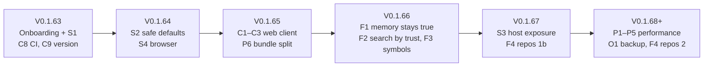

# RepoMemo enhancement analysis: 2026-10-13

> **Scope:** the code on `main` at V0.1.62, plus the unreleased onboarding work in the working tree (invitations, reset links, personal access tokens, migration 0023).
> **Method:** the roadmap and mindmaps were read against the code. Nothing was run or built. Each finding names the file it comes from, so it can be checked again.
> **Feeds:** the [Road to V0.2.0](../ROADMAP.md#-road-to-v020) and the backlog in ROADMAP.md, which use the same item IDs (F, S, P, C, O). The roadmap is the plan of record; §8 below was the first proposal and is superseded by it.
> **Companion:** [security review of 2026-10-10](../security/2026-10-10-security-review.md). Its H, M and L IDs are referenced here and not repeated.

---

## 1. Summary

RepoMemo's feature set is wide and coherent. The weak points are now **trust in the defaults**, **the cost of changing the web client**, and **requests that scan a whole workspace**, not missing features.

1. **Security first, because the next release depends on it.** None of the 2026-10-10 findings are patched yet; H1, H4, M1, M3, M5, M6 and M7 were checked again in the code today. The unreleased invitation links accept through `upsert_workspace_member`, so they make **H1** (cross-workspace membership) reachable by link as well. H1 and the token denylist (L2) belong in the same release as invitations.
2. **The web client is the bottleneck for product work.** `SharedWebApp.tsx` has 2,787 lines (202 KB), 150 `useState` and 31 `useEffect` calls, no router, no data cache and no tests. Every feature below touches it.
3. **Several reads load a whole workspace into memory on every request**: vector search, metrics, `artifacts/query`, the knowledge map and the health checks. That is fine at today's sizes, but it sets the ceiling, and it is also the denial-of-service surface in M11.
4. **There is no CI.** `.github/workflows` does not exist, so the 163 Rust tests, the type check and dependency audits run only when someone remembers to run them.
5. **The version strings have drifted.** `Cargo.toml`, both `package.json` files and `tauri.conf.json` still say `0.1.60` while the commits are V0.1.61 and V0.1.62. System › Overview and the console therefore report the wrong version.

---

## 2. Documentation alignment (done with this analysis)

| Document | Was | Now |
|---|---|---|
| ROADMAP | Current version V0.1.61; the V0.1.62 work (live progress, multi-file and folder upload, assistant dock, environment memory) listed as unreleased | V0.1.62 delivered; onboarding and API tokens unreleased; *Next* rebuilt from this analysis |
| Functional mindmap | Scope V0.1.32. Nine workspace sections (there are eleven: Repositories, Map and Health were missing, and Activity is now part of People). No notes, folders, business documents, assistant, map or health. Images described as "stored but not searchable" without a provider, though uploads are refused. §12 and §13 out of date | Scope V0.1.62; the missing branches added; gaps rewritten |
| Technical mindmap | Scope V0.1.32. "103 operations" (the router has 157 under `/v1`). Migrations 0012 and 0013 missing, 0022 and 0023 out of order. The provider table said OpenRouter cannot embed and rerank is a stub (both work). Test counts of 4 server tests (there are 61, and 163 in Rust overall). Sizes from V0.1.32 | Corrected; §5 completed with health, folders, previews and the shared-file link; the risk register updated |
| DEVELOPMENT_COMMANDS | `REPOMEMO_SERVER_ADDR`, `REPOMEMO_SERVICE_NAME` and `REPOMEMO_SOFFICE` missing from the settings table; pointed at the v2 Postman collection | Added; points at v4 |
| repository-sources | Phase 1b listed "automatic sync when the branch moves" (shipped in V0.1.56) | Moved to shipped |
| admin-console | "A system-wide stream does not exist" (`GET /v1/system/events` exists since V0.1.62, jobs only) | Updated |

---

## 3. Product features

### What exists, and where it falls short

| Area | Today | Gap worth closing |
|---|---|---|
| **Memory cards** | Cards with several citations, saved from Ask or the overview, exported as Markdown | Nothing flags a card whose cited passage changed or disappeared. Citations of an existing card cannot be edited (`update_memory_card` in `crates/storage/src/lib.rs` takes no citations) |
| **Repositories** | Local checkouts, branch polling, in-place updates, one evidence item with overview and summary | Rename *and* edit loses history; no commit on results; remote URLs; desktop has no section |
| **Search** | FTS5 + vectors with rank fusion, facets, saved searches, highlights | Symbols are extracted in shared mode but have **no API** (`sharedApi.ts` has no symbol call; desktop has symbol search). No filter by folder, lifecycle status or date, so outdated evidence ranks like verified evidence |
| **Assistant** | Closed capability router, stored per-user chats | The model sees no earlier turns; it cannot search across workspaces |
| **Evidence** | Notes, uploads, folders (5 levels), business document previews, lifecycle, comments | Folders cannot be moved; no bulk actions (move, delete, lifecycle); re-uploads create a new artifact rather than a version |
| **Onboarding** | Invitation and reset links passed by hand; personal access tokens | No email delivery, so no email verification (M4); the user is not told when a reset link is issued (L4) |
| **Knowledge map / health** | Computed per request from stored facts | No live updates; no caching; no memory-card staleness detector |
| **Desktop app** | Standalone local loop (symbols, summaries, embeddings) | Lags far behind the web client (no notes, folders, repositories, documents or assistant). Its future needs a decision |

### Proposed items

| ID | Item | Why | Size |
|---|---|---|---|
| F1 | **Memory that stays true.** A health detector for cards whose cited chunks were replaced or removed (re-index and repository syncs already drop them), a *needs review* state on the card, and citation editing in `PUT /v1/memory-cards/{id}` | Memory cards are the product's core promise, and today they go stale silently | S–M |
| F2 | **Search by trust.** Filters for lifecycle status (hide *outdated* and *superseded* by default), folder and date; a small boost for *verified* evidence in rank fusion | "Evidence before inference" should also mean "trusted evidence first" | S |
| F3 | **Symbol search on the web.** `POST /v1/workspaces/{ws}/symbols/search` over the existing `symbols` table, a filter in Retrieval, and symbol lookups for the assistant's find action | The data is already indexed; only the route and UI are missing | S |
| F4 | **Repositories phase 1b** (rename with edit via `git diff -M`, commit badge on results and citations) then **phase 2** (remote by URL) | Most teams' code is not on the server's disk | M → L |
| F5 | **Assistant memory.** Send the last few turns (bounded by tokens) with each message, and offer "search all my workspaces" | Follow-up questions are the natural way to use a chat | M |
| F6 | **Mail delivery** (SMTP in System › Settings) for invitations, reset links, mentions and assignments, then **email verification** for self-registration | Closes M4 and L4 and removes copy-paste from onboarding | M |
| F7 | **Evidence ergonomics.** Move folders, multi-select actions, upload a new version of a file (same artifact, as repositories do) | Folders and uploads are used daily, and versioning keeps comments and memory links attached | M |
| F8 | **Live map and health.** Refresh the Map and Health tabs from the event stream (they already exist for the ledger) | Consistency with the rest of the workspace | S |
| F9 | **Console follow-ups.** `logs --follow` (extend the system stream with log events), `users reset-link`, a System view of tokens, workspace commands once the app-admin rule is settled | Listed in admin-console.md; the system stream now exists | S–M |
| F10 | **Desktop decision.** Either make the desktop app a client of a server (the web client in Tauri, plus local folder import), or freeze it as the "local loop" edition and say so | `App.tsx` (2,750 lines) duplicates a shrinking subset of the product, and every feature must decide whether to port | Decision |

---

## 4. Security

All findings of the [2026-10-10 review](../security/2026-10-10-security-review.md) are still open. Grouped into releases:

| ID | Bundle | Review IDs | Why grouped | Size |
|---|---|---|---|---|
| S1 | **Ship-blockers for the onboarding release** | H1, H4, L2, L3, M7 | Invitations widen H1. Tokens are new, so moving them from a path denylist to a `SessionOnly` extractor (L2) and the link secrets to the URL fragment (L3) cost least before anyone depends on them. H4 and M7 are one-line changes | S–M |
| S2 | **Safe defaults** | M1, M8, M9, M3, L10 | Registration closed after setup (invitations now cover onboarding), split System permissions for app administrators, HTTPS deployment checks, the rightmost `X-Forwarded-For` entry, and progressive lockout delays | M |
| S3 | **Host exposure** | H2, H3, L8, M10 | Provider URL allowlist with DNS pinning and no error-body echo; repository links off unless `REPOMEMO_REPO_ROOTS` is set; git config hardening before phase 2; LibreOffice in a sandbox | M |
| S4 | **Browser hardening** | M5, L9, M2, M6 | No remote images in rendered Markdown (one prop per `ReactMarkdown`: 14 call sites), CSP for the built SPA and for Tauri, refresh token in an `HttpOnly` cookie | M |
| S5 | **Robustness and supply chain** | M11, M12, L1, L5, L6, L7, §7 | Parser timeouts, a cap on event streams per user, background AI against the quota, single-use file links, a Windows ACL on `secret.key`, `cargo deny` and `npm audit` in CI (needs C8) | M |

**Not in the review:**

- **Tests that lock the fixes in.** H1 needs "a viewer added to workspace A has no role in workspace B". L2 needs `tokens_never_reach_account_security` (apps/server) to walk the router instead of a fixed list, so a new route cannot be missed. M5 needs a component test that a Markdown image is not rendered (needs C3).
- **Revoke tokens on a password reset.** A reset usually follows a compromise; today tokens survive it (review §6).
- **The version string** (C9) is also a security concern: operators cannot tell which fixes a server has.

---

## 5. Platform performance

| ID | Hot path | Evidence | Direction | Size |
|---|---|---|---|---|
| P1 | **Vector search** decodes every vector of the workspace per query | `crates/storage/src/lib.rs` (the `chunk_embeddings` scan, about line 3356) | A per-workspace in-memory index (vectors as one `f32` matrix, invalidated by the embedding queue), then sqlite-vec if memory becomes the limit. Keep [ADR-0004](../../docs/decisions/0004-embedded-vector-storage-before-qdrant.md): no Qdrant until a service is justified | M |
| P2 | **`artifacts/query`** loads every artifact, then filters and pages in Rust | `apps/server/src/lib.rs` `query_artifacts` | Push the title/path, type, language, source and indexed filters, the count and `LIMIT/OFFSET` into SQL | S |
| P3 | **Workspace metrics** load every artifact, plus activity and members, per call | `workspace_metrics` | SQL aggregates (`COUNT`, `SUM(size)`, `GROUP BY type/language`) | S–M |
| P4 | **Dashboard N+1**: one `/metrics` call per workspace | `SharedWebApp.tsx` dashboard | `GET /v1/dashboard` with all workspace summaries in one query | S |
| P5 | **Knowledge map and health** recompute from scratch per request | `crates/api/src/knowledge_map.rs`, `health.rs` | Cache per workspace keyed by a content version (bumped by index, embedding and lifecycle events); this also answers part of M11 | M |
| P6 | **One JavaScript bundle**: no `React.lazy` or dynamic `import()` anywhere | `apps/desktop/src` | Split by route (System area, console, map, document viewer, TipTap editor), so sign-in and the ledger load first | S |
| P7 | **Refetch after every mutation**: `load()` reloads capabilities, overview, metrics, artifacts, memory and facets | technical mindmap §9 | A query cache (C2) with targeted invalidation, using the live events that already arrive | M (with C1–C2) |
| P8 | **Fixed concurrency**: 2 indexing slots, one embedding workspace at a time, a pool of 5 connections shared by readers and the writer | `indexing.rs`, `embedding.rs`, `storage/src/lib.rs:658` | Make the slots settings; a single dedicated writer connection plus a read pool (WAL allows parallel readers), which also removes the "take the write lock first" workaround in `replace_artifact_index` | M |
| P9 | **Parsers on the async runtime's blocking pool without limits** | `crates/ingestion/src/documents.rs` | Same as M11: a time budget per extraction, and memory caps for `.xls` | M |

**Measure first.** There are no timings yet. A debug-level span with the duration of search, Ask, metrics, map and health, shown in System › Logs, would confirm the order above before P1 to P5 are started.

---

## 6. Code health

| ID | Item | Evidence | Size |
|---|---|---|---|
| C1 | **Split `SharedWebApp.tsx`** by route and workspace section (dashboard, profile, workspace shell, each section, artifact page, memory page) | 2,787 lines, 202 KB, 150 `useState` | M |
| C2 | **Router and data cache.** A small router (or the hand-rolled one moved into its own module with typed routes) and TanStack Query for server state | Routes are matched by hand from `pathname.split("/")`; no cache | M |
| C3 | **Frontend tests.** Vitest + Testing Library for `sharedApi` (refresh-on-401), `liveEvents` (parsing, reconnect), Markdown safety (M5) and the upload walker | 0 frontend tests; `npm run typecheck` is the only gate | S–M |
| C4 | **Split `apps/server/src/lib.rs`** into route modules per domain, as `access.rs`, `system.rs`, `repositories.rs` and `health.rs` already are | 8,531 lines in one file | M |
| C5 | **Split `crates/storage/src/lib.rs`** the same way, as `access.rs`, `repo.rs`, `system.rs` and `setup.rs` already are | 6,206 lines | M |
| C6 | **Typed errors.** Storage and core return an error enum; `map_storage_error` stops matching substrings (9 `contains` checks today) | Risk 5 in the technical mindmap; also fixes L6 | M |
| C7 | **Generated TypeScript types** from the Rust DTOs (`ts-rs` or `specta`) | `types.ts` is mirrored by hand; it grew 71 lines in the onboarding work alone | S–M |
| C8 | **CI.** `cargo fmt --check`, `cargo clippy -D warnings`, `cargo test`, `npm run typecheck`, frontend tests, `cargo deny`, `npm audit --omit=dev` | No `.github/workflows` | S |
| C9 | **One version source.** A release script that sets `Cargo.toml`, both `package.json` files and `tauri.conf.json` together, run by each "Update V0.1.x" commit | Code says `0.1.60` at V0.1.62 | S |
| C10 | **Dependency hygiene.** One `reqwest` (0.12 and 0.13 are both in `Cargo.lock`), one `quick-xml`, Vite 5 → current (also closes the esbuild advisory in review §7) | `Cargo.lock`, `apps/desktop/package.json` | S |
| C11 | **Styles.** Split `styles.css` (6,242 lines) and `blueprint-refinement.css` (1,209) per component and remove dead rules once C1 is done | — | M |
| C12 | **Decide on `apps/worker`.** It is a 30-line stub. Remove it until the scale-out work needs it, or give it the durable queue | Roadmap *Later* | Decision |

---

## 7. Operations

| ID | Item | Why | Size |
|---|---|---|---|
| O1 | **Backup and restore** of an environment: SQLite online backup (`VACUUM INTO`) plus blobs and `secret.key`, from System › Maintenance and the console (`backup create`, `backup list`) | Self-hosted operators need a supported path before trusting the server with real knowledge | M |
| O2 | **Workspace export and import** as an archive (evidence, memory cards with citations, tasks) | Moving between environments and leaving cleanly | M |
| O3 | **Production guide**: serving the built SPA with the CSP from M2, TLS proxy, Windows service and systemd units, `/health/ready` | M2 and M9 depend on a defined deployment | S |
| O4 | **Quotas and disk floor**: storage per workspace, uploads per hour, refuse writes below a free-disk threshold, shown in System › Overview | M1; protects every other workspace on the server | M |
| O5 | **Server metrics export** (OpenMetrics `/metrics`, system administrators only, or a token) from the counters System › Overview already keeps | Lets operators use their existing monitoring | S |

---

## 8. Suggested order (superseded by the roadmap's release plan)

The reasoning:

- **S1 with the onboarding release.** It is cheap and stops the new links from widening H1.
- **CI and the version source first.** They are small and make every later release checkable.
- **The web split before the next features.** F1, F2, F3, F7 and P7 all touch `SharedWebApp.tsx`, so splitting it first makes each of them cheaper.
- **S3 before repositories phase 2.** Remote clones add protocol and credential risks on top of H3 and L8.
- **Performance after measuring.** The spans described in §5 come first, then P1 to P5.
