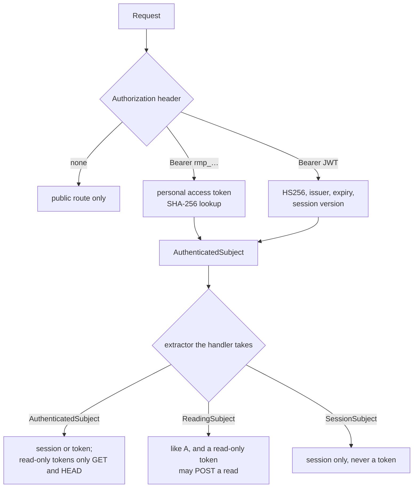

# Authentication and authorization

> **Branch of:** [TECHNICAL_MINDMAP.md §4](../TECHNICAL_MINDMAP.md#4-request-lifecycle-authentication-and-authorization) · **Related:** [api-reference.md](api-reference.md) (every route with its guard), [security review](../security/2026-10-10-security-review.md) · **Status:** V0.1.76

This page is the model on one page: who a request is, what that person may do, and the rules a new handler must follow. The mindmap's §4 keeps the history and the details.

---

## 1. Who is calling

| Credential | Lifetime | Stored as | Ends when |
|---|---|---|---|
| Access token (JWT) | 60 min (`REPOMEMO_ACCESS_TOKEN_TTL_MINUTES`) | not stored | it expires, or the user's *session version* changes |
| Refresh token | 30 days (`REPOMEMO_REFRESH_TOKEN_TTL_DAYS`), rotated on every use | SHA-256 hash | reuse of a rotated one revokes the family; sign-out; password change |
| Web refresh cookie | same | the refresh token itself | `HttpOnly; SameSite=Strict; Path=/v1/auth`, `Secure` on HTTPS |
| Personal access token | 7–365 days | SHA-256 hash | revoked, expired, or a used password reset link |
| Invitation or reset link | 7 days / 24 hours, single use | SHA-256 hash | used, withdrawn, expired |
| File link (Open in Office) | 60 seconds, first client | signed JWT with a `jti` | expires or is used by another client |

A **session version** on the user is stamped into each access token and checked on every request, so changing a password, signing out everywhere or deleting an account ends every session at once.

Sign-in answers identically for an unknown email and a wrong password and spends the same time. Failed sign-ins lock an account per address (10) and everywhere (50) for 15 minutes; a device that holds one of the account's refresh tokens gets past a lockout other people caused.

---

## 2. What they may do

### Roles

| Level | Roles (high to low) | Comes from |
|---|---|---|
| Organization | owner, admin, member | `organization_memberships` |
| Workspace | owner, admin, member, viewer | `workspace_memberships`; an organization role propagates to every workspace of it, except that adding a person to one workspace does not make them a member of the organization (they appear as a *guest*) |
| Server | system administrator, app administrator | `users.is_system_admin`, `users.is_app_admin` |

System administrators act as **administrators in every organization and workspace** (and owners of what they own). App administrators use the System pages but have no wildcard access, and only *read* them and run jobs and maintenance, and list backups; settings, roles, sessions, lockouts, reset links, raw log files, detaching the environment, and making, restoring or deleting backups are for system administrators.

### What each workspace role can do

| | viewer | member | admin | owner |
|---|:-:|:-:|:-:|:-:|
| Read evidence, search, ask (if the AI policy allows), see memory, tasks, map and health | ✔ | ✔ | ✔ | ✔ |
| Upload, add notes, comment, create tasks and memory cards, move and delete files, change evidence states | | ✔ | ✔ | ✔ |
| Link repositories, act on health findings, manage AI providers and policy, members and invitations, see activity | | | ✔ | ✔ |
| See raw passages of a file | | | ✔ | ✔ |
| Rename or delete the workspace, hand it to another owner | | | | ✔ |

The server decides; `GET …/capabilities` only tells the web app what to hide.

### Rules that hold everywhere

1. **Nobody grants `owner`** through a member form; ownership moves only with *transfer ownership* (a session, by the current owner, to a current member).
2. **Nobody changes an owner's role** or removes an owner. Removing an organization member who owns one of its workspaces is refused (409).
3. **An admin cannot grant `admin`** or change or remove an owner or admin.
4. **Authors keep their content** only while they can still write: a viewer cannot edit their old comments or tasks.
5. **People are added by invitation**: a member form does not add someone who is not already in the organization or workspace (`invitation_required`, the same answer for known and unknown addresses).
6. **Limits protect the server, not people's rights**: per-person rate limits (heavy requests, AI, uploads), per-workspace allowances (storage, background AI), per-person workspace count and a free-disk floor. They answer 429, 413, 409 or 507.

---

## 3. Adding a handler

1. Pick the extractor: `AuthenticatedSubject` for anything a token may do, `ReadingSubject` for a POST that only reads, `SessionSubject` for anything that changes who can get in (passwords, tokens, roles, reset links, ownership, settings, detaching).
2. Call the guard **before any work**, with the workspace or organization of the *resource* (load it first when the route names a resource id): `require_workspace_read/write/admin/owner`, `require_organization_*`, `require_system_admin`, `require_full_system_admin`, `require_system_change`.
3. For anything that spends a limited thing, count it: `consume_heavy_quota` (cheap to ask, costly to answer), `authorize_ai_use` (calls a provider), `quotas::check_incoming` (stores content).
4. Return typed errors (`not_found!`, `invalid!`, `conflict!`); anything else is a generic 500.
5. Record who did it: `record_workspace_activity` for workspace changes, `audit` for System changes.
6. Run `node scripts/list-routes.mjs`: a route marked `check` has an extractor but no guard call, which is right only for a person's own data (profile, notifications, own tokens).
7. Add a test that a viewer, a stranger and an anonymous caller are refused.
