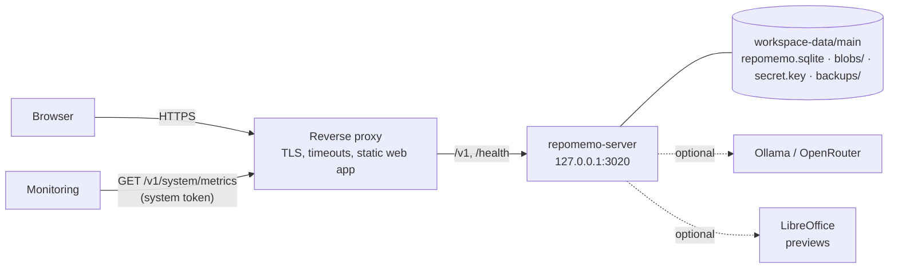

# Production guide: running RepoMemo for a team

> **Branch of:** [TECHNICAL_MINDMAP.md](../TECHNICAL_MINDMAP.md) · **Functional view:** [FUNCTIONAL_MINDMAP.md §1b](../FUNCTIONAL_MINDMAP.md#1b-system-area-system-administrators) · **Status:** V0.2.1; written in V0.1.75, checked line by line against the code in V0.2.1, and to be followed on a clean machine (R6)

This is what an operator needs to put RepoMemo on a server others can reach, keep it running, and get it back when something goes wrong. Every setting named here is described in [docs/DEVELOPMENT_COMMANDS.md](../../docs/DEVELOPMENT_COMMANDS.md#environment-variables); this page says which ones to set, and why.

RepoMemo is **one process and one folder**. The process is `repomemo-server` (the API, the background queues and the maintenance loop). The folder is an *environment*: a SQLite database, the stored files and a key file. There is no separate database server, queue or cache to run.

---

## 1. What runs where



Two things are served on **one host name**: the static web app (the `dist/` of `npm run build`), and the API under `/v1` (plus `/health`). One host matters: the refresh token is an `HttpOnly; SameSite=Strict` cookie scoped to `/v1/auth`, which needs the app and the API on the same site.

---

## 2. The settings that must be right

Set these in the service's environment, not in a file the web server can read.

| Variable | Value for production | Why |
|---|---|---|
| `REPOMEMO_JWT_SECRET` | 32 or more random characters, kept secret | Signs sessions and file links. Changing it signs everyone out |
| `REPOMEMO_SECRET_KEY` | 32 or more random characters from a secret store | Encrypts AI provider keys. Without it a key file sits in the data folder, next to what it protects |
| `REPOMEMO_SERVER_ADDR` | `127.0.0.1:3020` | Listen on loopback only; the proxy is the way in. The server refuses to listen beyond loopback over plain HTTP unless told it is behind TLS |
| `REPOMEMO_PUBLIC_URL` | `https://memo.example.com` | Turns HSTS on, makes the refresh cookie `Secure` |
| `REPOMEMO_TRUST_PROXY` | `true` | Read the client address from the proxy, so rate limits and lockouts are per person and not per proxy. Only the loopback address (or `REPOMEMO_TRUSTED_PROXIES`) is believed |
| `REPOMEMO_ALLOWED_ORIGIN` | `https://memo.example.com` | Browser origins allowed to call the API |
| `REPOMEMO_BACKUP_INTERVAL_HOURS` | `24` | Backs up by itself (see §6); off by default, and the server check warns until it is set |
| `REPOMEMO_SERVER_DATA_DIR` | `main` | Pins the environment (`workspace-data/main`). Without it a restart attaches whichever one was chosen last |
| `REPOMEMO_SYSTEM_ADMIN_EMAILS` | the operators' addresses | Accounts promoted to system administrators at startup |
| `REPOMEMO_SETUP_CODE` | 12 or more letters and digits, once | Unlocks the first-run setup; printed on the console when unset |
| `REPOMEMO_REPO_ROOTS` | the folders that hold repositories | Repository links are **off** without it |
| `REPOMEMO_GIT_ALLOWED_HOSTS` | the hosts repositories may be fetched from, such as `github.com` | Remote repository links are **off** without it (since V0.2.19; the links themselves come in V0.2.20) |

Leave `REPOMEMO_ALLOW_REGISTRATION` at its default (closed): people join with invitation links.

**Mail** (optional, since V0.2.9) is set up in System › Settings › Mail: the server, port, TLS or STARTTLS, the sign-in and the sender, then *Send test mail*. Mail is only ever sent over TLS, from an outbox that retries (1, 5 and 30 minutes, 2 and 6 hours) so a slow mail server never holds a request. A mail server on a private address needs `REPOMEMO_SMTP_ALLOWED_HOSTS`; one with a private certificate authority needs `REPOMEMO_SMTP_CA_FILE`. Allow the server's outbound connection to the mail port in your firewall. People can ask for a daily summary of what they have not read (Profile › Notifications); it is sent at most once a day each, only when something is waiting, from the same outbox.

The setup wizard's **Server checks** report on these: the database and the data folder, the key for stored credentials, the public address (HTTPS), client addresses behind the proxy, automatic backups, browser origins, repository folders, the AI host list and LibreOffice. A warning says what to set.

The server's **working directory** decides where `workspace-data/` is: set it in the service definition to a folder the service account owns, such as `/var/lib/repomemo` or `D:\RepoMemo`.

---

## 3. The reverse proxy

The proxy does four things: terminates TLS, forwards `/v1` and `/health` to the server, serves the web app, and lets the live event streams through without buffering. The server's own request timeout is 120 seconds (`REPOMEMO_REQUEST_TIMEOUT_SECONDS`), so the proxy's must be at least as long, and long enough for the largest upload on your slowest link.

### nginx

```nginx
server {
    listen 443 ssl http2;
    server_name memo.example.com;
    ssl_certificate     /etc/letsencrypt/live/memo.example.com/fullchain.pem;
    ssl_certificate_key /etc/letsencrypt/live/memo.example.com/privkey.pem;

    client_max_body_size 64m;          # at least REPOMEMO_MAX_UPLOAD_MB

    # Live events are long-lived: no buffering, no timeout. This block comes
    # first because nginx uses the first regular expression that matches.
    location ~ ^/v1/(workspaces/[^/]+/events|system/events)$ {
        proxy_pass http://127.0.0.1:3020;
        proxy_set_header Host $host;
        proxy_set_header X-Forwarded-For $remote_addr;   # replaces what the client sent
        proxy_buffering off;
        proxy_cache off;
        proxy_read_timeout 1h;
        proxy_http_version 1.1;
        proxy_set_header Connection "";
    }

    location ~ ^/(v1|health) {
        proxy_pass http://127.0.0.1:3020;
        proxy_set_header Host $host;
        proxy_set_header X-Forwarded-For $remote_addr;
        proxy_set_header X-Real-IP $remote_addr;
        proxy_read_timeout 180s;
        proxy_send_timeout 180s;
        proxy_http_version 1.1;
    }

    # The web app: the dist/ folder of `npm run build`.
    location / {
        root /srv/repomemo/web;
        index index.html;
        # The single line in dist/content-security-policy.txt:
        add_header Content-Security-Policy "<paste the line from dist/content-security-policy.txt>" always;
        try_files $uri /index.html;
    }
}
```

Build the web app with the address people will use for the API, which is the page's own host:

```bash
VITE_REPOMEMO_API_URL=https://memo.example.com npm run build
```

### Caddy

```caddyfile
memo.example.com {
    handle /v1/* {
        reverse_proxy 127.0.0.1:3020 {
            flush_interval -1
            transport http {
                response_header_timeout 180s
            }
        }
    }
    handle /health* {
        reverse_proxy 127.0.0.1:3020
    }
    handle {
        root * /srv/repomemo/web
        header Content-Security-Policy "<the line from dist/content-security-policy.txt>"
        try_files {path} /index.html
        file_server
    }
}
```

Caddy sets `X-Forwarded-For` itself and takes care of certificates. The `handle` blocks keep the web app's `try_files` away from `/v1`.

---

## 4. Running it as a service

Build once with `cargo build --release -p repomemo-server` and keep the binary next to the environment.

### systemd

```ini
# /etc/systemd/system/repomemo.service
[Unit]
Description=RepoMemo server
After=network.target

[Service]
User=repomemo
WorkingDirectory=/var/lib/repomemo
EnvironmentFile=/etc/repomemo/server.env     # mode 0600, owned by root
ExecStart=/opt/repomemo/repomemo-server
Restart=on-failure
RestartSec=5
KillSignal=SIGTERM
TimeoutStopSec=60
NoNewPrivileges=true
ProtectSystem=strict
ReadWritePaths=/var/lib/repomemo
PrivateTmp=true

[Install]
WantedBy=multi-user.target
```

The server shuts down gracefully on SIGTERM: in-flight requests finish and the write-ahead log is folded back. Do not `kill -9` it as a habit.

### Windows

Run the binary under a service wrapper such as [NSSM](https://nssm.cc), with the working directory and the environment variables set on the service, and a **dedicated, low-privilege account** as its user:

```powershell
nssm install RepoMemo "D:\RepoMemo\bin\repomemo-server.exe"
nssm set RepoMemo AppDirectory "D:\RepoMemo"
nssm set RepoMemo AppEnvironmentExtra REPOMEMO_JWT_SECRET=... REPOMEMO_PUBLIC_URL=https://memo.example.com REPOMEMO_TRUST_PROXY=true REPOMEMO_SERVER_DATA_DIR=main
nssm set RepoMemo ObjectName ".\repomemo" "<password>"
nssm set RepoMemo AppStopMethodConsole 30000
nssm start RepoMemo
```

On Windows the server restricts `secret.key` to the account it runs as (`icacls`), so run it as the same account every time, and give a backup tool access explicitly if it runs as another one.

### Is it up?

| Check | Answers |
|---|---|
| `GET /health` | 200 while the process is alive; `setup_required` is true until the first-run setup is done |
| `GET /health/ready` | 200 when the database answers, 503 when it does not. Use it for load balancer and orchestrator probes |
| `GET /v1/system/overview` | version, uptime, storage, free disk, queues, traffic (administrators) |

---

## 5. Limits that protect the disk and the server

All are run-time settings (System › Settings) with an environment default; `0` turns one off.

| Setting | Default | Protects |
|---|---|---|
| `REPOMEMO_WORKSPACE_STORAGE_MB` | 20,480 | One workspace filling the disk. Uploads and notes beyond it answer `413 workspace_full` |
| `REPOMEMO_UPLOADS_PER_HOUR` | 600 | One person flooding uploads (`429`) |
| `REPOMEMO_WORKSPACES_PER_PERSON` | 25 | Workspaces created without end (`409 workspace_limit`) |
| `REPOMEMO_DISK_FLOOR_MB` | 1,024 | A full disk: uploads stop (`507 disk_low`) while less than this is free. The overview shows free space |
| `REPOMEMO_MAX_UPLOAD_MB` | 10 | The size of one upload (environment only) |
| `REPOMEMO_HEAVY_REQUESTS_PER_MINUTE` | 240 | Searches and reports, per person |
| `REPOMEMO_AI_REQUESTS_PER_HOUR` | 120 | Interactive AI, per person |
| `REPOMEMO_BACKGROUND_AI_PER_DAY` | 2,000 | Image descriptions and embedding batches, per workspace |
| `REPOMEMO_DOCUMENT_TIMEOUT_SECONDS` | 60 | A document that takes forever to read |
| `REPOMEMO_VECTOR_INDEX_MB` | 512 | Memory held for meaning search |

Plan disk as: stored files + database (roughly a tenth of the text) + the cached previews + **each backup's new files**. Keep the free-disk floor above the size of one backup.

---

## 6. Backups, and getting back

### What a backup is

A folder in `<data folder>/backups/`: a consistent snapshot of the database (taken while the server runs), a copy of the stored files, the key file when there is one, and a manifest. A backup reuses the files of the one before it through hard links, so only new files cost space. Nothing is compressed or encrypted (encryption is planned for V0.2.42): **copy backups to another machine, and protect them like the data**: they contain `secret.key`. When you use `REPOMEMO_SECRET_KEY`, keep that value with your other secrets: a restore needs the same one to read the provider keys.

### Making them

| How | |
|---|---|
| System › Jobs & maintenance › **Back up now** | for a system administrator |
| `repomemo-console backup create --yes` | the same, from a terminal or a script (needs a session or a `system` token) |
| `REPOMEMO_BACKUP_INTERVAL_HOURS` (or Settings › Automatic backups) | the server backs up by itself when the newest backup is older than this; it runs from the maintenance loop, so maintenance must be on. `REPOMEMO_BACKUP_KEEP` (default 7) bounds how many are kept |

Check that they happen: System › Overview shows the last, the console's `backup list` prints them, and the metric `repomemo_backup_last_timestamp_seconds` can be alerted on.

### Taking them off the machine

```bash
# a nightly copy, after the 02:00 automatic backup
rsync -a --delete /var/lib/repomemo/workspace-data/main/backups/ backup-host:/srv/repomemo-backups/
```

```powershell
robocopy D:\RepoMemo\workspace-data\main\backups \\backup-host\repomemo /MIR /Z /R:2 /W:5
```

Hard links are followed by both tools, so the copy is complete, though larger than the space the backups take on the server.

### Restoring

A restore **never overwrites the running environment**. It makes a new one next to it, checks that it opens, and you decide when to attach it.

1. Copy the backup folder into `<data folder>/backups/` if it is not there.
2. `repomemo-console backup restore backup-20261014-020000 restored-2026-10 --yes`, or System › Jobs & maintenance › the backup's menu › *Restore as a new environment…*.
3. Wait for the line "Restored … Attach it from the environment menu" (`backup list` shows it).
4. Choose the new environment in the environment menu (System › Settings › Environment, *Detach* and pick it), or set `REPOMEMO_SERVER_DATA_DIR=restored-2026-10` and restart.
5. Sign in, open System › Overview, and look at the counts.

**Practise this once, on a spare machine, before you need it.** A backup nobody has restored is a hope.

### What a backup does not hold

- Cached previews and logs (rebuilt or rotated).
- Environment variables. Keep them in your configuration management.
- Repositories linked from disk: only their indexed content is in the database. The repositories live where they were.

---

## 7. Monitoring

`GET /v1/system/metrics` answers in the OpenMetrics text format. It needs a system administrator's session or a **personal access token with the system scope** (Profile › Tokens; only system administrators can create one).

```yaml
# prometheus.yml
scrape_configs:
  - job_name: repomemo
    scheme: https
    metrics_path: /v1/system/metrics
    authorization:
      type: Bearer
      credentials_file: /etc/prometheus/repomemo.token
    static_configs:
      - targets: ["memo.example.com"]
```

What is worth an alert:

| Metric | Alert when |
|---|---|
| `up` | 0 for two minutes |
| `repomemo_disk_free_bytes` | below twice the disk floor |
| `repomemo_backup_last_timestamp_seconds` | older than a day and a half (`time() - … > 129600`) |
| `rate(repomemo_http_server_errors_total[5m])` | above 0 for ten minutes |
| `repomemo_jobs{status="failed"}` | rising |
| `repomemo_indexing_queued` | not falling for an hour |
| `repomemo_abandoned_document_readings` | 4 (readings are refused until they end) |
| `repomemo_maintenance_failed_steps` | above 0 |

The full list is in the response. Counters start again at zero when the server restarts.

---

## 8. Office previews and the sandbox

Layout-accurate previews come from LibreOffice, which has a history of memory-safety bugs and reads files any writer can upload. Without it, previews fall back to extracted text. When you install it, run it **without network and without access to the data folder**:

```bash
REPOMEMO_SOFFICE_WRAPPER="bwrap --ro-bind / / --bind {work} {work} --bind {profile} {profile} --unshare-net --die-with-parent"
```

`{work}` is the conversion folder and `{profile}` its profile folder. System › Overview shows whether previews are sandboxed. On Windows, run the whole service under the low-privilege account of §4 and keep the data folder's permissions to that account.

---

## 9. Upgrading

1. **Back up** (§6), and copy the backup off the machine.
2. Read [CHANGELOG.md](../../CHANGELOG.md) for each version you skip: *Upgrading* lists what to do.
3. Stop the service (graceful), replace the binary and the web app's `dist/`, start the service. Migrations run at startup and the server refuses to start on a failed or newer migration.
4. Check System › Overview: the version, free disk, and a search that returns results.
5. To go back: stop, restore the backup into a new environment (§6), point `REPOMEMO_SERVER_DATA_DIR` at it, start the old binary.

Environments from V0.1.40 and later upgrade in place.

---

## 10. When something is wrong

| Symptom | Look at |
|---|---|
| Nobody can sign in after a restart | `REPOMEMO_JWT_SECRET` changed; sessions are signed with it |
| Provider keys "missing" after a restore or a move | `REPOMEMO_SECRET_KEY` differs, or `secret.key` was not carried over. Enter the keys again |
| Uploads answer `507` | Free disk is under the floor: free space or lower `REPOMEMO_DISK_FLOOR_MB` |
| Uploads answer `413 workspace_full` | The workspace is at its allowance: delete evidence or raise `REPOMEMO_WORKSPACE_STORAGE_MB` |
| Everyone shares one rate limit | The proxy's address is used: set `REPOMEMO_TRUST_PROXY=true` and have the proxy send `X-Forwarded-For` |
| Live updates stop after a minute | The proxy buffers or times out event streams: use the `location` in §3 |
| Searches slow after a restart | The first search per workspace builds the vector index; later ones are quick |
| A PDF "took longer than 60 seconds" | It is skipped on purpose; raise `REPOMEMO_DOCUMENT_TIMEOUT_SECONDS` if the file is legitimate |
| Embeddings stopped partway | The workspace reached `REPOMEMO_BACKGROUND_AI_PER_DAY`; they resume after midnight UTC |
| `repomemo.sqlite-wal` is large | Maintenance folds it back each pass; System › Maintenance › *Run maintenance now* does it at once |

The logs (System › Logs, or the files in `<data folder>/logs/`) carry a category per kind of event: `security`, `jobs`, `http`, `ai`, `performance`.
