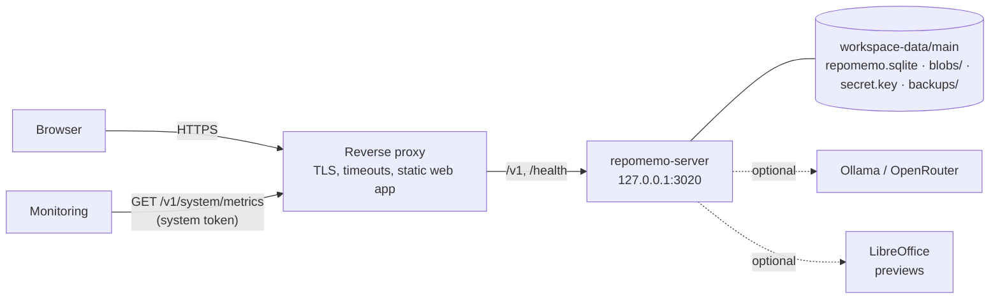

# Production guide: running RepoMemo for a team

> **Branch of:** [TECHNICAL_MINDMAP.md](../TECHNICAL_MINDMAP.md) · **Functional view:** [FUNCTIONAL_MINDMAP.md §1b](../FUNCTIONAL_MINDMAP.md#1b-system-area-system-administrators) · **Status:** V0.2.55; written in V0.1.75, checked line by line against the code in V0.2.1 and again in V0.2.55 (`npm run docs:check` compares its settings and routes with the code), updated with each release since (mail, backups, containers, audit export, readings in a process of their own), and still to be followed on a clean machine (R6, R12)

This is what an operator needs to put RepoMemo on a server others can reach, keep it running, and get it back when something goes wrong. Every setting named here is described in [docs/DEVELOPMENT_COMMANDS.md](../../docs/DEVELOPMENT_COMMANDS.md#optional-server-settings); this page says which ones to set, and why.

RepoMemo is **one process and one folder**. The process is `repomemo-server` (the API, the background queues and the maintenance loop). The folder is an *environment*: a SQLite database, the stored files and a key file. There is no separate database server, queue or cache to run.

---

## 1. What runs where



Two things are served on **one host name**: the static web app (the `dist/` of `npm run build`), and the API under `/v1` (plus `/health`). One host matters: the refresh token is an `HttpOnly; SameSite=Strict` cookie scoped to `/v1/auth`, which needs the app and the API on the same site.

---

## 2. The settings that must be right

Set these in the service's environment, not in a file the web server can read.

| Variable | Value for production | Why |
|---|---|---|
| `REPOMEMO_JWT_SECRET` | 32 or more random characters, kept secret | Signs sessions and file links. Changing it signs everyone out. Any secret (this one, `REPOMEMO_SECRET_KEY`, the two backup keys, the setup code) can be given as a file with the same name plus `_FILE`; both at once is refused (V0.4.1) |
| `REPOMEMO_SECRET_KEY` | 32 or more random characters from a secret store | Encrypts AI provider keys. Without it a key file sits in the data folder, next to what it protects |
| `REPOMEMO_SERVER_ADDR` | `127.0.0.1:3020` | Listen on loopback only; the proxy is the way in. The server refuses to listen beyond loopback over plain HTTP unless told it is behind TLS |
| `REPOMEMO_PUBLIC_URL` | `https://memo.example.com` | Turns HSTS on, makes the refresh cookie `Secure` |
| `REPOMEMO_TRUST_PROXY` | `true` | Read the client address from the proxy, so rate limits and lockouts are per person and not per proxy. Only the loopback address (or `REPOMEMO_TRUSTED_PROXIES`) is believed |
| `REPOMEMO_ALLOWED_ORIGIN` | `https://memo.example.com` | Browser origins allowed to call the API |
| `REPOMEMO_BACKUP_COPY_DIR` | unset | Another folder or share every backup is copied to and checked in (see §6) |
| `REPOMEMO_BACKUP_KEY` | unset | Seals new backups (16 or more characters; see §6) and is needed to restore them |
| `REPOMEMO_BACKUP_KEY_PREVIOUS` | unset | The key before the last change (16 or more characters, different from the new one): opens backups made with it, which can be sealed again with the new one (§6) |
| `REPOMEMO_BACKUP_INTERVAL_HOURS` | `24` | Backs up by itself (see §6); off by default, and the server check warns until it is set |
| `REPOMEMO_SERVER_DATA_DIR` | `main` | Pins the environment (`workspace-data/main`). Without it a restart attaches whichever one was chosen last |
| `REPOMEMO_SYSTEM_ADMIN_EMAILS` | the operators' addresses | Accounts promoted to system administrators at startup |
| `REPOMEMO_SETUP_CODE` | 12 or more letters and digits, once | Unlocks the first-run setup; printed on the console when unset |
| `REPOMEMO_REPO_ROOTS` | the folders that hold repositories | Repository links are **off** without it. Who may link one of these folders is a System setting, system administrators by default (V0.2.143) |
| `REPOMEMO_GIT_ALLOWED_HOSTS` | the hosts repositories may be fetched from, such as `github.com` | Remote repository links and connectors (GitHub with `api.github.com` named, GitLab with its host) are **off** without it (`https` since V0.2.20, `ssh` since V0.2.21, which also needs an `ssh` client on the `PATH`) |

Leave `REPOMEMO_ALLOW_REGISTRATION` at its default (closed): people join with invitation links.

**Mail** (optional, since V0.2.9) is set up in System › Settings › Mail: the server, port, TLS or STARTTLS, the sign-in and the sender, then *Send test mail*. Mail is only ever sent over TLS, from an outbox that retries (1, 5 and 30 minutes, 2 and 6 hours) so a slow mail server never holds a request. A mail server on a private address needs `REPOMEMO_SMTP_ALLOWED_HOSTS`; one with a private certificate authority needs `REPOMEMO_SMTP_CA_FILE`. Allow the server's outbound connection to the mail port in your firewall. People can ask for a daily summary of what they have not read (Profile › Notifications); it is sent at most once a day each, only when something is waiting, from the same outbox. Since V0.2.52 the server cannot be used to flood a mailbox: one address is sent at most 12 messages an hour (invitations, mentions, assignments, verification links), one person causes at most 60 an hour, and nothing is queued while 1,000 messages wait in the outbox; an invitation over the limit is still created and its link shown to pass on by hand.

The setup wizard's **Server checks** report on these: the database and the data folder, the key for stored credentials, the public address (HTTPS), client addresses behind the proxy, automatic backups, browser origins, repository folders, the AI host list and LibreOffice. A warning says what to set.

The server's **working directory** decides where `workspace-data/` is: set it in the service definition to a folder the service account owns, such as `/var/lib/repomemo` or `D:\RepoMemo`.

---

## 3. The reverse proxy

The proxy does four things: terminates TLS, forwards `/v1` and `/health` to the server, serves the web app, and lets the live event streams through without buffering. The server's own request timeout is 120 seconds (`REPOMEMO_REQUEST_TIMEOUT_SECONDS`), so the proxy's must be at least as long, and long enough for the largest upload on your slowest link.

### nginx

```nginx
server {
    listen 443 ssl http2;
    server_name memo.example.com;
    ssl_certificate     /etc/letsencrypt/live/memo.example.com/fullchain.pem;
    ssl_certificate_key /etc/letsencrypt/live/memo.example.com/privkey.pem;

    client_max_body_size 64m;          # at least REPOMEMO_MAX_UPLOAD_MB

    # The server compresses its own JSON and text (gzip or Brotli, when the client asks) since V0.2.160,
    # so no `gzip on;` is needed here for the API; leave it off for /v1/ and let the answers through as
    # they come. Static files of the web app can still be compressed by the proxy.

    # Importing a workspace archive (POST /v1/workspaces/import) sends one body
    # as large as REPOMEMO_MAX_IMPORT_MB. Give that path its own limit and let
    # nginx stream it instead of buffering it:
    #   location = /v1/workspaces/import {
    #       client_max_body_size 2048m;
    #       proxy_request_buffering off;
    #       proxy_read_timeout 3600s;
    #       proxy_pass http://127.0.0.1:3020;
    #   }

    # Live events are long-lived: no buffering, no timeout. This block comes
    # first because nginx uses the first regular expression that matches.
    location ~ ^/v1/(workspaces/[^/]+/events|system/events)$ {
        proxy_pass http://127.0.0.1:3020;
        proxy_set_header Host $host;
        proxy_set_header X-Forwarded-For $remote_addr;   # replaces what the client sent
        proxy_buffering off;
        proxy_cache off;
        proxy_read_timeout 1h;
        proxy_http_version 1.1;
        proxy_set_header Connection "";
    }

    location ~ ^/(v1|health) {
        proxy_pass http://127.0.0.1:3020;
        proxy_set_header Host $host;
        proxy_set_header X-Forwarded-For $remote_addr;
        proxy_set_header X-Real-IP $remote_addr;
        proxy_read_timeout 180s;
        proxy_send_timeout 180s;
        proxy_http_version 1.1;
    }

    # The web app: the dist/ folder of `npm run build`.
    location / {
        root /srv/repomemo/web;
        index index.html;
        # The single line in dist/content-security-policy.txt:
        add_header Content-Security-Policy "<paste the line from dist/content-security-policy.txt>" always;
        try_files $uri /index.html;
    }
}
```

Build the web app with the address people will use for the API, which is the page's own host:

```bash
VITE_REPOMEMO_API_URL=https://memo.example.com npm run build
```

### Caddy

```caddyfile
memo.example.com {
    handle /v1/* {
        reverse_proxy 127.0.0.1:3020 {
            flush_interval -1
            transport http {
                response_header_timeout 180s
            }
        }
    }
    handle /health* {
        reverse_proxy 127.0.0.1:3020
    }
    handle {
        root * /srv/repomemo/web
        header Content-Security-Policy "<the line from dist/content-security-policy.txt>"
        try_files {path} /index.html
        file_server
    }
}
```

Caddy sets `X-Forwarded-For` itself and takes care of certificates. The `handle` blocks keep the web app's `try_files` away from `/v1`.

---

## 4. Running it as a service

Build once with `cargo build --release -p repomemo-server` and keep the binary next to the environment.

### systemd

```ini
# /etc/systemd/system/repomemo.service
[Unit]
Description=RepoMemo server
After=network.target

[Service]
User=repomemo
WorkingDirectory=/var/lib/repomemo
EnvironmentFile=/etc/repomemo/server.env     # mode 0600, owned by root
ExecStart=/opt/repomemo/repomemo-server
Restart=on-failure
RestartSec=5
KillSignal=SIGTERM
TimeoutStopSec=60
NoNewPrivileges=true
ProtectSystem=strict
ReadWritePaths=/var/lib/repomemo
PrivateTmp=true

[Install]
WantedBy=multi-user.target
```

The server shuts down gracefully on SIGTERM: in-flight requests finish and the write-ahead log is folded back. Do not `kill -9` it as a habit.

### Windows

Run the binary under a service wrapper such as [NSSM](https://nssm.cc), with the working directory and the environment variables set on the service, and a **dedicated, low-privilege account** as its user:

```powershell
nssm install RepoMemo "D:\RepoMemo\bin\repomemo-server.exe"
nssm set RepoMemo AppDirectory "D:\RepoMemo"
nssm set RepoMemo AppEnvironmentExtra REPOMEMO_JWT_SECRET=... REPOMEMO_PUBLIC_URL=https://memo.example.com REPOMEMO_TRUST_PROXY=true REPOMEMO_SERVER_DATA_DIR=main
nssm set RepoMemo ObjectName ".\repomemo" "<password>"
nssm set RepoMemo AppStopMethodConsole 30000
nssm start RepoMemo
```

On Windows the server restricts `secret.key` to the account it runs as (`icacls`), so run it as the same account every time, and give a backup tool access explicitly if it runs as another one.

### In containers (since V0.2.45)

`docker compose up` gives a working server behind TLS with its data in a volume. Images are built from the one [Dockerfile](../../Dockerfile), and [docker-compose.yml](../../docker-compose.yml) starts them (a third, `converter`, only when layout-accurate previews are on):

| Container | What it is |
|---|---|
| `server` | `repomemo-server` on Debian 13 (trixie) slim with `git` 2.47.3 (a release the remote-clone check accepts; the Debian 12 image carried 2.39.5, which it refused) and CA certificates, running as an unprivileged user (uid 10001). Its working directory is the volume `repomemo-data` (`/var/lib/repomemo`), so the environment is `workspace-data/main` inside it: database, stored files, key file and backups. A health check asks `/health/ready`. Since V0.2.148 its root filesystem is read-only (`/tmp` is a `tmpfs`), it drops every capability and cannot gain any (`no-new-privileges`); it writes only to the data volume, the previews volume and the socket volume. LibreOffice is not in this image (a plain `docker build --build-arg WITH_LIBREOFFICE=true` can still add it) |
| `converter` | Only with `COMPOSE_PROFILES=previews` (V0.2.148): LibreOffice and a small listener, in a container with **no network**, a read-only root, no capabilities, and no view of the data volume. It shares two volumes with the server: `repomemo-previews` (the converted PDFs, the work folders and LibreOffice's profile, at `/var/lib/repomemo-previews`, named to the server by `REPOMEMO_PREVIEW_ROOT`) and `soffice-socket` (a socket the server's wrapper `repomemo-soffice-wrapper` talks to, through `socat`, to run one LibreOffice per conversion). A document that escapes LibreOffice reaches nothing but the previews. To turn previews on set `COMPOSE_PROFILES=previews` and `REPOMEMO_OFFICE_PREVIEWS=true` in `.env`; with previews off the converter is not started, and with the profile missing the server reports that the converter did not answer and converts nothing. The Debian 13 LibreOffice may be older than the releases the server accepts (26.2.5, 26.8.0): then System › Overview names the release and the reason, and the image must be rebuilt on a newer one |
| `web` | `repomemo-web` (V0.4.15–V0.4.17): the web app over plain HTTP on 8080, `/config.json`, `/healthz`, and `/v1` and `/health` forwarded to the server with event streams unbuffered. Published on `127.0.0.1:8080` (`REPOMEMO_WEB_PORT`) for a proxy of your own |
| `edge` | Only with `COMPOSE_PROFILES=edge` (V0.4.18): Caddy, **TLS and nothing else**, in front of `web`. A certificate for a public name (Let's Encrypt), Caddy's own for `localhost`, or yours: `tls.crt` and `tls.key` in `deploy/certs` (`REPOMEMO_TLS_DIR`), both or neither. Publishes 80 and 443; HSTS is its header |

```bash
cp .env.example .env        # set REPOMEMO_HOST, REPOMEMO_JWT_SECRET and REPOMEMO_SECRET_KEY
docker compose pull && docker compose up -d   # the released images (REPOMEMO_VERSION); add -f docker-compose.build.yml and --build to build this checkout
docker compose logs server  # the first-run setup code is printed here unless REPOMEMO_SETUP_CODE is set
```

Open `https://<REPOMEMO_HOST>` and follow the first-run setup. With a real host name, ports 80 and 443 must reach the machine and the name must point at it: Caddy then gets a Let's Encrypt certificate by itself and keeps it renewed in the `caddy-data` volume. With the default `localhost` the certificate comes from Caddy's own authority, for trying it out on one machine (the browser asks you to trust it).

What the compose file settles for you, from §2: the server listens on all interfaces of the private network only the proxy shares (`REPOMEMO_SERVER_ADDR=0.0.0.0:3020`, no published port), `REPOMEMO_PUBLIC_URL` and `REPOMEMO_ALLOWED_ORIGIN` are the `https://` address, `REPOMEMO_TRUST_PROXY=true` with `REPOMEMO_TRUSTED_PROXIES` naming the proxy's fixed address (172.29.0.2), and the environment is pinned (`REPOMEMO_SERVER_DATA_DIR=main`). The secrets are required and come from `.env`, never from the image. Anything else in §2 or [DEVELOPMENT_COMMANDS.md](../../docs/DEVELOPMENT_COMMANDS.md) is added under `environment:` of the `server` service.

- **Backups and the second copy.** Backups are made inside the volume (`REPOMEMO_BACKUP_INTERVAL_HOURS` is 24 here). A second copy needs a place outside it: mount a host folder or share on the `server` service, for example `- /srv/repomemo-backups:/backup-copy`, and set `REPOMEMO_BACKUP_COPY_DIR: /backup-copy`; the folder must be writable by uid 10001. Set `REPOMEMO_BACKUP_KEY` to seal them.
- **Repositories on disk.** Mount the folders read-only and list them in `REPOMEMO_REPO_ROOTS`; remote repositories need `REPOMEMO_GIT_ALLOWED_HOSTS` as before.
- **Upgrading.** Back up (§6), `git pull` or fetch the new release, then set `REPOMEMO_VERSION` in `.env` to the new release and run `docker compose pull && docker compose up -d` (V0.4.40: the images are pulled, not built; `deploy/upgrade.sh --version X.Y.Z` does it with the backup and the way back). The volume is kept; migrations run at start. To go back, restore the backup into a new environment (§6) and point `REPOMEMO_SERVER_DATA_DIR` at it.
- **Reading documents** starts a short-lived copy of the server inside the container (§5), so no extra permission is needed. Give the container as much memory as `REPOMEMO_DOCUMENT_MEMORY_MB` plus the server's own.
- **Refusing a database from the future (V0.4.36).** Before it changes anything, the storage engine reads two signs: `repomemo.version`, the file beside the database that every start leaves (the release that last opened it; it never goes backwards), and the highest migration the database has applied. A marker newer than the program, or a migration the program does not know, stops the start with a message that names both releases and says nothing was changed (*this database was written by RepoMemo 0.4.36, which is newer than this program (0.4.20)...*). A database with no marker (made before this release) or a marker equal or older is opened as before. The way back across such an upgrade is the backup: [docs/DIRECT_UPGRADE.md](../../docs/DIRECT_UPGRADE.md) is the guide for direct installs (back up, upgrade with the installer, look, and roll back by moving the link, restoring the backup when the old release refuses).
- **Pinning (V0.4.42).** Nothing the pipeline runs may move: `scripts/pins.mjs` (tests: `npm run pins:test`, run by CI) holds the rules, and `container:check` applies them to every workflow in `.github/workflows` (a new one is covered without being listed), the Dockerfile, both compose files, the scripts in `deploy/`, the service files, the monitoring example and `.env.example`. An action must be a 40-character commit; a `FROM` must name a digest (an earlier stage and `scratch` need none); and **an image pinned by digest anywhere is refused with a tag and no digest anywhere else** (a new `docker run caddy:2-alpine` fails the check). Dependabot proposes the next commit or digest weekly for Actions (grouped, so `checkout` is one change in every workflow), the Dockerfile and the compose files (`docker-compose`).
- **The quick start (V0.4.41).** [docs/QUICK_START.md](../../docs/QUICK_START.md): `curl -fsSL https://github.com/repomemo/repomemo/releases/latest/download/quickstart.sh | sh -s -- --dir repomemo`, then `sh deploy/init.sh --host <name>` and `docker compose pull && docker compose up -d --wait`. `deploy/quickstart.sh` resolves the version (the `/releases/latest` redirect, or `--version`), downloads `SHA256SUMS` and `repomemo-compose-<version>.tar.gz` from the release, **checks the archive against the sums before unpacking anything**, unpacks into an empty folder and pins `REPOMEMO_VERSION` in `.env.example`. `deploy/package-compose.sh` packs the files listed in `deploy/compose-bundle.txt` (the same bytes every time); the `release` job of `server-archives.yml` attaches the archive, the script and one `SHA256SUMS` over them and the three server archives. CI's `quickstart` job does it all against a local release folder, with a tampered archive too. Windows unpacks the archive by hand and uses `init.ps1`.
- **Compose on the released images (V0.4.40).** `docker-compose.yml` builds nothing: the four services name `${REPOMEMO_REGISTRY:-ghcr.io/repomemo}/repomemo-<server|converter|web|edge>:${REPOMEMO_VERSION:-latest}` (`REPOMEMO_CONVERTER_IMAGE` still replaces the converter's), so `docker compose pull && docker compose up -d` runs a release with no compiler; pin `REPOMEMO_VERSION` in `.env` to an `X.Y.Z` for a server you keep. `docker-compose.build.yml` is the one place a build is described (local tags `repomemo-<name>:${REPOMEMO_VERSION:-local}`): `-f docker-compose.yml -f docker-compose.build.yml`, or `COMPOSE_FILE` in `.env`, builds the checkout. `deploy/upgrade.sh` pulls by default and builds only when the build file is in `COMPOSE_FILE` (or `--build`). CI sets `COMPOSE_FILE` to build its commit, and the *Compose runs released images* job renders both readings with `docker compose config` and `scripts/check-compose-images.mjs`. `deploy/api.yml` still builds.
- **The release page (V0.4.39).** `node scripts/release-notes.mjs` (`npm run notes`) prints the page of a release: the changelog entry of the version (`## V<version>` up to the next release, CRLF dropped; no entry, or an empty one, is an error), then the four images with their names, the three archives and `SHA256SUMS`, the installers, and the links to [the upgrade guide](../../docs/DIRECT_UPGRADE.md) and [the verification guide](../../docs/VERIFYING_IMAGES.md). The `release` job of `server-archives.yml` checks the repository out, writes `release-notes.md` and makes the release with `--notes-file`, or, when the release exists (a re-run), rewrites its title and page with `gh release edit`; the job that pushes images does not touch the page. Four tests (`npm run notes:test`) run in CI.
- **Provenance of the images (V0.4.38).** After the join, the same job signs two statements about the joined image's digest, keylessly (Sigstore, with the workflow's own identity, so `id-token: write` and `attestations: write` are in that job only): a **SLSA build attestation** (`actions/attest-build-provenance`: repository, workflow, commit, tag) and an **SPDX SBOM** read from the pushed image by the scanner CI already pins (`actions/attest-sbom`). Both are pushed to the registry beside the image. [docs/VERIFYING_IMAGES.md](../../docs/VERIFYING_IMAGES.md) shows `gh attestation verify oci://ghcr.io/<owner>/repomemo-server:X.Y.Z --repo <owner>/repomemo` (and the SBOM with `--predicate-type https://spdx.dev/Spdx`), the cosign equivalent and what a valid attestation does not say; deploy by digest.
- **Images on the registry (V0.4.37).** `.github/workflows/release-images.yml` runs on a `v*` tag (and by hand, which builds and pushes nothing) and never on a pull request. A first job checks that the tag is `v` plus the version and runs the version, container, migration, documentation and template checks. Then each of the four images (`repomemo-server`, `repomemo-converter`, `repomemo-edge`, `repomemo-web`) is built **natively** on `ubuntu-latest` (amd64) and `ubuntu-24.04-arm` (arm64) with the commit, the commit's date and the version as build arguments, and pushed as `ghcr.io/<owner>/repomemo-<name>:X.Y.Z-amd64` and `-arm64`; a second job per image joins them (`docker buildx imagetools create`) as `X.Y.Z`, `X.Y` and `latest` and checks that both platforms are in it. Only a tag pushes, and only those two jobs have `packages: write`. Pull a release with `docker pull ghcr.io/<owner>/repomemo-server:X.Y.Z`; the package is private until its visibility is changed on GitHub.
- **Archives on the release (V0.4.35).** `.github/workflows/server-archives.yml` runs on a `v*` tag (and by hand, which only keeps the archives as artifacts) and never on a pull request: it checks that the tag is `v` plus the version, builds the web app and the server **natively** on `ubuntu-latest` (Linux x64), `ubuntu-24.04-arm` (Linux arm64) and `windows-latest` (Windows x64), checks the binary is for that platform, and packs each with `scripts/package-server.mjs` (the commit's date as the time recorded, so a rebuild is the same archive). Only on a tag, a second job (the one with write access) downloads the three, requires exactly three, writes **one `SHA256SUMS`**, checks it, and attaches the three archives and the sums to the GitHub release (making the release if it is not there; existing files are replaced). Check a download with `sha256sum --check SHA256SUMS`. The release page's text comes from the changelog in V0.4.39.
- **Front doors for direct installs (V0.4.34).** [docs/FRONT_DOORS.md](../../docs/FRONT_DOORS.md) is the one page from a running direct install to a working `https://` address: the three settings (`REPOMEMO_PUBLIC_URL`, `REPOMEMO_ALLOWED_ORIGIN`, `REPOMEMO_TRUST_PROXY`), then Caddy (automatic certificate; [deploy/direct/Caddyfile](../../deploy/direct/Caddyfile)), nginx with certbot ([deploy/direct/nginx.conf](../../deploy/direct/nginx.conf)), or the server alone on a trusted network; the firewall for ufw, firewalld and Windows; and a check. The server keeps listening on the loopback and serves the web app itself, so one proxy rule is enough. CI has Caddy and nginx validate the two files (`direct-front-doors`).
- **A Windows service (V0.4.33).** In an administrator PowerShell, from the unpacked zip: `.\service\install.ps1 -GenerateSecrets -Start`. It copies the release to `C:\Program Files\RepoMemo\repomemo-<version>` and points the junction `...\RepoMemo\current` at it (a new release is a new junction; the old one stays), makes `C:\ProgramData\RepoMemo` with an access list (SYSTEM and Administrators full control, Local Service change), makes `repomemo.env` there **only if it is absent** (the secrets filled in with `-GenerateSecrets`, `REPOMEMO_WEB_DIR` pointed at the junction's `web`; the file is readable by SYSTEM, Administrators and the service only), and registers the service through the server's own command, `repomemo-server service install --workdir <data> --env-file <env>`: it starts when Windows does, runs as `NT AUTHORITY\LocalService` and restarts after a failure (5 s, 5 s, 30 s). `-Start` starts it. **It can be run again:** a registered service, an existing settings file and a release already in place are left alone. The service answers the manager, reads the settings file into its environment (`NAME=value` lines), works in the data folder (`workspace-data\` is written there) and runs the same server as everywhere, stopping cleanly on Stop or a Windows shutdown (V0.4.6). `.\service\uninstall.ps1` stops and removes it and **never deletes the data** (`-RemoveProgram` also deletes the program files). Logs are the daily files under `workspace-data\main\logs` and the Service Control Manager's events in the System log. `repomemo-server service run` is for the service manager to start, not for a person.
- **systemd (V0.4.32).** From the unpacked archive, `sudo sh service/install.sh --generate-secrets --start` makes the system user `repomemo` (no login) and its folders (`/var/lib/repomemo`, the working folder where `workspace-data/` is written, and `/etc/repomemo`), copies the release to `/opt/repomemo-<version>` and points the link `/opt/repomemo` at it (a new release is a new link; the old one stays for a way back), makes `/etc/repomemo/repomemo.env` from the example **only if it is not there** (mode 0600, owned by root; `--generate-secrets` fills the two secrets), installs `/etc/systemd/system/repomemo.service` and enables it; `--start` starts it. **It can be run again** and changes nothing when nothing changed; it never overwrites the settings or a release folder that differs. The unit runs the server as that user with no capabilities and no new privileges, a strict view of the file system with only `/var/lib/repomemo` writable, a private `/tmp` and devices, the kernel closed to it, only the network address families it needs, no executable memory writes, and the `@system-service` set of system calls; it restarts on failure, sends SIGTERM and waits 45 seconds (the server's own grace is 30). Local changes go in a drop-in (`systemctl edit repomemo`). Logs are in the journal: `journalctl -u repomemo -f`. CI installs the archive as a service on a runner, runs `systemd-analyze verify`, asks the app, runs the installer again and stops the service.
- **The server as an archive (V0.4.31).** `node scripts/package-server.mjs --binary target/release/repomemo-server --web apps/desktop/dist --os linux --arch x64 --out dist-server` (`npm run package:server`) packs a direct install: `bin/` (the server; `repomemo-server.exe` on Windows), `web/` (the built web app, built with `VITE_REPOMEMO_API_URL=""` so it calls its own host), `config/repomemo.env.example` ([deploy/direct/](../../deploy/direct/repomemo.env.example): the settings of a direct install), `service/` (the unit and scripts of V0.4.32–V0.4.33), `README.txt`, `VERSION` and `SHA256SUMS` (the checksum of every file; `sha256sum -c SHA256SUMS`), in a folder named `repomemo-server-<version>-<os>-<arch>`, as a `.tar.gz` (Linux) or a `.zip` (Windows). No archive tool is needed: both are written by the script, in a fixed order and at a fixed time (`SOURCE_DATE_EPOCH`), so the same input is the same archive; `dist-server/SHA256SUMS` names each archive once. With `REPOMEMO_WEB_DIR=<folder>/web` the server serves the app on its own port (V0.4.20): unpack, fill in the two secrets, start. CI's `server-archive` job does exactly that in a clean folder and keeps the archive as an artifact.
- **Metrics in containers (V0.4.30).** `docker compose --profile monitoring up -d` starts an example Prometheus (pinned by version and digest, on `127.0.0.1:9090`, read-only, volume `prometheus-data`) that scrapes `/v1/system/metrics` every 15 seconds with a token of the `system` scope kept in `deploy/monitoring/metrics-token` (not committed; the scrape block is `deploy/monitoring/prometheus.yml`, and §7's `prometheus.yml` shows the same for a Prometheus of your own). It is never part of the default stack. [deploy/monitoring/README.md](../../deploy/monitoring/README.md) walks through it. CI starts it with a token made through the API and queries `repomemo_users`.
- **Logs in containers (V0.4.29).** The compose files set `REPOMEMO_LOG_FORMAT=json` and `REPOMEMO_LOG_TO_FILE=false`: the server writes one JSON object per line to standard output (`timestamp`, `level`, `target`, `message`, `fields`) and keeps no log files in the container, so `docker compose logs server` is a stream for Docker's log driver and any collector, and `System > Logs` shows the in-memory buffer only. The lines written outside the logging (a refused configuration, a data folder that cannot be used, the entrypoint giving a volume to its user) have the same shape, so **every line parses**; CI checks that. Audit events (what administrators did) carry `"target":"audit"` in the same stream: keep them apart with a filter, for example `docker compose logs --no-log-prefix server | jq -c 'select(.target=="audit")'`; they are also kept in the database (System > Audit).
- **Healthy, patient and quiet (V0.4.28).** Every service has a health check (the server's `repomemo-server --health`, the web image's `/healthz`, the edge listening on 443, the converter's socket), so `docker compose up --wait` returns only when all are healthy; the web image waits for the server and the edge for the web image. They restart unless stopped, and get time to finish when asked to stop: 45 seconds for the server (more than the 30 it gives running requests, `REPOMEMO_SHUTDOWN_GRACE_SECONDS`), 10 for the rest. Logs go to Docker's `json-file` driver with rotation (five files of ten megabytes per container). **Sizing and limits** are left to the machine and are not set in the file; as a start, the server wants 1 GB of memory plus `REPOMEMO_DOCUMENT_MEMORY_MB` per document being read (§5), the web image and the edge need about 64 MB each, the converter 1 GB while a preview is made. To cap one, add under the service: `deploy: { resources: { limits: { memory: 2g, cpus: "2" } } }`. CI reads the health of every service after `--wait`.
- **The upgrade test (V0.4.27).** CI's `upgrade-from-previous` job takes the release named in `deploy/upgrade-from.txt` (a commit; today V0.3.27), builds its server image, runs it on a single volume the way that release ran, and has `scripts/upgrade-test.mjs seed` make the first administrator, a workspace and an uploaded note, waiting until the note is searchable. It stops it, runs `deploy/migrate-volumes.sh`, starts this release's compose stack on the same data, and `scripts/upgrade-test.mjs verify` signs the same administrator in and finds the workspace, the note, its file and its text by search. A migration that loses any of it fails the job. Once images are published (V0.4.37) the job will pull the previous tag instead of building it; move `deploy/upgrade-from.txt` forward with each release that people run.
- **The smoke test over the whole stack (V0.4.26).** `node scripts/smoke-test.mjs <address>` was a read-only check of a server; with `REPOMEMO_SMOKE_SETUP_CODE=<the server's REPOMEMO_SETUP_CODE>` it also does the first hour on a **new** server: the first-run setup (administrator, completion), a workspace, an upload, indexing (it waits for the jobs), a search that finds the uploaded text, a backup, an export and an import of that export as a new workspace. It makes an administrator (`REPOMEMO_SMOKE_EMAIL`, `REPOMEMO_SMOKE_PASSWORD`, or its own) and data, so it is for a test stack and never for a server with data. CI's `docker compose up` job runs it through the edge (TLS) after the stack is healthy and fails when any step fails.
- **Backing up and restoring volumes (V0.4.25).** The server's own backups (System > Backups, `deploy/upgrade.sh`, the automatic ones) are consistent snapshots in the `repomemo-backups` volume; to have them off the machine, `sh deploy/backup-volumes.sh --out /srv/copies` archives that volume and `repomemo-data` (the key file and the logs) while the stack runs. `--all` also copies `repomemo-db` and `repomemo-files`, **with the stack stopped** meanwhile and started again after (a database copied while the server writes is not a backup). An archive folder is never overwritten (it has a `backup.txt`). `sh deploy/restore-volumes.sh --from /srv/copies --project NEW` fills the volumes of another stack from them, **empty volumes only** (a filled one or one in use is refused), and then `docker compose --project-name NEW up -d --wait` with the same secrets runs the copy. A copy made without `--all` holds the server's backups and the key file: the new stack starts empty and one of those backups is restored from System > Backups (§6). The console is an HTTP client (`REPOMEMO_TOKEN`), so it needs no container of its own: run it where the API can be reached. CI restores a copy into a second stack and signs the same account in (`volume-restore`).
- **Upgrading in containers (V0.4.24).** `sh deploy/upgrade.sh --version 0.4.24` (with `REPOMEMO_UPGRADE_TOKEN`, a personal access token of the `system` scope, or `--token-file`; or `--no-backup` when you have a backup of your own): it makes a **backup through the API** and waits for it, only then sets `REPOMEMO_VERSION` in `.env`, pulls what can be pulled, restarts with `docker compose up --wait` and asks `/health/ready` at the web image's loopback port. If the new version does not turn healthy (a tag that does not exist, a server that cannot start), it prints the last log lines, **puts the old tag back and starts the old images again**, and exits 1. It never deletes a volume. `--no-build` runs only images that exist or can be pulled (the way a released tag is run, V0.4.40). A database migration that the new version already ran is not undone by putting the old tag back: restore the backup (§6) to go back across a migration.
- **Making the .env (V0.4.23).** `sh deploy/init.sh` (Linux, macOS, WSL, Git Bash) or `deploy\init.ps1` (PowerShell) makes a `.env` from `.env.example` with the host name (`--host memo.example.com`, `-HostName`), two random 64-character secrets, the `edge` profile (`--no-edge`, `-NoEdge` to leave it out) and, on Unix, a file only its owner can read. **It refuses to overwrite a `.env`** that exists: replacing the secrets of a running install would sign everyone out and make the stored provider keys unreadable. It prints the one command to start and reminds you to keep a copy of `REPOMEMO_SECRET_KEY`. CI runs both and hands the results to `docker compose config`.
- **Three volumes (V0.4.22).** The compose files keep the data in four named volumes: `repomemo-db` (the database and its log, `REPOMEMO_DB_DIR`), `repomemo-files` (the stored files), `repomemo-backups`, and `repomemo-data` (the key file, the logs; the data folder). They can be backed up, sized and put on different disks on their own. The service is still called `server` in the compose files (it is the API). A 0.3.x install has everything in `repomemo-data`: **stop the stack, then `sh deploy/migrate-volumes.sh [project]`** copies the database, the files and the backups into the new volumes, checks the counts and the database size, refuses to run if the stack is up or a new volume is not empty, and deletes nothing (it prints the command to remove the old copies once you have signed in and looked). `deploy/api.yml` uses the same volumes. A new install needs nothing.
- **The 0.4 clean-install run (V0.4.66).** [clean-install.md](clean-install.md) § 6 is what the maintainer runs before the next minor is cut: nine container steps (the quick start, init and start, the first-run setup and `scripts/smoke-test.mjs`, `gh attestation verify` for the four images, the server's backups and the volumes' scripts into a second stack, `deploy/upgrade.sh` and its fall-back, the previews and monitoring profiles, a direct install on Linux and on Windows, the release page) and ten desktop steps (the installer, a handout, a bad file, a private authority, everyday use and saving, notices and links, updates, removal, Linux, macOS), with a record sheet that has a row for each. A workaround is anything done that the guide does not say. `container:check` requires every step, every row and the guides it follows.
- **The deployment security pass (V0.4.65).** [mindmap/security/2026-10-27-deployment-security-review.md](../security/2026-10-27-deployment-security-review.md) reads the cross-origin cookie, the web image, `_FILE` secrets, the release pipeline and images and the desktop surface: 0 high, 1 medium, 2 low, 5 info, none open. Fixed: the Windows workflow gives the update signing key to the build step that signs (not the job), the web image's entrypoint refuses a product name that could break `config.json` or be read as a Caddy placeholder, and a file given as a secret is limited to 64 KiB. Recommended and not enforceable here: protect the `v*` tags and the release environment.
- **Troubleshooting (V0.4.64).** [docs/TROUBLESHOOTING.md](../../docs/TROUBLESHOOTING.md) lists the three checks (`repomemo-server --check-config`, `/health` and `/health/ready`, *System › Overview* and *Logs*) and, with cause and remedy, every sentence a start and the first-run setup can raise: refused settings (`config.rs`), folders (`check_config.rs`), a newer database (`newer.rs`) and the setup answers (`setup.rs`). `npm run troubleshooting:check` extracts those sentences from the source (`bail!`, `with_context`, `anyhow!`, `ApiError`, and the folder check's `errors`/`warnings` pushes) and fails when the page does not quote one; CI runs it with its tests.
- **The desktop administrator's guide (V0.4.63).** [docs/DESKTOP_ADMIN.md](../../docs/DESKTOP_ADMIN.md): what to hand out (the program from the `desktop-*` artifacts, `repomemo-desktop.json`, optionally `repomemo-ca.pem`), `npm run desktop:package` (with Rust the address is compiled in; with `--from` it is a file beside the program), the silent install and where the file goes, the unsigned-app warnings, updates from the administrator's signed feed or the person's choice, and removal (`--forget-session`, the uninstaller, the data folders; ending an account is done on the server). `container:check` requires its sections and that what it names exists.
- **The deployment guide (V0.4.62).** [docs/DEPLOYMENT.md](../../docs/DEPLOYMENT.md) is the one page for a new administrator: the choice between containers (the quick start, `deploy/init.sh`, `docker compose pull && docker compose up -d --wait`, `deploy/upgrade.sh`) and a direct install (the archive, `service/install.sh` or `install.ps1`, a front door), sizing from §5 of this guide, the first hour (setup code, overview, first backup), backups (§6, `REPOMEMO_BACKUP_COPY_DIR`, the volumes' scripts) and upgrades (§9, `DIRECT_UPGRADE.md`). `container:check` requires its sections, its links, its commands and the scripts it names.
- **Where the desktop app keeps its files (V0.4.61).** [docs/DESKTOP_FILES.md](../../docs/DESKTOP_FILES.md): per system, the program, the configuration folder (`%APPDATA%\\com.repomemo.desktop`, `~/Library/Application Support/com.repomemo.desktop`, `~/.config/com.repomemo.desktop`) holding `repomemo-desktop.json`, `server.json` and `.window-state.json`, the session in Credential Manager, the Keychain or the Secret Service (service `RepoMemo`, one entry per server), the web view's data, and no log of the app's own. `container:check` requires the page to name each file, flag and system and to match `SERVER_FILE` and `KEYRING_SERVICE` in `connection.rs`, and fails if a logging plugin is linked.
- **macOS builds (V0.4.60).** `.github/workflows/desktop-macos.yml` (a `v*` tag, a pull request touching `apps/desktop`, or by hand; read access only) builds on `macos-latest` with the two Apple Rust targets: `tauri build --target universal-apple-darwin --bundles dmg` gives `RepoMemo_<version>_universal.dmg`. With the secrets `APPLE_CERTIFICATE`, `APPLE_CERTIFICATE_PASSWORD` and `APPLE_SIGNING_IDENTITY` (and `APPLE_ID`, `APPLE_PASSWORD`, `APPLE_TEAM_ID` for notarization) the build step exports Tauri's `APPLE_*` variables from `SECRET_APPLE_*` names; without a certificate it adds `tauri.adhoc.conf.json` (`signingIdentity: "-"`). CI mounts the image and checks `lipo -archs` (x86_64 and arm64), `Info.plist` (the bundle identifier and the `repomemo` scheme), `codesign --verify --deep --strict`, and, with notarization, `spctl --assess` and `xcrun stapler validate`; then runs the program for 30 seconds. The session is in the Keychain; the configuration file goes in `~/Library/Application Support/com.repomemo.desktop/`.
- **Linux builds (V0.4.59).** `.github/workflows/desktop-linux.yml` (a `v*` tag, a pull request touching `apps/desktop`, or by hand; read access only) installs the build libraries on Ubuntu 22.04 (`libwebkit2gtk-4.1-dev`, GTK 3, `librsvg2-dev`, `libayatana-appindicator3-dev`, `libxdo-dev`, `patchelf`, xvfb and xdotool for the tries), builds `tauri build --bundles appimage,deb`, checks the package (`dpkg-deb --info`, the desktop entry, `x-scheme-handler/repomemo`), starts the AppImage (`APPIMAGE_EXTRACT_AND_RUN=1`) and the `apt`-installed program on xvfb and requires a window titled RepoMemo, writes one `SHA256SUMS` and uploads `desktop-linux-x64`. The `.deb` depends on `xdg-utils`; the session needs a Secret Service at run time. The build and dev commands in `tauri.conf.json` are `npm run ...`, not `npm.cmd`.
- **The desktop parity check (V0.4.58).** `npm run desktop:check` (`scripts/check-desktop.mjs`, run by CI before the tests) reads `apps/desktop/src` and requires every file that exists for the desktop alone (its name says desktop, or it imports `lib/desktop`, a `@tauri-apps` package, or tests `isDesktopRuntime`/`__TAURI_INTERNALS__`) and every stylesheet class named for it to be in `apps/desktop/desktop-only.json` with a reason; an entry whose file is gone, that no longer knows about the desktop or that has no reason fails. Tests and generated files are not counted. Adding a screen only the app has therefore means adding an entry and saying why.
- **Windows code signing (V0.4.57).** With the repository secrets `WINDOWS_CERTIFICATE` (base64 `.pfx`) and `WINDOWS_CERTIFICATE_PASSWORD`, `desktop-windows.yml` imports the certificate in one step (the file removed at once), writes `tauri.signing.conf.json` (thumbprint, `sha256`, `timestampUrl`; git-ignored) and builds the program and both installers with it, then fails unless every `.exe` has a `Valid` Authenticode signature with a timestamp. Without them the build is unsigned and each file gets a notice. SmartScreen guidance for people and IT is in the development commands; the signature stays valid through `desktop:package` because the configuration file is separate from the program.
- **Signed updates (V0.4.56).** `updates.rs` (`tauri-plugin-updater`, configured with `requireSignedVersion` and nothing dangerous) offers `update_mode`, `check_update` and `install_update`. `pick_feed` chooses: the administrator's `updates` (`feed`, `publicKey`) in `repomemo-desktop.json` means *managed* (looked at without asking); otherwise the project's `.../releases/latest/download/latest.json` with the key given at build time (`REPOMEMO_UPDATE_PUBKEY`) means *optional* (the person's *Check for updates*, stored in `localStorage`); neither means off. The feed and key are given to the updater at run time, so the placeholder `pubkey` in `tauri.conf.json` is never trusted. `UpdateOffer` asks once per start. `scripts/update-feed.mjs` writes the feed; the Windows workflow signs the installer when `TAURI_SIGNING_PRIVATE_KEY` is a secret (`tauri.updater.conf.json`), and its `publish-update` job (tag, variable `REPOMEMO_UPDATE_PUBKEY` set, `contents: write`) attaches the installer, its `.sig` and `latest.json` to the release. `deny.toml` carries three zip advisories (the updater's extraction) with the maintainer's approval and a revisit date.
- **A private certificate authority (V0.4.55).** `repomemo-desktop.json` may name `certificate`, a PEM bundle beside it (1 to 10 certificates, 256 KB at most, with a `server`); `config::load_from` reads it or the whole file is a problem. When the app talks to the file's server (`connection::uses_private_ca`), `route_server` starts `trust::start`: a hyper relay on `127.0.0.1` and a reqwest client with `tls_built_in_root_certs(false)` plus the bundle's roots, no redirects, forwarding the path and query of each request to that origin only, streaming both ways, 403 without the run's secret (`x-repomemo-route`, a fresh UUID), 400 for another target, 502 with the TLS reason when the server's certificate fails. Only the relay's address is added to the window's HTTP scope. The page asks `server_route`; `throughRelay` in `lib/transport.ts` rewrites that server's requests to the relay with the secret and leaves every other address alone, so the rest of the client still knows the server by its own address. Any other server uses the system's ordinary trust. `desktop:package --certificate ca.pem` hands out `repomemo-ca.pem` (never a key).
- **repomemo:// links (V0.4.54).** `repomemo://open?server=<origin>&path=<path>`, made by browser pages (`lib/appLink.ts`, `OpenInAppLink`: the account area and each notice) and registered by the installer (`plugins.deep-link.desktop.schemes` in `tauri.conf.json`; the `repomemo` key under `Software/Classes` of `HKCU` for a per-person install). The system starts the app with the link or, when it runs, `tauri-plugin-single-instance` (feature `deep-link`) passes it to the running copy; `lib.rs` hands both to `deeplink::handle`, which keeps the first acceptable one (`take_pending_link` for a copy started by it, the `open-path` event otherwise) and tells the page of a refusal (`open-path-refused`). `deeplink::parse_link` accepts the host `open` with only `path` and `server`; `is_app_path` takes `/workspaces`, `/dashboard`, `/profile`, `/notifications` and `/system` paths (the router's) with no other host, `//`, backslash, control character, `..`, encoded slash or 2048-character excess; a `server` that is not the connected one is refused naming both. Tests compare the client's rules and list with the shell's.
- **Notices and the badge (V0.4.53).** `web/NoticeWatcher.tsx`, shown when `platform.nativeNotices`, looks every 60 s at `listSharedNotifications` (the notices the person's notification preferences created) and, every fifth look, at the review queue of each of the first 25 workspaces. A new unread notice, when `windowIsInBackground()`, goes to the installed `Notifier` (`lib/notifier.ts`; the app installs `shellNotifier`, a browser none) as one notification (several become a count and three titles); the first look tells nothing. The badge is unread notices plus items waiting in Review and is removed on sign-out. `notice.rs` (`tauri-plugin-notification`, used from Rust only) asks permission when it has not been given, cleans the text and shows it (`notify`), and sets the count on macOS and Linux or a red overlay dot on Windows (`set_badge`).
- **Saving files in the app (V0.4.52).** Every download of the client calls `lib/saveBlob.ts` (`saveBlob` answers whether the file was saved). A browser downloads through an anchor; `DesktopApp` installs `saveThroughShell` (`lib/desktop.ts`), which invokes the shell's `save_file` with the bytes as the raw body and the name, percent-encoded, in the `x-file-name` header. `files.rs` decodes and cleans the name (no folders, no forbidden characters, no Windows reserved names, at most 120 characters, never empty), opens the save dialog (`tauri-plugin-dialog`, used from Rust only, so no JavaScript permission is granted) and writes the bytes where the person pointed; a cancel answers nothing and the caller says nothing. `desktopParity.test.ts` keeps `.download =` in `saveBlob` alone.
- **Identity and polish (V0.4.51).** The icon set in `src-tauri/icons` is made from `public/RM-logo.svg` by `npm run icons` (Tauri's icon command) and committed. `tauri.conf.json` gives the bundle a publisher, copyright, category, descriptions and homepage (the version resource, the installer's Publisher). `lib.rs` registers `tauri-plugin-single-instance` first (a second start focuses the `main` window and ends; skipped for `--forget-session`) and `tauri-plugin-window-state` (size and place in `.window-state.json` in the config folder). The title bar follows `document.title` (`followPageTitle`, permission `core:window:allow-set-title`), and the client already puts the workspace's name there. CI reads the executable's version resource and starts a second copy.
- **The Windows installer (V0.4.50).** `RepoMemo_<version>_x64-setup.exe` is per person (`nsis.installMode: currentUser`): `%LOCALAPPDATA%\RepoMemo`, the person's own uninstall entry, no administrator rights, a Start menu entry and a desktop shortcut from Tauri's template (`/NS` leaves them out), `/S` for IT (`/D=` for a folder). `src-tauri/windows/hooks.nsh` adds the uninstall question: interactively, forget the saved server and sign-in? (default No); if yes the uninstaller runs the program with `--forget-session` (`connection::forget_saved`: the sessions of the packaged, configured and saved servers in the credential store, and `server.json`, never the administrator's file; no window). `/S` keeps them. A release build uses the Windows GUI subsystem, so there is no console behind the app. The workflow installs silently, checks the files, shortcuts and the `HKCU` entry, opens the app and removes it silently.
- **Windows builds in CI (V0.4.49).** `.github/workflows/desktop-windows.yml` (a `v*` tag, a pull request touching `apps/desktop`, or by hand; read access only, nothing published) builds on `windows-latest`: `tauri build --bundles nsis` for the per-person installer (`webviewInstallMode: downloadBootstrapper`, so WebView2 is fetched when missing) and the portable `repomemo-desktop.exe`, then again with `src-tauri/tauri.offline.conf.json` (`offlineInstaller`) for `RepoMemo_<version>_x64-offline.exe`, which carries the runtime. It starts the executable for 25 seconds and requires a live window titled RepoMemo, writes one `SHA256SUMS` and uploads the artifact `desktop-windows-x64`, which `desktop:package -- --from` turns into a handout.
- **Handing a team the app (V0.4.48).** `npm run desktop:package -- --server https://memo.example.com --name "Acme Memo"` (`scripts/package-desktop.mjs`) checks the address, the name and the help link by the app's own rules, then writes in `dist-desktop/` a portable zip (`RepoMemo.exe`, `repomemo-desktop.json`, a readme; reproducible), the per-person installer when there is one, the configuration file for IT and `SHA256SUMS`. With Rust and the Tauri CLI it builds with `REPOMEMO_PRESET_SERVER` compiled in; with `--from FOLDER` (the artifact CI uploads) it builds nothing and adds the file, which is the way for an administrator without Rust, at the cost that the program then obeys a file the person could delete. `npm run desktop:test` runs the tests.
- **The app's configuration file (V0.4.47).** `repomemo-desktop.json`, beside the executable or in the config folder (`com.repomemo.desktop` in `%APPDATA%`, `~/.config/com.repomemo.desktop`, `~/Library/Application Support/com.repomemo.desktop`; beside the executable wins), read once at start by `config.rs`: `server` (the rules of a typed address), `name`, `locked`, `support`, no other field. `connection::choose_start` takes the packaged address first (V0.4.46), then a locked server of the file, then the saved one; an unlocked server only fills in the connect screen. A file that is too long, not JSON, has an unknown field or a value that fails its rule is shown by the page (`DesktopConfigProblem`: path and reason) and obeyed in nothing, and the app connects to nothing. The sample is `deploy/desktop/repomemo-desktop.example.json`.
- **A preset server (V0.4.46).** Build the app with `REPOMEMO_PRESET_SERVER=https://memo.example.com` (`npm run tauri:build --workspace @repomemo/desktop`) and the address is compiled into the shell (`connection.rs`, `option_env!`; `build.rs` reruns when it changes). It is normalized by `normalize_server_url`, the rules of a typed address, and a bad one stops the app at start naming it. At start the shell allows that origin to the window, ignores `server.json`, and locks the connection: `prepare_server`, `remember_server` and `forget_server` refuse, `server_locked` tells the page, and the account area shows the host without *Change server*. Without the variable nothing changes.
- **One look (V0.4.45).** `components/AuthFrame.tsx` is the frame of the pages that ask who you are or which server; the sign-in page (`web/AuthCanvas.tsx`) and the desktop connect screen (`components/DesktopConnect.tsx`) are made of it and of the web client's field, input, button and toast, so a change to the look changes both. The desktop's only styles of its own are the account area's server note.
- **One transport (V0.4.44).** `apps/desktop/src/lib/transport.ts` is the seam between the web client and the network: `browserTransport` (the page's `fetch`) or `shellTransport` (`tauri-plugin-http`, `maxRedirections: 0`, loaded only there). `sharedApi` sends every request through the transport it was given (`configureDesktopApi` in the app, the page's by default); `pointAtServer` (`lib/desktopConnection.ts`) gives it the shell's. Components never test the runtime: they ask `lib/platform.ts` (`opensTabs`, `choosesServer`, `installedApp`), and `__TAURI_INTERNALS__` is read in `lib/desktop.ts` alone. `transport.test.ts` and `desktopParity.test.ts` fail when a second `fetch`, plugin import or runtime test appears.
- **Desktop parity (V0.4.43).** The desktop app is the web client in a window: one page, one script (`src/main.tsx`), one bundle served from `../dist`, and `App` choosing `DesktopApp` (Tauri) or `SharedWebApp`. [docs/DESKTOP_PARITY.md](../../docs/DESKTOP_PARITY.md) lists every difference with the release that closes it or the reason it stays, and the files that branch on the desktop runtime; `apps/desktop/src/test/desktopParity.test.ts` fails when the page, the bundle or the list stops being true.
- **App and server must be the same release line (V0.4.21).** At start the web app and the desktop app read the `version` in `/health` (V0.4.3) and compare its major and minor numbers with their own (`lib/versionCheck.ts`; the patch never matters; before 1.0 a new minor may change the API). A server on an earlier minor, or one that does not report a version (earlier than 0.4.3), is *too old*; one on a later minor is *too new*. The browser then shows a page with both versions and what to do (update the server, reload or clear the cache, or install the matching desktop app) instead of a screen that half works; the desktop's connect screen refuses to remember such a server and says the same in its message. After an upgrade of the server, a browser that cached the old web app may show *This app is too old for this server* until it reloads.
- **One process (V0.4.20).** For a plain install with no web server: `REPOMEMO_WEB_DIR=/opt/repomemo/web` (the built `dist`) and the server answers the app and the API on one port. The files, the page for client routes, the cache headers, the security headers and the content security policy are the web image's; `/config.json` says the API is this host (`REPOMEMO_PRODUCT_NAME` names the tab). It does not compress; put a front door in front for TLS and compression. Unset, the server serves no web app, as before.
- **Sample front doors (V0.4.19).** [deploy/proxies/](../../deploy/proxies/README.md) has an nginx configuration and a Traefik file-provider configuration for the web image on `127.0.0.1:8080`: the client's address in `X-Forwarded-For` (and `REPOMEMO_TRUST_PROXY=true`, `REPOMEMO_TRUSTED_PROXIES` when the proxy is elsewhere), no buffering for the two live event routes (`/v1/workspaces/<id>/events`, `/v1/system/events`), long uploads, HSTS, and the server's public address and origin. `container:check` reads both.
- **Behind your own proxy** (nginx, Traefik, a load balancer): leave `edge` out of `COMPOSE_PROFILES` (the default `.env.example` asks for it), and point your proxy at `127.0.0.1:8080` (the web image, which serves the app and the API) with §3's headers; or run the API alone with `deploy/api.yml` (V0.4.11).
- **The images are scanned (V0.4.13).** CI's `image-scan` job builds the server, the converter, the edge and the web image and reads each with Trivy (a container pinned by version and digest, so a moving tag cannot change the scanner). A **high or critical** finding that has a fix fails the job, after all three images are read; `.trivyignore` lists what is accepted, each with a reason and a date. The reports (JSON and a table per image) are kept as the run's `image-scan-reports` artifact. To scan an image you built yourself: `docker run --rm -v /var/run/docker.sock:/var/run/docker.sock ghcr.io/aquasecurity/trivy:0.75.0 image --severity HIGH,CRITICAL repomemo-server:local`.
- **Cross-origin mode (V0.4.17).** The web app and the API can have two addresses. The web image is told the API's address with `REPOMEMO_WEB_API_URL=https://api.example.com`: `/config.json` hands it to the app, and the image adds that **origin** to `connect-src` of the content security policy it sends (worked out when the container starts, validated like the upstream; the build's own policy in the page is removed so it cannot narrow the header's). The API lists the web app's origin (`REPOMEMO_ALLOWED_ORIGIN`, comma-separated for several) and says how the sign-in cookie may cross: `REPOMEMO_COOKIE_SAMESITE=lax` for two subdomains of one domain, `none` for unrelated sites (needs an `https://` `REPOMEMO_PUBLIC_URL`; some browsers block third-party cookies, so subdomains are the dependable shape). A request that presents the cookie from an origin that is not listed gets 403, and the CORS answer names listed origins only. The default stays same-origin with `strict`. `node scripts/cross-origin-test.mjs <api> <web origin> <third origin>` makes the requests a browser would (register, refresh, preflights, the live stream) against a new server; CI's `cross-origin` job runs it.
- **Same-origin mode (V0.4.16).** Give the web image `REPOMEMO_API_UPSTREAM=api:3020` (`host:port`, or `http(s)://host:port`) and it forwards `/v1/*`, `/health` and `/health/*` there, with the live event streams unbuffered and a 180-second wait for the first byte, so one address serves the app and the API and the sign-in cookie stays simple. Its entrypoint (`docker/web-entrypoint.sh`) reads the variable when the container starts, refuses anything that is not `host:port` or `http(s)://host:port` before it reaches the configuration, and writes the rule into `/tmp/api.caddy`; with the variable unset the image serves the app alone and answers 502 for the API paths. Caddy adds the client's address to `X-Forwarded-For`: list the web image's address in the API's `REPOMEMO_TRUSTED_PROXIES` (and set `REPOMEMO_TRUST_PROXY=true`) so rate limits and the audit trail see the real clients. CI's `same-origin` job runs both images on a network and asks `/health/ready`, `/health`, an anonymous `/v1/workspaces` (401) and the page through the web image alone.
- **The web client as an image of its own (V0.4.15).** `docker build --target webapp -t repomemo-web .` builds `repomemo-web`: the built web app behind Caddy over **plain HTTP on 8080**, with no API, no certificate and no database, run as user 10001 (Caddy's file capability is removed, so it also runs with every capability dropped and a read-only root: `docker run -p 8080:8080 --read-only --tmpfs /tmp --cap-drop ALL repomemo-web`). It sends the content security policy the build wrote and the usual security headers (`nosniff`, `X-Frame-Options: DENY`, no referrer, no `Server`), caches the hashed files under `/assets/` for a year and never the page, compresses (zstd, gzip), falls back to the page for client routes, answers `/config.json` from `REPOMEMO_WEB_API_URL` and `REPOMEMO_PRODUCT_NAME`, and answers `/healthz` (its health check). `/v1` and `/health` answer 502 until the next release forwards them to an API. CI's `web-image` job runs it alone and reads all of that.
- **The web app learns its server when it starts (V0.4.14).** The proxy image answers `/config.json` from `REPOMEMO_WEB_API_URL` (empty: this host) and `REPOMEMO_PRODUCT_NAME`, which `.env` can set; the web app reads it before it draws anything (`lib/runtimeConfig.ts`: only an empty or plain `http(s)` address with no login, query or fragment is taken, and a one-line name of 60 characters or fewer). Without the file the app keeps the address it was built with. The content security policy of the page is still the one the build wrote, so a different API address waits for the cross-origin work of V0.4.17.
- **The converter on its own (V0.4.12).** The `converter` stage is an image of its own (`repomemo-converter`, unprivileged user 10001, no network). CI builds it alone, starts it with no network and a read-only root, waits for its socket and prints which LibreOffice it carries (`converter-image`). `REPOMEMO_CONVERTER_IMAGE` in `.env` makes the `previews` profile start a converter image by its tag instead of building one.
- **The API alone (V0.4.11).** For a front door of your own, `deploy/api.yml` runs the server and its volume and nothing else: no web client, no proxy, one port published on the loopback (`REPOMEMO_API_PORT`, 3020). `docker compose -f deploy/api.yml --env-file .env up -d --build --wait`, then `curl http://127.0.0.1:3020/health/ready`. It needs the same two secrets, expects `REPOMEMO_PUBLIC_URL` (the https address people use, set at the front door; it turns on HSTS and secure cookies) and `REPOMEMO_ALLOWED_ORIGIN` (the web client's origin; the public URL by default), and trusts the front door's forwarding headers (`REPOMEMO_TRUSTED_PROXIES` for a proxy that is not on the loopback). It is locked down like the server of the full stack. CI starts it and asks `/health/ready` (`api-only`).
- **Volumes that belong to root (V0.4.10).** The server image starts `repomemo-entrypoint` (`docker/entrypoint.sh`). As root it looks at the data folders (`/var/lib/repomemo`, `/var/lib/repomemo-previews` and the three of *Splitting the data folder*), gives them, and what is shallow inside them (down to the database and the key file; the stored files are not walked, which would take minutes on a large install), to user 10001 when something belongs to someone else, and starts the server as that user with `setpriv`, so the server itself never runs as root. The compose file lets the container have only the capabilities that takes (`CHOWN`, `DAC_OVERRIDE`, `FOWNER`, `SETUID`, `SETGID`); they are gone once the server runs. Started as another user (`user:` in compose, `runAsUser` in Kubernetes), it cannot change an owner, so it stops with a clear message when a folder is not writable, naming the command to run on the host. A fresh named volume and a bind mount of a root-owned folder both start; one on a share that refuses `chown` is refused with the reason.
- **Labels (V0.4.9).** Every image (`repomemo-server`, `repomemo-converter`, `repomemo-edge`, `repomemo-web`) carries the OCI labels `title`, `description`, `source`, `licenses`, `version`, `revision` and `created`, from the build arguments `REPOMEMO_IMAGE_TAG`, `REPOMEMO_BUILD_COMMIT`, `REPOMEMO_BUILD_DATE` and `REPOMEMO_SOURCE_URL` (the compose file passes the first three to all three images). `docker inspect --format '{{json .Config.Labels}}' repomemo-server:<tag>` names the release and the commit; a build without the arguments says `unknown`. The labels are the last lines of each stage, so a new commit does not rebuild what is above them.
- **A smaller image (V0.4.8).** The binary is stripped of symbols it does not need, and the health check is the server's own `repomemo-server --health` (it asks `/health/ready` on the address in `REPOMEMO_SERVER_ADDR`), so `curl` is no longer installed. `socat` stays in the server image only because `repomemo-soffice-wrapper` talks to the converter's socket with it; the size saved is for the first CI build to record.
- **Building is cached by layer (V0.4.7).** The server stage builds its dependencies from a recipe made of the manifests and the lock file (`cargo chef`, pinned in the Dockerfile) in a layer of their own, and only then copies the code and builds it. A change of code rebuilds the workspace's own crates and not the several hundred dependencies; a change of a dependency or of `Cargo.lock` rebuilds that layer. CI's `server-image-cache` job builds the image whole, changes a line of code, builds it again and fails when the second build takes more than 60% of the first (both times are in the job's summary). The earlier cache mounts are gone, since a mount over `/build/target` would hide the cooked layer.
- `node scripts/check-container.mjs` (`npm run container:check`, run by CI) checks the Dockerfile, the compose file, the Caddyfile and `.env.example` against each other and against the variables the server reads, asserts that the server image's git is one `is_patched_git` accepts, refuses a base image without a digest, a CI action not pinned to a commit and a Dependabot file that leaves an ecosystem out; it needs no Docker. *Since V0.3.23* it also asserts that CI has a job that runs `docker compose up --build --wait` and asks `/health/ready` through the proxy, takes the stack down again, and a job on an arm64 runner that builds the `server` and `proxy` stages for `linux/arm64`.

### Splitting the data folder (V0.4.4)

By default everything is in the data folder: `repomemo.sqlite` (with its write-ahead log), `blobs/`, `backups/`, `secret.key`, `logs/`, `previews/` and `tmp/`. Three absolute-path settings move the first three elsewhere, for example onto three volumes: `REPOMEMO_DB_DIR` (the database, best on fast local disk), `REPOMEMO_BLOB_DIR` (the stored files, which can be large and slow) and `REPOMEMO_BACKUP_DIR` (backups, best on another disk than the two above). Each defaults to its place under the data folder, so nothing changes until one is set; all three need `REPOMEMO_SERVER_DATA_DIR`. The key file, the logs and the previews stay in the data folder, so back that up with the others.

- **Received files** wait in `.incoming` inside the files folder instead of `tmp/`, so storing a file stays a rename on one volume; the sweep of untracked files leaves that folder alone.
- **Backups** are made from the running database into the backups folder, and their free-space figure is the backups folder's. A restore still makes a normal single-folder environment under `workspace-data/`; to put a restored environment on separate volumes, stop, move `repomemo.sqlite*` and `blobs/` to the volumes and set the three variables.
- **Moving an existing install:** stop the server, move the database file (and its `-wal` and `-shm` files if any), `blobs/` or `backups/` to the new folder, set the variable, start. A server that finds no database in `REPOMEMO_DB_DIR` starts a new empty one.
- `repomemo-server --check-config` tries each folder that is set.

### Stopping it cleanly (V0.4.6)

On SIGTERM (what `docker stop`, systemd and Kubernetes send) or Ctrl+C the server, in this order: stops listening, so a new connection is refused by the system; ends the live event streams at once (the browser reconnects to whatever comes next); lets running requests finish for up to `REPOMEMO_SHUTDOWN_GRACE_SECONDS` (30); stops the background work; marks the jobs that were still running as interrupted (*Interrupted by a server stop; run it again*), so none shows progress forever and none is lost; and folds the write-ahead log into the database before closing it, so the next start opens a database that needs no recovery. A kill (SIGKILL, power loss) is still safe for the data (SQLite recovers), but leaves the log to be replayed.

Give the service manager more time than the grace: `stop_grace_period: 45s` in compose (V0.4.28 sets it), `TimeoutStopSec=45` in systemd.

### The check of the folders at start (V0.4.5)

Before it opens anything, the server looks at every folder it will write to (the data folder and the three of *Splitting the data folder*) and says what is wrong in its **first log line**, which is also printed to standard error:

- **Not writable** (a read-only mount, or a volume that belongs to another account): the start is refused, naming the folder, the system's reason and, on Linux, the user that owns the folder and the user the server runs as.
- **Full** (under 16 MiB free): the start is refused. **Under the disk floor** (`REPOMEMO_DISK_FLOOR_MB`, 1024 by default): a warning, since uploads are refused there.
- **On a network file system** (NFS, SMB/CIFS, 9p, sshfs, a Windows share): a warning. SQLite's write-ahead log needs shared memory and locks such file systems do not give, so keep the database on a local volume (files and backups may be elsewhere). Linux reads `/proc/self/mountinfo`; Windows recognises a UNC path.

`repomemo-server --check-config` prints the same findings without starting.

### Checking a configuration (V0.4.2)

`repomemo-server --check-config` reads the environment exactly as a start would, prints what the server would use (secrets only as "set, N characters" or "from the file …", never their values), looks at the data folder (it exists and is writable, or can be created) and exits **without serving**: `0` the configuration can start, `1` it is invalid (the first error is named), `2` the data folder cannot be used. A secret file that other accounts can read is a warning on Unix. In a container: `docker compose run --rm server --check-config`.

### Is it up?

Since V0.4.3 `/health` also names the build that answers (`version`, `commit`, `built_at`, `image`), and `repomemo-server --version` prints the same. The commit, date and image tag are build arguments of the Dockerfile (`REPOMEMO_BUILD_COMMIT`, `REPOMEMO_BUILD_DATE`, `REPOMEMO_IMAGE_TAG`); the compose file passes the tag from `REPOMEMO_VERSION`, and a plain `docker build` reports `unknown` for the ones it was not given.

| Check | Answers |
|---|---|
| `GET /health` | 200 while the process is alive; `setup_required` is true until the first-run setup is done |
| `GET /health/ready` | 200 when the database answers, 503 when it does not. Use it for load balancer and orchestrator probes |
| `GET /v1/system/overview` | version, uptime, storage, free disk, queues, traffic (administrators) |

---

## 5. Limits that protect the disk and the server

All are run-time settings (System › Settings) with an environment default; `0` turns one off.

| Setting | Default | Protects |
|---|---|---|
| `REPOMEMO_WORKSPACE_STORAGE_MB` | 20,480 | One workspace filling the disk. Uploads and notes beyond it answer `413 workspace_full` |
| `REPOMEMO_UPLOADS_PER_HOUR` | 600 | One person flooding uploads (`429`) |
| `REPOMEMO_WORKSPACES_PER_PERSON` | 25 | Workspaces created without end (`409 workspace_limit`) |
| `REPOMEMO_DISK_FLOOR_MB` | 1,024 | A full disk: uploads stop (`507 disk_low`) while less than this is free. The overview shows free space |
| `REPOMEMO_MAX_UPLOAD_MB` | 10 | The size of one file, an upload or a new version; it is received into a temporary file and never held in memory. Other request bodies stop at 1 MiB (environment only) |
| `REPOMEMO_UPLOAD_INFLIGHT_MB` | 512 | Uploads arriving at once, together: past it a new upload answers `503` with `Retry-After` and the sender tries again (environment only) |
| `REPOMEMO_MAX_IMPORT_MB` | 2,048 | The size of one workspace archive to import (environment only); read from a temporary file, never held in memory |
| `REPOMEMO_HEAVY_REQUESTS_PER_MINUTE` | 240 | Searches and reports, per person |
| `REPOMEMO_AI_REQUESTS_PER_HOUR` | 120 | Interactive AI, per person |
| `REPOMEMO_BACKGROUND_AI_PER_DAY` | 2,000 | Image descriptions and embedding batches, per workspace |
| `REPOMEMO_DOCUMENT_TIMEOUT_SECONDS` | 60 | A document that takes forever to read: its reader process is killed |
| `REPOMEMO_DOCUMENT_MEMORY_MB` | 1,024 | A document that eats memory: its reader process stops (`0` is no limit) |
| `REPOMEMO_VECTOR_INDEX_MB` | 512 | Memory held for meaning search |
| `REPOMEMO_MAX_IN_FLIGHT` | 64 | Requests served at once. Past it a request is refused at once with `503` and `Retry-After`, so a flood is answered quickly and the others keep their turn. Health checks, sign-in and the event streams are outside the count. `0` turns it off |
| `REPOMEMO_MAX_IN_FLIGHT_PER_ACCOUNT` | 32 | Requests served at once for one account (or personal access token): a script with too many at a time gets `429` and `Retry-After`; the others are not slowed. `0` turns it off |
| `REPOMEMO_SQLITE_CACHE_MB` | 32 | Page cache of each of the read connections (`REPOMEMO_DB_READ_CONNECTIONS`, 4): up to that many times this much memory for searching a large database. 0 keeps SQLite's own |
| `REPOMEMO_SQLITE_MMAP_MB` | 256 | Memory-mapped reads of each read connection; 0 turns them off. Lower it on a host with little memory or a network-mounted data folder |

Plan disk as: stored files + database (roughly a tenth of the text) + the cached previews + **each backup's new files**. Keep the free-disk floor above the size of one backup.

---

## 6. Backups, and getting back

### What a backup is

A folder in `<data folder>/backups/`: a consistent snapshot of the database (taken while the server runs), a copy of the stored files, the key file when there is one, and a manifest. A backup reuses the files of the one before it through hard links, so only new files cost space. Nothing is compressed. By default nothing is encrypted either: **copy backups to another machine, and protect them like the data**, since they contain `secret.key`. Set `REPOMEMO_BACKUP_KEY` (16 or more characters) to seal them (see *Encrypting backups* below). When you use `REPOMEMO_SECRET_KEY`, keep that value with your other secrets: a restore needs the same one to read the provider keys.

### Making them

| How | |
|---|---|
| System › Jobs & maintenance › **Back up now** | for a system administrator |
| `repomemo-console backup create --yes` | the same, from a terminal or a script (needs a session or a `system` token) |
| `REPOMEMO_BACKUP_INTERVAL_HOURS` (or Settings › Automatic backups) | the server backs up by itself when the newest backup is older than this; it runs from the maintenance loop, so maintenance must be on. `REPOMEMO_BACKUP_KEEP` (default 7) bounds how many are kept |

Check that they happen: System › Overview shows the last, the console's `backup list` prints them, and the metrics `repomemo_backup_last_timestamp_seconds` and `repomemo_backup_copy_last_timestamp_seconds` can be alerted on.

### A second copy, made for you

Set `REPOMEMO_BACKUP_COPY_DIR` to a folder on another disk or a mounted network share and the server copies every backup there once it is made, **and checks the copy**:

- the copy is written as `<name>.partial` and renamed only when it is whole;
- every file is hashed as it is read, written, and read back from the destination; the hashes are saved as `SHA256SUMS` in the destination folder (`sha256sum -c SHA256SUMS` repeats the check at any time), and the totals must equal the file count and size in the backup's manifest;
- unchanged files are linked to the previous copy instead of sent again (a share that cannot link gets a normal copy), so the second location grows like the first;
- the destination keeps the same number of backups as the server (`REPOMEMO_BACKUP_KEEP`);
- if the share is down or the check fails, the backup stays, the job is shown as failed with the reason (System › Backups, `backup list`), and the copy is tried again on the next maintenance pass or with *Copy to the second location now*. The metric `repomemo_backup_copy_last_timestamp_seconds` says when a backup was last copied and checked.

Mount the share before the server starts and give the account that runs it write access. The folder must not be inside the backups folder. A sealed backup (`REPOMEMO_BACKUP_KEY`) is copied sealed, so the share never holds anything readable.

### Taking them off the machine by hand

If you prefer your own tool, or want a third copy:

```bash
# a nightly copy, after the 02:00 automatic backup
rsync -a --delete /var/lib/repomemo/workspace-data/main/backups/ backup-host:/srv/repomemo-backups/
```

```powershell
robocopy D:\RepoMemo\workspace-data\main\backups \\backup-host\repomemo /MIR /Z /R:2 /W:5
```

Hard links are followed by both tools, so the copy is complete, though larger than the space the backups take on the server.

### Restoring

A restore **never overwrites the running environment**. It makes a new one next to it, checks that it opens, and you decide when to attach it.

1. Copy the backup folder into `<data folder>/backups/` if it is not there.
2. `repomemo-console backup restore backup-20261014-020000 restored-2026-10 --yes`, or System › Jobs & maintenance › the backup's menu › *Restore as a new environment…*.
3. Wait for the line "Restored … Attach it from the environment menu" (`backup list` shows it).
4. Choose the new environment in the environment menu (System › Settings › Environment, *Detach* and pick it), or set `REPOMEMO_SERVER_DATA_DIR=restored-2026-10` and restart.
5. Sign in, open System › Overview, and look at the counts.

**Practise this once, on a spare machine, before you need it.** A backup nobody has restored is a hope.

### Encrypting backups

Set `REPOMEMO_BACKUP_KEY` to a passphrase of 16 or more characters and every file of every new backup is sealed with AES-256-GCM before it is written: the database (`repomemo.sqlite.enc`), the key file (`secret.key.enc`) and each stored file (`blobs/…/<name>.enc`). Only `manifest.json` stays readable; it names the cipher, a random salt and a check value, and nothing that can open the backup.

- **Keep the passphrase apart from the backups**, in a password manager or a secret store. It is not in the backup, in the database or in the data folder, and **without it a sealed backup cannot be restored**. There is no recovery.
- **Restoring needs the same passphrase.** The server checks it against the manifest first; a wrong one is refused with "made with a different key" before any folder is made. Set `REPOMEMO_BACKUP_KEY` before restoring (the console and the page both use the server's value).
- **Changing the passphrase** (*since V0.3.24*): put the new one in `REPOMEMO_BACKUP_KEY` and the old one in `REPOMEMO_BACKUP_KEY_PREVIOUS`, then restart. New backups are sealed with the new passphrase (and share nothing with those made under the old one, so the first one is a full copy). A backup made with the old passphrase is listed as *previous key* in System › Backups and still restores, because the server tries the new passphrase and then the old. To retire the old passphrase, choose *Seal again with the current key* on each such backup (or `backup reseal <backup> --yes`): its files are read with the old passphrase and written afresh with the new one next to the original, which is replaced only when the new folder is whole, so it needs about as much free disk as the backup takes, and a failure leaves the backup as it was. A backup whose second copy was made before is copied again, because the copy no longer matches. When no backup is listed as *previous key* (delete the ones you do not need), remove `REPOMEMO_BACKUP_KEY_PREVIOUS`. A backup that neither passphrase opens is listed as *key not available*; only the passphrase it was made with can open it.
- A sealed backup costs about the same space as a plain one (16 bytes per 64 KiB), and unchanged files are still shared between backups made with the same passphrase.
- The key is derived with PBKDF2-HMAC-SHA-256 (600,000 rounds) and the files are sealed in 64 KiB chunks, each bound to its place, so a changed, moved or cut file fails to open instead of restoring wrong data. Opening takes a moment longer for large workspaces.
- System › Overview and the setup checks show whether encryption is on, and each sealed backup carries an *encrypted* tag. `repomemo-console` backups made by a server with the key set are sealed too.

### What a backup does not hold

- Cached previews and logs (rebuilt or rotated).
- Environment variables. Keep them in your configuration management.
- Repositories linked from disk: only their indexed content is in the database. The repositories live where they were.

---

## 7. Monitoring

**The audit trail** (what system administrators did) is kept in the database and trimmed by `REPOMEMO_SYSTEM_AUDIT_RETENTION_DAYS`. To keep it longer, or to hand it to an auditor or a log store, download it from System › Audit trail › *Export the audit trail* (JSON lines or CSV, by range of days), with `GET /v1/system/audit/export?format=csv&from=2026-10-01&to=2026-10-31` and a system administrator's session or token, or on a schedule with a `system`-scope token: `curl -H "Authorization: Bearer $TOKEN" "https://memo.example.com/v1/system/audit/export?from=2026-10-01&to=2026-10-31" -o audit-2026-10.jsonl`. Every export is itself an event (*audit exported*).

`GET /v1/system/metrics` answers in the OpenMetrics text format. It needs a system administrator's session or a **personal access token with the system scope** (Profile › Tokens; only system administrators can create one).

```yaml
# prometheus.yml
scrape_configs:
  - job_name: repomemo
    scheme: https
    metrics_path: /v1/system/metrics
    authorization:
      type: Bearer
      credentials_file: /etc/prometheus/repomemo.token
    static_configs:
      - targets: ["memo.example.com"]
```

What is worth an alert:

| Metric | Alert when |
|---|---|
| `up` | 0 for two minutes |
| `repomemo_disk_free_bytes` | below twice the disk floor |
| `repomemo_backup_last_timestamp_seconds` | older than a day and a half (`time() - … > 129600`) |
| `repomemo_backup_copy_last_timestamp_seconds` | with a second copy set up, older than a day and a half: the share was down or a check failed |
| `rate(repomemo_http_server_errors_total[5m])` | above 0 for ten minutes |
| `repomemo_jobs{status="failed"}` | rising |
| `repomemo_indexing_queued` | not falling for an hour |
| `repomemo_document_readings_killed_total` | rising steadily: documents that overrun their time or memory (look at what is being uploaded) |
| `repomemo_abandoned_document_readings` | only in `thread` mode: 4 (readings are refused until they end) |
| `repomemo_maintenance_failed_steps` | above 0 |

The full list is in the response. Counters start again at zero when the server restarts.

---

## 8. Office previews and the sandbox

Layout-accurate previews come from LibreOffice, which has a history of memory-safety bugs and reads files any writer can upload. **They are off until you turn them on** (`REPOMEMO_OFFICE_PREVIEWS=true`, V0.2.137): a LibreOffice that happens to be installed converts nothing and is not started. When they are on, the server asks LibreOffice for its release at start and refuses one older than the fixed releases (26.2.5 on the 26.2 line, 26.8.0 and later): System › Overview and the setup wizard's server check name the release and the reason, and files show extracted text meanwhile. Without LibreOffice, or with previews off, previews fall back to extracted text. When you turn them on, run LibreOffice **without network and without access to the data folder**:

```bash
REPOMEMO_SOFFICE_WRAPPER="bwrap --ro-bind / / --bind {work} {work} --bind {profile} {profile} --unshare-net --die-with-parent"
```

`{work}` is the conversion folder and `{profile}` its profile folder. System › Overview shows whether previews are sandboxed.

Before **every** conversion the server rewrites LibreOffice's profile (V0.2.138), so one document cannot loosen the settings for the next: macros disabled at the highest security level, no active content (OLE, DDE) or OLE automation, links from untrusted documents blocked, links never updated on load (Writer and Calc), no Python runtime, no update check, and Java switched off through a settings file the server points LibreOffice to (`-env:UNO_JAVA_JFW_USER_DATA`). The profile is `previews/profile` in the data folder. What a workspace is told about a preview (`ready`, `failed`) is kept per workspace under `previews/workspaces/`; the PDF itself is shared by every workspace that holds the same bytes. On Windows, run the whole service under the low-privilege account of §4 and keep the data folder's permissions to that account.

---

## 9. Upgrading

1. **Back up** (§6), and copy the backup off the machine.
2. Read [CHANGELOG.md](../../CHANGELOG.md) for each version you skip: *Upgrading* lists what to do.
3. Stop the service (graceful), replace the binary and the web app's `dist/`, start the service. Migrations run at startup and the server refuses to start on a failed or newer migration.
4. Check System › Overview: the version, free disk, and a search that returns results.
5. To go back: stop, restore the backup into a new environment (§6), point `REPOMEMO_SERVER_DATA_DIR` at it, start the old binary.

Environments from V0.1.40 and later upgrade in place.

---

## 10. When something is wrong

| Symptom | Look at |
|---|---|
| Nobody can sign in after a restart | `REPOMEMO_JWT_SECRET` changed; sessions are signed with it |
| Provider keys "missing" after a restore or a move | `REPOMEMO_SECRET_KEY` differs, or `secret.key` was not carried over. Enter the keys again |
| Uploads answer `507` | Free disk is under the floor: free space or lower `REPOMEMO_DISK_FLOOR_MB` |
| Uploads answer `413 workspace_full` | The workspace is at its allowance: delete evidence or raise `REPOMEMO_WORKSPACE_STORAGE_MB` |
| Uploads answer `503 uploads_busy` | More uploads are arriving than `REPOMEMO_UPLOAD_INFLIGHT_MB` allows together; the sender retries after the `Retry-After` seconds, or an administrator raises the setting |
| Everyone shares one rate limit | The proxy's address is used: set `REPOMEMO_TRUST_PROXY=true` and have the proxy send `X-Forwarded-For` |
| Live updates stop after a minute | The proxy buffers or times out event streams: use the `location` in §3 |
| Searches slow after a restart | The first search per workspace builds the vector index; later ones are quick |
| A PDF "took longer than 60 seconds" | It is skipped on purpose and its reader process was killed; raise `REPOMEMO_DOCUMENT_TIMEOUT_SECONDS` if the file is legitimate |
| A document "needed more than 1024 MB of memory" | The reader stopped at its limit; raise `REPOMEMO_DOCUMENT_MEMORY_MB` if the file is legitimate and the machine has the memory |
| Readings fail with "could not be started" | The server starts itself as the reader (`--document-reader`); check that its program file is where it was started from, or set `REPOMEMO_DOCUMENT_READER=thread` as a stopgap (no memory limit, nothing killed) |
| Embeddings stopped partway | The workspace reached `REPOMEMO_BACKGROUND_AI_PER_DAY`; they resume after midnight UTC |
| `repomemo.sqlite-wal` is large | Maintenance folds it back each pass; System › Maintenance › *Run maintenance now* does it at once |

The logs (System › Logs, or the files in `<data folder>/logs/`) carry a category per kind of event: `security`, `jobs`, `http`, `ai`, `performance`.
