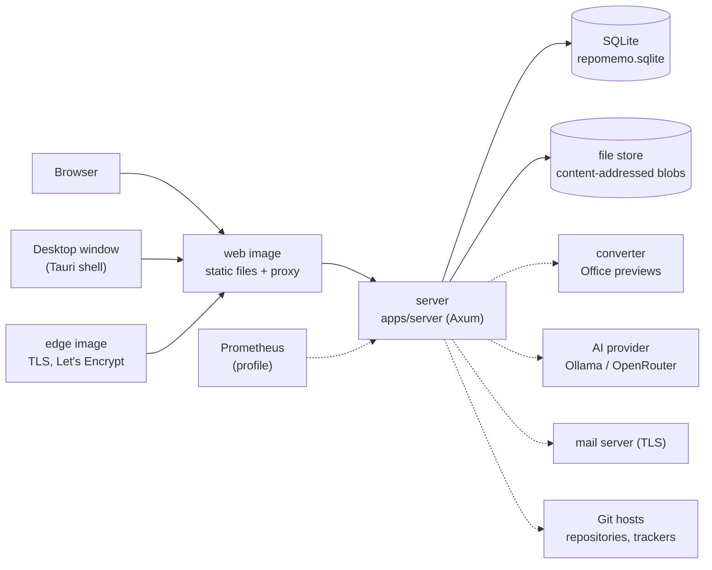

# Tracing a request and a background job

> **Branch of:** [TECHNICAL_MINDMAP.md](../TECHNICAL_MINDMAP.md) · **Written at:** V0.4.103 · **Related:** [api-reference.md](api-reference.md) · [auth-and-authorization.md](auth-and-authorization.md) · [operations.md](operations.md)

For a maintainer: for each major request and each background job, where it enters, which code handles it and which data store it reads or writes. File names are those of the repository at V0.4.103; if one moved, search for the function named.

## 1. The pieces

| Piece | Code | Notes |
|---|---|---|
| Server | `apps/server/src` (`lib.rs` builds the router; `runner.rs` starts and stops it; `winservice.rs` runs it as a Windows service) | One process: HTTP, background workers and the maintenance loop |
| Core | `crates/api` (`RepoMemoCore`: import, index, search, ask, memory, repositories, connectors) | Called by the server's handlers |
| Storage | `crates/storage` (SQLite via sqlx; 44 migrations in `migrations/`) | The only code that touches the database and the blob store |
| Ingestion / indexer | `crates/ingestion` (detect and read files, run in a separate reader process with time and memory limits), `crates/indexer` (chunking, symbols) | |
| Retrieval | `crates/retrieval` (full-text), `crates/api/src/meaning.rs` and `embeddings.rs` (by meaning) | |
| AI | `crates/ai` (Ollama, OpenRouter) | Only called when a provider is configured and allowed |
| Git | `crates/git` | Local and remote repositories |
| Mail | `crates/mail` | Outbox with retries; TLS only |
| Console | `apps/console` | A client of `POST /v1/system/console` |
| Client | `apps/desktop/src` (React), `apps/desktop/src-tauri/src` (shell) | One code base for browser and desktop |

## 2. Data stores

| Store | Holds | Written by |
|---|---|---|
| **SQLite** `repomemo.sqlite` (per environment folder `workspace-data/<env>/`) | Accounts, tokens, organizations, workspaces, `artifacts`, `artifact_versions`, `chunks` and the full-text index `chunks_fts`, `symbols`, `chunk_embeddings`, `memory_cards`, `workspace_tasks`, comments, `artifact_lifecycle` and its events, `indexing_jobs`, `workspace_activity`, `system_audit_events`, `system_settings`, `provider_settings`, mail outbox, saved searches, review snoozes, webhook deliveries | `crates/storage` only |
| **File store** (content-addressed; the `blobs` table names each) | The bytes of every uploaded file and version; the same bytes are stored once | `crates/storage` on import |
| **Caches** | Office previews | the converter path, `apps/server/src/conversion.rs` |
| **`backups/`** | Consistent snapshots, optionally sealed | `apps/server/src/backup.rs`, `backup_crypto.rs`, `backup_copy.rs` |
| **`logs/`** and an in-memory buffer | Server logs by category | `apps/server/src/logs.rs` |
| **`secret.key`** or `REPOMEMO_SECRET_KEY` | Key that encrypts provider keys and repository tokens | `crates/storage/src/secrets.rs` |
| **OS credential store** (desktop only) | The signed-in session of the desktop app | `apps/desktop/src-tauri/src/connection.rs` |

## 3. Request traces

Every request passes the same front: the proxy, then the router's layers (body limit, timeout `TimeoutLayer`, CORS `cors_layer`, concurrency and per-account limits in `security.rs`), then an **extractor** that authenticates (`auth.rs`; the kind of extractor decides whether a session, any token or an admin-scope token is accepted), then a guard in the handler (`require_workspace_*`, `access_control.rs`).

| Request | Entry | Core path | Reads / writes |
|---|---|---|---|
| **Sign in** `POST /v1/auth/login` | `auth.rs` | password check with equal timing, lockout counters, session version, refresh token | `users`, `refresh_tokens`; security log |
| **Upload evidence** `POST …/artifacts/upload` | `artifacts.rs` | stream to a temp file under the size limit, hash, `import_staged_upload` → `import_upload_content` in `crates/api/src/lib.rs`, enqueue indexing | blob store, `artifacts`, `artifact_versions`, `workspace_activity`, `indexing_jobs`; storage and rate quotas (`quotas.rs`) |
| **Search** `POST …/search` | `retrieval.rs` | `search_workspace_detailed`: full-text over `chunks_fts`, plus meaning search when an embedding provider is allowed; merge and filter; 5 s budget | `chunks`, `chunks_fts`, `chunk_embeddings`, `symbols`; embeddings provider (query text) |
| **Ask** `POST …/ask` | `retrieval.rs` → `ask_workspace` | retrieve passages; if none, answer "insufficient" with no AI call; otherwise re-rank and call the text provider with only those passages; return citations | `chunks`, provider settings; AI provider; `workspace_activity` (AI use) |
| **Save memory** `POST …/memory-cards` | `retrieval.rs` | validate, store the card and its citations (with passage fingerprints) | `memory_cards`, `workspace_activity` |
| **Lifecycle change / comment / task** | `review.rs`, `collaboration.rs`, `artifacts.rs` | write the change and its history, detect `@mentions` (`crates/api/src/mentions.rs`), create notifications, publish an event | `artifact_lifecycle(_events)`, `artifact_comments`, `workspace_tasks`, `workspace_notifications`, mail outbox |
| **Live events** `GET …/events` | `streams.rs`, `events.rs` | subscribe to the workspace's broadcast channel; role decides `activity` or `changed` | memory only |
| **Backup** `POST /v1/system/backups` | `backup.rs` | snapshot SQLite while running, hard-link unchanged files, write the manifest, optionally seal and copy | `backups/`, second location; `system_audit_events` |
| **Restore** `POST …/restore` | `backup.rs` | verify checksums, restore into a **new** environment, run `integrity_check` | new environment folder |
| **Console** `POST /v1/system/console` | `system/console.rs`, `crates/domain/src/console.rs` | parse, preview unless `--yes`, call the same handlers as the pages | as the command |

## 4. Background jobs

All jobs are rows in `indexing_jobs` (kind `indexing`, `embedding`, `repo_sync`, `backup`, `backup_copy`, `restore`, `maintenance`, `workspace_export`, `workspace_import`) so System › Jobs and the console list them. Workers start with the server (`serve.rs`), pick up unfinished work after a restart (`resume_pending`), and share fair turns across workspaces.

| Job | Started by | Code | Reads / writes | Failure behavior |
|---|---|---|---|---|
| **Indexing** | an upload, a repository sync, a manual re-index, the maintenance retry | `apps/server/src/indexing.rs` (workers behind a semaphore), `index_artifact_inner` in `crates/api`, `crates/ingestion` (reader process), `crates/indexer` | blob → text → `chunks`, `chunks_fts`, `symbols`; images via the vision provider | retried a few times, then `artifact_index_failures` with the reason, retried every `index_retry_hours` |
| **Embedding** | indexing finished, an embedding provider added | `apps/server/src/embedding.rs`, `crates/api/src/embeddings.rs` | `chunks` → provider → `chunk_embeddings`; daily allowance per workspace | stops at the allowance and resumes after midnight UTC; search falls back to keywords |
| **Repository sync** | link, a poll every few minutes, a webhook (`webhooks.rs`), the console | `repositories.rs`, `crates/api/src/repo_sync.rs`, `crates/git` | clone cache → `repo_files`, `artifacts`, then indexing | failed state with reason; 409 while syncing |
| **Connector sync** | the repository polling interval, or the user | `connectors.rs`, `crates/api/src/connectors*` | `connector_items`, `artifacts` | per-item failure recorded |
| **Maintenance** | the loop in `maintenance.rs`, or "Run now" | `run_pass`: fold the WAL, retry failed indexing, sweep blob files that have no record, start scheduled backups | SQLite, files, `backups/` | `repomemo_maintenance_failed_steps` metric |
| **Backup / copy** | schedule or request | `backup.rs`, `backup_copy.rs` | `backups/`, `REPOMEMO_BACKUP_COPY_DIR` | the job fails with the reason; the backup stays; copy retried |
| **Mail** | notifications, invitations, resets | `mail.rs`, `crates/mail` | `mail_outbox` | retried at 1, 5, 30 minutes, 2 and 6 hours |

## 5. The desktop transport

The desktop app is the React client in a Tauri window (`apps/desktop/src-tauri/src`). `connection.rs` keeps the chosen server address and the session (in the operating system's credential store); `trust.rs` holds the optional private certificate authority (from `certificate` in `config.rs`); the relay in `connection.rs` forwards uploads and event responses to the chosen server over verified TLS (V0.4.85), requiring the app's route secret and not following redirects; `updates.rs` checks the signed update feed; `files.rs`, `deeplink.rs` and `notice.rs` handle files, links and notices. The window may call the chosen server and no other. Everything else, including every API call, is the web client's.

## 6. Deployment topology and security boundaries

| Boundary | Enforced by |
|---|---|
| Internet → host | The edge image (TLS, Let's Encrypt) or your own proxy; the server refuses plain HTTP beyond loopback unless told it is behind TLS |
| Proxy → server | `REPOMEMO_TRUST_PROXY` and `REPOMEMO_TRUSTED_PROXIES`: forwarding headers are believed only from those peers |
| Browser origin → API | CORS (`REPOMEMO_ALLOWED_ORIGIN`), `SameSite=Strict` refresh cookie, a content security policy from the web image |
| Caller → handler | Extractors in `auth.rs`; guards `require_workspace_*`, `require_system_admin`; the server is the authority, the client only hides |
| Server → uploaded documents | Reader process with time and memory limits; the converter is a separate locked-down container |
| Server → AI provider / Git host / mail | Allowed-host lists (`REPOMEMO_AI_ALLOWED_HOSTS`, `REPOMEMO_GIT_ALLOWED_HOSTS`, `REPOMEMO_SMTP_ALLOWED_HOSTS`), explicit consent for cloud AI, secrets encrypted at rest |
| Operator → data | Backups sealed with a key, copied and checked; restores never overwrite |

In containers each service is its own locked-down container with a health check (`docker-compose.yml`); the monitoring profile adds a pinned Prometheus. A direct install runs the same server as a service and serves the web app itself.
